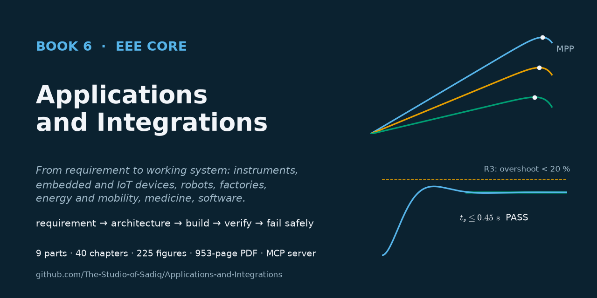

# Applications and Integrations

[](https://github.com/The-Studio-of-Sadiq/Applications-and-Integrations/actions/workflows/check.yml)
[](https://github.com/The-Studio-of-Sadiq/Applications-and-Integrations/actions/workflows/release.yml)
[](pdf/Applications-and-Integrations.pdf)
[](https://github.com/The-Studio-of-Sadiq/Applications-and-Integrations/wiki)
[](LICENSE)



**Book 6 — The Applications & Integrations Core**

How to combine the other cores into working systems. Requirements, architecture, modelling, prototyping and documentation; sensors, signal conditioning and data acquisition; embedded, IoT and edge-AI devices; robot arms, mobile robots and drones; PLCs, motor control, industrial networks and functional safety; solar PV, battery energy systems, electric vehicles and microgrids; RF links, practical signal processing and biomedical instrumentation; engineering software, scientific computing, machine learning and digital twins; and seven complete projects ending in a capstone.

This book is **project-oriented**. It does not repeat the theory of its siblings. Every chapter follows a real engineering system — a vaccine-fridge monitor, a strain-gauge DAQ, a smart radiator valve, a hospital delivery robot, a water-treatment control system, a school PV roof, a delivery-van powertrain, an ambulatory ECG recorder, a transformer-fleet analytics pipeline — through **requirements → architecture → design calculations → component selection → implementation → verification → failure analysis**, with budgets, real parts, code, test tables with limits and FMEA. The theory each step rests on is cited in one line with a link to the book that owns it: [*Circuits, Signals and Communications*](https://github.com/The-Studio-of-Sadiq/Circuits-Signals-and-Communications) (Book 3), [*Electronics and Computing*](https://github.com/The-Studio-of-Sadiq/Electronics-and-Computing) (Book 4), [*Electrical Energy and Machines*](https://github.com/The-Studio-of-Sadiq/Electrical-Energy-and-Machines) (Book 5), [*Engineering Physics*](https://github.com/The-Studio-of-Sadiq/Engineering-Physics), [*Materials Science and Engineering*](https://github.com/The-Studio-of-Sadiq/Materials-Science-and-Engineering) and [*The Mathematics Universe*](https://github.com/The-Studio-of-Sadiq/engineering-mathematics).

**Read the book as a PDF:** [`pdf/Applications-and-Integrations.pdf`](pdf/Applications-and-Integrations.pdf) or from the [latest release](https://github.com/The-Studio-of-Sadiq/Applications-and-Integrations/releases/latest) · **Wiki:** [chapter guide, figures, tooling](https://github.com/The-Studio-of-Sadiq/Applications-and-Integrations/wiki)

## Contents

| Part | Chapters |
|---|---|
| [I — Engineering Design Methodology](part-1-engineering-design-methodology/README.md) | 1 From requirement to working system · 2 System architecture · 3 Modeling and simulation workflow · 4 Prototyping and verification · 5 Engineering documentation |
| [II — Instrumentation and Measurement Systems](part-2-instrumentation-and-measurement-systems/README.md) | 6 Sensors and transducers · 7 Measurement and signal conditioning · 8 Data acquisition systems · 9 Instrumentation projects |
| [III — Embedded and Connected Systems](part-3-embedded-and-connected-systems/README.md) | 10 Embedded-system integration · 11 IoT systems · 12 Edge computing and embedded AI |
| [IV — Robotics and Mechatronics](part-4-robotics-and-mechatronics/README.md) | 13 Robotics fundamentals · 14 Mobile robotics · 15 Robot electronics and control · 16 Drones and aerial robotics · 17 Robotic system integration |
| [V — Industrial Automation](part-5-industrial-automation/README.md) | 18 Industrial control architecture · 19 Industrial sensors and actuators · 20 Industrial motor control · 21 Industrial communication and safety |
| [VI — Renewable Energy and Electric Mobility](part-6-renewable-energy-and-electric-mobility/README.md) | 22 Solar PV system design · 23 Battery energy systems · 24 Electric vehicles · 25 Microgrids and hybrid energy systems |
| [VII — Communications, Signal Processing, and Biomedical Applications](part-7-communications-signal-processing-and-biomedical/README.md) | 26 Communication-system integration · 27 Practical signal processing · 28 Biomedical instrumentation |
| [VIII — Engineering Software and Computational Tools](part-8-engineering-software-and-computational-tools/README.md) | 29 Engineering software workflows · 30 Scientific and engineering computing · 31 Engineering software architecture · 32 AI and machine learning for EEE · 33 Engineering simulation and digital twins |
| [IX — Interdisciplinary Engineering Projects](part-9-interdisciplinary-engineering-projects/README.md) | 34 Autonomous line-following robot · 35 Smart energy monitor · 36 Solar battery system · 37 Closed-loop motor drive · 38 Wireless sensor network · 39 Engineering simulation tool · 40 Capstone engineering project |

**Boundary.** This book owns engineering design method, system architecture and integration, component selection, verification and validation, and complete application systems. Circuit, signal, communication and control theory belong to Book 3; devices, circuits, computing, embedded systems and converters to Book 4; machines, drives, power systems and electrical safety to Book 5; physics, materials and mathematics to the foundation books (see [`TOC.md`](TOC.md#relation-to-the-other-books)).

## Repository layout

| Path | Contents |
|---|---|
| `part-N-*/` | one folder per part: `README.md` is the part opener, `NN-*.md` are the chapters (Markdown, LaTeX math, code listings in C, C++, Python and IEC 61131-3 Structured Text) |
| [`figures/`](figures) | all figures; each `figures/chNN/` folder is generated by `figures/scripts/chNN.py` |
| [`TOC.md`](TOC.md) | master syllabus, boundaries inside the book and with the other books |
| [`CONTRIBUTING.md`](CONTRIBUTING.md) | house style, including the reference-system rule and how this book integrates its siblings |
| [`FIGURES.md`](FIGURES.md) | figure plan: every figure, where it goes and what it shows |
| [`scripts/`](scripts) | PDF, figure, figure-plan, book-check, social-preview and wiki scripts |
| [`docs/`](docs) | social preview image |
| [`.github/`](.github) | CI and release workflows, issue and pull-request templates |
| [`mcp/`](mcp) | an MCP server so Claude and other clients can search, read and typeset the book ([README](mcp/README.md)); Claude Code picks it up from [`.mcp.json`](.mcp.json) |
| [`pdf/`](pdf) | the compiled book |

## Build the PDF

Requires Node.js ≥ 18 and a local Chrome, Edge or Chromium (set `CHROME_PATH` if it is not found automatically).

```bash
npm install
```

```bash
npm run pdf
```

This writes `dist/Applications-and-Integrations.pdf` (KaTeX-rendered math, clickable contents, PDF bookmarks). Build selected part openers or chapters with:

```bash
node scripts/build-pdf.mjs --parts P6,22,23 --out dist/excerpt.pdf
```

## Figures

Every figure is specified by a `<!-- FIGURE ... -->` marker at the point it belongs in its chapter and drawn by `figures/scripts/chNN.py`. Requires Python 3 with numpy, scipy, matplotlib and schemdraw.

Regenerate all figures (or `python scripts/build-figures.py ch22 ch35` for some):

```bash
npm run figures
```

Place newly drawn figures below their markers:

```bash
node scripts/insert-figures.mjs
```

Regenerate the figure plan [`FIGURES.md`](FIGURES.md):

```bash
npm run figures:plan
```

## MCP server

```bash
claude mcp add applications-integrations -- node /absolute/path/to/this/repo/mcp/server.mjs
```

Tools: `list_contents`, `read_part`, `search_book`, `list_figures`, `get_figure`, `build_pdf`. See [`mcp/README.md`](mcp/README.md).

## Contributing

Corrections, clearer explanations, better figures and better test data are welcome. Read [CONTRIBUTING.md](CONTRIBUTING.md) (workflow and house style) and report errors with the **Erratum** issue template. Everyone taking part follows the [Code of Conduct](CODE_OF_CONDUCT.md). Security issues in the tooling: see [SECURITY.md](SECURITY.md). Release history: [CHANGELOG.md](CHANGELOG.md).

CI (`.github/workflows/check.yml`) checks the sources, the figure plan, the MCP server and every figure script on each push; pushing a `v*` tag builds the PDF and publishes a release (`.github/workflows/release.yml`).

## Citation and license

To cite the book, use [CITATION.cff](CITATION.cff) (GitHub's "Cite this repository" button reads it). Content and code are under the [MIT License](LICENSE).
