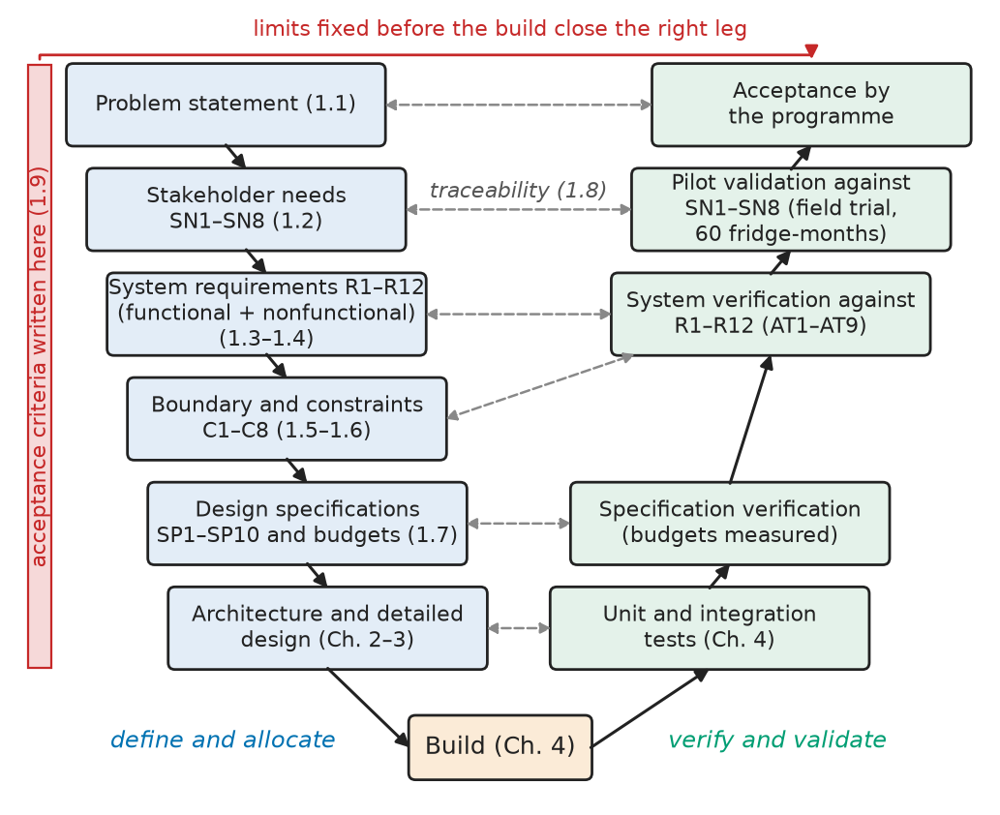
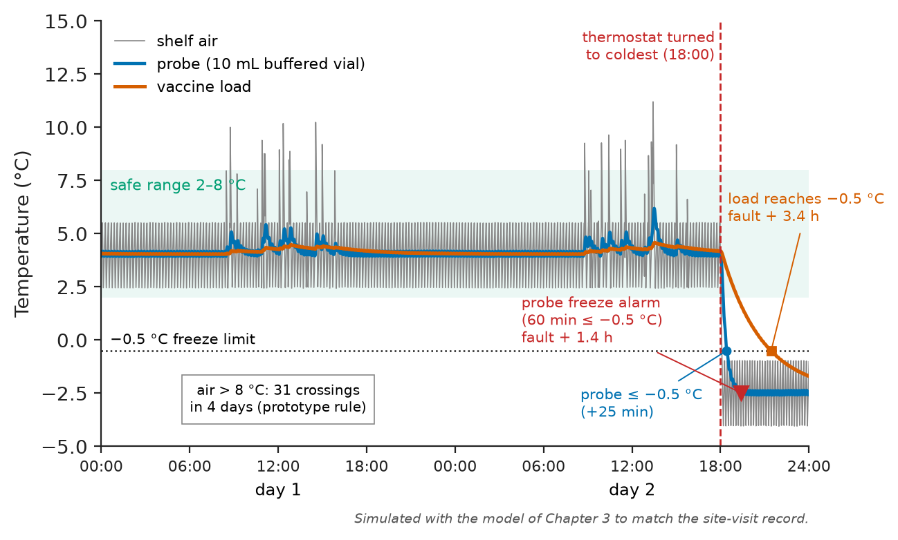
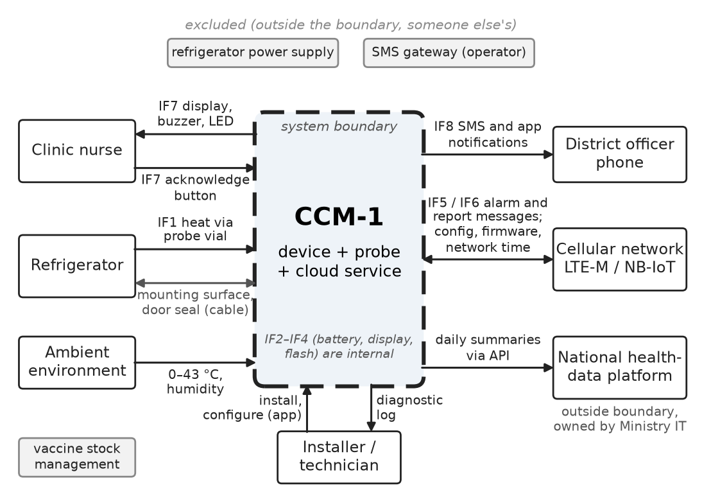
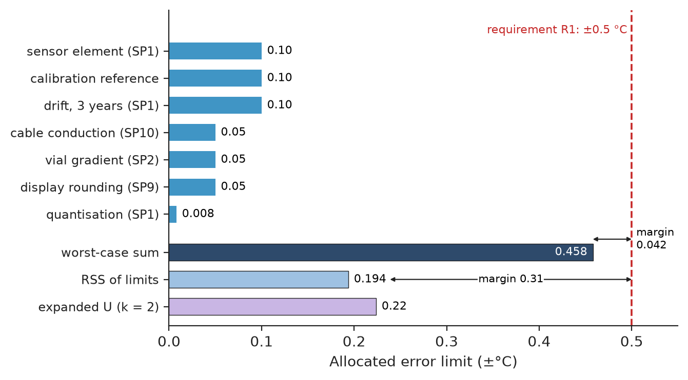
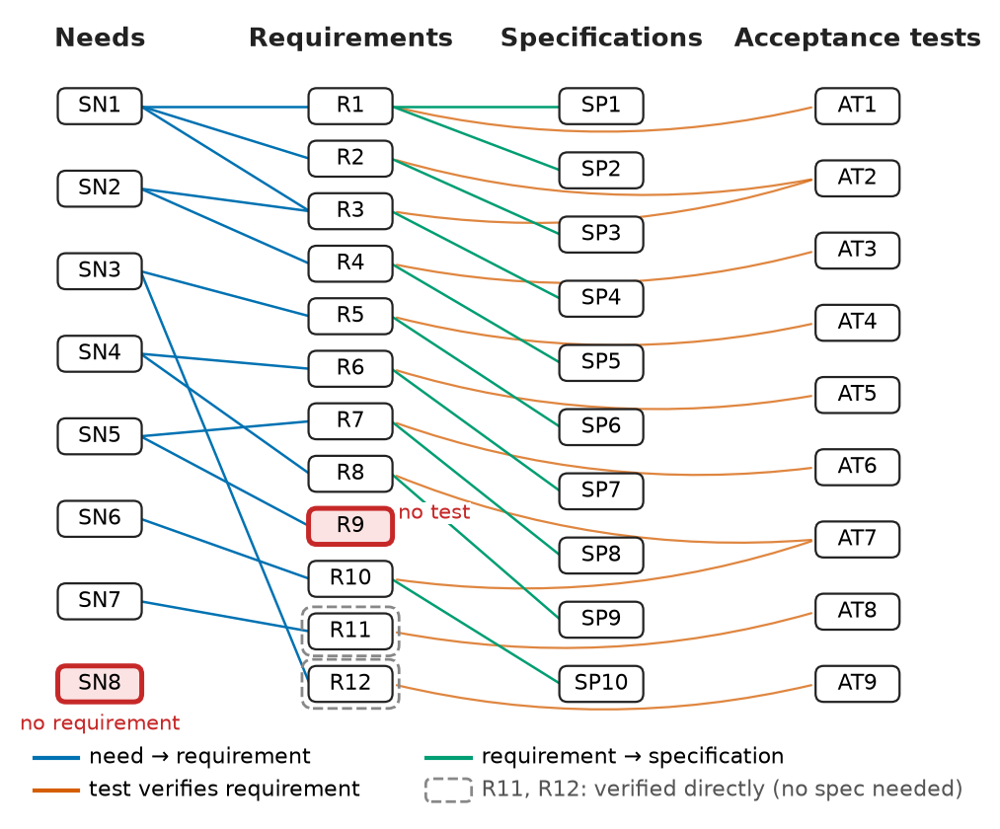
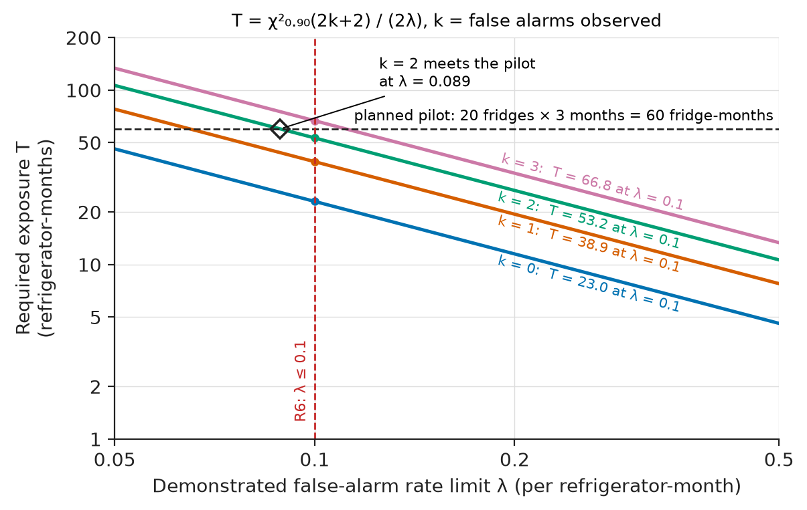

# Chapter 1 — From Requirement to Working System

*Part I · Engineering Design Methodology*

A national immunisation programme buys a remote alarm for the vaccine refrigerators in its 1,200 rural clinics. The brief to the contractor is one sentence: "a device that sends an SMS when the fridge temperature goes out of range." The contractor builds exactly that. An air-temperature sensor sits on the top shelf, a 2G modem sends a text whenever the reading crosses 8 °C, and the pilot units pass every bench test. In the field, each door opening during a vaccination session pushes the shelf air above 8 °C for a minute or two, so each clinic gets five to eleven messages a day. Within two weeks the nurses have blocked the number. In the third week a cleaner turns a thermostat knob to its coldest setting, a box of freeze-sensitive pentavalent vaccine spends the night at −2 °C, and the alarm that would have saved it is one unread message among sixty. Nothing in the hardware failed. The brief never said *whose* temperature (the air or the vaccine), *what* "out of range" means (how far, for how long), *who* must be told, *how fast*, or *what the user must not be bothered with*. Every one of those gaps was a requirement that nobody wrote down, and the first prototype's test plan could not catch them because it checked the device against a sentence instead of a set of numbers.

This chapter is about writing those numbers down before anything is built, and keeping them connected to the design and the tests until the system is accepted. Its running example, used through all of Part I, is that same product done properly: **CCM-1**, a battery-powered remote temperature monitor for vaccine refrigerators.

> **How does a vague need become a set of measurable, verifiable requirements, and where does the system end?**
> **How are requirements turned into design specifications, traced through the design, and closed by acceptance tests with pass/fail limits?**

| Concept | Engineering destination |
|---|---|
| Problem definition | Project charters, design briefs, tender specifications, the first page of every design report |
| Stakeholder requirements | Interviews, site surveys and field data that decide what a product must do for whom |
| Functional requirements | "Shall" statements a design can be built from and a test can check |
| Nonfunctional requirements | Battery life, accuracy, environment, cost, security, usability: the numbers that size the hardware |
| System boundaries | Context diagrams; what is supplied, what is assumed, what belongs to someone else |
| Constraints | Regulations, shipping rules, networks, budgets and schedules that remove design options |
| Design specifications | Allocated budgets (error, latency, energy) and part-level limits that designers work to |
| Requirements traceability | Trace matrices, coverage checks and change-impact analysis in every regulated industry |
| Acceptance criteria | Factory and site acceptance tests, pilot demonstrations, statistically sized field trials |

**Roadmap.** Define the problem with evidence and a value (1.1) → find the stakeholders and their needs (1.2) → write functional (1.3) and nonfunctional (1.4) requirements → draw the system boundary (1.5) and list the constraints (1.6) → allocate requirements into design specifications and budgets (1.7) → trace everything (1.8) → decide, before the build, what result will count as acceptance (1.9).

---

## 1.1 Problem definition

### What a problem statement contains

A design starts from a problem, not a product. The contractor's brief named a product ("a device that sends an SMS"), and so it fixed a solution before anyone had stated what was wrong. A usable **problem statement** answers six questions, each with evidence:

1. **Who is affected?** The clinic nurse who must act, the district cold-chain officer who must respond, the programme that pays for spoiled vaccine.
2. **What is wrong, measured how?** Vaccines are exposed to temperatures that damage them, and nobody finds out until the monthly download of a 30-day recorder.
3. **How often and how badly?** Here the evidence is an audit of the existing 30-day temperature recorders: in one year, 17 % of refrigerators logged at least one freeze episode (at or below −0.5 °C for 60 minutes or more), and 6 % logged a heat episode (above +8 °C for 10 hours or more).
4. **Why now?** The national 2G network is to be switched off within three years. The programme has a budget line for the replacement, and a new pentavalent and pneumococcal schedule has raised the value of the stock per refrigerator.
5. **What does success look like?** A freeze or heat episode is acted on within the same working day, not discovered a month later.
6. **What is not the problem?** Refrigerator reliability, power supply and vaccine supply logistics are real, but they are other projects. Stating them here stops scope from drifting.

Point 6 matters as much as the other five. A team that lets "and while we are at it, monitor the solar power system" into the problem statement has silently doubled the project.

### Putting a value on the problem

A problem with no value attached cannot be traded against cost, so the problem definition should end with a number.

**Worked example — what the freeze problem costs.** The programme has 1,200 refrigerators, each holding on average \$3,000 of vaccine, of which 45 % by value is freeze-sensitive. From the audit, 17 % of refrigerators (204) freeze at least once a year. A shake test after a freeze episode condemns, on average, half of the freeze-sensitive stock. The annual freeze loss is therefore

$$
204\times3000\times0.45\times0.5=\$137{,}700 .
$$

Heat episodes occur in 6 % of refrigerators (72). Each condemns about 30 % of the stock, a loss of $72\times3000\times0.30=\$64{,}800$. The total is \$202,500 a year, before counting cancelled vaccination sessions. If remote alarms let staff save 70 % of that, the programme saves \$141,750 a year. A two-year payback then allows $2\times141{,}750/1200=\$236$ per refrigerator over two years. Take off \$36 for 24 months of connectivity at \$1.50 a month and \$25 for installation, and the device itself may cost at most about \$175. That number becomes the cost requirement R11 (Section 1.4). It was derived from the problem, not guessed.

> **Status of the principle: The cost of a requirement defect grows with the phase in which it is found**
> *Empirical.* Industry data in software, aerospace and automotive programmes consistently show a defect found at acceptance or in the field costing one to two orders of magnitude more to fix than the same defect found while writing requirements. The ratio varies widely by domain and is a planning heuristic, not a law.

<!-- FIGURE 1.1 | figures/ch01/fig-1-1-requirements-v-chain.png | flowchart | The chain from problem to accepted system, with each left-hand artefact closed by a right-hand verification activity. | Content: V-shaped flowchart. Left leg top to bottom: Problem statement (1.1) -> Stakeholder needs SN1-SN8 (1.2) -> System requirements R1-R12, functional and nonfunctional (1.3-1.4) -> Boundary and constraints C1-C8 (1.5-1.6) -> Design specifications SP1-SP10 and budgets (1.7) -> Architecture and detailed design (Ch. 2-3). Bottom: Build (Ch. 4). Right leg bottom to top: Unit and integration tests (Ch. 4) -> Specification verification (budgets measured) -> System verification against R1-R12 (AT1-AT9) -> Pilot validation against SN1-SN8 (field trial, 60 fridge-months) -> Acceptance by the programme. Horizontal dashed arrows link each left box to its right counterpart, labelled traceability (1.8). A thin band labelled acceptance criteria written here (1.9) spans the left leg with an arrow to the right leg. -->



*Figure 1.1 — The chain from problem to accepted system, with each left-hand artefact closed by a right-hand verification activity.*

---

## 1.2 Stakeholder requirements

### Finding the stakeholders

A **stakeholder** is anyone who uses, pays for, installs, maintains, regulates or is harmed by the system. The usual mistake is to talk only to the person who signs the order. For CCM-1 the list, and how each was heard, is:

**Table 1.1 — CCM-1 stakeholders and elicitation methods.**

| Stakeholder | Role | How the needs were collected |
|---|---|---|
| Clinic nurse / health worker | Primary user; must act on an alarm | Site visits to 9 clinics, interviews, observation of a vaccination session |
| District cold-chain officer | Receives alarms; dispatches technicians | Interviews; review of 6 months of incident reports |
| Programme manager (ministry) | Pays; owns the vaccine loss | Workshop; audit data (Section 1.1) |
| Refrigerator technician | Installs device; diagnoses fridge faults | Interviews; ride-along on two repair trips |
| Procurement office | Tender, unit price, connectivity contract | Tender rules; past contract prices |
| Regulator / prequalification body | Accuracy, data integrity, device category | WHO PQS specifications for temperature monitoring devices (category E006); EN 12830 for recorder accuracy classes |
| Ministry IT and data office | Where data is stored, who may see it | National data-protection policy |
| Mobile network operators | Network availability and its lifetime | Coverage maps; 2G sunset notices; site survey |

The site visits supplied the most important evidence. Figure 1.2 is a two-day trace of the kind the team recorded: shelf air jumps by 5 to 8 K at every door opening, while a sensor in a small vial of liquid, which stands in for a vaccine vial, barely moves. A temperature "of the fridge" does not exist. There is air, there is load, and there is whatever the sensor is coupled to. The prototype's failure in the opening paragraph was decided by this one fact, and only a site visit with a second sensor revealed it.

<!-- FIGURE 1.2 | figures/ch01/fig-1-2-site-visit-trace.png | plot | Two days in a clinic refrigerator: shelf air versus a buffered probe and the vaccine load, including a thermostat fault on the second evening. | Content: x-axis time 0 to 48 h (day 1 00:00 to day 2 24:00), y-axis temperature -5 to +15 degC. Three curves: shelf air (thin, cycling between 2.5 and 5.5 degC with a 12 to 15 min compressor cycle, plus spikes to 10 to 11.2 degC at 15 door openings between 08:00 and 16:00 each day); buffered probe in a 10 mL vial (smooth, 3.9 to 5.5 degC on day 1, peaking at 6.2 degC on day 2 before the fault); vaccine load (very smooth, about 4.0 to 4.6 degC). Shaded band 2 to 8 degC labelled safe range. At t = 42 h (day 2, 18:00) a vertical dashed line labelled thermostat turned to coldest; afterwards air cycles between -4 and -1 degC, the probe falls below -0.5 degC 25 min later, the load crosses -0.5 degC 3.4 h after the fault. Markers: probe freeze alarm (60 min continuous at or below -0.5 degC) at fault + 1.4 h; dotted horizontal line at -0.5 degC. Annotation: air above 8 degC = 31 crossings in 4 days (prototype rule). Note in caption area: simulated with the model of Chapter 3 to match the site-visit record. -->



*Figure 1.2 — Two days in a clinic refrigerator: shelf air versus a buffered probe and the vaccine load, including a thermostat fault on the second evening.*

### From stakeholder statements to stakeholder needs

What stakeholders say is raw material. "I want an SMS when the fridge is bad" is a wish, and it has a solution built into it. The analyst rewrites each statement as a **need**: what the stakeholder must be able to do or know, still in their language and still free of design.

**Table 1.2 — CCM-1 stakeholder needs.**

| ID | Stakeholder | Need | Priority |
|---|---|---|---|
| SN1 | Nurse | Know at a glance whether the vaccine is safe, and be warned of freezing or overheating in time to save it | Must |
| SN2 | Cold-chain officer | Be told remotely and promptly of every alarm at every clinic, and see daily status of all refrigerators | Must |
| SN3 | Programme manager | No battery change or routine maintenance for at least two years in the field | Must |
| SN4 | Nurse | Not be disturbed by alarms caused by normal use (door openings, restocking) | Must |
| SN5 | Regulator | A complete, accurate, tamper-evident temperature history | Must |
| SN6 | Technician | Install in minutes and diagnose refrigerator faults from the record | Should |
| SN7 | Procurement | Unit and running cost inside the budget of Section 1.1 | Must |
| SN8 | Ministry IT | Temperature data hosted in-country and accessible only to authorised staff | Must |

Priorities follow the MoSCoW convention (must, should, could, won't this time). Two of the needs conflict. SN2 pulls towards reporting often and alarming early, while SN3 and SN4 pull towards reporting rarely and alarming late. Writing both down is how the conflict gets noticed. Sections 1.3 and 1.4 resolve it with numbers, and Chapter 2 resolves it again in the architecture.

---

## 1.3 Functional requirements

### What makes a requirement usable

A **functional requirement** states something the system shall *do*: an input it accepts, an output it produces, a transformation, a reaction to an event. ISO/IEC/IEEE 29148 and the INCOSE *Guide to Writing Requirements* set out the properties of a good one. Each statement is *necessary* (it traces to a need), *singular* (one requirement, not three joined by "and"), *unambiguous*, *measurable*, *feasible* and *verifiable*, and it says *what*, not *how*. The quickest way to learn the rules is to repair bad requirements:

**Table 1.3 — Repairing requirements.**

| Defective statement | Defect | Repaired requirement |
|---|---|---|
| The device shall alarm when the fridge is out of range | Undefined quantity, threshold and duration | The device shall raise a freeze alarm when the probe temperature has been at or below −0.5 °C continuously for 60 min |
| The device shall be accurate | Not measurable | The probe temperature error shall be within ±0.5 °C over −10 to +25 °C |
| Alarms shall be sent quickly and reliably | Two requirements; neither measurable | (a) An alarm notification shall leave the system within 15 min of the alarm condition; (b) for at least 95 % of alarm events |
| The device shall use an NTC thermistor | Design, not requirement | (Move to the design; keep only the accuracy and range requirement) |
| The battery shall last as long as possible | Not verifiable; no end point | The device shall operate for at least 2 years at 30 °C mean ambient with hourly reporting |
| The display should be easy to read | Subjective | Temperature digits shall be readable at 1 m by 9 of 10 test users in clinic lighting |

> **Status of the principle: A requirement must carry its own verification**
> *Empirical.* Requirements written without a test in mind are the largest single source of disputes at acceptance. The practical test of a requirement is whether two engineers, working separately, would agree on whether a given measurement passes it.

### CCM-1 functional requirements

Requirement IDs are issued in the order the requirements were agreed, so functional (Table 1.4) and nonfunctional (Table 1.6) IDs interleave; an ID is never reused.

**Table 1.4 — CCM-1 functional requirements (each with a measurable target and a verification method: T = test, A = analysis, I = inspection, D = demonstration).**

| ID | Requirement | Target | Verified by | Need |
|---|---|---|---|---|
| R1 | Measure the temperature of a vaccine-simulant probe | Range −30 to +50 °C; error ≤ ±0.5 °C over −10 to +25 °C, ≤ ±1.0 °C elsewhere | T: climatic chamber vs. calibrated reference | SN1 |
| R2 | Sample and record | Sample period ≤ 60 s; record period ≤ 5 min | T, I (log inspection) | SN1 |
| R3 | Raise freeze and heat alarms locally (sound, light, display) | Freeze: ≤ −0.5 °C for 60 min continuous; heat: > +8 °C for 10 h continuous | T: chamber profiles | SN1, SN2 |
| R4 | Notify alarms remotely; send daily status | Notification sent to officers ≤ 15 min after condition, for ≥ 95 % of events; daily report by 09:00 | T: pilot and network test | SN2 |
| R7 | Retain the record locally | ≥ 60 days of 5-min records; survives battery removal; each record integrity-checked | T, I | SN5 |
| R8 | Display temperature, alarm, battery and link status | Digits readable at 1 m (Table 1.3 criterion) | D with users | SN4 |
| R9 | Time-stamp records | Clock error ≤ 2 min per 30 days without network time | T | SN5 |

The thresholds in R3 are not invented. They are the defaults that WHO-prequalified 30-day recorders use, and keeping them means a CCM-1 alarm means the same thing to a nurse as the recorder she already knows. The probe in R1 is part of the requirement, not a design choice. The *quantity* to be measured is the temperature of something with the thermal behaviour of a vaccine vial, because Figure 1.2 shows that shelf air is the wrong quantity.

### Deriving numbers from other numbers

Some requirements appear to be free choices and are not. The 15-minute remote-notification target in R4 came from the district officers (an alarm acted on within the same working session). The design then has to split that 15 minutes among the parts of the chain.

**Worked example — the alarm-latency budget.** From the moment the freeze condition becomes true (the 60th consecutive minute at or below −0.5 °C) to the moment the cloud service hands the notification to the operator's SMS gateway, the delay is the sum of the stages in Table 1.5. The sample period adds at most one period, because the condition can become true just after a sample. Evaluation on the device is immediate. The radio must wake from power-saving mode, attach if needed and send, with retries. The cloud service must then forward the alarm as an SMS or app notification.

**Table 1.5 — Alarm-latency budget for R4.**

| Stage | Worst case allocated | Basis |
|---|---|---|
| Sampling quantisation | 1 min | Sample period of R2 |
| On-device evaluation and queueing | 0.1 min | Firmware, Chapter 2 |
| Radio wake, attach and send, up to 3 attempts | 5 min | Cellular attach worst case at cell edge, Chapter 2 |
| Cloud processing and hand-off to the SMS gateway | 2 min | Cloud design target |
| **Total** | **8.1 min** | Requirement 15 min; **margin 6.9 min (46 %)** |

The margin is kept on purpose. If the radio trade study in Chapter 2 lands on a network with longer attach times, the budget absorbs it. If it does not, the margin is there for the unknowns of the field.

> **Status of the principle: Worst-case latency of a serial chain is the sum of its stage worst cases**
> *Derived.* Delays in series add, so the sum of stage maxima bounds the end-to-end maximum. It is conservative, because the stage maxima rarely coincide. A statistical budget (percentiles combined by simulation) is tighter but needs stage delay distributions, which come later from test.

---

## 1.4 Nonfunctional requirements

### Qualities that size the hardware

**Nonfunctional requirements** say *how well* the system must perform its functions, and under what conditions: performance, energy, environment, reliability, safety, security, usability, maintainability, cost and compliance. Some writers call them quality attributes. In electrical and electronic design these are usually the requirements that set the size of the parts. Accuracy decides the sensor and the calibration. Battery life decides the radio, the power architecture and the reporting rate. Environment decides the enclosure and the cells. The functional requirements decide what the firmware does, and the nonfunctional ones decide whether the hardware can afford to do it.

**Table 1.6 — CCM-1 nonfunctional requirements.**

| ID | Category | Requirement | Target | Verified by | Need |
|---|---|---|---|---|---|
| R5 | Energy | Battery life without replacement | ≥ 2 years at 30 °C mean ambient (43 °C peak), hourly reporting, 4 alarm events per month | A (budget) + T (current profile) | SN3 |
| R6 | Usability / performance | False alarms from normal use | ≤ 0.1 per refrigerator-month with up to 20 door openings per day of up to 60 s each | T: field pilot | SN4 |
| R10 | Maintainability | Installation | ≤ 15 min, no tools other than a screwdriver; probe cable through the door seal without degrading it | D: 5 technicians | SN6 |
| R11 | Cost | Unit and running cost | ≤ \$175 per unit at 1,000 pcs; connectivity ≤ \$1.50 per month | A: costed BOM, quotes | SN7 |
| R12 | Environment | Operating conditions | Body 0 to +43 °C, 95 % RH non-condensing; probe −30 to +50 °C; enclosure IP54 (IEC 60529) | T: chamber, IP test | SN3 |

R6 is the requirement the first prototype lacked. It is nonfunctional because no function produces "fewer false alarms". It is a property of the whole chain of probe, threshold, duration rule and door behaviour, and it can only be checked in the field with real doors and real nurses.

Security and data protection (SN8) still have no requirement in this table, and the traceability check in Section 1.8 will find that gap.

### Turning a lifetime into a current

A lifetime requirement is useless to a circuit designer until it becomes an average current. The conversion needs the battery's *usable* charge, not its label capacity.

**Worked example — from two years to a current allocation.** Take a candidate pack of two AA lithium–thionyl-chloride cells (ER14505 class, 2.6 Ah each, 3.6 V) in parallel, 5.2 Ah on the label. Chapter 2 will confirm or replace this choice. Derate the label capacity three times. First, about 85 % is deliverable at the pulse loads and temperatures expected. Second, self-discharge at a hot-zone mean temperature is about 3 % a year, so 9 % over three years. Third, 10 % is held back as end-of-life reserve to drive the low-battery warning. The usable charge is

$$
Q_{\mathrm{use}}=5.2\times0.85\times(1-0.09)\times0.90=3.62\ \mathrm{Ah}.
$$

Designing to the 2-year requirement alone would leave no margin for the unknowns. The team sets a **design target** of 3 years, 50 % above the requirement, and the allowed average current is

$$
\bar I\le\frac{3.62\ \mathrm{Ah}}{3\times8766\ \mathrm{h}}=138\ \mu\mathrm{A}.
$$

At the requirement itself (2 years) the ceiling would be 206 µA. The 138 µA figure becomes design specification SP6, and every milliamp-second in Chapter 2's energy budget is charged against it.

> **Status of the principle: Battery life from usable charge and average current**
> *Approximate.* $t=Q_{\mathrm{use}}/\bar I$ treats the battery as a charge reservoir. It holds when the derating factors are taken from data at the actual load profile and temperature. It fails for pulse loads beyond the cell's rating, where voltage collapse rather than charge sets the end of life. Chapter 3 checks that case by simulation, and *Electronics and Computing*, [Ch. 25 §25.5](https://github.com/The-Studio-of-Sadiq/Electronics-and-Computing/blob/main/part-6-embedded-and-real-time-systems/25-embedded-system-architecture.md) sets out the average-current budget itself.

---

## 1.5 System boundaries

### The context diagram

A **system boundary** separates what the project designs, builds and is responsible for from what it uses, assumes or hands over. The tool for drawing it is the **context diagram** (Figure 1.3). The system is one box, every external entity is drawn around it, and every arrow that crosses the boundary is labelled with what flows (data, energy, material or human action). Each arrow is a future interface (Chapter 2), and each entity is someone else's responsibility that the design depends on.

<!-- FIGURE 1.3 | figures/ch01/fig-1-3-ccm1-context-diagram.png | block-diagram | Context diagram of CCM-1: the system boundary and every flow that crosses it. | Content: central box CCM-1 (device + probe + cloud service) drawn with a heavy dashed boundary. External entities around it: Refrigerator (arrows: heat via probe vial into CCM-1; mounting surface and door seal), Clinic nurse (arrows out: display, buzzer, LED; arrow in: acknowledge button), Installer/technician (arrow in: install, configure via app; arrow out: diagnostic log), Cellular network LTE-M/NB-IoT (bidirectional: alarm and report messages, configuration, firmware updates, network time), District officer phone (arrow out: SMS and app notifications from the cloud service), National health-data platform (arrow out: daily summaries via API; marked outside boundary, owned by Ministry IT), Ambient environment (arrow in: 0 to 43 degC, humidity). Excluded items shown outside in grey: refrigerator power supply, SMS gateway (operator), vaccine stock management. Label each crossing arrow with an interface tag IF1 to IF8 used in Chapter 2. -->



*Figure 1.3 — Context diagram of CCM-1: the system boundary and every flow that crosses it.*

### In scope, out of scope, and assumed

Drawing the boundary forces three lists. Each item on the "assumed" list is a risk, because the design depends on something the project does not control.

**Table 1.7 — CCM-1 scope.**

| In scope (designed and verified by the project) | Out of scope (someone else's) | Assumed (depended on, not controlled) |
|---|---|---|
| Device electronics, firmware, enclosure | Refrigerator, its thermostat and power supply | LTE-M or NB-IoT coverage at ≥ 90 % of clinics (verified by survey, Chapter 2) |
| Probe, buffer vial, flat cable | Vaccine stock management system | SMS gateway delivers within 2 min (operator SLA) |
| Cloud service: message intake, alarm forwarding, dashboard | National health-data platform | Clinic has a person who can respond during working hours |
| Installation kit and instructions | Refrigerator repair | Mobile operator keeps LTE-M running ≥ 7 years |
| Factory calibration and test | Training of nurses (programme does it) | Ambient within R12 |

The boundary is also a decision about where the requirements stop. CCM-1 does not have to *prevent* freezing, because that is the refrigerator's job. It has to *detect and report* freezing, and so its requirements end at the delivery of the alarm. Whether the nurse moves the vaccine is outside the system and belongs to the programme's training and procedures. This is why R4 ends at "notification sent", with delivery to the phone an operator assumption, and not at "vaccine saved".

---

## 1.6 Constraints

### Requirements versus constraints

A **constraint** is a limit on the *solution* imposed from outside the problem: a regulation, a standard the customer mandates, a network that exists, a budget, a schedule, a team, a part already in stock. A requirement says what the system must achieve. A constraint removes options for achieving it, and it is not negotiable with the design team. Mixing the two causes trouble. A constraint written as a requirement ("shall use 2G") stops the team looking for better solutions. A real constraint left unwritten (a shipping rule) is found when the first container is refused at the airport.

**Table 1.8 — CCM-1 constraints.**

| ID | Constraint | Source | Consequence for the design |
|---|---|---|---|
| C1 | 2G networks are switched off within 3 years | Operator notices | 2G GSM is eliminated as a long-term radio. It still enters the trade study (Chapter 2) as a reference |
| C2 | Each lithium-metal cell ≤ 1 g lithium content | IATA Dangerous Goods Regulations, PI 970 Section II (cells contained in equipment), to avoid fully regulated Class 9 shipping | Rules out D-size Li-SOCl₂ (about 4.5–5 g Li). AA-size (about 0.7 g) allowed |
| C3 | Cells must pass UN 38.3 | UN Manual of Tests and Criteria | Buy cells only from suppliers with test summaries |
| C4 | Radio and EMC conformity | ETSI EN 301 908-13 (LTE user equipment), EN 301 489-1/-52 (EMC), operator certification (GCF/PTCRB) | Use a pre-certified cellular module or SiP. A discrete RF design would add months |
| C5 | Electrical safety of the product | IEC 62368-1 | Battery-powered SELV design; limited-power source analysis |
| C6 | Data hosted in-country | National data-protection law | The cloud service runs on in-country infrastructure (feeds SN8) |
| C7 | Pilot units in 9 months; team of 3 engineers | Programme plan | Buy modules rather than design; reuse an existing server stack |
| C8 | Device must fit WHO PQS category E006 expectations | Procurement rule | Alarm defaults of R3; accuracy class; record format |

Constraint C2 is a good example of a fact that no amount of electrical analysis would reveal. The energy budget alone would pick a single D-size Li-SOCl₂ cell (19 Ah, plenty of margin). The air-freight rule makes that cell expensive to ship by air in the quantities needed, so the design moves to AA cells. That move in turn creates the pulse-current problem that Chapter 3 has to simulate. One unwritten constraint would have cost a redesign. Written down on day one, it costs a row in a table.

---

## 1.7 Design specifications

### From requirement to specification

Requirements describe the system as a black box. **Design specifications** describe how much of each requirement every part of the design is allowed to use. They are written by the design team, for the design team, and they appear once a first architecture exists. The tool for writing them is **allocation**: a system-level number (an error, a latency, an energy, a cost, a mass) is split into contributions, each contribution becomes a limit on one subsystem, and the sum, combined by the right rule, must fit inside the requirement with a margin. Table 1.5 was already an allocation, and Section 1.4 turned R5 into a current. The accuracy requirement R1 shows the method in full.

### Worked example — the measurement error budget

R1 asks for ±0.5 °C over −10 to +25 °C. The error at the display has several independent sources. The team lists them, gives each an allocated limit, and combines them twice. A worst-case linear sum covers the case where every error is at its limit with the same sign. A root-sum-square (RSS) combination covers independent errors of random sign, following the GUM.

**Table 1.9 — Error budget for R1 (limits, °C).**

| Contributor | Allocated limit | Becomes specification |
|---|---|---|
| Sensor element, interchangeability over −20 to +30 °C | ±0.10 | SP1 |
| Digitisation (quantisation) | ±0.008 | SP1 |
| Heat conducted along probe cable into vial | ±0.05 | SP10 |
| Gradient inside buffer vial | ±0.05 | SP2 |
| Calibration reference uncertainty at factory test | ±0.10 | Test spec (Chapter 4) |
| Long-term drift over 3 years | ±0.10 | SP1 |
| Display rounding to 0.1 °C | ±0.05 | SP9 |
| **Worst-case sum** | **±0.458** | Requirement ±0.5: margin 0.042 |
| **RSS of limits** | **±0.194** | Requirement ±0.5: margin 0.31 |

Treating each limit as the half-width of a rectangular distribution, the combined standard uncertainty is $u_c=0.194/\sqrt3=0.112$ °C, and the expanded uncertainty with coverage factor $k=2$ is $U=0.22$ °C. The design passes on both counts. The worst-case margin is thin, though, and it tells the team where to spend effort. The three 0.10 °C items (sensor, reference and drift) carry most of the budget, so the sensor chosen in Chapter 2 must meet SP1 and the factory reference must be better than ±0.10 °C.

> **Status of the principle: Root-sum-square combination of independent errors**
> *Derived.* For independent error sources, variances add (the GUM, JCGM 100, law of propagation of uncertainty for a linear model with unit sensitivities). The RSS is invalid for correlated errors, such as two contributors driven by the same temperature, and it is too optimistic for small numbers of contributors that are each bounded. In those cases the worst-case sum is the safe bound. The mathematics is in *The Mathematics Universe*, [Ch. 24 §24.8](https://github.com/The-Studio-of-Sadiq/engineering-mathematics/blob/main/part-7-numerical-computational/24-computational-mathematics.md), and Chapter 7 of this book applies it to measurement chains.

<!-- FIGURE 1.4 | figures/ch01/fig-1-4-error-budget.png | plot | Allocated error budget for R1: contributions, worst-case sum and root-sum-square against the requirement. | Content: horizontal bar chart, x-axis error limit 0 to 0.55 degC. Bars from top: sensor 0.10, calibration reference 0.10, drift 3 yr 0.10, cable conduction 0.05, vial gradient 0.05, display rounding 0.05, quantisation 0.008. Below, two summary bars: worst-case sum 0.458 (dark), RSS 0.194 (light), and expanded uncertainty U (k = 2) 0.22. Vertical red dashed line at 0.5 degC labelled requirement R1. Margin annotations: 0.042 for worst case, 0.31 for RSS. -->



*Figure 1.4 — Allocated error budget for R1: contributions, worst-case sum and root-sum-square against the requirement.*

### The specification set

Allocation produces the specification table that the designers of Chapters 2 and 3 work to. Each specification names its parent requirement, so a change to the requirement shows which specifications move.

**Table 1.10 — CCM-1 design specifications (first issue).**

| ID | Specification | Parent |
|---|---|---|
| SP1 | Sensor element: error ≤ ±0.10 °C over −20 to +30 °C; drift ≤ 0.03 °C/year; resolution ≤ 0.016 °C | R1 |
| SP2 | Buffer vial: 10 ± 1 mL glycol–water; time constant 15–25 min in still air | R1 |
| SP3 | Sample period 60 ± 1 s; record period 300 s | R2 |
| SP4 | Alarm evaluation every sample; duration counted in whole samples; re-arm hysteresis 0.3 °C | R3 |
| SP5 | Radio: up to 3 send attempts within 5 min; alarm messages bypass the hourly queue | R4 |
| SP6 | Average supply current ≤ 138 µA at 30 °C ambient, including alarms and updates | R5 |
| SP7 | Alarms evaluated on probe temperature only; air temperature never used for alarms | R6 |
| SP8 | Non-volatile store ≥ 1 MB; 8-byte records with sequence number; CRC per page | R7 |
| SP9 | Display: reflective (e-paper), digits ≥ 12 mm high, value rounded to 0.1 °C | R8 |
| SP10 | Probe cable: flat section ≤ 0.6 mm thick over the door seal; length 1.5 m | R10 |

SP7 is where the opening story's failure is turned into a rule. It is also the specification most likely to be challenged later ("we have an air sensor on the board anyway, why not use it?"), and the trace back to R6, SN4 and Figure 1.2 is the answer.

---

## 1.8 Requirements traceability

### The trace chain

**Traceability** is the recorded link from every need to the requirements that serve it, from every requirement to the specifications and design elements that implement it, and to the tests that verify it. In regulated industries it is mandatory evidence. Functional safety (IEC 61508, ISO 26262), medical devices (IEC 62304, ISO 13485) and aerospace (DO-178C) all demand it. Elsewhere it is simply the cheapest way to answer three questions that every project meets. Is every need covered? Is every requirement tested? What breaks if this requirement changes?

<!-- FIGURE 1.5 | figures/ch01/fig-1-5-traceability-graph.png | block-diagram | Traceability graph of CCM-1: needs, requirements, specifications and acceptance tests, with the gaps the coverage check found. | Content: four columns of small nodes left to right: Needs SN1-SN8; Requirements R1-R12; Specifications SP1-SP10; Acceptance tests AT1-AT9. Edges: SN1->R1,R2,R3; SN2->R3,R4; SN3->R5,R12; SN4->R6,R8; SN5->R7,R9; SN6->R10; SN7->R11; SN8 has no edge (node outlined red, label no requirement); R1->SP1,SP2; R2->SP3; R3->SP4; R4->SP5; R5->SP6; R6->SP7; R7->SP8; R8->SP9; R10->SP10; tests AT1->R1, AT2->R2,R3, AT3->R4, AT4->R5, AT5->R6, AT6->R7, AT7->R8,R10, AT8->R11, AT9->R12. R9 outlined red with label no test. R11 and R12 marked verified directly (no specification needed). -->



*Figure 1.5 — Traceability graph of CCM-1: needs, requirements, specifications and acceptance tests, with the gaps the coverage check found.*

### A machine-checkable trace

A trace matrix kept in a spreadsheet goes stale within weeks. Kept as data, in the repository next to the design and checked on every change, it stays true. Chapter 5 covers the tooling. The essential check is short:

```python
# Trace check for CCM-1: needs -> requirements -> specs -> tests.
needs = ["SN1", "SN2", "SN3", "SN4", "SN5", "SN6", "SN7", "SN8"]
req_from = {  # requirement -> stakeholder needs it serves
    "R1": ["SN1"], "R2": ["SN1"], "R3": ["SN1", "SN2"], "R4": ["SN2"],
    "R5": ["SN3"], "R6": ["SN4"], "R7": ["SN5"], "R8": ["SN4"],
    "R9": ["SN5"], "R10": ["SN6"], "R11": ["SN7"], "R12": ["SN3"],
}
spec_of = {  # design specification -> requirement it refines
    "SP1": "R1", "SP2": "R1", "SP3": "R2", "SP4": "R3", "SP5": "R4",
    "SP6": "R5", "SP7": "R6", "SP8": "R7", "SP9": "R8", "SP10": "R10",
}
tests = {  # acceptance test -> requirements it verifies
    "AT1": ["R1"], "AT2": ["R2", "R3"], "AT3": ["R4"], "AT4": ["R5"],
    "AT5": ["R6"], "AT6": ["R7"], "AT7": ["R8", "R10"], "AT8": ["R11"],
    "AT9": ["R12"],
}

served = {n for rs in req_from.values() for n in rs}
tested = {r for rs in tests.values() for r in rs}
refined = set(spec_of.values())
unknown = {r for rs in tests.values() for r in rs} - req_from.keys()

print("needs without a requirement:", sorted(set(needs) - served))
print("requirements without a test: ", sorted(req_from.keys() - tested,
                                              key=lambda r: int(r[1:])))
print("requirements without a spec: ", sorted(req_from.keys() - refined,
                                              key=lambda r: int(r[1:])))
print("tests citing unknown reqs:   ", sorted(unknown))
cov = len(req_from.keys() & tested) / len(req_from)
print(f"verification coverage: {cov:.0%}")
```

```text
needs without a requirement: ['SN8']
requirements without a test:  ['R9']
requirements without a spec:  ['R9', 'R11', 'R12']
tests citing unknown reqs:    []
verification coverage: 92%
```

The output says three different things, and each needs a different response:

- **SN8 has no requirement.** In-country hosting and access control were captured as a need and as constraint C6, but nobody wrote the security requirement. The fix is a new requirement R13: device identity by per-device credentials, encrypted transport, role-based access on the dashboard, verified by a security test. Chapter 11 owns its detail.
- **R9 has no test.** Clock accuracy was assumed to follow from the radio's network time. A device that cannot attach for a month would then drift unchecked. The fix is to add an AT10: 30 days in a chamber with the radio disabled, compare time stamps with a reference clock, limit 2 min.
- **R9, R11 and R12 have no specification.** For R11 (cost) and R12 (environment) that is correct, since they are verified directly against the requirement. For R9 it is another symptom of the same gap. A specification for the crystal (±20 ppm gives 52 s per 30 days) would have exposed it.

A coverage check does not judge whether a test is *good*. It only shows which links are missing. That is why the second check in a review is a person reading each requirement next to its test and asking whether the test can actually fail.

### Change impact

The second use of the trace appears when a requirement changes. In Chapter 3 the sensitivity analysis will show that the continuous-duration freeze rule of R3 occasionally lets the load freeze before the alarm. The proposed fix is an additional freeze warning based on a 60-minute moving average. Following the trace from R3 gives SP4 (alarm logic), AT2 (alarm test profiles), SN1 and SN2 (users to consult) and, through SP4, the firmware module that implements it (Chapter 2). This set is the *impact* of the change. It is what has to be redesigned, retested and re-approved, and the trace produces it in seconds instead of in a meeting.

---

## 1.9 Acceptance criteria

### What acceptance means

**Acceptance criteria** are the conditions, agreed with the customer *before* the design is built, under which the system will be accepted. Each states the test, the conditions, the sample, the pass/fail limit and who witnesses it. They close the V of Figure 1.1, so writing them at the start is the main defence against the opening story. The contractor's prototype would have failed acceptance criterion AT5 on its first day in a clinic, if AT5 had existed.

**Table 1.11 — CCM-1 acceptance tests.**

| Test | Verifies | Conditions and sample | Pass/fail limit |
|---|---|---|---|
| AT1 | R1 | 5 units in a climatic chamber at −25, −10, 0, +5, +8, +25, +45 °C, against a reference PRT with U ≤ 0.05 °C | Every reading within ±0.5 °C (−10 to +25 °C) and ±1.0 °C elsewhere |
| AT2 | R2, R3 | Chamber profiles: 59 min at −1 °C (no alarm), 61 min at −1 °C (alarm), 9 h 50 min at +9 °C (no alarm), 10 h 10 min (alarm) | Correct decision in all 4 profiles on all 5 units; alarm time within ±1 sample |
| AT3 | R4 | 50 injected alarms across 10 pilot sites | ≥ 95 % of notifications sent ≤ 15 min |
| AT4 | R5 | Current profile over 24 h with a power analyser at 25 and 43 °C, plus the budget analysis | Projected life ≥ 2 years at worst-case coverage |
| AT5 | R6 | Field pilot: 20 refrigerators × 3 months | ≤ 2 false alarms in 60 refrigerator-months (see below) |
| AT6 | R7 | Fill memory, remove battery 24 h, read back | 100 % of records intact; CRC and sequence checks pass |
| AT7 | R8, R10 | 10 users read display at 1 m; 5 technicians install | ≥ 9/10 correct readings; every install ≤ 15 min, door seal leak test pass |
| AT8 | R11 | Costed BOM at 1,000 pcs with 2 quotes per major part; connectivity contract | ≤ \$175 unit; ≤ \$1.50 per month |
| AT9 | R12 | Damp heat 43 °C / 95 % RH 96 h; IP54 test per IEC 60529 | Function test pass after each |

### Sizing a field trial

Some criteria are statistical, and a careless pilot can neither pass nor fail them. R6 asks for no more than 0.1 false alarms per refrigerator-month. A pilot that sees no false alarm in one month at five clinics has shown almost nothing. The question is how many refrigerator-months of exposure are needed, and how many false alarms may be seen, before the rate can be claimed with a given confidence.

**Worked example — how long a pilot must run.** Model false alarms as a Poisson process with rate $\lambda$ per refrigerator-month (independent events, constant rate). If $k$ false alarms are seen in total exposure $T$, the one-sided upper confidence bound on $\lambda$ at confidence $1-\alpha$ is $\chi^2_{1-\alpha,\,2(k+1)}/(2T)$ (*The Mathematics Universe*, [Ch. 20 §20.4 and §20.7](https://github.com/The-Studio-of-Sadiq/engineering-mathematics/blob/main/part-6-probability-statistics/20-statistical-analysis.md)). To demonstrate $\lambda\le0.1$ at 90 % confidence, the exposure must be at least

$$
T=\frac{\chi^2_{0.90,\,2(k+1)}}{2\times0.1}.
$$

For $k=0$ this gives 23.0 refrigerator-months, for $k=1$ 38.9, and for $k=2$ 53.2. A 20-refrigerator, 3-month pilot (60 refrigerator-months) can therefore tolerate up to 2 false alarms and still demonstrate R6. That is the limit written into AT5. The same logic sizes detection tests. To show that at least 95 % of freeze events are detected, with 90 % confidence and no misses allowed, requires $n\ge\ln0.10/\ln0.95=44.9$, so 45 injected events. AT3 uses 50.

> **Status of the principle: Exposure needed to demonstrate a failure rate**
> *Derived.* For a constant-rate Poisson process the chi-square bound is exact. It does not hold if false alarms cluster (one bad installation producing many), so the pilot must also be read site by site. A site with repeated false alarms is a failure mode to diagnose, not a sample to average.

<!-- FIGURE 1.6 | figures/ch01/fig-1-6-pilot-exposure.png | plot | Field exposure needed to demonstrate a false-alarm rate at 90 % confidence, against the number of false alarms observed. | Content: x-axis demonstrated rate limit lambda from 0.05 to 0.5 false alarms per refrigerator-month (log scale), y-axis required exposure 1 to 200 refrigerator-months (log scale). Four curves for k = 0, 1, 2, 3 observed false alarms: T = chi2_0.90(2k+2) / (2 lambda); at lambda = 0.1 they pass through 23.0, 38.9, 53.2 and 66.8. Horizontal dashed line at 60 refrigerator-months labelled planned pilot 20 fridges x 3 months; vertical dashed line at lambda = 0.1 labelled R6. Marker at intersection with k = 2 curve. -->



*Figure 1.6 — Field exposure needed to demonstrate a false-alarm rate at 90 % confidence, against the number of false alarms observed.*

### Verification of the first prototype, in hindsight

Running the contractor's Rev A prototype against Table 1.11 shows what written criteria would have caught. The figures for Rev A come from its pilot logs and a bench re-test.

**Table 1.12 — Rev A prototype against the CCM-1 acceptance criteria.**

| Requirement | Test | Limit | Rev A result | Pass/fail |
|---|---|---|---|---|
| R1 accuracy | AT1 | ±0.5 °C | ±0.3 °C (air sensor, bench) | Pass, but measures the wrong quantity |
| R3 alarm logic | AT2 | 4 of 4 profiles | Alarmed instantly at the threshold: 2 of 4 correct | Fail |
| R4 remote latency | AT3 | ≥ 95 % ≤ 15 min | 2G SMS: 98 % ≤ 15 min | Pass (but C1: network ends) |
| R5 battery life | AT4 | ≥ 2 years | Mains adapter only; 0 h on outage | Fail |
| R6 false alarms | AT5 | ≤ 0.1 per fridge-month | 5–11 per fridge-*day* | Fail |
| R7 retention | AT6 | 60 days | None stored on device | Fail |

The prototype was built competently to a brief that had none of these rows. Six requirements, written in a week, would have changed what was built.

### Failure analysis of the requirements process

Requirements fail in recognisable ways, and each failure has a detection method that costs little if it is used early. Table 1.13 applies FMEA thinking to the process itself, using CCM-1's history.

**Table 1.13 — FMEA of the requirements process.**

| Failure mode | Effect | Cause | Detection | Mitigation |
|---|---|---|---|---|
| Solution stated as the problem | Wrong product built well (Rev A) | Brief written by the buyer as a product description | Problem-statement review: does it name a product? | Six-question problem statement (Section 1.1) |
| Wrong measurand | Alarms on air, not vaccine; false alarms | No site data | Site visit with two sensors (Figure 1.2) | Measure the real environment before writing R1 |
| Missing nonfunctional requirement | Users disable the system | Only functions were listed | Stakeholder walk-through of a day of use | Quality-attribute checklist (Table 1.6 categories) |
| Unwritten constraint | Late redesign (cell shipping) | Regulations not reviewed | Constraint workshop with logistics and compliance | Constraint table at kick-off (Table 1.8) |
| Untestable requirement | Disputes at acceptance | Adjectives instead of numbers | "Two engineers" test (Section 1.3) | Each requirement written with its test |
| Need with no requirement | Gap found by auditor or in field (SN8) | Trace not maintained | Automated coverage check (Section 1.8) | Trace as data, checked on every change |
| Statistically meaningless acceptance | Pilot neither passes nor fails | Trial sized by budget, not by statistics | Compute required exposure first | Size the trial from the claim (Section 1.9) |

---

## What remains open

| Open question | Where it is answered |
|---|---|
| How are the requirements turned into an architecture, with interfaces, budgets and a radio and battery chosen by trade study? | Chapter 2 |
| Is the freeze rule of R3 safe for every refrigerator fault, and will the AA cells hold up under radio pulses at end of life? | Chapter 3 (simulation, sensitivity analysis) |
| How are the acceptance tests of Table 1.11 planned, instrumented, calibrated and repeated as regression tests? | Chapter 4 |
| How are requirements, trace data and test reports kept under version control and released? | Chapter 5; tooling in Chapter 29 |
| How is the probe's sensor chosen and calibrated, and how is the uncertainty budget of Table 1.9 verified? | Chapters 6 and 7 |
| How are device identity, provisioning and transport security (the missing R13) specified and built? | Chapter 11 |
| How does a full project report carry requirements through to final acceptance? | Chapter 40 |
| What theory supports the energy budget and low-power firmware? | *Electronics and Computing*, [Ch. 25](https://github.com/The-Studio-of-Sadiq/Electronics-and-Computing/blob/main/part-6-embedded-and-real-time-systems/25-embedded-system-architecture.md) and [Ch. 28](https://github.com/The-Studio-of-Sadiq/Electronics-and-Computing/blob/main/part-6-embedded-and-real-time-systems/28-embedded-system-design.md) |

**Next:** Chapter 2 takes CCM-1's requirements and builds its architecture: the functions, blocks, interfaces and flows of data, energy and control, and the trade studies that choose the radio and the battery.
