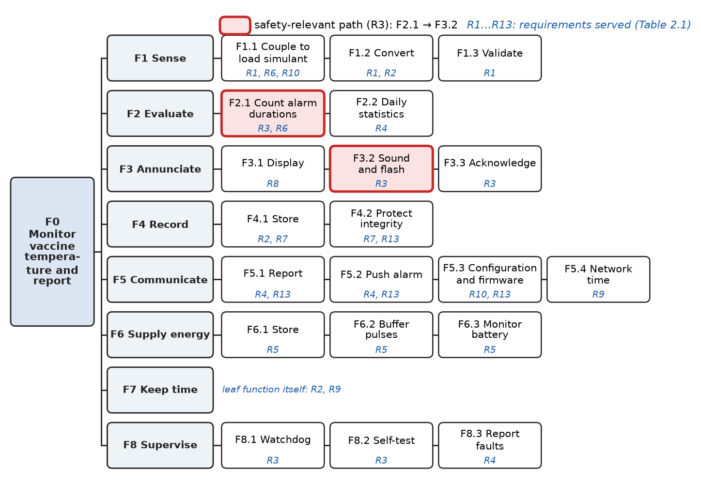
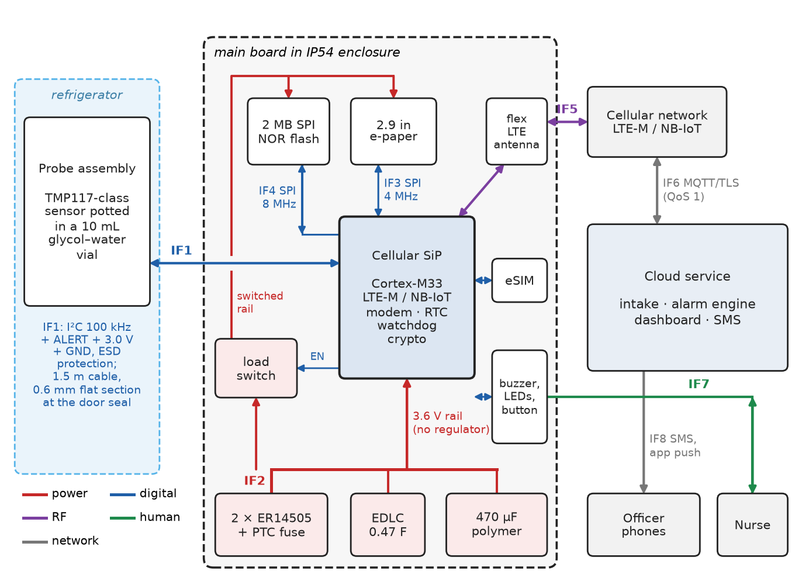
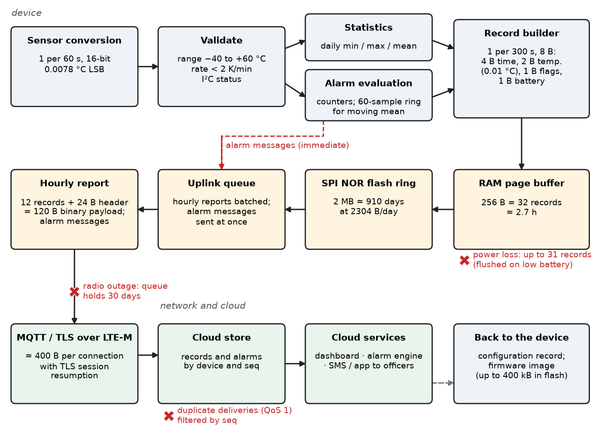
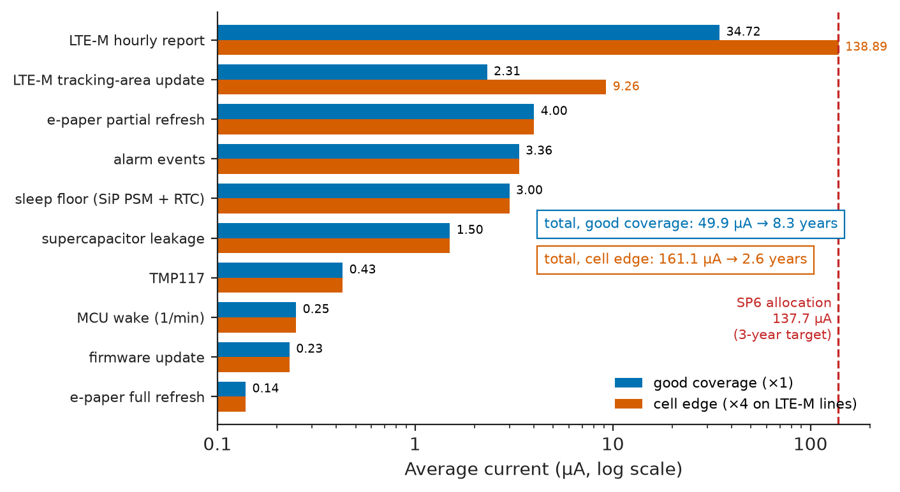
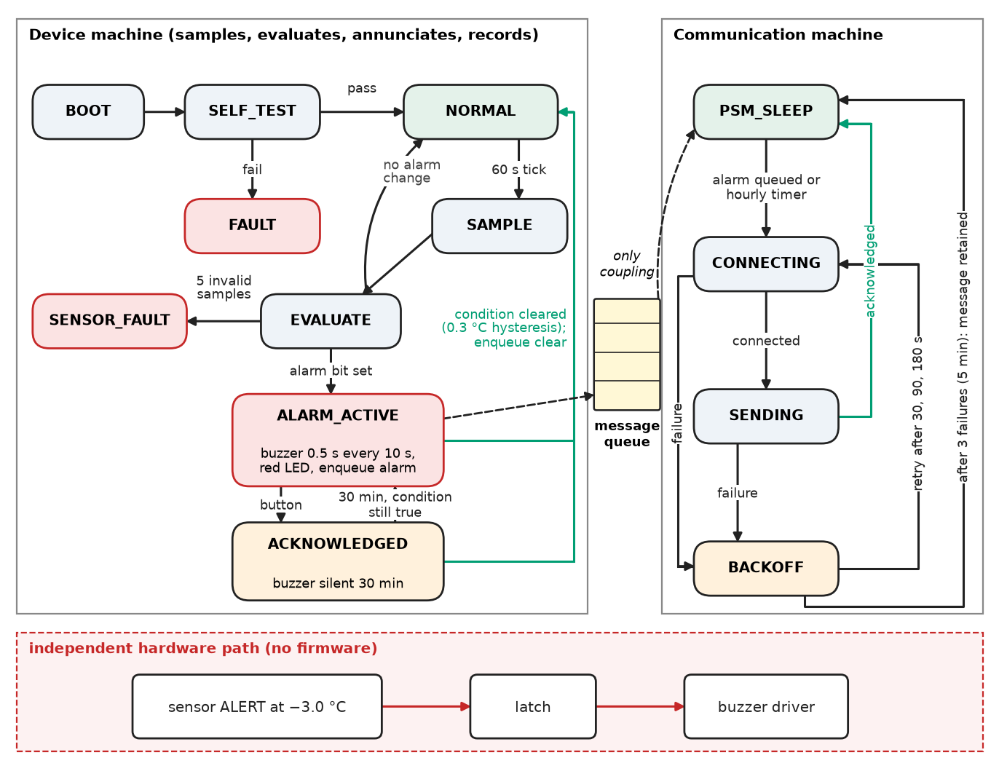
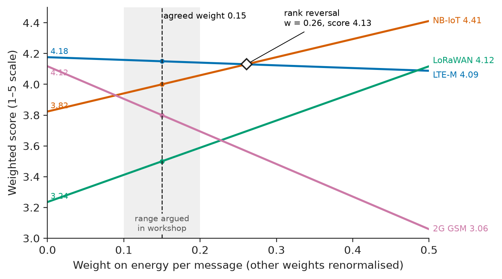

# Chapter 2 — System Architecture

*Part I · Engineering Design Methodology*

The second CCM-1 prototype had a good requirement set (Chapter 1) and a bad architecture. One microcontroller ran everything in a single loop: it read the probe, updated the display, evaluated the alarms and then called the cellular modem's blocking "send" function. On the bench, with a strong signal, a send took 2 s. At a clinic at the edge of the cell it took up to 4 min, with retries. During those minutes the loop did not run, so no samples were taken, the buzzer could not sound, and a freeze alarm that was due could not be raised. In the energy budget the radio had been entered at one average figure, measured at the bench, so the cell-edge clinic drained its battery four times faster than planned. Both failures were architectural. The local alarm path depended on the radio path, and the energy flow had been estimated for one operating point. Neither problem showed up in any single module's test. They existed only in the way the blocks had been connected.

This chapter turns CCM-1's requirements into an architecture: the functions, the blocks that perform them, the interfaces between blocks, and the flows of data, energy and control through them. It then makes the major choices by trade study, and records the decisions so that they can be checked, revisited and handed over.

> **How is a set of requirements decomposed into functions and allocated to hardware and software blocks with well-defined interfaces?**
> **How are data, energy and control flows budgeted through the architecture, and how are the big choices made and recorded so that they survive the first surprise?**

| Concept | Engineering destination |
|---|---|
| Functional decomposition | Function trees; completeness checks against requirements; the basis of functional FMEA |
| Block diagrams | Physical architecture of boards, modules, cables and services |
| Hardware–software partitioning | Which job goes to a peripheral, an external chip, firmware or the cloud |
| Interfaces | Interface control documents: electrical, protocol, mechanical and human |
| Data flow | Sample rates, record formats, storage and airtime budgets |
| Energy flow | Average-current and peak-power budgets, battery choice and life |
| Control flow | Operating modes, state machines, independence of safety paths |
| Modularity | Variants, reuse, swappable radios and probes, testable firmware modules |
| Trade-off analysis | Weighted decision matrices, sensitivity of a choice to its weights, Pareto fronts |
| Architecture documentation | Views, ICDs and architecture decision records that survive staff changes |

**Roadmap.** Decompose what the system must do (2.1) → draw what it is made of (2.2) → decide what is hardware and what is software (2.3) → define the interfaces (2.4) → budget the data (2.5), energy (2.6) and control (2.7) flowing across them → organise it into modules (2.8) → choose among alternatives by trade study (2.9) → record the architecture (2.10).

---

## 2.1 Functional decomposition

### Functions before boxes

An architecture starts with what the system must *do*, written without reference to any part. A **functional decomposition** breaks the top-level function into subfunctions, each a verb and a noun ("convert temperature", "store record"), until every leaf can be allocated to one block and verified by one test. Missing behaviour then shows up before any hardware exists, and the same function tree serves every candidate physical architecture, so the trade studies of Section 2.9 compare like with like.

<!-- FIGURE 2.1 | figures/ch02/fig-2-1-ccm1-function-tree.png | block-diagram | Functional decomposition of CCM-1, from the top-level function to allocatable leaves. | Content: root F0 Monitor vaccine temperature and report. Children: F1 Sense (F1.1 Couple to load simulant, F1.2 Convert, F1.3 Validate); F2 Evaluate (F2.1 Count alarm durations, F2.2 Daily statistics); F3 Annunciate (F3.1 Display, F3.2 Sound and flash, F3.3 Acknowledge); F4 Record (F4.1 Store, F4.2 Protect integrity); F5 Communicate (F5.1 Report, F5.2 Push alarm, F5.3 Configuration and firmware, F5.4 Network time); F6 Supply energy (F6.1 Store, F6.2 Buffer pulses, F6.3 Monitor battery); F7 Keep time; F8 Supervise (F8.1 Watchdog, F8.2 Self-test, F8.3 Report faults). Leaves annotated with requirement IDs (F8.1-F8.2: R3; F8.3: R4); F2.1 and F3.2 highlighted as the safety-relevant path. -->



*Figure 2.1 — Functional decomposition of CCM-1, from the top-level function to allocatable leaves.*

### Allocating requirements to functions

Each requirement of Chapter 1 must land on at least one function, and each function must serve at least one requirement. A function that serves none is gold-plating. A requirement served by none is a gap. Table 2.1 is the check.

**Table 2.1 — Requirement-to-function allocation for CCM-1.**

| Requirement | Functions | Note |
|---|---|---|
| R1 accuracy, range | F1.1, F1.2, F1.3 | Coupling (the vial) is part of the measurement |
| R2 sample, record | F1.2, F4.1, F7 | |
| R3 local alarms | F2.1, F3.2, F3.3, F8.1, F8.2 | Safety-relevant path |
| R4 remote alarms, daily status | F2.2, F5.1, F5.2, F8.3 | |
| R5 battery life | F6.1, F6.2, F6.3 (and every function's energy) | An emergent property: allocated by budget, Section 2.6 |
| R6 false alarms | F1.1, F2.1 | Set by coupling and duration rule together |
| R7 retention, integrity | F4.1, F4.2 | |
| R8 display | F3.1 | |
| R9 time stamps | F7, F5.4 | |
| R10 installation | F1.1 (cable), F5.3 (configuration) | Mechanical and procedural |
| R11 cost | All | Allocated by BOM budget |
| R12 environment | All | Allocated by component ratings and enclosure |
| R13 security (added in Chapter 1) | F5.1–F5.3, F4.2 | Detail in Chapter 11 |

R5, R11 and R12 have no single function. They are **emergent properties** of the whole system, so they are allocated by budgets (energy, cost) and by derating rules (environment) instead of by function. This is where most architecture failures hide. The opening story's battery drain belonged to no module and to every module at once.

---

## 2.2 Block diagrams

### From functions to physical blocks

The **physical architecture** assigns functions to blocks: chips, modules, boards, cables, enclosures, software services. A block diagram shows the blocks and the interfaces between them. It is not a schematic. Each block hides its inside, and each line is a named interface with a type (power, digital bus, RF, mechanical, human, network). Figure 2.2 is CCM-1's.

<!-- FIGURE 2.2 | figures/ch02/fig-2-2-ccm1-physical-architecture.png | block-diagram | Physical architecture of CCM-1 with every interface labelled. | Content: left: probe assembly in the refrigerator (TMP117-class sensor potted in a 10 mL glycol-water vial; 1.5 m cable, 0.6 mm flat section at the door seal), IF1 I2C 100 kHz + ALERT + 3.0 V + GND with ESD protection. Centre: main board in IP54 enclosure: cellular SiP (Cortex-M33, LTE-M/NB-IoT modem, RTC, watchdog, crypto), eSIM, flex LTE antenna (IF5), 2 MB SPI NOR flash (IF4), 2.9 in e-paper (IF3), buzzer, LEDs and button (IF7). Power: 2 x ER14505 pack with PTC fuse (IF2) -> 3.6 V rail direct to SiP, 0.47 F EDLC and 470 uF polymer capacitor; load switch to flash and display. Right: cellular network -> cloud service (intake, alarm engine, dashboard, SMS) via IF6 MQTT/TLS; IF8 to officer phones. Line colours: power red, digital blue, RF purple, human green, network grey. -->



*Figure 2.2 — Physical architecture of CCM-1 with every interface labelled.*

Several choices are already visible in the diagram, and each has a reason that traces to a requirement:

- **One cellular SiP** (system-in-package: application processor, LTE-M/NB-IoT modem and RF front end in one certified part) replaces a separate microcontroller and modem, removing one firmware image, one interface and one sleep current, and bringing radio certification (C4).
- **No voltage regulator.** The lithium–thionyl-chloride pack sits at 3.3 to 3.65 V under load, and the SiP accepts 3.0 to 5.5 V. A regulator would only add quiescent current and loss.
- **A pulse buffer** (an electric double-layer capacitor, EDLC) carries the radio's current bursts, because AA bobbin cells cannot. Chapter 3 sizes it.
- **A digital probe sensor.** The conversion happens in the vial, and only digital signals cross the cable and the door seal (Section 2.3).
- **Display and flash behind a load switch.** Their standby currents are larger than the SiP's in power-saving mode (Section 2.6).

---

## 2.3 Hardware–software partitioning

### The rule and its reasons

> **Boundary.** Partitioning at microcontroller level (periodic, bit-level and bulk-transfer jobs to peripherals) is set out in *Electronics and Computing*, [Ch. 25 §25.2](https://github.com/The-Studio-of-Sadiq/Electronics-and-Computing/blob/main/part-6-embedded-and-real-time-systems/25-embedded-system-architecture.md). The quantitative version with accelerators, offload break-even and FPGAs is in [Ch. 35 §35.1](https://github.com/The-Studio-of-Sadiq/Electronics-and-Computing/blob/main/part-8-integrated-circuits-and-vlsi/35-hardware-software-co-design.md). This section applies those rules at system level, where the options also include an external chip and the cloud.

At system level a function can live in an external chip, an on-chip peripheral, the firmware or the cloud. Book 4's reasons for moving a job toward hardware (periodic and fast, bit-level, bulk data) gain three more at this level:

1. **Independence.** A function that must still work when another fails belongs in a block that does not share that block's failure modes.
2. **Certification and supply.** A function that needs a certified or calibrated part is bought, not built.
3. **Changeability.** A rule that will change after deployment (thresholds, reporting rates, dashboards) belongs where changing it is cheap: in configuration data, or in the cloud.

**Table 2.2 — CCM-1 partitioning decisions.**

| Function | Options considered | Chosen home | Reason |
|---|---|---|---|
| F1.2 Convert temperature | NTC + SiP ADC + firmware linearisation; digital sensor IC | Digital sensor IC in the vial | Meets SP1 without per-unit calibration; no analog signal across the seal (Table 2.3) |
| F2.1 Count alarm durations | Firmware; sensor's hardware alert | Firmware, with sensor ALERT as an independent backstop | Duration rules need state; the backstop must not depend on firmware |
| F3.2 Sound alarm | Firmware tone loop; PWM peripheral | PWM peripheral | Periodic, zero CPU, works while the CPU sleeps |
| F4.2 Integrity | Firmware CRC; hardware CRC | Firmware CRC-16 per page | Short pages; energy negligible (Section 2.6) |
| F5.1 Transport security | Firmware TLS; modem-offloaded TLS | Modem-offloaded TLS with keys in secure storage | Protects keys; certified stack |
| F5.2 Alarm forwarding to people | Device sends SMS; cloud forwards | Cloud | Recipient lists and escalation change often; device sends one message |
| F7 Keep time | Firmware tick; RTC peripheral + network time | RTC with network time sync | Runs in sleep at about 1 µA |
| F8.1 Watchdog | Firmware; hardware watchdog | Hardware watchdog, 8 s window | Independence: survives a hung task |

**Worked example — partition for the right reason.** One team member proposes moving alarm evaluation entirely into the sensor's hardware alert to save energy, since the sensor can compare each conversion against a threshold and raise a pin. What does the firmware path cost? Each minute the SiP wakes for about 5 ms at about 3 mA to read the sensor and run the evaluation, a charge of 15 µC. The average is $15\times10^{-6}/60=0.25\ \mu\mathrm{A}$, which is 0.5 % of the 50 µA total found in Section 2.6. Moving evaluation to hardware would save almost nothing, and it would lose the 60-minute duration logic (the hardware alert compares single samples), so R6 would fail. The energy argument is wrong; the *independence* argument is right. If the firmware hangs, the watchdog resets it within 8 s, but a firmware bug that does *not* hang (a counter that never reaches 60) would silently disable freeze alarms. The firmware stays the primary path, and the sensor's ALERT output, set at −3.0 °C, drives the buzzer through a hardware latch. The sensor compares every conversion against its own limit register, so a logic bug in `alarm_eval` cannot hide a deep freeze. Lacking the duration rule, its threshold sits low enough to fire only on a freeze the primary path should already have caught.

> **Status of the principle: Allocate safety-relevant functions to independent blocks**
> *Empirical.* Practice in every safety standard (IEC 61508's independence and diversity, ISO 13849's categories) shows that redundancy within one block shares that block's common-cause failures. The benefit depends on the two paths really failing independently, which must be argued for each common cause (power, clock, firmware image). Chapter 21 covers functional safety.

### Component selection for the sensing function

Partitioning the conversion into a sensor IC leaves the question of which sensor. The candidates are compared against the specifications that Chapter 1 allocated: SP1 (±0.10 °C, drift ≤ 0.03 °C/year), SP2 (fits a 10 mL vial), the cable interface and the cost.

**Table 2.3 — Sensor element selection (2026 distributor prices, 1,000 pcs, indicative).**

| Candidate | Accuracy without calibration | Interface over 1.5 m | Calibration needed | Cost incl. calibration | Verdict |
|---|---|---|---|---|---|
| NTC 10 kΩ, 1 %, B = 3435 K, epoxy bead | ±0.25 °C near 25 °C, worse at the ends | Analog; leakage and seal contamination add error | Yes, 1 point (about 3 min per unit) | \$0.60 + \$1.50 | Meets SP1 only after calibration; analog signal across seal |
| PT1000, class A (IEC 60751) | ±0.15 °C at 0 °C, ±0.19 °C at 20 °C (tolerance grows with temperature) | Analog; needs a precision ADC and reference | Yes, for SP1 | \$2.50 + \$3.00 front end | Fails SP1 uncalibrated; costly front end |
| Digital, ±0.1 °C class (TMP117-class) | ±0.10 °C, −20 to +50 °C | I²C, digital | No (factory-trimmed, traceable) | \$1.90 | **Chosen**: meets SP1 at its limit with no calibration step |
| Digital, ±0.5 °C class (DS18B20-class) | ±0.5 °C, −10 to +85 °C | 1-Wire | Would need calibration and still drift | \$1.20 | Fails SP1 |

The chosen sensor meets SP1 exactly at its limit, with no margin on the sensor line. The margin is in the RSS total of the error budget (Table 1.9), and the AT1 chamber test checks the result. That is acceptable only because the budget is written down; without it, a sensor at its datasheet limit looks alarming or fine depending on who reads the sheet.

The processor block was chosen the same way: a cellular SiP with an integrated Cortex-M33 (nRF9160/nRF9151-class, about 3 µA in power-saving mode, \$15) beat a pre-certified LTE-M module plus a separate low-power MCU (BG95-class + STM32L4-class, 4–6 µA, \$14, two firmware images and an AT-command interface between them) on parts count and sleep current.

---

## 2.4 Interfaces

### The interface control document

Every line in Figure 2.2 is an **interface**, and every interface is a place where two teams, two suppliers or two assumptions meet. An **interface control document** (ICD) defines each one completely enough that the blocks on either side can be designed and tested separately: electrical levels and timing, protocol, data format, mechanical fit, environmental limits and failure behaviour. The last item, what each side does when the other misbehaves, is the one most often left out.

**Table 2.4 — CCM-1 interface control summary.**

| ID | Between | Type | Definition | Failure behaviour required |
|---|---|---|---|---|
| IF1 | Probe ↔ main board | I²C, 100 kHz, 3.0 V, + ALERT, 5 wires | 7-bit address 0x48; one-shot conversion, 8-sample averaging; 4.7 kΩ pull-ups on board | NACK or CRC/range error → invalid sample; 5 in a row → sensor-fault alarm (Section 2.7) |
| IF2 | Battery ↔ board | Power, 3.3–3.65 V, ≤ 100 mA continuous per cell | Keyed connector; PTC fuse 0.5 A | Under-voltage at 3.1 V under load → low-battery warning; 3.0 V → orderly shutdown |
| IF3 | SiP ↔ display | SPI 4 MHz + BUSY, DC, RST | Controller command set; partial refresh | Refresh time-out 5 s → display fault flag; alarms still sound |
| IF4 | SiP ↔ flash | SPI 8 MHz | 256-byte pages; 4 kB sectors | Program/erase verify failure → mark sector bad; report |
| IF5 | Antenna ↔ network | LTE-M (Cat-M1), NB-IoT fallback | Bands per national operators; PSM and eDRX enabled | No service → queue; retry schedule (Section 2.7) |
| IF6 | Device ↔ cloud | MQTT 3.1.1 over TLS 1.2, QoS 1 | Topics and payloads below; per-device certificate | No acknowledgement → message stays in the device queue |
| IF7 | Device ↔ nurse | Human | Buzzer ≥ 85 dB(A) at 1 m; red LED flash 1 Hz; e-paper text | Acknowledge silences buzzer for 30 min; LED stays on |
| IF8 | Cloud ↔ officer | SMS and app push | Escalation: officer at once; supervisor after 2 h unacknowledged | SMS failure → app push and e-mail |

IF6 is the interface between two teams (firmware and cloud), and so it is the one most likely to drift. Fixing it as an example message, in the ICD and in both teams' test suites, makes drift visible:

```json
{
  "dev": "ccm1-00417",
  "seq": 18233,
  "type": "alarm",
  "alarm": "freeze",
  "t_start": "2026-03-14T18:24:00Z",
  "t_raise": "2026-03-14T19:24:00Z",
  "probe_c": -1.42,
  "min_c": -2.10,
  "batt_v": 3.52,
  "rsrp_dbm": -118,
  "fw": "1.3.2"
}
```

On the wire the same fields travel in a compact binary encoding (Section 2.5); the JSON form is the readable contract. `seq` lets the cloud detect gaps and duplicates (QoS 1 delivers at least once), and `rsrp_dbm` lets the field team find cell-edge clinics before their batteries do.

### Worked example — an I²C bus through a refrigerator door

IF1 runs I²C, a bus designed for one circuit board, over 1.5 m of cable. Is that safe? I²C lines are open-drain, so each rising edge is an RC charge of the bus capacitance through the pull-up. The 30–70 % rise time is $t_r=0.8473\,R_pC_b$ (*Electronics and Computing*, [Ch. 26 §26.4](https://github.com/The-Studio-of-Sadiq/Electronics-and-Computing/blob/main/part-6-embedded-and-real-time-systems/26-embedded-interfaces.md); limits from NXP UM10204). The bus capacitance is estimated as follows: flat cable 1.5 m at about 60 pF/m gives 90 pF; sensor pin 10 pF; SiP pin 10 pF; connector and traces 15 pF; two ESD diodes at 5 pF each. The total is $C_b\approx135$ pF. Fast mode (400 kHz) allows $t_r\le300$ ns, which needs $R_p\le300/(0.8473\times0.135)=2.62$ kΩ. Standard mode (100 kHz) allows 1000 ns, so $R_p\le8.74$ kΩ. The low end is set by the 3 mA sink limit at $V_{OL}=0.4$ V from a 3.0 V rail: $R_p\ge(3.0-0.4)/3=0.87$ kΩ. The design runs at 100 kHz with 4.7 kΩ, which gives $t_r=538$ ns (46 % margin on the 1000 ns limit). A sensor read moves 6 bytes in under 1 ms, so the slower clock costs nothing that the energy budget can see. Two risks go to the FMEA (Section 2.10): a crushed cable that holds SDA low (bus clear and the sensor-fault path) and condensation leakage at the vial (potted probe PCB).

---

## 2.5 Data flow

### From sample to server

The **data flow** view follows each piece of information from where it is created to where it is used, with its rate, size and storage at each stage (Figure 2.3). It answers three budget questions: how much memory is needed, how much airtime and data volume, and where data can be lost.

<!-- FIGURE 2.3 | figures/ch02/fig-2-3-ccm1-data-flow.png | block-diagram | Data flow through CCM-1, with rates and sizes at each stage. | Content: left to right: Sensor conversion (1 per 60 s, 16-bit, 0.0078 degC LSB) -> Validate (range -40 to +60 degC, rate of change < 2 K per min, I2C status) -> Alarm evaluation (counters, 60-sample ring for moving mean) and Statistics (daily min/max/mean) -> Record builder (1 per 300 s: 8-byte record = 4-byte time, 2-byte temperature in 0.01 degC, 1-byte flags, 1-byte battery) -> RAM page buffer (256 B = 32 records, about 2.7 h) -> SPI NOR flash ring (2 MB, about 910 days at 2304 B/day) -> Uplink queue -> hourly report (12 records + 24-byte header = 120 B binary payload) and immediate alarm messages -> MQTT/TLS over LTE-M (about 400 B per connection with TLS session resumption) -> Cloud store -> dashboard, alarm engine, SMS. Side path from cloud: configuration and firmware images back to device. Red marks at loss points: RAM buffer on power loss (up to 31 records; flushed on low battery), radio outage (queue holds 30 days), cloud duplicate filter by seq. -->



*Figure 2.3 — Data flow through CCM-1, with rates and sizes at each stage.*

### Rates set by physics, not by habit

How fast should CCM-1 sample? The probe vial has a time constant of about 19 min (SP2, confirmed in Chapter 3), so the measured signal has almost no content above $1/(2\pi\times19\ \mathrm{min})\approx0.14$ mHz. A 60 s sample period is about 60 times faster than the Nyquist rate for that bandwidth (*Circuits, Signals and Communications*, [Ch. 19 §19.3](https://github.com/The-Studio-of-Sadiq/Circuits-Signals-and-Communications/blob/main/part-4-signals-and-systems/19-sampling-and-reconstruction.md)). The 60 s period is not driven by bandwidth at all. It is driven by the alarm rule (R3 counts minutes) and by the latency budget of Table 1.5. Record and report periods are then set by the users: 5-min records for the regulator's history (R7) and hourly reports for the officer's dashboard (R4).

**Worked example — storage and airtime budget.** A record is 8 bytes and is written every 5 min, 288 times a day, so a day costs $288\times8=2304$ bytes. The 60 days of R7 need 138 kB. A 2 MB flash holds about 910 days, so the memory requirement has a margin of about 15×. The flash is chosen at 2 MB anyway, because the next smaller size saves under \$0.10, and because firmware update images (up to 400 kB) need space too. The hourly report carries 12 records plus a 24-byte header, a payload of 120 bytes. The payload is not what dominates the airtime. TCP, TLS and MQTT overheads add about 400 bytes per connection with TLS session resumption, and about 4 kB with a full handshake. The monthly volume is

$$
720\times(120+400)\ \mathrm{B}\approx0.37\ \mathrm{MB}
$$

with resumption, plus 30 daily summaries for about 0.39 MB in total, inside a 1 MB plan. A full handshake on every connection would need $720\times4.12\ \mathrm{kB}\approx3.0$ MB a month, three times over the plan, with radio time to match. So session resumption is not an optimisation. It is a requirement on the protocol stack (a specification added to SP5). The data-flow view found it, and no other view would have.

> **Status of the principle: Protocol overhead dominates small telemetry messages**
> *Empirical.* For payloads of tens to hundreds of bytes over TCP/TLS, headers, handshakes and acknowledgements typically make up 70–95 % of the bytes and of the radio-on time. Compact encodings help less than reducing the number of connections and handshakes. Chapter 11 quantifies this for MQTT, CoAP and LwM2M.

---

## 2.6 Energy flow

### The energy view

The **energy flow** view follows energy from the source through storage, conversion and distribution to every load, at two time scales. The *average* scale sets the battery size and life. The *peak* scale sets the source impedance, the buffers and the brownout margin. CCM-1's source is a 5.2 Ah pack. Its storage includes a pulse buffer. Its distribution is a direct 3.6 V rail plus a load-switched branch. Its loads range from 3 µA (sleep) to about 280 mA (radio transmit bursts), five orders of magnitude.

> **Boundary.** The average-current budget $\bar I=I_{\mathrm{sleep}}+\sum_kQ_k/T_k$ and the power-mode ladder are set out in *Electronics and Computing*, [Ch. 25 §25.5](https://github.com/The-Studio-of-Sadiq/Electronics-and-Computing/blob/main/part-6-embedded-and-real-time-systems/25-embedded-system-architecture.md), and the firmware practices that make a budget come true in [Ch. 28 §28.5](https://github.com/The-Studio-of-Sadiq/Electronics-and-Computing/blob/main/part-6-embedded-and-real-time-systems/28-embedded-system-design.md). Here the budget is used as an architecture tool: which block dominates, and what that implies for the design.

### The budget

Each line of the budget is a charge per event multiplied by an event rate, or a constant floor. The values are first estimates from datasheets and from a 24-hour current profile of the Rev B board (measurement method: Chapter 4). The supercapacitor line uses the 0.47 F part that Chapter 3 selects.

```python
# ccm1_energy.py -- average-current budget and battery life of CCM-1
SECONDS_PER_MONTH = 30 * 86400
items = [  # (name, charge per event in coulombs, events per month) or a floor in amperes
    ("sleep floor: SiP in PSM + RTC",       None, 3.0e-6),
    ("supercapacitor leakage (0.47 F)",     None, 1.5e-6),
    ("TMP117 conversion + standby",         None, 0.43e-6),
    ("MCU wake, read, evaluate (1/min)",    15e-6, 43200),
    ("e-paper partial refresh (1/10 min)",  2.4e-3, 4320),
    ("e-paper full refresh (1/day)",        12e-3, 30),
    ("LTE-M hourly report",                 0.125, 720),
    ("LTE-M tracking-area update (1/12 h)", 0.10, 60),
    ("alarm events: 3 messages + buzzer",   0.375 + 1.8, 4),
    ("firmware update (2/year)",            3.6, 2 / 12),
]
usable_Ah = 5.2 * 0.85 * (1 - 3 * 0.03) * 0.90   # derated 2 x ER14505 (Section 1.4)

for coverage in (1.0, 4.0):                      # 4 = cell-edge repetitions on LTE-M
    total = 0.0
    for name, q, n in items:
        i = n if q is None else q * n / SECONDS_PER_MONTH
        if name.startswith("LTE-M"):
            i *= coverage
        total += i
        if coverage == 1.0:
            print(f"{name:38s} {i * 1e6:7.2f} uA")
    life = usable_Ah / total / 8766
    print(f"coverage x{coverage:.0f}: average {total * 1e6:6.1f} uA, life {life:4.1f} years, "
          f"margin vs 137.7 uA: {1 - total / 137.7e-6:+.0%}")
```

```text
sleep floor: SiP in PSM + RTC             3.00 uA
supercapacitor leakage (0.47 F)           1.50 uA
TMP117 conversion + standby               0.43 uA
MCU wake, read, evaluate (1/min)          0.25 uA
e-paper partial refresh (1/10 min)        4.00 uA
e-paper full refresh (1/day)              0.14 uA
LTE-M hourly report                      34.72 uA
LTE-M tracking-area update (1/12 h)       2.31 uA
alarm events: 3 messages + buzzer         3.36 uA
firmware update (2/year)                  0.23 uA
coverage x1: average   49.9 uA, life  8.3 years, margin vs 137.7 uA: +64%
coverage x4: average  161.1 uA, life  2.6 years, margin vs 137.7 uA: -17%
```

The 0.125 C per hourly report comes from the upload current profile that Chapter 3 simulates: 2.5 s at a 30 mA baseline, plus 1 s of 250 mA transmit bursts at 20 % duty. The coverage factor models the repetitions LTE-M uses to reach devices deep inside buildings or at the cell edge. A factor of 4 in energy per message is typical between good coverage and the coverage-enhancement modes.

**Table 2.5 — CCM-1 energy budget summary against SP6.**

| Case | Average current | Life (3.62 Ah usable) | Allocation SP6 | Margin | R5 (≥ 2 years) |
|---|---|---|---|---|---|
| Good coverage | 49.9 µA | 8.3 years | 137.7 µA | +64 % | Met |
| Cell edge, ×4 radio energy | 161.1 µA | 2.6 years | 137.7 µA | −17 % | Met, design target (3 years) missed |
| Cell edge with adaptive reporting (3-hourly) | 68.5 µA | 6.0 years | 137.7 µA | +50 % | Met |

The budget makes three facts plain. First, the radio is 74 % of the total in good coverage and 92 % at the cell edge, so optimising the sensor or MCU wake-ups would be wasted. Second, the 3-year target is missed at exactly the remote sites that matter most. The response is architectural, not a bigger battery: the firmware reads the modem's coverage-enhancement level and signal power and, at the cell edge, batches routine reports every 3 h while still pushing alarms at once. The third row shows the result, 6.0 years with R4 untouched. Third, the display costs 4 µA, more than the processor in sleep. Refreshing only on a change of 0.1 °C or of status would cut that about fourfold; it stays an open optimisation because the margin does not need it.

<!-- FIGURE 2.4 | figures/ch02/fig-2-4-energy-budget.png | plot | Where CCM-1's charge goes: average current per budget line in good coverage and at the cell edge. | Content: horizontal grouped bar chart, log x-axis 0.1 to 200 uA. Rows (top to bottom): LTE-M hourly report 34.72 / 138.9; LTE-M tracking-area update 2.31 / 9.26; e-paper partial refresh 4.00 / 4.00; alarm events 3.36 / 3.36; sleep floor 3.00 / 3.00; supercapacitor leakage 1.50 / 1.50; TMP117 0.43 / 0.43; MCU wake 0.25 / 0.25; firmware update 0.23 / 0.23; e-paper full refresh 0.14 / 0.14. Two colours: good coverage (x1) and cell edge (x4 on LTE-M lines). Right-hand annotation boxes: totals 49.9 uA (8.3 years) and 161.1 uA (2.6 years); vertical dashed line at 137.7 uA labelled SP6 allocation (3-year target). -->



*Figure 2.4 — Where CCM-1's charge goes: average current per budget line in good coverage and at the cell edge.*

> **Status of the principle: Average-current budget for a duty-cycled device**
> *Approximate.* The budget assumes event charges independent of battery state and temperature, and a battery that delivers its derated charge at any rate. It underestimates consumption when retries cluster (bad coverage days) and when cold raises cell resistance. A budget is a model, and it is checked by a long-duration current measurement (Chapter 4) and against field telemetry (`batt_v`, `rsrp_dbm`).

### Choosing the energy source

The battery was a candidate in Chapter 1. With the budget in hand it can be chosen properly. Four architectures were compared. Lithium content per cell is set by constraint C2.

**Table 2.6 — Energy-source selection.**

| Option | Usable charge (3.6 V equivalent) | Life at 49.9 / 161 µA | Pulse capability | Li per cell (C2) | Cost | Verdict |
|---|---|---|---|---|---|---|
| A: 1 × ER14505 (AA Li-SOCl₂) + EDLC | 1.81 Ah | 4.1 / 1.3 years | Needs buffer | 0.7 g | \$4.50 | Fails R5 at cell edge |
| B: 2 × ER14505 parallel + EDLC | 3.62 Ah | 8.3 / 2.6 years | Needs buffer (Chapter 3) | 0.7 g | \$7.80 | **Chosen** |
| C: 3 × AA Li-FeS₂ in series + buck converter | 2.87 Ah | 6.6 / 2.0 years | Good (2 A pulses) | about 0.98 g | \$6.90 | Marginal at cell edge; converter adds quiescent loss and a part |
| D: Li-ion 18650 + mains USB adapter | Unlimited on mains | Depends on mains | Good | n/a (Li-ion, 9 Wh) | \$9.00 | Fails at clinics with solar fridges and no outlet |

Option C handles radio pulses without a buffer and would win if pulse robustness outweighed energy. Option B wins on energy and simplicity: no converter, a flat 3.6 V, a 10-year shelf life. Its weakness, pulse capability as the cells age, is recorded as a risk for Chapter 3 to close by simulation. A decision resting on an unverified assumption is acceptable when the assumption is written down with the test that will check it.

---

## 2.7 Control flow

### Modes, states and who decides

The **control flow** view shows what the system does in each situation: its operating modes, the events that move it between them, and which block decides. For an embedded device this is a set of state machines, written down explicitly (*Electronics and Computing*, [Ch. 28 §28.4](https://github.com/The-Studio-of-Sadiq/Electronics-and-Computing/blob/main/part-6-embedded-and-real-time-systems/28-embedded-system-design.md)). The lesson of the opening paragraph sets the main architectural rule: **the local alarm path must not depend on the communication path**. CCM-1 therefore has two concurrent machines that share only a message queue. The device machine samples, evaluates, annunciates and records. The communication machine sends whatever is in the queue, whenever it can.

<!-- FIGURE 2.5 | figures/ch02/fig-2-5-ccm1-state-machines.png | state-diagram | CCM-1 control flow: the device and communication state machines, coupled only through the message queue. | Content: Device machine: BOOT -> SELF_TEST (fail -> FAULT) -> NORMAL; NORMAL on 60 s tick -> SAMPLE -> EVALUATE -> NORMAL; alarm bit set -> ALARM_ACTIVE (buzzer 0.5 s every 10 s, red LED, enqueue alarm); button -> ACKNOWLEDGED (buzzer silent 30 min); 30 min with condition -> ALARM_ACTIVE; cleared with 0.3 degC hysteresis -> NORMAL (enqueue clear); 5 invalid samples -> SENSOR_FAULT. Comms machine: PSM_SLEEP -> (alarm queued or hourly timer) -> CONNECTING -> SENDING -> acknowledged -> PSM_SLEEP; failure -> BACKOFF (30, 90, 180 s; 3 attempts in 5 min) -> CONNECTING; after 3 failures -> PSM_SLEEP with message retained. Dashed arrow between machines labelled message queue (only coupling). Separate hardware path: sensor ALERT at -3.0 degC -> latch -> buzzer driver. -->



*Figure 2.5 — CCM-1 control flow: the device and communication state machines, coupled only through the message queue.*

### The alarm evaluator

The function at the centre of the safety path, F2.1, is kept small, pure and testable on a host computer. It takes the state, the latest sample and its validity, and it returns the active alarm set. It does no input or output and has no timing of its own. One call per 60 s sample makes "minutes" equal to "calls", and that equivalence is part of the module's contract.

```c
/* alarm_eval.c -- CCM-1 alarm evaluation, one call per 60 s sample (C11) */
#include <stdbool.h>
#include <stdint.h>

#define FREEZE_LIMIT_CC  (-50)   /* -0.50 degC, in 0.01 degC units   (R3)  */
#define HEAT_LIMIT_CC    (800)   /* +8.00 degC                        (R3)  */
#define REARM_HYST_CC    (30)    /*  0.30 degC re-arm hysteresis      (SP4) */
#define FREEZE_SAMPLES   (60u)   /* 60 min continuous                       */
#define HEAT_SAMPLES     (600u)  /* 10 h continuous                         */
#define FAULT_SAMPLES    (5u)    /* consecutive invalid samples             */

enum { ALM_FREEZE = 1u, ALM_HEAT = 2u, ALM_SENSOR = 4u };

typedef struct {
    uint16_t cold_run, hot_run, bad_run;
    uint8_t  active;                       /* OR of ALM_* bits */
} alarm_state_t;

uint8_t alarm_eval(alarm_state_t *s, int16_t t_cc, bool valid)
{
    if (!valid) {                          /* hold duration counters */
        if (s->bad_run < FAULT_SAMPLES) s->bad_run++;
        if (s->bad_run >= FAULT_SAMPLES) s->active |= ALM_SENSOR;
        return s->active;
    }
    s->bad_run = 0u;
    s->active &= (uint8_t)~ALM_SENSOR;

    if (t_cc <= FREEZE_LIMIT_CC) { if (s->cold_run < FREEZE_SAMPLES) s->cold_run++; }
    else s->cold_run = 0u;
    if (t_cc > HEAT_LIMIT_CC) { if (s->hot_run < HEAT_SAMPLES) s->hot_run++; }
    else s->hot_run = 0u;

    if (s->cold_run >= FREEZE_SAMPLES) s->active |= ALM_FREEZE;
    else if (t_cc > FREEZE_LIMIT_CC + REARM_HYST_CC) s->active &= (uint8_t)~ALM_FREEZE;
    if (s->hot_run >= HEAT_SAMPLES) s->active |= ALM_HEAT;
    else if (t_cc < HEAT_LIMIT_CC - REARM_HYST_CC) s->active &= (uint8_t)~ALM_HEAT;
    return s->active;
}
```

Three decisions are visible, each recorded in the module's contract. An invalid sample *holds* the duration counters, so a one-minute probe dropout during a real freeze does not restart the 60-minute clock. The counters saturate, so a 30-day heat episode cannot overflow them. An alarm clears only 0.3 °C back past its limit, so a probe sitting at −0.5 °C does not toggle the alarm, and send a radio message, every minute. Latching the *event* for the record and the nurse is the device state machine's job; this function reports the present condition only.

The device machine works a few milliseconds per 60 s tick, while the communication machine may be busy for minutes. Because they share only the queue, the second cannot delay the first, which is exactly what the single-loop Rev B got wrong.

---

## 2.8 Modularity

### Boundaries that match change

A **module** is a part of the system with a defined interface that hides its inside, so it can be designed, tested, replaced or varied on its own. Good boundaries follow the lines along which the system will change; for CCM-1 the stakeholders and trade studies name them:

- **Radio.** LTE-M today; NB-IoT where an operator offers only that; LoRaWAN in a few districts with clinic gateways.
- **Probe.** A 2–8 °C probe now; a freezer variant (−25 to −15 °C, other thresholds) is already requested.
- **Rules and cloud.** Thresholds that guidance may revise; dashboards and escalation that change monthly.

So the probe separates at a connector (IF1), thresholds live in a signed configuration record (the constants in the listing are only defaults), and the firmware is layered so that `alarm_eval`, the recorder and the report encoder run on a host PC against fake drivers. Table 2.7 is the firmware design structure matrix (DSM): a mark in row *i*, column *j* means module *i* uses module *j*, and a clean architecture has marks only below the diagonal.

**Table 2.7 — Firmware design structure matrix (row uses column).**

| Module | bsp | drivers | config | alarm_eval | recorder | comms | ui | app_fsm |
|---|---|---|---|---|---|---|---|---|
| bsp (board support) | — | | | | | | | |
| drivers (sensor, flash, display) | × | — | | | | | | |
| config | | × | — | | | | | |
| alarm_eval | | | | — | | | | |
| recorder | | × | × | | — | | | |
| comms | | × | × | | × | — | | |
| ui | | × | | | | | — | |
| app_fsm (device state machine) | | × | × | × | × | × | × | — |

`alarm_eval` uses nothing, so it can be tested exhaustively (Chapter 4); `comms` reads the recorder's queue but the recorder never calls `comms`, the code-level form of Section 2.7's rule.

**Worked example — paying for a modular radio.** Should the radio sit on a plug-in daughterboard so that a LoRaWAN variant can be fitted later? The connector (\$0.80) and second PCB with assembly (\$1.10) add \$1.90 to every unit, \$2,280 over the 1,200 planned. The alternative is a new main-board variant only if it is ever needed, at about \$25,000 for layout, test and radio re-certification. The daughterboard pays only if the probability of needing the variant exceeds $2280/25000\approx9\ \%$. With NB-IoT fallback already covering most of the cases and only a handful of districts running gateways, the team judged that probability below 5 % and kept the SiP on the main board, with the radio-dependent firmware behind the `comms` interface so that a future variant changes hardware and one module, not the system. Modularity in software is nearly free; in hardware it has a unit cost and must be argued with numbers.

---

## 2.9 Trade-off analysis

### The method

A **trade study** chooses among alternatives that each satisfy the requirements to different degrees. The common tool is a **weighted decision matrix**. The criteria come from the requirements and constraints. The weights are agreed *before* the options are scored (otherwise the weights get tuned to favour a winner). Scores come from evidence, and the weighted sums are compared. The matrix itself is easy. Doing it honestly is not, and three practices make the difference:

1. **Eliminate first.** An option that violates a must-have requirement or a constraint is removed, not given a low score. A weighted sum can let a fatal flaw be outvoted by many small strengths.
2. **Score from data.** "Coverage = 4" should mean "92 % of surveyed clinics had RSRP better than −120 dBm", not an impression.
3. **Test the weights.** If a small, defensible change of weights changes the winner, the matrix has not decided anything. The decision then rests on judgement, and the record should say so.

The mathematics of weighted sums, dominance and Pareto optimality is in *The Mathematics Universe*, [Ch. 23 §23.9](https://github.com/The-Studio-of-Sadiq/engineering-mathematics/blob/main/part-7-numerical-computational/23-optimization.md). A weighted sum can only find options on the convex part of the Pareto front, which is one reason to plot the alternatives as well as rank them.

### The radio trade study

The radio is CCM-1's most consequential choice: it dominates energy (Section 2.6), it sets the alarm latency (Table 1.5) and it decides whether each clinic needs extra infrastructure. 2G GSM fails constraint C1 and would normally be eliminated. It is kept in the matrix as a reference point to show how the matrix treats a fatal flaw.

**Table 2.8 — Radio trade study: scores (1 poor to 5 excellent) and evidence.**

| Criterion (weight) | LTE-M | NB-IoT | LoRaWAN (gateway per clinic) | 2G GSM | Evidence |
|---|---|---|---|---|---|
| Coverage at clinics (0.25) | 4 | 3 | 5 | 5 | Survey of 120 clinics: LTE-M 92 %, NB-IoT 78 % (one operator), own gateway 100 % |
| Energy per message (0.15) | 4 | 5 | 5 | 2 | Module datasheets and bench profiles |
| No new infrastructure (0.20) | 5 | 5 | 1 | 5 | LoRaWAN needs a mains-powered gateway with backhaul at each clinic |
| Alarm latency (0.10) | 5 | 3 | 4 | 5 | NB-IoT: longer attach, no connected-mode mobility; 5 min budget tighter |
| 5-year cost (0.15) | 3 | 4 | 2 | 4 | Module + connectivity; gateway \$150 per clinic |
| Network longevity (0.15) | 4 | 4 | 4 | 1 | Operator roadmaps; 2G sunset (C1) |

```python
# ccm1_trade.py -- weighted decision matrix for the CCM-1 radio, with weight sensitivity
import numpy as np

criteria = ["coverage", "energy", "no new infrastructure", "alarm latency",
            "5-year cost", "network longevity"]
w = np.array([0.25, 0.15, 0.20, 0.10, 0.15, 0.15])
scores = {                    # 1 (poor) .. 5 (excellent), from Table 2.8
    "LTE-M":   [4, 4, 5, 5, 3, 4],
    "NB-IoT":  [3, 5, 5, 3, 4, 4],
    "LoRaWAN": [5, 5, 1, 4, 2, 4],
    "2G GSM":  [5, 2, 5, 5, 4, 1],
}
S = np.array(list(scores.values()), float)
names = list(scores)
total = S @ w
for n, s in sorted(zip(names, total), key=lambda p: -p[1]):
    print(f"{n:8s} {s:.2f}")

# Scale one weight at a time by k (others renormalised) and find the first k that
# changes the winner: how robust is the decision to the weights we argued about?
for j, c in enumerate(criteria):
    for k in np.r_[np.linspace(1, 0, 101), np.linspace(1, 4, 301)]:
        wk = w.copy()
        wk[j] *= k
        wk /= wk.sum()
        win = names[int(np.argmax(S @ wk))]
        if win != "LTE-M":
            print(f"{c:22s}: winner becomes {win} when its weight is x{k:.2f} "
                  f"({wk[j]:.2f} of the total)")
            break
    else:
        print(f"{c:22s}: LTE-M stays first for weight x0 to x4")
```

```text
LTE-M    4.15
NB-IoT   4.00
2G GSM   3.80
LoRaWAN  3.50
coverage              : winner becomes NB-IoT when its weight is x0.39 (0.12 of the total)
energy                : winner becomes NB-IoT when its weight is x2.00 (0.26 of the total)
no new infrastructure : winner becomes LoRaWAN when its weight is x0.18 (0.04 of the total)
alarm latency         : winner becomes NB-IoT when its weight is x0.24 (0.03 of the total)
5-year cost           : winner becomes NB-IoT when its weight is x2.01 (0.26 of the total)
network longevity     : winner becomes 2G GSM when its weight is x0.22 (0.04 of the total)
```

**Worked example — reading a close trade study.** LTE-M wins with 4.15 against NB-IoT's 4.00, a 4 % lead. The sensitivity scan says what that lead depends on. If the energy weight doubled from 0.15 to about 0.26, or the cost weight did the same, NB-IoT would tie and then win. If the coverage weight fell to under 40 % of its value, NB-IoT would win too. The choice is really 14 percentage points of coverage (92 % against 78 %) against a modest energy and cost advantage: a judgement the matrix exposes but cannot make. 2G comes third *despite* a fatal flaw, its other scores outvoting its 1 for longevity, which is why elimination on constraints comes before scoring. LoRaWAN wins only if infrastructure is almost ignored. The decision follows: LTE-M primary *with NB-IoT fallback*, which the chosen SiP supports in the same hardware, turning a close call into a configuration setting.

> **Status of the principle: Weighted-sum decision matrices**
> *Empirical.* The weighted sum assumes criteria that are independent and can be traded linearly, and scores on interval scales. Neither is strictly true. The method is a structured way to expose judgements, not to compute a right answer. Its result is trustworthy only when it is insensitive to defensible changes of weights, which is why the sensitivity scan is part of the method.

<!-- FIGURE 2.6 | figures/ch02/fig-2-6-trade-weight-sensitivity.png | plot | Radio trade study: weighted score of each option as the weight on energy per message varies, with the others renormalised. | Content: x-axis weight on energy 0 to 0.5, y-axis weighted score 3.0 to 4.5. Four straight lines: LTE-M from 4.18 (w = 0) through 4.15 (w = 0.15) to 4.09 (w = 0.5); NB-IoT from 3.82 through 4.00 to 4.41; LoRaWAN from 3.24 through 3.50 to 4.12; 2G GSM from 4.12 through 3.80 to 3.06. Vertical dashed line at w = 0.15 labelled agreed weight; marker at crossover of LTE-M and NB-IoT near w = 0.26 (both about 4.13) labelled rank reversal. Shaded band 0.10 to 0.20 labelled range argued in workshop. -->



*Figure 2.6 — Radio trade study: weighted score of each option as the weight on energy per message varies, with the others renormalised.*

---

## 2.10 Architecture documentation

### Views, not one diagram

No single diagram describes an architecture. ISO/IEC/IEEE 42010 frames the description as a set of **views**, each answering particular stakeholders' concerns (arc42 and the C4 model are lighter templates on the same idea). CCM-1's description is the set of views built in this chapter, kept under version control (Chapter 5):

**Table 2.9 — CCM-1 architecture description.**

| View | Content | Section |
|---|---|---|
| Context | System boundary, external entities, flows | 1.5 |
| Functional | Function tree, requirement allocation | 2.1 |
| Physical | Block diagram, component selections | 2.2–2.3 |
| Interface | ICD (Table 2.4), message contract | 2.4 |
| Data | Data-flow diagram, storage and airtime budget | 2.5 |
| Energy | Energy budget, source selection | 2.6 |
| Control | State machines, independence argument | 2.7 |
| Module | DSM, variant strategy | 2.8 |
| Decisions | Architecture decision records | below |

### Architecture decision records

The views say *what* the architecture is. They do not say *why*, and the why is the first thing lost when staff change. An **architecture decision record** (ADR) is a short, dated, numbered note: the context, the decision, the alternatives considered, the consequences, and the condition under which the decision should be revisited. ADRs are never edited after acceptance. A changed decision gets a new ADR that supersedes the old one, so the history stays readable.

```text
ADR-003  Radio technology                       Status: accepted 2026-02-11
Context  Must deliver alarms <= 15 min (R4) for >= 2 years on batteries (R5)
         at >= 90 % of clinics; 2G ends within 3 years (C1).
Decision LTE-M primary with NB-IoT fallback on a single cellular SiP.
Options  NB-IoT only; LoRaWAN with gateway per clinic; 2G (eliminated, C1).
Evidence Trade study Table 2.8; coverage survey 2026-01 (120 sites);
         energy budget Table 2.5.
Result   LTE-M 4.15 vs NB-IoT 4.00; reverses if energy weight >= 0.26 or
         coverage weight <= 0.12.
Conseq.  Radio dominates energy: adaptive reporting at cell edge (ADR-005).
Revisit  If an operator withdraws LTE-M, or field RSRP shows < 85 % coverage.
```

### Verifying an architecture before it is built

An architecture is verified by analysis against the requirements before hardware exists, and the result is tracked as evidence. Some rows can only be closed later by test, and those rows say so.

**Table 2.10 — Architecture verification for CCM-1.**

| Requirement | Architectural evidence | Limit | Result | Status |
|---|---|---|---|---|
| R1 accuracy | Error budget with chosen sensor (Tables 1.9, 2.3) | ±0.5 °C | ±0.458 worst case, ±0.194 RSS | Pass by analysis; AT1 pending |
| R3 alarm logic | `alarm_eval` contract; host unit tests on the 4 AT2 profiles | 4/4 correct | 4/4 | Pass (host) |
| R3 independence | Comms coupled only by queue; ALERT backstop | No dependency of alarm path on radio | None found in DSM | Pass by review |
| R4 latency | Latency budget (Table 1.5) with LTE-M retry schedule | ≤ 15 min | 8.1 min worst case | Pass by analysis; AT3 pending |
| R5 battery life | Energy budget (Table 2.5) | ≥ 2 years worst case | 2.6 years (6.0 with adaptive reporting) | Pass by analysis; pulse capability open (Chapter 3) |
| R7 retention | Storage budget (Section 2.5) | ≥ 60 days | About 910 days | Pass |
| R11 cost | Costed BOM (main parts as in Tables 2.3, 2.4, 2.7, plus enclosure, PCB, display) | ≤ \$175 | \$78 BOM, \$112 ex-works | Pass by analysis |
| IF1 timing | I²C rise time (Section 2.4) | ≤ 1000 ns | 538 ns | Pass by analysis |
| Data volume | Airtime budget (Section 2.5) | ≤ 1 MB/month | 0.39 MB | Pass; requires TLS resumption |

### Architecture-level failure analysis

A **functional FMEA** at architecture level asks, for each block and interface, how it can fail, what the system does then, and whether the architecture detects and contains it. It is cheaper now than at any later stage, because each mitigation is still a line on a diagram.

**Table 2.11 — Architecture FMEA for CCM-1 (selected rows).**

| Failure mode | Effect | Cause | Detection | Mitigation in the architecture |
|---|---|---|---|---|
| Radio blocks for minutes | Samples and local alarms stall (Rev B) | Single loop; blocking send | Code review against control-flow view | Separate machines coupled only by queue (Section 2.7) |
| Cell-edge site drains battery | Device dies in under 2 years | Radio energy ×4; budget at one point | Energy budget with coverage factor; `rsrp_dbm` telemetry | Adaptive reporting (Table 2.5) |
| Brownout during transmit at end of life | Reset loop; lost alarms | Cell resistance rises; AA cells cannot supply bursts | Peak-energy view; simulation (Chapter 3) | EDLC pulse buffer; low-battery warning at 3.1 V under load |
| Weak cell reverse-charged by its parallel partner | Cell heating; capacity loss | Unmatched parallel primary cells | Incoming cell inspection | Factory-matched pack from one lot, PTC fuse |
| Probe cable crushed in door | I²C hang or invalid readings | Mechanical damage at seal | NACK, bus-clear failure, invalid samples | Sensor-fault alarm after 5 samples; flat cable section (SP10) |
| Firmware bug disables freeze counting | Missed freeze alarm | Logic error not caught by tests | Host unit tests; review | Hardware ALERT backstop at −3.0 °C (Section 2.3) |
| Cloud and device disagree on message format | Alarms silently dropped | IF6 drift between teams | Contract tests in both CI pipelines | JSON contract in the ICD; `seq` gap detection |
| Flash sector wears out | Record loss | Repeated rewrites of one sector | Verify after program | Ring buffer, page-level writes (about 2.7 h per page) |

---

## What remains open

| Open question | Where it is answered |
|---|---|
| Is the chosen pack (option B) able to carry radio bursts at end of life, and what size of EDLC is needed? | Chapter 3 (component-level simulation) |
| Is the freeze rule safe across refrigerator faults, and does the 19 min probe constant hold? | Chapter 3 (system simulation, sensitivity, validation) |
| How are the architecture's analyses confirmed on hardware: current profiles, chamber tests, regression tests of `alarm_eval`? | Chapter 4 |
| How are ADRs, ICDs and the DSM kept consistent with the design as it changes? | Chapter 5 |
| How are MCU, firmware architecture and timing designed in detail for a product like this? | Chapter 10 |
| How are MQTT, TLS session resumption, provisioning and device identity implemented? | Chapter 11 |
| How is a cellular or LPWAN link budget computed for a cell-edge clinic? | Chapter 26 |
| How do functional-safety standards formalise independence and diagnostic coverage? | Chapter 21 |

**Next:** Chapter 3 builds the models that test this architecture before it is built: a thermal model of the refrigerator and probe, an equivalent circuit of the battery and pulse buffer, and the simulation, sensitivity and validation work that turns them into evidence.
