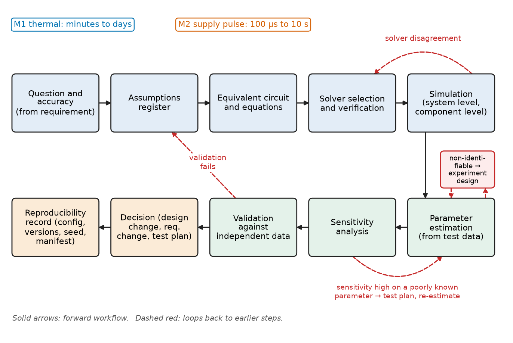
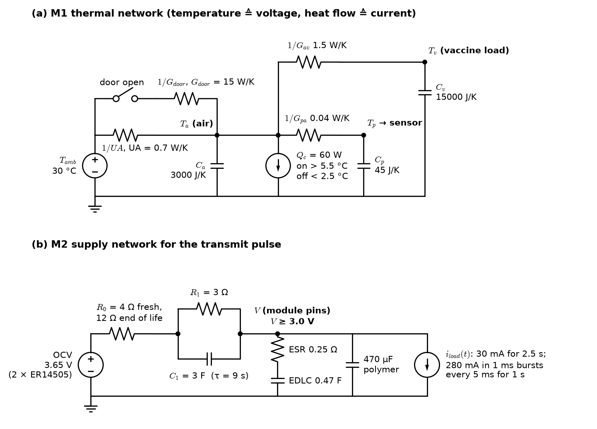
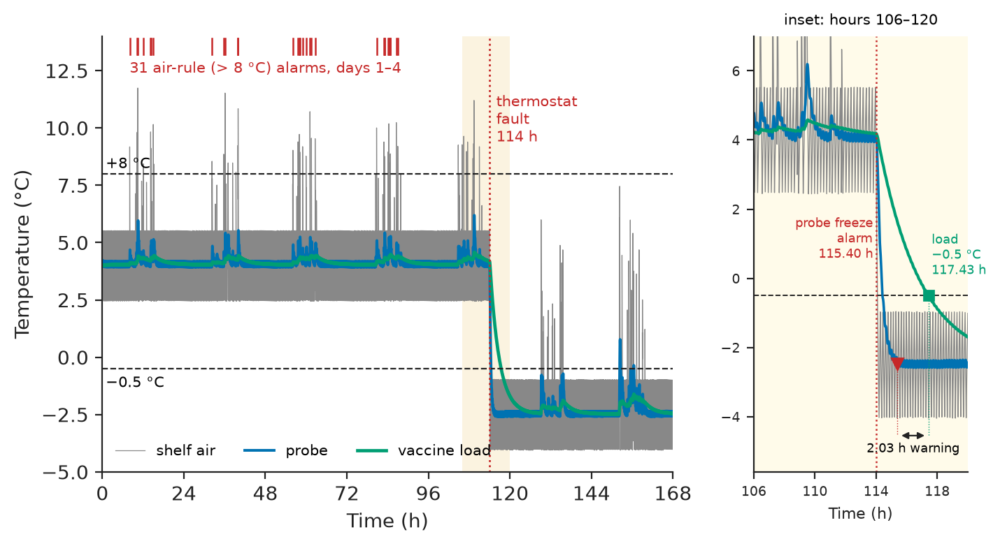
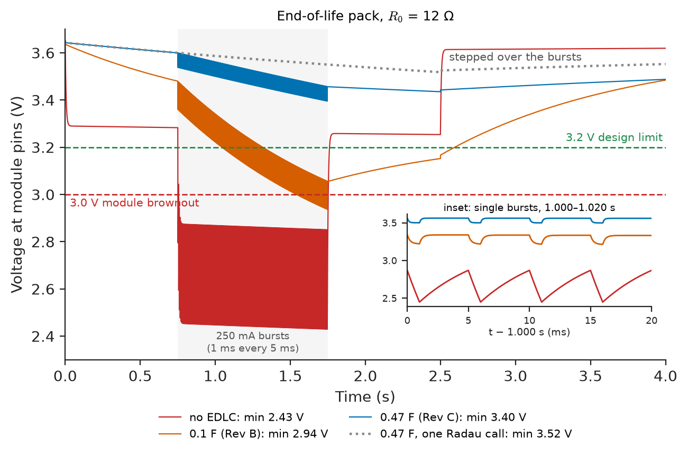
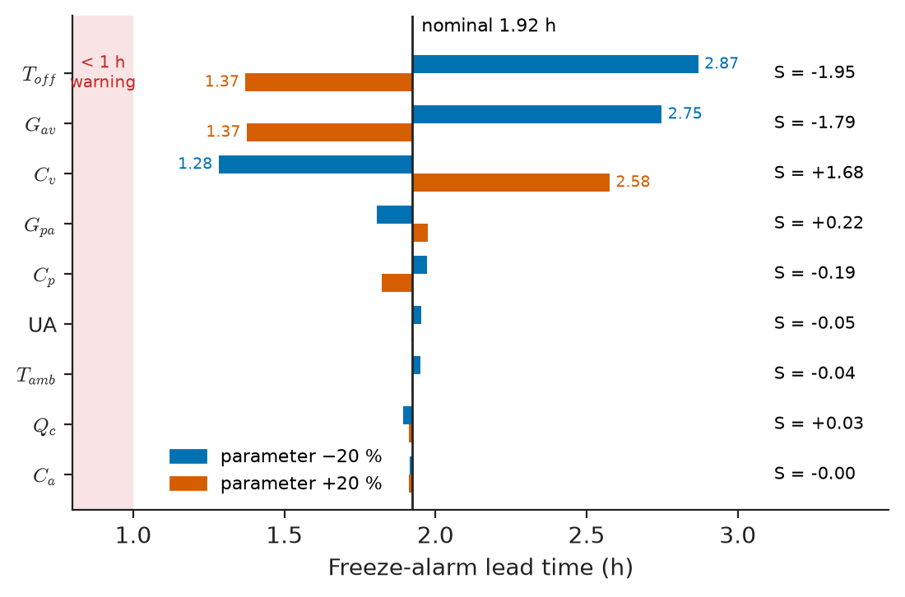
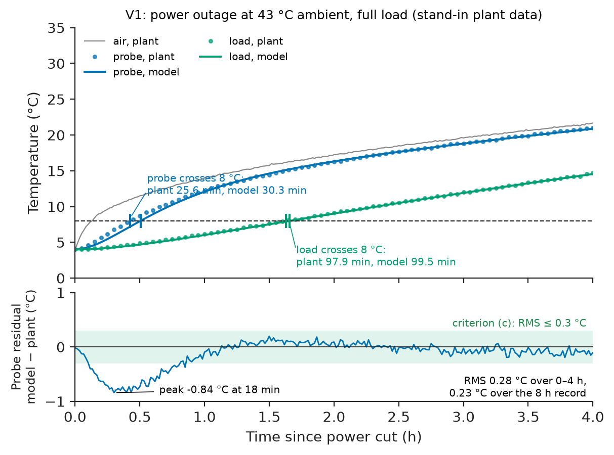

# Chapter 3 — Modeling and Simulation Workflow

*Part I · Engineering Design Methodology*

Chapter 2 chose two AA lithium–thionyl-chloride cells for CCM-1 and left one question open: can they, with a pulse-buffer capacitor, carry the modem's transmit bursts at end of life? An engineer modeled the pack, a 0.1 F supercapacitor and the modem load, ran an implicit solver at default settings, and got a minimum supply voltage of 3.33 V against the module's 3.0 V limit. So 0.1 F went into the Rev B build. On the bench, with 12 Ω in series to emulate a passivated end-of-life pack, the module reset during every upload. The circuit, parameters and load profile were all correct. The solver had covered 4 s in 64 steps, stepped straight over all 200 of the 1 ms bursts, and reported the voltage between them. Run properly, the same model gives 2.94 V: a brownout. A simulation is a measurement made on a model, and its method can be wrong in ways the result does not reveal.

This chapter is the workflow that makes model results trustworthy enough to design with. It builds two models of CCM-1, a thermal model of the refrigerator and probe and an electrical model of the battery and pulse buffer, and takes them through simulation, solver choice, assumptions, parameter estimation, sensitivity, validation and reproducibility.

> **How is a model built to answer a specific design question, at the right level of detail, with a solver that cannot silently mislead?**
> **How are model parameters estimated, their influence measured and the model validated, so that a simulation result can carry a design decision and be reproduced later?**

| Concept | Engineering destination |
|---|---|
| Mathematical modeling | Deciding what question a model answers and what it may ignore |
| Equivalent circuits | Thermal RC networks, battery and supercapacitor models, sensor and cable models |
| System-level simulation | Whole-product behaviour over days: alarms, false alarms, energy, faults |
| Component-level simulation | Brownout, ripple, rise times, transients over milliseconds to seconds |
| Numerical solver selection | Stiff circuits, switching loads, hybrid systems with events |
| Model assumptions | Assumption registers that state domain of validity and how each was checked |
| Parameter estimation | Fitting models to test records; identifiability; parameter uncertainty |
| Sensitivity analysis | Which parameters to measure better, which tolerances to tighten, which rules are fragile |
| Model validation | Evidence that a model predicts data it was not fitted to, within a stated accuracy |
| Simulation reproducibility | Configuration, versions, seeds and manifests that let a result be rerun and audited |

**Roadmap.** Frame each model by its question (3.1) → build equivalent circuits (3.2) → simulate the whole system over days (3.3) and the critical component over seconds (3.4) → choose solvers that cannot step over the physics (3.5) → write down the assumptions (3.6) → estimate parameters from a test (3.7) → find what matters (3.8) → validate against independent data (3.9) → make every run reproducible (3.10).

---

## 3.1 Mathematical modeling

### A model answers a question

> **Boundary.** How lumped models are formed from conservation laws and constitutive relations, and the modeling cycle itself, are treated in *The Mathematics Universe*, [Ch. 25 §25.1](https://github.com/The-Studio-of-Sadiq/engineering-mathematics/blob/main/part-7-numerical-computational/25-mathematical-modeling.md); the physical-system models and state-variable form used for control in *Circuits, Signals and Communications*, [Ch. 33 §33.1–33.2](https://github.com/The-Studio-of-Sadiq/Circuits-Signals-and-Communications/blob/main/part-7-control-system-fundamentals/33-dynamic-system-modeling.md). This chapter is the engineering workflow around them.

A model is built to answer a question, and the question fixes everything else: which quantities appear, which time scales matter, what can be lumped, how accurate the answer must be, and what data will validate it. A model with no stated question grows until nobody can run it or say whether it is right. CCM-1 needs three:

**Table 3.1 — CCM-1 model register.**

| Model | Question it answers | Requirement | Time scale | Accuracy needed | Validated against |
|---|---|---|---|---|---|
| M1 Thermal system | Does the probe rule avoid false alarms and catch freezing before the load freezes? | R3, R6, SP2, SP7 | Minutes to days | Crossing times ±10 % | Chamber outage and door tests (Section 3.9) |
| M2 Supply pulse | Does the supply stay above 3.0 V during uploads at end of life, and with what buffer? | R5, Table 2.6 risk | 100 µs to 10 s | Minimum voltage ±50 mV | Bench pulse test with emulated pack |
| M3 Energy budget | Will the battery last? | R5, SP6 | Months to years | ±20 % on average current | 24 h current profile; field telemetry |

M3 already exists (the budget of Section 2.6), a reminder that a model need not be a differential equation. This chapter builds M1 and M2 along the workflow of Figure 3.1, a loop in which validation failures return to the assumptions and sensitivity results return to the test plan.

<!-- FIGURE 3.1 | figures/ch03/fig-3-1-modeling-workflow.png | flowchart | The modeling and simulation workflow used for CCM-1, with the loops that return to earlier steps. | Content: boxes left to right then down: Question and accuracy (from requirement) -> Assumptions register -> Equivalent circuit and equations -> Solver selection and verification -> Simulation (system level, component level) -> Parameter estimation (from test data) -> Sensitivity analysis -> Validation against independent data -> Decision (design change, requirement change, test plan) -> Reproducibility record (config, versions, seed, manifest). Feedback arrows: validation fails -> assumptions; sensitivity high on poorly known parameter -> test plan / parameter estimation; parameters non-identifiable -> experiment design; solver disagreement -> solver selection. Side annotations: M1 thermal (minutes to days), M2 supply pulse (100 us to 10 s). -->



*Figure 3.1 — The modeling and simulation workflow used for CCM-1, with the loops that return to earlier steps.*

### How much model?

Detail costs effort, data and run time, and every extra parameter can be wrong. The right level is the *simplest model whose error is small against the accuracy the question needs*. M1 asks about crossing times of minutes to hours; air, load and probe each have a time constant in that range, so three thermal nodes are the minimum and a CFD model of the cabinet would answer no question anyone has asked. M2 asks about a minimum voltage during 1 ms bursts, so the bulk capacitor's 100 µs time scale stays, while the battery's hour-scale diffusion is dropped.

---

## 3.2 Equivalent circuits

### The thermal network

> **Boundary.** The effort–flow analogy that makes a thermal network an RC circuit (temperature as effort, heat flow as flow, thermal resistance and capacity as R and C) and the lumping criterion are developed in *Engineering Physics*, [Ch. 17 §17.1–17.3](https://github.com/The-Studio-of-Sadiq/Engineering-Physics/blob/main/CHAPTERS/CHAPTER%2017.md); thermal resistance networks from conduction in [Ch. 14 §14.7](https://github.com/The-Studio-of-Sadiq/Engineering-Physics/blob/main/CHAPTERS/CHAPTER%2014.md). Here the analogy is used, not derived.

M1 is a three-node RC network (Figure 3.2, left). Node $T_a$ is the cabinet air together with the liner and shelves that exchange heat with it quickly. Node $T_v$ is the vaccine load. Node $T_p$ is the probe vial. The conductances are the walls to ambient (UA), air to load ($G_{av}$), air to vial ($G_{pa}$) and, while the door is open, an extra air-exchange conductance $G_{door}$. The compressor is a heat-current sink $Q_c$ switched by a hysteresis thermostat on the air. In state form, $\dot{\mathbf x}=A\mathbf x+B\mathbf u$ with $\mathbf x=[T_a,T_v,T_p]^{\mathsf T}$ and $\mathbf u=[T_{amb},\,Q_c\,s(t)]^{\mathsf T}$, where $s(t)$ is the thermostat state.

<!-- FIGURE 3.2 | figures/ch03/fig-3-2-equivalent-circuits.png | circuit | Equivalent circuits of CCM-1: thermal network of refrigerator and probe (left) and supply network for the transmit pulse (right). | Content: left, thermal RC network drawn electrically: source T_amb 30 degC -> 1/UA (UA 0.7 W/K) -> node T_a with C_a 3000 J/K to ground; parallel switched 1/G_door (15 W/K, door open); current sink Q_c 60 W at T_a controlled by thermostat (on above 5.5, off below 2.5 degC); 1/G_av (1.5 W/K) to node T_v with C_v 15000 J/K; 1/G_pa (0.04 W/K) to node T_p with C_p 45 J/K feeding the sensor. Right: OCV 3.65 V -> R0 (4 ohm fresh, 12 ohm end of life) -> R1 3 ohm parallel C1 3 F -> node V; from V to ground: EDLC (ESR 0.25 ohm + 0.47 F), 470 uF polymer capacitor, load source i_load(t) (30 mA, 280 mA in 1 ms bursts every 5 ms for 1 s). Label V >= 3.0 V. -->



*Figure 3.2 — Equivalent circuits of CCM-1: thermal network of refrigerator and probe (left) and supply network for the transmit pulse (right).*

Each parameter comes from geometry and handbook data, before any test is run. Section 3.7 then refines the ones the data can determine.

**Table 3.2 — First-principles parameters of M1 (100 L compression refrigerator, 30 °C clinic).**

| Parameter | Value | Basis |
|---|---|---|
| $C_a$ | 3,000 J/K | Air 100 L × 1.2 kg/m³ × 1005 J/(kg·K) = 120 J/K, plus liner and shelves effectively coupled to air |
| $C_v$ | 15,000 J/K | Vaccine and diluent load, about 3.6 kg water-equivalent |
| $C_p$ | 45 J/K | 10 mL glycol–water (about 38 J/K) plus vial and sensor PCB |
| UA | 0.7 W/K | 1.5 m² of 50 mm polyurethane at 0.025 W/(m·K) gives 0.75 W/K; less a little for corners |
| $G_{av}$ | 1.5 W/K | Natural convection to boxed load |
| $G_{pa}$ | 0.04 W/K | 42 cm² vial surface × about 9.5 W/(m²·K) combined convection and radiation |
| $G_{door}$ | 15 W/K | Air exchange while open; tuned to the 5–8 K air spikes of Figure 1.2 |
| $Q_c$ | 60 W | Evaporator capacity at 2–5 °C |

**Worked example — the probe time constant and whether the vial may be lumped.** The probe's time constant in still air is $\tau_p=C_p/G_{pa}=45/0.04=1125$ s, or 18.75 min, inside SP2's 15–25 min window. Treating the vial as a single node requires its internal temperature to be nearly uniform, which means a Biot number $Bi=hL_c/k\ll1$ (*Engineering Physics*, Ch. 17 §17.1.2). With $L_c=V/A=10\ \mathrm{mL}/42\ \mathrm{cm^2}=2.4$ mm, $h=9.5$ W/(m²·K) and $k\approx0.45$ W/(m·K) for glycol–water, $Bi=9.5\times0.0024/0.45=0.05$. This is below the usual limit of 0.1, so the lumped vial is justified. The same check fails for the vaccine load, a stack of cartons with air gaps, and Section 3.6 records that as an assumption with a consequence.

### The supply network

> **Boundary.** The Thevenin equivalent circuit of a cell (OCV source, series $R_0$, RC pairs for polarisation) and its use in battery management are in *Electrical Energy and Machines*, [Ch. 16 §16.1–16.4](https://github.com/The-Studio-of-Sadiq/Electrical-Energy-and-Machines/blob/main/part-4-power-generation/16-energy-storage.md); capacitor behaviour and first-order transients in *Circuits, Signals and Communications*, [Ch. 5–6](https://github.com/The-Studio-of-Sadiq/Circuits-Signals-and-Communications/blob/main/part-2-transient-and-ac-analysis/06-first-order-circuits.md).

M2 (Figure 3.2, right) has three states: the node voltage across the 470 µF polymer capacitor at the module pins, the EDLC's internal voltage behind its ESR, and the voltage on the battery's polarisation RC pair. The pack's series resistance $R_0$ is the parameter that matters. For a lithium–thionyl-chloride bobbin cell it is high (several ohms per AA cell) and it grows with the passivation layer that forms on the lithium anode during storage, faster at high temperature (*Materials Science and Engineering*, [Ch. 40](https://github.com/The-Studio-of-Sadiq/Materials-Science-and-Engineering/blob/main/Chapters/CHAPTER%2040.md)). Two cases bracket it: 4 Ω for a fresh pack at 25 °C, and 12 Ω for a passivated pack near end of life.

**Table 3.3 — Parameters of M2 (representative values for the cell class; to be measured on the purchased cells).**

| Parameter | Value | Note |
|---|---|---|
| OCV | 3.65 V | Two ER14505 cells in parallel |
| $R_0$ | 4 Ω fresh / 12 Ω end of life | Pack value; passivation and cold raise it |
| $R_1$, $C_1$ | 3 Ω, 3 F (τ = 9 s) | Polarisation |
| EDLC | 0.1, 0.47 or 1.0 F; ESR 0.5, 0.25, 0.15 Ω | Candidates; leakage 1–3 µA |
| Bulk capacitor | 470 µF polymer | ESR neglected |
| Load | 30 mA for 2.5 s; 250 mA extra in 1 ms bursts every 5 ms for 1 s; 5 µA otherwise | LTE-M upload profile, 0.125 C per upload |

---

## 3.3 System-level simulation

### Seven days in a clinic

A **system-level simulation** runs the whole product, including its environment and its firmware decisions, over the time scale of the requirement. For M1 that means days: door openings during clinic hours, a compressor cycling under its thermostat, a fault, and the logger's sampling and alarm rules applied to the simulated signals. The firmware logic is part of the model, so a system simulation tests the *rules* as well as the physics.

Between events the network is linear with constant inputs, so it can be advanced exactly by the matrix exponential of the augmented system (the zero-order-hold discretisation). Each 5 s step is then one matrix–vector product, with no truncation error. Listing 3.1 simulates 7 days: 15 door openings of 20–60 s between 08:00 and 16:00 each day, and a thermostat fault at 114 h (day 5, 18:00) that moves the switching points from 2.5/5.5 °C to −4/−1 °C. It then applies two alarm rules: the Rev A prototype's (air above 8 °C) and CCM-1's (probe at or below −0.5 °C for 60 consecutive 1-min samples).

```python
# ccm1_system.py -- refrigerator + buffered probe + logger alarm rules, 7 days
import numpy as np
from scipy.linalg import expm

Ca, Cv, Cp = 3000.0, 15000.0, 45.0          # J/K: air+liner, vaccine load, probe vial
UA, Gav, Gpa, Gdoor = 0.7, 1.5, 0.04, 15.0  # W/K: walls, air-load, air-vial, open door
Tamb, Qc, dt = 30.0, 60.0, 5.0              # degC, W compressor, s

def zoh(g):                                  # exact discretisation, x = [Ta, Tv, Tp]
    A = np.array([[-(g + Gav + Gpa), Gav, Gpa], [Gav, -Gav, 0], [Gpa, 0, -Gpa]])
    A /= np.array([[Ca], [Cv], [Cp]])
    B = np.array([[g / Ca, -1 / Ca], [0, 0], [0, 0]])
    M = expm(np.block([[A, B], [np.zeros((2, 5))]]) * dt)
    return M[:3, :3], M[:3, 3:]
closed, opened = zoh(UA), zoh(UA + Gdoor)

rng = np.random.default_rng(7)
N = 7 * 86400 // 5
door = np.zeros(N, bool)
for t0 in (rng.uniform(8, 16, (7, 15)) * 3600 + np.arange(7)[:, None] * 86400).ravel():
    door[int(t0 / dt):int((t0 + rng.uniform(20, 60)) / dt)] = True  # 15 openings/day
x, on, X = np.array([4.0, 4.0, 4.0]), False, np.empty((N // 12, 3))
for k in range(N):
    lo, hi = (-4.0, -1.0) if k * dt >= 114 * 3600 else (2.5, 5.5)  # thermostat fault
    on = (x[0] > hi) or (on and x[0] > lo)
    Phi, Gam = opened if door[k] else closed
    x = Phi @ x + Gam @ np.array([Tamb, Qc * on])
    if k % 12 == 0:
        X[k // 12] = x                       # logger samples once a minute
air, vac, probe = X.T

n4 = 4 * 1440                                # four normal days of 1-min samples
print("air > 8 degC alarms, days 1-4:", np.sum((air[1:n4] > 8) & (air[:n4 - 1] <= 8)))
print(f"probe range, days 2-4: {probe[1440:n4].min():.2f} to {probe[1440:n4].max():.2f} degC")
run = np.convolve(probe <= -0.5, np.ones(60), "valid")   # 60-min continuous window
print(f"probe freeze alarm at {(np.argmax(run == 60) + 59) / 60:.2f} h; "
      f"vaccine below -0.5 degC at {np.argmax(vac <= -0.5) / 60:.2f} h")
```

```text
air > 8 degC alarms, days 1-4: 31
probe range, days 2-4: 3.92 to 5.53 degC
probe freeze alarm at 115.40 h; vaccine below -0.5 degC at 117.43 h
```

The 15 s run answers M1's question for this scenario. The air rule raises 31 alarms in four normal days, close to the 5–11 a day that killed the Rev A prototype. The probe stays within 3.92–5.53 °C on days 2–4 (6.2 °C at most), so the probe rule raises none. When the thermostat fails, the probe alarm fires 1.40 h after the fault and 2.03 h *before* the load itself reaches −0.5 °C. That is a two-hour window in which a nurse can move the vaccine. SP7, "alarms on probe temperature only", was a requirement-level decision in Chapter 1. Here it gets its first quantitative evidence. Figure 3.3 shows the run.

<!-- FIGURE 3.3 | figures/ch03/fig-3-3-seven-day-simulation.png | plot | Seven-day system simulation of CCM-1: shelf air, probe and vaccine load, with the thermostat fault on day 5. | Content: x-axis 0 to 168 h, y-axis -5 to +14 degC. Air (thin grey: 2.5 to 5.5 degC cycling, door spikes to about 11.7 degC 08:00-16:00; after 114 h cycling -4 to -1 degC), probe (blue, 3.9 to 6.2 degC, falling after the fault), load (green, about 4 to 4.6 degC, falling slowly). Dashed lines at +8 and -0.5 degC; red ticks on top for the 31 air-rule alarms of days 1-4. Markers: fault 114 h; probe freeze alarm 115.40 h; load at -0.5 degC 117.43 h; arrow between labelled 2.03 h warning. Inset: hours 106 to 120. -->



*Figure 3.3 — Seven-day system simulation of CCM-1: shelf air, probe and vaccine load, with the thermostat fault on day 5.*

Running the simulation with the parameters fitted in Section 3.7 instead of the first-principles values changes the probe range to 3.82–5.70 °C and the warning window to 1.93 h. Both conclusions hold, and that check is itself a small sensitivity analysis.

> **Status of the principle: Exact discretisation of a linear system with piecewise-constant input**
> *Derived.* For $\dot{\mathbf x}=A\mathbf x+B\mathbf u$ with $\mathbf u$ constant over a step $h$, $\mathbf x_{k+1}=e^{Ah}\mathbf x_k+\int_0^h e^{A\sigma}d\sigma\,B\mathbf u_k$ exactly, and both terms come from one exponential of the augmented matrix. It is exact only if every input change falls on a step boundary. Here door openings are rounded to 5 s and the thermostat switches at the step after its threshold, a timing error of at most 5 s in a process with 3-minute time constants.

---

## 3.4 Component-level simulation

### The supply under a transmit burst

A **component-level simulation** zooms into one part of the system at the time scale of its own failure mode. For M2 that is the 4 s around an upload. The question is the minimum voltage at the module pins, the requirement is ≥ 3.0 V with margin, and the design variable is the pulse buffer. Listing 3.2 integrates the three-state circuit with a stiff solver and *restarts it at every load edge*. Section 3.5 explains why that matters.

```python
# ccm1_pulse.py -- battery + supercapacitor + bulk capacitor under an LTE-M upload
import numpy as np
from scipy.integrate import solve_ivp

OCV, R1, C1 = 3.65, 3.0, 3.0           # 2 x ER14505 in parallel: OCV, polarisation RC
Cb = 470e-6                            # polymer bulk capacitor at the module pins

SEGS = [(0.0, 0.75, 0.030)]            # (start s, end s, load A): 30 mA for 2.5 s ...
for t in 0.75 + 0.005 * np.arange(200):        # ... with 250 mA bursts, 1 ms in 5 ms
    SEGS += [(t, t + 0.001, 0.280), (t + 0.001, t + 0.005, 0.030)]
SEGS += [(1.75, 2.5, 0.030), (2.5, 4.0, 5e-6)]

def rhs(t, y, R0, Csc, Resr, i):        # y = [v_node, v_supercap, v_RC]
    vb, vc, v1 = y
    ib = (OCV - v1 - vb) / R0
    isc = (vc - vb) / Resr if Csc else 0.0
    return [(ib + isc - i) / Cb, -isc / Csc if Csc else 0.0, (ib - v1 / R1) / C1]

def vmin(R0, Csc=0.0, Resr=1.0, restart=True):
    if not restart:                     # one call: the solver never sees the bursts
        s = solve_ivp(lambda t, y: rhs(t, y, R0, Csc, Resr, next(
            i for a, b, i in SEGS if a <= t < b) if t < 4.0 else 5e-6),
            (0, 4.0), [OCV, OCV, 0.0], method="Radau", rtol=1e-6, atol=1e-8)
        return s.y[0].min(), s.nfev
    y, lo, nfev = [OCV, OCV, 0.0], OCV, 0
    for a, b, i in SEGS:                # restart the solver at every load edge
        s = solve_ivp(rhs, (a, b), y, method="Radau", args=(R0, Csc, Resr, i),
                      rtol=1e-6, atol=1e-8)
        y, lo, nfev = s.y[:, -1], min(lo, s.y[0].min()), nfev + s.nfev
    return lo, nfev

print("Radau, one call, R0 = 12, 1 F: Vmin = %.3f V (%d evaluations)" % vmin(12, 1.0, 0.15, False))
for R0 in (4.0, 12.0):                  # fresh at 25 degC; passivated at end of life
    for Csc, Resr in [(0.0, 1.0), (0.1, 0.5), (0.47, 0.25), (1.0, 0.15)]:
        v, n = vmin(R0, Csc, Resr)
        print(f"R0 = {R0:4.1f} ohm, Csc = {Csc:4.2f} F: Vmin = {v:.3f} V ({n} evaluations)")
```

```text
Radau, one call, R0 = 12, 1 F: Vmin = 3.579 V (516 evaluations)
R0 =  4.0 ohm, Csc = 0.00 F: Vmin = 3.055 V (24443 evaluations)
R0 =  4.0 ohm, Csc = 0.10 F: Vmin = 3.249 V (48450 evaluations)
R0 =  4.0 ohm, Csc = 0.47 F: Vmin = 3.442 V (46923 evaluations)
R0 =  4.0 ohm, Csc = 1.00 F: Vmin = 3.528 V (45489 evaluations)
R0 = 12.0 ohm, Csc = 0.00 F: Vmin = 2.430 V (15963 evaluations)
R0 = 12.0 ohm, Csc = 0.10 F: Vmin = 2.937 V (48675 evaluations)
R0 = 12.0 ohm, Csc = 0.47 F: Vmin = 3.395 V (46888 evaluations)
R0 = 12.0 ohm, Csc = 1.00 F: Vmin = 3.514 V (45456 evaluations)
```

The table closes Chapter 2's open decision. Without a buffer, a fresh pack at 25 °C clears 3.0 V by only 55 mV, which explains why bench tests on new cells passed. At end of life it falls to 2.43 V. The 0.1 F part of the Rev B build fails at end of life (2.94 V). The 0.47 F part holds 3.40 V, a margin of 395 mV, and 1 F adds only another 120 mV for twice the leakage and size.

**Worked example — choosing the buffer.** The design rule is to keep at least 0.2 V of margin at end of life, to cover cold and cell-to-cell spread in $R_0$. The 0.47 F part leaves 0.395 V. Its leakage of about 1.5 µA costs $1.5/49.9=3\ \%$ of the average current (Table 2.5), and its 2.6 µA larger sibling would cost 5 %. A rough check confirms the simulation. Over the 2.5 s upload the load draws $0.030\times2.5+0.25\times0.2\times1.0=0.125$ C. If the 12 Ω battery supplied nothing, the 0.47 F capacitor would drop by $0.125/0.47=0.27$ V. The battery supplies part of the charge, so the true drop from 3.65 V to 3.40 V (0.25 V, partly across the ESR) is plausible. A simulation result that a one-line estimate cannot roughly reproduce should not be believed until it is explained. CCM-1 Rev C uses 0.47 F, ESR ≤ 0.25 Ω, and the open risk on option B in Table 2.6 is closed.

<!-- FIGURE 3.4 | figures/ch03/fig-3-4-supply-pulse-simulation.png | plot | Supply voltage at the module pins during an LTE-M upload with an end-of-life pack (R0 = 12 ohm), for three buffer choices. | Content: x-axis 0 to 4 s, y-axis 2.3 to 3.7 V. Traces: no EDLC (minimum 2.43 V in the 0.75-1.75 s burst window, sawtooth from 1 ms bursts every 5 ms); 0.1 F (minimum 2.94 V); 0.47 F (minimum 3.40 V, recovering toward 3.65 V after 2.5 s). Red dashed line 3.0 V module brownout; green dashed line 3.2 V design limit. Grey dotted trace: solver in one call without restarts, near 3.52 V, labelled stepped over the bursts. Inset 1.000 to 1.020 s showing single bursts. -->



*Figure 3.4 — Supply voltage at the module pins during an LTE-M upload with an end-of-life pack (R0 = 12 ohm), for three buffer choices.*

A circuit with switching converters, protection diodes and vendor device models belongs in a circuit simulator (LTspice, ngspice) instead. The workflow is unchanged; the usual pattern is to extract compact parameters from SPICE (an effective $R_0$, an efficiency curve) for the system-level model (Chapter 29).

---

## 3.5 Numerical solver selection

### Stiffness and discontinuities

> **Boundary.** Runge–Kutta and multistep methods, step-size control, absolute stability and stiffness are developed in *The Mathematics Universe*, [Ch. 22 §22.9 and §22.11](https://github.com/The-Studio-of-Sadiq/engineering-mathematics/blob/main/part-7-numerical-computational/22-numerical-methods.md), with the modeling view of stiffness in [Ch. 25 §25.9](https://github.com/The-Studio-of-Sadiq/engineering-mathematics/blob/main/part-7-numerical-computational/25-mathematical-modeling.md). This section is about choosing among them for a real model.

Two properties of a model decide the solver. The first is **stiffness**: time constants spread over many decades. The eigenvalues of M2's system matrix (with $R_0=12$ Ω and 0.47 F) give time constants of 115 µs (bulk capacitor through the parallel source resistances), 4.4 s and 11.8 s (EDLC and battery RC), a ratio of about $10^5$. An explicit method's step is limited by *stability* to roughly the smallest time constant, even when nothing is happening on that scale. An implicit method's step is limited only by *accuracy*. The second property is **discontinuity**: the load switches 400 times in one upload. An adaptive solver of any kind assumes a smooth right-hand side between steps. A 1 ms burst that falls between two steps is never seen, and the step-size controller cannot know.

**Table 3.4 — Solvers on M2 (R0 = 12 Ω, 0.47 F, 4 s window, rtol 1e-6; desktop PC, SciPy 1.18).**

| Method | Steps | RHS evaluations | Wall time | $V_{min}$ | Verdict |
|---|---|---|---|---|---|
| RK45 (explicit), default | 15,012 | 114,854 | 15.8 s | 3.395 V | Correct, because stiffness forced tiny steps |
| Radau (implicit), default | 62 | 705 | 0.17 s | 3.518 V | **Wrong** by +123 mV: stepped over the bursts |
| BDF (implicit), default | 112 | 273 | 0.06 s | 3.518 V | **Wrong**, same reason |
| LSODA (switching), default | 209 | 631 | 0.05 s | 3.518 V | **Wrong**, same reason |
| Radau, max step 0.2 ms | 28,350 | 242,269 | 31.5 s | 3.395 V | Correct, wasteful |
| LSODA, max step 0.2 ms | 41,234 | 87,894 | 3.9 s | 3.395 V | Correct |
| Radau, restarted at each load edge | — | 46,888 | 3.7 s | 3.395 V | Correct by construction |
| Exact discretisation per segment (linear circuit) | 2,015 | — | 0.03 s | 3.395 V | Correct, fastest; needs linearity |

The dangerous rows are the fast ones: three implicit solvers return in a twentieth of a second with an answer 123 mV too optimistic and no warning, the opening story's failure. RK45 is right only by accident, because stiffness forces steps of about 0.27 ms, small enough to catch every burst. Extending the run to the full hour between uploads shows the cost of that accident: at 3.8 steps per simulated millisecond, about 14 million steps and close to 4 hours of wall time, against seconds for Radau with restarts or the exact discretisation.

> **Status of the principle: Explicit integrators on stiff systems are stability-limited**
> *Derived.* For the test equation $\dot y=\lambda y$, an explicit method is stable only for $h\lvert\lambda\rvert$ below a constant of order 1 to 3, so its step is set by the fastest mode, $h\lesssim2.8\,\tau_{min}$ for classical RK4-type methods. A-stable implicit methods have no such limit. This holds for linear stability around smooth solutions; discontinuities limit every method equally unless the solver is told where they are.

### Rules that follow

For each model, the solver choice is recorded with its reason:

1. **Tell the solver where the discontinuities are**: integrate piecewise between known events, or use event location for state-dependent switches. A small `max_step` is an expensive fallback.
2. **For stiff models use an implicit or switching method** (Radau, BDF, LSODA). Reach for an explicit method only when the stiffness ratio is modest, as it is for M1 (time constants 3 min to 9.6 h).
3. **For linear models with piecewise-constant inputs use exact discretisation.** This is M1's method (Listing 3.1), and it is also how firmware filters are discretised.
4. **Verify the numerics separately from the model**: halve the tolerance or step, cross-check two methods, compare with a one-line estimate. This *solution verification* asks "are the equations solved right?", not validation's "are they the right equations?".

---

## 3.6 Model assumptions

### The assumption register

Most model failures are assumptions that stopped being true. An **assumption register** lists each one with its justification, a quantitative check, and what happens to the conclusions if it fails, forcing the question "how would I know if this were wrong?"

> **Boundary.** Catalogues of standard modeling assumptions, how to make them quantitative and how to check them afterwards are in *The Mathematics Universe*, [Ch. 25 §25.6](https://github.com/The-Studio-of-Sadiq/engineering-mathematics/blob/main/part-7-numerical-computational/25-mathematical-modeling.md).

**Table 3.5 — Assumption register for M1 and M2.**

| ID | Assumption | Justification and check | If violated |
|---|---|---|---|
| A1 | Vial is one lumped node | $Bi=0.05<0.1$ (Section 3.2) | Probe lag underestimated; alarms later than modeled |
| A2 | Vaccine load is one lumped node | Cartons with air gaps: $Bi$ well above 0.1; inner vials lag outer ones | Load crossing times are for an average vial; the outermost vials, nearest the evaporator, freeze earlier. Covered by the margin in Section 3.8 |
| A3 | Liner lumped with air in $C_a$ | Liner exchanges heat with air in minutes | Air spikes during door openings mispredicted (found in Section 3.9) |
| A4 | Conductances constant | Natural convection varies about ±15 % over 0–30 K differences | Second-order effect on crossing times; covered by the ±20 % sensitivity |
| A5 | Thermostat is ideal hysteresis on air | Real thermostats sense the evaporator plate | Cycling period wrong; average temperatures unchanged |
| A6 | Door opening = conductance step | Air exchange is turbulent and incomplete | Spike shape approximate; probe response checked in validation |
| A7 | Pack $R_0$ constant during a pulse | Li-SOCl₂ shows transient voltage delay when passivated | Brownout worse than modeled at first pulse after storage; 0.2 V margin |
| A8 | EDLC is ideal C + ESR | Real EDLCs show distributed (ladder) behaviour at 1 ms | ESR effectively higher at short pulses; measure at 1 ms |

A2 and A7 are the assumptions whose violation would make the design *unsafe*, not just inaccurate, so validation and testing target them. A reviewer who doubts A5 can see at once that it affects no decision.

> **Status of the principle: Lumped-node thermal model of a refrigerator**
> *Approximate.* Valid when each node is nearly isothermal ($Bi<0.1$) and the coupling coefficients are constant. It predicts mean temperatures and crossing times to about 10 % for closed-door operation. It does not predict spatial gradients (top shelf against bottom, vials touching the evaporator plate) or the detailed shape of door transients.

---

## 3.7 Parameter estimation

### Fitting to a chamber test

> **Boundary.** Linear and nonlinear least squares, Gauss–Newton and Levenberg–Marquardt, parameter covariance and identifiability are developed in *The Mathematics Universe*, [Ch. 24 §24.7](https://github.com/The-Studio-of-Sadiq/engineering-mathematics/blob/main/part-7-numerical-computational/24-computational-mathematics.md) and [Ch. 25 §25.8](https://github.com/The-Studio-of-Sadiq/engineering-mathematics/blob/main/part-7-numerical-computational/25-mathematical-modeling.md).

Table 3.2's values come from handbooks. The refining test is a power outage in a climatic chamber at 32 °C: the loaded refrigerator sits at 4 °C, power is cut, and air, load (a reference sensor in a vaccine-simulant carton) and probe are logged each minute for 8 h. Until the chamber is free, Listing 3.3 fits a stand-in record from a deliberately *richer* 4-node "plant" with the liner as its own node, plus 0.05 °C noise. Such a *recovery test* checks the estimator on data whose truth is known, and the extra node shows how the fit behaves when the model is structurally too simple, as every model is.

```python
# ccm1_fit.py -- estimate the 3-node model from an 8-h power-outage record at 32 degC
import numpy as np
from scipy.linalg import expm
from scipy.optimize import least_squares

t = np.arange(0, 8 * 60 + 1) * 60.0                      # 1-min samples, s

def simulate(A, B, x0, u):                               # constant input u over the test
    n, m = A.shape[0], B.shape[1]
    M = expm(np.block([[A, B], [np.zeros((m, n + m))]]) * 60)
    X = [x0]
    for _ in t[1:]:
        X.append(M[:n, :n] @ X[-1] + M[:n, n:] @ u)
    return np.array(X)

def model3(Ca, UA, Cv, Gav, Gpa, x0, Tamb=32.0):        # states [Ta, Tv, Tp]
    A = np.array([[-(UA + Gav + Gpa), Gav, Gpa], [Gav, -Gav, 0], [Gpa, 0, -Gpa]])
    A /= np.array([[Ca], [Cv], [45.0]])
    return simulate(A, np.array([[UA / Ca], [0], [0]]), x0, np.array([Tamb]))

# Stand-in for the chamber record: 4-node plant (air, liner, load, vial) + 0.05 degC noise
A4 = np.array([[-4.54, 3.0, 1.5, 0.04], [3.0, -3.75, 0, 0], [1.5, 0, -1.5, 0],
               [0.04, 0, 0, -0.04]]) / np.array([[1500], [4000], [15000], [45]])
truth = simulate(A4, np.array([[0], [0.75 / 4000], [0], [0]]),
                 np.array([4.0, 9.0, 4.0, 4.0]), np.array([32.0]))
meas = np.delete(truth, 1, axis=1) + np.random.default_rng(1).normal(0, 0.05, (len(t), 3))

names = ["Ca J/K", "UA W/K", "Cv J/K", "Gav W/K", "Gpa W/K"]
for fixed_Cv in (None, 15000.0):                         # Cv free, then Cv from weighing
    def res(p):
        q = list(p[:2]) + [fixed_Cv if fixed_Cv else p[2]] + list(p[-2:])
        return (model3(*q, meas[0]) - meas).ravel()
    p0 = [3000, 0.7, 1.0, 0.03] if fixed_Cv else [3000, 0.7, 12000, 1.0, 0.03]
    f = least_squares(res, p0, x_scale="jac")
    cov = np.linalg.inv(f.jac.T @ f.jac) * np.sum(f.fun**2) / (f.fun.size - len(p0))
    sd = np.sqrt(np.diag(cov))
    used = [n for n in names if not (fixed_Cv and n.startswith("Cv"))]
    print("Cv fixed" if fixed_Cv else "all free", f"rms = {np.sqrt(np.mean(f.fun**2)):.3f}",
          f"corr(Ca,UA) = {cov[0, 1] / (sd[0] * sd[1]):+.2f}")
    print("   " + ", ".join(f"{n} {v:.4g}+/-{s:.2g}" for n, v, s in zip(used, f.x, sd)))
```

```text
all free rms = 0.052 corr(Ca,UA) = +0.98
   Ca J/K 33.48+/-0.69, UA W/K 0.01045+/-0.00011, Cv J/K 256+/-2.8, Gav W/K 0.02553+/-0.00028, Gpa W/K 0.03965+/-0.00016
Cv fixed rms = 0.133 corr(Ca,UA) = +0.95
   Ca J/K 3793+/-28, UA W/K 0.5844+/-0.0011, Gav W/K 1.52+/-0.003, Gpa W/K 0.04129+/-0.00045
```

**Worked example — reading a fit that looks perfect.** The all-free fit has the best residual (0.052 °C, equal to the noise) and tight-looking standard deviations, and it is nonsense. An air capacity of 33 J/K is less than the 120 J/K of the air alone, and UA = 0.010 W/K would mean a wall 70 times better insulated than polyurethane. The reason is **identifiability**. An unforced warming test constrains only the *ratios* $G/C$, the time constants. The absolute scale of all the capacities and conductances together is pinned only weakly, through the fixed vial capacity. The optimiser exploited that freedom to make the 3-node model mimic the missing liner node, and the Jacobian-based uncertainties, which are local, cannot reveal it. A correlation of +0.98 between $C_a$ and UA is the warning sign. The fix is physical, not numerical: the load is weighed (3.6 kg water-equivalent gives $C_v=15{,}000$ J/K) and fixed. The second fit is physically sensible. UA = 0.584 W/K is the series combination of the true wall (0.75 W/K) and liner coupling (3 W/K), $0.75\times3/3.75=0.60$ W/K. $C_a=3{,}793$ J/K has absorbed part of the liner. $G_{av}$ and $G_{pa}$ come back within 3 % of the plant's values. Its residual (0.133 °C) is now well above the noise, an honest sign of the structural simplification recorded as A3.

> **Status of the principle: Identifiability of lumped thermal parameters from an unforced test**
> *Derived.* The free response of $\dot{\mathbf x}=A\mathbf x+B\mathbf u$ depends only on $A$ and $B$, whose entries are ratios $G/C$. Scaling every $G$ and $C$ by the same factor leaves the response unchanged, so absolute values need either a known heat input (a heater test) or an independently measured capacity. The local covariance from $J^{\mathsf T}J$ does not show this when the fit settles in a compensating, wrong region.

---

## 3.8 Sensitivity analysis

### Which parameters matter?

A **sensitivity analysis** asks how much an output of interest changes when each input changes. It decides where measurement effort, tolerances and margins should go. The cheapest form is **one-at-a-time** (OAT): move each parameter by a stated amount (here ±20 %) with the others at nominal, and report the normalised sensitivity $S=(\Delta y/y)/(\Delta p/p)$. The output chosen is the one that carries the safety decision: the **lead time**, from the probe freeze alarm to the load reaching −0.5 °C, in a thermostat-fault scenario starting from steady 4 °C.

> **Boundary.** Local sensitivities, adjoint methods and linearised (GUM) and Monte Carlo uncertainty propagation are in *The Mathematics Universe*, [Ch. 24 §24.6 and §24.8](https://github.com/The-Studio-of-Sadiq/engineering-mathematics/blob/main/part-7-numerical-computational/24-computational-mathematics.md).

```python
# ccm1_sens.py -- sensitivity of freeze-alarm lead time to the model parameters
import numpy as np
from scipy.linalg import expm

NOM = dict(Ca=3000.0, Cv=15000.0, Cp=45.0, UA=0.7, Gav=1.5, Gpa=0.04,
           Qc=60.0, Tamb=30.0, Toff=-4.0)

def lead_time(p, dt=5.0):
    """Hours from the probe freeze alarm to the load reaching -0.5 degC."""
    A = np.array([[-(p["UA"] + p["Gav"] + p["Gpa"]), p["Gav"], p["Gpa"]],
                  [p["Gav"], -p["Gav"], 0], [p["Gpa"], 0, -p["Gpa"]]])
    A /= np.array([[p["Ca"]], [p["Cv"]], [p["Cp"]]])
    B = np.array([[p["UA"] / p["Ca"], -1 / p["Ca"]], [0, 0], [0, 0]])
    M = expm(np.block([[A, B], [np.zeros((2, 5))]]) * dt)
    x, on, run, t_alarm = np.array([4.0, 4.0, 4.0]), True, 0, None
    for k in range(int(12 * 3600 / dt)):        # thermostat fault from t = 0
        on = (x[0] > p["Toff"] + 3) or (on and x[0] > p["Toff"])
        x = M[:3, :3] @ x + M[:3, 3:] @ np.array([p["Tamb"], p["Qc"] * on])
        if k % 12 == 11:                        # logger: one sample per minute
            run = run + 1 if x[2] <= -0.5 else 0
            if run == 60 and t_alarm is None:
                t_alarm = (k + 1) * dt / 3600
        if x[1] <= -0.5:
            return (k + 1) * dt / 3600 - (t_alarm or np.inf)
    return np.nan

y0 = lead_time(NOM)
print(f"nominal lead time = {y0:.2f} h")
for name in NOM:                                # one at a time, +/- 20 %
    lo, hi = (lead_time({**NOM, name: NOM[name] * f}) for f in (0.8, 1.2))
    print(f"{name:5s} -20%: {lo:5.2f} h  +20%: {hi:5.2f} h  "
          f"S = {(hi - lo) / (0.4 * y0):+.2f}")
```

```text
nominal lead time = 1.92 h
Ca    -20%:  1.91 h  +20%:  1.91 h  S = -0.00
Cv    -20%:  1.28 h  +20%:  2.58 h  S = +1.68
Cp    -20%:  1.97 h  +20%:  1.82 h  S = -0.19
UA    -20%:  1.95 h  +20%:  1.92 h  S = -0.05
Gav   -20%:  2.75 h  +20%:  1.37 h  S = -1.79
Gpa   -20%:  1.81 h  +20%:  1.97 h  S = +0.22
Qc    -20%:  1.89 h  +20%:  1.91 h  S = +0.03
Tamb  -20%:  1.95 h  +20%:  1.92 h  S = -0.04
Toff  -20%:  2.87 h  +20%:  1.37 h  S = -1.95
```

The nominal lead time (1.92 h) differs from Listing 3.1's 2.03 h because this scenario starts from a uniform 4 °C. The ranking is what matters (Figure 3.5). The load's capacity $C_v$ and coupling $G_{av}$ (together its time constant) and the fault severity $T_{off}$ dominate. The probe parameters $C_p$ and $G_{pa}$, which the design controls through SP2, matter an order of magnitude less, and UA, $Q_c$, $C_a$ and ambient hardly at all. The lead time is governed by what is in the refrigerator and how badly it fails, which the design cannot control: a margin question, not a tolerance question.

<!-- FIGURE 3.5 | figures/ch03/fig-3-5-lead-time-tornado.png | plot | Tornado chart: freeze-alarm lead time for each parameter at -20 % and +20 %, nominal 1.92 h. | Content: horizontal bars centred on vertical line at 1.92 h, x-axis lead time 1.0 to 3.0 h, sorted by range: Toff (1.37 to 2.87; -20 % = -3.2 degC gives 2.87), Gav (2.75 at -20 %, 1.37 at +20 %), Cv (1.28 at -20 %, 2.58 at +20 %), Gpa (1.81 to 1.97), Cp (1.97 to 1.82), UA (1.95 to 1.92), Tamb (1.95 to 1.92), Qc (1.89 to 1.91), Ca (1.91 to 1.91). Two colours for -20 % and +20 %. Annotate S values beside each bar (+1.68, -1.79, -1.95, ...). Shaded region below 1.0 h labelled less than 1 h warning. -->



*Figure 3.5 — Tornado chart: freeze-alarm lead time for each parameter at -20 % and +20 %, nominal 1.92 h.*

### Monte Carlo over plausible refrigerators

OAT misses interactions and only explores near the nominal point. A Monte Carlo run samples all the uncertain inputs together over plausible ranges: $C_v$ ±40 %, $G_{av}$ ±30 %, $G_{pa}$ ±20 %, $C_p$ ±10 %, $T_{off}$ uniform from −6 to −1.5 °C, ambient 20–43 °C. Rerunning `lead_time` for 400 samples (seed 3, about 2 min) gives the following. In 56 samples the load never reaches −0.5 °C within 12 h (mild faults). Of the 344 that freeze, the median lead time is 2.08 h and the 5th percentile 0.27 h. In **8 of the 344 the load freezes before the probe alarm**. These are mild faults in which the air cycles around −0.5 °C, so the probe dips below the threshold and back again many times and never completes 60 *continuous* minutes, while the heavy load drifts steadily below freezing.

**Worked example — a sensitivity result that changes a requirement.** The 8 late cases are a rule problem, not a parameter problem: the continuous-duration rule of R3 resets on any single sample above −0.5 °C. On the same 400 samples the team tested a *freeze warning* raised when the 60-minute moving mean of the probe is at or below −0.5 °C. Late cases fell from 8 to 0, the 5th-percentile lead time rose from 0.27 h to 0.68 h and the median from 2.08 h to 2.51 h. The price was 9 warnings instead of 4 in the 56 non-freezing cases, all situations in which the probe averaged below freezing for an hour, which a nurse would want to know. The change goes back to Chapter 1 as requirement R3a, "raise a freeze warning when the 60-min mean probe temperature is ≤ −0.5 °C", beside the unchanged WHO-compatible alarm of R3, and the trace of Section 1.8 lists what must change: SP4, `alarm_eval`, AT2 and the users to consult. Found now, it costs a code change; found in the field, a box of vaccine.

> **Status of the principle: One-at-a-time sensitivity**
> *Approximate.* OAT normalised sensitivities are first-order and local. They rank parameters correctly when the response is near-linear and interactions are weak over the ranges explored. They miss interactions and threshold effects, such as the late-alarm cases above, which only a global method (Monte Carlo, variance-based indices) reveals.

---

## 3.9 Model validation

### Verification, calibration, validation

**Verification** checks that the equations are solved correctly (Section 3.5); **calibration** adjusts parameters to fit data (Section 3.7); **validation** tests whether the calibrated model predicts *other* data, from conditions it was not fitted to, within the accuracy its question needs (*The Mathematics Universe*, [Ch. 25 §25.7](https://github.com/The-Studio-of-Sadiq/engineering-mathematics/blob/main/part-7-numerical-computational/25-mathematical-modeling.md)). A model that fits its calibration data has shown only that it can be bent. Criteria are written *before* the data are seen, from the model's question: for M1, (a) load crossing time of 8 °C within ±10 %, (b) probe crossing time within ±10 min, (c) probe RMS error ≤ 0.3 °C.

Three independent records are used. Until the chamber is available they too come from the 4-node plant: their value now is to rehearse the procedure and expose structural limits, and the procedure is reused unchanged on the chamber records.

**Table 3.6 — Validation of M1 (fitted parameters of Section 3.7, $C_v$ set from the weighed load).**

| Record | Conditions | Probe RMS error | Probe crossing 8 °C (plant / model) | Load crossing 8 °C (plant / model) | Result |
|---|---|---|---|---|---|
| V0 (calibration) | Outage, 32 °C, full load | 0.133 °C (fit) | n/a | n/a | Not validation |
| V1 | Outage, 43 °C, full load | 0.226 °C | 25.6 / 30.3 min (+4.7 min) | 97.9 / 99.5 min (+1.6 %) | Pass (a), (b), (c) |
| V2 | Outage, 25 °C, half load ($C_v$ = 7,500 J/K) | 0.120 °C | 49.3 / 52.4 min (+3.1 min) | 102.9 / 104.6 min (+1.7 %) | Pass (a), (b), (c) |
| V3 | Single 60 s door opening, 30 °C | Air rise 9.50 K plant / 4.96 K model; probe rise 2.06 / 2.37 K | n/a | n/a | Air: **fail** (−48 %); probe: within +15 %, conservative |

<!-- FIGURE 3.6 | figures/ch03/fig-3-6-validation-43c-outage.png | plot | Validation record V1: 43 degC power outage, plant (stand-in for chamber data) against the calibrated 3-node model. | Content: top panel x-axis time 0 to 4 h, y-axis temperature 0 to 35 degC: probe plant (dots, 1-min samples) and probe model (line), load plant (dots) and load model (line), air plant (thin). Horizontal dashed line at 8 degC; crossing markers: probe 25.6 min plant vs 30.3 min model; load 97.9 vs 99.5 min. Bottom panel: residual probe model minus plant, -1 to +1 degC, peaking at -0.84 degC at 18 min, RMS 0.28 degC over 0-4 h, 0.23 degC over 8 h; shaded band plus/minus 0.3 degC labelled criterion (c). -->



*Figure 3.6 — Validation record V1: 43 degC power outage, plant (stand-in for chamber data) against the calibrated 3-node model.*

The result is a **domain of validity**, not a yes or no. M1 predicts outage warming, and so probe and load crossing times, well across ambient temperatures and load sizes, and can carry the alarm-timing decisions. It does *not* predict air during door openings: lumping the liner into $C_a$ (A3) makes its air too sluggish, halving the spikes. No decision depends on air spikes, because SP7 removed air from the alarm logic, so the limitation is acceptable *and recorded*; the probe rise it predicts is 15 % high, erring towards false alarms and therefore safe for R6. The model is also 3–5 min *late* on probe crossings, immaterial for a 10-hour heat rule, and freeze timing is not validated at all, since every record is a warming test. A cold-fault chamber test is added to the test plan.

**Table 3.7 — Model verification and validation status against the model register.**

| Model claim | Check | Limit | Result | Status |
|---|---|---|---|---|
| M1 solved correctly | Exact discretisation; rerun with 1 s step instead of 5 s | Crossing times change ≤ 5 min | Alarm 0 min, load 1.8 min | Pass |
| M1 warming crossings | V1, V2 | ±10 % load, ±10 min probe | +1.7 % max, +4.7 min max | Pass (stand-in data) |
| M1 freeze timing | Cold-fault chamber test | ±10 min | Not yet run | Open: chamber test |
| M1 door transients | V3 | Air ±20 % | −48 % | Fail: outside validity domain |
| M2 solved correctly | Two methods agree (Table 3.4) | ±5 mV | 0 mV | Pass |
| M2 minimum voltage | Bench pulse test, emulated pack | ±50 mV | Not yet run | Open: bench test |

---

## 3.10 Simulation reproducibility

### What must be recorded

A result that cannot be rerun cannot be checked, defended at a review, or compared when the model changes. Five things are recorded with every result that enters a decision: model version (code under version control), configuration (parameters, scenario, solver, tolerances), random seed, software environment, and input data by content hash. Lock files, containers and deterministic reductions are in *Electronics and Computing*, [Ch. 24 §24.8](https://github.com/The-Studio-of-Sadiq/Electronics-and-Computing/blob/main/part-5-programming-and-computational-systems/24-scientific-computing.md); seeded streams and floating-point non-associativity in *The Mathematics Universe*, [Ch. 24 §24.9](https://github.com/The-Studio-of-Sadiq/engineering-mathematics/blob/main/part-7-numerical-computational/24-computational-mathematics.md).

Every listing here fixes its seed, which is why "31 alarms" is a reproducible number rather than a lucky draw; another seed gives another door schedule and count, while the *conclusion* (dozens of air alarms, none from the probe) is seed-independent, which a few reruns confirm. Listing 3.5 writes the run record that accompanies Listing 3.1's results.

```python
# run_manifest.py -- record what a CCM-1 simulation run depended on
import hashlib, json, platform, sys
import numpy as np, scipy

config = {                                   # the run's inputs, normally read from TOML
    "model": "ccm1_system", "model_version": "3.2.0",
    "params": {"Ca": 3000.0, "Cv": 15000.0, "Cp": 45.0, "UA": 0.7, "Gav": 1.5,
               "Gpa": 0.04, "Gdoor": 15.0, "Tamb": 30.0, "Qc": 60.0},
    "solver": {"method": "exact-zoh", "dt_s": 5.0},
    "scenario": {"days": 7, "doors_per_day": 15, "fault_h": 114.0},
    "seed": 7,
}
canon = json.dumps(config, sort_keys=True, separators=(",", ":")).encode()
manifest = {
    "config_sha256": hashlib.sha256(canon).hexdigest()[:16],
    "python": platform.python_version(), "numpy": np.__version__,
    "scipy": scipy.__version__, "platform": sys.platform,
    "results": {"air_rule_alarms_4d": 31, "freeze_alarm_h": 115.40,
                "load_below_m0p5_h": 117.43},
}
print(json.dumps(manifest, indent=1))
```

```text
{
 "config_sha256": "735e7d4afc8eec53",
 "python": "3.14.7",
 "numpy": "2.5.4",
 "scipy": "1.18.1",
 "platform": "win32",
 "results": {
  "air_rule_alarms_4d": 31,
  "freeze_alarm_h": 115.4,
  "load_below_m0p5_h": 117.43
 }
}
```

In the project the simulation fills in the results block and the manifest is committed with the report. The hash is taken over a *canonical* serialisation (sorted keys, fixed separators), so identical configurations hash alike and any change, even of one tolerance, gives a new hash. A report can then cite "Figure 3.3, run 735e7d4a" and anyone can check that figure, configuration and code agree. Chapter 5 sets out the version-control and release practice, Chapter 29 the build automation.

> **Status of the principle: Bitwise reproducibility of a simulation run**
> *Approximate.* With the same code, configuration, seed and library versions on the same platform, a run reproduces bit for bit. Across platforms or library versions, results agree only within numerical-error tolerances, because linear-algebra libraries and parallel reductions may sum in different orders. Regression tests therefore compare decision quantities with tolerances, not bit patterns.

### Failure analysis of the modeling workflow

Every failure in this chapter came from the workflow, not from the physics, and each has a check that would have caught it.

**Table 3.8 — FMEA of the CCM-1 modeling workflow.**

| Failure mode | Effect | Cause | Detection | Mitigation |
|---|---|---|---|---|
| Solver steps over load pulses | Brownout margin overstated by 123 mV; 0.1 F built (Rev B) | Adaptive solver blind to discontinuities | Cross-check two methods; one-line charge estimate | Integrate between events; exact discretisation (Section 3.5) |
| Non-identifiable fit accepted | Physically absurd parameters with tight error bars | Unforced test constrains only ratios | Physical bounds; parameter correlations > 0.95 | Fix a measured capacity; design a forced test |
| Model used outside its domain | Air-spike predictions 48 % low | Liner lumped with air (A3) | Validation record V3 | State the domain; decisions avoid air transients |
| Validation on warming only | Freeze timing untested | All records were outage tests | Validation matrix vs. model claims (Table 3.7) | Cold-fault chamber test added to the test plan |
| Rule fragility hidden by nominal runs | Load freezes before alarm in 2.3 % of freezing cases | Continuous-duration rule; OAT only | Monte Carlo over plausible refrigerators | Requirement R3a (moving-mean warning) |
| Lucky seed | Result depends on one random schedule | Single stochastic run | Rerun with several seeds | Seeds recorded; conclusions checked across seeds |
| Unreproducible result | Figure cannot be regenerated at review | Parameters edited by hand; versions unknown | Manifest and config hash missing | Run manifest committed with every result |

---

## What remains open

| Open question | Where it is answered |
|---|---|
| How are prototypes, instruments, test plans and calibrations organised so that open rows like those of Table 3.7 are closed by measurement? | Chapter 4 |
| How are model code, configurations and manifests kept under version control and released with the design? | Chapter 5; Chapter 29 |
| How does a measurement chain's uncertainty propagate into the probe reading used by M1? | Chapter 7 |
| How are numerical solvers, parameter sweeps and optimisation used at scale, and their results verified? | Chapter 30 |
| How are models calibrated continuously against field data, as digital twins with quantified uncertainty? | Chapter 33 |
| How is a complete engineering simulation tool built, verified and documented? | Chapter 39 |
| What theory underlies stiffness, least squares and uncertainty propagation? | *The Mathematics Universe*, [Ch. 22](https://github.com/The-Studio-of-Sadiq/engineering-mathematics/blob/main/part-7-numerical-computational/22-numerical-methods.md), [Ch. 24](https://github.com/The-Studio-of-Sadiq/engineering-mathematics/blob/main/part-7-numerical-computational/24-computational-mathematics.md), [Ch. 25](https://github.com/The-Studio-of-Sadiq/engineering-mathematics/blob/main/part-7-numerical-computational/25-mathematical-modeling.md) |

**Next:** Chapter 4 moves from models to hardware: how prototypes are planned, instruments chosen, tests written with pass/fail limits, calibrations done, faults diagnosed and regressions caught, on a four-channel DC power monitor whose first PCB read 3 % high.
