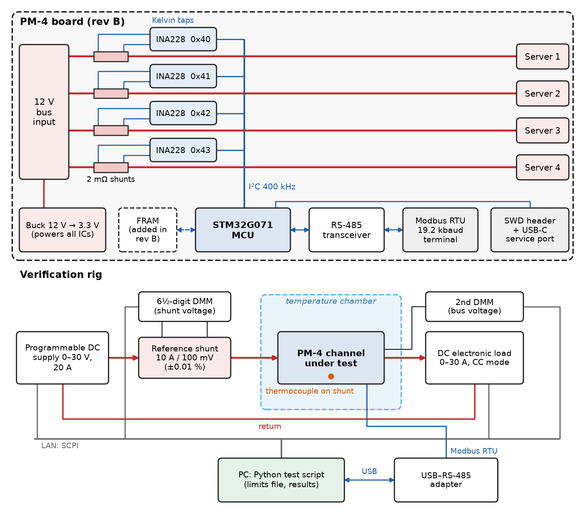
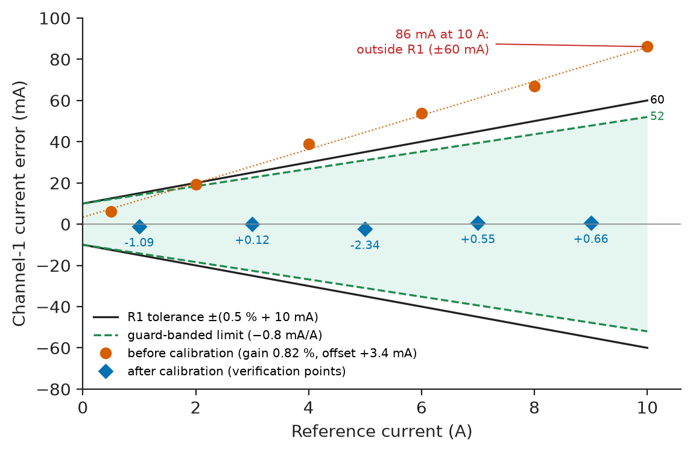
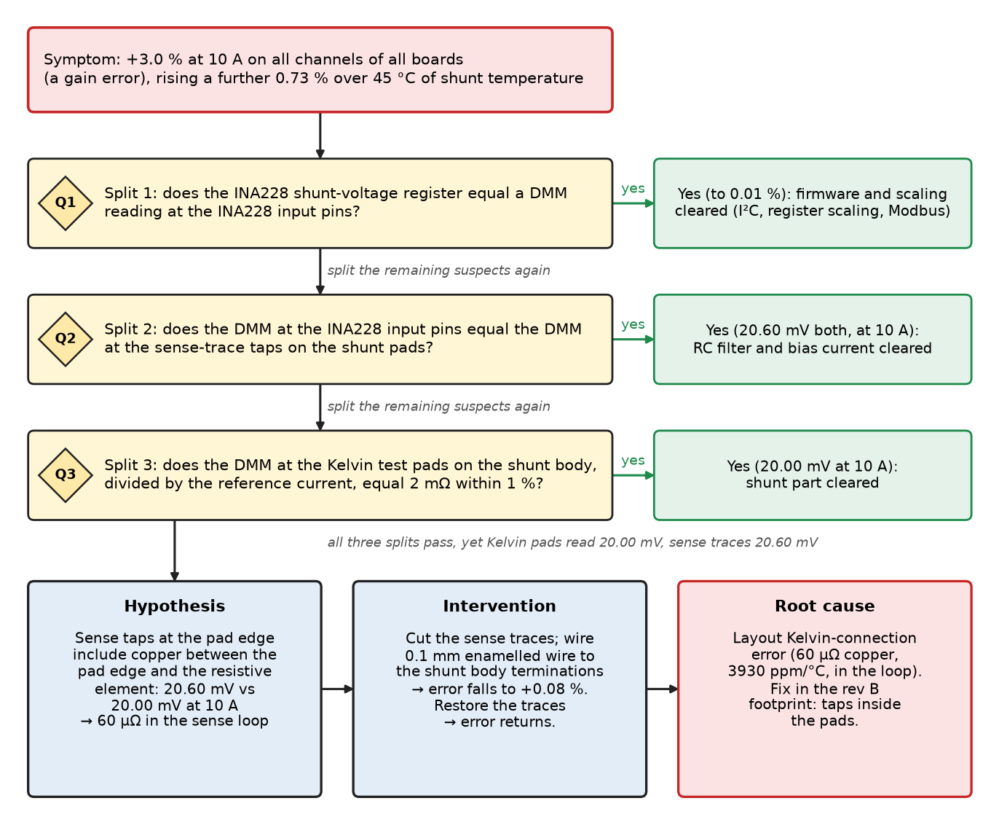
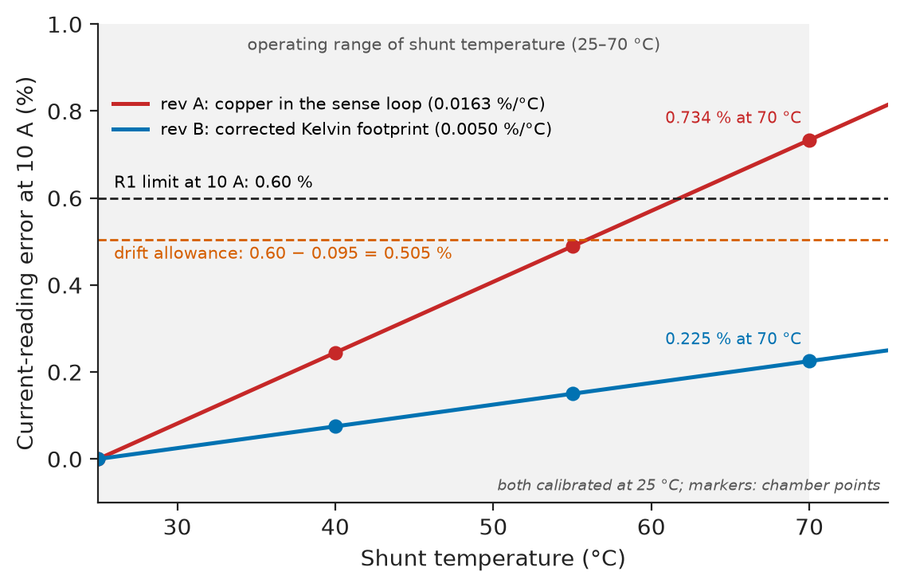
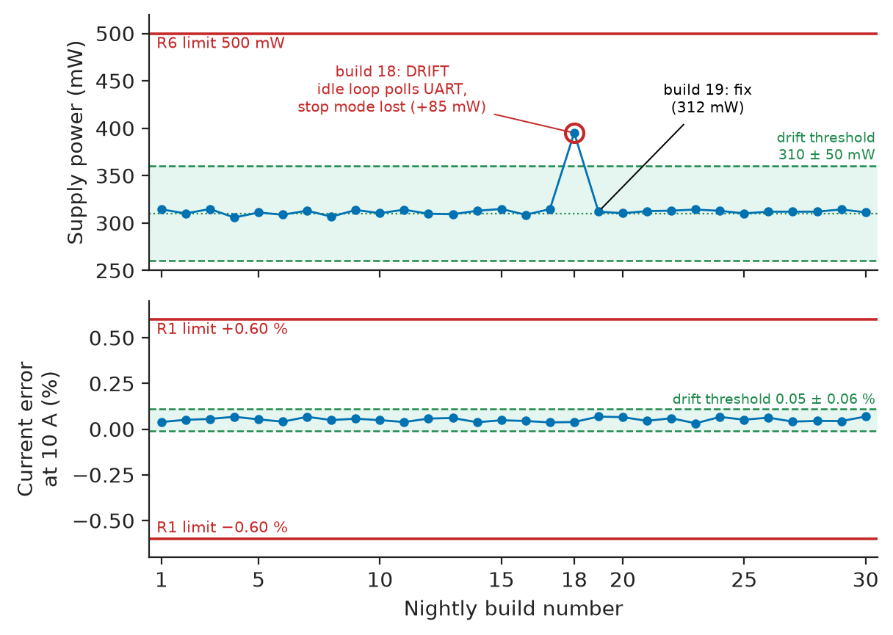

# Chapter 4 — Prototyping and Verification

*Part I · Engineering Design Methodology*

A small team builds PM-4, a four-channel 12 V DC power monitor that sits between the 12 V bus of an edge-computing rack and four servers and reports current, voltage, power and energy per port over RS-485. The breadboard reads within 0.1 % of a reference meter. The first printed circuit board reads 3 % high at 10 A, and the error grows another 0.7 % as the board warms. Nothing on the schematic changed between the two builds. What changed was a piece of copper: on the breadboard the current-sense amplifier was wired to the voltage terminals of a four-terminal shunt module; on the PCB its sense traces left the shunt from the edge of the current-carrying pads, so 60 µΩ of copper with a temperature coefficient of 3,930 ppm/°C ended up inside the measurement. The fault took two days to find because nobody had planned which prototype was supposed to answer which question, the test plan checked only one current at room temperature, and the reference meter on the bench was not accurate enough to tell a 0.5 % error from a good board. This chapter is about the work between a model that predicts a design will meet its requirements (Chapter 3) and the evidence that it does.

> **What must each prototype prove, and how do you choose the instruments, tests and limits that prove it?**
> **When a prototype fails, how do you find the cause quickly, fix it, and make sure the same fault never comes back unnoticed?**

| Concept | Engineering destination |
|---|---|
| Prototype planning | A build sequence (breadboard, EVT, DVT, PVT) where each build retires named risks |
| Breadboarding | Fast proof of firmware, interfaces and circuit concepts before copper is committed |
| PCB prototyping | Layout-dependent behaviour: Kelvin sensing, thermal paths, EMC, testability |
| Instrument selection | Reference instruments with a test-uncertainty ratio that makes pass/fail decisions meaningful |
| Test plans | Test cases traced to requirement IDs, with conditions, limits and pass/fail rules |
| Verification versus validation | "Built right" against the specification versus "right product" in the user's rack |
| Calibration | Gain and offset correction of every unit against traceable references, with guard-banded limits |
| Fault diagnosis | Half-splitting, hypothesis tests and root-cause records instead of trial-and-error |
| Regression testing | Automated re-runs of the verification suite on every firmware build and board revision |
| Design iteration | Revision B: changes justified by failures and validation findings, closed by re-test |

**Roadmap.** Plan the builds and what each must prove (4.1) → cheap concept builds (4.2) → the first boards and what only copper can reveal (4.3) → instruments good enough to judge (4.4) → test plans (4.5) and the difference between verifying and validating (4.6) → calibration of every unit (4.7) → diagnosing what went wrong (4.8) → keeping it fixed (4.9) → the next revision (4.10).

---

## 4.1 Prototype planning

### The running example: PM-4

PM-4 is small enough to follow in detail and has every ingredient of a larger system: an analog measurement whose accuracy depends on layout, firmware, a field bus, a power supply, an enclosure, a calibration step in production, and users with expectations nobody wrote down. Chapters 1–3 showed how requirements, an architecture and a model are produced; here they are taken as given and turned into hardware. Table 4.1 is the specification the prototypes are built to verify.

**Table 4.1 — PM-4 requirements (abridged).**

| ID | Requirement | Target | Verification method |
|---|---|---|---|
| R1 | Current accuracy, each channel, 0–10 A, 0–50 °C ambient | ±(0.5 % of reading + 10 mA) | Test against reference shunt, 11 points, 25 °C and 50 °C |
| R2 | Bus-voltage accuracy, 10.8–13.2 V | ±(0.2 % of reading + 10 mV) | Test against 6½-digit DMM |
| R3 | Power accuracy, 1–10 A | ±1.0 % of reading | Computed from R1, R2 test data; spot test |
| R4 | Update period of all channels | 1.00 s, jitter ≤ 10 ms | Logic-analyser capture of Modbus responses |
| R5 | Interface | Modbus RTU over RS-485, 19.2 kbaud, 32 units per segment | Protocol conformance test |
| R6 | Self-consumption from the 12 V bus | ≤ 0.5 W | Input power measurement |
| R7 | Insertion voltage drop per channel at 10 A | ≤ 30 mV | Four-wire voltage measurement |
| R8 | Ambient temperature range | 0–50 °C operating | Chamber test |
| R9 | ESD immunity | IEC 61000-4-2, ±4 kV contact, criterion B | Accredited lab, pre-scan in house |
| R10 | Unit cost at 1,000 pcs | ≤ \$30.00 | BOM roll-up (Chapter 5) |

The architecture (Figure 4.1) is one INA228-class 20-bit current/power monitor per channel, each reading a 2 mΩ shunt in the positive rail, all four on one I²C bus to an STM32G071-class microcontroller that runs Modbus on an RS-485 transceiver. A 4.5–36 V buck converter makes 3.3 V from the monitored bus itself.

<!-- FIGURE 4.1 | figures/ch04/fig-4-1-pm4-architecture-and-rig.png | block-diagram | PM-4 architecture (top) and the bench rig used to verify it (bottom). | Content: top half, PM-4 board: 12 V bus input terminal -> four channel paths each with a 2 mOhm shunt (Kelvin taps drawn) -> output terminals to Server 1 to Server 4; each shunt feeds an INA228 (I2C addresses 0x40 to 0x43); I2C bus at 400 kHz to STM32G071 MCU; MCU -> RS-485 transceiver -> Modbus RTU 19.2 kbaud terminal; MCU -> FRAM (added in rev B, drawn dashed); buck converter 12 V to 3.3 V powering all ICs; SWD header and USB-C service port. Bottom half, test rig: programmable DC supply 0-30 V 20 A -> reference shunt 10 A / 100 mV (0.01 %) in series -> PM-4 channel under test -> DC electronic load 0-30 A CC mode; 6.5-digit DMM on reference shunt voltage; second DMM on bus voltage; thermocouple on shunt; temperature chamber boundary around PM-4; PC running Python test script talking SCPI over LAN to supply, load and DMMs and Modbus over USB-RS-485 adapter to PM-4. Arrows labelled with interface names. -->



*Figure 4.1 — PM-4 architecture (top) and the bench rig used to verify it (bottom).*

### A prototype answers questions

A prototype is an experiment, and an experiment without a question produces anecdotes. Planning starts from the risk list (every requirement or assumption that could be wrong, ranked by likelihood and by the cost of finding out late), and each build is assigned the risks it must retire and the tests that retire them. Table 4.2 is the usual ladder; its names come from consumer and automotive practice, its logic applies to a 50-unit industrial product as much as to a phone.

**Table 4.2 — The prototype ladder for PM-4.**

| Build | Form | Quantity | Questions it must answer | Exit criterion |
|---|---|---|---|---|
| Concept (breadboard) | Evaluation boards, shunt module, MCU dev kit | 1 | Does the INA228 + firmware + Modbus chain work? Is the error budget plausible? | R1 met at 25 °C on 1 channel; Modbus read of all registers |
| EVT (engineering validation test) | First PCB, hand or quick-turn assembled | 5 | Does the layout preserve accuracy? Thermal rise? Power consumption? Debug access? | R1–R7 met at 25 °C on all channels of 3 boards |
| DVT (design validation test) | Final layout, production parts, real enclosure | 22 | Does the design meet all requirements over temperature, ESD, unit-to-unit spread? | Full verification table passes; no open severity-1 defects |
| PVT (production validation test) | Built by the contract manufacturer on the production line with the production tester | 100 | Can it be built and calibrated at yield and cost? | First-pass yield ≥ 95 %; test time ≤ 90 s; R10 met |

Two rules keep the ladder honest: a build starts only when the previous exit criterion is met or a reasoned waiver is signed (skipping EVT is how a layout error reaches 22 DVT units), and each quantity is set by what must be estimated, not by what the budget leaves over.

**Worked example — How many DVT units?** The DVT must show, with 90 % confidence, that at least 90 % of units meet R1 over temperature. If $n$ units are tested and none fails, the success-run relation from the binomial distribution gives the minimum sample size:

$$
n=\frac{\ln(1-C)}{\ln R}=\frac{\ln 0.10}{\ln 0.90}=21.9\ \Rightarrow\ 22\ \text{units}
$$

Raising the demonstrated reliability to 95 % at the same confidence needs $\ln 0.10/\ln 0.95=44.9$, so 45 units, which doubles the DVT cost; lowering it to 80 % needs 11. The team chose 22, because unit-to-unit spread in PM-4 comes mainly from the shunt tolerance, which calibration removes, and because PVT adds 100 more units of evidence. One failure among the 22 voids the demonstration; the units are then analysed, the cause fixed, and the sample re-run.

> **Status of the principle: Success-run sample size**
> *Derived.* Follows from the binomial probability of zero failures in $n$ independent trials, $R^n\le 1-C$; it assumes the units are representative of production and that the test actually exercises the failure mechanism, which no formula can check.

PM-4's five largest risks at the start were layout error in the 2 mΩ sense path, shunt self-heating, I²C robustness, buck-converter noise coupling, and cost. The concept build attacks the I²C risk; EVT the layout, heating and noise; DVT everything over temperature; PVT the cost. A risk that no build is scheduled to retire is a risk the project has decided to discover in the field.

---

## 4.2 Breadboarding

### What a breadboard is for

A breadboard (in the broad sense: solderless board, evaluation modules, dev kits and jumper wires) is the cheapest way to answer questions about *function*: does the chip respond, does the firmware read the right registers, does the protocol stack interoperate, is the error budget of the right order. It is a poor way to answer questions about *parasitics*: contact resistance, stray capacitance, loop inductance and thermal paths are all different from the final board, and sometimes worse by orders of magnitude.

**Table 4.3 — Solderless breadboard and jumper parasitics (typical).**

| Parameter | Typical value | Consequence |
|---|---|---|
| Contact resistance per spring contact | 10–50 mΩ, varies with insertion and age | Useless for milliohm current paths; unstable in any current path above about 1 A |
| Current rating of a contact | about 1 A continuous | Contacts heat and loosen at 10 A |
| Capacitance between adjacent rows | 2–5 pF | Limits high-impedance and above-10 MHz circuits |
| Jumper wire inductance | about 10 nH per cm | Ringing on fast edges; switching converters will not behave as on PCB |

**Worked example — Why the 10 A path stays off the breadboard.** A 10 A test current through one breadboard contact of 20 mΩ drops $10\times0.020=0.20$ V and dissipates $10^2\times0.020=2.0$ W in a spring the size of a grain of rice; the plastic softens within a minute. More subtly, if the INA228 sense inputs were taken from breadboard rows rather than from the shunt's own terminals, a 20 mΩ contact in series with a 2 mΩ shunt would make the reading wrong by a factor of eleven. The concept build therefore uses a four-terminal 2 mΩ shunt module bolted to 2.5 mm² wire, with the INA228 evaluation module's sense inputs wired by a twisted pair directly to the module's voltage terminals; only the low-current logic (I²C, power, RS-485) goes through the breadboard.

> **Status of the principle: Breadboards prove function, not parasitics**
> *Empirical.* A breadboard reproduces logic, firmware and low-frequency signal behaviour reliably; any result that depends on milliohms, picofarads, nanohenries or thermal paths must be re-measured on the PCB.

### What the PM-4 concept build proved

In two weeks the concept build showed that the firmware reads four INA228s at 400 kHz I²C (rise time 180 ns with 4.7 kΩ pull-ups, against the 300 ns fast-mode limit), that the Modbus stack interoperates with two commercial masters, that the error at 25 °C is within ±0.1 % from 1 to 10 A after a two-point calibration, and that the noise on a 1 s average is 0.3 mA rms. The shunt module rose 18 °C at 10 A, which put shunt drift on the EVT test list with a number attached. The concept build proved nothing about the PCB sense path, and the team's mistake was to treat its 0.1 % result as if it had.

---

## 4.3 PCB prototyping

### What only copper can reveal

The first PCB build is where layout-dependent requirements are tested for the first time. For PM-4 these are the four-wire (Kelvin) sense connection of each shunt, the thermal path that sets shunt temperature, the coupling of the buck converter's 1 MHz switching node into the sense traces, and ESD paths from the field terminals. Quick-turn fabrication makes the first board cheap compared with the cost of an error discovered later: in 2026 a five-piece order of a 100 × 80 mm four-layer board costs roughly \$60–\$150 with a five-working-day turnaround, and partial assembly by a quick-turn assembler adds about \$200–\$400 in set-up.

### Design for test and debug

An EVT board is built to be probed, reworked and measured. The PM-4 EVT layout included features that the production board would later drop or shrink:

- **Test points** on every rail, the I²C and RS-485 lines and each alert output, on a 2.54 mm grid that a production bed-of-nails fixture can reuse.
- **Zero-ohm links** in each block's supply, so current can be measured per block and a block isolated during diagnosis.
- **Kelvin test pads** on each shunt body, separate from the INA228 sense traces, so the shunt voltage can be measured independently of the amplifier.
- **An SWD header**, a UART log output and option footprints (a second RC filter stage on the sense lines), populated only if tests demand them.

### The error budget the PCB must preserve

The EVT test limits come from the error budget written before layout. Table 4.4 is the budget for one channel at 10 A, after the per-unit calibration of Section 4.7 at 25 °C board temperature, with the worst-case board temperature of 70 °C (50 °C ambient plus 20 °C self-heating) at the hot end.

**Table 4.4 — Current error budget, one channel at 10 A, after calibration.**

| Contribution | Basis | Error at 10 A |
|---|---|---|
| Shunt temperature coefficient | 50 ppm/°C × 45 °C | 0.225 % |
| INA228 gain drift | 20 ppm/°C max × 25 °C die rise | 0.050 % |
| Calibration reference | Reference shunt plus DMM, Section 4.4 | 0.020 % |
| Noise on a 1 s average | Concept build measurement | 0.010 % |
| Nonlinearity after two-point calibration | Concept build residuals | 0.010 % |
| Offset after calibration | 0.5 mA residual | 0.005 % |
| **Worst-case sum** |  | **0.320 %** |
| **Root sum of squares** |  | **0.232 %** |
| **Requirement R1 at 10 A** | 0.5 % + 10 mA | **0.600 %** |
| **Margin (worst case)** | (0.600 − 0.320)/0.600 | **47 %** |

The budget is the contract between the designer and the layout: the shunt drift entry assumes that the only temperature-sensitive resistance inside the sense loop is the shunt itself. Section 4.8 shows what happened when the layout broke that assumption.

> **Boundary.** How individual error terms combine (worst case, root sum of squares, and expanded uncertainty per GUM/JCGM 100) belongs to Chapter 7 of this book, with the statistics in [*The Mathematics Universe*, Ch. 20 §20.10](https://github.com/The-Studio-of-Sadiq/engineering-mathematics/blob/main/part-6-probability-statistics/20-statistical-analysis.md). The INA228's internal ADC architecture and the reference behind it are circuit topics of [*Electronics and Computing*, Ch. 10 §10.7 and §10.10](https://github.com/The-Studio-of-Sadiq/Electronics-and-Computing/blob/main/part-2-analog-electronics/10-analog-integrated-circuits.md). Here the budget is a test limit.

---

## 4.4 Instrument selection

### The instrument must be better than the requirement

A test can only decide pass or fail if the measuring system is substantially more accurate than the tolerance being checked. Practice expresses this as the **test-uncertainty ratio** (TUR): the tolerance of the requirement divided by the uncertainty of the measurement used to check it. Calibration laboratories and most quality systems ask for a TUR of at least 4:1 (ANSI/NCSL Z540.3 uses the closely related probability of false accept, at most 2 %); below that, either the limits must be guard-banded (Section 4.7) or a better instrument found.

> **Status of the principle: The 4:1 test-uncertainty ratio**
> *Empirical.* A convention from metrology practice that keeps the probability of accepting a bad unit to a few percent for typical distributions of unit errors; it is a rule of thumb, not a law, and a decision rule with explicit guard bands (ISO/IEC 17025, ILAC G8) replaces it when the ratio cannot be met.

**Worked example — Choosing the current reference.** R1 at 10 A allows ±60 mA, that is ±0.60 %. Two ways of measuring the reference current were on the bench:

1. A 6½-digit bench DMM on its 10 A range. A typical 1-year specification for this class is 0.15 % of reading + 0.008 % of range, so 0.158 % at 10 A. TUR $=0.60/0.158=3.8$, below 4:1 and, worse, the DMM's own 10 A shunt self-heats during a long sweep.
2. A 10 A / 100 mV reference shunt with a calibration certificate of ±0.010 %, read by the same DMM on its 100 mV range, typically 0.0050 % of reading + 0.0035 % of range, so 0.0085 % at full scale. The worst-case sum is $0.010+0.0085=0.0185$ %, giving TUR $=0.60/0.0185=32$.

Option 2 costs one reference shunt (about \$400–\$900 with a certificate) and makes every later decision clear. It also measures what R1 asks for: current in the external circuit, independent of the DUT.

### The PM-4 instrument set

Table 4.5 is the selection made for EVT and DVT. Each row starts from the requirement it serves; a "nice" instrument that serves no requirement is not bought.

**Table 4.5 — Instrument selection for PM-4 verification.**

| Need (requirement) | Candidate classes | Key specification needed | Chosen | Why |
|---|---|---|---|---|
| Reference current, 0–10 A (R1, R3) | DMM 10 A range; reference shunt + DMM 100 mV range; precision current source | Uncertainty ≤ 0.15 % (TUR 4) | Reference shunt 10 A/100 mV ±0.01 % + 6½-digit DMM | TUR 32; independent of DUT |
| Bus voltage reference (R2) | 4½-digit handheld; 6½-digit DMM | ≤ 0.07 % at 12 V | Second 6½-digit DMM, 100 V range | About 0.004 % typical; TUR > 50 |
| Source and sink 0–10 A at 12 V | Bench supply + resistor bank; programmable supply + DC electronic load | Programmable, ≥ 12 A, SCPI over LAN | 30 V/20 A programmable supply; 30 A DC electronic load (CC mode) | Automated sweeps, repeatable steps |
| Timing, jitter (R4) | Oscilloscope; logic analyser with protocol decode | 1 µs resolution, Modbus/UART decode, 60 s record | 8-channel logic analyser | Long captures, protocol-level timestamps |
| Temperature (R1 at 50 °C, R8) | Oven; temperature chamber; thermal camera | 0–70 °C, ±1 °C uniformity | Benchtop chamber plus type T thermocouples on shunts; thermal camera for EVT | Chamber for limits, camera for finding hot spots |
| Switching noise coupling | 100 MHz scope; 200 MHz 12-bit scope with differential probe | 12-bit vertical, 1 mV/div | 200 MHz 12-bit oscilloscope | Sees 1 MHz buck ripple on sense lines |
| ESD (R9) | Accredited lab; in-house ESD gun | IEC 61000-4-2 levels | In-house gun for pre-scan; lab for the formal test | Find failures before paying for the lab |

Every instrument used for a verification result carries an asset number and a calibration due date, both recorded in the test report (Chapter 5); an instrument out of calibration on the day of a test turns a pass into "unknown".

---

## 4.5 Test plans

### Anatomy of a test plan

A test plan converts each requirement into one or more test cases, each of which can be executed by someone other than its author and gives the same verdict. A useful test case has seven fields: **ID and requirement trace** (TC-R1-03 → R1); **purpose**; **set-up** (equipment by asset number, wiring diagram, firmware build, unit serial); **conditions** (temperature, supply voltage, load); **procedure** (steps, settling times, number of readings); **limits** (numerical, including guard band); and **pass/fail rule** (all points within limits, or a statistical rule). A plan also says what happens on failure: stop, record, notify, and whether the unit may be re-tested.

**Table 4.6 — Excerpt of the PM-4 DVT test plan.**

| Test case | Trace | Conditions | Procedure | Limit | Rule |
|---|---|---|---|---|---|
| TC-R1-01 | R1 | 25 °C, 12.0 V, each channel | 11 points 0–10 A; 30 s settle; mean of 10 readings at 1 s | ±(0.5 % + 10 mA) minus guard band | All points pass |
| TC-R1-02 | R1, R8 | 50 °C ambient, 10 A on all four channels for 30 min | Readings every 10 s; last 10 min evaluated | Same | All readings pass |
| TC-R2-01 | R2 | 25 °C; 10.8, 12.0, 13.2 V | 10 readings each | ±(0.2 % + 10 mV) | All pass |
| TC-R4-01 | R4 | 25 °C | 600 consecutive polls | 1.00 s ± 10 ms | Max deviation within limit |
| TC-R6-01 | R6 | 13.2 V, RS-485 active, all LEDs on | Input power, 60 s average | ≤ 0.5 W | Pass |
| TC-R7-01 | R7 | 10 A, 25 °C | Four-wire voltage, input to output terminal | ≤ 30 mV | Pass |
| TC-R9-01 | R9 | IEC 61000-4-2 set-up | ±4 kV contact on terminals and enclosure, 10 discharges each polarity | Criterion B: self-recovery, no data loss | Pass |

### Coverage of conditions, not only of requirements

Rev A passed its first test because the only current test ran at room temperature with one channel loaded; temperature, and four channels at full load heating the board together, were never exercised. A plan must cover the conditions that drive each term of the error budget: for PM-4 the corners of current, ambient, bus voltage and number of loaded channels. All combinations would be $2^4=16$ corners per channel; the plan tests those the budget says are worst (hot, four channels, 10 A) plus the room-temperature sweep.

### Automating the bench

A plan executed by hand is executed slightly differently each time. PM-4 tests run from a Python script that drives the supply and load over SCPI, reads the DMMs and the DUT, applies limits from one limits file and stamps each results file with unit serial, firmware hash, instrument asset numbers and ambient temperature. With a different limits file the same script becomes the PVT production test, the cheapest way to make production and design verification agree.

---

## 4.6 Verification versus validation

### Two different questions

**Verification** asks whether the product meets its specification: each requirement in Table 4.1, tested against its limit. **Validation** asks whether the product meets the needs of its users in its real environment, including the needs that never became requirements. The distinction is the same one made for firmware in the V-model of [*Electronics and Computing*, Ch. 28 §28.10](https://github.com/The-Studio-of-Sadiq/Electronics-and-Computing/blob/main/part-6-embedded-and-real-time-systems/28-embedded-system-design.md); here it is applied to the whole device, on the bench for verification and in users' racks for validation.

> **Status of the principle: Verification does not imply validation**
> *Fundamental.* A specification is a finite description of an open-ended need; a product can satisfy every written requirement and still fail the need the requirements were meant to capture, so validation evidence must come from the use environment, not from the specification.

### The DVT verification table

Table 4.7 is the summary of DVT verification of 22 Rev B units (the revision produced in Section 4.10). Each result is the worst unit.

**Table 4.7 — PM-4 Rev B DVT verification summary (22 units).**

| Req. | Test | Limit | Worst result | Verdict |
|---|---|---|---|---|
| R1 | TC-R1-01/02, 25 °C and 50 °C, four channels | ±52 mA at 10 A (guard-banded) | +21 mA at 10 A, 50 °C | Pass |
| R2 | TC-R2-01 | ±(0.2 % + 10 mV) = ±34 mV at 12 V | −9 mV | Pass |
| R3 | Derived from R1/R2 data | ±1.0 % | 0.29 % | Pass |
| R4 | TC-R4-01 | 1.00 s ± 10 ms | 1.4 ms deviation | Pass |
| R5 | Modbus conformance, 32-unit segment emulated | No exceptions, CRC errors 0 in 10⁵ polls | 0 errors | Pass |
| R6 | TC-R6-01 | ≤ 0.50 W | 0.31 W | Pass |
| R7 | TC-R7-01 | ≤ 30 mV at 10 A | 24 mV | Pass |
| R8 | Chamber 0 °C and 50 °C, 4 h each | Functional, R1 met | Met | Pass |
| R9 | IEC 61000-4-2 ±4 kV contact | Criterion B | Reset on 2 of 40 discharges, recovered in 1.2 s, energy count kept | Pass |
| R10 | BOM roll-up | ≤ \$30.00 | \$28.45 | Pass |

### What validation found

Before DVT closed, six EVT units were installed in a customer's pilot rack for four weeks next to the rack's billing meter. They met every number in Table 4.1, and validation still found two needs nobody had written down:

1. **Energy totals must survive a bus outage.** The rack's tenant billing used PM-4's energy registers. During a planned maintenance the 12 V bus went down for 20 minutes; PM-4, powered from the same bus, lost a day of accumulated energy held in RAM. No requirement said the counters must be non-volatile, because the specification had been written for "monitoring", and billing was the users' real use.
2. **Hot-plug spikes caused nuisance alarms.** A server's power supply draws an inrush spike when plugged in; the 1 s average was fine but a firmware overcurrent alarm sampled single conversions and tripped.

Both became requirements, R11 (energy totals retained through loss of supply, ≤ 1 Wh lost per outage) and R12 (overcurrent alarm on a 100 ms moving average), and entered Revision B (Section 4.10). Six units in one rack found them more cheaply than six hundred in a data centre would have.

---

## 4.7 Calibration

### What calibration can and cannot fix

Calibration compares the instrument with a reference of known, traceable value under stated conditions and records the relationship; *adjustment* then changes the instrument so its readings agree. In products the two are combined: measure each unit against a reference, compute and store correction coefficients, and verify at points not used for the fit. This removes systematic errors that stay stable between calibration and use (shunt tolerance, gain and offset), but not noise, temperature drift, ageing, or any error that depends on a condition the calibration did not reproduce.

> **Status of the principle: Calibration removes only stable systematic error**
> *Derived.* A correction measured under one set of conditions equals the error under another set only to the extent that the error does not depend on the conditions that changed; the residual is therefore bounded by the drift terms of the budget (Table 4.4), not by the calibration fit.

### The PM-4 calibration procedure

The production calibration of each channel is:

1. Soak the unit at 25 ± 2 °C for 10 minutes with the bus at 12.0 V and no load.
2. Apply six reference currents, 0.5, 2, 4, 6, 8 and 10 A, from the electronic load; at each point wait 5 s (shorter than the shunt's thermal time constant, so the shunt stays near 25 °C) and average 10 readings of both the DUT raw current and the reference shunt.
3. Fit raw = gain × reference + offset by least squares; reject the unit if any residual exceeds 5 mA (a sign of nonlinearity or a bad contact, not of calibratable error).
4. Write gain and offset to the unit's non-volatile memory with a CRC and the calibration date, station ID and procedure revision.
5. Verify at five different currents (1, 3, 5, 7, 9 A) against guard-banded limits.

The least-squares fit itself is standard ([*The Mathematics Universe*, Ch. 20 §20.9](https://github.com/The-Studio-of-Sadiq/engineering-mathematics/blob/main/part-6-probability-statistics/20-statistical-analysis.md); the same pattern in Python appears in [*Electronics and Computing*, Ch. 22 §22.5](https://github.com/The-Studio-of-Sadiq/Electronics-and-Computing/blob/main/part-5-programming-and-computational-systems/22-python-for-engineering.md)). What matters here is the procedure around it: points not used for the fit are used for the verdict, and the verdict uses guard-banded limits.

### Guard banding

The production station's reference chain (cheaper than the DVT bench, with fixture contact resistance) has an expanded uncertainty $U_{95}$ of 8 mA at 10 A, so a unit truly 61 mA out could read inside the 60 mA tolerance. The guard-banded acceptance limit subtracts the test uncertainty from the tolerance:

$$
A = T - U_{95} = 60\ \mathrm{mA} - 8\ \mathrm{mA} = 52\ \mathrm{mA}\quad\text{at } 10\ \mathrm{A}
$$

This is the simple guarded-acceptance rule of ILAC G8: it costs some yield near the limit and buys confidence that no accepted unit is outside R1. The station's uncertainty is taken as proportional to current.

**Worked example — Calibrating and verifying one channel.** The listing applies the procedure to channel 1 of a Rev B board (an illustrative data set of the kind the station records).

```python
import numpy as np

# Calibration points: reference current (A, from reference shunt + DMM)
# and the raw PM-4 channel-1 reading (A, factory-default coefficients).
i_ref = np.array([0.500, 2.000, 4.000, 6.000, 8.000, 10.000])
i_raw = np.array([0.5063, 2.0194, 4.0388, 6.0539, 8.0670, 10.0861])

gain, offset = np.polyfit(i_ref, i_raw, 1)          # raw = gain*ref + offset
resid_mA = 1e3 * (i_raw - (gain * i_ref + offset))
print(f"gain = {gain:.5f}  offset = {1e3*offset:+.2f} mA  "
      f"max |residual| = {np.abs(resid_mA).max():.2f} mA")

def corrected(raw):
    return (raw - offset) / gain

# Verification at points NOT used for the fit, against R1: +/-(0.5 % rdg + 10 mA)
i_chk = np.array([1.000, 3.000, 5.000, 7.000, 9.000])
r_chk = np.array([1.0105, 3.0282, 5.0422, 7.0616, 9.0782])
U_test = 0.008                                       # A, test-station U95 at 10 A
for ref, raw in zip(i_chk, r_chk):
    err = corrected(raw) - ref
    tol = 0.005 * ref + 0.010
    acc = tol - U_test * ref / 10                    # guard-banded acceptance limit
    print(f"{ref:4.1f} A  err {1e3*err:+6.2f} mA  limit +/-{1e3*acc:5.1f} mA  "
          f"{'PASS' if abs(err) <= acc else 'FAIL'}")
```

```text
gain = 1.00824  offset = +3.35 mA  max |residual| = 2.48 mA
 1.0 A  err  -1.09 mA  limit +/- 14.2 mA  PASS
 3.0 A  err  +0.12 mA  limit +/- 22.6 mA  PASS
 5.0 A  err  -2.34 mA  limit +/- 31.0 mA  PASS
 7.0 A  err  +0.55 mA  limit +/- 39.4 mA  PASS
 9.0 A  err  +0.66 mA  limit +/- 47.8 mA  PASS
```

The uncalibrated channel read 0.82 % high, mostly the shunt's tolerance (the part is ±1 %) plus a 3.35 mA offset; that alone would fail R1 at 10 A (0.82 % > 0.60 %). After correction the worst verification error is 2.34 mA against a limit of 31.0 mA. The 2.48 mA maximum residual is under the 5 mA reject threshold of step 3. Figure 4.2 shows the error before and after correction across the range, with the guard-banded limit.

<!-- FIGURE 4.2 | figures/ch04/fig-4-2-calibration-error.png | plot | Channel-1 current error of a PM-4 rev B board before and after two-point least-squares calibration, against the R1 tolerance and the guard-banded acceptance limit. | Content: x-axis reference current 0 to 10 A; y-axis error in mA from -80 to +100. Series 1 (before calibration, markers at 0.5, 2, 4, 6, 8, 10 A): errors +6.3, +19.4, +38.8, +53.9, +67.0, +86.1 mA, roughly a straight line of slope 0.82 percent plus 3.4 mA. Series 2 (after calibration, markers at the verification points 1, 3, 5, 7, 9 A): -1.09, +0.12, -2.34, +0.55, +0.66 mA. Solid lines: R1 tolerance +/-(0.005 I + 10 mA), i.e. +/-10 mA at 0 A to +/-60 mA at 10 A. Dashed lines: guard-banded limit +/-(0.005 I + 10 mA - 0.8 mA per A), i.e. +/-10 mA at 0 A to +/-52 mA at 10 A. Annotate uncalibrated 86 mA at 10 A as outside R1. -->



*Figure 4.2 — Channel-1 current error of a PM-4 rev B board before and after two-point least-squares calibration, against the R1 tolerance and the guard-banded acceptance limit.*

### Calibration records and intervals

The calibration data are part of the unit's record (serial, date, station, procedure revision, reference asset numbers and due dates, raw data, coefficients, verdict); a unit whose record cannot be found cannot be shown to meet R1. The bench instruments' own interval (12 months for the DMMs and reference shunt) comes from the manufacturer's stability specification and the laboratory's quality system (ISO/IEC 17025 when accredited), and is shortened if an instrument is found out of tolerance. The calibration of sensors rather than whole instruments, with traceable references for temperature, torque and current, is the subject of §6.11.

---

## 4.8 Fault diagnosis

### A method, not a mood

Fault diagnosis on a prototype is an experiment on a system whose behaviour has diverged from its model. The efficient method has four steps:

1. **Characterise the symptom with numbers.** "Reads high" cannot be diagnosed; "+3.0 % at 10 A on all four channels of all three boards, rising 0.73 % over 45 °C" can.
2. **List hypotheses that explain all the numbers**, ranked by likelihood and cost of testing.
3. **Split the system** at points where a measurement can tell "good upstream" from "good downstream", choosing points that halve the remaining suspects (half-splitting; Figure 4.3).
4. **Confirm by intervention**: change the suspected cause alone and see the symptom go and come back. Correlation without intervention is a hypothesis, not a root cause.

For $N$ equally likely suspect blocks in a chain, half-splitting finds the faulty one in $\lceil\log_2 N\rceil$ measurements instead of up to $N-1$ by walking along the chain; for the PM-4 signal chain of eight blocks (terminal, copper, shunt, sense trace, RC filter, INA228, I²C, firmware scaling) that is three measurements instead of seven.

> **Status of the principle: Half-splitting**
> *Derived.* Each measurement that divides the remaining suspects into two equally likely halves gains one bit of information, so $\lceil\log_2 N\rceil$ measurements suffice; the result assumes a single fault and observable intermediate points, which is why EVT boards are designed with test pads and zero-ohm links.

<!-- FIGURE 4.3 | figures/ch04/fig-4-3-half-split-diagnosis.png | flowchart | Half-split diagnosis of the PM-4 rev A current error. | Content: start box: Symptom: +3.0 percent at 10 A, all channels, all boards, +0.73 percent over 45 C. Decision 1: Does INA228 shunt-voltage register equal DMM reading at the INA228 input pins? Yes -> firmware and scaling cleared (I2C, register scaling, Modbus). Decision 2: Does DMM at INA228 input pins equal DMM at the sense-trace taps on the shunt pads? Yes (20.60 mV both at 10 A) -> RC filter and bias current cleared. Decision 3: Does DMM at the Kelvin test pads on the shunt body divided by the reference current equal 2 mOhm within 1 percent? Yes (20.00 mV) -> shunt part cleared. Hypothesis box: sense taps at the pad edge include copper between pad edge and resistive element, 20.60 mV versus 20.00 mV, i.e. 60 microohm. Intervention box: cut sense traces, wire 0.1 mm enamelled wire to shunt body terminations; error falls to +0.08 percent; restore -> error returns. Root cause box: layout Kelvin connection error; fix in rev B footprint. -->



*Figure 4.3 — Half-split diagnosis of the PM-4 rev A current error.*

### The Rev A story

Applying the method to the opening fault:

- **Symptom.** With the *concept* build's coefficients, all twelve channels of the three EVT boards read between +2.7 % and +3.3 % high (mean +3.0 %) at any current, and the error rose by 0.73 % between 25 °C and 70 °C shunt temperature. Proportional to current, it is a gain error, not an offset; present on every channel with a spread no larger than the shunt tolerance, it is a design error, not a manufacturing one.
- **Hypotheses.** (a) Wrong SHUNT_CAL value in firmware (gain scaling); (b) shunt parts out of tolerance or a wrong part fitted; (c) a resistance in series with the shunt inside the sense loop; (d) INA228 input bias current through the RC filter resistors.
- **Split 1.** The INA228 shunt-voltage register (raw, before the firmware's current scaling) agreed with a DMM at the INA228 input pins to 0.01 %: firmware, I²C and scaling cleared, hypothesis (a) gone.
- **Split 2.** The DMM at the INA228 pins agreed with a DMM at the far end of the sense traces where they leave the shunt pads (20.60 mV against 20.60 mV at 10 A), so the RC filter and its bias-current drop were cleared and hypothesis (d) was gone (a bias current would produce an offset, not a gain error). But the separate Kelvin test pads on the shunt body read only 20.00 mV: the 3 % lived between the pad edge and the resistive element.
- **Split 3.** The voltage across the shunt body divided by 2 mΩ matched the reference current within the shunt's 1 % tolerance: hypothesis (b) gone.
- **Intervention.** On one board the sense traces were cut and replaced by fine wires soldered at the shunt's terminations; the error dropped to +0.08 %. Restoring the traces brought it back.

The root cause is a resistance in the sense loop that is not the shunt: the footprint's sense traces left each pad at its outer edge, so the measured path included copper from the pad edge to the resistive element. Its size follows from the 3.0 % error: $0.030\times2\ \mathrm{m\Omega}=60\ \mathrm{\mu\Omega}$.

**Worked example — Copper in the sense loop.** One-ounce copper (35 µm) has a sheet resistance of $\rho/t=1.72\times10^{-8}/35\times10^{-6}=0.49\ \mathrm{m\Omega}$ per square, so 60 µΩ is only 0.12 squares of copper: a strip 1 mm wide and 0.12 mm long, or the solder-and-copper path under the edge of a 2512 pad. The copper's temperature coefficient (3,930 ppm/°C) then enters the measurement. The effective temperature coefficient of the sensed resistance, referred to the calibrated value, is

$$
\alpha_\mathrm{eff}=\frac{R_\mathrm{Cu}\,\alpha_\mathrm{Cu}+R_\mathrm{sh}\,\alpha_\mathrm{sh}}{R_\mathrm{sh}+R_\mathrm{Cu}}=\frac{60\ \mathrm{\mu\Omega}\times3930+2000\ \mathrm{\mu\Omega}\times50}{2060\ \mathrm{\mu\Omega}}\ \mathrm{ppm/^\circ C}=163\ \mathrm{ppm/^\circ C}
$$

Over the 45 °C span of Table 4.4 this gives $163\times10^{-6}\times45=0.73$ %, matching the measured drift and more than three times the 0.225 % the budget allotted to the shunt. Calibration could have removed the 3 % gain error; nothing in calibration can remove a drift of 0.73 %, which together with the other budget terms (0.73 + 0.095 = 0.83 %) exceeds R1's 0.60 % at 10 A. Figure 4.4 compares the drift of Rev A and Rev B.

<!-- FIGURE 4.4 | figures/ch04/fig-4-4-revA-revB-drift.png | plot | Current-reading error at 10 A versus shunt temperature for rev A (copper in the sense loop) and rev B (corrected Kelvin footprint), both calibrated at 25 C. | Content: x-axis shunt temperature 25 to 75 C; y-axis error in percent from -0.1 to +1.0. Rev A line: 0 percent at 25 C rising linearly with slope 0.0163 percent per C to 0.73 percent at 70 C (markers from chamber data at 25, 40, 55, 70 C). Rev B line: slope 0.005 percent per C, 0.225 percent at 70 C, markers at same temperatures. Horizontal dashed line at 0.6 percent labelled R1 limit at 10 A; second dashed line at 0.6 - 0.095 = 0.505 percent labelled drift allowance after other budget terms. Shaded band 25 to 70 C labelled operating range of shunt temperature. -->



*Figure 4.4 — Current-reading error at 10 A versus shunt temperature for rev A (copper in the sense loop) and rev B (corrected Kelvin footprint), both calibrated at 25 C.*

> **Status of the principle: Kelvin (four-terminal) sensing**
> *Fundamental.* A voltage measured across two points includes every resistance between them; only when the sense connections touch the resistive element at the points where its value is defined, with no load current in the sense leads, does the measured voltage equal current times the specified resistance.

### Recording the failure

A diagnosis ends in a failure record: symptom, data, hypotheses and results, root cause with evidence, corrective action, and the test that proves the fix. Table 4.8 collects PM-4's EVT and pilot failures in FMEA form.

**Table 4.8 — FMEA-style record of PM-4 prototype failures.**

| Failure mode | Effect | Cause | Detection | Mitigation |
|---|---|---|---|---|
| Gain error +3 % and drift 163 ppm/°C | R1 fails over temperature | Sense traces include 60 µΩ of copper (layout) | EVT chamber test; half-split diagnosis | Rev B footprint with sense taps inside pads; DRC rule; TC-R1-02 at 50 °C on 4 channels |
| Energy totals lost on bus outage | Billing data lost | Counters in RAM; device powered from monitored bus | Validation pilot | R11; FRAM plus hold-up capacitor (Section 4.10) |
| Nuisance overcurrent alarms on hot-plug | False alarms to operator | Alarm on single 1 ms conversions | Validation pilot | R12; 100 ms moving average; inrush test case |
| I²C lock-up after ESD hit | Readings freeze until power cycle | Slave holds SDA low after a glitch | ESD pre-scan, 3 of 40 discharges | Bus-recovery routine (9 clocks), watchdog, I²C timeout |
| Buck ripple on sense lines | 1 mA rms extra noise | Sense traces routed beside the switching node | Scope on EVT, 200 MHz probe | Reroute; ground plane under sense pairs; populate second RC stage |
| Calibration coefficient corruption | Channel reads with default gain (0.8 % error) | Write interrupted by power loss at station | Production verification step | CRC on coefficients; two copies; reject unit if both invalid |

---

## 4.9 Regression testing

### Why passing once is not enough

Any change of firmware, layout, part or supplier can break something that worked. Regression testing re-runs the affected part of the verification suite after every change and compares the results with the limits and with the previous results. PM-4 runs three tiers:

- **On every firmware commit (minutes):** host-side unit tests of the scaling, Modbus and energy-accumulation code; build of the release binary; static analysis ([*Electronics and Computing*, Ch. 28 §28.10](https://github.com/The-Studio-of-Sadiq/Electronics-and-Computing/blob/main/part-6-embedded-and-real-time-systems/28-embedded-system-design.md) covers these practices for firmware).
- **Nightly (about 40 minutes):** the bench of Figure 4.1 flashes the newest build onto two reference boards and runs TC-R1-01, -R2-01, -R4-01 and -R6-01 against the stored baseline.
- **Each hardware revision or part change:** the full DVT suite on at least 5 units.

### Compare with the baseline, not only with the limit

A result that is still inside its limit may still be a regression: a change that moved supply power from 310 mW to 395 mW passes R6 (500 mW) but has used two-thirds of the remaining margin, and the next change may break it. The nightly comparison therefore has two thresholds: the requirement limit (FAIL) and a drift threshold relative to the stored baseline (DRIFT, which holds the build for a human to explain).

```python
import json

LIMITS = {                  # requirement limits on |value|
    "i_err_10A_pct":    0.60,   # R1 at 10 A: 0.5 % + 10 mA
    "v_err_12V_pct":    0.28,   # R2 at 12 V: 0.2 % + 10 mV
    "p_err_10A_pct":    1.00,   # R3
    "jitter_ms":       10.0,    # R4 update-period jitter
    "supply_mW":      500.0,    # R6
}
baseline = json.loads('{"i_err_10A_pct": 0.05, "v_err_12V_pct": 0.04, '
                      '"p_err_10A_pct": 0.09, "jitter_ms": 1.2, "supply_mW": 310}')
current  = json.loads('{"i_err_10A_pct": 0.06, "v_err_12V_pct": 0.04, '
                      '"p_err_10A_pct": 0.10, "jitter_ms": 1.4, "supply_mW": 395}')

def check(value, base, limit):
    if abs(value) > limit:
        return "FAIL"
    if abs(value - base) > 0.10 * limit:      # moved by >10 % of the limit
        return "DRIFT"
    return "ok"

verdicts = {k: check(current[k], baseline[k], LIMITS[k]) for k in LIMITS}
for k, v in verdicts.items():
    print(f"{k:14s} base {baseline[k]:7.2f}  now {current[k]:7.2f}  "
          f"limit {LIMITS[k]:7.2f}  {v}")
print("BUILD", "ACCEPTED" if all(v == "ok" for v in verdicts.values())
      else "HELD FOR REVIEW")
```

```text
i_err_10A_pct  base    0.05  now    0.06  limit    0.60  ok
v_err_12V_pct  base    0.04  now    0.04  limit    0.28  ok
p_err_10A_pct  base    0.09  now    0.10  limit    1.00  ok
jitter_ms      base    1.20  now    1.40  limit   10.00  ok
supply_mW      base  310.00  now  395.00  limit  500.00  DRIFT
BUILD HELD FOR REVIEW
```

The held build had changed the idle loop to poll the RS-485 receiver instead of sleeping until the UART interrupt; the MCU never entered its stop mode, costing 85 mW. The fix restored sleep, and the next nightly run returned to 312 mW. In the real system the baseline and the limits live in version-controlled files next to the test script, so that a change to a limit is itself a reviewed change (Chapter 5). Figure 4.5 shows a month of nightly results.

<!-- FIGURE 4.5 | figures/ch04/fig-4-5-nightly-regression-trend.png | plot | Thirty nightly regression runs of PM-4 firmware on the reference bench: supply power and current error at 10 A, with limits and drift thresholds. | Content: two stacked panels sharing x-axis build number 1 to 30. Top panel: supply power in mW, y from 250 to 520; values around 305 to 315 for builds 1 to 17, jump to 395 at build 18 (marked with a red DRIFT marker), back to 312 at build 19 onward; solid line at 500 mW labelled R6 limit; dashed band baseline 310 +/- 50 mW labelled drift threshold. Bottom panel: current error at 10 A in percent, y from -0.7 to +0.7; values scattered between +0.03 and +0.07; solid lines at +/-0.60 labelled R1 limit; dashed lines at baseline 0.05 +/- 0.06 labelled drift threshold. Annotate build 18: idle loop polls UART, stop mode lost; build 19: fix. -->



*Figure 4.5 — Thirty nightly regression runs of PM-4 firmware on the reference bench: supply power and current error at 10 A, with limits and drift thresholds.*

> **Status of the principle: Regression against a baseline**
> *Empirical.* Practice in hardware and software teams shows that most regressions first appear as a loss of margin rather than as a limit violation; tracking the distance from a reviewed baseline catches them while the change that caused them is still known.

Automate whatever is repeated and has a numerical verdict; keep for humans what needs judgement (thermal-camera inspection, ESD discharges, the review of every DRIFT verdict). A suite that reports "ok" for months is checked now and then by injecting a fault, such as a wrong coefficient or a disconnected reference, to prove that it can fail: a test that cannot fail is not a test.

---

## 4.10 Design iteration

### Revision B

A design iteration is justified by evidence: each change traces to a failure record, a validation finding, or a margin judged too thin, and each is closed by a re-run of the tests that showed the problem. The PM-4 Rev B change list was:

**Table 4.9 — PM-4 Rev A → Rev B changes.**

| Change | Trigger | Closed by |
|---|---|---|
| New shunt footprint: sense taps from inside the pads at the resistive element; DRC keep-out of sense traces from current copper | FMEA row 1 | TC-R1-02, four channels at 50 °C: drift 0.225 % at 70 °C shunt |
| FRAM (16 kbit) for energy totals; 47 µF hold-up on 12 V input; brown-out comparator interrupt | R11 (validation) | Power-interruption test: 500 random interruptions, 0 Wh lost |
| Alarm on 100 ms moving average; inrush test case added | R12 (validation) | Hot-plug of a 1,600 W server PSU 50 times, 0 false alarms |
| I²C bus-recovery routine, 25 ms transaction timeout, watchdog | ESD pre-scan | R9 at ±4 kV: 0 lock-ups |
| Sense pairs rerouted on inner layer over ground; buck moved 15 mm away | Noise measurement | 0.3 mA rms noise, same as concept build |
| Coefficients stored twice with CRC | FMEA row 6 | Fault-injection test: interrupted writes recovered |

**Worked example — Sizing the hold-up capacitor for R11.** On a bus failure PM-4 must detect the drop and write four 8-byte energy totals plus a sequence number to FRAM before its 3.3 V rail collapses. Detection by the comparator takes under 50 µs; the FRAM write of about 40 bytes at 1 MHz I²C takes about 0.4 ms; allowing for the MCU to finish its current task, 2 ms of hold-up is required. The board draws 0.33 W from its input. Taking the input from 10.8 V (lowest specified bus voltage) down to 4.5 V (the buck converter's minimum input), the stored energy needed is $E=0.33\ \mathrm{W}\times2\ \mathrm{ms}=0.66\ \mathrm{mJ}$, so

$$
C\ge\frac{2E}{V_1^2-V_2^2}=\frac{2\times0.66\times10^{-3}}{10.8^2-4.5^2}=13.7\ \mathrm{\mu F}
$$

A blocking diode keeps the capacitor from feeding the collapsing bus and the servers on it. A 47 µF aluminium-polymer capacitor gives a factor 3.4 margin, covering a −20 % tolerance, end-of-life capacitance loss and a bus that collapses faster than the 2 ms assumed. The power-interruption test (500 interruptions at random instants) is the verification, because the timing assumptions are exactly the kind of thing an analysis gets wrong.

### When to stop iterating

Iteration ends when the current exit criterion is met with margin and the remaining risks are accepted in writing, not when the design is perfect. Rev B met every requirement in DVT with at least 20 % margin except R10 (cost, 5 %) and went to PVT, with one accepted open item: the 47 µF capacitor's life at 50 °C, to be re-checked in the first field-return analysis. Recording why each change was made, where it lives and which test closed it is the subject of Chapter 5.

> **Boundary.** Simulation of the hold-up transient and of the shunt's thermal behaviour before building (instead of after) belongs to Chapter 3; the electrical-safety rules for bench work on live circuits are in [*Electrical Energy and Machines*, Ch. 29 §29.7](https://github.com/The-Studio-of-Sadiq/Electrical-Energy-and-Machines/blob/main/part-8-electrical-safety-and-engineering-practice/29-electrical-safety.md); on-target firmware debugging (SWD, fault registers, trace) is in [*Electronics and Computing*, Ch. 28 §28.8](https://github.com/The-Studio-of-Sadiq/Electronics-and-Computing/blob/main/part-6-embedded-and-real-time-systems/28-embedded-system-design.md).

---

## What remains open

| Open question | Where it is answered |
|---|---|
| How are schematics, BOMs, test reports and revisions recorded so that Rev B can be rebuilt and audited in five years? | Chapter 5 |
| How are measurement uncertainties combined into an expanded uncertainty and a decision rule? | Chapter 7 |
| How are individual sensors (temperature, torque, current) calibrated against traceable references? | Chapter 6, §6.11 |
| How are calibration rigs and automated test equipment designed as products in their own right? | Chapter 9 |
| How does the energy monitor become a complete metering product with communications and safety approval? | Chapter 35 |
| How is firmware tested continuously and reproducibly in a software pipeline? | Chapter 29 |
| How are hardware-in-the-loop rigs used when the plant is a robot or a motor rather than a resistor load? | Chapter 17 |

**Next:** Chapter 5 turns the evidence produced here into documents (schematics, block and wiring diagrams, BOMs, calculations, test reports) under version and revision control, so that PM-4 Rev B can be built, verified and changed by people who were not in the room.
