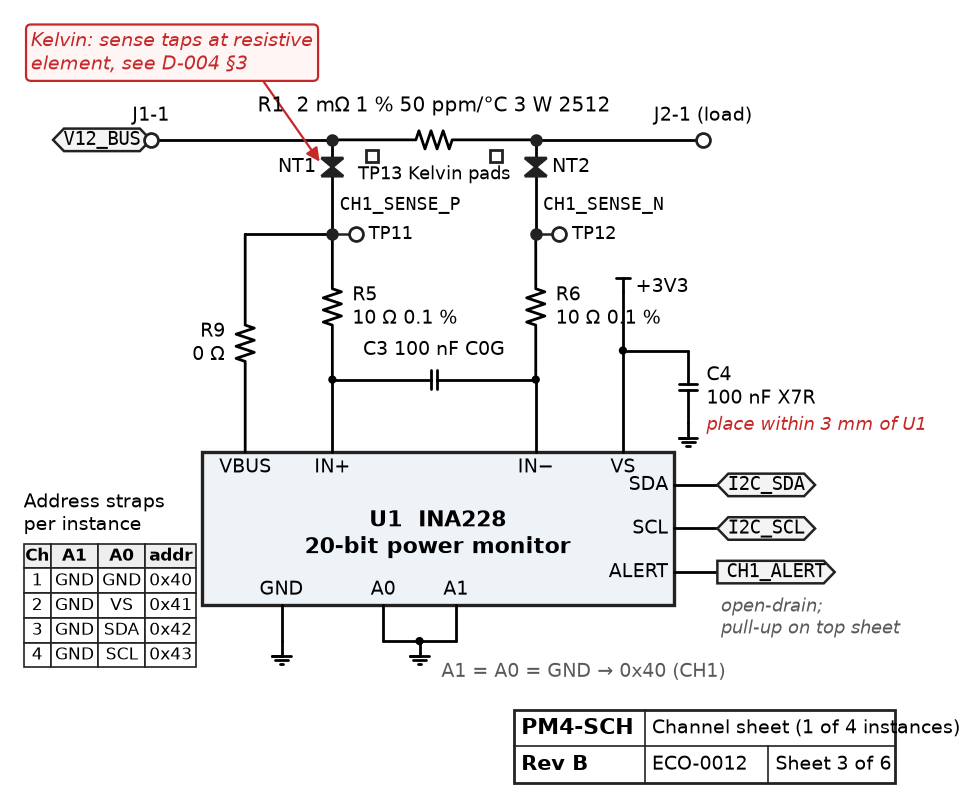
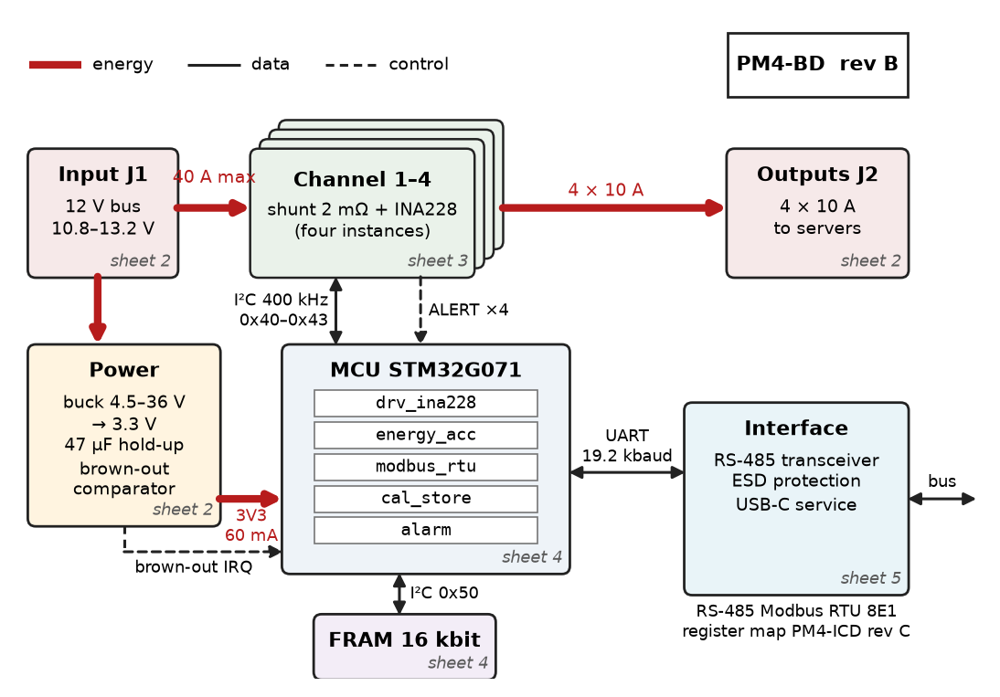
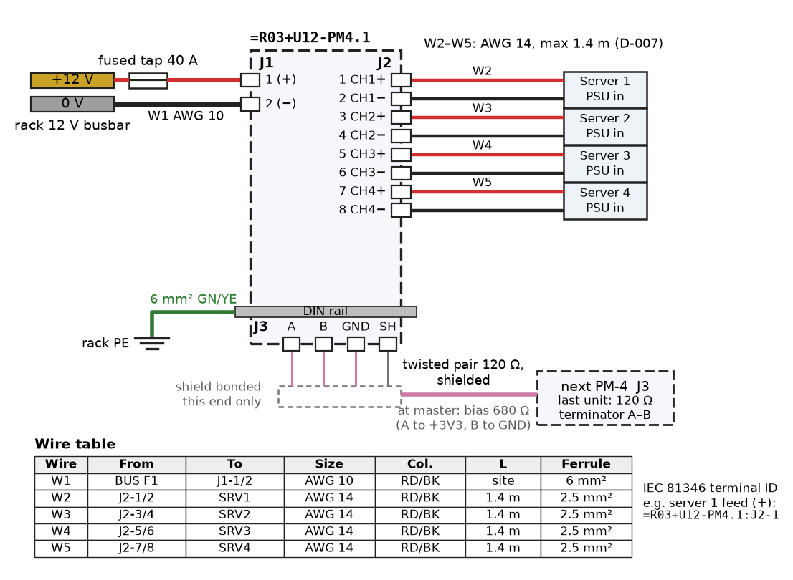
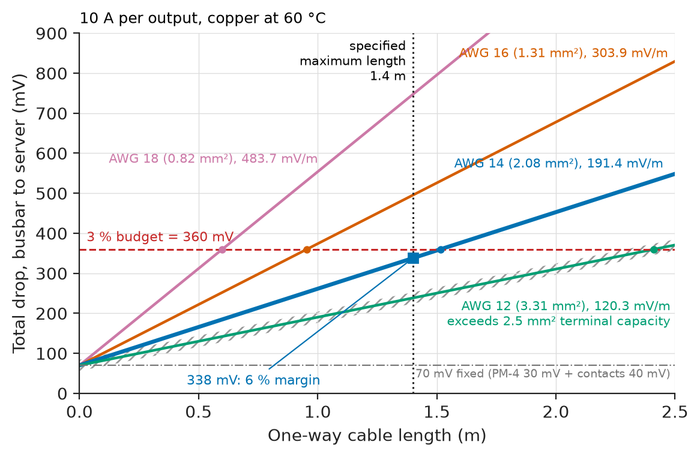
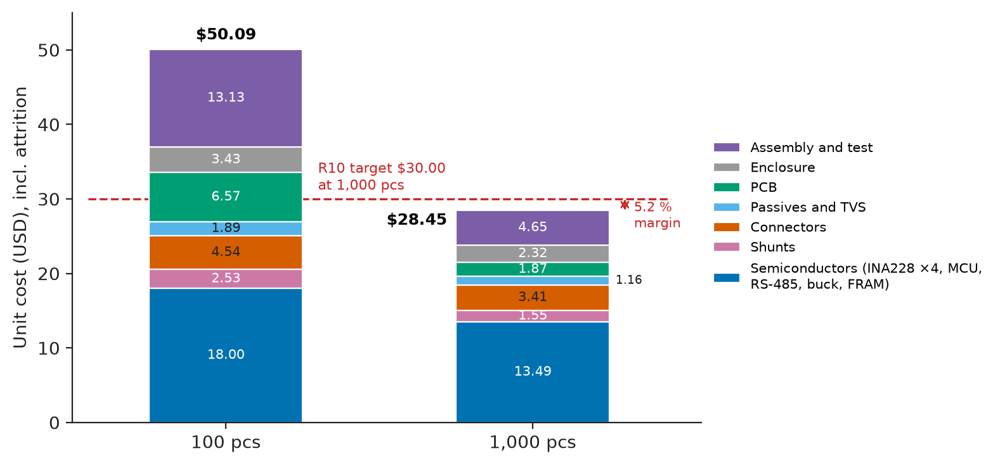

# Chapter 5 — Engineering Documentation

*Part I · Engineering Design Methodology*

Eighteen months after PM-4 Rev B was released (Chapter 4), a data-centre operator returns 40 units from one production lot: in warm racks they read up to 1.4 % high at full load, outside the ±0.6 % of requirement R1. Every unit has a test report that says PASS. It takes the team three weeks to find out why, and almost all of that time goes into reconstructing facts that should have been on paper. The test reports record "PASS" and a date but not the firmware build hash or the calibration procedure revision. The BOM line for the 2 mΩ shunt points to an approved-manufacturer list to which purchasing had added a cheaper "equivalent" thick-film part with a temperature coefficient of 300 ppm/°C instead of 50 ppm/°C; nobody had re-run the temperature test, because nothing in the change process said a new source of a critical part was a design change. Which units carry the alternate is unknown, because the contract manufacturer's lot records were never linked to serial numbers. The design was right and the verification of Chapter 4 was right; the record of *what was actually built* was missing. This chapter treats documentation as part of the product: the set of controlled artefacts from which the product can be built, verified, repaired, changed and audited by people who were not there when it was designed.

> **Which documents does a working system need, and what must each contain so that someone else can build, test and change it?**
> **How are those documents kept consistent with each other and with the hardware and firmware actually shipped, revision after revision?**

| Concept | Engineering destination |
|---|---|
| Schematics | Fabrication, layout, review, repair and failure analysis of every board |
| Block diagrams | Architecture reviews, interface control, onboarding, safety assessment |
| Wiring diagrams | Installation, harness manufacture, panel building, field service |
| Bill of materials | Purchasing, contract manufacturing, cost roll-up, obsolescence and alternates control |
| Design calculations | Evidence that ratings, scaling and margins were checked; re-use when a part changes |
| Test reports | Proof of conformity; the basis of release, certification and field-return analysis |
| Version control | Exact history of firmware, hardware sources, calculations and documents |
| Technical documentation | Datasheets, register maps, manuals: the interface to users and integrators |
| Revision management | Part numbers, revision letters, change orders and effectivity by serial number |
| Reproducibility | Rebuilding any released firmware, board and result bit-for-bit or number-for-number |

**Roadmap.** What the drawings must say (5.1–5.3) → what the product is made of and what it costs (5.4) → why the numbers are right (5.5) → proof that it works (5.6) → keeping every artefact's history (5.7) → documents for users (5.8) → controlled change (5.9) → rebuilding anything that was released (5.10).

---

## 5.1 Schematics

### What documentation must achieve

Documentation is designed like the product, from requirements. Table 5.1 states what PM-4's documentation set must achieve, each item measurable and verified by an audit or a drill rather than by opinion.

**Table 5.1 — Documentation requirements for PM-4.**

| ID | Requirement | Target | Verification |
|---|---|---|---|
| D1 | Every released artefact carries a part number, revision and approval record | 100 % of released files | Automated check of the release package |
| D2 | Schematic, BOM and layout of a released revision agree | 0 mismatches in reference designators, values, footprints | Scripted comparison in CI (Section 5.4) |
| D3 | Any shipped serial number traces to its PCB revision, BOM revision, approved-source lots, firmware hash and calibration record | Answer within 1 hour | Traceability drill on 5 random serials per quarter |
| D4 | Any released firmware can be rebuilt bit-identically | SHA-256 of rebuild equals released hash | CI rebuild of the last three releases weekly |
| D5 | Every design calculation can be re-run from the repository and reproduces its released numbers | 0 differences | CI runs all calculation scripts |
| D6 | Test reports contain the elements of ISO/IEC 17025 §7.8 relevant to a product test, including decision rule | Checklist 100 % | Report review at release |
| D7 | A change to a critical part, its sources or a limit requires an engineering change order (ECO) | 0 uncontrolled changes | Quarterly audit of AML and limits files against ECO log |

D3, D7 and the missing firmware hash in the test reports are exactly the three gaps that cost three weeks in the opening story.

### What a schematic is for

A schematic is the authoritative statement of the circuit's connectivity and component values. It is read by the layout engineer, the reviewer, the test engineer writing the bed-of-nails program, the technician repairing a board and, years later, the engineer analysing a field failure. Each reader needs more than the connectivity a netlist captures:

- **Values with the parameters that matter**: "2 mΩ 1 % 50 ppm/°C 3 W 2512", not "2m"; "47 µF 25 V polymer", not "47u". A tolerance or temperature coefficient that is not on the schematic is not under control.
- **Design intent where layout or assembly can break it**: a net-tie symbol and note at each shunt ("Kelvin: sense taps at resistive element, see D-004 §3"), "place within 3 mm of U1" for decoupling, "matched-length pair" for the RS-485 lines.
- **Population variants**: parts not fitted (DNP) marked as such, so the BOM generator and the assembler agree.
- **Net names that carry meaning**: `CH1_SENSE_P`, `I2C_SDA`, `V12_BUS`, so test points and firmware can refer to the same name.
- **A title block** with part number, revision, sheet number, date and approval, on every sheet.

Large designs are drawn hierarchically: PM-4 has a top sheet (connectors, power, MCU), one channel sheet instantiated four times, and an interface sheet (RS-485, USB, ESD). Figure 5.1 is the channel sheet, after the Rev B changes.

<!-- FIGURE 5.1 | figures/ch05/fig-5-1-channel-schematic.png | circuit | PM-4 rev B channel sheet (one of four instances), with design-intent notes. | Content: V12_BUS input terminal J1 pin 1 -> shunt R1 2 mOhm 1 percent 50 ppm/C 3 W 2512 -> output terminal J2 pin 1 (load); net-tie NT1 drawn at each end of R1 with note Kelvin: sense taps at resistive element, see D-004 section 3. Sense nets CH1_SENSE_P and CH1_SENSE_N each through 10 ohm 0.1 percent resistors R5, R6 to INA228 U1 pins IN+ and IN-; differential capacitor C3 100 nF C0G across IN+ and IN- after the resistors; VBUS pin to CH1_SENSE_P via 0 ohm R9. U1 VS pin to +3V3 with C4 100 nF X7R, note place within 3 mm. U1 A0 and A1 address straps both to GND giving address 0x40 for channel 1 (table on sheet for 0x40 to 0x43). SDA, SCL to hierarchical port I2C bus; ALERT open-drain to port CH1_ALERT with pull-up on top sheet. Test points TP11 CH1_SENSE_P, TP12 CH1_SENSE_N, TP13 Kelvin pads on R1 body. Title block: PM4-SCH, rev B, sheet 3 of 6, ECO-0012. -->



*Figure 5.1 — PM-4 rev B channel sheet (one of four instances), with design-intent notes.*

### Schematic review and electrical rule checks

Before release a schematic passes an electrical rule check (ERC: unconnected pins, outputs driving outputs, power nets without a source) and a human review against a checklist: every IC's absolute maximum ratings against the worst-case voltages on its pins; every pull-up and address strap against the datasheet; every connector pin-out against the wiring diagram; every part against the derating rules (for PM-4, resistors at ≤ 50 % of rated power at 70 °C, capacitors at ≤ 80 % of rated voltage). The review record lists the findings and their disposition; it is a released document in its own right.

---

## 5.2 Block diagrams

### Architecture on one page

A block diagram shows the system's functions and the interfaces between them at a level where one page holds the whole design (Figure 5.2). Unlike a schematic it is not derived from anything; it is drawn deliberately, and its value is in what it leaves out. Chapter 2 owns the architecture method; here the concern is the block diagram as a controlled document. Three rules make it useful:

1. **Every arrow is an interface with a name and a specification**: "I²C 400 kHz, addresses 0x40–0x43", "Modbus RTU 19.2 kbaud 8E1, register map PM4-ICD rev C", "12 V bus 10.8–13.2 V, 40 A max". An arrow without a specification is a question disguised as an answer.
2. **Each block maps to a schematic sheet, a firmware module or a purchased item**, so the diagram can be checked against the detailed design.
3. **Energy, data and control flows are distinguished** (line style or colour), because they are reviewed by different people.

<!-- FIGURE 5.2 | figures/ch05/fig-5-2-pm4-block-diagram.png | block-diagram | PM-4 block diagram as a controlled document, with named interfaces and the schematic sheet or firmware module behind each block. | Content: blocks: Input terminal J1 (sheet 2); Channel 1 to 4, each shunt plus INA228 (sheet 3, four instances); MCU STM32G071 (sheet 4) containing firmware modules drv_ina228, energy_acc, modbus_rtu, cal_store, alarm; FRAM 16 kbit (sheet 4); Power: buck 4.5-36 V to 3.3 V, 47 uF hold-up, brown-out comparator (sheet 2); Interface: RS-485 transceiver, ESD, USB-C service (sheet 5). Thick lines energy flow: J1 12 V bus 40 A max -> channels -> J2 outputs 4 x 10 A; J1 -> buck -> 3V3 rail 60 mA. Thin solid lines data: I2C 400 kHz addr 0x40-0x43 between channels and MCU; I2C to FRAM addr 0x50; UART 19.2 kbaud to RS-485; label RS-485 Modbus RTU 8E1, register map PM4-ICD rev C. Dashed lines control: ALERT lines to MCU, brown-out interrupt to MCU. Title block corner: PM4-BD rev B. -->



*Figure 5.2 — PM-4 block diagram as a controlled document, with named interfaces and the schematic sheet or firmware module behind each block.*

### The interface control document

The arrow labelled "Modbus RTU" in Figure 5.2 points to a separate document: the **interface control document** (ICD), here the register map PM4-ICD. It is the one document shared by two teams (PM-4's firmware and the customer's building-management or rack software), so it is versioned independently and changed only by agreement. An excerpt is in Section 5.8.

---

## 5.3 Wiring diagrams

### From schematic to installation

A wiring diagram shows physical conductors between physical terminals: which wire, of what size, colour and length, from which terminal to which, through which connector. A schematic says CH1 output connects to the load; the wiring diagram says "J2-1 to server 1 PSU input +, AWG 14 red, 1.4 m, ferrule 2.5 mm², tightened to 0.5 N·m". Installers, harness manufacturers and field technicians work from it; a wrong wiring diagram is wired faithfully.

For PM-4 the installation drawing (Figure 5.3) covers the rack-level wiring: the 12 V bus feed to J1, four output pairs to the servers, the RS-485 daisy chain with termination at the last unit, and the protective-earth bond of the DIN rail. Conventions follow IEC 81346 reference designations so that "=R03+U12-PM4.1:J2-1" identifies the same terminal on the drawing, the wire marker and the maintenance record, and IEC 60617 symbols ([*Electrical Energy and Machines*, Ch. 30 §30.9](https://github.com/The-Studio-of-Sadiq/Electrical-Energy-and-Machines/blob/main/part-8-electrical-safety-and-engineering-practice/30-electrical-system-design.md) gives the same conventions for installations).

<!-- FIGURE 5.3 | figures/ch05/fig-5-3-rack-wiring-diagram.png | wiring-diagram | Rack-level wiring of a PM-4 unit: 12 V feed, four server outputs, RS-485 chain and earth bond. | Content: left, rack 12 V busbar with fused tap 40 A, wire W1 AWG 10 red and black to PM-4 J1 pins 1 (+) and 2 (-); PM-4 drawn as a terminal block outline with J1, J2 (8 positions: CH1+ CH1- CH2+ CH2- CH3+ CH3- CH4+ CH4-), J3 (RS-485 A, B, GND, shield). Wires W2 to W5 AWG 14, red (+) and black (-), each 1.4 m maximum, to Server 1 to Server 4 PSU input terminals. RS-485: J3 to next PM-4 J3, twisted pair 120 ohm cable, shield bonded at one end; 120 ohm terminator at last unit; bias resistors 680 ohm at master. DIN rail bonded to rack PE with 6 mm2 green-yellow. Wire table inset: wire ID, from, to, size, colour, length, ferrule. Reference designations in IEC 81346 form, e.g. =R03+U12-PM4.1:J2-1. -->



*Figure 5.3 — Rack-level wiring of a PM-4 unit: 12 V feed, four server outputs, RS-485 chain and earth bond.*

### Wire sizing as a documented calculation

The wire sizes on a wiring diagram are not drawing details; each is the result of a calculation that belongs in the design record, because a later installer who lengthens a run changes it.

**Worked example — Sizing the server feed.** Each output carries up to 10 A at 12 V. The rack designer allows 3 % (360 mV) total drop from the busbar to the server terminals; PM-4's insertion drop (R7) takes 30 mV and four connector contacts of about 1 mΩ each take $4\times1\ \mathrm{m\Omega}\times10\ \mathrm{A}=40$ mV, leaving 290 mV for the copper of the loop (out and back). At a conductor temperature of 60 °C copper's resistivity rises to $0.0172\times(1+0.00393\times40)=0.0199\ \Omega\,\mathrm{mm^2/m}$. The longest one-way length allowed is

$$
L_\mathrm{max}=\frac{\Delta V}{2\,I\,\rho/A}
$$

which gives 0.60 m for AWG 18 (0.823 mm²), 0.95 m for AWG 16 (1.31 mm²), 1.52 m for AWG 14 (2.08 mm²) and 2.41 m for AWG 12 (3.31 mm²). The pluggable terminals accept at most 2.5 mm², which rules out AWG 12, so the drawing specifies AWG 14 with a maximum length of 1.4 m: total drop $2\times10\ \mathrm{A}\times1.4\ \mathrm{m}\times9.57\ \mathrm{m\Omega/m}+70\ \mathrm{mV}=338$ mV, a 6 % margin on the 360 mV budget (Figure 5.4). The note "max 1.4 m" on the wiring diagram is the visible end of this calculation, and the calculation's ID (D-007) is printed beside it.

<!-- FIGURE 5.4 | figures/ch05/fig-5-4-feed-voltage-drop.png | plot | Total voltage drop from busbar to server at 10 A versus one-way cable length for four wire sizes, at 60 C conductor temperature. | Content: x-axis one-way length 0 to 2.5 m; y-axis total drop in mV from 0 to 900. Four straight lines each starting at 70 mV (PM-4 insertion 30 mV plus connectors 40 mV): AWG 18 slope 483.6 mV per m, AWG 16 slope 303.8 mV per m, AWG 14 slope 191.4 mV per m, AWG 12 slope 120.2 mV per m. Horizontal dashed line at 360 mV labelled 3 percent budget. Vertical dotted line at 1.4 m labelled specified maximum length; marker at (1.4 m, 338 mV) on the AWG 14 line labelled 6 percent margin. Grey hatched region for AWG 12 labelled exceeds 2.5 mm2 terminal capacity. -->



*Figure 5.4 — Total voltage drop from busbar to server at 10 A versus one-way cable length for four wire sizes, at 60 C conductor temperature.*

> **Status of the principle: Voltage drop in a feed**
> *Derived.* Ohm's law applied to the loop resistance, with resistivity corrected linearly for conductor temperature; it is approximate where contact resistances age or where the cable's temperature is unknown, which is why the budget keeps a margin.

---

## 5.4 Bill of materials

### The BOM is the product, in purchasable form

The bill of materials lists every item needed to build one unit: reference designators, quantity, an internal part number (IPN), description with the critical parameters, and the approved sources. Two structures are kept apart:

- The **BOM** names IPNs, not manufacturer part numbers. IPN 210-0020 is "Shunt 2 mΩ 1 % 50 ppm/°C 2512 3 W, metal element".
- The **approved manufacturer list (AML)** maps each IPN to the manufacturer parts allowed to fill it, each with a qualification record showing that the part meets the IPN's specification *in this design*.

This split lets purchasing buy from any approved source without an engineering change, and lets engineering control what "approved" means. The opening failure was a hole in that control: an alternate was added to the AML without a qualification record, and nothing checked.

### A BOM that checks itself

PM-4's BOM and AML are CSV files in the hardware repository, exported from the schematic tool and edited only through reviewed changes. A script run in continuous integration (CI) rolls up cost at two order quantities and blocks the release if any critical IPN has an unqualified source.

```python
import csv, io

BOM = """ipn,refdes,qty,description,critical,usd_100,usd_1k
310-0228,U1-U4,4,Power monitor 20-bit I2C (INA228),yes,3.10,2.35
210-0020,R1-R4,4,Shunt 2 mOhm 1% 50ppm/K 2512 3 W,yes,0.62,0.38
320-0071,U5,1,MCU Cortex-M0+ 128 kB (STM32G071),yes,1.95,1.42
330-1450,U6,1,RS-485 transceiver 3.3 V,no,1.05,0.78
340-0933,U7,1,Buck 4.5-36 V to 3.3 V 0.5 A,no,0.82,0.58
350-0016,U8,1,FRAM 16 kbit I2C,yes,1.60,1.18
410-0816,J1-J2,2,Pluggable terminal block 2x8 5.08 mm,no,1.90,1.45
410-0105,J3,1,USB-C receptacle,no,0.70,0.48
900-0001,-,1,Passives and TVS (62 places),no,1.80,1.10
600-0004,-,1,PCB 4-layer 100x80 mm ENIG rev B,yes,6.50,1.85
610-0002,-,1,DIN-rail enclosure,no,3.40,2.30
700-0001,-,1,SMT assembly and AOI,no,9.00,3.20
700-0002,-,1,Functional test and calibration,no,4.00,1.40
"""
# Approved manufacturer list: ipn -> [(manufacturer part, qualification record)]
AML = {
    "210-0020": [("WSL2512R0020FEA", "QR-017"), ("CSS2H-2512R-2L00F", "QR-017"),
                 ("GENERIC-2M-2512-TF", "")],        # added by purchasing, not qualified
    "310-0228": [("INA228AIDGSR", "QR-002")],
}
ATTRITION = {"210": 0.02, "900": 0.05}               # extra parts bought, by IPN class

rows = list(csv.DictReader(io.StringIO(BOM)))
for col in ("usd_100", "usd_1k"):
    cost = sum(int(r["qty"]) * float(r[col]) * (1 + ATTRITION.get(r["ipn"][:3], 0.01))
               for r in rows)
    print(f"{col:8s} unit cost {cost:6.2f}")
for r in rows:
    if r["critical"] == "yes":
        for mpn, qr in AML.get(r["ipn"], []):
            if not qr:
                print(f"BLOCK: {r['ipn']} {r['refdes']} source {mpn} has no qualification record")
```

```text
usd_100  unit cost  50.09
usd_1k   unit cost  28.45
BLOCK: 210-0020 R1-R4 source GENERIC-2M-2512-TF has no qualification record
```

**Worked example — Cost against requirement R10.** At 1,000 pieces the rolled-up cost is \$28.45 against the \$30.00 target, a margin of $(30.00-28.45)/30.00=5.2$ %. At 100 pieces it is \$50.09, 76 % above the 1k price, because set-up-dominated items (PCB, assembly, test) fall steeply with volume: assembly alone drops from \$9.00 to \$3.20. The thin margin is why the cheaper shunt was tempting: replacing \$0.38 parts by \$0.12 parts would save $4\times0.26\times1.02=\$1.06$ per unit, which looks like 3.7 % of cost and is in fact the difference between meeting R1 and not meeting it. A BOM that carries critical parameters and qualification records makes that trade visible before purchase, not after field return. Figure 5.5 breaks the cost down by category and quantity.

<!-- FIGURE 5.5 | figures/ch05/fig-5-5-bom-cost-breakdown.png | plot | PM-4 rev B unit cost by category at 100 and 1,000 pieces, against the R10 target. | Content: two stacked vertical bars, x labels 100 pcs and 1,000 pcs; y-axis unit cost in USD from 0 to 55. Categories and values (100 pcs / 1k pcs, including attrition): semiconductors INA228 x4, MCU, RS-485, buck, FRAM 18.00 / 13.49; shunts 2.53 / 1.55; connectors 4.54 / 3.41; passives and TVS 1.89 / 1.16; PCB 6.57 / 1.87; enclosure 3.43 / 2.32; assembly and test 13.13 / 4.65 (totals 50.09 and 28.45 shown on top of the bars). Horizontal dashed line at 30.00 labelled R10 target at 1,000 pcs; annotate 5.2 percent margin on the 1k bar. -->



*Figure 5.5 — PM-4 rev B unit cost by category at 100 and 1,000 pieces, against the R10 target.*

> **Status of the principle: The BOM–AML split**
> *Empirical.* Industry practice (and the configuration-management requirements of ISO 9001 §8.5.2 and IPC-2581/ODB++ data exchange) separates what a part must be from who may supply it; it works only if adding a source is itself a controlled change with a qualification test.

---

## 5.5 Design calculations

### A calculation is a document

Every number on a schematic that was not copied from a datasheet came from a calculation: the shunt value, the INA228 scaling registers, the hold-up capacitor (Section 4.10), the wire size (Section 5.3), the derating of every part. A design calculation document states its inputs (with sources), its method (with references), its results, and the checks applied; it carries an ID, a revision and an approval like a drawing. The best form for most electronics calculations is a short script in the repository whose output is the document's results section, because it can be re-run when an input changes and checked by CI (requirement D5).

**Worked example — INA228 scaling, calculation D-004.** The INA228 reports current as a 20-bit two's-complement number scaled by a programmable LSB. Per the device's register description, the current LSB is chosen as $I_\mathrm{max}/2^{19}$, the calibration register value is $\mathrm{SHUNT\_CAL}=13107.2\times10^6\times\mathrm{CURRENT\_LSB}\times R_\mathrm{shunt}$, multiplied by 4 when the ±40.96 mV input range is selected, and the power and energy LSBs are 3.2 and $16\times3.2$ times the current LSB.

```python
"""calc/ina228_scaling.py -- design calculation D-004, PM-4 rev B."""
R_SHUNT = 0.002        # ohm, IPN 210-0020
I_MAX   = 10.0         # A, requirement R1 full scale
ADCRANGE = 1           # 1 -> +/-40.96 mV full scale

v_fs = 40.96e-3 if ADCRANGE else 163.84e-3
current_lsb = I_MAX / 2**19
shunt_cal = 13107.2e6 * current_lsb * R_SHUNT * (4 if ADCRANGE else 1)
v_max = I_MAX * R_SHUNT
p_shunt = I_MAX**2 * R_SHUNT

print(f"CURRENT_LSB = {current_lsb*1e6:.4f} uA")
print(f"SHUNT_CAL   = {shunt_cal:.1f}  (register value {round(shunt_cal)})")
print(f"POWER_LSB   = {3.2*current_lsb*1e6:.2f} uW, ENERGY_LSB = {16*3.2*current_lsb*1e6:.1f} uJ")
print(f"V_shunt max = {v_max*1e3:.1f} mV = {100*v_max/v_fs:.1f} % of ADC range")
print(f"P_shunt     = {p_shunt:.2f} W (rating 3 W, derated to 1.5 W at 70 C)")
assert v_max < 0.9 * v_fs, "shunt voltage exceeds 90 % of ADC range"
assert p_shunt < 0.5 * 1.5, "shunt dissipation above 50 % of derated rating"
assert round(shunt_cal) < 2**15, "SHUNT_CAL does not fit its 15-bit field"
```

```text
CURRENT_LSB = 19.0735 uA
SHUNT_CAL   = 2000.0  (register value 2000)
POWER_LSB   = 61.04 uW, ENERGY_LSB = 976.6 uJ
V_shunt max = 20.0 mV = 48.8 % of ADC range
P_shunt     = 0.20 W (rating 3 W, derated to 1.5 W at 70 C)
```

The register value 2000 goes into the firmware's configuration header, which cites D-004 rev B; the firmware's unit test asserts the same number, so a change of shunt value that is not carried into firmware fails CI. The `assert` lines are the calculation's acceptance criteria: the 20 mV full-scale signal uses 48.8 % of the ADC range (headroom for 2× overload alarms), and 0.20 W is 13 % of the derated rating. The choice of 2 mΩ against R7's 30 mV insertion limit is in the same document, so a later proposal to use 5 mΩ for better resolution meets the 30 mV limit on the same page ($10\times5=50$ mV, fail).

> **Status of the principle: Executable calculations**
> *Empirical.* Calculations kept as scripts with assertions and run in CI catch stale inputs and transcription errors that hand calculations and spreadsheets miss; the script is still only as right as its equations, which is why each one cites its source and is reviewed once by a second engineer.

---

## 5.6 Test reports

### What a test report must contain

A test report is the evidence that a specific item met (or did not meet) specific requirements under specific conditions. Its value lies in the details that make the result reproducible and traceable. ISO/IEC 17025 §7.8 lists the content of a laboratory report; for a product verification report the relevant elements are:

- **Identification**: report number, revision, page *n* of *N*, issuing organisation, approval.
- **Item under test**: part number, revision, serial numbers; **firmware build hash**; calibration-coefficient file hash; any deviations from the released configuration.
- **Procedure**: test plan and test-case IDs with their revisions; limits file revision; any deviation from the procedure.
- **Equipment**: every instrument by asset number with its calibration due date; test software version.
- **Conditions**: ambient temperature and humidity, supply voltages, warm-up times.
- **Results**: measured values with units and expanded uncertainty; the **decision rule** (e.g. guarded acceptance, Section 4.7); the verdict per test case.
- **Raw data reference**: the path and hash of the raw data file, kept for the product's life.

The PM-4 reports from the opening story had the verdicts and the serial numbers but not the firmware hash, the coefficient-file hash, the limits revision or the raw data, so a question about a single unit's calibration could not be answered from the report. The Rev B report header after the change is shown below; it is generated by the test script itself, not typed.

```text
TEST REPORT TR-PM4-0217  rev 0            page 1 of 4
Item      PM4-100 rev B   serials 2410-0441 .. 2410-0462 (22 units)
Firmware  pm4-fw v1.3.0   sha256 9f2c41e7...b07a   (release build)
Cal file  per unit, sha256 listed on page 3
Procedure TP-PM4-DVT rev C; limits limits_dvt.toml rev 5 (git 4e81c0d)
Equipment AS-0112 DMM 6.5 digit (cal due 2027-03-14)
          AS-0113 DMM 6.5 digit (cal due 2027-03-14)
          AS-0201 shunt 10 A/100 mV, 0.01 % (cal due 2027-01-30)
          AS-0310 chamber; AS-0405 load 30 A; AS-0406 supply 20 A
Software  pm4-bench v2.4.1 (git a7d93f2)
Ambient   23.4 C, 41 % RH
Decision  guarded acceptance, A = T - U95 (ILAC G8); U95 stated per result
Raw data  data/dvt/2026-10-12/ sha256 3c1e...9a40
```

**Table 5.2 — Excerpt of results, TR-PM4-0217 (worst of 22 units).**

| Test case | Requirement | Limit (guarded) | Result ± $U_{95}$ | Verdict |
|---|---|---|---|---|
| TC-R1-02 | R1, 10 A, 50 °C | ±52 mA | +21 ± 3 mA | Pass |
| TC-R2-01 | R2, 12.0 V | ±33 mV | −9 ± 1 mV | Pass |
| TC-R6-01 | R6 | ≤ 0.50 W | 0.31 ± 0.01 W | Pass |
| TC-R7-01 | R7 | ≤ 30 mV | 24.0 ± 0.2 mV | Pass |
| TC-R11-01 | R11, 500 interruptions | ≤ 1 Wh lost | 0 Wh lost | Pass |

A failed test is reported with the same care as a passed one, and a report is never edited after issue: a correction is a new revision with the reason stated. A report that has been quietly corrected is worth nothing in a dispute or an audit.

---

## 5.7 Version control

### Everything that defines the product goes in the repository

Version control records every change to every file with author, time, reason and parent, and lets any past state be recovered exactly. Firmware engineers take it for granted; electronics teams too often keep schematics on a shared drive as `PM4_final_v3_JB.sch`. Modern EDA tools (KiCad, and Altium or OrCAD with their own data managers) store designs as files that can be version-controlled; KiCad's are text, so changes can even be reviewed as diffs. PM-4 uses one Git repository per product with this layout:

```text
pm4/
  hw/          KiCad project (schematic, layout), bom.csv, aml.csv, fab notes
  fw/          firmware sources, CMake build, unit tests
  calc/        design calculations D-001..D-012 as Python scripts
  test/        bench scripts, test plans, limits_*.toml, report generator
  docs/        ICD, user manual, installation guide (Markdown -> PDF)
  ci/          container definition, CI workflow, release script
  CHANGELOG.md, ECO/ (one file per change order)
```

Large binary outputs (Gerbers, PDFs, firmware images) are not committed by hand; they are produced by the release pipeline (Section 5.10) and attached to the release, with their hashes recorded. Measurement raw data, which can be large, goes to an archive whose path and hash the test report records.

### Commits, branches and tags

Three conventions make the history useful rather than merely complete:

- **Commit messages cite the reason**: `fw: alarm on 100 ms moving average (R12, ECO-0014)`. A history searchable by requirement and ECO answers "why is it like this?" years later.
- **Changes arrive through reviewed merges**: work happens on a branch; merging to `main` requires CI to pass and one reviewer to approve. Limits files and the AML are under the same rule, which closes the gap that let an unqualified source in (requirement D7).
- **Releases are annotated tags**: hardware and firmware are tagged separately because they are released separately.

```bash
git tag -a hw-pm4-revB -m "PM4-100 rev B, ECO-0012..0016, released 2026-09-02"
git tag -a fw-v1.3.0 -m "Firmware 1.3.0 for PM4-100 rev B (R11, R12)"
git push origin hw-pm4-revB fw-v1.3.0
git describe --tags --dirty        # embedded in the build: fw-v1.3.0, or fw-v1.3.0-4-g7c1d2e9-dirty
```

The firmware embeds the `git describe` string and the build refuses to produce a release image from a dirty tree (uncommitted changes), so no shipped binary can come from code that is not in the repository.

### Choosing the documentation tools

The tool choices are themselves design decisions against the requirements of Table 5.1. Table 5.3 compares the classes considered.

**Table 5.3 — Documentation tool selection for a small hardware team.**

| Need | Options compared | Strengths | Weaknesses | Choice for PM-4 |
|---|---|---|---|---|
| Schematic and layout | KiCad (open, text files); Altium (commercial, own vault) | KiCad: diffable files, scriptable `kicad-cli`, no licence cost. Altium: mature library and supply-chain tools | KiCad: smaller library ecosystem. Altium: binary files, licence per seat | KiCad 8 (D2, D5 automation) |
| Source history | Git; PDM/PLM system | Git: branches, review, free hosting. PLM: part numbers, ECO workflow, AML | Git: no item master. PLM: cost, poor diffing of sources | Git for sources; ECO and IPN registers as files in Git (spreadsheet-sized team) |
| Documents | Word processor; Markdown/AsciiDoc built to PDF | Markdown: diffable, built in CI, same review as code | Markdown: weaker page layout | Markdown + PDF build |
| Calculations | Spreadsheet; scripts | Scripts: testable, re-runnable (D5) | Spreadsheets hide formulas and invite copy-paste errors | Python scripts with asserts |

A team that grows past a few products usually adds a product-lifecycle-management (PLM) system for the item master and the change workflow and keeps Git for sources; the principles are the same.

---

## 5.8 Technical documentation

### Documents for people outside the team

The documents so far are for the people who build and change PM-4. Technical documentation is for those who use, integrate and service it: a **datasheet** (what it does, ratings, accuracy, dimensions), an **installation guide** (wiring diagram, torque values, termination, earthing), a **user manual** (configuration, alarms, troubleshooting), the **ICD** (register map, protocol behaviour, error codes) and a **service note** for recalibration. Each states the product revision and firmware versions it applies to.

Two qualities matter more than style. First, **every number in a user document must trace to a verified value**: the datasheet's "±0.5 % + 10 mA, 0–50 °C" is requirement R1, verified in TR-PM4-0217; a datasheet that rounds a verified ±0.6 % to "better than 0.5 %" creates a warranty problem. Second, **interface documents are exact and versioned**: integrators write code against them.

**Table 5.4 — Excerpt of the register map, PM4-ICD rev C (Modbus input registers).**

| Address | Name | Type | Unit / scale | Notes |
|---|---|---|---|---|
| 30001–30002 | CH1_CURRENT | int32, big-endian word order | 1 mA | Signed; positive for current into J1 |
| 30003–30004 | CH1_VOLTAGE | uint32 | 1 mV | Bus voltage at channel output |
| 30005–30006 | CH1_POWER | int32 | 10 mW | |
| 30007–30010 | CH1_ENERGY | uint64 | 1 Wh | Non-volatile since firmware 1.3.0 (R11) |
| 30081 | STATUS | bitfield | — | bit 0 cal valid, bit 1 FRAM ok, bit 2 brown-out seen, bits 4–7 alarm per channel |
| 30090–30091 | FW_HASH | uint32 | — | First 32 bits of the firmware SHA-256 |

The last row came from the field-return investigation: an operator can now read the firmware identity over the network, which links a unit's behaviour to its build without opening the rack (requirement D3).

### Docs as code

PM-4's user documents are Markdown in `docs/`, reviewed in the same merge requests as the firmware changes that affect them, and built to PDF by the release pipeline with the product revision and firmware version filled in from the tags. The register-map table is generated from the same header file the firmware uses, so the ICD cannot disagree with the code.

---

## 5.9 Revision management

### Part numbers, revisions and the interchangeability rule

Every controlled item (assembly, PCB, drawing, document, firmware) has an identifier and a revision. The rule that decides whether a change needs a new revision letter or a new part number is **form, fit and function** (F/F/F) interchangeability: if the changed item can replace the old one in every application without any other change, it keeps its part number and takes a new revision; if not, it gets a new part number. PM4-100 rev A → rev B kept its part number because rev B is a drop-in replacement (same terminals, same Modbus map for existing registers, better accuracy). Had the register map changed incompatibly, the product would have become PM4-200.

> **Status of the principle: Form, fit and function interchangeability**
> *Empirical.* A configuration-management convention (ISO 10007, EIA-649) that keeps part numbers meaningful to stores, service and customers; its value depends on judging "function" from the user's side, including software interfaces, not only from the drawing.

### The change workflow

A change passes through a request (ECR: what and why), an impact analysis (which documents, stock, units in the field, tests), an approved change order (ECO: what exactly changes, from which serial number or date, what happens to existing stock), implementation, and verification. The ECO's **effectivity** (the first serial, lot or date to which it applies) is what makes traceability possible.

**Table 5.5 — PM-4 revision history (extract of the ECO register).**

| ECO | Change | Items affected | Effectivity | Verification |
|---|---|---|---|---|
| ECO-0012 | Kelvin footprint for shunts | PM4-PCB rev B, PM4-SCH rev B | Serial 2409-0001 | TC-R1-02 |
| ECO-0013 | FRAM, hold-up capacitor, brown-out interrupt (R11) | PCB rev B, BOM rev B, fw 1.3.0 | Serial 2409-0001 | TC-R11-01 |
| ECO-0014 | Alarm moving average (R12) | fw 1.3.0, ICD rev C | fw 1.3.0, field update allowed | TC-R12-01 |
| ECO-0019 | Remove unqualified shunt source from AML; add QR rule to CI | AML rev D, ci/bom_check | Immediate; purge lots 2502-xx | Audit; CI BLOCK test |
| ECO-0020 | FW_HASH register; report header with firmware and cal hashes | fw 1.3.1, ICD rev D, pm4-bench 2.4 | fw 1.3.1 | Traceability drill (D3) |

**Worked example — Disposition of existing stock.** When ECO-0012 was approved, 350 assembled Rev A boards were in stock. Two dispositions were costed. Rework (cut eight sense traces, add eight fine wires, re-test) takes about 20 minutes at a loaded labour rate of \$36 per hour, so \$12.00, plus \$1.40 for re-test: $350\times13.40=\$4{,}690$. Scrapping writes off the board cost at 1,000-piece prices without enclosure and test, $28.45-2.32-1.41=\$24.71$ per board (with the 1 % attrition): $350\times24.71=\$8{,}650$. Rework is cheaper by about \$3,960, but the wired boards differ from the released design, would need their own qualification (wire fatigue under vibration, consistency of hand-made Kelvin taps), and would leave a population in the field that behaves differently from Rev B. The ECO therefore scrapped them for products and reworked 30 as engineering and test-fixture units, labelled "REV A-ENG, not for sale", recorded by serial number. The decision and its arithmetic are part of the ECO, so the next engineer does not re-argue it.

### Release states

Each document carries a state: **draft** (editable, not for use), **in review**, **released** (frozen; changes only through an ECO), **superseded** and **obsolete**. Manufacturing and test use released documents only. In the Git workflow, "released" means a tagged commit and a release package built by the pipeline; a PDF on a shared drive is never authoritative.

---

## 5.10 Reproducibility

### What must be reproducible

Reproducibility means that anyone with the repository and the archived inputs can regenerate any released artefact and get the same result: the firmware binary bit for bit, the fabrication outputs, every calculation's numbers, and every test report from its raw data. It requires that *every* input is recorded and pinned: source code, but also compiler version, library versions, tool versions, the limits files, the calibration coefficients and the instrument identities. The mathematics of reproducible numerical work is in [*The Mathematics Universe*, Ch. 24 §24.9](https://github.com/The-Studio-of-Sadiq/engineering-mathematics/blob/main/part-7-numerical-computational/24-computational-mathematics.md); here the inputs are a product's.

> **Status of the principle: A build is a function of its inputs**
> *Derived.* A deterministic toolchain maps identical inputs to identical outputs, so a differing output proves a differing input; bit-identical rebuilds therefore require every input, including tool versions and timestamps, to be pinned, and fail as soon as one is left implicit.

### The release pipeline

PM-4's CI runs the same pipeline on every merge and, for a tagged commit, produces the release package. It runs inside a container image pinned by digest, so the compiler, KiCad and Python versions are fixed; the build date embedded in the firmware comes from the commit time, not the clock.

```yaml
# ci/release.yml -- CI workflow (GitHub Actions syntax)
name: release
on: { push: { tags: ["hw-*", "fw-*"] }, pull_request: {} }
jobs:
  build:
    runs-on: ubuntu-24.04
    container: ghcr.io/example/pm4-tools@sha256:5b1f0c9e2d4a7b3c6e8f1a2b3c4d5e6f7a8b9c0d1e2f3a4b5c6d7e8f9a0b1c2d
    steps:
      - uses: actions/checkout@v4
        with: { fetch-depth: 0 }
      - name: Design calculations reproduce (D5)
        run: for f in calc/*.py; do python "$f" > "out/${f##*/}.txt"; done && git diff --exit-code out/
      - name: ERC, DRC and BOM/AML checks (D2, D7)
        run: |
          kicad-cli sch erc --exit-code-violations hw/pm4.kicad_sch
          kicad-cli pcb drc --exit-code-violations hw/pm4.kicad_pcb
          python ci/bom_check.py hw/bom.csv hw/aml.csv
      - name: Firmware build, unit tests, reproducibility (D4)
        run: |
          export SOURCE_DATE_EPOCH=$(git log -1 --format=%ct)
          cmake -S fw -B build -DCMAKE_BUILD_TYPE=Release && cmake --build build
          ctest --test-dir build --output-on-failure
          sha256sum build/pm4-fw.bin | tee out/fw.sha256
      - name: Fabrication outputs and documents
        run: |
          kicad-cli sch export pdf -o out/PM4-SCH.pdf hw/pm4.kicad_sch
          kicad-cli pcb export gerbers -o out/gerbers/ hw/pm4.kicad_pcb
          python docs/build.py --rev "$(git describe --tags)" -o out/docs/
```

The calculation step is the CI form of requirement D5: the scripts' outputs are committed, the pipeline re-runs them, and `git diff --exit-code` fails the build if any number changed without the change being committed and reviewed. The weekly job rebuilds the last three firmware tags and compares their hashes with the released ones (D4).

### Traceability of the built unit

Reproducing a design is half the job; the other half is knowing which design each shipped unit is. The as-built record joins, per serial number: PCB revision and fabrication lot; BOM revision and the AML source and lot of each critical part (from the contract manufacturer's component-traceability data, now required by the manufacturing agreement); firmware hash; calibration record and coefficient hash; test report number. With it, the opening question ("which units carry the 300 ppm/°C shunt?") becomes a query: the alternate's lots map to serials 2502-0118 to 2502-0377 (260 units), which were recalled and recalibrated with the qualified part fitted, instead of recalling the full 1,800 units shipped that year.

### Verification of the documentation set

The documentation requirements of Table 5.1 are verified like any others. Table 5.6 is the result of the first audit after ECO-0019 and ECO-0020.

**Table 5.6 — Verification of the PM-4 documentation set.**

| Req. | Test | Limit | Result | Verdict |
|---|---|---|---|---|
| D1 | Release-package checker over 146 files | 100 % with part number, revision, approval | 146 of 146 | Pass |
| D2 | `bom_check.py` and KiCad DRC/ERC in CI | 0 mismatches | 0 | Pass |
| D3 | Traceability drill, 5 random serials | ≤ 1 h each | 6–22 min | Pass |
| D4 | Rebuild fw-v1.2.0, v1.3.0, v1.3.1 | Hashes equal | 3 of 3 equal | Pass |
| D5 | Re-run calc/*.py | 0 differences | 0 | Pass |
| D6 | Checklist review of TR-PM4-0217 | 100 % | 100 % | Pass |
| D7 | AML and limits files against ECO log | 0 uncontrolled changes | 0 since ECO-0019 | Pass |

### Failure analysis of the documentation system

Table 5.7 lists the documentation failures this chapter has met, in the same FMEA form used for hardware in Chapter 4: a documentation system fails by mechanisms just as definite as a circuit's.

**Table 5.7 — FMEA of the PM-4 documentation system.**

| Failure mode | Effect | Cause | Detection | Mitigation |
|---|---|---|---|---|
| Unqualified alternate on a critical part | Out-of-spec units shipped (1.4 % error) | AML editable without ECO; no qualification field | Field returns | ECO-0019: QR field mandatory, CI BLOCK, AML under review rule |
| Test report lacks build and calibration identity | Days lost reconstructing configuration | Report template typed by hand | Field-return investigation | Report header generated by test script with hashes (ECO-0020) |
| Units not traceable to component lots | Recall of 1,800 instead of 260 units | CM lot data not linked to serials | Field-return investigation | Traceability clause in CM agreement; as-built record per serial |
| Firmware not rebuildable | Cannot reproduce a field bug or patch an old release | Unpinned toolchain, build date from clock | Weekly rebuild job | Container by digest; SOURCE_DATE_EPOCH; dirty-tree refusal |
| Calculation out of date after a part change | Wrong register value or rating | Hand calculation not linked to BOM | CI calc re-run; firmware unit test of SHUNT_CAL | Executable calculations with asserts (D5) |
| Wiring length exceeded in the field | Server PSU undervoltage at load steps | Installer unaware of length limit | Commissioning check of voltage at server | "max 1.4 m, D-007" printed on wiring diagram and label |

---

## What remains open

| Open question | Where it is answered |
|---|---|
| How are requirements written so that test cases and documents can trace to them? | Chapter 1 |
| How is an architecture decomposed and its interfaces specified before the block diagram is drawn? | Chapter 2 |
| How are measurement uncertainties stated in a test report and combined into a decision rule? | Chapter 7 |
| How are industrial control panels documented (circuit diagrams, terminal plans, IEC 81346 designations)? | Chapters 18 and 20 |
| How are engineering software projects version-controlled, built and tested reproducibly at scale? | Chapter 29 |
| How do file formats and data interoperability of engineering tools affect long-term documentation? | Chapter 31 |
| How is a full project report assembled from these documents? | Chapter 40 |
| How are installation documents for low-voltage electrical systems prepared? | [*Electrical Energy and Machines*, Ch. 30 §30.9](https://github.com/The-Studio-of-Sadiq/Electrical-Energy-and-Machines/blob/main/part-8-electrical-safety-and-engineering-practice/30-electrical-system-design.md) |

**Next:** Chapter 6 opens Part II with the sensors and transducers that turn temperature, pressure, position, speed, force, light, magnetic field, current and voltage into signals, selected and calibrated for an instrumented motor test bench.
