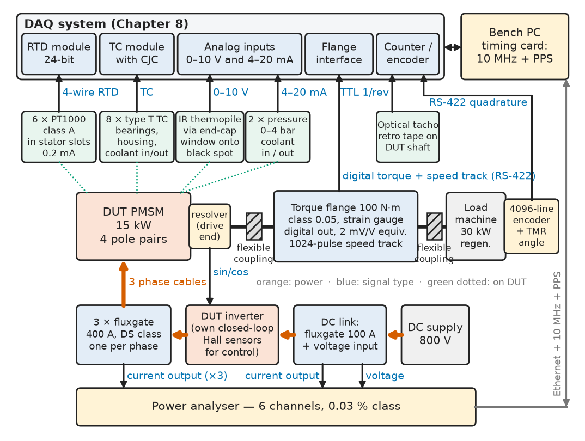
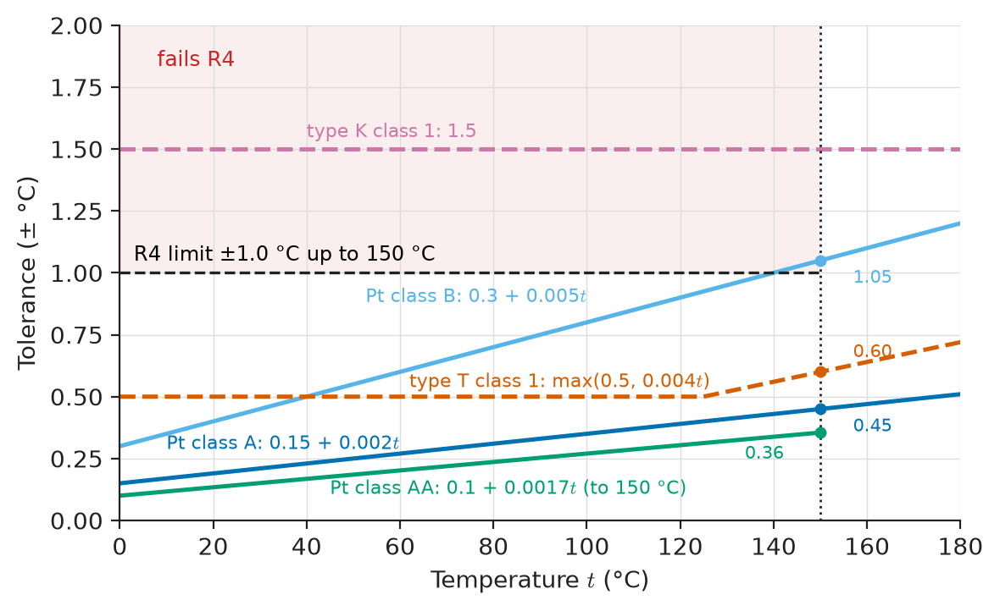
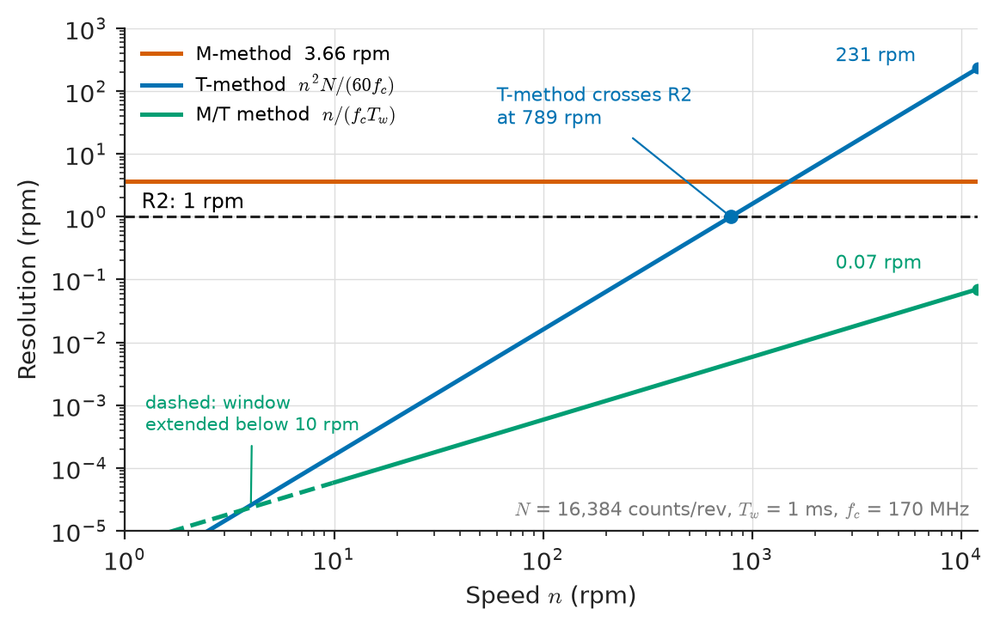
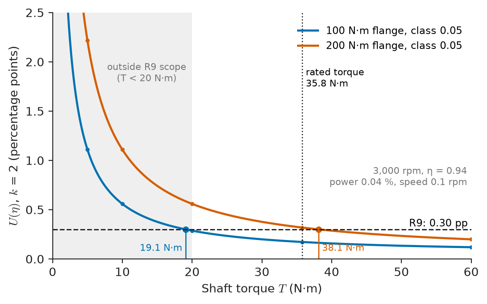
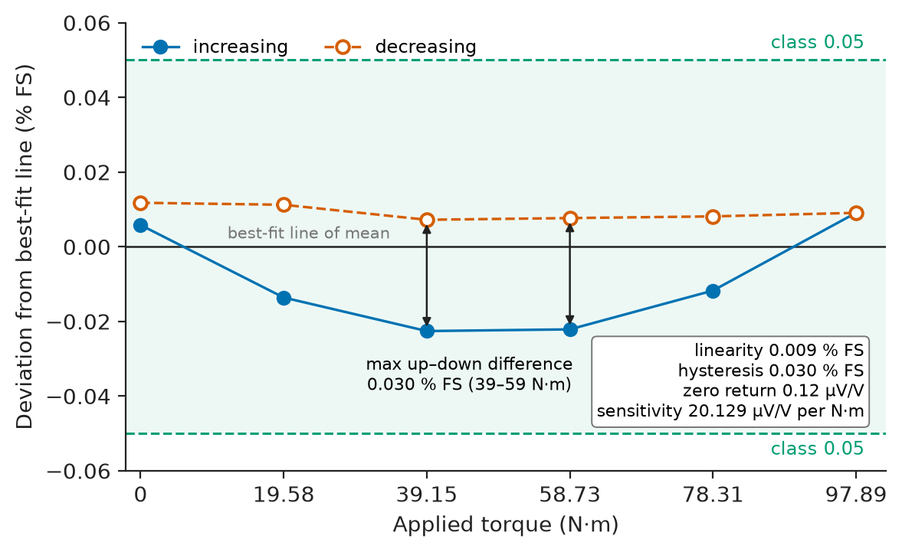

# Chapter 6 — Sensors and Transducers

*Part II · Instrumentation and Measurement Systems*

A motor supplier's test bench reports a peak efficiency of 96.1 % for a 15 kW permanent-magnet pump motor at 20 N·m and 3,000 rpm. The customer's laboratory measures 94.9 % on the same motor. Neither bench has a broken sensor. The supplier's bench uses a 500 N·m torque flange left over from a larger motor; its zero drifts by 0.05 % of full scale per 10 K, and as the shaft coupling warms by 10 K during the run the zero moves by 0.25 N·m, which is 1.25 % of the 20 N·m being measured and almost exactly the 1.2 percentage points of disagreement. Its winding temperature comes from a type K thermocouple taped to the end winding, which lags the slot temperature by 15 °C, so the motor is mapped "cold" and its copper losses are underestimated. The sensors were chosen from what was in the cupboard, not from an uncertainty budget. This chapter rebuilds that bench (a 15 kW motor test bench for efficiency mapping and thermal characterisation) as the running reference system, and uses it to cover every major sensor family: temperature, pressure, position, speed, force and strain, light, magnetic field, current and voltage, then selection and calibration.

> **How do you choose a sensor so that the measurement, not the catalogue, meets the requirement, including range, accuracy, dynamics, environment and interface?**
> **What does each sensor family really deliver on a bench, where does it fail, and how is it calibrated traceably?**

| Concept | Engineering destination |
|---|---|
| Temperature sensors | Winding, bearing, coolant and electronics temperatures; thermal derating and protection |
| Pressure sensors | Coolant, hydraulic and pneumatic circuits; process transmitters; leak tests |
| Position sensors | Rotor angle for commutation and back-EMF tests; robot joints; valve positions |
| Speed sensors | Efficiency maps, speed loops, overspeed protection, vibration orders |
| Force and strain sensors | Torque flanges, load cells, weighing, structural monitoring |
| Light sensors | Optical encoders and tachometers, IR thermometry, light curtains, ambient-light control |
| Magnetic sensors | Angle sensors, current transducers, proximity, commutation |
| Current and voltage sensors | Power analysers, drive control, protection, battery and PV monitoring |
| Sensor selection | A traceable chain from requirement to part number with the margin shown |
| Sensor calibration | Traceable references, calibration procedures and intervals for every channel |

**Roadmap.** The bench and its requirements (6.1) → the sensor families it needs (6.2–6.9) → choosing among them (6.10) → calibrating them and proving the bench (6.11).

---

## 6.1 The test bench and its measurement requirements

### The reference system

The bench tests permanent-magnet synchronous motors up to 15 kW (rated 35.8 N·m at 4,000 rpm, peak 60 N·m, maximum 12,000 rpm, four pole pairs) driven by their own inverter from an 800 V-capable DC supply. The motor under test (DUT) is coupled through a torque flange to a 30 kW regenerative load machine. The bench produces efficiency maps over the torque–speed plane, thermal characterisation (winding, magnet, bearing and coolant temperatures) and back-EMF and angle-offset measurements. Table 6.1 is its measurement specification.

**Table 6.1 — Measurement requirements of the 15 kW motor test bench.**

| ID | Quantity | Range | Required accuracy | Verification |
|---|---|---|---|---|
| R1 | Shaft torque | ±100 N·m, motoring and generating | Class 0.05 (±0.05 N·m) | Lever-and-weights calibration (6.11) |
| R2 | Shaft speed | 0–12,000 rpm, 1 kHz updates | ≤ 1 rpm resolution and error | Comparison with optical tachometer and frequency reference |
| R3 | Rotor angle | 0–360° | Resolution ≤ 0.025°, accuracy ±0.05° mechanical (±0.2° electrical) | Manufacturer's certificate; index check |
| R4 | Winding temperature | −20 to 180 °C | ±1 °C up to 150 °C; insulation tested at 3 kV | Dry-block comparison with reference PRT |
| R5 | Bearing, housing, coolant temperatures | 0–150 °C | ±1.5 °C | Dry-block comparison |
| R6 | Coolant pressure, inlet and outlet | 0–4 bar (gauge) | ±0.5 % FS (±20 mbar) | Pressure-calibrator comparison |
| R7 | Rotor magnet temperature | 20–150 °C, non-contact | ±5 °C | Comparison with embedded probe on a test rotor |
| R8 | Phase currents; DC-link current and voltage | 300 A peak, DC–100 kHz; 100 A DC; 0–800 V | Power uncertainty ≤ 0.04 % of reading (standard) | Power-analyser calibration certificate |
| R9 | Efficiency (derived) | Torque ≥ 20 N·m | Expanded uncertainty ≤ 0.3 percentage points (k = 2) | Uncertainty budget (6.6) and round-robin |
| R10 | Traceability | All channels | Calibration interval ≤ 12 months, ISO/IEC 17025 certificates | Calibration register |

### Architecture

Figure 6.1 shows the sensors, where they sit, and the interfaces that carry their signals to the data-acquisition (DAQ) system and the power analyser. Conditioning (bridges, amplifiers, filters, isolation and ADCs) is the subject of Chapter 7 and the DAQ itself of Chapter 8; this chapter ends at the sensor's electrical output and its specification.

<!-- FIGURE 6.1 | figures/ch06/fig-6-1-motor-bench-sensor-architecture.png | block-diagram | Sensor architecture of the 15 kW motor test bench, with the output interface of each sensor. | Content: mechanical line left to right: DUT PMSM 15 kW (4 pole pairs) with resolver on drive end -> flexible coupling -> torque flange 100 N m class 0.05 (strain-gauge, digital output with 2 mV/V equivalent, integrated 1024-pulse speed track) -> flexible coupling -> load machine 30 kW regenerative with 4096-line optical encoder and TMR angle sensor. Around DUT: 6 PT1000 class A embedded in slots (4-wire, 0.2 mA) -> RTD DAQ module; 8 type T thermocouples on bearings, housing, coolant inlet and outlet -> thermocouple DAQ module with CJC; IR thermopile through end-cap window viewing black-painted rotor spot -> 0-10 V; reflective optical tachometer on retro tape -> TTL 1 pulse per rev; 2 coolant pressure transmitters 0-4 bar 4-20 mA on inlet and outlet. Electrical side: DC supply 800 V -> DC-link fluxgate current transducer 100 A and voltage input -> DUT inverter -> three phase cables each through a fluxgate transducer 400 A (DS-class) -> DUT; all to power analyser (6 channels, 0.03 percent class); inverter own closed-loop Hall sensors for control. DAQ and power analyser synchronised by 10 MHz reference and PPS to bench PC. Label each arrow with signal type: 4-wire RTD, TC, 4-20 mA, TTL/RS-422 quadrature, current output, sin/cos. -->



*Figure 6.1 — Sensor architecture of the 15 kW motor test bench, with the output interface of each sensor.*

The interfaces fall into the classes summarised in [*Electronics and Computing*, Ch. 26 §26.9](https://github.com/The-Studio-of-Sadiq/Electronics-and-Computing/blob/main/part-6-embedded-and-real-time-systems/26-embedded-interfaces.md): resistance (RTDs), thermocouple EMF, 4–20 mA loops, bridge outputs in mV/V, pulse and quadrature trains, sin/cos analog, current outputs from closed-loop transducers, and digital buses. The choice of interface is part of the sensor choice, because it decides how much error the cable and the conditioning add.

---

## 6.2 Temperature sensors

### The families and what each is good for

Five families cover almost every engineering temperature measurement (Table 6.2). Their physics (resistance of metals and semiconductors, the Seebeck effect, junction voltage, thermal radiation) is in [*Engineering Physics*, Ch. 14 §14.1 and §14.3](https://github.com/The-Studio-of-Sadiq/Engineering-Physics/blob/main/CHAPTERS/CHAPTER%2014.md); what matters for selection is range, interchangeability (tolerance without calibration), stability, size and interface.

**Table 6.2 — Temperature sensor families (typical values).**

| Family | Range | Interchangeability | Stability | Interface | Typical use |
|---|---|---|---|---|---|
| Platinum RTD (Pt100, Pt1000), IEC 60751 | −200 to 600 °C (thin film −50 to 300 °C) | Class A $\pm(0.15+0.002\lvert t\rvert)$ °C | 0.05 °C/year | Resistance, 3- or 4-wire, 0.1–1 mA excitation | Windings, process, reference work |
| Thermocouple, IEC 60584 (types K, T, J, N) | −200 to 1,300 °C (type K) | Class 1 type T ±0.5 °C or $\pm0.004\lvert t\rvert$ | Drifts at high temperature (type K ageing) | µV signal plus cold-junction compensation | Surfaces, high temperature, small and fast |
| NTC thermistor | −40 to 150 °C | ±0.2 to ±1 °C at 25 °C, worse elsewhere | Good if glass-encapsulated | Resistance, strongly nonlinear | Electronics, batteries, low cost |
| Silicon IC sensor (analog or I²C/SPI) | −55 to 150 °C | ±0.1 to ±1 °C | Good | Digital bus or voltage | Board temperatures, ambient |
| Infrared (thermopile, Section 6.7) | −50 to 1,000 °C | Depends on emissivity | Good | Voltage or digital | Rotating and live parts |

### The winding: RTD or thermocouple?

Requirement R4 asks for ±1 °C up to 150 °C inside a winding that sits at up to 800 V DC-link potential with fast PWM edges. The tolerance classes of IEC 60751 for platinum RTDs, at temperature $t$ in °C, are AA: $\pm(0.1+0.0017\lvert t\rvert)$, A: $\pm(0.15+0.002\lvert t\rvert)$, B: $\pm(0.3+0.005\lvert t\rvert)$.

**Worked example — Which class meets R4?** At 150 °C: class AA gives ±0.36 °C, class A ±0.45 °C and class B ±1.05 °C. Class B fails R4 on its own; class A leaves 0.55 °C for the measurement chain (4-wire connection, excitation, ADC), which a 24-bit RTD module meets easily. A type T thermocouple of IEC 60584 class 1 has $\max(0.5,\ 0.004\lvert t\rvert)=0.6$ °C at 150 °C, before a cold-junction compensation error of typically 0.3–0.5 °C; type K class 1 is ±1.5 °C, failing R4 outright. Self-heating of a PT1000 at 0.2 mA is $I^2R=(0.2\ \mathrm{mA})^2\times1573\ \Omega=63\ \mathrm{\mu W}$, negligible against a winding's thermal mass, while the signal is still $0.2\ \mathrm{mA}\times3.74\ \Omega/^\circ\mathrm{C}=0.75$ mV/°C. The choice is PT1000 class A thin-film elements, two per phase, embedded in the slots during winding with insulation rated for the winding's own test voltage, wired 4-wire with shielded twisted pairs.

Figure 6.2 plots the tolerance bands against R4.

<!-- FIGURE 6.2 | figures/ch06/fig-6-2-temperature-tolerance-classes.png | plot | Interchangeability tolerance of platinum RTD classes (IEC 60751) and class 1 thermocouples (IEC 60584) from 0 to 180 C, against the winding-temperature requirement. | Content: x-axis temperature 0 to 180 C; y-axis tolerance in plus-or-minus degrees C from 0 to 2.0. Lines: Pt class AA 0.1 + 0.0017 t (0.10 at 0 C, 0.355 at 150 C, drawn to 150 C only); class A 0.15 + 0.002 t (0.45 at 150 C, 0.51 at 180 C); class B 0.3 + 0.005 t (1.05 at 150 C, 1.2 at 180 C); type T class 1 max(0.5, 0.004 t) (flat 0.5 to 125 C then 0.6 at 150 C, 0.72 at 180 C); type K class 1 flat 1.5. Horizontal dashed line at 1.0 C labelled R4 limit up to 150 C; vertical dotted line at 150 C. Shade region above 1.0 C for t below 150 C as fails R4. -->



*Figure 6.2 — Interchangeability tolerance of platinum RTD classes (IEC 60751) and class 1 thermocouples (IEC 60584) from 0 to 180 C, against the winding-temperature requirement.*

> **Status of the principle: Interchangeability tolerance is not accuracy**
> *Empirical.* The IEC 60751 and IEC 60584 classes bound the deviation of an uncalibrated sensor from the standard reference function when new; ageing, installation (immersion, contact, lead resistance, cold-junction error) and the measuring chain add to it, so the class is the starting entry of an error budget, not the result.

### Installation decides the reading

A sensor measures its own temperature. A probe taped to an end winding measures the tape, the air and the end winding, and its time constant can be minutes; the old bench's 15 °C lag was an installation error, not a sensor error. Bearing thermocouples are fitted in drilled holes with thermal paste and a spring, because surface contact resistance otherwise dominates; coolant thermocouples are immersed at least ten probe diameters to keep stem conduction below 0.1 °C. The thermal response of each installation follows a first-order lag whose analysis is in [*Circuits, Signals and Communications*, Ch. 6](https://github.com/The-Studio-of-Sadiq/Circuits-Signals-and-Communications/blob/main/part-2-transient-and-ac-analysis/06-first-order-circuits.md): with a time constant of 8 s for a slot RTD, a reading taken 40 s (five time constants) after a step is within 0.7 % of the step, which sets the dwell time per efficiency-map point.

---

## 6.3 Pressure sensors

### Technologies and references

Pressure is measured as **gauge** (relative to atmosphere), **absolute** (relative to vacuum) or **differential** (between two ports). Coolant pressure drop across the motor jacket (R6) is a differential quantity, but two gauge transmitters are used so that each port can also be checked for over-pressure. Four sensing technologies dominate:

**Table 6.3 — Pressure-sensing technologies (typical industrial transmitters).**

| Technology | Principle | Typical accuracy | Strengths | Weaknesses |
|---|---|---|---|---|
| Piezoresistive silicon (oil-filled, stainless diaphragm) | Doped-Si bridge on diaphragm, gauge factor about 100 | 0.1–0.5 % FS | Cheap, small, high output | Temperature drift needs compensation; fill-fluid limits |
| Thin-film on steel | Sputtered metal bridge on steel diaphragm | 0.1–0.5 % FS | No fluid, robust, high overpressure | Lower output |
| Ceramic capacitive | Ceramic diaphragm capacitance | 0.1–0.5 % FS | Corrosion resistant, high overload | Larger, electronics in sensor |
| Piezoelectric | Charge from quartz or ceramic under stress | Dynamic only | Very high bandwidth (combustion, cavitation) | No static measurement |

The piezoresistive and piezoelectric materials and their coefficients are in [*Materials Science and Engineering*, Ch. 35 §35.9](https://github.com/The-Studio-of-Sadiq/Materials-Science-and-Engineering/blob/main/Chapters/CHAPTER%2035.md) and [Ch. 27 §27.3](https://github.com/The-Studio-of-Sadiq/Materials-Science-and-Engineering/blob/main/Chapters/CHAPTER%2027.md).

### The bench choice

R6 needs ±20 mbar on 0–4 bar. A 0–4 bar gauge thin-film transmitter with 0.25 % FS accuracy (±10 mbar, including nonlinearity, hysteresis and repeatability at 25 °C) and a total error band of 0.5 % FS over 0–80 °C media temperature meets R6 with the 4–20 mA output preferred for the 5 m cable to the DAQ: 4 mA per bar, and a broken wire reads below 3.6 mA (NAMUR NE 43) instead of "0 bar". The total error band, not the accuracy at 25 °C, is the specification to compare with R6, because coolant runs at 25–65 °C during a thermal test. Pump pulsation (about 50 Hz) is averaged out over 1 s in the DAQ.

> **Boundary.** Process-industry pressure transmitters, their HART and 4–20 mA installation, and flow measurement belong to Chapter 19; loop conditioning and the shunt-resistor interface are in Chapter 7.

---

## 6.4 Position sensors

### Linear and angular, incremental and absolute

Position sensors report either a change (incremental: counts from a reference) or an absolute value (each position has its own code). For rotating machines the relevant families are:

**Table 6.4 — Angular position sensors for motor work (typical).**

| Sensor | Resolution | Accuracy | Speed limit | Environment | Interface |
|---|---|---|---|---|---|
| Optical incremental encoder, 4096 lines | 16,384 counts/rev (×4) = 0.022° | ±20″ (0.0056°) | 12,000 rpm (300 kHz line frequency) | Clean, 0–70 °C | RS-422 A/B/Z |
| Optical absolute encoder, 23 bit | 0.00004° | ±20″ | 6,000–12,000 rpm | Clean | BiSS-C, EnDat 2.2 |
| Resolver (transformer type) | 12–16 bit after converter | ±5 to ±10′ (0.08–0.17°) | > 20,000 rpm | −55 to 155 °C, oil, vibration | sin/cos carrier, needs RDC |
| Magnetic (Hall or TMR) on-axis angle IC | 12–14 bit | ±0.3° to ±1° after calibration | > 20,000 rpm | Robust, sensitive to stray fields (6.8) | SPI, ABI, PWM |
| Inductive (PCB coil) encoder | 14–18 bit | ±0.05° to ±0.2° | > 20,000 rpm | Robust, immune to DC fields | SPI, sin/cos |
| Potentiometer (linear or rotary) | Analog | 0.1–1 % FS linearity | Low; wear | Contact wear | Ratiometric voltage |

### What the bench needs

The DUT's own inverter uses a resolver, because resolvers survive the motor's heat and vibration; the drive control behind that choice is in [*Electrical Energy and Machines*, Ch. 12 §12.6](https://github.com/The-Studio-of-Sadiq/Electrical-Energy-and-Machines/blob/main/part-3-motor-drives/12-ac-motor-drives.md). The bench needs more: R3 asks for ±0.05° mechanical, which is ±0.2° electrical with four pole pairs, to measure the resolver's offset against the back-EMF zero crossing and to map torque ripple against angle.

**Worked example — Does the resolver meet R3?** A ±10′ resolver is $\pm10/60=\pm0.167°$ mechanical, so $\pm0.67°$ electrical with $p=4$: more than three times R3. A 4096-line optical encoder has a resolution of $360°/16384=0.022°$ and an accuracy of ±20″ = ±0.0056°, both inside R3, so it goes on the load-machine end of the shaft line as the bench reference. The angle between DUT rotor and encoder is then fixed only if the couplings are torsionally stiff: a coupling of 10 kN·m/rad twisting under 60 N·m deflects $60/10^4=6$ mrad $=0.34°$, so angle-sensitive tests are run at no load (back-EMF) or corrected with the measured torque and the coupling's stiffness.

> **Status of the principle: Electrical angle is pole pairs times mechanical angle**
> *Fundamental.* In a machine with $p$ pole pairs, one mechanical revolution is $p$ electrical cycles, so every mechanical angle error is multiplied by $p$ in the commutation and torque-angle the drive sees.

> **Boundary.** Encoder and resolver interfaces in firmware (timer encoder mode, resolver-to-digital conversion) are implemented in Chapter 15; linear position sensors and limit switches for machines are in Chapter 19.

---

## 6.5 Speed sensors

### Speed from position, and speed of its own

Speed is measured either by differentiating position (encoder, resolver) or by a sensor of its own: a magnetic or Hall gear-tooth pickup counting teeth, an optical reflective tachometer reading tape on the shaft, a DC or AC tachogenerator (now rare), or the speed track built into many torque flanges. On the bench the encoder supplies speed at 1 kHz; an optical tachometer (1 pulse per revolution) gives an independent check that does not depend on the encoder's electronics.

### Counting methods

Three ways of turning edges into speed are in use (Figure 6.3), with $N$ counts per revolution and a timer clock $f_c$:

- **M-method** (count edges in a fixed window $T_w$): resolution $\Delta n = 60/(N T_w)$, constant with speed; with $N=16384$ and $T_w=1$ ms, 3.66 rpm, which fails R2 at every speed.
- **T-method** (time one edge period with $f_c$): relative resolution $N n/(60 f_c)$, excellent at low speed and poor at high speed; with $f_c=170$ MHz at 12,000 rpm only 51.9 clock ticks fall in one edge period, a resolution of 231 rpm.
- **M/T method** (count the edges in about one window, and time exactly from the first to the last of them): relative resolution $1/(f_c T_w)=5.9\times10^{-6}$, that is 0.07 rpm at 12,000 rpm and better below.

**Worked example — Meeting R2.** R2 asks for ≤ 1 rpm with an estimate every 1 ms. The M-method gives 3.66 rpm and is rejected; the T-method meets 1 rpm only below about 790 rpm ($n^2\le 60 f_c/N$, so $n\le\sqrt{60\times170\times10^6/16384}=789$ rpm). The M/T method meets it from about 10 rpm (below which fewer than three edges fall in a 1 ms window and the window is lengthened) to 12,000 rpm with a 14-fold margin at top speed. The encoder's own ±20″ graduation error adds a once-per-revolution speed ripple that averages out over whole revolutions; for efficiency points the speed is averaged over 1 s anyway.

<!-- FIGURE 6.3 | figures/ch06/fig-6-3-speed-resolution-methods.png | plot | Speed-measurement resolution of the M, T and M/T methods for a 16,384-count encoder, 1 ms window and 170 MHz timer clock, against requirement R2. | Content: log-log axes; x-axis speed 1 to 12,000 rpm; y-axis resolution in rpm from 1e-5 to 1e3. M-method: horizontal line at 3.66 rpm. T-method: line rising as n squared, resolution = n^2 x 16384 / (60 x 170e6), i.e. 1.6e-4 rpm at 10 rpm, 1.6 rpm at 1,000 rpm, 231 rpm at 12,000 rpm. M/T method: line rising proportionally, resolution = n / 170,000, 5.9e-5 rpm at 10 rpm, 0.07 rpm at 12,000 rpm; drawn dashed below 10 rpm where window is extended. Horizontal dashed line at 1 rpm labelled R2. Mark T-method crossing 1 rpm at 789 rpm. -->



*Figure 6.3 — Speed-measurement resolution of the M, T and M/T methods for a 16,384-count encoder, 1 ms window and 170 MHz timer clock, against requirement R2.*

The firmware of the bench's speed module implements the M/T method in a few lines. The hardware latches the encoder count and a 170 MHz timestamp on each edge (how that latch is made on a given timer is a Chapter 15 topic); the 1 ms task does the arithmetic.

```c
/* mt_speed.c -- M/T speed estimate from a quadrature encoder (C11).
 * Illustrative for an STM32G4-class MCU: one timer in encoder mode counts
 * edges, a 32-bit timer at 170 MHz timestamps the most recent edge.      */
#include <stdint.h>

#define F_TICK_HZ    170000000.0f   /* timestamp clock                    */
#define COUNTS_REV   16384.0f       /* 4096 lines x 4                     */
#define STALL_TICKS  17000000u      /* 100 ms without an edge -> speed 0  */

typedef struct {
    uint16_t cnt_prev;   /* encoder count at the previous edge used */
    uint32_t t_prev;     /* timestamp of that edge                  */
    float    rpm;        /* last estimate                           */
} mt_t;

/* Call every 1 ms with the count and timestamp latched at the latest edge
 * and the present timestamp. Wrap-around of both counters is handled.    */
float mt_update(mt_t *s, uint16_t cnt_edge, uint32_t t_edge, uint32_t t_now)
{
    int32_t  m  = (int16_t)(uint16_t)(cnt_edge - s->cnt_prev); /* signed edges */
    uint32_t dt = t_edge - s->t_prev;                         /* ticks        */

    if (m == 0 || dt == 0u) {            /* no new edge in this window      */
        if ((uint32_t)(t_now - s->t_prev) > STALL_TICKS) {
            s->rpm = 0.0f;               /* declare standstill              */
        }
        return s->rpm;                   /* otherwise hold the last value   */
    }
    s->rpm = (60.0f * F_TICK_HZ / COUNTS_REV) * (float)m / (float)dt;
    s->cnt_prev = cnt_edge;
    s->t_prev   = t_edge;
    return s->rpm;
}
```

Signed edge counts give direction; unsigned subtraction makes both counters wrap safely (the conversion of an out-of-range value to `int16_t` is implementation-defined in C11 but modular on every embedded compiler in use). At 12,000 rpm 3,277 edges fall in 1 ms, well inside the 16-bit range. Holding the last value until a 100 ms stall timeout means the estimate is stale at very low speed; the bench flags points below 10 rpm as "low-speed mode".

> **Status of the principle: Quantisation of counted speed**
> *Derived.* Counting an integer number of edges in a window, or an integer number of clock ticks in a period, bounds the resolution by one count; the M/T method makes both counts large by timing exactly the interval spanned by whole edges.

> **Boundary.** Motor-speed measurement as a stand-alone instrumentation project (gear-tooth pickups, period counters, display) is in Chapter 9; the speed loop that uses this estimate is in Chapter 37.

---

## 6.6 Force and strain sensors

### Strain gauges, load cells and torque transducers

A metal-foil strain gauge changes resistance with strain by its gauge factor (about 2; silicon gauges 100–175, [*Materials Science and Engineering*, Ch. 35 §35.9](https://github.com/The-Studio-of-Sadiq/Materials-Science-and-Engineering/blob/main/Chapters/CHAPTER%2035.md)). Four gauges in a full Wheatstone bridge on a machined spring element make a load cell or a torque transducer whose output is specified in mV/V of excitation, typically 1–3 mV/V at rated load; the loaded-bridge circuit analysis is in [*Circuits, Signals and Communications*, Ch. 4 §4.2](https://github.com/The-Studio-of-Sadiq/Circuits-Signals-and-Communications/blob/main/part-1-circuit-fundamentals/04-network-theorems.md). With 10 V excitation and 2 mV/V, full scale is 20 mV, and 0.01 % of full scale is 2 µV, which is why thermal EMFs, excitation stability and ratiometric conversion (Chapter 7) matter as much as the gauge.

For shaft torque there are three options:

**Table 6.5 — Torque-measurement options for the bench (typical).**

| Option | Accuracy class | Speed limit | Signal transfer | Comments |
|---|---|---|---|---|
| In-line torque flange, strain gauge, contactless telemetry | 0.03–0.1 % FS | 10,000–20,000 rpm | Digital or frequency (10 kHz ± 5 kHz), integrated speed track | Measures shaft torque directly; stiff, short |
| Slip-ring torque shaft | 0.1–0.25 % FS | 3,000–8,000 rpm | Analog through rings | Ring wear and noise; obsolescent |
| Reaction torque (cradled load machine + load cell on an arm) | 0.05–0.1 % of FS of load cell | Unlimited | Load cell analog | Includes load machine bearing friction; slow dynamics |
| Magnetoelastic or SAW shaft sensor | 0.5–1 % FS | High | Analog/digital | Cheap, automotive; not for efficiency work |

### The range trap

The old bench's failure was a range error, not a technology error. A transducer's accuracy class is a percentage of *full scale*, so the absolute error is fixed by the rated torque and the relative error grows as the measured torque falls.

**Worked example — Choosing the flange's rated torque.** The DUT's peak torque is 60 N·m. A 100 N·m class 0.05 flange has an error limit of ±0.05 N·m; a 200 N·m flange (bought "for future motors") has ±0.10 N·m, and the old 500 N·m flange ±0.25 N·m. Combined with a zero error of 0.01 % FS after re-zeroing, converted to standard uncertainty for rectangular limits, the 100 N·m flange contributes $u_T=\sqrt{0.05^2+0.01^2}/\sqrt3=0.029$ N·m, which is 0.147 % at 20 N·m. The flange's safe overload (typically 200 % of rated torque) covers a short-circuit transient of the DUT. The 100 N·m flange is the choice; motors above 50 N·m peak will need their own.

### The efficiency budget

R9 is a derived requirement: efficiency $\eta=P_\mathrm{mech}/P_\mathrm{elec}$ with $P_\mathrm{mech}=T\omega$. For independent inputs the relative uncertainties add in quadrature (the GUM law of propagation; Chapter 7 owns its use, [*The Mathematics Universe*, Ch. 24 §24.8](https://github.com/The-Studio-of-Sadiq/engineering-mathematics/blob/main/part-7-numerical-computational/24-computational-mathematics.md) its mathematics):

$$
\frac{U(\eta)}{\eta}=2\sqrt{\left(\frac{u_T}{T}\right)^2+\left(\frac{u_n}{n}\right)^2+\left(\frac{u_P}{P_\mathrm{elec}}\right)^2}
$$

**Table 6.6 — Efficiency uncertainty budget at 3,000 rpm, η = 0.94 (100 N·m flange).**

| Contribution | Basis | Relative standard uncertainty at 20 N·m | At 35.8 N·m |
|---|---|---|---|
| Torque | Class 0.05 and 0.01 % zero, rectangular | 0.147 % | 0.082 % |
| Speed | 0.1 rpm, rectangular | 0.002 % | 0.002 % |
| Electrical power | Power analyser and fluxgate sensors (6.9) | 0.040 % | 0.040 % |
| **Combined** |  | **0.152 %** | **0.091 %** |
| **Expanded, k = 2, in percentage points** | $2\times0.94\times$ combined | **0.287 pp** | **0.172 pp** |
| **R9 limit** |  | 0.30 pp | 0.30 pp |
| **Margin** |  | **4 %** | **43 %** |

The listing evaluates the budget over torque and finds the lowest torque at which R9 is met for each flange size.

```python
import numpy as np

SQ3 = np.sqrt(3.0)

def U_eta(T, n_rpm, eta, T_fs=100.0, cls=0.05e-2, zero=0.01e-2,
          p_rel=0.04e-2, n_abs=0.1):
    """Expanded (k=2) uncertainty of efficiency, in percentage points."""
    u_T = np.hypot(cls * T_fs, zero * T_fs) / SQ3    # N m, rectangular limits
    u_n = n_abs / SQ3                                  # rpm
    rel = np.sqrt((u_T / T)**2 + (u_n / n_rpm)**2 + p_rel**2)
    return 2 * 100 * eta * rel

for T in (5, 10, 20, 35.8, 60):
    print(f"T = {T:5.1f} N m   U(eta) = {U_eta(T, 3000, 0.94):.2f} pp (100 N m)"
          f"   {U_eta(T, 3000, 0.94, T_fs=200):.2f} pp (200 N m)")

T = np.linspace(1, 60, 5901)
for fs in (100, 200):
    ok = T[U_eta(T, 3000, 0.94, T_fs=fs) <= 0.30]
    print(f"{fs} N m flange meets 0.30 pp for T >= {ok.min():.1f} N m")
```

```text
T =   5.0 N m   U(eta) = 1.11 pp (100 N m)   2.22 pp (200 N m)
T =  10.0 N m   U(eta) = 0.56 pp (100 N m)   1.11 pp (200 N m)
T =  20.0 N m   U(eta) = 0.29 pp (100 N m)   0.56 pp (200 N m)
T =  35.8 N m   U(eta) = 0.17 pp (100 N m)   0.32 pp (200 N m)
T =  60.0 N m   U(eta) = 0.12 pp (100 N m)   0.20 pp (200 N m)
100 N m flange meets 0.30 pp for T >= 19.1 N m
200 N m flange meets 0.30 pp for T >= 38.1 N m
```

This is why R9 is stated "for torque ≥ 20 N·m": below that the torque term dominates and no power analyser can rescue the measurement. The map is still measured at low torque, but its points are drawn with their larger uncertainty (Figure 6.4) instead of being presented as equally good. The 200 N·m flange would have met R9 only above 38 N·m, above the motor's rated torque.

<!-- FIGURE 6.4 | figures/ch06/fig-6-4-efficiency-uncertainty-vs-torque.png | plot | Expanded uncertainty of measured efficiency versus shaft torque at 3,000 rpm for 100 N m and 200 N m class 0.05 torque flanges. | Content: x-axis torque 1 to 60 N m (log scale optional, linear preferred); y-axis U(eta) in percentage points from 0 to 2.5. Curve 100 N m flange: 1.11 pp at 5 N m, 0.56 at 10, 0.29 at 20, 0.17 at 35.8, 0.12 at 60. Curve 200 N m flange: 2.22 at 5, 1.11 at 10, 0.56 at 20, 0.32 at 35.8, 0.20 at 60. Horizontal dashed line at 0.30 pp labelled R9. Vertical markers at 19.1 N m and 38.1 N m where curves cross R9. Vertical dotted line at 35.8 N m labelled rated torque. Shaded region below 20 N m labelled outside R9 scope. -->



*Figure 6.4 — Expanded uncertainty of measured efficiency versus shaft torque at 3,000 rpm for 100 N m and 200 N m class 0.05 torque flanges.*

> **Status of the principle: Full-scale-specified errors grow at low reading**
> *Derived.* An error limit fixed as a fraction of full scale is a constant absolute error, so its relative size is inversely proportional to the reading; the useful range of a transducer for a relative-accuracy requirement is therefore bounded below, typically at 20–30 % of full scale.

---

## 6.7 Light sensors

### Photodiodes, phototransistors and thermopiles

Light sensors convert optical power into current or voltage. **Photodiodes** give a photocurrent proportional to optical power (about 0.5 A/W for silicon near 850 nm), linear over many decades and fast (nanoseconds with a reverse bias); **phototransistors** add gain but are slower (microseconds) and less linear; **integrated ambient-light sensors** add a filter matched to the eye and a digital interface; **thermopiles** are chains of thermocouples that absorb infrared radiation and are the basis of non-contact thermometers. Device physics is in [*Electronics and Computing*, Ch. 2 §2.6](https://github.com/The-Studio-of-Sadiq/Electronics-and-Computing/blob/main/part-1-electronic-devices/02-semiconductor-junction-devices.md) and Ch. 5 §5.7; detector materials in [*Materials Science and Engineering*, Ch. 35 §35.5](https://github.com/The-Studio-of-Sadiq/Materials-Science-and-Engineering/blob/main/Chapters/CHAPTER%2035.md). On the bench, light sensors do three jobs: the optical encoder (Section 6.4) is a photodiode array behind a grating; the reflective optical tachometer is an infrared LED and phototransistor reading a strip of retro-reflective tape; and the rotor magnet temperature (R7) is measured by a thermopile through a window in the end cap.

### Infrared thermometry of the rotor

The rotor's magnets are the part of the motor most at risk thermally (demagnetisation above about 150 °C for common NdFeB grades) and the hardest to reach: they rotate at up to 12,000 rpm and sit at no fixed potential. A thermopile with an 8–14 µm filter viewing the rotor's end face through a germanium window measures the radiated power, which depends on temperature *and on emissivity*. Bare magnet coatings and machined steel have emissivities of 0.1–0.3 that change with polishing and oxidation; the rotor therefore gets a spot of high-emissivity black paint (ε ≈ 0.95).

**Worked example — The cost of an emissivity error.** The thermometer is set to ε = 0.95; the paint, after a few hundred hours, is really 0.90. Neglecting reflected radiation, the indicated temperature scales as $(\varepsilon/\varepsilon_\mathrm{set})^{1/n}$ with $n\approx4$ for a broadband detector (Stefan–Boltzmann; [*Engineering Physics*, Ch. 10 §10.8](https://github.com/The-Studio-of-Sadiq/Engineering-Physics/blob/main/CHAPTERS/CHAPTER%2010.md)), or $n\approx c_2/(\lambda T)=14388/(10\times373)=3.86$ for an 8–14 µm band at 100 °C. At a true 100 °C (373.15 K) the reading is $373.15\times(0.90/0.95)^{1/3.86}=367.96$ K, that is 5.2 °C low, beyond R7's ±5 °C limit from this one term alone. The bench therefore re-checks the painted spot's emissivity every 200 hours against a test rotor with an embedded, telemetered thermocouple, and the window's transmission is calibrated in place.

> **Status of the principle: Radiation thermometry depends on emissivity**
> *Fundamental.* Emitted radiance is emissivity times the black-body radiance at the surface temperature, so a non-contact thermometer measures temperature only through an assumed emissivity; every error in that assumption is an error in temperature, larger at longer wavelengths and lower temperatures.

### Optical tachometer and ambient light

The tachometer's phototransistor also sees ambient light: lighting flickering at 100 Hz produced spurious pulses near 6,000 rpm during commissioning. Synchronous detection of a modulated LED, as in industrial optical sensors, cures this; the bench used a hood and a 940 nm daylight filter.

---

## 6.8 Magnetic sensors

### Families

Magnetic-field sensors underlie current transducers, angle sensors, proximity switches and gear-tooth speed pickups. The families differ by orders of magnitude in sensitivity:

**Table 6.7 — Magnetic sensor families (typical).**

| Family | Range | Resolution | Offset and drift | Typical use |
|---|---|---|---|---|
| Hall effect (CMOS) | ±10 mT to ±2 T | about 10 µT | Tens of µT offset; chopper-stabilised versions better | Current sensors, switches, angle ICs, BLDC commutation |
| AMR (anisotropic magnetoresistance) | ±1 mT (sensing), saturated mode for angle | about 10 nT | Needs set/reset pulses | Compasses, angle (180° periodic) |
| GMR / TMR (giant, tunnel magnetoresistance) | ±1 to ±10 mT, or saturated angle mode | 1–10 nT | Low; TMR has high output | Angle sensors, current sensors, read heads |
| Fluxgate | ±100 µT (field) or as zero-flux current transducer | about 0.1 nT | Very low drift | Precision current transducers, magnetometers |
| Inductive (eddy-current) proximity | Distance 1–20 mm to metal | µm | Temperature dependent | Industrial proximity, shaft displacement |

The physics of Hall and magnetoresistive effects is in [*Engineering Physics*, Ch. 14 §14.2 and §14.9](https://github.com/The-Studio-of-Sadiq/Engineering-Physics/blob/main/CHAPTERS/CHAPTER%2014.md), and the magnetic materials behind fluxgate cores and bias magnets in [*Materials Science and Engineering*, Ch. 29 §29.9](https://github.com/The-Studio-of-Sadiq/Materials-Science-and-Engineering/blob/main/Chapters/CHAPTER%2029.md).

### Stray fields on a power bench

A magnetic angle sensor reads the direction of the field from a diametrically magnetised magnet on the shaft end, typically 40–60 mT at the sensor. Any external field adds vectorially and turns the measured angle. A motor bench is full of external fields: phase cables carrying 300 A peak.

**Worked example — A cable beside the angle sensor.** The field of a long straight conductor at distance $r$ is $B=\mu_0 I/(2\pi r)$. A 300 A phase cable 20 mm from the sensor produces $4\pi\times10^{-7}\times300/(2\pi\times0.02)=3.0$ mT. Perpendicular to a 50 mT magnet field, it turns the measured angle by up to $\arctan(3.0/50)=3.4°$, at the PWM fundamental frequency, so it shows up as angle noise rather than an offset. At 50 mm the error is 1.4°, at 100 mm 0.69°. The TMR angle sensor on the load machine is therefore used only for coarse position (its role is a plausibility check of the optical encoder), cables are routed at least 100 mm away and twisted as a three-phase set so their fields largely cancel, and for the DUT drive the resolver, being an inductive transformer with a high-amplitude carrier, is far less susceptible. Differential (gradiometric) Hall angle sensors, which subtract the uniform part of an external field, are the production solution where a magnetic sensor must sit near power cables.

> **Status of the principle: Superposition of magnetic fields at the sensor**
> *Fundamental.* A magnetic sensor responds to the total field at its location; any external source adds vectorially to the field it is meant to measure, so stray-field immunity must be designed by distance, shielding, cancellation or gradiometric sensing, not assumed.

---

## 6.9 Current and voltage sensors

### Current: five ways

**Table 6.8 — Current-sensing options for a motor bench (typical).**

| Sensor | Bandwidth | Accuracy | Offset | Isolation | Notes |
|---|---|---|---|---|---|
| Shunt resistor | DC to MHz (coaxial) | 0.1 % (calibrated 0.01 %) | µV-level | None; needs isolated amplifier | Heating at 300 A; best for low current |
| Current transformer | 50 Hz to kHz | 0.2–1 % (IEC 61869-2 classes) | No DC | Inherent | AC only; saturates with DC |
| Open-loop Hall | DC to 50 kHz | 1–2 % | 0.5–1 % FS, drifts | Inherent | Cheap, low power |
| Closed-loop (compensated) Hall | DC to 100–200 kHz | 0.3–0.5 % | about 0.1–0.2 % FS | Inherent | Drive control standard |
| Fluxgate (zero-flux) transducer | DC to 300 kHz–1 MHz | 0.01 % or better, linearity ppm | about 10–20 ppm FS | Inherent | Power analysers, calibration |
| Rogowski coil | Hz to MHz | 0.5–1 % | No DC | Inherent | Fast transients, large conductors |

Current transformers as instrument transformers are treated in [*Electrical Energy and Machines*, Ch. 4 §4.13](https://github.com/The-Studio-of-Sadiq/Electrical-Energy-and-Machines/blob/main/part-2-transformers-and-electrical-machines/04-transformers.md); in drive power stages the closed-loop Hall sensor is the usual choice ([*Electronics and Computing*, Ch. 32 §32.4](https://github.com/The-Studio-of-Sadiq/Electronics-and-Computing/blob/main/part-7-power-electronics/32-motor-drives-and-power-conversion.md)).

### Why the power measurement uses fluxgates

R8 asks for a power uncertainty of 0.04 % of reading, and the efficiency map extends to light loads, where offsets dominate.

**Worked example — Offset at light load.** The DC-link current transducer is rated 100 A. A closed-loop Hall transducer with an offset of 0.2 % of rating has a 0.2 A offset; at a light-load point drawing 2 A from the DC link, that is a 10 % error in input power, and it drifts with temperature so it cannot simply be zeroed out once. A fluxgate transducer with a 20 ppm offset has $20\times10^{-6}\times100\ \mathrm{A}=2$ mA, 0.1 % at 2 A and negligible above 20 A. On the AC side the same argument applies to the rms currents and to the power factor at light load. The bench therefore uses fluxgate transducers (400 A rating on the phases, 100 A on the DC link) feeding a precision power analyser, while the DUT inverter keeps its own closed-loop Hall sensors for control, which needs bandwidth and robustness rather than 0.01 %.

### Voltage

Voltage up to 800 V is measured by the power analyser's own isolated 1,000 V inputs, specified together with the analyser (typical basic accuracy 0.02–0.05 % of reading at the fundamental); a passive divider is used only where the analyser cannot be connected. For control and protection inside an inverter the standard solution is a high-ohmic resistive divider (several resistors in series to share voltage and creepage) into an isolated amplifier or isolated sigma-delta modulator. Working on an 800 V bench imposes the safe-testing practice in [*Electrical Energy and Machines*, Ch. 29 §29.7](https://github.com/The-Studio-of-Sadiq/Electrical-Energy-and-Machines/blob/main/part-8-electrical-safety-and-engineering-practice/29-electrical-safety.md): CAT-rated probes and leads, interlocked guards and a discharge check of the DC link before contact.

> **Boundary.** Isolation amplifiers, bridge conditioning and anti-alias filtering are designed in Chapter 7; power-analyser-grade measurement of harmonics and power quality is the subject of Chapter 9; the current sensing of a production drive is applied in Chapter 37.

---

## 6.10 Sensor selection

### A procedure

The sections above applied the same steps to each quantity. Written as a procedure:

1. **Quantity and reference**: what exactly is measured (gauge or absolute pressure; slot or end-winding temperature; shaft or reaction torque).
2. **Range including abnormal conditions**: overload, short-circuit torque, over-temperature, plus the low end where full-scale errors dominate (Section 6.6).
3. **Accuracy allocated from a budget**: the sensor's share of the derived requirement (R9 for torque and power), not a catalogue class chosen by habit.
4. **Dynamics**: bandwidth or time constant against the signal (100 kHz for currents with PWM ripple, 8 s for a slot RTD against a 40 s dwell).
5. **Environment**: temperature, vibration, EMI and stray fields, potential and insulation (an RTD in an 800 V winding), ingress protection, cleanliness (optical encoders).
6. **Interface and cabling**: 4-wire RTD, 4–20 mA, RS-422, digital; what the cable adds and how faults are detected.
7. **Installation**: mounting, thermal contact, coupling stiffness, alignment.
8. **Calibration and traceability**: can it be calibrated in place or must it be removed; interval; who certifies it.
9. **Cost, availability and lifetime**, including the cost of a wrong measurement.

### The bench's selection

Table 6.9 summarises the result for every channel of the bench, each traced to its requirement.

**Table 6.9 — Sensor selection for the motor test bench.**

| Quantity (req.) | Candidates compared | Chosen | Deciding reasons |
|---|---|---|---|
| Torque (R1, R9) | Flange 100 N·m class 0.05; flange 200 N·m class 0.05; reaction load cell | 100 N·m flange, digital output, speed track | Meets R9 from 19.1 N·m; reaction method adds bearing friction |
| Speed (R2) | Encoder M/T; flange speed track 1024 pulses; optical tach | Encoder M/T at 1 kHz; tach as independent check | 0.07 rpm at 12,000 rpm; tach catches encoder faults |
| Angle (R3) | Resolver ±10′; 4096-line optical; TMR angle IC | 4096-line optical encoder | ±0.0056° against ±0.05° required |
| Winding temp. (R4) | PT1000 class A; PT1000 class B; type T; type K | PT1000 class A, 4-wire, slot-embedded | ±0.45 °C at 150 °C; insulation for 3 kV |
| Surface and coolant temp. (R5) | Type T class 1; type K class 1; NTC | Type T class 1 | 0.6 °C at 150 °C plus CJC within ±1.5 °C |
| Coolant pressure (R6) | Piezoresistive oil-filled; thin-film on steel; ceramic | Thin-film 0–4 bar, 4–20 mA | 0.5 % FS total error band 0–80 °C; wire-break detection |
| Magnet temp. (R7) | Thermopile 8–14 µm; telemetry thermocouple | Thermopile + painted spot, telemetry for periodic check | Non-contact at 12,000 rpm; telemetry too costly for routine use |
| Currents (R8) | Closed-loop Hall; fluxgate; coaxial shunt | Fluxgate 400 A and 100 A | Offset 20 ppm; 0.01 % class |
| Voltage (R8) | Analyser direct input; divider + isolated amplifier | Analyser direct 1,000 V input | Accuracy specified with analyser |

---

## 6.11 Sensor calibration

### Traceability chains

Each sensor is calibrated against a reference whose own calibration traces, through an unbroken chain of comparisons with stated uncertainties, to national standards (ISO/IEC 17025 laboratories issue the certificates). The calibration procedure itself (points, dwell, fit, verification at independent points, guard bands, records) is the one developed in Chapter 4 (§4.7); here it is applied to each sensor family:

**Table 6.10 — Calibration methods for the bench sensors.**

| Sensor | Reference | Method | Typical reference uncertainty | Interval |
|---|---|---|---|---|
| Torque flange | Lever arm and calibrated weights (DIN 51309 / EURAMET cg-14 procedures) or reference transducer | Static steps up and down, both directions | 0.01–0.02 % | 12 months |
| PT1000, thermocouples | Dry-block or liquid-bath calibrator with reference PRT | Comparison at 3–5 temperatures | 0.03–0.1 °C | 12 months; in-situ check every 3 months |
| Pressure transmitters | Pressure calibrator or dead-weight tester | 5 points up and down | 0.02–0.05 % FS | 12 months |
| Fluxgate transducers and analyser | Accredited power calibration | Ratio and phase at several currents and frequencies | 0.005–0.01 % | 12 months |
| Encoder | Manufacturer's certificate; index and count check in situ | Count per revolution against optical tach | — | On installation |
| IR thermopile | Black-body source; test rotor with telemetry | 3 temperatures; emissivity of spot | 0.5–1 °C | 200 h (emissivity), 12 months |

### Calibrating the torque flange

The flange is calibrated in place with a calibrated lever arm clamped to the shaft and certified weights hung from it, with the load machine's shaft locked. The applied torque is $T=m\,g\,L$, and **$g$ is the local acceleration of gravity, not the standard value**.

**Worked example — Local gravity.** The bench is in Dhaka (latitude 23.8° N, about 10 m above sea level). The international gravity formula with the free-air correction gives $g=9.7887$ m/s², against the standard $g_n=9.80665$ m/s². Using $g_n$ would overstate every applied torque by $9.80665/9.7887-1=0.183$ %, and the calibrated flange would then read 0.183 % high forever, almost four times its class. A 10 kg weight on a 1.0000 m arm applies $10\times9.7887\times1.0000=97.89$ N·m, not 98.07 N·m. (The difference between the equator and the poles is about 0.5 %, so this error is never negligible for class 0.05 work.)

The calibration data are analysed for sensitivity, linearity and hysteresis as a percentage of full scale:

```python
import numpy as np

G_LOCAL = 9.78871          # m/s^2 at the lab (23.8 deg N, 10 m above sea level)
ARM = 1.0000               # m, calibrated lever arm
mass = np.array([0, 2, 4, 6, 8, 10.0])                  # kg, OIML class M1 weights
torque = mass * G_LOCAL * ARM                            # N m applied
up   = np.array([0.0, 0.39369, 0.78759, 1.18168, 1.57597, 1.97047])  # mV/V
down = np.array([0.00012, 0.39419, 0.78819, 1.18228, 1.57637, 1.97047])

T_FS = 100.0
mean = (up + down) / 2
k, z = np.polyfit(torque, mean, 1)                       # best-fit straight line
span = k * T_FS                                          # mV/V at full scale
lin = np.max(np.abs(mean - (k * torque + z))) / span * 100
hys = np.max(np.abs(down - up)) / span * 100
print(f"sensitivity {k*1e3:.3f} uV/V per N m, span {span:.4f} mV/V at {T_FS:.0f} N m")
print(f"linearity {lin:.3f} % FS, hysteresis {hys:.3f} % FS, "
      f"zero return {1e3*(down[0]-up[0]):.2f} uV/V")
print(f"span error had standard g been used: {100*(9.80665/G_LOCAL-1):+.3f} %")
```

```text
sensitivity 20.129 uV/V per N m, span 2.0129 mV/V at 100 N m
linearity 0.009 % FS, hysteresis 0.030 % FS, zero return 0.12 uV/V
span error had standard g been used: +0.183 %
```

Linearity (0.009 % FS) plus hysteresis (0.030 % FS) is 0.039 % FS, inside class 0.05; the calibration is repeated in the generating (negative torque) direction with the arm on the other side. The new sensitivity, 20.129 µV/V per N·m, is entered into the DAQ with the certificate number. Figure 6.5 shows the deviations.

<!-- FIGURE 6.5 | figures/ch06/fig-6-5-torque-calibration-deviation.png | plot | Torque-flange calibration: deviation of increasing and decreasing readings from the best-fit line, in percent of full scale, with the class 0.05 band. | Content: x-axis applied torque 0 to 100 N m (points at 0, 19.58, 39.15, 58.73, 78.31, 97.89 N m); y-axis deviation in percent FS from -0.06 to +0.06. Increasing series (filled circles): +0.006, -0.014, -0.023, -0.022, -0.012, +0.009 percent FS. Decreasing series (open circles): +0.012, +0.011, +0.007, +0.008, +0.008, +0.009 percent FS. Maximum up-down difference 0.030 percent FS at 39 to 59 N m. Best-fit line of mean shown as zero. Dashed horizontal lines at +/-0.05 percent FS labelled class 0.05. Annotate linearity 0.009 percent FS, hysteresis 0.030 percent FS, zero return 0.12 microvolt per volt. -->



*Figure 6.5 — Torque-flange calibration: deviation of increasing and decreasing readings from the best-fit line, in percent of full scale, with the class 0.05 band.*

> **Status of the principle: Traceable calibration**
> *Empirical.* A measurement result is comparable with others only through an unbroken, documented chain of calibrations to national standards with uncertainties at each step (the metrological traceability of ISO/IEC 17025 and the International Vocabulary of Metrology); a calibration with an unstated reference, such as an unstated value of $g$, is not traceable however careful it was.

### Commissioning verification

After calibration the bench was verified against Table 6.1 and by a round robin: the same reference motor measured on the customer's bench, whose efficiency at 3,000 rpm and 30 N·m was 94.62 %.

**Table 6.11 — Verification of the rebuilt bench.**

| Req. | Test | Limit | Result | Verdict |
|---|---|---|---|---|
| R1 | Calibration, both directions | Class 0.05 | 0.039 % FS (lin + hys) | Pass |
| R2 | Encoder speed against tach and frequency reference, 100–12,000 rpm | ≤ 1 rpm | 0.3 rpm worst (1 s averages) | Pass |
| R3 | Index position repeatability, 100 revolutions | ±0.05° | ±0.006° | Pass |
| R4 | Slot PT1000 against reference PRT in dry block, 25/100/150 °C (before winding) | ±1 °C | ±0.31 °C worst | Pass |
| R5 | Type T against reference, 25/100/150 °C | ±1.5 °C | ±0.7 °C worst | Pass |
| R6 | Pressure calibrator, 5 points, 25 and 65 °C media | ±20 mbar | ±11 mbar | Pass |
| R7 | Thermopile against telemetry test rotor, 60–140 °C | ±5 °C | ±2.8 °C | Pass |
| R8 | Analyser and fluxgates, accredited certificate | 0.04 % (standard) | 0.03 % | Pass |
| R9 | Round robin, reference motor, 3,000 rpm, 30 N·m | Agreement within combined U of both benches (0.27 pp) | 94.71 % vs 94.62 %: 0.09 pp | Pass |
| R10 | Calibration register audit | All channels ≤ 12 months | 42 of 42 | Pass |

### Failure analysis of the bench sensors

**Table 6.12 — FMEA of the motor-bench sensor set.**

| Failure mode | Effect | Cause | Detection | Mitigation |
|---|---|---|---|---|
| Torque zero drift during a run | Efficiency biased, 1 pp at 20 N·m with a 500 N·m flange | Coupling heating; oversized flange | Zero check at standstill before and after each map; round robin | 100 N·m flange; automatic re-zero every 15 min at standstill |
| Winding temperature lags | Thermal map optimistic by 15 °C | Probe taped to end winding | Comparison of slot and end-winding probes | Slot-embedded PT1000 class A |
| Encoder miscount | Speed and angle wrong; efficiency wrong | Electrical noise on RS-422 lines; contamination | Count per revolution checked against index and optical tach | Shielded twisted pairs, differential receivers, index check every revolution |
| Angle sensor disturbed by cable field | Angle noise up to 3.4° | Phase cable 20 mm from magnetic sensor | Angle noise at PWM frequency | Route cables 100 mm away, twisted set; optical encoder as reference |
| IR reading low | Magnet temperature underestimated by 5 °C | Emissivity of painted spot fell from 0.95 to 0.90 | 200 h check against telemetry rotor | Repaint and re-check; window kept clean |
| Pressure transmitter wire break | Reads 0 bar; overpressure undetected | Connector vibration | Loop current below 3.6 mA (NE 43) | Alarm on loop fault; locking connectors |
| Fluxgate transducer loses zero-flux lock | Current reading saturates | Overcurrent above rating during a DUT fault | Transducer status output | Status wired to bench interlock; DUT trip at 350 A |
| Calibration with standard g | Torque reads 0.183 % high | Local gravity not applied | Calibration review | Local g on procedure and certificate |

The opening bench failed through two of these rows. The rebuilt bench agrees with the customer's within 0.09 percentage points, well inside the combined uncertainty of the two benches.

---

## What remains open

| Open question | Where it is answered |
|---|---|
| How are bridges, RTDs, thermocouples and 4–20 mA loops conditioned, filtered, isolated and digitised without losing the accuracy chosen here? | Chapter 7 |
| How are expanded uncertainties computed per GUM and used in decision rules? | Chapter 7 |
| How are the 40-odd bench channels sampled, synchronised with the power analyser and logged? | Chapter 8 |
| How are motor-speed, temperature and power-quality instruments built as stand-alone projects? | Chapter 9 |
| How are encoders and resolvers read by timers and RDCs in firmware? | Chapter 15 |
| Which industrial proximity, pressure, flow and limit sensors are used on machines and process plants? | Chapter 19 |
| How is a production drive's current and speed sensing designed and protected? | Chapter 37 |
| How are the motor's losses and efficiency map explained physically? | [*Electrical Energy and Machines*, Ch. 8](https://github.com/The-Studio-of-Sadiq/Electrical-Energy-and-Machines/blob/main/part-2-transformers-and-electrical-machines/08-special-electrical-machines.md) |

**Next:** Chapter 7 takes the sensor outputs chosen here (millivolt bridges, RTD resistances, thermocouple EMFs, loop currents) through bridges, instrumentation amplifiers, filters, isolation and ADCs, and puts a number on the uncertainty each stage adds.
