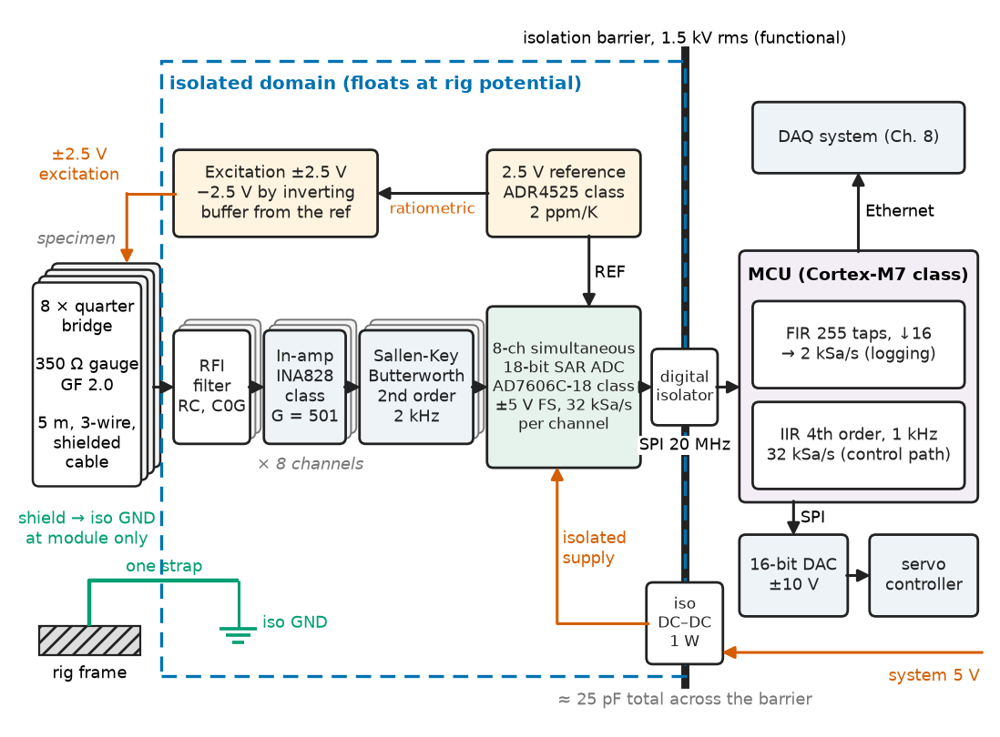
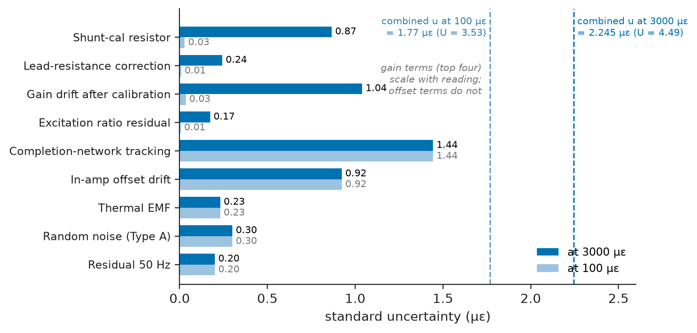
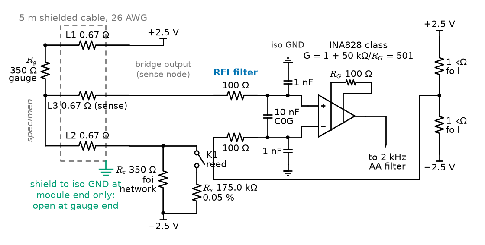
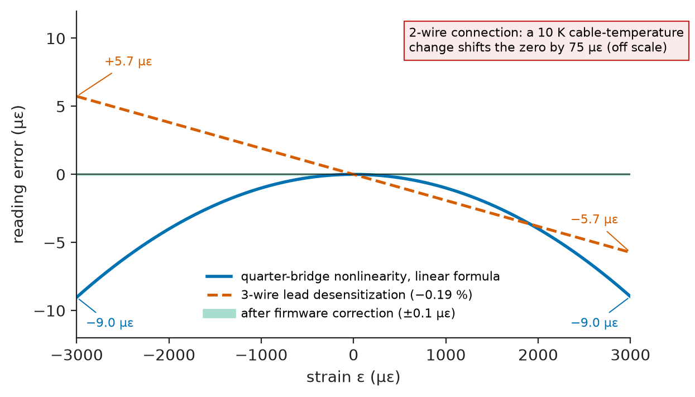
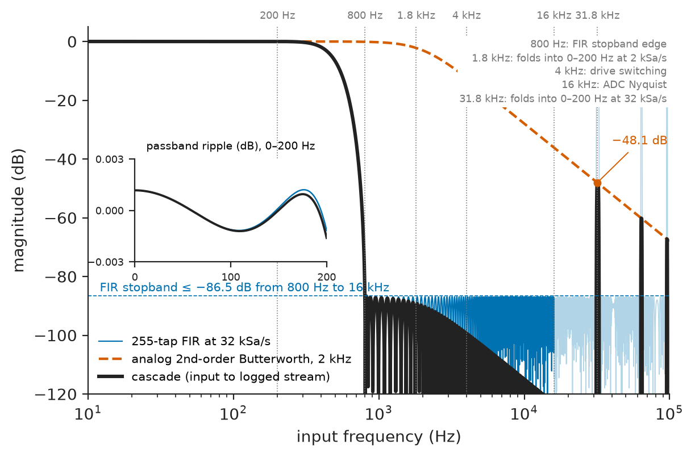
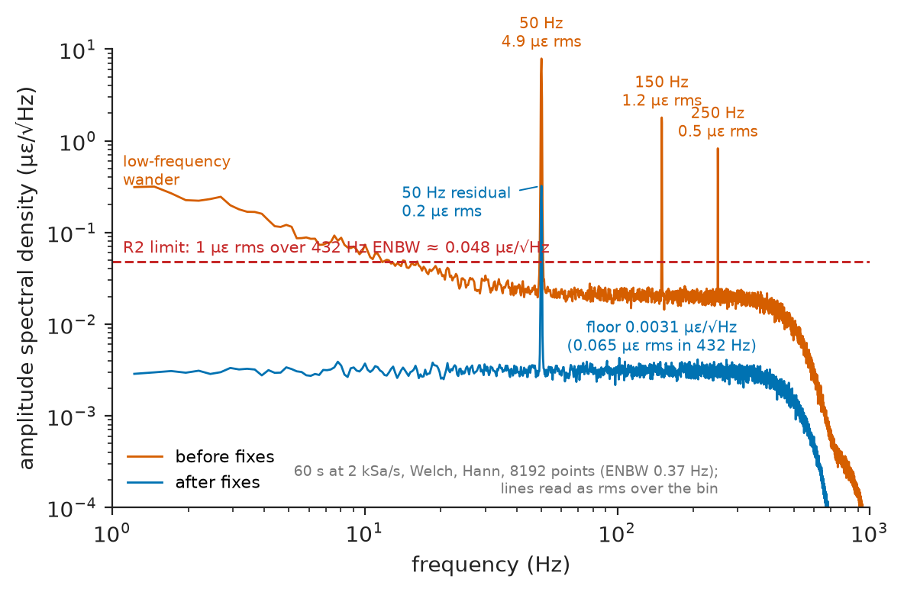

# Chapter 7 — Measurement and Signal Conditioning

*Part II · Instrumentation and Measurement Systems*

A materials laboratory commissions a servo-hydraulic fatigue rig for aluminium suspension arms. Eight foil strain gauges on each arm feed a new conditioning module, and on the bench, with a resistor box standing in for the gauges, the module is quiet to a fraction of a microstrain. On the rig it is not. When the 55 kW hydraulic pump starts on its variable-frequency drive, every channel jumps by 30 to 40 µε and stays there, a 14 µε peak-to-peak 50 Hz ripple appears, and narrow spikes follow each switching edge of the drive. Nothing in the module is broken. The bench's resistor box floated; the rig's frame sits about 10 V rms from the module's ground and carries the drive's common-mode edges; the cable shields were bonded at both ends; and the in-amp inputs rectified radio-frequency energy into a DC shift. This chapter designs that module properly and verifies it against numbers written down before the build.

> **How is a chain from a millivolt-level sensor to a digital number designed so that its range, resolution and uncertainty are known before it is built?**
> **Which conditioning decisions — bridge, amplifier, filters, isolation, converter, sampling — decide whether a measurement survives a real installation rather than a bench?**

| Concept | Engineering destination |
|---|---|
| Measurement range and resolution | Choosing gain, headroom and converter bits for load cells, pressure dies, current shunts |
| Accuracy and precision | Separating bias from scatter in calibration data; deciding what a calibration can fix |
| Error and uncertainty | Uncertainty budgets for test reports, calibration certificates and acceptance limits |
| Bridge circuits | Strain gauges, load cells, pressure sensors, RTDs, magnetoresistive sensors |
| Instrumentation amplifiers | Bridge, thermocouple, shunt and biopotential front ends |
| Filtering | RFI protection, anti-aliasing, decimation, low-latency control outputs |
| Isolation | Rig and plant grounds, motor drives, mains-referenced and high-voltage measurements |
| ADC and DAC selection | Simultaneous versus multiplexed, SAR versus delta-sigma, analog outputs to controllers |
| Sampling | Sample rate, oversampling, inter-channel skew |
| Noise reduction | Noise budgets, shielding, grounding, guarding, averaging |

**Roadmap.** The reference system and what range and resolution it needs (7.1) → what accuracy and precision mean in its calibration data (7.2) → the uncertainty budget (7.3) → the bridge (7.4) → the in-amp (7.5) → four filters with four jobs (7.6) → isolation (7.7) → converter selection (7.8) → sampling (7.9) → noise reduction and the rig failure explained (7.10) → implementation, verification and failure analysis (7.11).

---

## 7.1 Measurement range and resolution

> **Boundary.** Strain-gauge physics, gauge factor, transverse sensitivity and thermal output belong to [Chapter 6](06-sensors-and-transducers.md); the conductor and alloy properties behind them to *Materials Science and Engineering*, [Ch. 25](https://github.com/The-Studio-of-Sadiq/Materials-Science-and-Engineering/blob/main/Chapters/CHAPTER%2025.md). This chapter takes the gauge as a 350 Ω resistor whose value changes by $\Delta R/R=\mathrm{GF}\cdot\varepsilon$ and designs everything after it.

### The reference system

The running system of this chapter is an **8-channel isolated strain-gauge conditioning module** for the fatigue rig. Each channel serves one 350 Ω foil gauge with gauge factor 2.0 in a quarter-bridge, 3-wire connection over 5 m of shielded cable. The module samples all channels simultaneously, logs them at 2 kSa/s to the data-acquisition system of [Chapter 8](08-data-acquisition-systems.md), and drives one selected channel to the rig's servo controller as a ±10 V analog signal for strain-controlled tests. Table 7.1 is the requirement set it is built to.

**Table 7.1 — Requirements for the strain-gauge conditioning module.**

| ID | Requirement | Target | Verification |
|---|---|---|---|
| R1 | Measurement range | ±3000 µε per channel without clipping, after ±500 µε of initial bridge imbalance | Bridge calibrator, ±3500 µε steps |
| R2 | Noise | ≤ 1 µε rms in the 2 kSa/s logged stream, rig running | 60 s record at zero load, pump on |
| R3 | Module uncertainty | ≤ 0.15 % of reading + 4 µε (k = 2), 15–35 °C module ambient | Bridge calibrator at 9 points in a climatic chamber |
| R4 | Bandwidth | 0–200 Hz; amplitude error ≤ 0.1 % at 30 Hz | Sine from calibrator, 1–200 Hz |
| R5 | Inter-channel skew | ≤ 10 µs | Common sine into all channels, cross-correlation |
| R6 | Common-mode immunity | ≤ 1 µε shift for 10 V rms 50 Hz and 1 kV/µs edges between rig and module ground | Injection test |
| R7 | Zero drift | ≤ 0.5 µε/°C | Climatic chamber, dummy bridges |
| R8 | Analog output | ±10 V for ±3000 µε, 16-bit, latency ≤ 1 ms | Step input, oscilloscope |
| R9 | Shunt calibration | Built-in 1000 µε equivalent step, ±0.1 % | Compare with bridge calibrator |
| R10 | Isolation | Channel bank to system: 1.5 kV rms for 60 s (functional), CMTI ≥ 50 kV/µs | Hipot, datasheet |

The architecture (Figure 7.1) follows the signal: bridge, RFI filter, instrumentation amplifier, analog anti-aliasing filter and one 8-channel simultaneous-sampling ADC inside an isolated domain; a digital isolator and isolated DC–DC converter across the barrier; a microcontroller that decimates, scales and logs; and a DAC for the controller output. The interfaces are ±2.5 V excitation and three wires per gauge, ±5 V full scale at the ADC, SPI at 20 MHz across the barrier, Ethernet to the DAQ.

<!-- FIGURE 7.1 | figures/ch07/fig-7-1-strain-module-architecture.png | block-diagram | Architecture of the 8-channel isolated strain-gauge conditioning module for the fatigue rig. | Content: left, stack of 8 quarter-bridge channels (350 ohm gauge, 5 m 3-wire shielded cable). Dashed box isolated domain: excitation +/-2.5 V from 2.5 V reference (ADR4525 class); RFI filter; in-amp INA828 class G = 501; Sallen-Key Butterworth 2 kHz; 8-ch simultaneous 18-bit SAR (AD7606C-18 class), +/-5 V, 32 kSa/s, reference shared with excitation (arrow ratiometric). Thick barrier line with digital isolator (SPI 20 MHz) and isolated DC-DC 1 W (about 25 pF). Right: MCU (Cortex-M7 class) with FIR decimate-by-16 to 2 kSa/s (logging) and IIR 1 kHz (control path); Ethernet to DAQ; SPI to 16-bit DAC +/-10 V to servo controller. Shield bonded to isolated ground at module only; one strap from isolated ground to rig frame. -->



*Figure 7.1 — Architecture of the 8-channel isolated strain-gauge conditioning module for the fatigue rig.*

### Range from the material and the bridge

The range comes from the specimen, not the electronics. A 6061-T6 arm yields near 276 MPa; with $E=69$ GPa that is about 4000 µε, and a fatigue test stays below roughly three quarters of yield, so ±3000 µε covers every planned load case. A quarter bridge excited with $V_{ex}=5$ V gives about $V_{ex}\,\mathrm{GF}\,\varepsilon/4=2.5$ µV per microstrain, 7.5 mV at 3000 µε. The gauge, its solder tabs and the completion resistor are never exactly 350 Ω, so the bridge starts unbalanced; ±500 µε of initial imbalance (0.1 % resistance mismatch) is the allowance in R1. The signal chain must therefore carry ±3500 µε, ±8.75 mV, without clipping anywhere — including at the in-amp's internal nodes (Section 7.5).

### Resolution: bits needed and bits bought

Resolution is the smallest change the chain can report; it is limited by quantization or by noise, whichever is larger. The ratio of range to resolution sets the minimum effective number of bits:

$$
N_{\min}=\log_2\frac{\text{span}}{\text{resolution}}
$$

> **Status of the principle: Effective bits from range and resolution**
> *Derived.* Follows from dividing the span into equal steps; it gives the minimum *effective* resolution, so the converter's ENOB after noise, not its nominal bit count, must meet it, and headroom for imbalance and overload is added on top.

**Worked example — How many bits does the strain module need, and how many does it get?** The span is 6000 µε and the resolution target 1 µε, a ratio of 6000 or 75.6 dB, so $N_{\min}=12.6$ bits. With ±500 µε of imbalance and 20 % overload headroom the converter must cover about 8400 µε at 1 µε, 13.0 bits effective. The chosen chain has an in-amp gain of 501, so 3000 µε gives $7.48\ \mathrm{mV}\times501=3.75$ V at a ±5 V, 18-bit converter: one LSB is $10\ \mathrm{V}/2^{18}=38.1$ µV, or 76.1 nV referred to the input, 0.03 µε. The quantization step is thirty times finer than needed, and Section 7.10 shows the noise is below it as well. The extra bits are not waste: they let one gain cover gauges with very different imbalance without trimming, and they make the noise, not the converter, the resolution limit.

Bits follow from range and resolution at the *input*, after the gain: a "24-bit" converter behind a chain whose noise is 10 µε rms resolves 10 µε.

---

## 7.2 Accuracy and precision

**Precision** is the closeness of repeated readings to each other under stated conditions (repeatability over a short time, reproducibility across operators, days or rigs). **Trueness** is the closeness of their mean to the true value; its opposite is **bias**. **Accuracy** combines both. A channel can be precise and wrong, and calibration can remove bias but never scatter.

**Worked example — A precise channel with a bias.** A precision bridge calibrator is connected at the end of a 5 m gauge cable in place of the gauge and set to +1000.0 µε (GF = 2.0, uncertainty 0.02 % of setting). Channel 3 is read 25 times at one-second intervals: the mean is 998.1 µε and the sample standard deviation 0.22 µε. The standard error of the mean is $0.22/\sqrt{25}=0.044$ µε, and with Student's $t_{0.975,24}=2.064$ the 95 % interval for the mean is $998.1\pm0.09$ µε (*The Mathematics Universe*, [Ch. 20 §20.7](https://github.com/The-Studio-of-Sadiq/engineering-mathematics/blob/main/part-6-probability-statistics/20-statistical-analysis.md)). The channel is repeatable to a fifth of a microstrain, yet reads 1.9 µε (0.19 %) low, twenty times its half-width. The cause is the 0.67 Ω of lead resistance, which desensitizes a 3-wire quarter bridge by $R_L/(R_g+R_L)=0.19\ \%$ (Section 7.4). Corrected, the mean moves to 1000.0 µε; the 0.22 µε scatter does not change.

A bias that is stable and explained is corrected, and its *correction* carries an uncertainty; scatter enters the budget as a Type A term; a bias that is not understood is a fault to be found, never a number to be subtracted.

---

## 7.3 Error and uncertainty

> **Boundary.** The GUM vocabulary, Type A and Type B evaluation, the law of propagation of uncertainty, effective degrees of freedom and the coverage factor are set out in *The Mathematics Universe*, [Ch. 20 §20.10](https://github.com/The-Studio-of-Sadiq/engineering-mathematics/blob/main/part-6-probability-statistics/20-statistical-analysis.md) (after JCGM 100). Here they are applied to a design: the budget is written before the build, and each line is a design decision.

### The error model of a conditioning chain

Every line of a conditioning chain contributes to one of four error shapes:

- **Offset** errors, independent of reading: in-amp offset and its drift, thermal EMFs at connectors, bridge imbalance and the drift of the completion network, residual interference.
- **Gain** errors, proportional to reading: excitation, reference, in-amp gain and its drift, lead desensitization, the calibration reference itself.
- **Nonlinearity**: the quarter bridge's own (Section 7.4), the converter's INL, amplifier distortion.
- **Noise**: random, characterized by a spectral density and a bandwidth.

Zeroing and shunt calibration (R9) remove initial offset and gain; the budget holds the uncertainty of those corrections, the drift after them, and noise.

### The budget for the strain module

The listing evaluates the module's budget in the GUM manner. Tolerances and drift specifications are Type B terms with rectangular distributions (half-width divided by $\sqrt3$); the at-rest noise, measured on the first rig run after the fixes of Section 7.10, is Type A. Gain terms are combined in percent of reading, offset terms in microstrain, and the two are combined at each reading.

```python
import math

RECT, NORM = math.sqrt(3), 1.0          # divisors: rectangular half-width, standard unc.
# (contribution, type, value, divisor); type 'g' = % of reading, 'o' = microstrain
budget = [
    ("shunt-cal resistor 0.05 %",       "g", 0.05,  RECT),
    ("lead-resistance correction",      "g", 0.014, RECT),
    ("gain drift after cal, +/-10 K",   "g", 0.06,  RECT),
    ("excitation ratio residual",       "g", 0.01,  RECT),
    ("completion-network tracking",     "o", 2.5,   RECT),
    ("in-amp offset drift, +/-10 K",    "o", 1.6,   RECT),
    ("thermal EMF at connectors",       "o", 0.4,   RECT),
    ("random noise (Type A)",           "o", 0.3,   NORM),
    ("residual 50 Hz after isolation",  "o", 0.2,   NORM),
]
def rss(kind):
    return math.sqrt(sum((v/d)**2 for _, k, v, d in budget if k == kind))

u_g, u_o = rss("g"), rss("o")
print(f"gain terms: u = {u_g:.4f} % of reading; offset terms: u = {u_o:.2f} ue")
for eps in (100, 1000, 3000):
    U = 2*math.hypot(u_g/100*eps, u_o)            # expanded, k = 2
    limit = 0.0015*eps + 4.0                       # R3: 0.15 % of reading + 4 ue
    print(f"{eps:5d} ue: U(k=2) = {U:4.2f} ue, limit {limit:4.2f} ue, "
          f"margin {100*(1-U/limit):3.0f} %")
```

```text
gain terms: u = 0.0462 % of reading; offset terms: u = 1.77 ue
  100 ue: U(k=2) = 3.53 ue, limit 4.15 ue, margin  15 %
 1000 ue: U(k=2) = 3.65 ue, limit 5.50 ue, margin  34 %
 3000 ue: U(k=2) = 4.49 ue, limit 8.50 ue, margin  47 %
```

Table 7.2 is the same budget with the origin of each value; Figure 7.2 plots the contributions.

**Table 7.2 — Uncertainty budget of one channel at 3000 µε (25 ± 10 °C, after zero and shunt calibration).**

| Contribution | Basis | Half-width or s | Standard uncertainty at 3000 µε |
|---|---|---|---|
| Shunt-cal resistor | 0.05 % tolerance, 175.0 kΩ | 0.05 % | 0.87 µε |
| Lead-resistance correction | ±0.05 Ω on 350 Ω | 0.014 % | 0.24 µε |
| Gain drift after calibration | in-amp and $R_G$, 60 ppm/K × 10 K | 0.06 % | 1.04 µε |
| Excitation ratio residual | ratiometric, 0.01 % divider ratio | 0.01 % | 0.17 µε |
| Completion-network tracking | 0.5 ppm/K × 10 K, ÷ GF | 2.5 µε | 1.44 µε |
| In-amp offset drift | 0.4 µV/K × 10 K = 4 µV | 1.6 µε | 0.92 µε |
| Thermal EMF | 1 µV at dissimilar contacts | 0.4 µε | 0.23 µε |
| Random noise | measured, 2 kSa/s, pump on | 0.3 µε | 0.30 µε |
| Residual 50 Hz | measured after fixes | 0.2 µε | 0.20 µε |
| **Combined, expanded (k = 2)** | | | **4.49 µε** |
| **R3 limit / margin** | 0.15 % + 4 µε | | **8.50 µε / 47 %** |

<!-- FIGURE 7.2 | figures/ch07/fig-7-2-uncertainty-contributions.png | plot | Standard-uncertainty contributions of one strain channel at 3000 and at 100 microstrain. | Content: horizontal bars, the nine contributions of Table 7.2, x-axis 0 to 1.6 microstrain. Dark bars at 3000 microstrain: 0.87, 0.24, 1.04, 0.17, 1.44, 0.92, 0.23, 0.30, 0.20. Light bars at 100 microstrain: 0.03, 0.01, 0.03, 0.01, 1.44, 0.92, 0.23, 0.30, 0.20. Dashed lines at combined 2.25 and 1.77 microstrain. -->



*Figure 7.2 — Standard-uncertainty contributions of one strain channel at 3000 and at 100 microstrain.*

> **Status of the principle: Root-sum-square combination of independent contributions**
> *Derived.* The law of propagation of uncertainty for a linear model with uncorrelated inputs; correlated terms (two channels sharing one reference, a gain drift and an offset drift driven by the same temperature) need their covariance, and a worst-case linear sum replaces the RSS where a requirement is a safety limit rather than a statistical one.

Two things in the budget change the design. First, the largest term at low strain is not the converter, not noise, but the **temperature tracking of the bridge-completion network**: a 0.5 ppm/K ratio drift over ±10 K is 5 ppm of resistance, $5\times10^{-6}/2.0=2.5$ µε. A pair of ordinary 25 ppm/K thin-film resistors with 10 ppm/K tracking would contribute 50 µε and fail R3 and R7 by a factor of ten; the module uses a hermetic metal-foil network with 0.5 ppm/K tracking at about \$18 per channel, the most expensive analog part on the board. Second, a 0.05 % shunt-calibration resistor contributes more than the whole lead correction; a 0.01 % part (another \$6) would cut that line by five, and is noted for Revision B.

---

## 7.4 Bridge circuits

> **Boundary.** The Wheatstone bridge as a circuit — its balance condition and Thévenin equivalent — is network analysis from *Circuits, Signals and Communications*, [Ch. 3](https://github.com/The-Studio-of-Sadiq/Circuits-Signals-and-Communications/blob/main/part-1-circuit-fundamentals/03-network-analysis.md). This section chooses a configuration, excitation and wiring for a measurement, and computes what each choice costs.

### Choosing the configuration

A bridge converts a small resistance change into a small differential voltage riding on a large common-mode voltage of $V_{ex}/2$. Which arms are active decides sensitivity, linearity and temperature compensation (Table 7.3).

**Table 7.3 — Strain-bridge configurations (350 Ω gauges, GF 2.0, 5 V excitation, typical).**

| Configuration | Active gauges | Output at 1000 µε | Nonlinearity at 3000 µε | Temperature compensation | Typical use |
|---|---|---|---|---|---|
| Quarter, 2-wire | 1 | 2.50 mV | −0.30 % | None; leads in one arm | Avoid beyond a few centimetres of lead |
| Quarter, 3-wire | 1 | 2.50 mV (−0.19 % with 5 m leads) | −0.30 % | Leads in adjacent arms cancel | Strain surveys on specimens |
| Half, bending | 2 (top and bottom faces) | 5.00 mV | 0 | Gauges compensate each other | Beams, shafts in bending |
| Full, bending or Poisson | 4 | 10.0 mV (bending) | 0 (bending) | Full | Load cells, torque shafts, pressure dies |

The fatigue rig needs strain at eight specific points on an irregular part, so quarter bridges are unavoidable; the completion half-bridge and the dummy arm live in the module (Figure 7.3).

<!-- FIGURE 7.3 | figures/ch07/fig-7-3-quarter-bridge-3wire.png | circuit | One channel of the quarter-bridge front end with 3-wire gauge connection, symmetric excitation, shunt calibration and RFI filter. | Content: rails +2.5 V and -2.5 V. Gauge 350 ohm fed from +2.5 V through lead L1 0.67 ohm; from its other terminal lead L2 0.67 ohm in series with completion resistor 350 ohm (foil network) to -2.5 V, and lead L3 0.67 ohm as sense wire to in-amp input. Other half-bridge: two 1 kohm foil resistors. Shunt-cal 175.0 kohm 0.05 % via reed relay across the completion resistor. RFI filter: 100 ohm per input, 1 nF C0G each input to isolated ground, 10 nF C0G across. In-amp RG = 100 ohm (G = 501). Shield to isolated ground at module end only. -->



*Figure 7.3 — One channel of the quarter-bridge front end with 3-wire gauge connection, symmetric excitation, shunt calibration and RFI filter.*

### Output, nonlinearity, leads and shunt calibration

For a quarter bridge with all arms nominally equal and $x=\mathrm{GF}\,\varepsilon$, the bridge ratio is

$$
\frac{V_o}{V_{ex}}=\frac{x/4}{1+x/2}
$$

so the output falls short of the linear approximation $V_{ex}x/4$ by a fraction of about $x/2$, and a linear conversion reads $-\mathrm{GF}\,\varepsilon^2/2$ in error: low by 0.10 % at 1000 µε and 0.30 % at 3000 µε in tension, and too compressive by the same amount in compression. The error is exactly known and is removed in firmware by inverting the expression (Section 7.11), so it is a correction, not an uncertainty.

> **Status of the principle: Quarter-bridge nonlinearity**
> *Derived.* Exact for a bridge of four equal nominal arms with one varying; with unequal arms or lead resistance the expression changes slightly, and the firmware correction must use the same arm model as the hardware.

**Worked example — Two wires or three, and the shunt resistor.** Each conductor of the 5 m cable is 26 AWG copper, 0.134 Ω/m, so $R_L=0.67$ Ω.

- *2-wire.* Both leads sit in the gauge arm and add $2R_L=1.34$ Ω to 350 Ω, an apparent strain of $1.34/350/2.0=1914$ µε. Zeroing removes it, but the copper changes resistance by 0.393 %/K: a 10 K change of cable temperature along the rig moves the zero by $0.00393\times10\times1.34/350/2.0=75$ µε, twenty times the R3 budget.
- *3-wire.* One lead sits in the gauge arm and one in the adjacent completion arm, so their changes cancel to first order; the third carries no current and only senses. What remains is a gain error: the gauge's change is now measured against $R_g+R_L$ rather than $R_g$, so the reading is low by $R_L/(R_g+R_L)=0.19\ \%$, the bias found in Section 7.2. The firmware multiplies by $1+R_L/R_g$, with $R_L$ measured at installation by the module's lead-resistance check.
- *Shunt calibration.* A resistor $R_s$ across the 350 Ω completion arm lowers it to $R_gR_s/(R_g+R_s)$. The bridge responds only to the ratio of the gauge arm to the completion arm, so this is exactly equivalent to raising the gauge by the fraction $R_g/R_s$: a tensile step of $R_g/(R_s\,\mathrm{GF})$. For 1000 µε at GF 2.0, $R_g/R_s=0.002$ and $R_s=175.0$ kΩ. (The often-quoted $R_g(1/(\mathrm{GF}\,\varepsilon)-1)=174.65$ kΩ is for a shunt across the gauge itself; used across the completion arm it gives 1002 µε, a 0.2 % calibration error.) Its 0.05 % tolerance is the first line of Table 7.2.

Figure 7.4 shows the errors against strain: the nonlinearity is the largest but costs nothing once corrected; the 2-wire lead drift, invisible on a bench, is what ruins a test.

<!-- FIGURE 7.4 | figures/ch07/fig-7-4-bridge-errors.png | plot | Quarter-bridge reading errors against strain before correction. | Content: x-axis -3000 to +3000 microstrain, y-axis error -12 to +12 microstrain. Solid: linear-formula error, a downward parabola reaching -9.0 at both -3000 and +3000. Dashed: 3-wire lead desensitization -0.19 % of reading, -5.7 at +3000, +5.7 at -3000. Shaded band +/-0.1 microstrain: after firmware correction. Text box: 2-wire, 10 K cable temperature change gives 75 microstrain zero shift (off scale). -->



*Figure 7.4 — Quarter-bridge reading errors against strain before correction.*

### Excitation

Excitation trades signal against self-heating. At 5 V the gauge carries $2.5\ \mathrm{V}/350\ \Omega=7.1$ mA and dissipates 17.9 mW, acceptable on aluminium, which conducts the heat away; on a composite specimen excitation would drop to 1 to 2 V. Two further decisions:

- **Symmetric excitation**, +2.5 V and −2.5 V, puts the bridge outputs near 0 V instead of 2.5 V. Section 7.5 shows why the in-amp needs this.
- **Ratiometric excitation**: both rails are derived from the ADC's own 2.5 V reference, so a reference error scales signal and full scale together and cancels. The residual is the ratio error of the inverting buffer's resistors, 0.01 %, the fourth line of Table 7.2. Full bridges at the end of long cables add **remote sense** lines (6-wire connection) so the excitation actually reaching the bridge is measured; a 3-wire quarter bridge carries its lead correction instead.

---

## 7.5 Instrumentation amplifiers

> **Boundary.** The three-op-amp instrumentation amplifier, its gain equation, its gain-proportional CMRR and the common-mode "diamond plot" are in *Electronics and Computing*, [Ch. 8 §8.6](https://github.com/The-Studio-of-Sadiq/Electronics-and-Computing/blob/main/part-2-analog-electronics/08-operational-amplifiers.md); offset drift, zero-drift amplifiers and input protection in §8.10. Here they decide a part, a gain resistor and a supply.

### Selecting the in-amp

Table 7.4 compares four in-amp classes against R2, R6 and R7. The in-amp's own noise is not decisive (Section 7.10 shows 7 nV/√Hz contributes 0.06 µε rms); offset drift, CMRR at 50 Hz and common-mode range are.

**Table 7.4 — In-amp classes for a 350 Ω bridge at G ≈ 500 (datasheet-class values, 2026 distributor prices, 100 pcs).**

| Class | Noise density | Offset drift (max) | CMRR at G ≥ 100 (min) | Notes | Price | Verdict |
|---|---|---|---|---|---|---|
| INA828 class, bipolar, ±18 V | 7 nV/√Hz | 0.2–0.4 µV/K | 120 dB | Robust inputs, low 1/f noise | \$4.50 | **Chosen** |
| AD8421 class, low noise | 3.2 nV/√Hz | 0.2–0.4 µV/K | 126 dB | Lowest noise, 2 mA supply | \$7.80 | Noise advantage not needed |
| INA333 class, zero-drift CMOS | 50 nV/√Hz | 0.1 µV/K | 100 dB | 5.5 V max supply, chopper ripple near 350 kHz, BW about 3.5 kHz at G = 100 | \$3.20 | Lower CMRR; ripple must be filtered |
| Discrete difference amplifier, op-amp and 0.01 % resistors | Depends | Depends | 74 dB (resistor-limited) | Cheap, inputs load the bridge | \$2 | Fails R6 |

The gain of the chosen class is $G=1+50\ \mathrm{k\Omega}/R_G$. For a 3.75 V output at 3000 µε, $G\approx500$, so $R_G=50\ \mathrm{k\Omega}/499=100.2$ Ω: a 100 Ω, 0.1 %, 10 ppm/K resistor gives $G=501$. Its tolerance does not matter, because shunt calibration measures the actual gain; its temperature coefficient does, and is part of the 60 ppm/K gain-drift line in Table 7.2.

### The common-mode check

**Worked example — Why the bridge is excited at ±2.5 V.** In the first schematic the bridge was excited from 0 and +5 V, so both inputs sit at a common mode of 2.5 V, and the in-amp ran from an isolated ±5 V supply. The first-stage amplifiers of a three-op-amp in-amp swing to $V_{cm}\pm G\,v_d/2$. At full range plus imbalance, $v_d=8.75$ mV and $G\,v_d/2=501\times8.75\ \mathrm{mV}/2=2.19$ V, so the internal nodes reach $2.5+2.19=4.69$ V — inside a ±5 V supply only if the internal amplifiers swing within 0.31 V of the rail, which this class does not guarantee across temperature. The output looks normal until the strain approaches the top of its range and then flattens: a silent clip that a bench test with small signals never shows. With symmetric excitation the common mode is about 0 V, the internal nodes stay within ±2.2 V, and there is 2.5 V of headroom on each side. The check is made against the manufacturer's diamond plot for G = 501 and ±5 V, not against the input-range line on the first page of the datasheet.

### Common-mode rejection and the RFI filter

With 120 dB of CMRR at 50 Hz, a 10 V rms common-mode voltage leaves $10\ \mathrm{V}/10^{6}=10$ µV rms of differential error, 4 µε rms — four times R6. CMRR alone cannot meet R6; isolation (Section 7.7) removes the common mode from the in-amp inputs instead.

At radio frequencies a bipolar input stage rectifies interference and produces a DC offset; this was the 30–40 µε zero shift seen when the pump started. The cure is a passive RFI filter at the inputs (Figure 7.3): 100 Ω in series with each input, 1 nF from each input to ground and 10 nF across them. The differential bandwidth is $1/(2\pi\cdot2R(C_d+C_c/2))=75.8$ kHz, far above the 200 Hz signal, and the common-mode bandwidth $1/(2\pi RC_c)=1.59$ MHz. The differential capacitor is ten times the common-mode ones so that mismatch between the two 1 nF parts, which converts common mode into differential mode, is swamped. All three are C0G: X7R capacitors change value with voltage and temperature and are piezoelectric, so they turn vibration on a fatigue rig into signal (*Materials Science and Engineering*, [Ch. 27](https://github.com/The-Studio-of-Sadiq/Materials-Science-and-Engineering/blob/main/Chapters/CHAPTER%2027.md)).

---

## 7.6 Filtering

> **Boundary.** The anti-aliasing stopband rule $f_{stop}=f_s-f_p$ and Butterworth order selection are in *Circuits, Signals and Communications*, [Ch. 19 §19.9](https://github.com/The-Studio-of-Sadiq/Circuits-Signals-and-Communications/blob/main/part-4-signals-and-systems/19-sampling-and-reconstruction.md); FIR and IIR design in Book 3 [Ch. 23 §23.5–23.6](https://github.com/The-Studio-of-Sadiq/Circuits-Signals-and-Communications/blob/main/part-5-digital-signal-processing/23-digital-filters.md); Sallen-Key component selection in *Electronics and Computing*, [Ch. 8 §8.8](https://github.com/The-Studio-of-Sadiq/Electronics-and-Computing/blob/main/part-2-analog-electronics/08-operational-amplifiers.md).

### Four filters, four jobs

The module has four filters, and confusing their jobs is the commonest filtering mistake:

1. **RFI filter** (Section 7.5): keeps megahertz energy out of the in-amp. Corner 75.8 kHz differential, 1.6 MHz common mode.
2. **Analog anti-aliasing filter**: a 2nd-order Sallen-Key Butterworth at 2 kHz after the in-amp, ahead of an ADC sampling each channel at 32 kSa/s. It must attenuate everything that would fold into 0–200 Hz, i.e. above $32\ \mathrm{kHz}-200\ \mathrm{Hz}=31.8$ kHz.
3. **Logging decimator**: a 255-tap linear-phase FIR at 32 kSa/s, decimating by 16 to 2 kSa/s, passband 0–200 Hz, stopband from 800 Hz.
4. **Control-path filter**: a 4th-order Butterworth IIR at 1 kHz on the 32 kSa/s stream, feeding the DAC without decimation.

Oversampling lets the analog filter be gentle; the sharp filtering is digital and identical in every channel. The listing checks the chain against R4, R5 and R8.

```python
import numpy as np
from scipy import signal

FS_ADC, DEC = 32_000, 16            # ADC rate per channel, decimation to 2 kSa/s
FC_AA = 2_000                       # analog 2nd-order Butterworth (Sallen-Key)

# Analog anti-alias filter
b_a, a_a = signal.butter(2, 2*np.pi*FC_AA, analog=True)
def analog(f):
    w, h = signal.freqs(b_a, a_a, worN=2*np.pi*np.atleast_1d(f))
    return h
att_alias = -20*np.log10(abs(analog(FS_ADC - 200)))[0]
gd_aa = np.sqrt(2)/(2*np.pi*FC_AA)          # DC group delay, 2nd-order Butterworth

# Logging path: linear-phase FIR decimator 32 -> 2 kSa/s
fir = signal.remez(255, [0, 200, 800, FS_ADC/2], [1, 0], weight=[1, 3], fs=FS_ADC)
w, h = signal.freqz(fir, worN=2**16, fs=FS_ADC)
ripple = np.ptp(20*np.log10(abs(h[w <= 200])))
stop = -20*np.log10(abs(h[w >= 800]).max())
gd_fir = (len(fir) - 1)/2/FS_ADC

# Control path: 4th-order Butterworth IIR at 1 kHz, no decimation
sos = signal.butter(4, 1_000, fs=FS_ADC, output='sos')
b, a = signal.sos2tf(sos)
_, gd = signal.group_delay((b, a), w=[30], fs=FS_ADC)
gd_iir = gd[0]/FS_ADC

# Channel skew from a 1 % shift in analog cut-off frequency
skew = gd_aa - np.sqrt(2)/(2*np.pi*FC_AA*1.01)

print(f"analog AA: {att_alias:.1f} dB at {FS_ADC-200} Hz, "
      f"droop at 200 Hz {20*np.log10(abs(analog(200)))[0]:.5f} dB, delay {gd_aa*1e6:.1f} us")
print(f"FIR 255 taps: ripple {ripple:.4f} dB, stopband {stop:.1f} dB, delay {gd_fir*1e3:.2f} ms")
print(f"IIR control path: group delay at 30 Hz {gd_iir*1e3:.3f} ms")
print(f"skew per 1 % cut-off mismatch: {skew*1e6:.2f} us")
```

```text
analog AA: 48.1 dB at 31800 Hz, droop at 200 Hz -0.00043 dB, delay 112.5 us
FIR 255 taps: ripple 0.0024 dB, stopband 86.5 dB, delay 3.97 ms
IIR control path: group delay at 30 Hz 0.415 ms
skew per 1 % cut-off mismatch: 1.11 us
```

The FIR's 0.0024 dB peak-to-peak ripple is ±0.014 %, a seventh of R4's 0.1 %; its 86.5 dB stopband removes the drive's 4 kHz switching components and everything that would fold into the passband at 2 kSa/s. Figure 7.5 shows the cascade.

<!-- FIGURE 7.5 | figures/ch07/fig-7-5-filter-chain-response.png | plot | Magnitude response of the filter chain: analog anti-aliasing filter, FIR decimator and their cascade. | Content: x-axis 10 Hz to 100 kHz log, y-axis 0 to -120 dB. Dashed: 2nd-order Butterworth 2 kHz (-48.1 dB at 31.8 kHz). Thin: 255-tap FIR at 32 kSa/s, passband to 200 Hz, below -86.5 dB from 800 Hz to 16 kHz, images above 16 kHz faint. Thick: cascade. Markers at 200 Hz, 800 Hz, 1.8 kHz, 4 kHz (drive switching), 16 kHz, 31.8 kHz. Inset: passband ripple, -0.003 to +0.003 dB. -->



*Figure 7.5 — Magnitude response of the filter chain: analog anti-aliasing filter, FIR decimator and their cascade.*

> **Status of the principle: Linear-phase FIR delay**
> *Derived.* A symmetric FIR of $N$ taps delays every frequency by exactly $(N-1)/2$ samples; the delay is fixed and correctable in logged data, but it is latency, and it rules a long linear-phase FIR out of any feedback path.

### The control path and its latency budget

R8 asks the analog output to follow strain within 1 ms, because the servo controller closes a strain loop on it. Fed from the logging FIR, the DAC would lag 3.97 ms, a phase lag of $360\times30\times3.97\ \mathrm{ms}=43^\circ$ at 30 Hz. The control path therefore taps the 32 kSa/s stream through a 4th-order IIR with 0.415 ms of group delay at 30 Hz; its nonlinear phase does not matter to a controller, so the two paths are kept separate (Table 7.5).

**Table 7.5 — Latency budget of the analog output path (R8).**

| Stage | Latency | Basis |
|---|---|---|
| Analog anti-aliasing filter | 0.113 ms | Group delay, 2nd-order Butterworth, 2 kHz |
| Wait for next sample (worst case) | 0.031 ms | One period at 32 kSa/s |
| Conversion and SPI read across isolator | 0.010 ms | 8 channels, 18 bits, 20 MHz |
| IIR group delay at 30 Hz | 0.415 ms | Listing above |
| Scaling, channel selection | 0.020 ms | Measured on target, worst case |
| DAC SPI write and settling to 16 bits | 0.010 ms | Datasheet class |
| **Total / requirement / margin** | **0.599 ms / 1.0 ms / 40 %** | |

---

## 7.7 Isolation

### Why the module is isolated

Section 7.5 showed that CMRR leaves 4 µε of error from the rig's 50 Hz ground difference; the drive's edges are worse, and a fault could put mains voltage on the rig frame. An **isolation barrier** lets the whole front end float at the rig's potential, so the common-mode voltage appears across the barrier, not across the in-amp inputs.

**Functional** isolation lets the circuit work; **basic** isolation gives one level of shock protection; **reinforced** two. Grade, creepage, clearance and test voltages come from the product standard, IEC 61010-1 for measurement equipment, with measurement categories for mains-connected inputs (*Electrical Energy and Machines*, [Ch. 29 §29.7](https://github.com/The-Studio-of-Sadiq/Electrical-Energy-and-Machines/blob/main/part-8-electrical-safety-and-engineering-practice/29-electrical-safety.md)). The strain inputs are not mains-connected and the rig frame is earthed, so functional isolation with a 1.5 kV test (R10) is adequate; Section 9.4 shows an instrument where it is not.

Two numbers describe a barrier in a noisy installation: its **common-mode transient immunity** (CMTI), the dv/dt the data path survives without errors, and its **barrier capacitance**.

**Table 7.6 — Isolation options for a multichannel analog front end (typical).**

| Option | Example class | What crosses the barrier | Barrier capacitance | Comment |
|---|---|---|---|---|
| Digital isolator + isolated DC–DC, bank isolation | ISO7741-class 4-channel isolator, 1 W isolated module | SPI and power for all 8 channels | 2 pF (isolator) + 3–50 pF (DC–DC) | Chosen; lowest cost per channel |
| Isolated ΔΣ modulator per channel | AMC1306-class | 1-bit stream, decimated in MCU | about 1–2 pF per channel | Channel-to-channel isolation; for shunts on separate potentials |
| Isolation amplifier per channel | AMC1311-class | Analog voltage | about 1–2 pF | Simple, but ±0.2–0.3 % gain error adds to the budget |

The rig's eight gauges sit on one specimen bolted to one frame, so they share a potential and do not need isolation from each other: one barrier for the bank is enough. A test on a battery string, where each sensor sits at a different cell potential, would need per-channel isolation (Section 9.5).

**Worked example — What the barrier carries.** The chosen isolator and isolated DC–DC converter together present at most about 22 pF across the barrier (20 pF for the DC–DC plus 2 pF for the isolator, budgeted here as 25 pF). With the isolated ground strapped to the rig frame at the specimen end, the 10 V rms, 50 Hz ground difference now appears across that capacitance, whose reactance at 50 Hz is $1/(2\pi\cdot50\cdot25\ \mathrm{pF})=127$ MΩ, so it drives only $10\ \mathrm{V}/127\ \mathrm{M\Omega}=79$ nA, which returns through the strap and shield, not through the signal wires. The in-amp sees essentially no 50 Hz common mode; the residual measured after the fix was 0.2 µε. The drive edges are a different matter: at 1 kV/µs the same 25 pF passes $i=C\,dv/dt=25\ \mathrm{pF}\times10^9\ \mathrm{V/s}=25$ mA for the duration of the edge. That current must have a low-impedance path that avoids the analog ground — a dedicated strap from isolated ground to the rig frame and a stitching capacitor across the barrier on the PCB — and it is why a DC–DC module with 50 pF of barrier capacitance was rejected in favour of one with under 20 pF.

> **Status of the principle: Isolation converts common-mode voltage into barrier current**
> *Derived.* With the front end floating, a ground-potential difference divides between the barrier impedance and the impedances to the rig; when the barrier impedance is much larger, almost all of it appears across the barrier and the remaining current is $C_{barrier}\,dv/dt$. It fails when the front end has a second, unintended path to system ground — a shield bonded at both ends, a USB debugger plugged in during the test.

---

## 7.8 ADC and DAC selection

> **Boundary.** Converter architectures, static accuracy (offset, gain, DNL, INL), quantization and ENOB are in *Electronics and Computing*, [Ch. 10 §10.10](https://github.com/The-Studio-of-Sadiq/Electronics-and-Computing/blob/main/part-2-analog-electronics/10-analog-integrated-circuits.md) and the converter interface (reference, acquisition time, ratiometric measurement) in [Ch. 26 §26.8](https://github.com/The-Studio-of-Sadiq/Electronics-and-Computing/blob/main/part-6-embedded-and-real-time-systems/26-embedded-interfaces.md). Here four real part classes are compared against R1–R8.

### The ADC

Table 7.7 compares four ways to digitize eight bridges.

**Table 7.7 — Converter options for 8 bridge channels (datasheet-class values; indicative 2026 prices, 100 pcs).**

| Option | Example class | Simultaneous (R5) | Resolution at input | Common mode | Cost per 8 ch | Verdict |
|---|---|---|---|---|---|---|
| (a) In-amp per channel + 8-ch simultaneous 18-bit SAR | INA828 + AD7606C-18 | Yes | ≪ 0.1 µε | Handled by in-amp, 120 dB min | about \$66 | **Chosen** |
| (b) Multiplexed 24-bit ΔΣ with PGA and excitation | AD7124-8 | No | 0.05 µε at 50 Sa/s | Direct bridge, ratiometric | about \$12 | Fails R5; throughput far below 8 × 2 kSa/s |
| (c) 8-ch simultaneous 24-bit ΔΣ with PGA | ADS131M08 | Yes | 0.1–0.3 µε at gain 128 | Limited range; CMRR about 100 dB | about \$6 | Revision B candidate |
| (d) Industrial bridge modules + generic DAQ | DIN-rail, ±10 V out | Depends on DAQ | 0.1 % class | Module | about \$1200 | Cost; second analog stage |

Option (a) wins because its common-mode rejection is a guaranteed minimum at the operating gain. Option (c) would remove eight in-amps and eight filters, and is the obvious cost-down once Revision A has measured how little common mode remains behind the barrier.

The ADC's 2.5 V reference (ADR4525 class, 2 ppm/K) also generates the excitation, so its drift cancels in the ratio (Section 7.4).

### The DAC

**Worked example — How many bits for the controller output?** R8 maps ±3000 µε to ±10 V, so 1 µε is 3.33 mV. A microcontroller's 12-bit DAC behind a ±10 V scaling amplifier has steps of $20\ \mathrm{V}/4096=4.88$ mV, 1.46 µε: the controller would see a staircase coarser than the measurement's resolution, and its integrator would hunt between steps. A 16-bit bipolar DAC (AD5761R class, internal reference, ±10 V output, settling about 8 µs) has steps of 0.305 mV, 0.09 µε, with INL of a few LSB. A PWM output with an RC filter cannot meet R8 at all: a ripple below one 16-bit step requires a filter time constant of several milliseconds. The 16-bit DAC at \$11 is chosen, on the non-isolated side, because the servo controller's input is differential and referenced to the controller ground.

---

## 7.9 Sampling

> **Boundary.** The sampling theorem, aliasing, jitter-limited SNR and the sample-and-hold are in *Circuits, Signals and Communications*, [Ch. 19 §19.2–19.7](https://github.com/The-Studio-of-Sadiq/Circuits-Signals-and-Communications/blob/main/part-4-signals-and-systems/19-sampling-and-reconstruction.md); oversampling and its resolution gain in Book 3 [Ch. 21 §21.2](https://github.com/The-Studio-of-Sadiq/Circuits-Signals-and-Communications/blob/main/part-5-digital-signal-processing/21-dsp-fundamentals.md).

### Choosing the rate

The signal of interest is the strain waveform of a fatigue cycle at up to 30 Hz with harmonics to 200 Hz. The logged rate of 2 kSa/s gives ten samples per period of the 200 Hz component and a margin between 200 Hz and the 1 kHz Nyquist frequency that the FIR uses as its transition band. The ADC rate of 32 kSa/s is chosen for the analog filter's sake: it puts the first frequency that folds into the passband at 31.8 kHz, sixteen times above the 2 kHz analog corner. At 4 kSa/s instead, the same filter would give $10\log_{10}(1+(3.8/2)^4)=11.5$ dB at the folding frequency of 3.8 kHz — and the drive's 4 kHz switching component would alias to 0 Hz, straight into the passband.

> **Status of the principle: Oversample, filter gently, decimate digitally**
> *Derived.* Raising the converter rate moves the folding frequency $f_s-f_p$ away from the passband, so a low-order analog filter suffices and the sharp filter becomes a digital one with exact, identical coefficients in every channel; the cost is converter power, data rate and processor load, and it assumes the converter's own noise does not rise faster than the oversampling ratio recovers.

### What can still alias

Components near multiples of the ADC rate fold to near DC. The drive's 8th switching harmonic at 32 kHz would alias to a slowly wandering offset, indistinguishable from drift; only the analog filter's 48 dB prevents it, and no digital filter can. Verification therefore sweeps the drive's switching frequency from 2 to 8 kHz while a channel at zero load is watched for any offset change.

### Simultaneity and skew

The simultaneous-sampling ADC holds all channels at one instant, so the remaining skew comes from the analog filters: 1.11 µs per 1 % of cut-off mismatch (Section 7.6). With 1 % C0G capacitors and 0.1 % resistors the worst case is about 2 %, 2.2 µs, inside R5; it matters when principal strains are computed from a rosette. A multiplexed converter at 32 kSa/s per channel would skew the first and last channels by 27 µs.

Clock jitter is irrelevant here: 1 ns rms on a 200 Hz signal limits SNR to $-20\log_{10}(2\pi\cdot200\cdot10^{-9})=118$ dB. It is worth computing again for the 1 MSa/s power channels of [Chapter 8](08-data-acquisition-systems.md).

---

## 7.10 Noise reduction

> **Boundary.** Thermal noise, noise spectral density, noise bandwidth and the noise of filters are from *Circuits, Signals and Communications*, [Ch. 29 §29.3–29.4](https://github.com/The-Studio-of-Sadiq/Circuits-Signals-and-Communications/blob/main/part-6-communication-theory/29-random-signals-and-communication-noise.md); in-amp noise models from *Electronics and Computing*, [Ch. 8](https://github.com/The-Studio-of-Sadiq/Electronics-and-Computing/blob/main/part-2-analog-electronics/08-operational-amplifiers.md).

### Random noise: the budget nobody needed

**Worked example — Input-referred noise of one channel.** Referred to the in-amp input, three white-noise sources add in quadrature:

- the bridge's 350 Ω output resistance plus the 2 × 100 Ω RFI resistors, 550 Ω, give $\sqrt{4kTR}=3.0$ nV/√Hz at 300 K;
- the in-amp contributes 7 nV/√Hz;
- the ADC, with about 90 dB SNR on its ±5 V range (112 µV rms spread over 0–16 kHz at 32 kSa/s), contributes $112\ \mu\mathrm{V}/\sqrt{16\,000\ \mathrm{Hz}}/501=1.8$ nV/√Hz.

The total is 7.8 nV/√Hz. The equivalent noise bandwidth of the 255-tap FIR, computed from its coefficients, is 432 Hz, so the logged stream carries $7.8\ \mathrm{nV}/\sqrt{\mathrm{Hz}}\times\sqrt{432\ \mathrm{Hz}}=0.16$ µV rms, or 0.065 µε rms. The in-amp's 1/f noise, 0.14 µV peak-to-peak from 0.1 to 10 Hz, adds about 0.01 µε rms. Random noise is fifteen times below R2's limit.

A lower-noise in-amp would therefore buy nothing. What fills the rig's noise budget is **interference** and **drift**, reduced by layout, wiring and grounding, not by part selection.

### Interference and the rig failure explained

Interference couples by four paths, each with its own cure (Table 7.8). The diagnosis on the rig followed them in order, with the pump switched on and off and a battery-powered oscilloscope with a differential probe.

**Table 7.8 — Interference paths found on the fatigue rig and the fix for each.**

| Path | Mechanism on the rig | Symptom before | Fix | After |
|---|---|---|---|---|
| Conductive (ground loop) | Shield bonded at module and at rig frame; 50 Hz frame current shared the shield and the module ground | 14 µε pk-pk at 50 Hz and 150 Hz | Isolated front end; shield bonded at module end only; one strap from isolated ground to frame | 0.2 µε rms residual |
| Common-mode to differential conversion | Drive edges, 1 kV/µs, through unequal input impedances | Spikes up to 60 µε at each edge | RFI filter with matched C0G parts; twisted-pair leads | Not detectable at 2 kSa/s |
| RF rectification | In-amp inputs demodulated MHz ringing into DC | 30–40 µε zero shift with pump on | RFI filter (Section 7.5) | < 0.5 µε shift |
| Magnetic (normal mode) | Untwisted lead loop of 30 cm² near the pump motor cable | 2 µε at 50 Hz on two channels | Twisted leads; cable rerouted 0.5 m from motor cable | Below noise |

Figure 7.6 shows a channel's spectrum at zero load with the pump running, before and after.

<!-- FIGURE 7.6 | figures/ch07/fig-7-6-rig-spectrum-before-after.png | plot | Spectrum of one channel at zero load with the pump running, before and after the isolation and wiring fixes. | Content: x-axis 1 Hz to 1 kHz log, y-axis amplitude spectral density 1e-4 to 10 microstrain per root hertz, log. Before: floor about 0.02, lines at 50 Hz (4.9 microstrain rms), 150 Hz (1.2), 250 Hz (0.5), raised wander below 5 Hz. After: floor 0.0031 (0.065 microstrain rms over 432 Hz), residual 50 Hz line 0.2. Dashed line: R2 limit. -->



*Figure 7.6 — Spectrum of one channel at zero load with the pump running, before and after the isolation and wiring fixes.*

> **Status of the principle: Single-point shield grounding at low frequency**
> *Empirical.* Bonding a cable shield at one end only breaks the low-frequency ground loop through it, which is what a bridge at 0–200 Hz needs; above a few megahertz a shield open at one end becomes an antenna, so RF practice bonds both ends, and the compromise for mixed environments is one end direct and the other through a small capacitor.

### Averaging and its limit

Averaging $n$ independent readings of a static quantity reduces random noise by $\sqrt n$ (Section 7.2 located a mean to 0.044 µε with 25 readings). It does nothing for a 50 Hz line unless the window is a whole number of mains periods, and nothing for drift or bias.

---

## 7.11 Implementation, verification and failure analysis

### Strain from codes

The firmware converts each decimated code to strain in three steps: form the bridge ratio $V_r$, invert the quarter-bridge expression exactly and subtract the zero taken before the test, then apply the lead and shunt-calibration corrections. Because the excitation is ratiometric, the reference voltage cancels: with a ±5 V ADC range equal to twice the 2.5 V reference and a 5 V excitation equal to twice the same reference, $V_r=\text{code}/(2^{17}G)$ for an 18-bit signed code. The C17 listing is the per-channel conversion; the shunt-calibration routine computes `k_cal` as the ratio of the expected to the measured step.

```c
#include <stdint.h>

#define IA_GAIN     501.0f          /* in-amp gain, 1 + 50 kOhm / 100 Ohm */
#define CODE_FS     131072.0f       /* 2^17: 18-bit signed full scale      */

typedef struct {
    float gf;                       /* gauge factor from the gauge data sheet       */
    float rl_over_rg;               /* lead resistance / gauge resistance (3-wire)  */
    float k_cal;                    /* gain correction from shunt calibration       */
    float eps_zero;                 /* strain reading at zero load (tare)           */
} qb_channel_t;

/* Bridge ratio Vout/Vex from a ratiometric ADC code: the reference cancels. */
static inline float bridge_ratio(int32_t code)
{
    return (float)code / (CODE_FS * IA_GAIN);
}

/* Quarter bridge, exact inversion of Vr = (x/4)/(1 + x/2), x = GF * strain. */
float strain_from_code(const qb_channel_t *ch, int32_t code)
{
    const float vr  = bridge_ratio(code);
    const float eps = 4.0f * vr / (ch->gf * (1.0f - 2.0f * vr)) - ch->eps_zero;
    return eps * (1.0f + ch->rl_over_rg) * ch->k_cal;
}

/* Shunt R across the completion arm simulates eps = (Rg/Rs)/GF in tension. */
float shunt_cal_factor(const qb_channel_t *ch, float rg, float rs, float eps_measured)
{
    const float eps_expected = (rg / rs) / ch->gf;
    return ch->k_cal * eps_expected / eps_measured;
}
```

Two details matter. The tare is subtracted in the strain domain, after the inversion: subtracting the zero-load *ratio* first would leave a 3 µε error at 3000 µε for 500 µε of imbalance. An imbalance in the completion arm also changes the bridge's sensitivity by about 0.1 % per 500 µε, and the shunt calibration, made with the same imbalance present, absorbs it into `k_cal`. Second, `shunt_cal_factor` is called with the strain computed with the old `k_cal` but with the lead correction disabled, because a shunt at the module calibrates the electronics, not the leads.

### Verification

Table 7.9 closes each requirement with a test; the bridge calibrator is a 350 Ω precision strain-bridge simulator with 0.02 % of setting uncertainty, itself calibrated by an accredited laboratory, and the climatic chamber runs 15, 25 and 35 °C.

**Table 7.9 — Verification of the strain-gauge module (Revision A, after fixes).**

| Req. | Test | Limit | Result | Pass/fail |
|---|---|---|---|---|
| R1 | Calibrator steps to ±3500 µε, all channels; check ADC codes and in-amp internal nodes | No clipping; linearity ≤ 0.05 % | Max +4.37 V / −4.40 V at ADC (±5 V range); linearity 0.012 % | Pass |
| R2 | 60 s at zero load, pump and drive running, 8 channels | ≤ 1 µε rms | 0.25 µε rms worst channel (0.07 µε with dummy bridge on bench) | Pass |
| R3 | 9 points from −3000 to +3000 µε at 15, 25, 35 °C | 0.15 % + 4 µε (k = 2) | Worst error 3.1 µε at +3000 µε, 35 °C | Pass |
| R4 | Calibrator sine 1–200 Hz, 1000 µε | ≤ 0.1 % at 30 Hz | −0.004 % at 30 Hz; −0.03 % at 200 Hz | Pass |
| R5 | Same 30 Hz sine into 8 channels; cross-correlation | ≤ 10 µs | 1.4 µs worst pair | Pass |
| R6 | 10 V rms 50 Hz injected rig-to-module; 1 kV/µs pulses; drive sweep 2–8 kHz | ≤ 1 µε shift | 0.2 µε; 0.4 µε; no offset change | Pass |
| R7 | Dummy bridges, 15–35 °C | ≤ 0.5 µε/°C | 0.18 µε/°C worst channel | Pass |
| R8 | 1000 µε step from calibrator to DAC output | ≤ 1 ms; 16 bits | 0.62 ms to 50 %; 16 bits monotonic | Pass |
| R9 | Shunt step vs calibrator 1000 µε | ±0.1 % | 999.6 µε (−0.04 %) | Pass |
| R10 | 1.5 kV rms, 60 s, barrier; isolator CMTI from datasheet | No breakdown; ≥ 50 kV/µs | 0.4 µA leakage; 100 kV/µs | Pass |

The R6 drive sweep would have caught the original failure on day one; it is now in the regression set ([Chapter 4](../part-1-engineering-design-methodology/04-prototyping-and-verification.md)).

### Failure analysis

**Table 7.10 — FMEA of the strain-gauge module (extract).**

| Failure mode | Effect | Cause | Detection | Mitigation |
|---|---|---|---|---|
| Ground loop through shield | 50 Hz error of several µε | Shield bonded at both ends during rig rework | R6 injection test; 50 Hz line in at-rest spectrum | Shield termination marked on drawing; at-rest spectrum logged before every test |
| Silent clipping of in-amp internal node | Reading flattens near full range | Asymmetric excitation; gain raised for a low-strain specimen | Diamond-plot check in design review; R1 step test | Symmetric excitation; firmware flags codes beyond ±4.5 V |
| RF rectification | DC zero shift with drive running | RFI filter omitted or wrong dielectric | Pump on/off zero comparison | RFI filter with C0G parts; test in R6 |
| Open gauge or broken lead | Channel saturates or reads nonsense | Debonded gauge, fatigued lead at the specimen | Bridge-resistance check at start of test; out-of-range flag | Lead strain relief; automatic channel invalidation in the log |
| Completion-network drift | Zero drift of tens of µε over temperature | Thin-film resistors substituted for foil network at purchasing | R7 chamber test on first article | Part number locked in BOM with "no substitution" |
| Aliased drive harmonic | Slow, wandering offset | Drive frequency multiple of ADC rate; weak analog filter | Drive sweep in R6 | 48 dB analog filter; ADC rate not a round multiple of common drive frequencies |

Every failure in the table is invisible on a bench with a floating resistor box; the two tests that make the module trustworthy — injecting the rig's common-mode voltage and sweeping the drive frequency — come from asking what the installation does that the bench does not.

---

## What remains open

| Open question | Where it is answered |
|---|---|
| How are the eight channels timestamped, logged, stored and synchronized with the rig controller's load and displacement channels? | [Chapter 8](08-data-acquisition-systems.md) |
| How are thermocouple, energy, speed, power-quality and battery measurements conditioned in compact instruments? | [Chapter 9](09-instrumentation-projects.md) |
| How are the strain module's production units tested automatically, with guard-banded limits? | [Chapter 9 §9.7](09-instrumentation-projects.md) |
| How are gauges, thermocouples and other sensors chosen and calibrated in the first place? | [Chapter 6](06-sensors-and-transducers.md) |
| How is a current and voltage front end designed for a mains energy meter, with calibration and safety? | [Chapter 35](../part-9-interdisciplinary-engineering-projects/35-project-smart-energy-monitor.md) |
| How are the same conditioning principles applied to biopotentials with patient-safety isolation? | [Chapter 28](../part-7-communications-signal-processing-and-biomedical/28-biomedical-instrumentation.md) |

**Next:** Chapter 8 takes the conditioned, digitized channels and builds the acquisition system around them — architecture, synchronization across nodes, real-time transfer, logging, storage and the checks that prove a recorded data set is valid.
