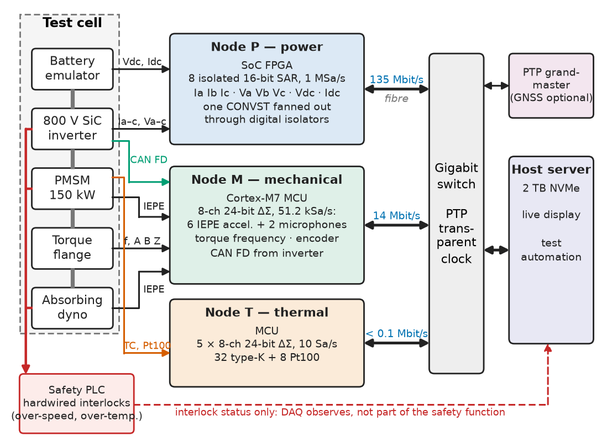
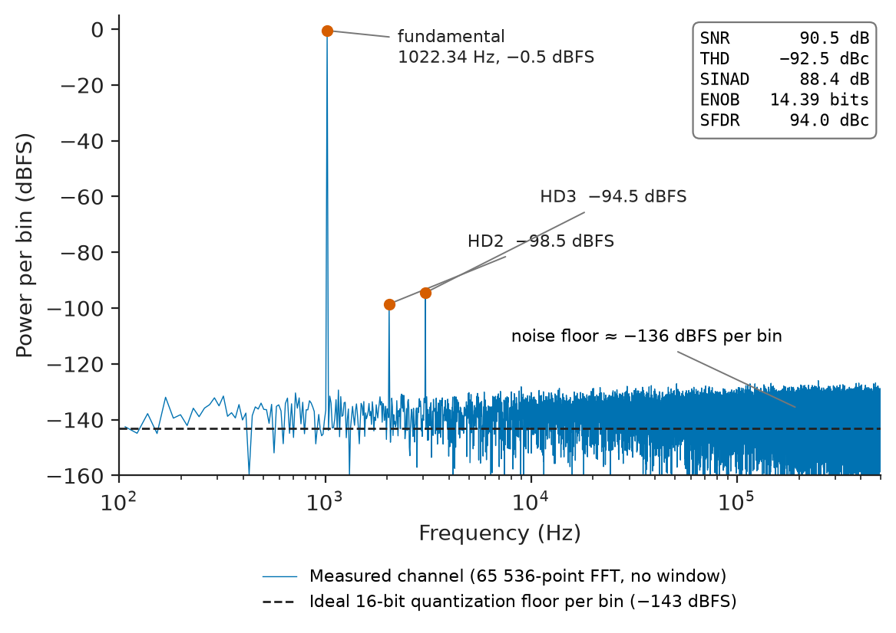
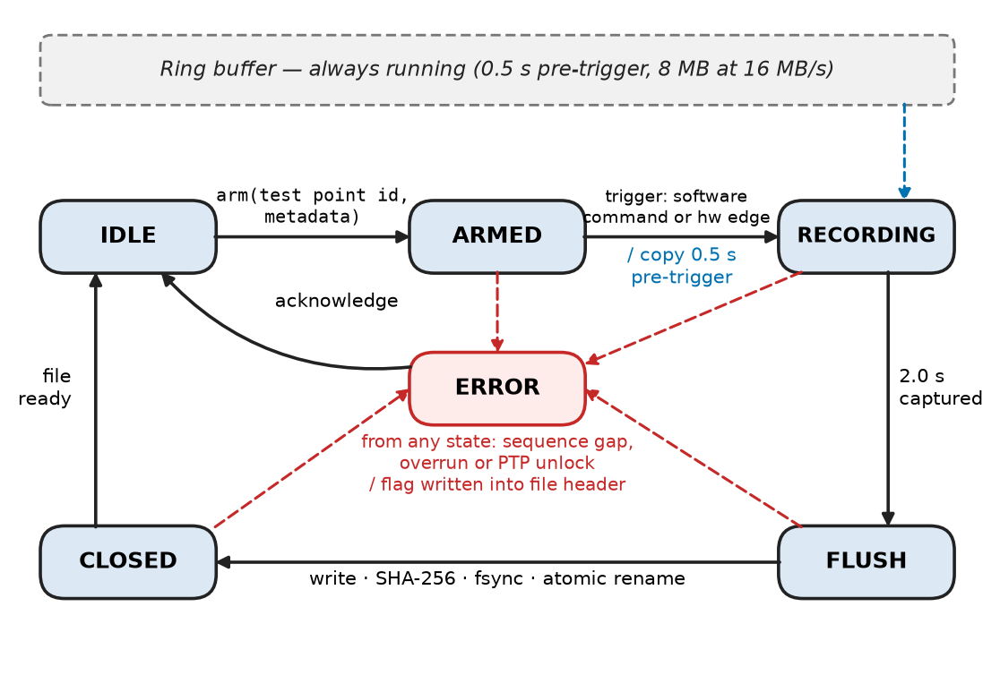
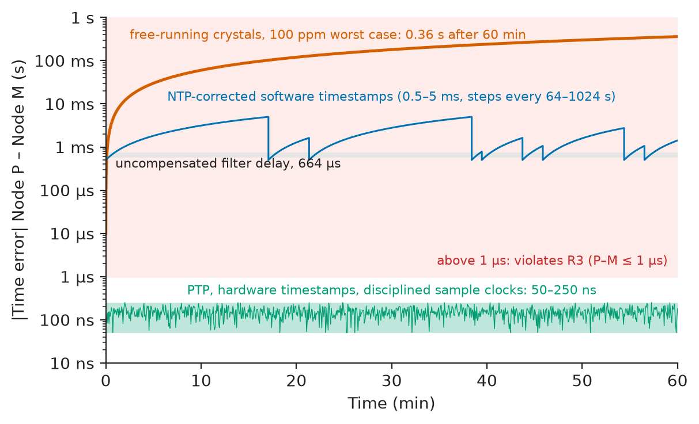
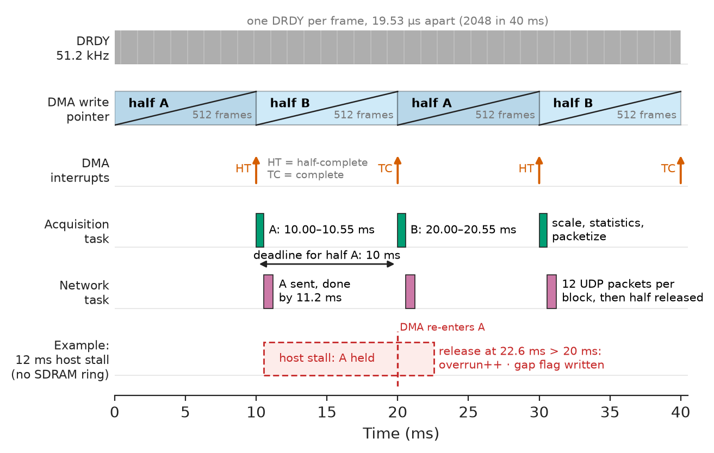
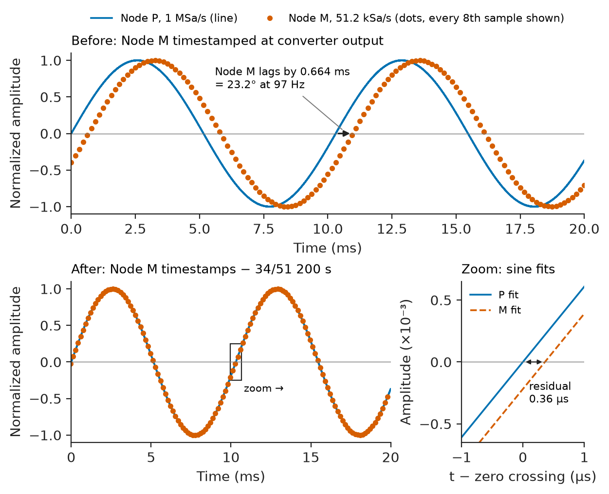

# Chapter 8 — Data Acquisition Systems

*Part II · Instrumentation and Measurement Systems*

An engineering team maps the efficiency of a 150 kW traction drive on a dynamometer: an 800 V silicon-carbide inverter feeding a permanent-magnet motor whose shaft drives an absorbing machine through a torque flange. Electrical power is measured by one acquisition node next to the inverter, mechanical power by another at the shaft, temperatures by a third, and each node timestamps its data from its own crystal, corrected by NTP. Steady-state points look plausible. During torque ramps the computed efficiency swings by more than a percent from ramp to ramp and occasionally exceeds 100 %, and the vibration order maps at high speed are smeared. Every sensor is in calibration and every converter meets its datasheet. The fault is in the acquisition system: the nodes disagree about time by milliseconds, with steps whenever NTP corrects a clock, and the vibration converter's decimation filter delays its samples by 664 µs that nobody subtracted. This chapter builds the acquisition system for that test cell so that every sample has a known time, a known origin and a known validity.

> **How is a multi-node acquisition system architected so that thousands of channels at very different rates arrive complete, aligned in time and traceable to their calibration?**
> **How are real-time transfer, logging, storage and validation designed so that a lost sample, a clock fault or a bad sensor is detected rather than analysed?**

| Concept | Engineering destination |
|---|---|
| DAQ architectures | Choosing centralized, distributed or embedded acquisition for test cells, vehicles, plants and labs |
| Sensor interfaces | IEPE, thermocouple, RTD, current-transducer, frequency, encoder and bus inputs |
| ADC performance | ENOB, SINAD and SFDR measured on the assembled channel, not quoted from the datasheet |
| Sampling rates | Per-channel rates from signal bandwidth, and the data rates they imply |
| Data logging | Triggered windows, ring buffers, metadata, continuous low-rate records |
| Synchronization | PTP, shared clocks, GNSS, filter-delay compensation |
| Real-time acquisition | DMA ping-pong buffers, deadlines, overrun detection |
| Serial and network interfaces | SPI, CAN FD, USB, Ethernet, EtherCAT throughput and latency |
| Data storage | File formats, storage budgets, integrity under power loss |
| Measurement validation | Automated checks, injected references, energy balances |

**Roadmap.** Requirements and architecture (8.1) → what each sensor needs at the node (8.2) → how good the digitized channel really is (8.3) → rates and data volume (8.4) → logging (8.5) → time alignment across nodes (8.6) → moving samples in real time (8.7) → the links (8.8) → storage (8.9) → proving the data valid (8.10) → verification and failure analysis (8.11).

---

## 8.1 DAQ architectures

> **Boundary.** Conditioning, uncertainty and converter selection for individual channels are in [Chapter 7](07-measurement-and-signal-conditioning.md); embedded interfaces (SPI, CAN, USB, Ethernet) at the protocol level in *Electronics and Computing*, [Ch. 26](https://github.com/The-Studio-of-Sadiq/Electronics-and-Computing/blob/main/part-6-embedded-and-real-time-systems/26-embedded-interfaces.md); scheduling and latency theory in [Ch. 27](https://github.com/The-Studio-of-Sadiq/Electronics-and-Computing/blob/main/part-6-embedded-and-real-time-systems/27-real-time-computing.md). This chapter is the system around the channels.

### Four architectures

**Table 8.1 — DAQ architectures (typical).**

| Architecture | Example | Strengths | Weaknesses | Fits |
|---|---|---|---|---|
| Centralized chassis | PXI or cDAQ-class chassis with plug-in modules, shared backplane clock | Sample-clock sharing, one software stack | Long analog cables from sensor to chassis; one chassis per location | Bench and small test cells |
| Distributed networked nodes | Ethernet nodes near sensor groups, PTP time | Short analog runs, galvanic separation by location, scalable | Time sync must be engineered; more firmware | Large test cells, vehicles, plants |
| Fieldbus I/O | EtherCAT terminals, distributed clocks | Deterministic cycle, cheap channels | Cycle-based, limited to kSa/s per channel | Process and machine data, slow channels |
| Embedded logger | MCU board with local ADC and SD card | Low cost and power, standalone | Limited rate and storage; validation is on you | Field monitoring, IoT (Chapter 11) |

### The reference system: a three-node dynamometer DAQ

The dynamometer cell's sensors sit in three places with three very different signal types, so the architecture is **distributed** (Figure 8.1). **Node P** (power) stands beside the inverter: eight high-voltage channels — three phase currents, three phase voltages, DC-link voltage and current — each with its own isolated 16-bit 2 MSa/s SAR converter run at 1 MSa/s, all triggered by one convert signal from a SoC FPGA. **Node M** (mechanical) at the shaft: six IEPE accelerometers and two microphones on an 8-channel simultaneous 24-bit delta-sigma converter at 51.2 kSa/s, plus torque-flange frequency output, a 1024-line encoder and the inverter's CAN FD telemetry, on a Cortex-M7 MCU. **Node T** (thermal) on the coolant manifold: 32 type-K thermocouples and 8 Pt100s on five multiplexed 24-bit delta-sigma converters at 10 Sa/s. All three connect to a PTP-aware Gigabit switch, a grandmaster clock and a host server with 2 TB of NVMe storage. Safety interlocks (over-speed, over-temperature) are hardwired through the cell's safety PLC (Chapter 21); the DAQ observes them but is not part of the safety function.

<!-- FIGURE 8.1 | figures/ch08/fig-8-1-dyno-daq-architecture.png | block-diagram | Distributed acquisition system of the 150 kW electric-drive dynamometer cell. | Content: left, test cell drawing: battery emulator, 800 V SiC inverter, PMSM, torque flange, absorbing dyno. Node P (SoC FPGA, 8 isolated 16-bit 1 MSa/s channels: Ia Ib Ic, Va Vb Vc, Vdc, Idc; one CONVST fan-out through digital isolators). Node M (Cortex-M7 MCU, 8-ch 24-bit delta-sigma 51.2 kSa/s for 6 IEPE accelerometers and 2 microphones, torque frequency input, encoder, CAN FD from inverter). Node T (MCU, 5 x 8-ch 24-bit delta-sigma, 32 type-K + 8 Pt100, 10 Sa/s). All three to a PTP transparent-clock Gigabit switch; PTP grandmaster (GNSS optional); host server with 2 TB NVMe, live display, test automation. Link labels: P 135 Mbit/s, M 14 Mbit/s, T < 0.1 Mbit/s. Separate red path: safety PLC hardwired interlocks, DAQ observes only. -->



*Figure 8.1 — Distributed acquisition system of the 150 kW electric-drive dynamometer cell.*

**Table 8.2 — Requirements for the dynamometer DAQ.**

| ID | Requirement | Target | Verification |
|---|---|---|---|
| R1 | Channels and rates | P: 8 × 1 MSa/s; M: 8 × 51.2 kSa/s + torque, speed 1 kSa/s + CAN; T: 40 × 10 Sa/s | Configuration audit, rate counters |
| R2 | Node P channel quality | ENOB ≥ 14.0 bits at 1 kHz, −0.5 dBFS, front end included; intra-node skew ≤ 50 ns | FFT test with coherent sampling; common pulse |
| R3 | Inter-node alignment | P–M ≤ 1 µs; P–T ≤ 1 ms, for 8 h | Shared reference sine, sine-fit phase |
| R4 | No silent loss | 0 undetected gaps in 8 h; every gap flagged in the file | Sequence counters; forced overload test |
| R5 | Live view | ≤ 250 ms from sample to display | Timestamped test pulse |
| R6 | Storage | One 8 h test on local NVMe with ≥ 20 % free; self-describing files with checksum | Storage audit; reader test |
| R7 | Power-loss integrity | ≤ 1 s of data lost; all closed files readable | Pull-the-plug test |
| R8 | Validation | Automated range, stuck, gap, clock and energy-balance checks on every run | Seeded faults |
| R9 | Network load | ≤ 50 % on any link | Switch counters |
| R10 | HV safety | Node P inputs reinforced-isolated for 1000 V DC working (IEC 61010-1, -2-030) | Type test, hipot |

---

## 8.2 Sensor interfaces

Each sensor family arrives with its own electrical interface, and the node must supply what the sensor needs and detect when it fails (Table 8.3); how the sensors themselves were chosen — fluxgates for power, encoders and torque flanges for the shaft — is in [Chapter 6](06-sensors-and-transducers.md).

**Table 8.3 — Sensor interfaces of the dynamometer DAQ.**

| Signal | Sensor class | Interface | Conditioning at the node | Fault detection |
|---|---|---|---|---|
| Phase and DC currents | Closed-loop fluxgate transducer, ±700 A, DC–100 kHz class | Current output, 1:1750 | 12.5 Ω 0.01 % burden, ±5 V | Transducer status line; zero check at standstill |
| Phase and DC voltages | Compensated 1000:1 HV divider | ±1 V differential | Isolated channel per input, 300 kHz anti-alias | Divider open: reads 0 with inverter running |
| Vibration | IEPE accelerometer, 100 mV/g, ±50 g | 2-wire, constant current, bias about 12 V | 4 mA source, 24 V compliance, AC coupling 0.3 Hz | Bias outside 2–20 V: short or open |
| Sound | IEPE microphone | As above | As above | As above |
| Torque | Torque flange, 10 kHz ± 5 kHz frequency output | RS-422 | Timer reciprocal counting | Frequency outside 4–16 kHz |
| Speed and angle | 1024-line encoder | RS-422 A, B, Z | Quadrature timer, M/T speed (Section 9.3) | Missing Z pulse count per revolution |
| Temperatures | Type K thermocouple; Pt100 4-wire | µV; resistance | 24-bit ΔΣ, CJC on isothermal block (Section 9.1); 1 mA excitation | Burnout current; resistance out of range |
| Inverter telemetry | Inverter controller | CAN FD, 500 kbit/s / 2 Mbit/s | Transceiver, hardware timestamp on receipt | Message-rate watchdog |

**Worked example — How long can an IEPE cable be?** An IEPE accelerometer's internal amplifier is powered by the constant current $I_{cc}$ that also carries the signal; it can only charge the cable capacitance as fast as the spare current allows. The usual limit is

$$
f_{\max}=\frac{I_{cc}-1\ \mathrm{mA}}{2\pi\,C_{cable}\,V_{pk}}
$$

where 1 mA is reserved for the sensor's own amplifier. With $I_{cc}=4$ mA, a 30 m cable at 100 pF/m (3 nF) and a 5 V peak signal (50 g at 100 mV/g), $f_{\max}=3\ \mathrm{mA}/(2\pi\cdot3\ \mathrm{nF}\cdot5\ \mathrm{V})=31.8$ kHz, above the 20 kHz analysis band. A 100 m run through the cell's cable trays (10 nF) drops it to 9.5 kHz: the waveform would be slew-limited, distorting peaks without any visible fault. The cell layout therefore puts Node M within 30 m of every accelerometer, an architecture decision driven by one line of arithmetic.

> **Status of the principle: IEPE slew limit**
> *Approximate.* Treats the cable as a lumped capacitance charged by the spare constant current; it ignores cable resistance and the sensor's output impedance, and it is conservative at low amplitude because the limit scales with $V_{pk}$.

The phase-current interface shows a different kind of choice. A fluxgate transducer's current output is immune to the inverter's electric fields over the 5 m run to Node P, and the burden resistor that converts it to voltage sits at the node, so the accuracy-setting part (0.01 %, 5 ppm/K) is inside the instrument's temperature-controlled enclosure. Voltage-output transducers are cheaper but pick up common-mode noise from the inverter's 50 V/ns edges along the cable.

---

## 8.3 ADC performance

> **Boundary.** Quantization noise, $\mathrm{SQNR}=6.02N+1.76$ dB and ENOB are defined in *Circuits, Signals and Communications*, [Ch. 19 §19.8](https://github.com/The-Studio-of-Sadiq/Circuits-Signals-and-Communications/blob/main/part-4-signals-and-systems/19-sampling-and-reconstruction.md); leakage and coherent sampling in Book 3 [Ch. 22 §22.5](https://github.com/The-Studio-of-Sadiq/Circuits-Signals-and-Communications/blob/main/part-5-digital-signal-processing/22-discrete-fourier-transform.md); converter static errors in *Electronics and Computing*, [Ch. 10 §10.10](https://github.com/The-Studio-of-Sadiq/Electronics-and-Computing/blob/main/part-2-analog-electronics/10-analog-integrated-circuits.md).

### What is measured, on what

A datasheet characterizes the converter with an ideal source; the system's ENOB includes the divider, the isolated driver, the reference and the board. R2 therefore applies to the **assembled channel**, measured with a low-distortion source (a calibrator with < −110 dBc harmonics, followed by a passive band-pass filter) at the channel's input terminals. The dynamic figures are SNR (noise only), THD (harmonics 2 to 6), SINAD (both), ENOB $=(\mathrm{SINAD}-1.76)/6.02$, and SFDR (signal to largest spur). The test follows IEEE Std 1241 with **coherent sampling**: the tone is set to a prime number of cycles in the record, $f_0=J f_s/N$, so all its energy falls in one bin with no window.

The listing processes a record exactly as the production test does; here the record is synthesized with the channel's measured noise (180 µV rms) and harmonic levels so that the analysis can be checked against known inputs.

```python
import numpy as np

FS, N, NBITS, VFS = 1_000_000, 65_536, 16, 10.0      # +/-10 V, 16-bit, 1 MSa/s
CYCLES = 67                                           # prime: coherent, no window
f0 = CYCLES*FS/N
rng = np.random.default_rng(1)

t = np.arange(N)/FS
a = VFS*10**(-0.5/20)                                 # -0.5 dBFS test tone
v = a*np.sin(2*np.pi*f0*t)
v += a*10**(-98/20)*np.sin(2*np.pi*2*f0*t)            # HD2 model, -98 dBc
v += a*10**(-94/20)*np.sin(2*np.pi*3*f0*t)            # HD3 model, -94 dBc
v += rng.normal(0, 180e-6, N)                         # front-end + ADC noise
lsb = 2*VFS/2**NBITS
code = np.clip(np.round(v/lsb), -2**15, 2**15 - 1)    # ideal 16-bit quantizer

P = np.abs(np.fft.rfft(code*lsb))**2
P[0] = 0
sig = P[CYCLES]
harm = sum(P[(h*CYCLES) % N] for h in range(2, 7))    # HD2..HD6 (no folding here)
noise = P.sum() - sig - harm
spur = np.delete(P, [0, CYCLES]).max()

snr, thd = 10*np.log10(sig/noise), 10*np.log10(harm/sig)
sinad = 10*np.log10(sig/(noise + harm))
print(f"f0 = {f0:.2f} Hz  SNR {snr:.1f} dB  THD {thd:.1f} dBc  SINAD {sinad:.1f} dB")
print(f"ENOB {(sinad - 1.76)/6.02:.2f} bits (re full scale "
      f"{(sinad + 0.5 - 1.76)/6.02:.2f})  SFDR {10*np.log10(sig/spur):.1f} dBc")
```

```text
f0 = 1022.34 Hz  SNR 90.5 dB  THD -92.5 dBc  SINAD 88.4 dB
ENOB 14.39 bits (re full scale 14.47)  SFDR 94.0 dBc
```

The channel meets R2 (14.0 bits) with 0.39 bits of margin. The listing makes two practical points. The noise term, 180 µV rms, is twice the 16-bit quantization noise ($305\ \mu\mathrm{V}/\sqrt{12}=88$ µV): the front end, not the converter, sets the ENOB, which is why a 16-bit converter was chosen rather than an 18-bit one. And ENOB must be quoted with its test level: referred to full scale the same channel is 14.47 bits. Figure 8.2 shows the spectrum.

<!-- FIGURE 8.2 | figures/ch08/fig-8-2-adc-fft-test.png | plot | Coherently sampled FFT test of one Node P channel: 1022.34 Hz at -0.5 dBFS, 65 536 points at 1 MSa/s. | Content: x-axis frequency 0 to 500 kHz (log 100 Hz to 500 kHz), y-axis dBFS 0 to -160. Single fundamental bin at -0.5 dBFS; HD2 at -98.5 dBFS, HD3 at -94.5 dBFS marked; noise floor per bin near -137 dBFS. Text box: SNR 90.5 dB, THD -92.5 dBc, SINAD 88.4 dB, ENOB 14.39 bits, SFDR 94.0 dBc. Dashed line at the ideal 16-bit floor per bin for comparison. -->



*Figure 8.2 — Coherently sampled FFT test of one Node P channel: 1022.34 Hz at -0.5 dBFS, 65 536 points at 1 MSa/s.*

> **Status of the principle: ENOB from SINAD**
> *Derived.* Inverts the ideal-quantizer SNR relation, so it summarizes noise and distortion as an equivalent ideal converter; it hides where the error comes from (THD and SNR must be read separately) and it depends on input frequency and level, which must be stated with it.

Other performance figures matter for multichannel systems and are measured the same way: **crosstalk** (a full-scale tone on one channel, the FFT of its neighbours: −110 dB measured between Node P channels thanks to separate isolated islands), **DC offset and gain drift** over the enclosure's temperature range, and for multiplexed converters such as Node T's, **settling after a channel switch**, measured by alternating a full-scale and a zero-scale input on adjacent channels.

---

## 8.4 Sampling rates

> **Boundary.** The sampling theorem, anti-aliasing filter order and jitter-limited SNR are in *Circuits, Signals and Communications*, [Ch. 19 §19.2–19.9](https://github.com/The-Studio-of-Sadiq/Circuits-Signals-and-Communications/blob/main/part-4-signals-and-systems/19-sampling-and-reconstruction.md).

Each rate starts from the highest frequency the analysis needs, adds a filter transition band, and is then rounded to what the converter offers (Table 8.4).

**Table 8.4 — Sampling-rate decisions for the dynamometer DAQ.**

| Group | Analysis band | Rule | Rate | Margin |
|---|---|---|---|---|
| Phase currents and voltages | To 100 kHz: 1 kHz fundamental, 20 kHz switching and sidebands to 5th order | Analog 3rd-order Bessel at 300 kHz; folding starts at $f_s-f_p=900$ kHz | 1 MSa/s | Bessel −21 dB at 900 kHz plus transducer roll-off; filter chosen for flat group delay |
| Vibration, sound | To 20 kHz (gear mesh, bearing orders) | $f_s=2.56\,f_{\max}$, ΔΣ brick-wall filter | 51.2 kSa/s | Converter's digital filter > 100 dB above 25.6 kHz |
| Torque | To 1 kHz | One reciprocal count per carrier period, averaged | 1 kSa/s | 5–15 periods per sample |
| Speed | To 1 kHz | M/T method (Section 9.3) | 1 kSa/s | ±0.05 % at ≥ 1200 rpm |
| Temperatures | < 1 Hz (thermal time constants ≥ 5 s) | 20 ms integration rejects 50 Hz | 10 Sa/s | 50× |
| CAN telemetry | Event-driven, about 500 frames/s | Timestamp on receipt | — | — |

> **Status of the principle: Sample rate of 2.56 times the analysis bandwidth**
> *Empirical.* Vibration-analyser practice: a delta-sigma converter's decimation filter is flat to about 0.45 $f_s$ and fully attenuating by 0.55 $f_s$, so $f_{\max}=f_s/2.56$ leaves its transition band outside the analysis band; it assumes that filter shape and is not a sampling-theorem limit.

The jitter check is worth doing for Node P: at 100 kHz, 50 ps rms of convert-clock jitter limits SNR to $-20\log_{10}(2\pi\cdot10^5\cdot50\ \mathrm{ps})=90.1$ dB, comparable to the channel's own 90.5 dB, so the FPGA's convert signal is generated from a low-jitter clock and re-timed in each isolated island, not driven straight from fabric logic through the isolators.

The rates fix the data volume. Node P produces $8\times10^6\times2$ bytes $=16.0$ MB/s; Node M $8\times51\,200\times4=1.64$ MB/s; Node T 1.6 kB/s; CAN about 8 kB/s. The total, 17.6 MB/s, is 63.5 GB per hour of continuous recording, the number that drives Sections 8.5, 8.8 and 8.9.

---

## 8.5 Data logging

### Windows, rings and continuous records

Continuous recording of every channel at full rate is rarely needed and expensive. The cell's test automation steps the drive through 400 operating points in an 8 h efficiency map; at each it waits for thermal and electrical settling and then asks for a measurement. The logging design therefore has three layers:

- **Triggered full-rate windows**: Node P records 2 s at 1 MSa/s per test point, with 0.5 s of **pre-trigger** taken from a ring buffer that runs continuously, so events just before a trigger (a protection trip, a torque step) are captured.
- **Continuous high-rate where it is cheap**: Node M records continuously, because vibration events are not scheduled.
- **Continuous aggregates**: Node P computes per-electrical-cycle RMS values, active and reactive power per phase and DC power on the FPGA and logs them at up to 1000 records per second; Node T logs everything continuously.

The logger in each node is a state machine (Figure 8.3) whose states and transitions are logged themselves, so that a file's history — when it was armed, triggered, flushed, and whether anything went wrong — is part of the data.

<!-- FIGURE 8.3 | figures/ch08/fig-8-3-logger-state-machine.png | state-diagram | State machine of the windowed logger on Node P. | Content: states IDLE, ARMED, RECORDING, FLUSH, CLOSED, ERROR. Background box labelled ring buffer always running (0.5 s pre-trigger, 8 MB). Transitions: IDLE to ARMED on arm(test point id, metadata); ARMED to RECORDING on trigger (software command or hardware edge), copying 0.5 s pre-trigger; RECORDING to FLUSH when 2.0 s captured; FLUSH to CLOSED after write, SHA-256, fsync, atomic rename; CLOSED to IDLE. Any state to ERROR on sequence gap, overrun or PTP unlock, with the flag written into the file header; ERROR to IDLE on acknowledge. -->



*Figure 8.3 — State machine of the windowed logger on Node P.*

### Metadata is part of the measurement

A number without its context cannot be validated or reused. Every file carries, in its header:

- channel names, units, sensor type and serial number, calibration coefficients and calibration date;
- the conditioning configuration: range, filter settings, decimation and the resulting **group delay** per channel (Section 8.6);
- the time base: PTP grandmaster identity, lock state at start and end, maximum offset during the record;
- the test context: test-point ID, commanded speed and torque, firmware versions, operator;
- integrity data: block sequence range, any gaps, overrun counters, clipping counters per channel.

The calibration coefficients are recorded, not just applied, so that a calibration error found later can be corrected in archived data without re-running a test.

---

## 8.6 Synchronization

### Why time is the hardest channel

Efficiency is $\eta=T\omega/P_{elec}$, with $T\omega$ from Node M and $P_{elec}$ from Node P. If the two nodes disagree about time, every transient converts directly into an error.

**Worked example — What a timebase error costs.** Two nodes with free-running ±50 ppm crystals can drift apart by up to 100 ppm, $10^{-4}\times3600\ \mathrm{s}=0.36$ s per hour. NTP holds a LAN within a few milliseconds but corrects in steps. Suppose a residual 10 ms misalignment during a torque ramp of 200 N·m/s at 6000 rpm ($\omega=628.3$ rad/s): the torque value paired with a given electrical sample is wrong by $200\times0.01=2$ N·m, and mechanical power by $2\times628.3=1.26$ kW — 1.3 % of a 100 kW operating point, the scatter seen in the opening paragraph. To keep the same error below 0.01 %, alignment must be better than about 80 µs; for vibration-to-current phase analysis at a 2.3 kHz gear-mesh frequency, 1 µs is 0.8°. R3's 1 µs follows.

### Methods

**Table 8.5 — Time-synchronization methods (typical achievable alignment).**

| Method | Alignment | Infrastructure | Typical use |
|---|---|---|---|
| Shared sample clock and trigger lines | < 10 ns | Coax to each module; short distances | Chassis DAQ, oscilloscopes |
| IEEE 1588 PTP, hardware timestamping, PTP-aware switches | 20–200 ns | Grandmaster; transparent or boundary-clock switches | Distributed test cells; substations (IEC 61850-9-3 profile) |
| White Rabbit (PTP extension) | < 1 ns | Dedicated switches, fibre | Accelerators, large physics experiments |
| GNSS 1PPS at each node | 20–100 ns | Antenna per node; sky view | Outdoor and wide-area systems |
| IRIG-B | 1–10 µs | Coax distribution | Legacy test ranges |
| NTP | 0.1–10 ms on a LAN | None | Logs, slow channels |

The cell uses **PTP** (IEEE 1588-2019, default profile) with hardware timestamping in each node's Ethernet MAC and a transparent-clock switch that corrects for its own queueing delay. PTP gives each node a clock, but a clock is not a sample: the node's **sample clock** must be derived from it. Node P's FPGA generates its 1 MSa/s convert pulses from a counter clocked by a PLL locked to the PTP clock, so sample 0 of every second falls on the PTP second. Node M feeds the delta-sigma converter's master clock from a VCXO disciplined to PTP and resynchronizes the converter's filter on a PTP second edge. Node T, whose requirement is 1 ms, simply timestamps each conversion with the PTP clock.

> **Status of the principle: Time transfer by two-way message exchange**
> *Derived.* PTP estimates the offset between two clocks from the timestamps of a message exchange in both directions, assuming the path delay is the same each way; asymmetric delays (a switch that is not PTP-aware, different cable lengths for transmit and receive pairs) appear directly as half the asymmetry in offset error.

### Filter delay is a timing error too

**Worked example — The delta-sigma converter's delay.** Node M's converter uses a wideband linear-phase decimation filter with a group delay of about 34 output periods (datasheet-class value; the exact figure depends on the filter and rate selected and is read from the datasheet), $34/51\,200=664$ µs. Node P's SAR channels add only their analog filters' 1–2 µs. Left uncorrected, a 100 Hz shaft-order component in the vibration data appears $360\times100\times664\ \mu\mathrm{s}=23.9^\circ$ late relative to the phase currents, and at the 2.3 kHz gear mesh the error is 550°, more than a full cycle. The correction is exact and costs nothing: every Node M sample is timestamped at the time its input was *sampled*, the converter's output time minus the filter delay, and the delay used is written in the metadata. A firmware change of filter mode must change that number in the same commit.

### The time budget

**Table 8.6 — Time-alignment budget, Node P to Node M (R3: 1 µs).**

| Contribution | Value (bound) | Basis |
|---|---|---|
| PTP offset between the two nodes (each a slave to the same grandmaster) | 100 ns | Hardware timestamps, one transparent-clock hop, measured |
| Timestamp granularity | 8 ns | 125 MHz timestamp clock |
| Sample-clock PLL residual | 50 ns | PLL/VCXO tracking jitter |
| Convert-edge to timestamp latency | 20 ns | Calibrated, residual after correction |
| Analog front-end delay mismatch after calibration | 200 ns | Transducer and filter delays measured and subtracted |
| **RSS / linear sum** | **230 ns / 378 ns** | |
| **Requirement / margin (RSS)** | **1 µs / 77 %** | |

PTP must also fail safely. If the grandmaster is lost, each node holds over on its own oscillator; a 0.5 ppm VCXO drifts 1 µs in 2 s, so R3 is violated within seconds. The nodes therefore write the PTP state and maximum offset into every block header, and the validation of Section 8.10 marks data recorded outside lock rather than letting an analyst discover it. Figure 8.4 compares the alignment achieved by the three timing schemes the cell has used.

<!-- FIGURE 8.4 | figures/ch08/fig-8-4-node-time-error.png | plot | Time offset between Node P and Node M over one hour with three timing schemes. | Content: x-axis time 0 to 60 min, y-axis absolute time error, logarithmic from 10 ns to 1 s. Free-running crystals: straight ramp reaching 0.36 s at 60 min (worst case 100 ppm). NTP-corrected software timestamps: sawtooth between 0.5 and 5 ms with steps every 64 to 1024 s. PTP with hardware timestamps and disciplined sample clocks: band 50 to 250 ns. Shaded region above 1 microsecond labelled violates R3. Second shaded band at 664 microseconds labelled uncompensated filter delay. -->



*Figure 8.4 — Time offset between Node P and Node M over one hour with three timing schemes.*

---

## 8.7 Real-time acquisition

> **Boundary.** Interrupt latency, priorities, response-time analysis and latency and jitter measurement are in *Electronics and Computing*, [Ch. 27 §27.2–27.10](https://github.com/The-Studio-of-Sadiq/Electronics-and-Computing/blob/main/part-6-embedded-and-real-time-systems/27-real-time-computing.md); timer-triggered ADC with DMA at the architecture level in [Ch. 25 §25.2](https://github.com/The-Studio-of-Sadiq/Electronics-and-Computing/blob/main/part-6-embedded-and-real-time-systems/25-embedded-system-architecture.md).

### The deadline is the buffer

Acquisition is real-time in a specific sense: the converter will not wait. Samples arrive at a fixed rate and are written by DMA into a circular buffer split into two halves (**ping-pong**); when one half fills, the processor must finish with it before the DMA wraps around and starts overwriting it. The deadline for processing one half is therefore one half-buffer period, and missing it loses data silently unless the firmware detects it. Figure 8.5 shows the timing on Node M.

<!-- FIGURE 8.5 | figures/ch08/fig-8-5-pingpong-timing.png | timing-diagram | Ping-pong DMA acquisition on Node M: 512-frame halves at 51.2 kSa/s. | Content: time axis 0 to 40 ms. Row 1 DRDY at 51.2 kHz (drawn as dense ticks). Row 2 DMA write pointer filling half A (0-10 ms), half B (10-20 ms), A, B. Row 3 interrupts: half-complete at 10, 30 ms; complete at 20, 40 ms. Row 4 acquisition task: processes A from 10.0 to 10.55 ms, B from 20.0 to 20.55 ms (scale, statistics, packetize). Row 5 network task: sends 12 UDP packets per block, done by 11.2 ms. Arrow from 10 ms to 20 ms labelled deadline for half A. Red dashed example: a 12 ms host stall delays release of A past 20 ms, overrun counter increments, gap flag written. -->



*Figure 8.5 — Ping-pong DMA acquisition on Node M: 512-frame halves at 51.2 kSa/s.*

The C17 listing is the DMA side of that design for an STM32H7-class MCU (HAL callback names as in STM32Cube; illustrative). The converter's 24-bit samples arrive in 32-bit words, eight channels interleaved; each half holds 512 frames, 10 ms. The completion interrupt does almost nothing: it marks the half as owned by the consumer, invalidates the data cache over it (the Cortex-M7 cache would otherwise return stale data), attaches the block's sequence number and the PTP time of its first sample, and posts it to a queue. If the consumer has not released the half from the previous lap, the overrun is counted, not hidden.

```c
#include <stdint.h>
#include <stdbool.h>
#include "stm32h7xx_hal.h"               /* vendor HAL; illustrative names */

#define NCH        8u
#define FRAMES     512u                  /* 10 ms at 51.2 kSa/s */
#define HALF_WORDS (NCH * FRAMES)

typedef struct {
    uint32_t seq;                        /* block sequence number             */
    uint64_t t0_ns;                      /* PTP time at which frame 0 sampled */
    const int32_t *data;                 /* HALF_WORDS samples, interleaved   */
} block_t;

static int32_t dma_buf[2u * HALF_WORDS] __attribute__((aligned(32), section(".dma_ram")));
static volatile bool half_busy[2];
static volatile uint32_t blocks_done, overruns;

extern SPI_HandleTypeDef hspi2;
extern uint64_t ptp_sample_time_ns(uint64_t frame_index);  /* DRDY capture minus filter delay */
extern bool queue_post_from_isr(const block_t *b);         /* RTOS queue, non-blocking        */

static void on_half(unsigned h)
{
    if (half_busy[h]) {
        overruns++;                       /* consumer still owned it: data overwritten */
    }
    half_busy[h] = true;
    SCB_InvalidateDCache_by_Addr(&dma_buf[h * HALF_WORDS], (int32_t)(HALF_WORDS * sizeof(int32_t)));
    const block_t b = { blocks_done, ptp_sample_time_ns((uint64_t)blocks_done * FRAMES),
                        &dma_buf[h * HALF_WORDS] };
    if (!queue_post_from_isr(&b)) {
        overruns++;                       /* queue full: block dropped, gap recorded */
        half_busy[h] = false;
    }
    blocks_done++;
}

void HAL_SPI_RxHalfCpltCallback(SPI_HandleTypeDef *hspi) { if (hspi == &hspi2) on_half(0u); }
void HAL_SPI_RxCpltCallback(SPI_HandleTypeDef *hspi)     { if (hspi == &hspi2) on_half(1u); }

void block_release(const block_t *b)     /* called by the network task when sent */
{
    half_busy[(b->data == dma_buf) ? 0u : 1u] = false;
}
```

The sequence number travels with the block to the host, which detects any gap by a jump in `seq`; the overrun counter travels in the block header. Together they make R4 testable: a forced overload (the host deliberately stalls) must produce a flagged gap, never a silently shortened record.

**Table 8.7 — Node M processing budget per 10 ms block (480 MHz Cortex-M7, measured with a cycle counter).**

| Task | Time | Basis |
|---|---|---|
| DMA interrupt, cache invalidate, queue post | 0.009 ms | 4096 words, 32-byte lines |
| Scale 4096 samples to engineering units | 0.085 ms | about 10 cycles per sample |
| Block statistics (min, max, RMS, clip count) | 0.040 ms | |
| Packetize and send 16 kB over UDP | 0.350 ms | 12 packets, lwIP and Ethernet DMA |
| CAN FD receive and timestamp (about 5 frames) | 0.050 ms | |
| Torque and speed timer reads | 0.015 ms | |
| **Total / deadline / margin** | **0.55 ms / 10 ms / 94 %** | |

The large margin is intentional. The deadline that matters is not the processor's but the **network's**: the half must be released only after it has been sent or copied, so a host or switch stall of more than 10 ms would overrun. Node M therefore copies each block into a 4 MB ring in external SDRAM (about 2.4 s of data) and releases the DMA half immediately; the network task drains the ring. Node P, at 16 MB/s, uses 1 GB of DDR as the same kind of ring, 62 s of ride-through.

---

## 8.8 Serial and network interfaces

> **Boundary.** Signalling, framing, arbitration and bit timing of SPI, I²C, CAN, USB and Ethernet are in *Electronics and Computing*, [Ch. 26 §26.3–26.7](https://github.com/The-Studio-of-Sadiq/Electronics-and-Computing/blob/main/part-6-embedded-and-real-time-systems/26-embedded-interfaces.md); industrial Ethernet and fieldbuses in [Chapter 21](../part-5-industrial-automation/21-industrial-communication-and-safety.md).

Inside the node the converter links are chosen for bandwidth and determinism; between nodes, for distance, throughput and time transfer (Table 8.8).

**Table 8.8 — Interfaces in and around the DAQ (practical payload rates, typical).**

| Interface | Raw rate | Practical payload | Latency | Used here |
|---|---|---|---|---|
| SPI to converter | 25–50 Mbit/s | Near raw | µs | Node M ΔΣ converter; Node T converters |
| LVDS or parallel to FPGA | 100+ Mbit/s per lane | Near raw | ns | Node P SAR channels (through isolators) |
| CAN FD | 0.5 Mbit/s arbitration, 2 Mbit/s data | about 1 Mbit/s for 64-byte frames | Frame time, sub-ms | Inverter telemetry |
| USB 2.0 high speed | 480 Mbit/s | 30–40 MB/s bulk | 125 µs microframes | Bench DAQ, not here |
| 100BASE-TX Ethernet | 100 Mbit/s | about 11.5 MB/s TCP | Sub-ms on a quiet LAN | Node T |
| 1000BASE-T Ethernet | 1 Gbit/s | about 115 MB/s TCP | Sub-ms on a quiet LAN | Nodes P and M, host |
| EtherCAT | 100 Mbit/s | Cyclic process image | µs jitter, distributed clocks | Alternative for slow channels |

**Worked example — Node P on Gigabit Ethernet.** Node P sends 16.0 MB/s in packets carrying 1456 bytes of samples after a 16-byte block header inside a 1472-byte UDP payload: 10 989 packets per second. Each occupies 1538 bytes on the wire (payload, UDP, IP and Ethernet headers, preamble and inter-frame gap), so the link carries $10\,989\times1538\times8=135$ Mbit/s, 13.5 % of the link — within R9's 50 %, and Node M adds 14 Mbit/s. The bottleneck is the host, not the wire: 11 000 packets per second through a default 200 kB socket buffer overflow it in about 12 ms if the receiving thread is descheduled. The host therefore uses a 64 MB socket buffer and a dedicated receive thread, and the node's 1 GB ring with a retransmission request by sequence number covers anything longer. UDP with application-level sequence numbers and retransmission was chosen over TCP for Node P so that live-view latency (R5) is not held up behind a retransmission of archived data; Node M and T use TCP.

---

## 8.9 Data storage

### Formats

**Table 8.9 — Storage formats for measurement data.**

| Format | Strengths | Weaknesses | Used here |
|---|---|---|---|
| CSV | Universal, readable | 3–4× larger than binary, slow, lossy float printing, no typed metadata | Small exports only |
| Raw binary blocks + JSON header | Fastest to write, simple, append-only | Must be documented (endianness, scaling) | Node ring buffers, transfer |
| HDF5 | Chunked, compressed, typed metadata, partial reads | Library dependency; needs care for crash consistency | Archive of every test |
| TDMS | Streaming with metadata | Tied to one vendor's ecosystem | Not used |
| ASAM MDF4 | Automotive standard, bus and signal data together | Tooling-specific | Inverter CAN logs for the drive supplier |
| Parquet | Columnar, compressed, fast queries | Not suited to streaming waveforms | Per-test-point results table |

A 16-bit sample written as text ("-12345,") takes seven bytes against two in binary; for Node P's 12.8 GB of windows per test, CSV would mean 45 GB and a float formatting choice that could lose resolution. Raw binary blocks written by the host's receive thread, then converted to HDF5 after each test point with the metadata of Section 8.5, give both fast writes and a self-describing archive.

### The storage budget

**Worked example — How much disk does a test need?** For one 8 h efficiency map (Table 8.10), Node P windows are $400\times2\ \mathrm{s}\times16\ \mathrm{MB/s}=12.8$ GB; its per-cycle aggregates, 20 quantities × 4 bytes × 1000 records/s for 28 800 s, 2.3 GB; Node M continuously, $1.64\ \mathrm{MB/s}\times28\,800\ \mathrm{s}=47.2$ GB; Node T and CAN together 0.3 GB. The total is 62.6 GB. A 2 TB NVMe disk kept 20 % free holds 1.6 TB, 25 tests, before data must move to the archive; the peak write rate of 17.6 MB/s is under 4 % of a sustained 500 MB/s NVMe rate, so writing never limits acquisition.

**Table 8.10 — Storage budget per 8 h test.**

| Stream | Volume | Share |
|---|---|---|
| Node P windows (400 × 2 s) | 12.8 GB | 20 % |
| Node P per-cycle aggregates | 2.3 GB | 4 % |
| Node M continuous | 47.2 GB | 75 % |
| Node T and CAN | 0.3 GB | < 1 % |
| **Total / usable disk / tests per disk** | **62.6 GB / 1.6 TB / 25** | |

The budget also says where to save: Node M's continuous record is three quarters of the volume. Revision B stores Node M at full rate only within ±5 s of each test point and anomaly flag, and keeps 1-second spectra otherwise, cutting the test to about 22 GB.

### Integrity

R7 requires that a power failure costs at most one second and never corrupts closed files. The host writes each window to a temporary file, flushes it to disk, computes its SHA-256, writes the hash into the header and renames the file atomically into place; a file that exists under its final name is complete by construction. The continuous streams are written as one-minute segments the same way, and the host runs on a UPS that gives it 5 minutes to close everything cleanly. The nodes themselves store nothing permanently: their flash is used only for configuration, which avoids the write-endurance failures of loggers that write samples to internal flash.

---

## 8.10 Measurement validation

A data set is valid when it can be shown to be complete, correctly timed, within the sensors' ranges and physically consistent. Each check runs automatically after every test point, and its result is written into the file (Table 8.11).

**Table 8.11 — Automated validation checks.**

| Check | Rule | Catches |
|---|---|---|
| Completeness | No gap in block sequence; overrun counters zero | Lost samples (R4) |
| Time base | PTP locked throughout; offset < 250 ns; timestamps monotonic | Clock faults (R3) |
| Range and clipping | No sample at converter full scale; values inside sensor range | Overload, wrong range setting |
| Stuck or dead channel | Standard deviation over 1 s above a floor for running conditions | Frozen sensor, broken wire |
| Sensor health | IEPE bias 2–20 V; thermocouple burnout; current-transducer status | Cable faults, open sensors |
| Physical consistency | Motoring: $P_{dc}\ge P_{ac}\ge T\omega$; inverter efficiency 95–99.5 %; motor 85–98 % | Calibration, sign or alignment errors |
| Reference injection | Shared reference sine phase between nodes within 1 µs | Inter-node skew (R3) |

The consistency check is the most powerful: an efficiency above 100 % in the opening paragraph was a failed physical-consistency check that nobody had automated. The reference-injection check measures alignment directly. A 97 Hz sine from a signal generator is fed into a spare channel on every node; the listing estimates each node's phase by a three-parameter least-squares sine fit (IEEE Std 1057) using the node's own sample timestamps, so the result is the timing error of the whole chain including filter delay. The simulated case includes Node M's 664 µs filter delay and a 0.35 µs residual timing error.

```python
import numpy as np

F_REF = 97.0                       # shared reference sine, injected into one channel per node
rng = np.random.default_rng(7)

def capture(fs, n, true_delay, noise):
    """Timestamps the node believes, and samples it really took true_delay later."""
    t = np.arange(n)/fs
    x = np.sin(2*np.pi*F_REF*(t - true_delay)) + rng.normal(0, noise, n)
    return t, x

def phase(t, x):
    """Three-parameter sine fit (IEEE 1057) at known frequency; returns phase in rad."""
    A = np.column_stack([np.sin(2*np.pi*F_REF*t), np.cos(2*np.pi*F_REF*t), np.ones_like(t)])
    s, c, _ = np.linalg.lstsq(A, x, rcond=None)[0]
    return np.arctan2(c, s)

GD_M = 34/51_200                   # node M decimation-filter group delay (datasheet class)
tP, xP = capture(1_000_000, 200_000, 0.0, 1e-3)          # node P, SAR, 0.2 s
tM, xM = capture(51_200, 10_240, GD_M + 0.35e-6, 1e-3)   # node M, delta-sigma + PTP error

def skew(tm):
    d = (phase(tP, xP) - phase(tm, xM))/(2*np.pi*F_REF)
    return (d + 0.5/F_REF) % (1/F_REF) - 0.5/F_REF        # unwrap to +/- half a period

print(f"raw skew M vs P:         {skew(tM)*1e6:8.2f} us")
print(f"after group-delay shift: {skew(tM - GD_M)*1e6:8.2f} us")
```

```text
raw skew M vs P:           664.42 us
after group-delay shift:     0.36 us
```

The method resolves the 0.35 µs residual to about 0.01–0.02 µs (repeated runs with different noise seeds give 0.32 to 0.36 µs), well inside R3. The reference frequency is chosen low, 97 Hz, so that the phase is unambiguous over ±5.2 ms: at 997 Hz the 664 µs delay would wrap and read as −339 µs. Figure 8.6 shows the two captured sines before and after compensation.

<!-- FIGURE 8.6 | figures/ch08/fig-8-6-reference-sine-alignment.png | plot | Shared 97 Hz reference sine captured by Node P and Node M, before and after filter-delay compensation. | Content: two panels, x-axis time 0 to 20 ms, y-axis normalized amplitude -1.1 to 1.1. Top panel: Node P trace (continuous line, 1 MSa/s) and Node M samples (dots, 51.2 kSa/s) visibly lagging by 0.664 ms (23.2 degrees at 97 Hz), annotated. Bottom panel: after subtracting 34/51 200 s from Node M timestamps, dots lie on the line; inset zoom near a zero crossing shows residual 0.36 microsecond. -->



*Figure 8.6 — Shared 97 Hz reference sine captured by Node P and Node M, before and after filter-delay compensation.*

> **Status of the principle: Energy-balance plausibility check**
> *Fundamental.* Energy conservation requires DC input power to exceed AC output power and AC power to exceed shaft power in motoring; a measured efficiency above unity proves an error in calibration, sign convention or time alignment, although an efficiency below unity does not prove the data correct.

---

## 8.11 Verification and failure analysis

**Table 8.12 — Verification of the dynamometer DAQ.**

| Req. | Test | Limit | Result | Pass/fail |
|---|---|---|---|---|
| R1 | Configuration audit; rate counters over 1 h | Rates as specified | All exact to PTP-second boundaries | Pass |
| R2 | FFT test per channel; 1 µs pulse into all 8 P channels | ENOB ≥ 14.0; skew ≤ 50 ns | 14.31–14.42 bits; 18 ns worst | Pass |
| R3 | 97 Hz reference into P, M, T for 8 h | P–M ≤ 1 µs; P–T ≤ 1 ms | P–M 0.15–0.42 µs; P–T 0.2 ms | Pass |
| R4 | 8 h run; forced 15 s host stall | 0 undetected gaps | 0 gaps in normal run; 15 s stall: 0 lost on Node P (62 s ring), gap flagged on Node M after its 2.4 s ring filled; 70 s stall: gap flagged on both | Pass |
| R5 | Test pulse to display, timestamp comparison | ≤ 250 ms | 120 ms worst | Pass |
| R6 | Full 8 h test; reader opens every file | ≥ 20 % free; all files self-describing | 62.6 GB used; 100 % read | Pass |
| R7 | Mains pulled at random 10 times | ≤ 1 s lost; files readable | UPS shutdown clean; with UPS bypassed, ≤ 0.8 s lost, no corrupt closed file | Pass |
| R8 | Seeded faults: open IEPE, swapped current sign, 1 ms time step, stuck TC | All detected | 4/4 detected and flagged | Pass |
| R9 | Switch counters at full rate | ≤ 50 % | 13.5 % (P), 1.4 % (M) | Pass |
| R10 | Type test 1000 V DC working; routine hipot | IEC 61010-1/-2-030 limits | Pass at accredited lab | Pass |

**Table 8.13 — FMEA of the dynamometer DAQ (extract).**

| Failure mode | Effect | Cause | Detection | Mitigation |
|---|---|---|---|---|
| Uncompensated filter delay | Phase and efficiency errors in transients | Filter mode changed in firmware without updating delay | Reference-sine check (R3) after every firmware change | Delay derived from filter configuration in code, written to metadata |
| PTP loss and holdover | Inter-node drift of µs per second | Grandmaster or switch reboot | PTP state in block headers; validation check | Data outside lock flagged; grandmaster on UPS |
| Silent sample loss | Shortened record, wrong time base | Host stall longer than node buffer | Sequence gaps, overrun counters | Node rings (62 s P, 2.4 s M); gap flags |
| Asymmetric network path | Constant time offset | Non-PTP-aware switch inserted during maintenance | Reference-sine check | Switch model locked in drawings; check in commissioning |
| IEPE cable fault | Distorted or missing vibration | Damaged cable, connector water ingress | Bias voltage outside 2–20 V | Health check per block; cable routing |
| Calibration coefficients wrong | Systematic error in a channel | Sensor swapped without updating record | Physical-consistency check; sensor serial read back where possible | Calibration database keyed by sensor serial |
| File corruption on power loss | Lost or unreadable test data | Write interrupted | Hash check on read | Atomic rename, fsync, UPS |
| Ground loop through Ethernet shields | Noise on HV channels | Shielded cables bonded at both ends across cell grounds | Noise floor check at standstill | Fibre link from Node P to switch |

The last line records a Revision A change: Node P's copper Ethernet link carried 2 mV of 50 Hz noise into the isolated channel references through the cable shield, raising the noise floor by 3 dB; a fibre link removed it and broke a ground path between the inverter cabinet and the control room.

---

## What remains open

| Open question | Where it is answered |
|---|---|
| How are the cell's thermocouples, speed sensor and energy measurements built and calibrated as instruments? | [Chapter 9](09-instrumentation-projects.md) |
| How is a whole laboratory's acquisition organised around shared time, storage and test automation? | [Chapter 9 §9.8](09-instrumentation-projects.md) |
| How are firmware architecture, fault handling and timing designed across many embedded nodes? | [Chapter 10](../part-3-embedded-and-connected-systems/10-embedded-system-integration.md) |
| How is telemetry moved from remote devices over MQTT or HTTP with authentication? | [Chapter 11](../part-3-embedded-and-connected-systems/11-iot-systems.md) |
| How do EtherCAT, PROFINET and other industrial networks handle cyclic data and safety? | [Chapter 21](../part-5-industrial-automation/21-industrial-communication-and-safety.md) |
| How are acquired data processed, versioned and managed in engineering software workflows? | [Chapter 29](../part-8-engineering-software-and-computational-tools/29-engineering-software-workflows.md), [Chapter 30](../part-8-engineering-software-and-computational-tools/30-scientific-and-engineering-computing.md) |
| How is a drive's efficiency map used in a vehicle energy model? | [Chapter 24](../part-6-renewable-energy-and-electric-mobility/24-electric-vehicles.md) |

**Next:** Chapter 9 applies conditioning and acquisition to eight compact instruments for an electric-drive and battery laboratory — temperature, energy, speed, power quality, battery monitoring, calibration rigs, automated test and the laboratory DAQ that ties them together.
