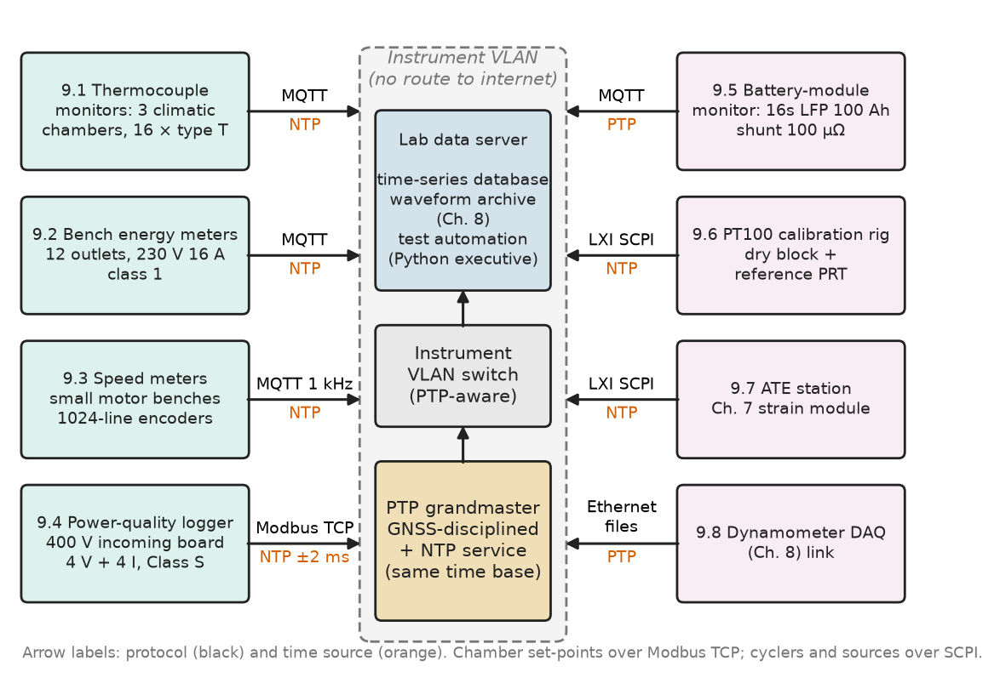
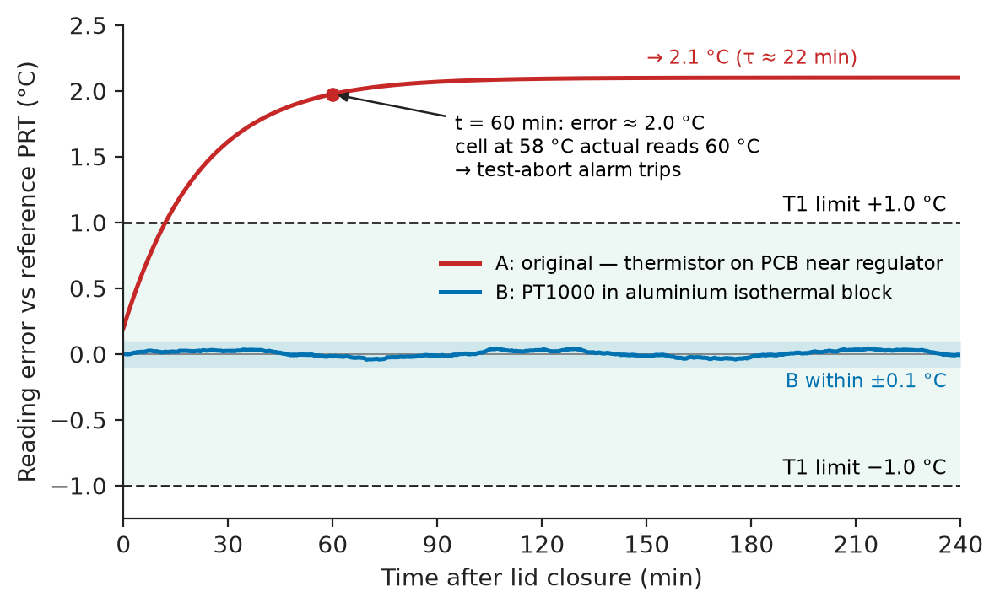
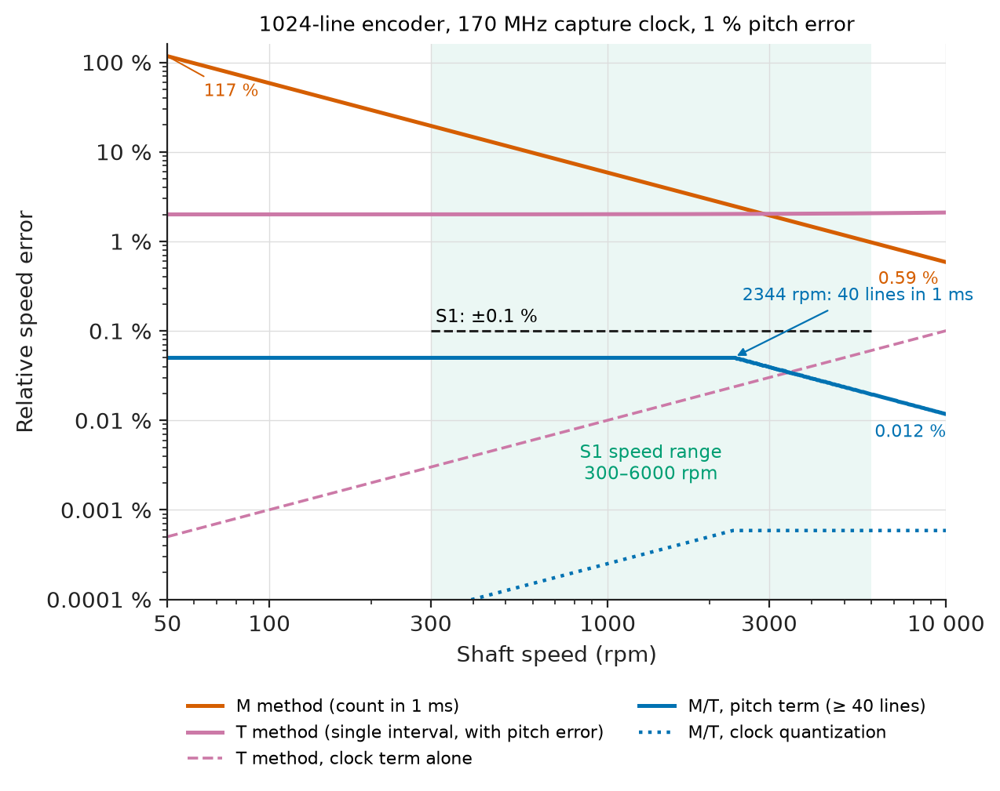
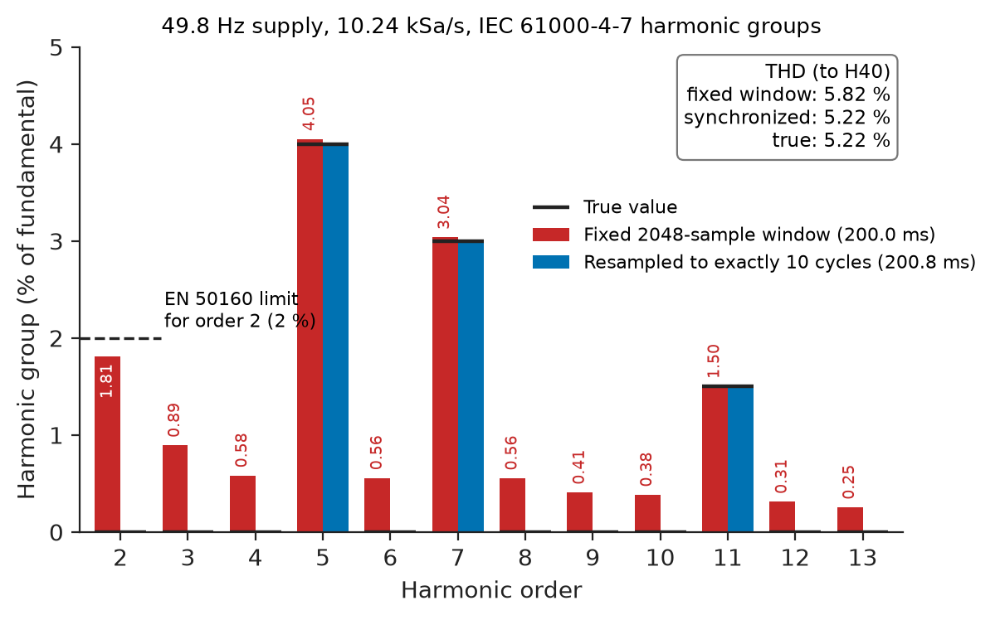
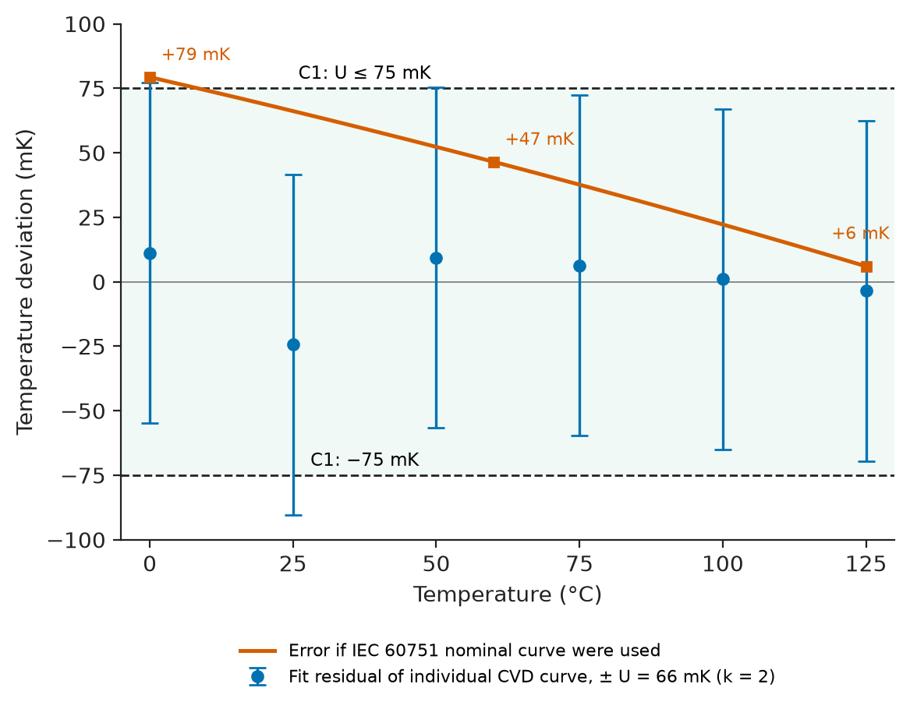
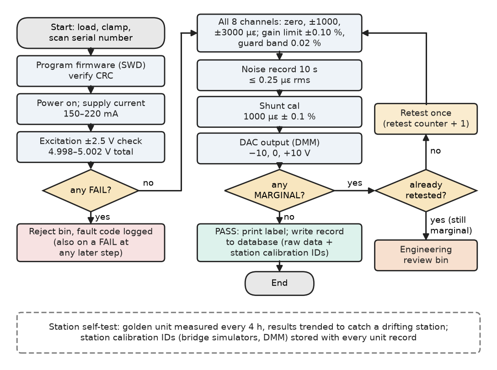

# Chapter 9 — Instrumentation Projects

*Part II · Instrumentation and Measurement Systems*

An electric-drive and battery laboratory installs a new 16-channel thermocouple monitor in each of its battery climatic chambers. On the bench it agrees with a reference thermometer to 0.2 °C. In service, an hour after the enclosure lid is screwed down, every channel reads about 2 °C high, and a cell that is actually at 58 °C trips the 60 °C test-abort alarm. The thermocouples are within tolerance and the converter is fine. The cold-junction sensor is a thermistor on the circuit board, 4 cm from a linear regulator; with the lid closed the board warms by 2 °C more than the terminal block where the thermocouple wires actually end, and a thermocouple measures only the difference between its two junctions. The fix — an isothermal aluminium terminal block with the reference sensor inside it — costs \$14. The failure is typical of small instruments: each is simple, and each fails at an interface its designer did not measure. This chapter builds eight of them for the same laboratory, each as a compact project with requirements, architecture, a key calculation, a part choice, a test with a limit and a failure.

> **What does it take to turn a sensor, a converter and a microcontroller into an instrument whose readings can be trusted in a real laboratory?**
> **Which few design decisions and tests dominate each common instrument — temperature, energy, speed, power quality, battery, calibration rig and test station?**

| Concept | Engineering destination |
|---|---|
| Temperature monitoring | Climatic chambers, battery cycling, data centres, cold chain, process monitoring |
| Energy monitoring | Sub-metering, building energy management, lab cost allocation |
| Motor-speed measurement | Drive test benches, conveyors, pumps, machine tools |
| Power-quality measurement | Compliance surveys, troubleshooting drive trips, utility contracts |
| Battery monitoring | Cell and module testing, energy-storage commissioning, BMS validation |
| Sensor calibration systems | In-house calibration, traceability, ISO/IEC 17025 practice |
| Automated test equipment | Production test of boards and modules, incoming inspection |
| Laboratory data-acquisition systems | Shared time, storage and test automation for a whole lab |

**Roadmap.** The laboratory's instrument suite, its requirements and the temperature monitor (9.1) → energy (9.2) → speed (9.3) → power quality (9.4) → battery (9.5) → calibration rig (9.6) → automated test (9.7) → the laboratory DAQ that ties them together (9.8) → verification and failure analysis across the suite (9.9).

---

## 9.1 Temperature monitoring

> **Boundary.** Thermocouple physics and the Seebeck effect are in *Engineering Physics*, [Ch. 14 §14.3](https://github.com/The-Studio-of-Sadiq/Engineering-Physics/blob/main/CHAPTERS/CHAPTER%2014.md); sensor types and selection in [Chapter 6](06-sensors-and-transducers.md); RTD excitation and lead resistance in *Electronics and Computing*, [Ch. 26 §26.9](https://github.com/The-Studio-of-Sadiq/Electronics-and-Computing/blob/main/part-6-embedded-and-real-time-systems/26-embedded-interfaces.md).

### The laboratory and its instruments

The running system is the instrument suite of the laboratory that houses the dynamometer cell of [Chapter 8](08-data-acquisition-systems.md) (Figure 9.1). Every instrument publishes to one laboratory data server with shared time, and each is small enough to be designed, built and verified by one engineer in a few weeks. Table 9.1 collects their requirements; IDs carry the project's initial.

<!-- FIGURE 9.1 | figures/ch09/fig-9-1-lab-instrument-suite.png | block-diagram | Instrument suite of the electric-drive and battery laboratory around its shared data backbone. | Content: centre, lab data server (time-series database, waveform archive, test automation in Python) and PTP grandmaster with NTP service, on an instrument VLAN switch. Around it: (9.1) thermocouple monitors in 3 climatic chambers, 16 type T each; (9.2) 12 bench-outlet energy meters; (9.3) speed meters on small motor benches, 1024-line encoders; (9.4) power-quality logger at the 400 V lab incoming board, 4 V + 4 I; (9.5) battery-module monitor, 16s LFP 100 Ah, shunt 100 microohm; (9.6) PT100 calibration rig with dry block and reference PRT; (9.7) ATE station for the Chapter 7 strain module; (9.8) link to the Chapter 8 dynamometer DAQ. Each arrow labelled with protocol (Ethernet MQTT, Modbus TCP, LXI SCPI) and time source (PTP or NTP). -->



*Figure 9.1 — Instrument suite of the electric-drive and battery laboratory around its shared data backbone.*

**Table 9.1 — Requirements for the laboratory instrument suite.**

| ID | Requirement | Target | Verification |
|---|---|---|---|
| T1 | Chamber thermocouple accuracy | 16 × type T, −20 to +60 °C, U ≤ 1.0 °C (k = 2) including sensor | Comparison with reference PRT in chamber, lid closed, 4 h |
| T2 | Over-temperature alarm | Relay opens within 2 s of any channel > 60 °C, independent of server | Heated-junction test |
| E1 | Bench energy meter accuracy | Class 1 (IEC 62053-21), 0.05–16 A, PF 0.5 inductive to 1, 230 V | Reference meter on calibration bench |
| S1 | Shaft speed | ±0.1 % of reading, 300–6000 rpm, new value every 1 ms | Speed from precision frequency source |
| Q1 | Power-quality methods | IEC 61000-4-30 Class S: 10-cycle RMS ±0.5 % of declared voltage; harmonics to the 40th (IEC 61000-4-7) | Calibrator with harmonics, 49.5–50.5 Hz |
| Q2 | Event capture | Sags and swells by half-cycle RMS; timestamps ±10 ms | Programmable source sags |
| B1 | Cell voltages | 16 cells, ±2 mV, all cells within 10 ms of each other | Precision DMM per cell |
| B2 | Module current | ±0.1 % of reading ±20 mA (k = 2), −300 to +300 A, aligned with voltages within 1 ms | Reference DC current transducer |
| B3 | Charge counting | Offset-driven drift ≤ 0.1 Ah per 24 h | 24 h at zero current |
| C1 | PT100 calibration | U ≤ 0.075 °C (k = 2), 0–125 °C | Uncertainty budget; proficiency comparison |
| A1 | Strain-module production test | ≤ 120 s per unit; guard-banded limits | Timed runs; seeded faulty units |
| A2 | ATE repeatability | %GRR ≤ 30 % of gain-error tolerance | Gauge R&R study, 10 units × 3 repeats × 2 operators |
| L1 | Time and data | Every record timestamped with stated accuracy; one catalogue for all instruments | Audit of 1 week of data |

### The temperature monitor: architecture and part choice

Battery cells in the chambers run from −20 to +60 °C; the monitor reads 16 thermocouples bonded to cells, logs at 1 Sa/s and opens an alarm relay wired into the chamber's interlock (T2). Type T (copper–constantan) is chosen over the more common type K because its IEC 60584-1 class 1 tolerance is ±0.5 °C from −40 to 125 °C, against ±1.5 °C for type K, and T1 cannot be met with a ±1.5 °C sensor. A thermocouple measures only the temperature *difference* between its measuring junction and the point where its wires meet copper, so the second sensor in the system — the cold-junction compensation (CJC) sensor — has an error that adds one-for-one to every reading.

**Table 9.2 — Front-end options for 16 thermocouples (datasheet-class values; indicative 2026 prices).**

| Option | Class | CJC | Resolution and accuracy | Cost for 16 ch | Verdict |
|---|---|---|---|---|---|
| Thermocouple-to-digital IC per channel | MAX31856 | On-die sensor, ±0.7 °C, at the IC's location | 19-bit; linearization built in | about \$130 | CJC on the PCB, not at the terminals |
| 16-bit ΔΣ with PGA | ADS1118 | Internal temperature sensor | 16-bit, 2 channels per IC | about \$45 | Same CJC weakness; 8 ICs |
| 24-bit ΔΣ with PGA, external RTD for CJC | AD7124-8 ×3 | PT1000 class A inside isothermal block | Noise ≪ 0.01 °C; burnout detection | about \$40 + \$14 block | **Chosen** |
| Commercial 16-ch module | NI-9213 class | Built-in, at terminals | ±0.5–1 °C typical system accuracy | about \$1100 | Meets T1 marginally; cost |

In the chosen design both thermocouple terminal blocks are bolted to one 10 mm aluminium plate with a 4-wire PT1000 cemented into a hole between them; the plate is thermally separated from the PCB by nylon standoffs and from the enclosure air by a foam cover. Two converters take seven thermocouples each plus one RTD input; a third takes the remaining two thermocouples and a second PT1000 at the other end of the block, which measures the block's own gradient.

### The uncertainty budget

**Table 9.3 — Uncertainty of one chamber channel at 25 °C cold junction.**

| Contribution | Half-width or s | Distribution | Standard uncertainty |
|---|---|---|---|
| Type T class 1 tolerance | 0.5 °C | Rectangular | 0.289 °C |
| CJC PT1000 class A, $\pm(0.15+0.002\lvert t\rvert)$ at 25 °C | 0.20 °C | Rectangular | 0.115 °C |
| Gradient terminal to PT1000 (measured ≤ 0.1 °C) | 0.10 °C | Rectangular | 0.058 °C |
| Converter, reference, linearization (NIST ITS-90 polynomial) | — | Normal | 0.030 °C |
| Noise at 1 Sa/s | — | Normal | 0.020 °C |
| **Combined; expanded (k = 2)** | | | **0.318 °C; 0.64 °C** |
| **T1 limit; margin** | | | **1.0 °C; 36 %** |

The sensor's own tolerance is 80 % of the variance; the next improvement would be calibrating the thermocouple batch on the rig of Section 9.6, not a better converter.

**Worked example — How fast is the alarm?** Each AD7124-class converter runs its 50/60 Hz-rejecting sinc filter, which settles in about 80 ms after a channel switch, so eight inputs take $8\times80=640$ ms per scan. The firmware compares each new value with 60 °C and debounces over two consecutive readings, so the worst case is about two scans, 1.3 s, inside T2's 2 s. The comparison and relay drive run in the instrument, not on the server; if the network or server is down, the alarm still works, and the relay is energized-when-healthy so that a dead instrument also opens the interlock.

### The failure and its test

Figure 9.2 shows the opening paragraph's failure as measured, and the fix. The error rose with a time constant of about 22 min after the lid closed, because the board's thermistor followed the regulator's heating while the terminal block followed the chamber air. The verification test for T1 is therefore run with the lid closed for 4 h, the instrument's worst thermal state, never on an open bench.

<!-- FIGURE 9.2 | figures/ch09/fig-9-2-cjc-error-lid-closed.png | plot | Cold-junction compensation error after the enclosure lid is closed, original design and isothermal-block fix. | Content: x-axis time 0 to 240 min after lid closure, y-axis reading error versus reference PRT, -0.5 to 2.5 degC. Curve A (original, thermistor on PCB near regulator): 0.2 degC at t = 0 rising as 0.2 + 1.9(1 - exp(-t/22 min)) to 2.1 degC. Curve B (PT1000 in aluminium isothermal block): within plus or minus 0.1 degC throughout. Horizontal dashed lines at plus or minus 1.0 degC labelled T1 limit. Annotation at 60 min: alarm tripped at 58 degC actual. -->



*Figure 9.2 — Cold-junction compensation error after the enclosure lid is closed, original design and isothermal-block fix.*

---

## 9.2 Energy monitoring

> **Boundary.** AC power, power factor and three-phase power are in *Circuits, Signals and Communications*, [Ch. 9](https://github.com/The-Studio-of-Sadiq/Circuits-Signals-and-Communications/blob/main/part-2-transient-and-ac-analysis/09-ac-power.md). This section is a compact project; the full design of a smart energy monitor, with front-end design, firmware, calibration, communications and safety, is [Chapter 35](../part-9-interdisciplinary-engineering-projects/35-project-smart-energy-monitor.md).

The laboratory allocates energy costs to projects through meters on its 12 bench outlets (230 V, 16 A). Each meter is a single-phase **metering IC** (ADE7953 or STPM32 class: delta-sigma converters, digital integrator and power computation, ±0.1 % typical over a 1000:1 range) with a 2000:1 current transformer and a resistive voltage divider, and a small MCU that reads energy registers every second and publishes them. The CT with a 10 Ω burden gives 80 mV at 16 A; a 1 MΩ / 1 kΩ divider gives 230 mV at 230 V, both inside a ±500 mV input range. The IC's analog side sits at mains potential through the divider, so the MCU's link to the network crosses a reinforced digital isolator, and creepage and clearance follow IEC 61010-1 for a CAT III 300 V circuit.

The dynamic range sets the converter: from the 16 A maximum down to the starting current of a class 1 meter, 0.004 of its base current (here 1 A), or 4 mA, is 4000:1, and the meter must still be within ±1.5 % at 5 % of its base current, 0.05 A. That is why metering ICs are delta-sigma devices with programmable gain, and why the CT burden is kept small enough that the CT stays linear at the bottom of the range.

**Worked example — The CT's phase error at power factor 0.5.** Active power is $P=VI\cos\varphi$. A CT whose secondary current leads the primary by $\delta$ makes the meter compute $VI\cos(\varphi-\delta)$, a relative error of about $\delta\tan\varphi$. At PF 0.5 ($\varphi=60^\circ$, $\tan\varphi=1.732$) a typical small CT's 0.5° phase error gives $1.732\times0.00873=1.51\ \%$, beyond class 1 limits on its own, while at PF 1 it contributes nothing. The metering IC has a phase-calibration register that delays the voltage channel; set during calibration at PF 0.5, it leaves a residual of about 0.02°, 0.06 %. The lesson generalizes to every power measurement in this book: amplitude calibration at unity power factor proves nothing about the phase path.

> **Status of the principle: Power error from a phase error**
> *Derived.* First-order expansion of $\cos(\varphi-\delta)$ for small $\delta$; the error grows without bound as $\varphi$ approaches 90°, which is why reactive-energy and low-power-factor measurements need phase matching an order of magnitude better than active-energy ones.

Verification follows the class 1 test points (0.05, 0.1, 1, 5 and 16 A at PF 1; 0.1, 5 and 16 A at PF 0.5 inductive and 0.8 capacitive) against a reference meter of class 0.1 on the calibration bench; the results are in Table 9.7.

---

## 9.3 Motor-speed measurement

> **Boundary.** The M, T and M/T counting methods, their quantization for a 16 384-count encoder and an M/T firmware listing are in [Chapter 6 §6.5](06-sensors-and-transducers.md); encoder interfacing for control loops is in [Chapter 15](../part-4-robotics-and-mechatronics/15-robot-electronics-and-control.md). This section builds a stand-alone speed meter for cheaper sensors, where a different error dominates.

### The instrument

The laboratory's small motor benches and conveyor rigs (up to 6000 rpm) need a portable speed meter: a 5-digit display updated four times a second for the operator, and a 1 kHz stream to the lab DAQ (S1: ±0.1 % of reading, 300–6000 rpm). It accepts either the rig's existing 1024-line encoder (RS-422 A channel) or a Hall gear-tooth sensor reading a 60-tooth steel wheel where no encoder is fitted. The input passes an RC filter and a Schmitt trigger into a timer of an STM32G4-class MCU with a 170 MHz capture clock; the timer's digital glitch filter rejects pulses shorter than 0.5 µs, which removes drive switching spikes and is still ten times shorter than the 4.9 µs half-period of a 1024-line encoder at 6000 rpm.

The quantization analysis of Chapter 6 assumes perfectly spaced edges. A cheap encoder or a machined gear does not have them: each line or tooth sits off its ideal angle by a **pitch error**, about 1 % of a line period for a small optical encoder, and a single interval inherits it in full at both ends. The listing adds that term to the three methods, with an M/T estimator that spans at least 40 lines over a sliding window updated every 1 ms.

```python
import math

LINES, F_CLK, T_WIN = 1024, 170e6, 1e-3   # A-channel rising edges, timer clock, window
PITCH_ERR = 0.01                          # edge-placement error, fraction of a line period
M_MIN = 40                                # M/T: minimum lines per estimate

print(" rpm   M-method   T-method   M/T quant   M/T pitch   M/T window")
for rpm in (100, 300, 1200, 6000):
    f_line = rpm/60*LINES                          # edges per second
    m_rel = 1/(f_line*T_WIN)                       # one count in the window
    t_rel = f_line/F_CLK + 2*PITCH_ERR             # one clock tick per period + pitch
    lines = max(M_MIN, math.floor(f_line*T_WIN))   # whole lines inside the estimate
    win = max(T_WIN, lines/f_line)                 # window stretches at low speed
    mt_q = 1/(F_CLK*win)                           # one clock tick over the window
    mt_p = 2*PITCH_ERR/lines                       # two end edges misplaced
    print(f"{rpm:5d}  {100*m_rel:8.3f} %  {100*t_rel:7.3f} %  {100*mt_q:8.5f} %"
          f"  {100*mt_p:8.3f} %  {1e3*win:7.2f} ms")
```

```text
 rpm   M-method   T-method   M/T quant   M/T pitch   M/T window
  100    58.594 %    2.001 %   0.00003 %     0.050 %    23.44 ms
  300    19.531 %    2.003 %   0.00008 %     0.050 %     7.81 ms
 1200     4.883 %    2.012 %   0.00030 %     0.050 %     1.95 ms
 6000     0.977 %    2.060 %   0.00059 %     0.020 %     1.00 ms
```

**Worked example — Reading the table against S1.** The M method misses S1 at every speed: even at 6000 rpm one count in a 1 ms window is 0.98 %. The T method's clock resolution is excellent (0.06 % at 6000 rpm) but the pitch error puts every single-interval estimate at about ±2 %. The M/T method meets ±0.1 % everywhere: clock quantization is negligible, and pitch error is 0.05 % at 40 lines, falling to 0.02 % at 6000 rpm where 102 lines fit in 1 ms. The price is latency at low speed: at 300 rpm the 40-line window spans 7.8 ms, so a new value still appears every 1 ms but describes the last 7.8 ms. Below 300 rpm S1 is not claimed. Figure 9.3 plots the three methods: with real edges the deciding term is pitch error, not clock resolution.

<!-- FIGURE 9.3 | figures/ch09/fig-9-3-speed-method-resolution.png | plot | Relative speed error of M, T and M/T methods against shaft speed for a 1024-line encoder and 170 MHz timer. | Content: log-log axes, x-axis speed 50 to 10 000 rpm, y-axis relative error 1e-6 to 1 (100 %). M method: 1/(f_line x 1 ms), falling from 117 % at 50 rpm to 0.59 % at 10 000 rpm. T method: flat near 2 % (pitch error dominated), clock term alone shown dashed rising from 5e-6 to 1e-3. M/T: pitch term 0.05 % flat to 2344 rpm then falling to 0.012 % at 10 000 rpm; quantization term below 1e-5. Shaded band 300-6000 rpm with horizontal line at 0.1 % labelled S1. -->



*Figure 9.3 — Relative speed error of M, T and M/T methods against shaft speed for a 1024-line encoder and 170 MHz timer.*

> **Status of the principle: M/T speed estimation**
> *Derived.* Counting whole edges over a clock-timed interval that begins and ends on edges makes clock quantization relative to the whole interval and divides end-point placement error by the number of lines spanned; it assumes speed is nearly constant over the window, so the window length is also the estimator's low-pass filter.

**Worked example — The gear-tooth wheel.** With the 60-tooth wheel, 40 teeth take 133 ms at 300 rpm and 6.7 ms at 6000 rpm, so the 1 kHz stream is heavily overlapped at low speed. A second error appears: if the wheel is mounted 0.05 mm off-centre on a 50 mm pitch radius, each tooth's angle is displaced by up to $e/r=0.001$ rad in a once-per-revolution pattern, and the measured speed carries a ±0.1 % ripple at shaft frequency — the whole of S1. Averaging over whole revolutions cancels it exactly, so in gear-tooth mode the estimator's window is rounded up to an integer number of revolutions (200 ms at 300 rpm, 10 ms at 6000 rpm), and the meter states that mode in every record.

The verification source is a function generator producing a square wave at the line frequency for 300, 1200 and 6000 rpm (5.12, 20.48 and 102.4 kHz) with a rubidium-referenced timebase, which tests the timer chain; the pitch-error term is then checked against a 10 000-line reference encoder on the same shaft. The same estimator feeds the motor drive of [Chapter 37](../part-9-interdisciplinary-engineering-projects/37-project-closed-loop-motor-drive.md).

---

## 9.4 Power-quality measurement

> **Boundary.** Power-quality phenomena, limits (EN 50160, IEC 61000-3-x) and IEC 61000-4-30 instrument classes are in *Electrical Energy and Machines*, [Ch. 25 §25.9](https://github.com/The-Studio-of-Sadiq/Electrical-Energy-and-Machines/blob/main/part-7-power-quality-and-grid-modernization/25-power-quality.md); the leakage of a fixed-rate 200 ms record at 49.8 Hz is worked through in *Circuits, Signals and Communications*, [Ch. 22 §22.3](https://github.com/The-Studio-of-Sadiq/Circuits-Signals-and-Communications/blob/main/part-5-digital-signal-processing/22-discrete-fourier-transform.md). This section builds the instrument.

The laboratory's drives and cyclers draw distorted currents, and the facilities team wants to know whether the 400 V incoming supply stays inside EN 50160 and which equipment is responsible when a cycler trips. A permanently installed **Class S** logger (IEC 61000-4-30) at the incoming board measures four voltages (L1, L2, L3, N to PE) and four currents through split-core CTs with 333 mV outputs.

### Architecture and safety

An 8-channel simultaneous delta-sigma converter (ADS131M08 class) samples all channels at a fixed 10.24 kSa/s, 2048 samples per 10 cycles at exactly 50 Hz. The voltage inputs are 2 MΩ resistor strings (five 400 kΩ resistors in series, each rated for its share of the impulse) into 2.7 kΩ, giving ±438 mV peak at 230 V rms, with headroom to the converter's ±1.2 V for swells. Unlike the strain module of [Chapter 7](07-measurement-and-signal-conditioning.md), this front end *is* mains-connected: the incoming board is a CAT III location, so the inputs must withstand a 4 kV impulse (IEC 61010-1 for CAT III 300 V; *Electrical Energy and Machines*, [Ch. 29 §29.7](https://github.com/The-Studio-of-Sadiq/Electrical-Energy-and-Machines/blob/main/part-8-electrical-safety-and-engineering-practice/29-electrical-safety.md)), and the barrier between the measuring circuit and the Ethernet port must be **reinforced**: a reinforced digital isolator, a reinforced isolated DC–DC converter and 6 mm of creepage on the PCB with a slot under the barrier.

### Synchronization to the mains

IEC 61000-4-7 computes harmonics over a 10-cycle window that must contain exactly ten mains cycles, with harmonic **groups** that collect the energy of neighbouring bins. A fixed-rate converter delivers 2048 samples per 200.0 ms, but at 49.8 Hz ten cycles last 200.8 ms. Instead of a PLL that steers the converter clock, this design measures the frequency from the zero crossings of the fundamental and **resamples** each 10-cycle window to 2048 points by cubic interpolation in firmware. The listing compares the two on a voltage with 4 % fifth, 3 % seventh and 1.5 % eleventh harmonics.

```python
import numpy as np
from scipy.interpolate import CubicSpline

FS, N = 10_240, 2048                       # fixed ADC rate; 2048 samples = 10 cycles at 50 Hz
H = {1: 1.0, 5: 0.04, 7: 0.03, 11: 0.015}  # harmonic amplitudes, per unit of fundamental

def grid_voltage(t, f):
    return 325.27*sum(a*np.sin(2*np.pi*h*f*t + 0.3*h) for h, a in H.items())

def harmonics(x):
    """IEC 61000-4-7 harmonic groups from one 10-cycle window, per unit of H1."""
    X = 2*np.abs(np.fft.rfft(x))/len(x)
    g = {h: np.sqrt(X[10*h]**2 + 0.5*X[10*h - 5]**2 + 0.5*X[10*h + 5]**2
                    + sum(X[10*h + k]**2 for k in (-4, -3, -2, -1, 1, 2, 3, 4)))
         for h in range(1, 41)}
    thd = np.sqrt(sum(g[h]**2 for h in range(2, 41)))/g[1]
    return g[2]/g[1], g[5]/g[1], thd

for f in (50.0, 49.8):
    t = np.arange(int(1.1*N))/FS
    x = grid_voltage(t, f)
    fixed = harmonics(x[:N])                             # window assumes exactly 50 Hz
    t_sync = np.arange(N)*(10/f)/N                       # 2048 points over exactly 10 cycles
    sync = harmonics(CubicSpline(t, x)(t_sync))
    for name, r in (("fixed", fixed), ("sync ", sync)):
        print(f"{f:4.1f} Hz {name}: H2 {100*r[0]:.3f} %  H5 {100*r[1]:.3f} %  THD {100*r[2]:.3f} %")
```

```text
50.0 Hz fixed: H2 0.000 %  H5 4.000 %  THD 5.220 %
50.0 Hz sync : H2 0.000 %  H5 4.000 %  THD 5.220 %
49.8 Hz fixed: H2 1.813 %  H5 4.053 %  THD 5.823 %
49.8 Hz sync : H2 0.000 %  H5 4.000 %  THD 5.220 %
```

**Worked example — What a 0.2 Hz deviation does to a compliance report.** With the fixed-rate window at 49.8 Hz, the fundamental's leakage lands in the second-harmonic group as a fictitious 1.81 % H2 — close to the 2 % EN 50160 limit for that order — and THD reads 5.82 % instead of 5.22 %, 11.5 % high in relative terms. Harmonic grouping alone does not prevent this, because the fundamental is 25 times larger than the largest harmonic and its leakage dominates the low-order groups. Resampled to exactly ten cycles, all values return to their true levels to the printed precision (Figure 9.4). The resampling costs about 2048 cubic evaluations per channel per 200 ms window, under 2 % of a Cortex-M4 at 170 MHz for eight channels, and avoids a clock PLL that would also need to keep the converter's digital filter settled across frequency changes.

<!-- FIGURE 9.4 | figures/ch09/fig-9-4-harmonic-groups-sync.png | plot | Harmonic groups of a 49.8 Hz voltage measured with a fixed 2048-sample window and with the window resampled to exactly ten cycles. | Content: grouped bar chart, x-axis harmonic order 2 to 13, y-axis harmonic group in percent of fundamental 0 to 5 percent. True values: H5 4.0, H7 3.0, H11 1.5, others 0. Fixed window bars: fictitious H2 1.81 percent, leakage into every other order (H3 0.90, H4 0.58, H6 0.56, H8 0.56 percent), H5 4.06, H7 3.04 percent. Synchronized bars equal to the true values. Text box: THD fixed 5.82 percent, synchronized 5.22 percent, true 5.22 percent. Dashed marker at 2 percent on H2 labelled EN 50160 limit for order 2. -->



*Figure 9.4 — Harmonic groups of a 49.8 Hz voltage measured with a fixed 2048-sample window and with the window resampled to exactly ten cycles.*

> **Status of the principle: Window synchronization for harmonic measurement**
> *Derived.* The DFT of a record holding an integer number of cycles has no leakage between harmonic bins; with a non-integer number the fundamental's energy spreads into every group. It assumes the frequency is constant over the window, so the frequency estimate is updated every window, and fast frequency changes still produce small errors.

### Events

Sags, swells and interruptions are detected from the half-cycle RMS, $U_{rms(1/2)}$, recomputed every half cycle over one full cycle; an event starts when any phase falls below 90 % of the declared 230 V and ends when all return above 92 % (2 % hysteresis), and its duration and residual voltage are logged with a 1-cycle waveform before and after. The logger's clock is NTP-disciplined to ±2 ms against the lab grandmaster, inside Q2's ±10 ms; correlating a sag with a cycler trip needs no better, because the cycler's own fault log is stamped to the nearest 10 ms.

---

## 9.5 Battery monitoring

> **Boundary.** Battery-pack architecture, BMS functions, state-of-charge and state-of-health estimation are owned by [Chapter 23](../part-6-renewable-energy-and-electric-mobility/23-battery-energy-systems.md); the system-level principles (Coulomb counting, OCV methods, balancing) are in *Electrical Energy and Machines*, [Ch. 16 §16.3–16.4](https://github.com/The-Studio-of-Sadiq/Electrical-Energy-and-Machines/blob/main/part-4-power-generation/16-energy-storage.md). This section builds the *measurement* instrument that validates a module under test, independent of the cycler and the module's own BMS.

The laboratory cycles 16s LFP modules of 100 Ah (51.2 V nominal) for weeks at a time. The cycler reports its own current and voltage, but the test standard requires independent confirmation of cell voltages, module current and temperature, and the lab wants DC internal resistance (DCIR) from current pulses. LFP makes the voltage requirement hard: on its flat plateau the open-circuit voltage changes by well under a millivolt per percent of state of charge, so B1's ±2 mV is the loosest tolerance that is still useful.

**Architecture.** A 16-cell monitor IC of the automotive class (ADBMS6830 or BQ79616 class; about ±1.5–2 mV total error over temperature, all cells converted simultaneously) sits on the module with each sense lead protected by a 100 Ω series resistor and a fuse at the tap, because a sense wire shorted across a 100 Ah cell is a fire, not a measurement error. It talks over an isolated daisy-chain link to the instrument's MCU. Current is measured on the low side by a 100 µΩ manganin shunt and a 20-bit digital power monitor (INA228 class: ±163.84 mV range, ±1 µV maximum offset, 312.5 nV per LSB, which is 3.1 mA at 100 µΩ). Both converters are triggered from one timer so that voltage and current samples are aligned within 1 ms (B2), which DCIR needs: $R_{DC}=\Delta V/\Delta I$ at the edges of a 100 A pulse.

**Worked example — Choosing the shunt value.** At 300 A a 100 µΩ shunt dissipates $300^2\times100\ \mu\Omega=9.0$ W and develops 30 mV; a 50 µΩ shunt halves the heat to 4.5 W but also halves the signal. The converter's ±1 µV offset is $1\ \mu\mathrm{V}/100\ \mu\Omega=10$ mA with the larger shunt and 20 mA with the smaller. Uncorrected, 10 mA integrates to $0.010\times24=0.24$ Ah in 24 h, 0.24 % of the module's capacity, and 20 mA to 0.48 Ah; both miss B3's 0.1 Ah. The instrument therefore **auto-zeros** during every rest step of the test profile, when the cycler's output is open and the current is truly zero, leaving about 2 mA of residual drift: 0.048 Ah per 24 h with the 100 µΩ shunt. The 100 µΩ shunt is kept, mounted on a finned heat sink that limits its rise to 30 K so that its temperature coefficient stays inside the budget below.

**Table 9.4 — Current-measurement budget (B2: ±0.1 % of reading ±20 mA, k = 2).**

| Contribution | Half-width | Distribution | Standard uncertainty |
|---|---|---|---|
| Shunt value after in-situ calibration against a reference DCCT | 0.01 % | Rectangular | 0.006 % |
| Shunt temperature coefficient, 20 ppm/K × 30 K | 0.06 % | Rectangular | 0.035 % |
| Converter gain drift after calibration | 0.02 % | Rectangular | 0.012 % |
| Converter offset (before auto-zero) | 10 mA | Rectangular | 5.8 mA |
| Thermal EMF at shunt sense terminals, 1 µV | 10 mA | Rectangular | 5.8 mA |
| **Expanded (k = 2) at 10 A / 100 A / 300 A** | | | **18 mA / 76 mA / 222 mA** |
| **B2 limit at 10 A / 100 A / 300 A; margin** | | | **30 / 120 / 320 mA; 30–40 %** |

The table shows why the shunt's temperature, not the converter, dominates at high current — and why the shunt is calibrated in place, mounted and warm, against a reference DC current transducer rather than trusted from its nameplate.

---

## 9.6 Sensor calibration systems

> **Boundary.** Calibration procedure, calibration intervals and the place of calibration in a test plan are owned by [Chapter 4](../part-1-engineering-design-methodology/04-prototyping-and-verification.md); traceability chains and calibration methods per sensor type by [Chapter 6 §6.11](06-sensors-and-transducers.md); least-squares fitting and its uncertainty by *The Mathematics Universe*, [Ch. 20 §20.9–20.10](https://github.com/The-Studio-of-Sadiq/engineering-mathematics/blob/main/part-6-probability-statistics/20-statistical-analysis.md). This section builds a calibration rig.

### Traceability and the rig

For temperature the traceability chain runs from the ITS-90 fixed points at a national laboratory, through an ISO/IEC 17025-accredited laboratory that calibrates the lab's **reference platinum resistance thermometer** (PRT) with an expanded uncertainty of 0.020 °C, to the in-house rig, which calibrates the lab's PT100 sensors and, with an electrical thermocouple simulator, its thermocouple channels.

The rig is a dry-block calibrator (−25 to 140 °C, an aluminium block with drilled wells), the reference PRT, and a readout that measures each sensor by 4-wire ratio against a 100 Ω standard resistor (0.005 %, 2 ppm/K) using an AD7124-class converter, so that the excitation current cancels. Eight PT100s are calibrated together at six points, 0 to 125 °C, waiting at each for the reference to be stable within 5 mK over 10 min.

### Fitting the coefficients

IEC 60751 gives the Callendar–Van Dusen equation and nominal coefficients for any Pt100; an individual sensor deviates from them, and the rig fits its own $R_0$, $A$ and $B$ (for $t\ge0$ °C, $R=R_0(1+At+Bt^2)$) by linear least squares in $R_0$, $R_0A$ and $R_0B$. The listing simulates one sensor and the rig's measurement noise, fits it, and shows how far the nominal curve would have been off.

```python
import numpy as np

A0, B0 = 3.9083e-3, -5.775e-7                 # IEC 60751 coefficients (t >= 0 degC)
rng = np.random.default_rng(3)

def r_cvd(t, r0, a, b):
    return r0*(1 + a*t + b*t*t)

def t_from_r(r, r0, a, b):                     # inverse of the quadratic
    return (-a + np.sqrt(a*a - 4*b*(1 - r/r0)))/(2*b)

# Unit under test (unknown to the rig) and the comparison run
true = (100.031, 3.9050e-3, -5.79e-7)
t_ref = np.array([0.0, 25, 50, 75, 100, 125])            # reference PRT readings, degC
t_act = t_ref + rng.normal(0, 0.010, t_ref.size)         # block gradient + reference unc.
r_meas = r_cvd(t_act, *true) + rng.normal(0, 0.0005, t_ref.size)   # 4-wire readout

# Linear least squares in (R0, R0*A, R0*B)
M = np.column_stack([np.ones_like(t_ref), t_ref, t_ref**2])
c0, c1, c2 = np.linalg.lstsq(M, r_meas, rcond=None)[0]
fit = (c0, c1/c0, c2/c0)
resid_mK = 1e3*(t_from_r(r_meas, *fit) - t_ref)
print(f"R0 = {fit[0]:.4f} ohm  A = {fit[1]:.5e}  B = {fit[2]:.3e}")
print("residuals (mK):", np.array2string(resid_mK, precision=1))

for t in (0.0, 60.0, 125.0):                   # error if IEC nominal coefficients were used
    err = t_from_r(r_cvd(t, *true), 100.0, A0, B0) - t
    tol = 0.15 + 0.002*abs(t)                  # IEC 60751 class A
    print(f"{t:5.1f} degC: nominal-curve error {err:+.3f} degC (class A +/-{tol:.3f})")
```

```text
R0 = 100.0336 ohm  A = 3.90333e-03  B = -5.679e-07
residuals (mK): [ 11.1 -24.3   9.4   6.3   1.   -3.5]
  0.0 degC: nominal-curve error +0.079 degC (class A +/-0.150)
 60.0 degC: nominal-curve error +0.047 degC (class A +/-0.270)
125.0 degC: nominal-curve error +0.006 degC (class A +/-0.400)
```

The fitted coefficients differ from the simulated truth in the fourth digit because six noisy points constrain three parameters; what matters is that the fitted curve reproduces the calibration points to within the residuals (13 mK standard deviation), and that the sensor, while inside class A, sits 0.079 °C off the nominal curve at 0 °C. Using the individual coefficients removes that bias for every later measurement. Figure 9.5 shows the residuals with their uncertainty.

<!-- FIGURE 9.5 | figures/ch09/fig-9-5-pt100-calibration-residuals.png | plot | PT100 calibration on the dry-block rig: residuals of the fitted Callendar-Van Dusen curve and deviation of the IEC nominal curve. | Content: x-axis temperature 0 to 125 degC. Left y-axis millikelvin -100 to +100: fit residuals at 0, 25, 50, 75, 100, 125 degC = 11.1, -24.3, 9.4, 6.3, 1.0, -3.5 mK as points with error bars of plus or minus 66 mK (U, k = 2). Second series: nominal-curve error of the unit, a smooth curve from +79 mK at 0 degC through +47 mK at 60 degC to +6 mK at 125 degC. Dashed lines at plus or minus 75 mK labelled C1. -->



*Figure 9.5 — PT100 calibration on the dry-block rig: residuals of the fitted Callendar-Van Dusen curve and deviation of the IEC nominal curve.*

### The rig's uncertainty

**Table 9.5 — Uncertainty budget of the PT100 calibration rig (per point, 0–125 °C).**

| Contribution | Half-width or s | Distribution | Standard uncertainty |
|---|---|---|---|
| Reference PRT, from certificate (U = 0.020 °C, k = 2) | 0.010 °C | Normal | 0.0100 °C |
| Reference drift since calibration | 0.010 °C | Rectangular | 0.0058 °C |
| Block axial uniformity over sensing length | 0.040 °C | Rectangular | 0.0231 °C |
| Block radial (well-to-well) uniformity | 0.020 °C | Rectangular | 0.0115 °C |
| Immersion and stem conduction | 0.010 °C | Rectangular | 0.0058 °C |
| Readout ratio, 10 ppm of 100 Ω | 0.0026 °C | Rectangular | 0.0015 °C |
| Self-heating difference at 1 mA | 0.005 °C | Rectangular | 0.0029 °C |
| Repeatability (Type A, 10 readings) | — | Normal | 0.0080 °C |
| Fit residual | — | Normal | 0.0130 °C |
| **Combined; expanded (k = 2)** | | | **0.0328 °C; 0.066 °C** |
| **C1 limit; margin** | | | **0.075 °C; 12 %** |

The block's axial uniformity is the largest term, which is typical of dry blocks and is why the reference PRT and the sensors under test are inserted to the same depth, and why the next upgrade is a stirred liquid bath, not a better readout. The ratio of the class A tolerance at 0 °C (±0.15 °C) to the rig's 0.066 °C is 2.3: enough to verify class A with guard bands, not enough to verify class AA (±0.10 °C) without a large rejection zone.

> **Status of the principle: Test uncertainty ratio and guard banding**
> *Empirical.* Practice (ILAC-G8, ANSI/NCSL Z540.3) treats a ratio of tolerance to expanded calibration uncertainty of 4:1 as making measurement uncertainty negligible in pass/fail decisions; below that, acceptance limits are tightened by a guard band derived from the uncertainty, trading false rejects for a stated probability of false accept.

---

## 9.7 Automated test equipment

> **Boundary.** Test plans, verification versus validation and regression testing are owned by [Chapter 4](../part-1-engineering-design-methodology/04-prototyping-and-verification.md); automated testing of software by [Chapter 29](../part-8-engineering-software-and-computational-tools/29-engineering-software-workflows.md). This section builds a production test station.

The strain-gauge module of [Chapter 7](07-measurement-and-signal-conditioning.md) moves from prototype to a batch of 40 units. Testing each by hand with a bridge calibrator takes 40 minutes and depends on the operator; an ATE station must do it in two minutes (A1) and with a known repeatability (A2).

### The station

The station consists of a bed-of-nails fixture that contacts the module's power, isolated-side test points and DAC output; eight **bridge simulators**, each a 350 Ω precision network with relay-switched shunts giving 0, ±1000 and ±3000 µε equivalents (0.005 % resistors, calibrated against a resistance bridge traceable through the lab's standard resistor); a programmable power supply with current readback; a 6.5-digit DMM on a relay matrix; and a PC running the test sequencer. Instruments are controlled over LXI with SCPI commands (with PyVISA as an optional dependency); the module under test streams its readings over its own Ethernet port, as it will in service. The hipot test of R10 runs on a separate safety-interlocked station.

**Table 9.6 — Test-time budget per strain module (A1: ≤ 120 s).**

| Step | Time | Note |
|---|---|---|
| Load, clamp, scan serial number | 10 s | Operator |
| Firmware programming and boot check | 30 s | SWD, verify CRC |
| Supply current, excitation voltages | 4 s | DMM via matrix |
| Zero and gain at ±1000, ±3000 µε, all 8 channels in parallel | 8 s | 5 points × (0.5 s settle + 0.5 s average), plus 3 s relay switching |
| Noise record, 10 s | 10 s | All channels at once |
| Shunt-cal check | 2 s | Built-in relay |
| DAC output at −10, 0, +10 V | 3 s | DMM |
| Report, label, unclamp | 8 s | Database write |
| **Total / limit / margin** | **75 s / 120 s / 38 %** | |

Running the channels in parallel is what makes the budget: the module samples all eight simultaneously, so testing them one at a time would add about two minutes for no information.

### Limits, guard bands and the sequencer

Each measurement has a specification limit and a measurement uncertainty. The station applies **guard-banded acceptance**: a value passes only if it is inside the limits shrunk by the expanded uncertainty of that measurement; a value between the guard-banded and the specification limit is **marginal** and triggers a retest, and only a value outside the specification is a fail. The listing is the core of the sequencer, with a simulated station standing in for the instruments; channel 6 of this unit has been given a gain error of +0.06 % to show the marginal path.

```python
import numpy as np
from dataclasses import dataclass

@dataclass
class Step:
    name: str
    lo: float
    hi: float
    u_meas: float          # expanded uncertainty of this measurement (k = 2)
    unit: str

    def judge(self, x):
        lo_g, hi_g = self.lo + self.u_meas, self.hi - self.u_meas   # guard-banded limits
        if lo_g <= x <= hi_g:
            return "PASS"
        return "FAIL" if (x < self.lo or x > self.hi) else "MARGINAL"

class FakeStation:                       # stands in for SMU, DMM and bridge simulator
    rng = np.random.default_rng(11)
    def measure(self, step, ch):
        nominal = {"I_supply": 182.0, "V_exc": 5.0000, "gain_err": 0.0, "noise": 0.08}[step]
        spread = {"I_supply": 6.0, "V_exc": 0.0006, "gain_err": 0.035, "noise": 0.02}[step]
        return nominal + self.rng.normal(0, spread) + (0.06 if (step, ch) == ("gain_err", 6) else 0)

plan = [Step("I_supply", 150, 220, 1.0, "mA"), Step("V_exc", 4.998, 5.002, 0.0003, "V"),
        Step("gain_err", -0.10, 0.10, 0.02, "%"), Step("noise", 0.0, 0.25, 0.02, "ue rms")]
st, verdicts = FakeStation(), []
for s in plan:
    for ch in (range(8) if s.name in ("gain_err", "noise") else [0]):
        x = st.measure(s.name, ch)
        verdicts.append(v := s.judge(x))
        if v != "PASS":
            print(f"{s.name:9s} ch{ch}: {x:+.4f} {s.unit} -> {v} (limits {s.lo}..{s.hi})")
print(f"{len(verdicts)} measurements, unit result:",
      "PASS" if all(v == "PASS" for v in verdicts) else "RETEST/REJECT")
```

```text
gain_err  ch6: +0.0861 % -> MARGINAL (limits -0.1..0.1)
18 measurements, unit result: RETEST/REJECT
```

**Worked example — How many good units does the guard band reject?** The gain error of production units has a spread of about 0.035 % (one standard deviation, from the first 20 units) around zero, and the guard band narrows the ±0.10 % limit to ±0.08 %. The fraction of good units falling between 0.08 % and 0.10 % on either side is $2[\Phi(0.10/0.035)-\Phi(0.08/0.035)]=2(0.99786-0.98886)=1.8\ \%$, where $\Phi$ is the standard normal distribution; these are retested, and most pass on the second measurement because part of the spread is measurement noise. Without the guard band the station would accept units whose true error is up to 0.12 % with a probability that cannot be stated. The gauge R&R study (10 units, 3 repeats, 2 operators) gave a measurement-system standard deviation of 0.006 %, a %GRR of $6\times0.006/0.20=18\ \%$ of the tolerance, within A2.

<!-- FIGURE 9.6 | figures/ch09/fig-9-6-ate-test-flow.png | flowchart | Test flow of the ATE station for the strain-gauge module. | Content: start (scan serial) -> program firmware, verify CRC -> power on, measure supply current (150-220 mA) -> excitation +/-2.5 V check (4.998-5.002 V total) -> decision any FAIL? yes -> reject bin with fault code -> all channels: zero, +/-1000 and +/-3000 microstrain gain (limit +/-0.10 %, guard band 0.02 %) -> noise 10 s (<= 0.25 microstrain rms) -> shunt cal (1000 microstrain +/-0.1 %) -> DAC -10, 0, +10 V -> decision any MARGINAL? yes -> retest once (counter); still marginal -> engineering review bin -> pass: print label, write record to database with raw data and station calibration IDs -> end. Side box: station self-test with golden unit every 4 h. -->



*Figure 9.6 — Test flow of the ATE station for the strain-gauge module.*

The sequence in Figure 9.6 adds two practices that make ATE trustworthy over months: a **golden unit** measured every four hours, whose results are trended to catch a drifting station, and the station's own calibration IDs written into every unit's record, so that if a bridge simulator is later found out of calibration, every affected unit can be identified.

---

## 9.8 Laboratory data-acquisition systems

> **Boundary.** DAQ architectures, synchronization, logging and storage are owned by [Chapter 8](08-data-acquisition-systems.md); device connectivity, MQTT and provisioning by [Chapter 11](../part-3-embedded-and-connected-systems/11-iot-systems.md); scientific data management by [Chapter 30](../part-8-engineering-software-and-computational-tools/30-scientific-and-engineering-computing.md). This section integrates the laboratory's instruments.

Eight instruments built by different people become a laboratory system only when they share four things: **time**, **naming**, **storage** and **automation**.

- **Time.** The lab runs one GNSS-disciplined PTP grandmaster. Instruments with sub-millisecond needs (the dynamometer DAQ, the battery monitor's current–voltage alignment across instruments) use PTP; the others use NTP served by the same grandmaster, and every record carries its time source and estimated accuracy (L1).
- **Naming and metadata.** Every channel has a unique identifier of the form `lab/chamber2/tc07`, a unit, a sensor serial and a calibration record linked by that serial, so a Section 9.6 recalibration propagates to every later reading.
- **Storage.** Slow data (temperatures, energy, PQ aggregates, battery monitor) go to a time-series database; waveforms and dynamometer windows to the file archive of [Chapter 8](08-data-acquisition-systems.md); test results to a relational table keyed by test ID.
- **Automation.** Tests are scripts: a Python test executive sets chamber temperatures over Modbus TCP, commands cyclers and power sources over SCPI, arms the DAQ and records which instrument, firmware and calibration produced each file.

**Worked example — How much data does the lab produce?** The slow instruments produce, per day: chamber thermocouples $3\times16$ channels × 1 Sa/s × 8 bytes, 33 MB; bench energy meters 12 × 6 quantities × 1/s × 8 bytes, 50 MB; the PQ logger about 150 quantities at five 200 ms values per second × 4 bytes, 259 MB; four battery monitors with 21 channels at 10 Sa/s × 8 bytes, 581 MB. The total, about 0.92 GB/day or 340 GB/year, is small. Two dynamometer tests a week at 62.6 GB each add 6.5 TB/year. The archive design is therefore driven entirely by waveforms, and the decimation and windowing decisions of [Chapter 8](08-data-acquisition-systems.md) are worth more than any database tuning.

The instrument network is a separate VLAN with no route to the internet, and instruments that cannot authenticate (most bench instruments) are reachable only from the test-automation server; the energy meters and battery monitors, which publish over MQTT, use per-device credentials as in [Chapter 11](../part-3-embedded-and-connected-systems/11-iot-systems.md).

---

## 9.9 Verification and failure analysis

**Table 9.7 — Verification of the instrument suite.**

| ID | Test | Limit | Result | Pass/fail |
|---|---|---|---|---|
| T1 | 16 channels vs reference PRT at −20, 25, 60 °C, lid closed 4 h | ±1.0 °C | Worst −0.42 °C | Pass |
| T2 | Heated junction stepped to 65 °C | ≤ 2 s; works with server down | 1.2 s worst; yes | Pass |
| E1 | Class 1 test points vs class 0.1 reference meter | ±1.0 % (±1.5 % at 0.05 A) | Worst +0.41 % (PF 0.5, 0.1 A) | Pass |
| S1 | Frequency source at 300, 1200, 6000 rpm equivalents; reference encoder | ±0.1 % | 0.004 % (timer chain); 0.06 % worst (with encoder) | Pass |
| Q1 | Calibrator, 230 V with 4 % H5, 49.5–50.5 Hz | ±0.5 % RMS; IEC 61000-4-7 class II harmonics | RMS +0.12 %; H5 within 0.6 % of reading | Pass |
| Q2 | Programmable sags to 70 % for 100 ms | Detected; ±10 ms | All detected; timestamps ±3 ms | Pass |
| B1 | 16 cells vs 6.5-digit DMM at 2.8, 3.3, 3.6 V | ±2 mV | Worst 1.3 mV | Pass |
| B2 | Reference DCCT at 10, 100, 300 A, both directions | ±0.1 % ±20 mA | Worst 0.06 % at 300 A, warm | Pass |
| B3 | 24 h at zero current with auto-zero | ≤ 0.1 Ah | 0.031 Ah | Pass |
| C1 | Budget (Table 9.5); bilateral comparison with accredited lab | U ≤ 0.075 °C; $\lvert E_n\rvert\le1$ | 0.066 °C; $E_n$ = 0.4 | Pass |
| A1 | 20 timed runs; 3 seeded faulty units | ≤ 120 s; all faults caught | 74–79 s; 3/3 | Pass |
| A2 | Gauge R&R, 10 × 3 × 2 | %GRR ≤ 30 % | 18 % | Pass |
| L1 | Audit of one week of records | Every record has time source and calibration link | 100 % | Pass |

**Table 9.8 — FMEA across the instrument suite (extract).**

| Instrument | Failure mode | Effect | Cause | Detection | Mitigation |
|---|---|---|---|---|---|
| Temperature | CJC not at junction temperature | All channels offset by up to 2 °C | Reference sensor on warm PCB | Lid-closed comparison test | Isothermal block with PT1000; block-gradient RTD |
| Temperature | Thermocouple open | Reading drifts or rails | Broken wire at cell | Burnout current, out-of-range flag | Alarm treats open as hot (fail-safe) |
| Energy | CT phase error | Error grows at low power factor | Uncalibrated phase path | PF 0.5 test point | Phase register calibrated per meter |
| Speed | Encoder pitch error | ±2 % ripple in single-interval speed | T method on uneven lines | Reference-encoder comparison | M/T over ≥ 40 lines |
| Power quality | Fixed window at off-nominal frequency | Fictitious even harmonics, THD high | No window synchronization | Calibrator at 49.8 Hz | Resampling to 10 cycles |
| Battery | Sense lead short | Arc or fire at cell tap | Chafed harness | Cell voltage implausible | Tap fuse and 100 Ω resistor at every lead |
| Battery | Coulomb drift | SoC reference wrong after days | Offset integration | 24 h zero-current test | Auto-zero at rest steps |
| Calibration | Block gradient underestimated | Certificates optimistic | Different immersion of reference and UUT | Two references swapped between wells | Equal immersion; liquid bath for Revision B |
| ATE | Station drift | Good units failed or bad passed | Bridge simulator relay contact wear | Golden unit every 4 h | Relay replacement schedule; calibration IDs in records |

---

## What remains open

| Open question | Where it is answered |
|---|---|
| How is the bench energy meter designed in full, with firmware, communications, calibration and safety? | [Chapter 35](../part-9-interdisciplinary-engineering-projects/35-project-smart-energy-monitor.md) |
| How are battery packs, BMS functions and state estimation designed around the measurements of Section 9.5? | [Chapter 23](../part-6-renewable-energy-and-electric-mobility/23-battery-energy-systems.md) |
| How is the speed measurement closed into a motor speed loop? | [Chapter 15](../part-4-robotics-and-mechatronics/15-robot-electronics-and-control.md), [Chapter 37](../part-9-interdisciplinary-engineering-projects/37-project-closed-loop-motor-drive.md) |
| How are microcontroller selection, firmware architecture and fault handling done for instruments like these? | [Chapter 10](../part-3-embedded-and-connected-systems/10-embedded-system-integration.md) |
| How do the instruments connect securely to a server over MQTT? | [Chapter 11](../part-3-embedded-and-connected-systems/11-iot-systems.md) |
| How are power-quality limits set and harmonics mitigated? | *Electrical Energy and Machines*, [Ch. 25](https://github.com/The-Studio-of-Sadiq/Electrical-Energy-and-Machines/blob/main/part-7-power-quality-and-grid-modernization/25-power-quality.md) |
| How is a whole project's test report and revision history organised? | [Chapter 5](../part-1-engineering-design-methodology/05-engineering-documentation.md), [Chapter 40](../part-9-interdisciplinary-engineering-projects/40-capstone-engineering-project.md) |

**Next:** Chapter 10 opens Part III by taking the microcontroller inside every one of these instruments as its subject: how it is chosen, how its firmware is structured, how its timing and power are budgeted and how it is debugged when the system around it misbehaves.
