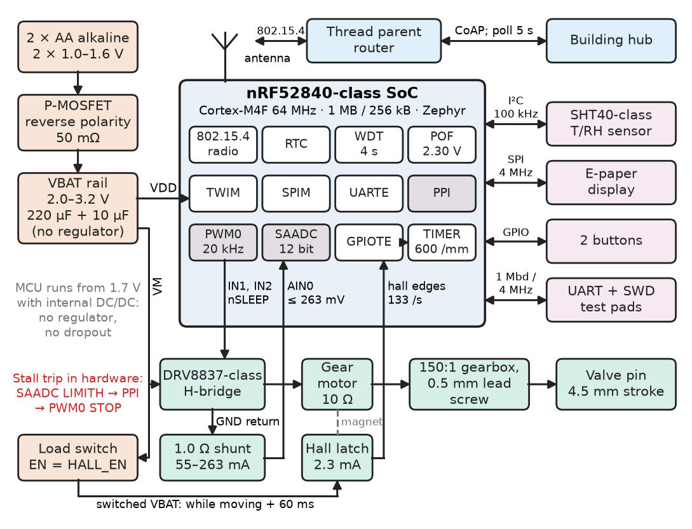
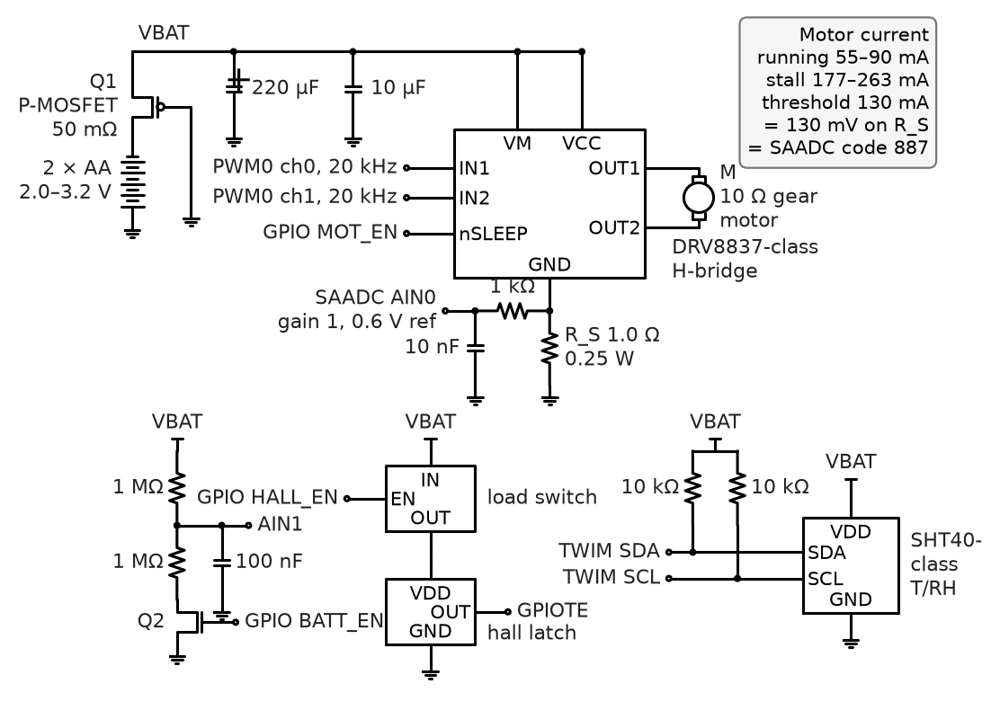
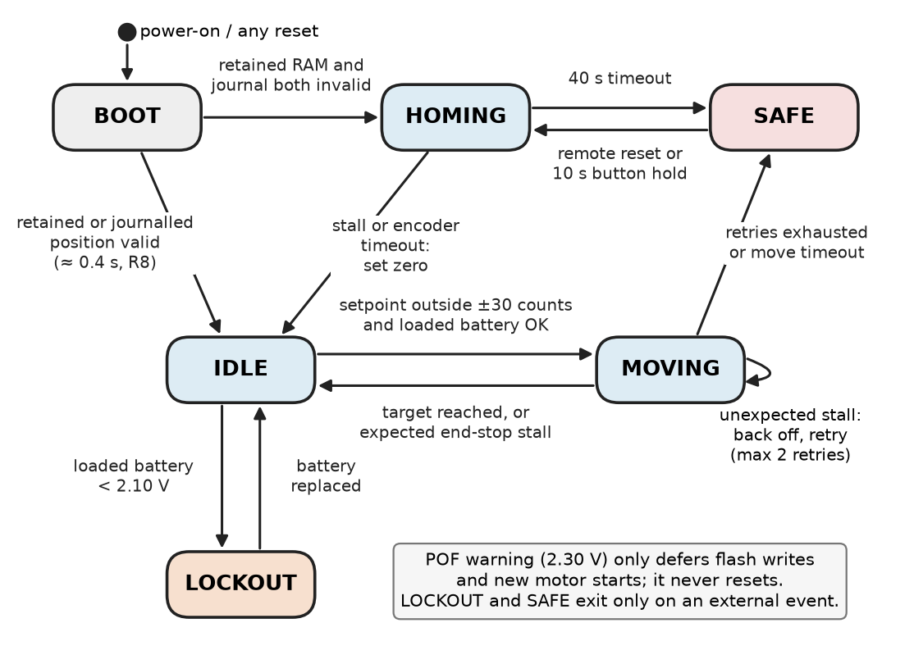
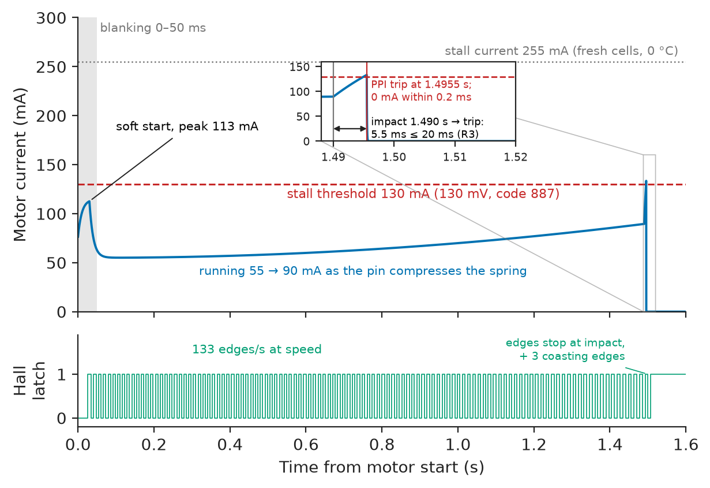
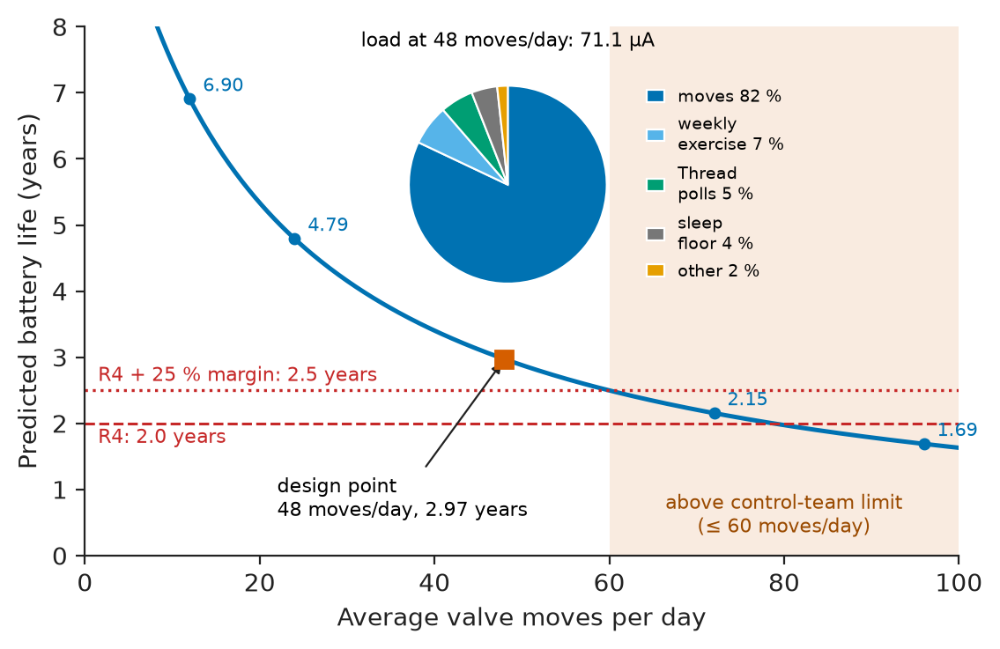
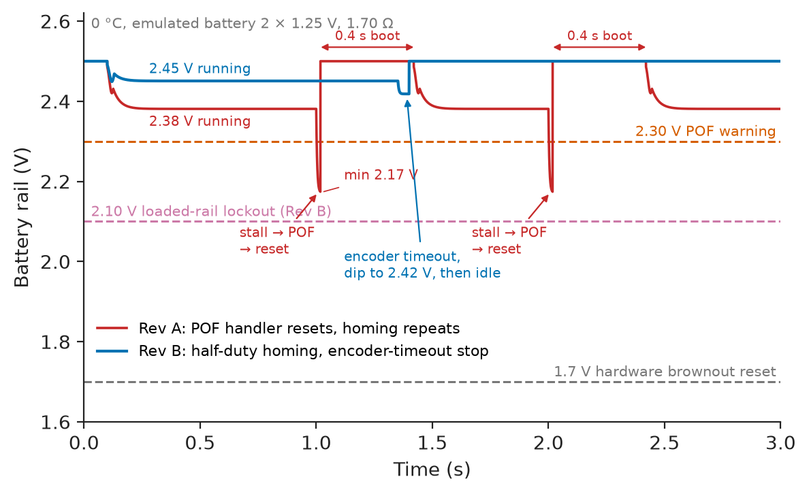

# Chapter 10 — Embedded-System Integration

*Part III · Embedded and Connected Systems*

A manufacturer of smart radiator valves ships 40,000 units in October. In late November the returns start: two AA cells flat after six weeks instead of the two heating seasons on the box. Every returned unit passes bench test with fresh cells. The cause appears only when a unit is put in a 0 °C chamber with cells two-thirds used. When the valve drives into its end stop, the stalled motor pulls the rail from 2.5 V to 2.17 V. The power-fail comparator, set at 2.30 V to protect flash writes, had a handler that reset the processor "to be safe". The reset lost the position held in RAM, so the valve homed by driving into the end stop again, which reset it again. The loop ran at about 60 mA until the cells were empty, within a day. No component was faulty. The failure lay in the joins: an unwritten battery model for a cold hallway, an interrupt handler with the wrong policy, position kept in the wrong memory, and a test plan that never put a half-used cell in a cold room. This chapter integrates that device, a battery-powered smart thermostatic radiator valve (TRV), from microcontroller choice to the second revision.

> **How are a microcontroller, sensors, an actuator, a radio and a battery integrated into a device whose timing, energy and fault behaviour are designed rather than discovered?**
> **What has to be measured, injected and recorded before an embedded product can be trusted to run unattended for years?**

| Concept | Engineering destination |
|---|---|
| Microcontroller selection | A part that fits the peripherals, radio, memory, sleep current and supply range of the product, with margin |
| Sensor and actuator interfaces | Shunt, ADC, encoder and driver circuits sized against the signal and the fault they must detect |
| Firmware architecture | An event-driven state machine on an RTOS, with the safety-relevant paths in hardware |
| Timing constraints | A stall-detection chain with a written latency budget and measured margin |
| Power management | An average-current budget that predicts battery life, and a load-aware supply model that predicts brownout |
| Fault handling | A defined safe state, a reset policy, persistent state and a fault log for every failure the FMEA lists |
| Communication interfaces | I²C, SPI, UART and an IEEE 802.15.4 radio, each with a stated rate, owner and power cost |
| Debugging and testing | SWD trace, current profiling, a hardware-in-the-loop rig with fault injection, and a verification table |

**Roadmap.** The reference valve and its requirements (10.1) → choosing the microcontroller (10.2) → the sensor and actuator interfaces (10.3) → firmware architecture (10.4) → timing constraints and the stall budget (10.5) → power management and the brownout model (10.6) → fault handling and the FMEA (10.7) → communication interfaces (10.8) → debugging, testing and Revision B (10.9).

---

## 10.1 The reference system: a battery-powered radiator valve

> **Boundary.** The embedded architecture this chapter applies — system models, partitioning, MCU selection criteria, memory and power constraints, firmware structures, boot and update — is set out in *Electronics and Computing*, [Ch. 25](https://github.com/The-Studio-of-Sadiq/Electronics-and-Computing/blob/main/part-6-embedded-and-real-time-systems/25-embedded-system-architecture.md); the bus protocols in [Ch. 26](https://github.com/The-Studio-of-Sadiq/Electronics-and-Computing/blob/main/part-6-embedded-and-real-time-systems/26-embedded-interfaces.md); scheduling, latency and watchdogs in [Ch. 27](https://github.com/The-Studio-of-Sadiq/Electronics-and-Computing/blob/main/part-6-embedded-and-real-time-systems/27-real-time-computing.md); drivers, state machines, low-power practice, debugging and HIL testing in [Ch. 28](https://github.com/The-Studio-of-Sadiq/Electronics-and-Computing/blob/main/part-6-embedded-and-real-time-systems/28-embedded-system-design.md). This chapter does not repeat them; it takes one product through those decisions. Requirements practice is from [Chapter 1](../part-1-engineering-design-methodology/01-from-requirement-to-working-system.md) and architecture documentation from [Chapter 2](../part-1-engineering-design-methodology/02-system-architecture.md).

A TRV replaces the wax-capsule head of a radiator valve: a DC gear motor turns a lead screw that pushes the valve pin through its 4.5 mm stroke, a sensor measures the room, and a radio exchanges setpoints, temperature, position and battery state with a building hub. It runs on two AA alkaline cells from 0 °C to about 50 °C at the head, unattended for at least two years. It contains every integration problem of a small embedded product: an actuator drawing fifty thousand times the sleep current, a sensor that its own electronics can heat, a radio that must be reachable yet nearly always asleep, a battery whose resistance changes threefold with temperature and charge, and an end stop found by stalling the motor against it.

**Table 10.1 — Requirements for the reference TRV.**

| ID | Requirement | Target | Verification |
|---|---|---|---|
| R1 | Room-temperature measurement | ±0.3 °C, 15–30 °C, sensor shielded from the motor and the hot valve body | Chamber test against a calibrated PT100 reference |
| R2 | Valve-position accuracy | ±0.05 mm over the 4.5 mm stroke, repeatable after reset | Dial-gauge fixture, 200 moves |
| R3 | Stall protection | Motor de-energised ≤ 20 ms after stall on the primary path, ≤ 100 ms on the backup path | Locked-rotor HIL test, oscilloscope on motor current |
| R4 | Battery life | ≥ 2 years on 2 × AA alkaline at 48 moves per day, margin ≥ 25 % | Charge per event measured, budget computed |
| R5 | Supply range | Full function from 3.2 V down to 2.2 V loaded rail, 0–50 °C; no reset caused by the motor | Programmable source with series resistance, 0 °C chamber |
| R6 | Command latency | Setpoint from hub applied ≤ 10 s after it is sent | Network test, 500 commands |
| R7 | Safe state | On any unrecoverable fault: valve parked at the frost-protection position (1.0 mm open), fault reported | Fault-injection campaign, Table 10.10 |
| R8 | Recovery | Watchdog recovery to normal operation ≤ 2 s; no homing after a reset if position is known | Forced-reset test |
| R9 | Firmware update | Signed over-the-air update with rollback; device never unbootable | Power-cut during update, 50 trials |
| R10 | ESD robustness | ±8 kV contact discharge on buttons and housing with no reset, IEC 61000-4-2 level 4 | Accredited ESD test |

Each requirement implies an interface or a budget: R3 a fast current path, R4 and R5 a battery that is modelled and not just counted, R8 position that survives a reset, R7 a frost position reachable on a nearly empty battery.

<!-- FIGURE 10.1 | figures/ch10/fig-10-1-trv-architecture.png | block-diagram | Architecture of the reference smart radiator valve, with the interfaces between blocks. | Content: left: 2 x AA cells -> reverse-polarity P-MOSFET -> VBAT rail (2.0 to 3.2 V, 220 uF) feeding the MCU, the H-bridge and (via load switch) the hall sensor. Centre: nRF52840 with SAADC, PWM0, GPIOTE, TIMER, PPI, RTC, TWIM, SPIM, UARTE, POF comparator, WDT, 802.15.4 radio. Right: SHT40-class sensor on I2C 100 kHz; e-paper on SPI 4 MHz; two buttons; UART and SWD test pads. Bottom: DRV8837-class bridge -> 10 ohm gear motor -> 1 ohm shunt -> SAADC AIN0; hall latch -> GPIOTE -> TIMER (600 counts per mm); 150:1 gearbox and 0.5 mm lead screw -> valve pin, 4.5 mm stroke. Antenna -> Thread parent router -> hub. Arrows labelled with signal, rate or current. -->



*Figure 10.1 — Architecture of the reference smart radiator valve, with the interfaces between blocks.*

In the architecture of Figure 10.1 everything sits on one battery rail with no regulator: the MCU runs from 1.7 V and has an internal DC/DC converter, so a regulator would only add quiescent current and dropout. Motor, driver and shunt form the actuator chain; a hall latch forms the position chain; the temperature sensor sits at the front, away from motor and valve body. The 802.15.4 radio runs Thread as a *sleepy end device* that polls its parent router for queued messages.

---

## 10.2 Microcontroller selection

> **Boundary.** The selection criteria (peripherals and pins, compute, memory, energy, security, qualification, ecosystem) and a table of representative parts are in *Electronics and Computing*, [Ch. 25 §25.3](https://github.com/The-Studio-of-Sadiq/Electronics-and-Computing/blob/main/part-6-embedded-and-real-time-systems/25-embedded-system-architecture.md). Here they are applied to one product, with the numbers that decide it.

### Requirements that eliminate candidates

Three requirements remove most microcontrollers before any comparison of cores. The radio: the building system uses IEEE 802.15.4 (Thread), so the MCU contains that radio or pairs with a transceiver that adds a second sleep current, an SPI link and a second firmware image. The supply range: R5 requires full function on a 2.2 V loaded rail, in practice to 2.0 V, with no regulator. The sleep floor: the budget of Section 10.6 allows about 3 µA for everything always on, including RAM retention and the RTC.

**Table 10.2 — Microcontroller candidates for the TRV (typical datasheet values at 3 V, 25 °C; check current datasheets).**

| Candidate | Core, Flash / RAM | Radio | Supply range | Sleep with RTC and RAM | Radio RX / TX 0 dBm | Assessment |
|---|---|---|---|---|---|---|
| nRF52840-class SoC | Cortex-M4F 64 MHz, 1 MB / 256 kB | BLE 5, 802.15.4 | 1.7–5.5 V (VDDH) | 1.5–3 µA | about 4.6 / 4.8 mA with DC/DC | Mature Thread stack, power-fail comparator, PPI event routing; **chosen** |
| EFR32MG24-class SoC | Cortex-M33 78 MHz, 1.5 MB / 256 kB | BLE 5, 802.15.4 | 1.71–3.8 V | about 1.3 µA (EM2) | about 5 / 5 mA | Close second; larger flash makes A/B updates easier; less team experience |
| ESP32-C6-class SoC | RISC-V 160 MHz, external flash / 512 kB | Wi-Fi 6, BLE, 802.15.4 | 3.0–3.6 V | about 7 µA deep sleep | tens of mA | Fails R5: needs a regulated 3.0 V or more |
| STM32L0 + separate 802.15.4 transceiver | Cortex-M0+ 32 MHz, 192 kB / 20 kB | external | 1.65–3.6 V | about 1 µA + transceiver | per transceiver | 20 kB RAM cannot hold a Thread stack with margin |

The nRF52840-class part is chosen, although it does not have the lowest sleep current. It passes every filter with margin and has three integration features: a power-fail comparator (POF) that warns before the rail is too low for a safe flash write; a programmable peripheral interconnect (PPI) that lets one peripheral's event trigger another's task without the CPU (the stall path of Section 10.5); and an ADC (SAADC) with hardware limit comparators. The EFR32MG24 has equivalents and would also have worked; the team's existing Thread code decided.

> **Status of the principle: Eliminate, then compare**
> *Empirical.* Selecting on hard constraints first (radio, supply range, sleep floor, memory for the stack) and only then on cost and convenience is established practice. It avoids choosing on a headline figure such as MHz or µA/MHz that does not bind for the product.

### The memory budget

The firmware is Zephyr with OpenThread and a small CoAP application. A Matter layer was rejected: its image, around 700 kB, would not fit twice in 1 MB for A/B updates (R9) without external flash.

**Table 10.3 — Flash and RAM budget (nRF52840-class, Zephyr + OpenThread, release build).**

| Region | Allocation | Used / estimated | Margin |
|---|---|---|---|
| MCUboot bootloader | 48 kB | 38 kB | 21 % |
| Primary image slot | 464 kB | 340 kB | 27 % |
| Secondary (update) slot | 464 kB | 340 kB | 27 % |
| Settings / position journal (NVS) | 32 kB (8 pages) | 1 kB live data | — |
| Fault log | 16 kB | 4 kB per 64 records | — |
| **Flash total** | **1024 kB** | | |
| OpenThread, 802.15.4 driver, buffers | | 54 kB | |
| Kernel, thread stacks (measured high-water + 25 %) | | 28 kB | |
| mbedTLS heap (commissioning, DTLS) | | 36 kB | |
| Application, FSM, display buffer | | 14 kB | |
| Logging (RTT) and retained-RAM block | | 9 kB | |
| **RAM total** | **256 kB** | **141 kB** | **45 %** |

**Worked example — Will an update still fit in two years?** Firmware images of connected products typically grow 10–20 % a year as features and fixes are added. At 15 % per year the 340 kB image becomes $340\times1.15^2=450$ kB after two years, still inside the 464 kB slot but with only 3 % margin left. The 27 % release margin buys about two years of growth, not five, which is why CI records every build's image size (Chapter 29): the partition table cannot change in the field, because the bootloader is never updated over the air.

---

## 10.3 Sensor and actuator interfaces

> **Boundary.** Sensor principles and selection are in [Chapter 6](../part-2-instrumentation-and-measurement-systems/06-sensors-and-transducers.md), signal conditioning and ADC selection in [Chapter 7](../part-2-instrumentation-and-measurement-systems/07-measurement-and-signal-conditioning.md). The brushed DC motor's linear torque–current and speed–voltage characteristics are from *Electrical Energy and Machines*, [Ch. 5 §5.8](https://github.com/The-Studio-of-Sadiq/Electrical-Energy-and-Machines/blob/main/part-2-transformers-and-electrical-machines/05-dc-machines.md), and H-bridge operation is from *Electronics and Computing*, [Ch. 32](https://github.com/The-Studio-of-Sadiq/Electronics-and-Computing/blob/main/part-7-power-electronics/32-motor-drives-and-power-conversion.md). Motor drivers and encoder interfaces for robots are developed further in [Chapter 15](../part-4-robotics-and-mechatronics/15-robot-electronics-and-control.md).

The interface circuit of Figure 10.2 brings four signals to the MCU (motor current, shaft position, room temperature, battery voltage) and drives one actuator.

<!-- FIGURE 10.2 | figures/ch10/fig-10-2-trv-interface-circuit.png | circuit | Power path and actuator interface of the TRV. | Content: 2 x AA -> P-MOSFET reverse protection (50 mohm) -> VBAT with 220 uF and 10 uF. VBAT -> DRV8837-class VM and VCC; IN1, IN2 from PWM0 (20 kHz); nSLEEP from GPIO; outputs to 10 ohm gear motor. Bridge ground through 1.0 ohm 0.25 W shunt; shunt node -> 1 kohm and 10 nF -> SAADC AIN0 (gain 1, 0.6 V reference). Hall latch powered by load switch from GPIO HALL_EN, output to GPIOTE. Battery divider 1 Mohm + 1 Mohm switched by N-MOSFET, 100 nF, -> AIN1. SHT40-class sensor with 10 kohm pull-ups. Notes: running 55 to 90 mA, stall 177 to 263 mA, threshold 130 mV. -->



*Figure 10.2 — Power path and actuator interface of the TRV.*

### Actuator: driver choice and a lesson about minimum voltage

The first choice of motor driver, a DRV8833-class dual H-bridge common on evaluation boards, has a motor-supply minimum of 2.7 V: it would stop driving long before the cells reach the 2.2 V of R5. The rule is to check every part's minimum operating voltage against the *loaded end-of-life* rail, not the nominal one. A DRV8837-class bridge was chosen instead (Table 10.4).

**Table 10.4 — Actuator-chain component selection.**

| Function | Candidates | Deciding numbers | Choice |
|---|---|---|---|
| H-bridge | DRV8833 class (VM 2.7–10.8 V); DRV8837 class (VM 0–11 V, logic 1.8–7 V, 0.28 Ω); discrete N/P MOSFET bridge | Must drive at 2.0 V; sleep < 0.1 µA | DRV8837 class |
| Current sense | Low-side shunt + MCU ADC; high-side current-sense amplifier (INA180 class, about 80 µA when on) | Stall must be detected without a powered amplifier | 1.0 Ω low-side shunt into SAADC |
| Position sensor | Hall latch on motor shaft (DRV5011 class, about 2.3 mA); slotted optical switch (LED 5–10 mA); none (time-based) | Count accuracy and current while moving | Hall latch, powered only while moving |
| Temperature sensor | 10 kΩ NTC + ADC (±0.5 °C with calibration); SHT40 class digital (±0.2 °C typ, 0.08 µA idle); TMP117 class (±0.1 °C) | R1 ±0.3 °C, no calibration step in production | SHT40 class |

### Current sensing for stall detection

The motor is a 10 Ω brushed DC motor driving a 150:1 gearbox. At standstill only its winding resistance limits its current, so the start and stall current is

$$
I_{\text{stall}}=\frac{V_{\text{OC}}}{R_{\text{src}}+R_{\text{bridge}}+R_{m}+R_{\text{shunt}}}
$$

where $V_\text{OC}$ is the battery open-circuit voltage and $R_\text{src}$ the battery's internal plus contact resistance. Running against the valve load it draws 55–90 mA, rising as the pin compresses the valve spring near the closed position.

**Worked example — Sizing the shunt and the stall threshold.** Over the battery states of Section 10.6, the stall current ranges from 177 mA (cells at 1.15 V each, 0 °C) to 263 mA (fresh cells, 25 °C). The running current peaks at 90 mA when closing. A threshold of 130 mA sits between the two: it is 1.44 times the highest running current and 0.73 times the lowest stall current, a 27 % margin below the weakest stall. With a 1.0 Ω shunt the threshold is 130 mV. The SAADC is set to gain 1 with its internal 0.6 V reference and 12-bit resolution, so one code is $0.6/4096=0.146$ mV, or 0.146 mA, and the threshold is code 887. The shunt dissipates at most $0.263^2\times1.0=69$ mW in a stall and drops 55–90 mV while running, about 3 % of the motor voltage. A 0.5 Ω shunt would halve that loss but put the threshold at 65 mV, closer to the ADC offset and to ground-bounce errors. The input RC (1 kΩ, 10 nF, 10 µs) softens the 20 kHz PWM edges and is fast against the 0.5 ms sampling period.

The motor also draws stall current every time it *starts*, before it builds back-EMF; with a mechanical time constant near 10 ms the transient decays within 30–50 ms. The design ramps the PWM duty from 30 % to 100 % over 30 ms and **blanks** the detector for the first 50 ms of every move. The blanking leaves a hole: a valve already seized at the start is caught only by the backup encoder path of Section 10.5.

### Position: counting hall edges

A two-pole magnet on the motor shaft and a hall latch give two edges per revolution. Through the 150:1 gearbox and 0.5 mm lead screw that is $2\times150/0.5=600$ counts per millimetre, so R2 (±0.05 mm) is ±30 counts. The risk is not resolution but *lost counts*, which accumulate until the next homing. Three details prevent them:

- The latch draws about 2.3 mA, so a load switch powers it only while moving, and for 60 ms *after* the stop, because the coasting rotor's edges are real travel.
- Edges are counted by a hardware timer fed through GPIOTE and PPI, not by an interrupt per edge. At 4,000 rpm loaded they arrive at 133 per second, but a radio critical section could still drop one; hardware counting removes the dependence.
- A single latch cannot sense direction, which is inferred from the command. That is safe only because the lead screw is self-locking, confirmed by pushing on the pin with 80 N.

### Temperature and battery

The SHT40-class sensor sits on a flex at the front of the housing, a thermal decision: on the main board of the first prototype it read 1.6 °C high whenever the radiator was hot. The 2 × 1 MΩ battery divider is switched by a MOSFET, because left connected it would draw 1.5 µA, half the sleep budget. The battery is measured unloaded once an hour and *loaded* during the first 100 ms of each move; only the loaded value predicts the brownout of Section 10.6.

---

## 10.4 Firmware architecture

> **Boundary.** Super-loop, event-driven and RTOS structures and their worst-case response are compared in *Electronics and Computing*, [Ch. 25 §25.6](https://github.com/The-Studio-of-Sadiq/Electronics-and-Computing/blob/main/part-6-embedded-and-real-time-systems/25-embedded-system-architecture.md); layering, non-blocking drivers and run-to-completion state machines in [Ch. 28 §28.1–28.4](https://github.com/The-Studio-of-Sadiq/Electronics-and-Computing/blob/main/part-6-embedded-and-real-time-systems/28-embedded-system-design.md). The choices below apply them.

### Structure

The radio stack decides the structure. OpenThread needs an RTOS or a carefully managed event loop, and its radio driver needs the highest interrupt priority to meet 802.15.4 acknowledgement timing (an ACK must start 192 µs after the frame ends). The firmware therefore runs on Zephyr with five threads and a strict rule about what runs where.

**Table 10.5 — Firmware partition: what runs where.**

| Context | Content | Priority | Rule |
|---|---|---|---|
| Hardware (PPI, SAADC limit, PWM STOP) | Primary stall trip; hall edge counting | — | No CPU involvement; works even if firmware is stuck |
| Radio ISR and OpenThread thread | 802.15.4 MAC, Thread, CoAP | Highest | Owned by the stack; no application code |
| ISRs (SAADC, GPIOTE, POF, RTC) | Capture data, post an event; nothing else | High | ≤ 20 µs each; no blocking, no flash access |
| Control thread | Valve state machine, setpoint control | Above normal | Run-to-completion event handler, one event queue |
| Sensor and UI threads | Temperature read, buttons, e-paper | Normal | Non-blocking drivers with timeouts |
| Housekeeping thread | Fault log, position journal, battery, watchdog supervisor | Low | Only thread that writes flash |

Two rules carry the design. **The safety-relevant reaction is in hardware** and firmware only confirms it, so nothing in software can delay the motor stop. **Only one thread writes flash**: a page erase stalls the CPU for tens of milliseconds and must not run below the power-fail threshold, and one low-priority writer can be gated by the power monitor without affecting control.

### The valve state machine

The valve's behaviour is a six-state machine (Figure 10.3); the control thread feeds events from ISRs, radio and timers into one handler, whose core is listed below.

<!-- FIGURE 10.3 | figures/ch10/fig-10-3-valve-state-machine.png | state-diagram | Valve control state machine of the TRV after the Revision B changes. | Content: states BOOT, HOMING, IDLE, MOVING, LOCKOUT, SAFE. BOOT -> IDLE if retained or journalled position valid, else -> HOMING. HOMING -> IDLE on stall or encoder timeout (set zero); HOMING -> SAFE on 40 s timeout. IDLE -> MOVING on setpoint outside +/-30 counts with loaded battery OK; IDLE -> LOCKOUT if loaded battery below 2.10 V. MOVING -> IDLE on target reached or expected end-stop stall; MOVING -> MOVING on unexpected stall (max 2 retries); MOVING -> SAFE when retries exhausted or move timeout. LOCKOUT -> IDLE on battery replaced. SAFE -> HOMING on remote reset or 10 s button hold. Note: POF warning only defers flash writes and new starts, never resets. -->



*Figure 10.3 — Valve control state machine of the TRV after the Revision B changes.*

```c
/* valve_fsm.c -- valve control state machine (C11; illustrative driver API) */
#include <stdint.h>
#include "valve_io.h"   /* motor_start(), motor_stop(), pos_counts(), pos_set_zero(),
                           batt_loaded_mv(), report_fault(), safe_park(),
                           event_t, fault_t, EV_*, F_*, DIR_*                    */

typedef enum { ST_BOOT, ST_HOMING, ST_IDLE, ST_MOVING, ST_LOCKOUT, ST_SAFE } vstate_t;

#define POS_TOL      30      /* counts, +/-0.05 mm at 600 counts per mm */
#define FROST_POS    600     /* 1.0 mm open                             */
#define V_LOCKOUT_MV 2100u   /* loaded-rail threshold                   */
#define MAX_RETRIES  2u

static vstate_t st = ST_BOOT;
static int32_t target;
static uint8_t retries;

static int32_t iabs32(int32_t v) { return v < 0 ? -v : v; }

static void go_safe(fault_t f)
{
    motor_stop();
    report_fault(f);
    safe_park(FROST_POS);           /* timed open-loop move, own stall trip   */
    st = ST_SAFE;
}

static void start_move(void)
{
    if (batt_loaded_mv() < V_LOCKOUT_MV) { report_fault(F_LOW_BATT); safe_park(FROST_POS); st = ST_LOCKOUT; return; }
    motor_start(target > pos_counts() ? DIR_OPEN : DIR_CLOSE);  /* 30 ms soft start */
    st = ST_MOVING;
}

void valve_on_event(const event_t *e)
{
    switch (st) {
    case ST_BOOT:                   /* arg: position restored */
        if (e->id != EV_BOOT) break;
        if (e->arg) st = ST_IDLE; else { motor_start(DIR_CLOSE); st = ST_HOMING; }
        break;
    case ST_HOMING:
        if (e->id == EV_STALL || e->id == EV_ENC_TIMEOUT) { motor_stop(); pos_set_zero(); st = ST_IDLE; }
        else if (e->id == EV_MOVE_TIMEOUT) go_safe(F_HOMING);
        break;
    case ST_IDLE:
        if (e->id == EV_SETPOINT && iabs32(e->arg - pos_counts()) > POS_TOL) {
            target = e->arg; retries = 0; start_move();
        }
        break;
    case ST_MOVING:
        if (e->id == EV_TARGET_REACHED) { motor_stop(); st = ST_IDLE; }
        else if (e->id == EV_STALL && iabs32(pos_counts()) <= POS_TOL) { motor_stop(); st = ST_IDLE; }
        else if (e->id == EV_STALL || e->id == EV_ENC_TIMEOUT) {
            motor_stop();
            if (++retries > MAX_RETRIES) go_safe(F_STALL); else start_move();
        } else if (e->id == EV_MOVE_TIMEOUT) go_safe(F_MOVE_TIMEOUT);
        break;
    default:                        /* LOCKOUT, SAFE: exits on explicit commands, elided */
        break;
    }
}
```

A stall *at the closed end stop* is the expected end of a closing move; a stall anywhere else is a fault, retried twice (production code first backs off 0.2 mm to free a sticky pin) and then escalated to SAFE. The battery is checked before every start. LOCKOUT and SAFE leave only on explicit external events, so the device cannot oscillate between faulted and running, the loop that killed the Revision A batteries.

> **Status of the principle: Every fault state has an exit that needs a new fact**
> *Derived.* If a state machine can leave a fault state only on an event that the fault itself cannot generate, it cannot form a fault–recover–fault cycle without outside input. This follows from the transition structure and holds for any machine whose events are correctly classified.

---

## 10.5 Timing constraints

> **Boundary.** Deadlines, worst-case execution time, interrupt latency, jitter and response-time analysis are developed in *Electronics and Computing*, [Ch. 27 §27.1–27.3 and §27.10](https://github.com/The-Studio-of-Sadiq/Electronics-and-Computing/blob/main/part-6-embedded-and-real-time-systems/27-real-time-computing.md). This section writes a latency budget across hardware and software for one safety function.

### Which deadlines are hard

Two deadlines are hard: the 192 µs 802.15.4 acknowledgement turnaround, owned by the radio stack, and R3. A stalled gear motor delivers its stall torque, multiplied by 150, into the screw and end stop; gearbox tests showed tooth damage after about 400 stalls longer than 200 ms, and every homing and full close ends in one.

### The stall-detection budget

Figure 10.4 shows a closing move that ends in the end stop. The detection chain runs from the mechanical event to the motor being de-energised, and each link has a worst-case time.

<!-- FIGURE 10.4 | figures/ch10/fig-10-4-motor-current-stall.png | plot | Motor current during a closing move that ends at the end stop, with soft start, blanking window, stall threshold and hall edges. | Content: x axis 0 to 1.6 s with inset 1.49 to 1.52 s; y axis current 0 to 300 mA. Soft-start peak about 120 mA decaying to 55 mA by 50 ms (0 to 50 ms shaded, blanking); running current rising from 55 to 90 mA up to 1.490 s; end-stop impact at 1.490 s, current rising toward 255 mA; dashed line 130 mA (stall threshold, code 887); marker at 1.4955 s hardware trip, current to zero within 0.2 ms. Lower trace: hall edges at 133 per second stopping at 1.490 s plus three coasting edges. Annotation: latency 5.5 ms against 20 ms. -->



*Figure 10.4 — Motor current during a closing move that ends at the end stop, with soft start, blanking window, stall threshold and hall edges.*

**Table 10.6 — Stall-detection latency budget (R3: 20 ms primary, 100 ms backup).**

| Link | Primary path (hardware) | Software-confirm path | Backup path (encoder timeout) |
|---|---|---|---|
| Current rises from running level to threshold after impact | 5.0 ms | 5.0 ms | — |
| Last hall edge to timeout | — | — | 40 ms timeout + 7.5 ms edge period |
| SAADC sample period (timer-triggered via PPI) | 0.5 ms | 0.5 ms | — |
| Conversion (40 µs acquisition and conversion) | 0.04 ms | 0.04 ms | — |
| Confirmation filter (4 consecutive samples) | — | 1.5 ms | — |
| Limit event → PPI → PWM STOP, or ISR latency incl. radio masking | < 0.001 ms | 1.0 ms (assumed, then measured) | 1.0 ms |
| H-bridge turn-off | < 0.001 ms | < 0.001 ms | < 0.001 ms |
| **Worst-case total** | **5.5 ms** | **8.0 ms** | **48.5 ms** |
| Limit | 20 ms | 20 ms | 100 ms |
| **Margin** | **72 %** | **60 %** | **52 %** |

The primary path never involves the CPU: a timer triggers the SAADC every 0.5 ms through PPI, the channel limit comparator raises LIMITH above code 887, and a PPI channel routes that event to the PWM STOP task. The software-confirm path takes the same event as an interrupt, checks the next samples and posts `EV_STALL`. If the shunt opened or the SAADC were misconfigured, the backup catches the stall: no hall edge for 40 ms (five nominal edge periods) while the motor is on.

```c
/* stall_trip.c -- hardware stall trip: SAADC limit -> PPI -> PWM0 STOP
   (nRF52840 register names; illustrative, error handling omitted) */
#include <stdint.h>
#include "nrf.h"

#define STALL_CODE 887u      /* 130 mV / (0.6 V / 4096): 130 mA on the 1-ohm shunt */
#define PPI_CH_TRIP 3u

void stall_trip_configure(void)
{
    /* High limit = STALL_CODE, low limit = most negative value (disabled). */
    NRF_SAADC->CH[0].LIMIT = (STALL_CODE << SAADC_CH_LIMIT_HIGH_Pos) | 0x8000u;
    NRF_SAADC->INTENSET    = SAADC_INTENSET_CH0LIMITH_Msk;   /* software confirm path */
    NRF_PPI->CH[PPI_CH_TRIP].EEP = (uint32_t)&NRF_SAADC->EVENTS_CH[0].LIMITH;
    NRF_PPI->CH[PPI_CH_TRIP].TEP = (uint32_t)&NRF_PWM0->TASKS_STOP;
}

/* Called by the blanking timer 50 ms after each motor start, and on motor stop. */
void stall_trip_arm(int on)
{
    if (on) NRF_PPI->CHENSET = 1u << PPI_CH_TRIP;
    else    NRF_PPI->CHENCLR = 1u << PPI_CH_TRIP;
}
```

The entry "assumed, then measured" is how such a budget is used honestly: the radio stack masks application interrupts in short critical sections that no datasheet bounds, so the budget *assumes* 1.0 ms and Section 10.9 *measures* it (0.31 ms worst case over 10⁶ samples under continuous Thread traffic).

> **Status of the principle: End-to-end latency is the sum of worst-case link latencies**
> *Derived.* For a chain of sequential stages, the worst-case end-to-end latency is bounded by the sum of each stage's worst case. The bound is conservative, because the worst cases rarely coincide. It is valid only if every stage is in the table, including the physical one.

**Worked example — Why the software-only path was not enough in Revision A.** Revision A detected stalls in a 1 kHz timer interrupt averaging 8 samples: 5 + 8 + 1 = 14 ms, apparently inside 20 ms. But its control thread also wrote a statistics record to flash at the end of each move, and a page erase blocks the CPU for up to 85 ms on this part class. When an erase coincided with an end-of-move stall, the measured stall lasted up to 97 ms. A budget that omits the flash stall is wrong, not just tight. The hardware trip and the single flash-writing thread each remove the problem on their own.

---

## 10.6 Power management

> **Boundary.** The average-current model of battery life, the power-mode ladder and supply integrity are in *Electronics and Computing*, [Ch. 25 §25.5](https://github.com/The-Studio-of-Sadiq/Electronics-and-Computing/blob/main/part-6-embedded-and-real-time-systems/25-embedded-system-architecture.md), and the firmware practices that make a budget true in [Ch. 28 §28.5](https://github.com/The-Studio-of-Sadiq/Electronics-and-Computing/blob/main/part-6-embedded-and-real-time-systems/28-embedded-system-design.md). Battery capacity and rate ratings are from *Electrical Energy and Machines*, [Ch. 16 §16.2](https://github.com/The-Studio-of-Sadiq/Electrical-Energy-and-Machines/blob/main/part-4-power-generation/16-energy-storage.md).

Power management here asks two separate questions, and Revision A answered only the first. **How long will the battery last** is about *charge*, answered by an average-current budget. **Will the device keep working as the battery ages** is about *source resistance and peak current*, answered by a load model of the battery.

### The charge budget

The listing computes the average current from the charge per event, measured on prototypes with a current profiler, and converts it to life with 80 % usable capacity and 2 % per year self-discharge.

```python
# Average-current and life budget of the smart radiator valve (TRV)
DAY = 86400.0
loads = [  # name, current_A, duration_s, events_per_day
    ("sleep floor",       3.0e-6, DAY,   1),
    ("temperature read",  1.7e-3, 6e-3,  1440),
    ("Thread data poll",  5.5e-3, 3.5e-3, DAY / 5),
    ("status report",     6.0e-3, 18e-3, 288),
    ("valve moves",       70e-3,  1.5,   48),
    ("weekly exercise",   70e-3,  40.6,  1 / 7),
    ("display updates",   3.0e-3, 2.0,   10),
]
total = 0.0
for name, i, t, n in loads:
    ua = i * t * n / DAY * 1e6
    total += ua
    print(f"{name:<17s} {ua:6.2f} uA")
cap_mah, usable, sd = 2500.0, 0.80, 0.02          # 2 x AA alkaline in series
i_sd = cap_mah * sd / 8760 * 1e3                  # self-discharge, uA
life_h = usable * cap_mah / ((total + i_sd) / 1e3)
print(f"total load {total:.1f} uA + self-discharge {i_sd:.1f} uA")
print(f"life {life_h / 8760:.2f} years; motor share "
      f"{(loads[4][1]*loads[4][2]*loads[4][3] + 70e-3*40.6/7) / DAY * 1e6 / total:.0%}")
```

```text
sleep floor         3.00 uA
temperature read    0.17 uA
Thread data poll    3.85 uA
status report       0.36 uA
valve moves        58.33 uA
weekly exercise     4.70 uA
display updates     0.69 uA
total load 71.1 uA + self-discharge 5.7 uA
life 2.97 years; motor share 89%
```

**Table 10.7 — Battery-life budget summary (R4).**

| Item | Value |
|---|---|
| Average load current | 71.1 µA (motor 89 %, radio polling 5 %, sleep floor 4 %) |
| Self-discharge equivalent | 5.7 µA |
| Usable capacity | 2,000 mAh (80 % of 2,500 mAh at this load and 0–20 °C) |
| Predicted life | 2.97 years |
| Requirement | ≥ 2 years with ≥ 25 % margin |
| **Margin** | **49 %** |

**Worked example — Where the next microamp comes from.** The motor is 89 % of the load. Halving the sleep floor to 1.5 µA, which would take a new MCU, buys 2 % of life; halving the number of moves by widening the controller's deadband buys about 60 %. Figure 10.5 shows life falling from 6.9 years at 12 moves per day to 2.97 years at 48 and 1.69 years at 96, crossing the requirement near 80. The heating-control algorithm therefore carries an electronics limit, at most 60 moves per day on average (25 % margin), written into the interface specification with the control team and checked by the HIL rig's 30-day replay of a real heating season.

<!-- FIGURE 10.5 | figures/ch10/fig-10-5-life-vs-moves.png | plot | Predicted battery life of the TRV against the average number of valve moves per day. | Content: x axis moves per day 0 to 100; y axis life 0 to 8 years; curve through (12, 6.91), (24, 4.79), (48, 2.97), (72, 2.15), (96, 1.69). Dashed line 2.0 years (R4); dotted line 2.5 years (R4 plus 25 % margin); marker at 48 moves, design point 2.97 years; shaded region above 60 moves per day labelled control-team limit. Inset pie of the 71.1 uA load: moves 82 %, weekly exercise 7 %, Thread polls 5 %, sleep floor 4 %, other 2 %. -->



*Figure 10.5 — Predicted battery life of the TRV against the average number of valve moves per day.*

### The load model and brownout

For brownout the battery is a voltage source with a resistance; the open-circuit voltage falls with discharge, and the resistance rises with discharge and roughly doubles from 25 °C to 0 °C for alkaline cells. Under a current pulse $I$ the rail is

$$
V_{\text{rail}}=V_{\text{OC}}-I\,R_{\text{src}}
$$

and the largest $I$ is the stall current. The listing computes the rail at stall for four states of charge at 25 °C and 0 °C and compares it with the 2.30 V threshold that Revision A treated as a reset.

```python
# Battery-rail dip at motor start or stall: 2 x AA alkaline, Rev A power path
R_MOTOR, R_BRIDGE, R_SHUNT, R_CONTACTS = 10.0, 0.28, 1.0, 0.10
POF_REV_A = 2.30          # V, power-fail threshold that Rev A treated as a reset

def r_cell(ocv, temp_c):
    """Representative AA alkaline internal resistance (ohm)."""
    r = 0.20 if ocv >= 1.45 else 0.30 if ocv >= 1.30 else 0.40
    return r * (2.0 if temp_c <= 0 else 1.0)

print(" OCV/cell  T(C)  R_src   I_stall   V_rail  Rev A")
for ocv in (1.55, 1.35, 1.25, 1.15):
    for temp in (25, 0):
        r_src = 2 * r_cell(ocv, temp) + R_CONTACTS
        i = 2 * ocv / (r_src + R_BRIDGE + R_MOTOR + R_SHUNT)
        v = 2 * ocv - i * r_src
        flag = "RESET" if v < POF_REV_A else "ok"
        print(f"  {ocv:4.2f}    {temp:3d}  {r_src:4.2f}  {i*1e3:6.0f} mA  {v:5.2f} V  {flag}")
```

```text
 OCV/cell  T(C)  R_src   I_stall   V_rail  Rev A
  1.55     25  0.50     263 mA   2.97 V  ok
  1.55      0  0.90     255 mA   2.87 V  ok
  1.35     25  0.70     225 mA   2.54 V  ok
  1.35      0  1.30     215 mA   2.42 V  ok
  1.25     25  0.90     205 mA   2.32 V  ok
  1.25      0  1.70     193 mA   2.17 V  RESET
  1.15     25  0.90     189 mA   2.13 V  RESET
  1.15      0  1.70     177 mA   2.00 V  RESET
```

**Worked example — Reproducing the field failure.** At room temperature Revision A survives until the cells are nearly exhausted (1.15 V each), which is why bench tests passed. At 0 °C it fails at 1.25 V per cell, about two-thirds through the capacity, reached after a few weeks of heavy winter use. The loop then draws about 60 mA (homing, reboot, network rejoin), so the remaining $0.33\times2{,}500=825$ mAh lasts about $825/60\approx14$ h. The "six weeks" was the time to reach cold and two-thirds used; the loop emptied the cells overnight.

> **Status of the principle: Battery as an open-circuit voltage behind a resistance**
> *Approximate.* A Thevenin model with state-of-charge- and temperature-dependent $V_\text{OC}$ and $R_\text{src}$ predicts the dip under pulses of milliseconds to seconds. It ignores the cell's diffusion dynamics (the slow additional sag under long pulses), so it is used here with resistances measured at 100 ms pulse length on cells of the chosen brand at each temperature.

### Revision B power policy

The fix broke the failure chain at four links:

1. **Power-fail warning changes behaviour, not state.** The POF handler now only blocks flash writes and new motor starts; the hardware brownout reset (about 1.7 V) is the only reset.
2. **Position survives reset**, in a CRC-protected retained-RAM block and a flash journal written after each move; homing happens only if both are invalid.
3. **Loaded-voltage lockout.** If the rail measured early in the previous move was below 2.10 V, the valve parks at the frost position and reports low battery. At 0 °C and 1.15 V per cell the running rail is $2.30-0.07\times1.70=2.18$ V, so the lockout trips shortly after that, near the point where a full stroke is no longer guaranteed.
4. **Gentler stalls.** Homing runs at 50 % PWM duty and uses the encoder timeout. With the 220 µF reservoir smoothing the 20 kHz PWM, the battery sees roughly $D^2$ of the stall current, a quarter at $D=0.5$, so the worst homing dip falls from 0.33 V to about 0.08 V.

---

## 10.7 Fault handling

> **Boundary.** Watchdog types, fault handlers and safe states at the processor level are in *Electronics and Computing*, [Ch. 27 §27.11](https://github.com/The-Studio-of-Sadiq/Electronics-and-Computing/blob/main/part-6-embedded-and-real-time-systems/27-real-time-computing.md); power-loss-safe logging in [Ch. 28 §28.6](https://github.com/The-Studio-of-Sadiq/Electronics-and-Computing/blob/main/part-6-embedded-and-real-time-systems/28-embedded-system-design.md). Functional safety in the formal sense (IEC 61508, ISO 13849) is the subject of [Chapter 21](../part-5-industrial-automation/21-industrial-communication-and-safety.md). A TRV is not a safety function under those standards, but the method of naming each failure, its detection and its reaction is the same.

### Safe state and reset policy

For a radiator valve, fully closed is not safe in winter (pipes freeze) and fully open overheats rooms, so the safe state is *parked at 1.0 mm open*. A fault never leaves the motor energised, nor the valve closed if it can still move.

The reset policy is the second decision, and Revision A got it wrong. A reset is the right answer when the software state is untrustworthy (hard fault, watchdog timeout, stack overflow) and the wrong answer to an *environmental* condition such as a low rail, which survives the reset. In Revision B environmental faults move the state machine to a degraded state and only software faults reset. Every reset stores its cause from the reset-reason register, with the last 16 events, in no-init RAM; with a valid retained position the device is back in IDLE in about 0.4 s (R8).

The housekeeping thread kicks the watchdog (4 s timeout) only when the control, sensor and radio threads have each reported progress within 2 s, the supervisor pattern of Book 4 §27.11; the timeout exceeds the worst flash erase plus the longest radio operation.

### FMEA

**Table 10.8 — FMEA of the reference TRV (Revision B).**

| Failure mode | Effect | Cause | Detection | Mitigation |
|---|---|---|---|---|
| Motor stall not detected | Gearbox damage after repeated long stalls | Shunt open, SAADC misconfigured, blanking left on | Encoder-timeout backup path (≤ 48.5 ms); self-test at boot reads shunt offset | Independent backup path; move timeout 30 s |
| Hall sensor failure | Position lost; valve runs to end stop | Sensor dead, magnet cracked, load switch failed | No edges within 100 ms of start while current shows running | Stop, report F_ENCODER, go SAFE using timed open-loop move to frost position |
| Lost counts | Position drifts; R2 violated | Coasting edges ignored; back-driving | Homing offset > 60 counts at weekly exercise | Hall powered 60 ms after stop; self-locking screw; weekly re-zero |
| Brownout reset loop (Rev A) | Battery flat in hours | POF handler reset + RAM-only position + homing stall | Reset counter > 3 per hour in fault log | Rev B power policy (Section 10.6) |
| Temperature sensor I²C hang | No room temperature; control stops | SDA held low after a reset mid-transfer | Driver timeout 20 ms, NACK on probe | Bus-clear (9 SCL pulses), sensor power-cycle, fall back to last value for 30 min then SAFE |
| Flash wear of position journal | Settings lost after years | Excessive journal writes | NVS erase counter | 48 writes/day of 16 B over 8 pages of 4 kB: each page erased every 43 days, about 1,200 years at 10,000 cycles |
| Radio parent lost | No commands; device keeps last schedule | Border router off, interference | No poll response for 3 polls | Keep local schedule; reattach with back-off; Ch. 11 covers fleet behaviour |
| Seized valve pin after summer | Valve will not move in October | Limescale, idle pin | Stall within 0.2 mm of start | Weekly exercise stroke all year |
| ESD on buttons | Reset or latch-up | Discharge to button frame | Reset cause = brownout or pin reset | TVS on button lines; frame bonded to ground plane; R10 test |
| Reversed battery | Damage | User error | — | P-MOSFET reverse-polarity protection |

Two rows deserve comment. An early prototype journalled position on every hall *edge* instead of every *move*: about 9,600 writes per day, wearing the pages out in under six years, inside the service life. And the seized-pin row is mitigated by a *behaviour*, the weekly exercise, which the power budget then has to pay for (4.7 µA).

---

## 10.8 Communication interfaces

> **Boundary.** The electrical and protocol details of UART, SPI, I²C, and the troubleshooting method are in *Electronics and Computing*, [Ch. 26](https://github.com/The-Studio-of-Sadiq/Electronics-and-Computing/blob/main/part-6-embedded-and-real-time-systems/26-embedded-interfaces.md); the communication stack layering in [Ch. 28 §28.7](https://github.com/The-Studio-of-Sadiq/Electronics-and-Computing/blob/main/part-6-embedded-and-real-time-systems/28-embedded-system-design.md). The radio link budget belongs to [Chapter 26](../part-7-communications-signal-processing-and-biomedical/26-communication-system-integration.md) of this book, and the connected-device side (provisioning, MQTT, fleet security) to [Chapter 11](11-iot-systems.md).

Every interface gets a line recording its rate, its owner (the one driver that may use it) and its power cost, the column that matters most for battery life.

**Table 10.9 — Interface table of the TRV.**

| Interface | Peer | Rate / format | Owner | Power cost and rule |
|---|---|---|---|---|
| I²C (TWIM) | SHT40-class sensor | 100 kHz, CRC-8 on data | Sensor driver | Pull-ups 10 kΩ: 0.3 mA only while a line is low; peripheral disabled between reads |
| SPI (SPIM) | E-paper display | 4 MHz, write-only | Display driver | Display powered only during updates (about 2 s, 3 mA) |
| UART (UARTE) | Factory tester, debug | 1 Mbaud, framed with CRC-16 | Test shell | Disabled in field firmware: an enabled receiver keeps the high-frequency clock running, about 0.5 mA |
| SAADC | Shunt, battery divider | 2 kHz while moving; 1 per hour otherwise | Motor and battery drivers | Off between conversions |
| 802.15.4 radio | Thread parent router | 250 kbit/s; CoAP over UDP over 6LoWPAN | OpenThread | Sleepy end device, poll every 5 s: 3.85 µA |
| SWD | Debugger | 4 MHz | — | Pads only; debug interface locked in production (APPROTECT) |

**Worked example — I²C pull-ups chosen for energy, not speed.** The bus to the temperature sensor is 30 mm long with one device, about 50 pF in total. Book 4 §26.4 gives the rise time $t_r=0.8473\,R_pC_b$. With 10 kΩ pull-ups, $t_r=0.8473\times10\ \mathrm{k\Omega}\times50\ \mathrm{pF}=0.42$ µs. That meets the 1 µs standard-mode limit but not the 0.3 µs fast-mode limit, so the bus runs at 100 kHz. A read is about 0.9 ms of bus activity, roughly half of it with a line low at $3.0/10\ \mathrm{k\Omega}=0.3$ mA: about 0.14 µC, against 10 µC for the whole measurement event. Fast-mode 2.2 kΩ pull-ups would cost 1.4 mA while low and gain nothing.

The radio couples timing to power. A sleepy end device is reachable only at its polls, so the parent router holds the hub's command until the next one: worst-case latency is 5 s plus about 0.2 s, against R6's 10 s. A 10 s poll would save 1.9 µA but leave no margin. On a battery-powered radio device latency is bought with energy; Chapter 11 takes that trade-off to fleet scale.

---

## 10.9 Debugging and testing

> **Boundary.** On-chip debug (SWD, breakpoints, trace), fault analysis, HIL testing and firmware validation are in *Electronics and Computing*, [Ch. 28 §28.8–28.10](https://github.com/The-Studio-of-Sadiq/Electronics-and-Computing/blob/main/part-6-embedded-and-real-time-systems/28-embedded-system-design.md). Test plans, verification versus validation and regression are in [Chapter 4](../part-1-engineering-design-methodology/04-prototyping-and-verification.md); HIL for robots is in [Chapter 17](../part-4-robotics-and-mechatronics/17-robotic-system-integration.md).

### The instruments

Three instruments carry most of the integration work, each answering a question the others cannot.

- **SWD debug probe with RTT logging**: what is the firmware doing? RTT logs through a RAM buffer without stopping the core. The probe is unplugged for power measurements, because an attached debugger keeps debug domains powered (hundreds of microamps).
- **Current profiler** (PPK2 or Otii class, 100 kS/s, sub-microamp resolution, also the supply): where does the charge go? The budget of Section 10.6 is built from its charge-per-event measurements, and it found the 0.5 mA UART receiver left enabled on the first prototype.
- **Mixed-signal oscilloscope** with a current probe on the motor lead and digital channels on hall, PWM and a firmware-toggled GPIO: how long does it take? Every link of Table 10.6 was measured as the time between two edges.

### The HIL rig and fault injection

The integration rig puts a production head on a real valve body mounted on a load cell, inside a climate chamber. It is powered from a source with programmable output resistance, which emulates a battery at any $V_\text{OC}$ and $R_\text{src}$, so the Section 10.6 table becomes a test matrix. A Thread border router and a scripted hub send setpoints; relays inject faults (open hall line, SDA shorted to ground, motor disconnected, locked rotor). A Python runner (Chapter 29) sequences the cases against limits nightly for every firmware build, so the rig is also the regression test.

<!-- FIGURE 10.6 | figures/ch10/fig-10-6-rail-dip-rev-a-b.png | plot | Battery rail at 0 C with cells at 1.25 V each during homing, Revision A against Revision B, on the HIL rig with emulated battery. | Content: x axis 0 to 3 s; y axis 1.9 to 2.6 V. Rev A (red): 2.50 V at rest, 2.42 V at soft start, 2.38 V running, stall at 1.0 s drops to 2.17 V below the 2.30 V POF line, reset, recovery, 0.4 s boot, homing restarts and repeats at 2.0 s. Rev B (blue): half-duty homing, 2.45 V running, encoder-timeout stop at 1.4 s with dip to 2.42 V, then idle. Lines: 2.30 V POF warning, 2.10 V loaded-rail lockout, 1.7 V hardware BOR. -->



*Figure 10.6 — Battery rail at 0 C with cells at 1.25 V each during homing, Revision A against Revision B, on the HIL rig with emulated battery.*

Figure 10.6 shows the rig reproducing the field failure on the first day it was run: the emulated battery at 2.50 V and 1.70 Ω, chamber at 0 °C, Revision A firmware. It looped like the returned units; Revision B homes once, cleanly.

### Verification against the requirements

**Table 10.10 — Verification of the Revision B TRV (5 prototype units; rig measurements).**

| Req. | Test | Limit | Result | Pass/fail |
|---|---|---|---|---|
| R1 | Chamber 15, 22, 30 °C against PT100 reference, radiator hot and cold | ±0.3 °C | max error 0.21 °C | Pass |
| R2 | 200 random moves, dial gauge, 2 resets in sequence | ±0.05 mm | max error 0.032 mm | Pass |
| R3 | Locked rotor at 25 °C and 0 °C, 5 battery states, 100 stalls each | ≤ 20 ms primary, ≤ 100 ms backup | 5.1 ms worst primary; 44 ms backup (shunt open) | Pass |
| R4 | Charge per event measured; budget recomputed | ≥ 2.5 years (2 years + 25 %) | 2.97 years predicted | Pass |
| R5 | Emulated battery 2.20–3.20 V loaded, 0 and 50 °C, 1000 moves | No motor-caused reset | 0 resets; lockout at 2.09–2.11 V | Pass |
| R6 | 500 setpoint commands from hub | ≤ 10 s | max 5.4 s, median 2.7 s | Pass |
| R7 | Fault-injection set of Table 10.8 (9 modes × 10 trials) | Safe state reached, fault reported | 90/90 | Pass |
| R8 | Forced watchdog reset during move | ≤ 2 s to IDLE, no homing | 0.42 s, no homing | Pass |
| R9 | Power cut at random points during OTA, 50 trials | Always boots a valid image | 50/50 | Pass |
| R10 | IEC 61000-4-2, ±8 kV contact | No reset | 1 reset at frame seam on unit 3 (fixed by bonding, retested) | Pass after fix |
| Timing | Radio-induced ISR latency, 10⁶ samples under traffic | ≤ 1.0 ms assumed in budget | 0.31 ms worst case | Pass |

The R10 row shows what the table is for: the first ESD run failed, the fix was traced to the failure, and the test was repeated. A table in which every first attempt passes usually means the limits were written after the results.

### What Revision B changed, and why

Each Revision B change traces to a mechanism: the hardware stall trip (flash-erase stalls, Section 10.5); POF policy, retained position, loaded-voltage lockout and half-duty homing (the reset loop, Section 10.6); the DRV8837-class driver (2.7 V minimum of the original, Section 10.3); the front-flex sensor (1.6 °C self-heating error); the bonded button frame (ESD reset); and the disabled UART receiver (0.5 mA, which would have cut life to under five months).

> **Status of the principle: Test the corners the budget depends on**
> *Empirical.* Integration failures cluster where two budgets meet at an extreme: cold battery with peak current, flash erase with stall, radio traffic with interrupt latency. A test matrix built from the budgets' own variables (temperature, state of charge, concurrent activity) finds them before the field does.

---

## What remains open

| Open question | Where it is answered |
|---|---|
| How the TRV is provisioned onto a network, authenticated and updated as one of thousands of devices | [Chapter 11](11-iot-systems.md) |
| How a learned model could replace the fixed deadband controller, and what it costs on this MCU | [Chapter 12](12-edge-computing-and-embedded-ai.md) |
| The 802.15.4 link budget through walls and around radiators | [Chapter 26](../part-7-communications-signal-processing-and-biomedical/26-communication-system-integration.md) |
| Motor drivers, encoders and PID loops when the actuator is a robot joint, not a valve | [Chapter 15](../part-4-robotics-and-mechatronics/15-robot-electronics-and-control.md) |
| The same integration method in a complete project: firmware, budgets and tests for a robot, an energy monitor, a motor drive and a sensor network | [Chapters 34](../part-9-interdisciplinary-engineering-projects/34-project-autonomous-line-following-robot.md), [35](../part-9-interdisciplinary-engineering-projects/35-project-smart-energy-monitor.md), [37](../part-9-interdisciplinary-engineering-projects/37-project-closed-loop-motor-drive.md), [38](../part-9-interdisciplinary-engineering-projects/38-project-wireless-sensor-network.md) |
| Battery chemistry choice and cell models beyond the Thevenin approximation | [Chapter 23](../part-6-renewable-energy-and-electric-mobility/23-battery-energy-systems.md); *Electrical Energy and Machines*, [Ch. 16](https://github.com/The-Studio-of-Sadiq/Electrical-Energy-and-Machines/blob/main/part-4-power-generation/16-energy-storage.md) |
| Formal functional safety when the actuator can hurt someone | [Chapter 21](../part-5-industrial-automation/21-industrial-communication-and-safety.md) |

**Next:** Chapter 11 takes the single connected device and multiplies it into a fleet, and the questions change from timing and microamps to telemetry, protocols, gateways, provisioning and security.
