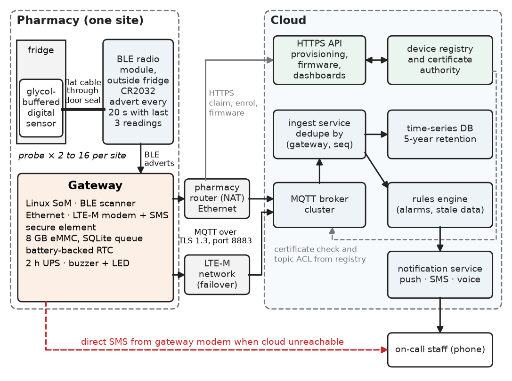
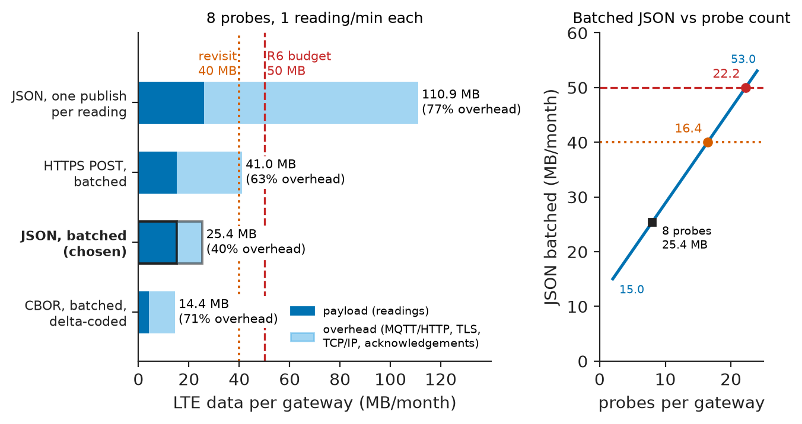
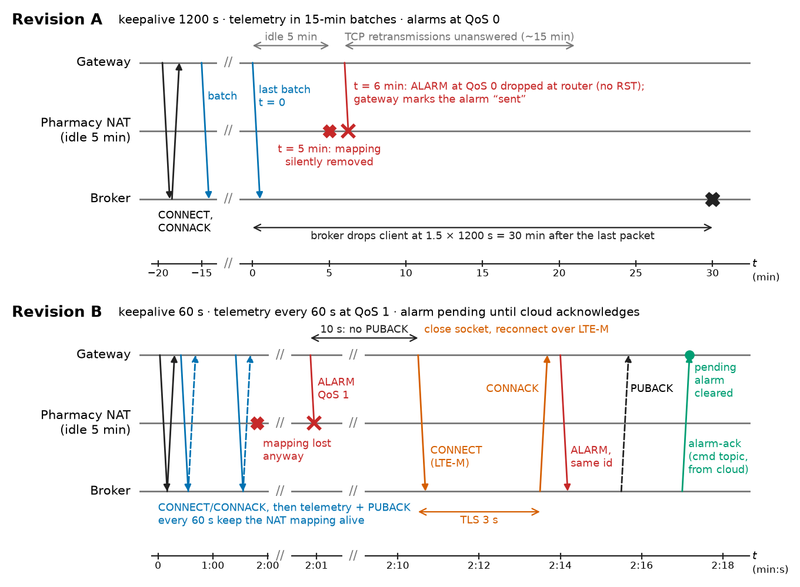
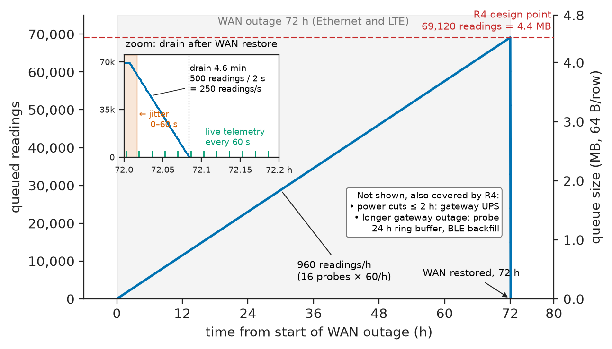
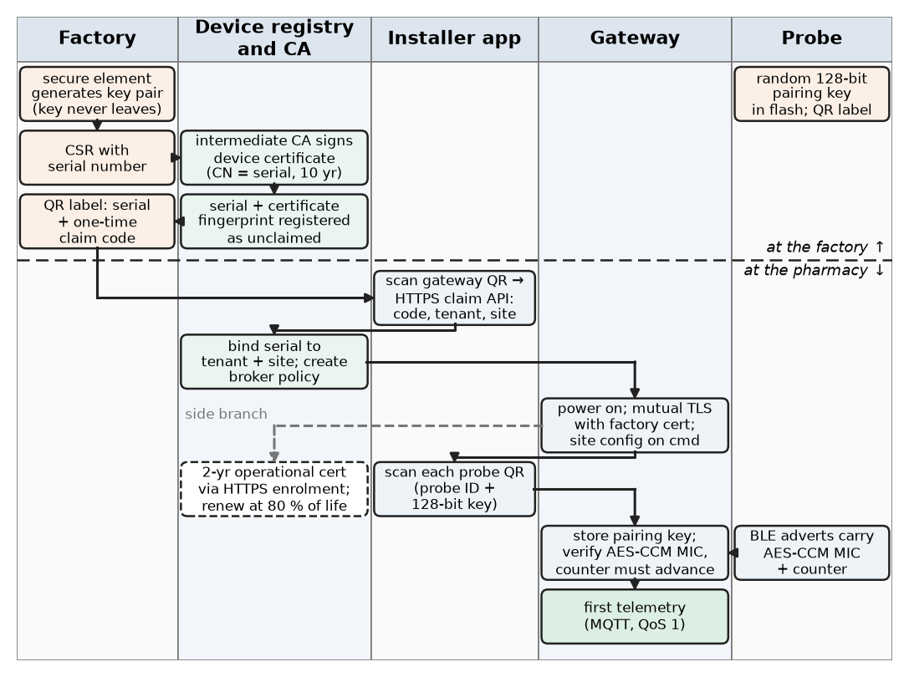
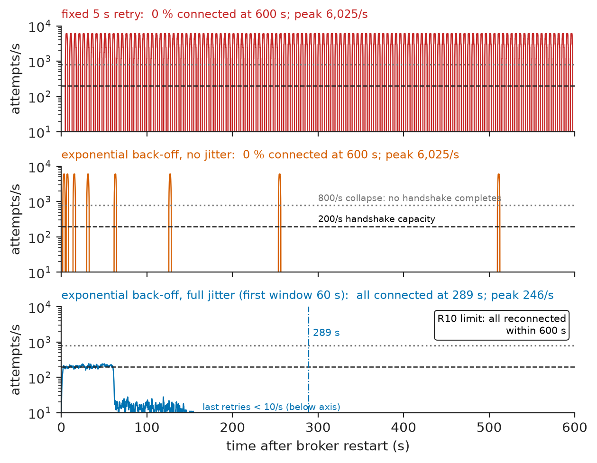

# Chapter 11 — IoT Systems

*Part III · Embedded and Connected Systems*

At 22:40 on a Saturday the compressor of a vaccine refrigerator in a suburban pharmacy fails. The wireless probe inside reports the rising temperature every minute. At 23:12 the probe passes 8 °C for the fifteenth consecutive minute, and the gateway on the shelf publishes an alarm to the cloud. The alarm never arrives. To save cellular data, the gateway uploaded telemetry in 15-minute batches and its MQTT keepalive was stretched to 20 minutes; in the idle gap the pharmacy's broadband router had silently dropped the gateway's TCP mapping, and the gateway had not noticed. The alarm was published at QoS 0 into a dead socket, and the gateway marked it as sent. When the connection was re-established, the routine telemetry flowed again and was stored correctly, but the cloud raised alarms only from alarm messages, not from the data. The pharmacist found the fridge at 14 °C on Monday morning, and \$18,000 of vaccines were destroyed. Every component met its datasheet; the probe, the gateway and the broker all did what they were told. The failure was in the system's assumptions: that a TCP connection is alive until told otherwise, that a published message is a delivered message, and that one alarm path is enough. This chapter designs that monitoring system properly. The reference system is a cold-chain monitoring fleet for a chain of 120 pharmacies: about 1,000 refrigerator and freezer probes, 120 gateways, and a cloud back end.

> **How is a fleet of connected devices designed so that data and alarms arrive complete, on time and authenticated, across links that fail silently?**
> **Which choices of connectivity, protocol, storage, provisioning and security decide whether the system can be trusted for regulated records over five years?**

| Concept | Engineering destination |
|---|---|
| Device architecture | A probe, gateway and cloud partition that keeps each function where its data and power are |
| Connectivity | BLE inside the pharmacy, Ethernet with LTE-M failover to the cloud |
| Telemetry | A batched payload with sequence numbers and UTC timestamps that fits a cellular data budget |
| MQTT and HTTP | Publish–subscribe for telemetry, alarms and commands; HTTPS for provisioning and firmware |
| Gateways | Store-and-forward for 72 h, local alarms, direct SMS when the cloud is unreachable |
| Data storage | A probe ring buffer, an SQLite queue on the gateway, a compressed time-series store in the cloud |
| Remote monitoring | Heartbeats, last-will messages, stale-data alarms and an end-to-end alarm acknowledgement |
| Device provisioning | Factory keys in a secure element, certificates, claiming by QR code |
| Authentication | Mutual TLS with per-device X.509 certificates, topic-level access control |
| Security and reliability | A threat model, ETSI EN 303 645 provisions, signed updates, jittered back-off, availability budgets |

**Roadmap.** Requirements and device architecture (11.1) → connectivity (11.2) → telemetry design (11.3) → MQTT and HTTP fundamentals (11.4) → the gateway (11.5) → data storage (11.6) → remote monitoring and the alarm path (11.7) → device provisioning (11.8) → authentication (11.9) → security, reliability and verification (11.10).

---

## 11.1 Requirements and device architecture

> **Boundary.** The single device is the subject of [Chapter 10](10-embedded-system-integration.md): MCU choice, timing, power budget, fault handling. This chapter treats devices as members of a fleet. Radio link budgets and wireless sensor networks are owned by [Chapter 26](../part-7-communications-signal-processing-and-biomedical/26-communication-system-integration.md); the theory of propagation and path loss by *Circuits, Signals and Communications*, [Ch. 30](https://github.com/The-Studio-of-Sadiq/Circuits-Signals-and-Communications/blob/main/part-6-communication-theory/30-wireless-and-mobile-communications.md). A complete wireless sensor network project, with its own security section, is [Chapter 38](../part-9-interdisciplinary-engineering-projects/38-project-wireless-sensor-network.md). Industrial cybersecurity (IEC 62443) for control systems is in [Chapter 21](../part-5-industrial-automation/21-industrial-communication-and-safety.md).

Cold-chain monitoring for medicines is regulated. In the EU, good distribution practice (GDP, 2013/C 343/01) requires temperature-controlled storage to be monitored, deviations to be alarmed and investigated, and records to be kept. Electronic records must meet data-integrity rules such as EU GMP Annex 11 or US 21 CFR Part 11: audit trails, protection against alteration, and retention. The requirements below come from the pharmacy chain's quality team and its IT security policy.

**Table 11.1 — Requirements for the cold-chain monitoring fleet.**

| ID | Requirement | Target | Verification |
|---|---|---|---|
| R1 | Temperature measurement | ±0.5 °C from −30 to +15 °C (glycol-buffered probe) | Calibration against reference, Ch. 9 procedure |
| R2 | Logging interval and time base | One reading per minute; UTC timestamps within ±2 s | Log audit against GNSS-disciplined reference |
| R3 | Alarm latency | Local buzzer ≤ 2 min and on-call notification ≤ 5 min after the alarm condition is met | End-to-end injected excursions, 200 trials |
| R4 | Data completeness | 100 % of readings stored for WAN or cloud outages ≤ 72 h and gateway power cuts ≤ 2 h | Outage injection, sequence-gap audit |
| R5 | Probe battery life | ≥ 3 years | Charge-per-event measurement and budget |
| R6 | Cellular data | ≤ 50 MB per gateway per month in continuous LTE backup | Byte count on modem over 7 days |
| R7 | Records | Retained 5 years, tamper-evident, with audit trail | Data-integrity audit |
| R8 | Device security | Unique identity per device, mutual authentication, no default passwords, signed updates (ETSI EN 303 645) | Penetration test, provision checklist |
| R9 | Availability | Alarm delivery ≥ 99.9 % per year; remote dashboard ≥ 99.8 % | Availability model plus 6-month field data |
| R10 | Fleet recovery | After a broker restart, all gateways reconnected within 10 min without overload | Load test with the vendor's full fleet of 12,000 gateways |

R3 and R4 are the requirements Revision A broke. R10 extends beyond this chain, because the monitoring vendor runs one broker cluster for 12,000 gateways across many customers.

### Partition: probe, gateway, cloud

<!-- FIGURE 11.1 | figures/ch11/fig-11-1-cold-chain-architecture.png | block-diagram | Architecture of the pharmacy cold-chain monitoring fleet. | Content: left, inside one pharmacy: 2 to 16 probes, each a glycol-buffered digital sensor on a flat cable through the door seal to a BLE radio module outside the fridge (CR2032, advert every 20 s carrying the last 3 readings). Centre: gateway (Linux SoM, BLE scanner, Ethernet, LTE-M modem with SMS, secure element, 8 GB eMMC with SQLite queue, battery-backed RTC, 2 h UPS, buzzer and LED). Arrows: BLE adverts to gateway; Ethernet via pharmacy router (NAT) and LTE-M as failover, both MQTT over TLS 1.3 port 8883 to the cloud. Right, cloud: MQTT broker cluster -> ingest service (dedupe by gateway and sequence) -> time-series database (5-year retention) and rules engine -> notification service (push, SMS, voice) -> on-call staff; HTTPS API for provisioning, firmware and dashboards; device registry and certificate authority. Dashed arrow from gateway modem directly to on-call phone labelled direct SMS when cloud unreachable. -->



*Figure 11.1 — Architecture of the pharmacy cold-chain monitoring fleet.*

The architecture of Figure 11.1 puts each function where its information and energy are.

- **Probe.** It measures, timestamps relative to its own counter, and broadcasts. It is a coin-cell device, so it never holds a connection. The sensor sits inside the fridge in a glycol bottle that mimics the thermal mass of a vial. The radio sits outside the fridge door, because a refrigerator is a metal box that attenuates 2.4 GHz by 20–40 dB.
- **Gateway.** It owns everything that needs mains power, storage and a clock: scanning, UTC timestamping, alarm evaluation, store-and-forward, the cloud connection, and a second alarm path that does not depend on the cloud.
- **Cloud.** It owns everything that spans sites: the record of truth, the audit trail, dashboards, alarm escalation to people, the device registry and firmware distribution.

The alarm decision is made twice, on purpose: once at the gateway, from the readings it has, and once in the cloud, from the stored data stream. The cloud evaluation also raises a "stale data" alarm when a gateway's data stops arriving. Revision A made the decision only at the gateway and trusted its single message.

> **Status of the principle: Decide where the data is; confirm where the record is**
> *Empirical.* Placing time-critical decisions at the edge, where data arrives first and does not depend on the WAN, and repeating them centrally on the authoritative record, is standard practice in monitoring and alarm systems. It turns a single point of failure in the alarm path into two independent paths.

---

## 11.2 Connectivity

> **Boundary.** Data rates, sensitivities and range follow from modulation, noise and path loss, owned by *Circuits, Signals and Communications*, [Ch. 27](https://github.com/The-Studio-of-Sadiq/Circuits-Signals-and-Communications/blob/main/part-6-communication-theory/27-digital-communication.md) and [Ch. 30 §30.10](https://github.com/The-Studio-of-Sadiq/Circuits-Signals-and-Communications/blob/main/part-6-communication-theory/30-wireless-and-mobile-communications.md). Ethernet's PHY and MAC are in *Electronics and Computing*, [Ch. 26 §26.7](https://github.com/The-Studio-of-Sadiq/Electronics-and-Computing/blob/main/part-6-embedded-and-real-time-systems/26-embedded-interfaces.md). Here the technologies are compared as integration options.

There are two connectivity decisions: probe to gateway (short range, coin cell, inside a building) and gateway to cloud (wide area, mains powered, through networks the system does not own).

**Table 11.2 — Connectivity options (typical values; check current datasheets and operator terms).**

| Technology | Rate | Indoor range | Device current (TX / RX / sleep) | Infrastructure | Fit for this system |
|---|---|---|---|---|---|
| BLE 5 advertising, 1M PHY | 1 Mbit/s | 10–30 m | 5 / 5 mA / 1–2 µA | Gateway scanner | **Probe link, chosen**: lowest probe energy, phones can read it for service |
| BLE Coded PHY (S8) | 125 kbit/s | 2–4 × 1M range | same, 8 × airtime | Gateway scanner | Fallback for large stores |
| IEEE 802.15.4 / Thread | 250 kbit/s | 10–30 m, mesh | 5 / 5 mA / 1–3 µA | Border router, routers | Mesh unnecessary for 2–16 probes per room |
| Sub-GHz 868 MHz (LoRa, FSK) | 0.3–50 kbit/s | 50–500 m | 20–120 / 5–10 mA / 1 µA | Gateway; 1 % duty cycle (ETSI EN 300 220) | Range not needed; duty-cycle limit constrains retries |
| Wi-Fi 4 | 1–72 Mbit/s | 20–40 m | 200–300 / 50–100 mA / 10–100 µA | Pharmacy AP | Probe energy too high; pharmacy IT will not admit IoT devices |
| Ethernet | 100 Mbit/s | cable | mains | Pharmacy router | **Gateway primary uplink** |
| LTE-M (Cat-M1) | up to about 1 Mbit/s | operator | 100–500 / 30–60 mA / PSM 3–10 µA | Operator, SIM | **Gateway failover uplink, chosen**; supports SMS |
| NB-IoT | tens of kbit/s | operator, deep indoor | similar, longer airtime | Operator | Latency of seconds and patchy SMS support; not for alarms |

Two non-technical facts decide as much as the table does. Pharmacy IT policy forbids IoT devices on the store's Wi-Fi, but allows a separate VLAN port on the router. And a store's broadband is consumer-grade, with outages of hours a few times a year. That is why the gateway has an LTE-M modem as a *warm* standby: attached to the network, with a TLS session ready to open, so failover takes seconds rather than the 10–60 s of a cold attach.

**Worked example — Will the probe battery last?** A probe wakes every 60 s to read its sensor, about 2 µC, and transmits an advertising event every 20 s, about 15 µC each for three channels at 0 dBm. Each advert carries the last three readings, so a single lost advert loses nothing. The average current is $1.5+2/60+3\times15/60=2.28$ µA, plus self-discharge of 1 % per year of a 225 mAh CR2032 (0.26 µA). With 80 % usable capacity, life is $0.8\times225\ \mathrm{mAh}/2.54\ \mathrm{\mu A}=70{,}900$ h, or 8.1 years. R5 is met with a large margin, which is spent on the triple-redundant adverts. The method is that of Chapter 10's budget and is not repeated here.

---

## 11.3 Telemetry

Telemetry design decides three things: what is sent, how often, and in what shape. Each decision is constrained by the requirements, and each one costs bytes.

**What.** Each reading carries the probe ID, the temperature, the probe's battery voltage and the received signal strength. The last two are not needed for the record, but they are the fleet's health data, and they predict failures weeks ahead. Every gateway message also carries a **monotonic sequence number** and a **UTC timestamp**. The sequence number lets the cloud detect gaps (R4) and discard duplicates. The timestamp is assigned by the gateway, whose clock is disciplined by NTP over the WAN and held by a battery-backed RTC when offline. Probe readings are timestamped at reception and corrected by the probe's relative counter: a reading that was "two adverts old" is backdated by 40 s.

**How often.** R2 fixes one reading per minute. The temptation is to report *on change* only, which can cut traffic tenfold for a stable fridge. That temptation is rejected for the record stream, because a missing reading must be distinguishable from an unchanged one: under GDP an absent value is a gap that must be investigated. The heartbeat property of continuous telemetry is also what lets the cloud detect a dead gateway (Section 11.7).

**Shape.** Readings can be published one per message or batched per gateway, as text (JSON) or binary (CBOR, Protocol Buffers). The listing computes the bytes exchanged per minute, including MQTT, TLS 1.3 and TCP/IP overheads and the acknowledgements, for a gateway with 8 probes, and the resulting monthly volume on LTE.

```python
# Monthly uplink+downlink bytes per gateway (8 probes, one reading per probe per minute)
TLS, TCPIP = 22, 52            # TLS 1.3 record overhead; IPv4 + TCP with timestamps
MIN_PER_MONTH = 60 * 24 * 30

def mqtt_qos1(topic_len, payload_len):
    publish = 2 + 2 + topic_len + 2 + payload_len + TLS + TCPIP
    puback = 4 + TLS + TCPIP
    return publish + puback + TCPIP          # + bare TCP ACK of the PUBACK

options = {   # name: bytes exchanged per minute
    "JSON, one publish per reading": 8 * mqtt_qos1(36, 75),
    "JSON, batched per gateway":     mqtt_qos1(28, 8 * 40 + 30),
    "CBOR, batched, delta-coded":    mqtt_qos1(28, 8 * 10 + 15),
    "HTTPS POST, batched (keep-alive)": 250 + 8 * 40 + 30 + 150 + 2 * TLS + 3 * TCPIP,
}
for name, b in options.items():
    print(f"{name:<34s} {b:5d} B/min  {b * MIN_PER_MONTH / 1e6:6.1f} MB/month")
```

```text
JSON, one publish per reading       2568 B/min   110.9 MB/month
JSON, batched per gateway            588 B/min    25.4 MB/month
CBOR, batched, delta-coded           333 B/min    14.4 MB/month
HTTPS POST, batched (keep-alive)     950 B/min    41.0 MB/month
```

**Worked example — Choosing the payload against the data budget.** One message per reading would cost 110.9 MB per month on LTE, more than twice R6's 50 MB. The payload is not the problem; overhead is. Each 75-byte reading carries about 246 bytes of headers and acknowledgements. Batching the 8 readings into one message cuts the volume to 25.4 MB, a 49 % margin against R6. CBOR with delta coding would reach 14.4 MB (71 % margin), but it makes every message unreadable in a broker console during an incident. The design takes batched JSON: the margin is enough, and debuggability is worth more than the extra 11 MB. The decision is recorded together with its trigger for revisiting: switch to CBOR if a gateway's probe count makes JSON exceed 40 MB, which happens above 16 probes (Figure 11.2). Batched HTTPS POSTs, at 41.0 MB, fit as well, but with only 18 % margin, and they cannot carry commands *to* the gateway, which is the deciding point for MQTT in Section 11.4.

<!-- FIGURE 11.2 | figures/ch11/fig-11-2-lte-data-per-format.png | plot | Monthly LTE data per gateway for four telemetry formats, against the 50 MB budget. | Content: horizontal bar chart, x axis MB per month 0 to 120; bars: JSON one publish per reading 110.9, HTTPS POST batched 41.0, JSON batched 25.4 (highlighted as chosen), CBOR batched delta-coded 14.4. Vertical dashed line at 50 MB labelled R6 budget; dotted line at 40 MB labelled revisit threshold. Each bar split into payload and overhead (headers, TLS, TCP/IP, acknowledgements); for the per-reading JSON bar the overhead share is about 77 percent. Secondary small panel: JSON batched volume against probes per gateway 2 to 24, linear from 15.0 MB to 53.0 MB, crossing the 40 MB revisit line at 16.4 probes and the 50 MB budget at 22.2 probes. -->



*Figure 11.2 — Monthly LTE data per gateway for four telemetry formats, against the 50 MB budget.*

The batched JSON payload for one minute from one gateway looks like this (two of eight readings shown):

```json
{
  "v": 1,
  "gw": "GW-0A17F3",
  "seq": 1048213,
  "ts": "2026-10-24T23:12:00Z",
  "r": [
    {"p": "P-03C1", "t": 8.21, "b": 2.98, "q": -71, "age": 0},
    {"p": "P-03C4", "t": 4.62, "b": 3.01, "q": -64, "age": 20}
  ]
}
```

The `v` field versions the schema, because a fleet in the field always runs several firmware versions at once and the ingest service must accept all of them. `age` is the reading's age in seconds at reception, from the redundant-advert scheme.

---

## 11.4 MQTT and HTTP fundamentals

> **Boundary.** TCP, TLS and the internet protocol suite are used here as given. CRC and error-detection theory is in *Circuits, Signals and Communications*, [Ch. 28 §28.6](https://github.com/The-Studio-of-Sadiq/Circuits-Signals-and-Communications/blob/main/part-6-communication-theory/28-information-theory-and-coding.md). The protocols are specified by OASIS (MQTT 3.1.1 and 5.0) and the IETF (HTTP semantics, RFC 9110; TLS 1.3, RFC 8446).

### MQTT in one page

MQTT is a publish–subscribe protocol over a long-lived TCP connection to a **broker**. Clients do not address each other. They publish messages to **topics**, hierarchical strings such as `cc/v1/acme/s042/GW-0A17F3/telemetry`, and subscribe to topic filters with wildcards (`+` for one level, `#` for the rest). The features that matter for integration are few:

- **QoS levels.** QoS 0 is at most once: sent, never acknowledged. QoS 1 is at least once: the sender stores the message until it receives a PUBACK and resends it otherwise, so duplicates are possible. QoS 2 is exactly once, through a four-step handshake. QoS applies *per hop*, client to broker and broker to subscriber, never end to end.
- **Sessions.** With a persistent session (MQTT 3.1.1 `cleanSession=0`; MQTT 5 `Session Expiry Interval` > 0) the broker keeps a client's subscriptions and queues its QoS 1/2 messages while it is offline.
- **Keepalive.** The client promises to send *some* control packet within the keepalive interval, and sends PINGREQ if it has nothing else to send. The broker drops a client that is silent for 1.5 times the interval.
- **Retained messages and Last Will.** A retained message is stored per topic and delivered to every new subscriber, which suits "current status". A **Last Will and Testament** (LWT) is registered at connect time and published *by the broker* if the client vanishes without a clean disconnect.
- **MQTT 5 additions.** Message expiry, reason codes on every acknowledgement, user properties, and request–response correlation are all useful for commands and acknowledgements.

<!-- FIGURE 11.3 | figures/ch11/fig-11-3-mqtt-session-nat-timing.png | timing-diagram | MQTT session through a NAT router that drops idle mappings: Revision A loses the alarm, Revision B recovers it. | Content: three lifelines: gateway, pharmacy NAT router (idle timeout 5 min), broker. Top half, Revision A: CONNECT and CONNACK (keepalive 1200 s, QoS 0 alarms); telemetry uploaded in 15-minute batches, last batch at t = 0, link idle afterwards; at t = 5 min NAT mapping silently removed (cross on router lifeline); at t = 6 min gateway publishes ALARM QoS 0 -> dropped at router (no RST returned); gateway marks alarm sent; broker drops client at 1.5 x 1200 s = 30 min. Bottom half, Revision B: keepalive 60 s, telemetry every 60 s at QoS 1 keeps mapping alive; when mapping is lost anyway, PUBACK for alarm not received within 10 s -> gateway closes socket, reconnects over LTE-M (TLS 3 s), republishes ALARM with same alarm ID; broker PUBACK; cloud sends alarm-ack command; gateway clears pending alarm. Time axis in minutes, with 10 s and 3 s annotations. -->



*Figure 11.3 — MQTT session through a NAT router that drops idle mappings: Revision A loses the alarm, Revision B recovers it.*

Figure 11.3 replays the opening failure on these mechanisms. Three properties of TCP and NAT combined against Revision A. A NAT router or carrier-grade NAT forgets an idle TCP mapping after some minutes, often 2–30, without telling either end. A TCP sender learns that its peer is gone only after its retransmissions time out, about 15 minutes with Linux defaults. And QoS 0 discards the message as soon as it is written to the socket. The rules that follow are general:

1. **Keepalive must be shorter than the shortest NAT idle timeout on the path.** This design uses 60 s. Telemetry every minute is itself a keepalive, so the setting costs no extra data in normal operation.
2. **Anything that must arrive is QoS 1**, on a persistent session, with a short application timeout for the PUBACK. Here the gateway waits 10 s for a PUBACK and then declares the connection dead.
3. **"Delivered to the broker" is not "handled".** The alarm stays *pending* at the gateway, and is re-published with the same alarm ID, until the cloud returns an application-level acknowledgement on the gateway's command topic.
4. **QoS 1 means duplicates**, so every consumer is idempotent: the ingest service stores a reading once per (gateway, sequence) pair.

> **Status of the principle: Delivery guarantees are per hop**
> *Fundamental.* By the protocol's definition an MQTT acknowledgement covers one hop, client to broker or broker to client. End-to-end assurance therefore needs an application acknowledgement from the final consumer. This holds for any store-and-forward messaging protocol, not only MQTT.

### The topic tree and the command channel

Topics are an interface and are designed like one: versioned, scoped by tenant and site so that access control can be written as patterns, and separated by direction.

```text
cc/v1/{tenant}/{site}/{gw}/telemetry     gateway -> cloud   QoS 1   batched readings
cc/v1/{tenant}/{site}/{gw}/alarm         gateway -> cloud   QoS 1   alarm raise/clear, alarm ID
cc/v1/{tenant}/{site}/{gw}/status        gateway -> cloud   QoS 1   retained; LWT = "offline"
cc/v1/{tenant}/{site}/{gw}/cmd/#         cloud -> gateway   QoS 1   alarm-ack, config, ota
cc/v1/{tenant}/{site}/{gw}/cmd-result    gateway -> cloud   QoS 1   result of each command
```

An alarm message carries enough to be handled without any other context, and an ID that makes it idempotent:

```json
{
  "v": 1,
  "gw": "GW-0A17F3",
  "alarm_id": "GW-0A17F3-000731",
  "state": "raised",
  "probe": "P-03C1",
  "rule": "T>8.0C for 15 min",
  "t_now": 8.21,
  "since": "2026-10-24T22:57:00Z",
  "ts": "2026-10-24T23:12:00Z"
}
```

### Where HTTP fits

HTTP is request–response: the client asks, the server answers, and the connection can be closed between requests. That suits operations that the device initiates, that are large, or that are rare.

**Table 11.3 — MQTT and HTTP in this system.**

| Property | MQTT | HTTPS |
|---|---|---|
| Connection | Long-lived, one per device | Per request, or kept alive for a while |
| Direction | Both ways; the cloud can push to the device at any time | Device asks, server answers; push needs polling or long-polling |
| Overhead per small message | 2–5 B header plus topic | 150–500 B of headers |
| Delivery semantics | QoS 0/1/2 per hop, persistent sessions, LWT | Status codes; retry is the client's job |
| Large transfers | Possible, but awkward (whole message in memory) | Range requests, resumable, CDN-cacheable |
| Used here for | Telemetry, alarms, status, commands | Provisioning (certificate signing), firmware download, probe backfill uploads, dashboards and API |

Firmware images (40–80 MB root-filesystem deltas for the Linux gateway) are downloaded over HTTPS with range requests from a content-delivery network, which is resumable across the store's broadband drops. The MQTT command channel only tells the gateway *which* signed image to fetch.

---

## 11.5 Gateways

A gateway is where protocols, trust domains and failure domains meet. In this system it does six jobs: protocol translation (BLE adverts to MQTT), time-stamping, local alarm evaluation, store-and-forward, WAN failover, and a second alarm path.

**Table 11.4 — Gateway platform selection.**

| Option | Compute and storage | Power | Indicative cost (2026, 1k pcs) | Assessment |
|---|---|---|---|---|
| MCU gateway (ESP32-S3 class + Ethernet PHY + LTE-M module) | 240 MHz, 8 MB PSRAM, 16 MB flash | 0.5 W | \$38 | Cheapest. Store-and-forward and queries in raw flash, SMS fallback and certificate rotation all hand-written |
| **Linux SoM (i.MX 6ULL / i.MX 93 class) + LTE-M module** | Cortex-A7/A55, 512 MB DDR, 8 GB eMMC | 1–1.5 W | \$56 | **Chosen.** SQLite queue, A/B root filesystem updates, mature TLS and modem tooling, 10-year SoM availability |
| Single-board computer (Raspberry Pi CM4 class) | 4 × Cortex-A72, 1–8 GB, eMMC | 2–4 W | \$60–80 | Capable, but higher power for the 2 h UPS, and consumer-grade supply terms |
| Commercial industrial gateway | Varies | 3–8 W | \$250–600 | Fast to deploy, but per-unit cost across 120 sites and vendor lock-in of the edge software |

The Linux SoM costs \$18 more per site than the MCU option, \$2,160 across the chain. That is about one-eighth of one lost vaccine fridge, and it buys a database, robust updates and maintainable alarm logic. The MCU option would be right for a fleet of 50,000 consumer devices. It is not right for 120 regulated sites.

### Store-and-forward

**Worked example — Sizing the queue for R4 (Figure 11.4).** The largest store has 16 probes, so a 72 h outage accumulates $16\times60\times72=69{,}120$ readings. At about 64 bytes per row in SQLite, including indices, that is 4.4 MB, trivial for an 8 GB eMMC. Sizing for storage is easy. The design questions are elsewhere. First, *commit granularity*: one SQLite transaction per minute-batch, not per reading, which cuts eMMC writes sixty-fold and loses at most one minute if power is cut without warning. Second, *power*: a 2 h UPS covers R4's power-cut case, and the probes' own 24 h ring buffers allow backfill over a BLE connection if the gateway is off longer. Third, *drain*: after the outage the backlog is uploaded in batches of 500 readings every 2 s, so 139 messages, about 4.6 minutes. Live readings take priority over backfill, so real-time alarms are never queued behind history. The drain also starts after a random 0–60 s delay, for the fleet reason in Section 11.10.

<!-- FIGURE 11.4 | figures/ch11/fig-11-4-store-and-forward.png | plot | Gateway queue occupancy during a 72 h WAN outage at the largest store and its drain afterwards. | Content: x axis time in hours from -6 to 80; y axis queued readings 0 to 75,000 (secondary axis MB, 0 to 4.8). Flat at zero before t = 0; linear rise at 960 readings per hour to 69,120 (4.4 MB) at t = 72 h; WAN restored at 72 h; after a jitter delay of 0 to 60 s the queue drains in about 4.6 min (inset zoom 72.0 to 72.2 h shows the drain at 250 readings/s while live telemetry continues every 60 s). Horizontal dashed line at 69,120 labelled R4 design point; annotation of UPS covering power cuts up to 2 h and probe ring buffer 24 h. -->



*Figure 11.4 — Gateway queue occupancy during a 72 h WAN outage at the largest store and its drain afterwards.*

### Local alarms and the second path

The gateway evaluates the alarm rules locally, so its buzzer and LED respond within R3's 2 min whether or not any network exists. If an alarm is raised and the cloud has not acknowledged it within 3 minutes over either uplink, the gateway sends an SMS directly through its LTE-M modem to the store's on-call number. The SMS path shares the gateway and the modem with the main path, but not the router, the broker, the cloud or the notification service, which is where most outages occur.

> **Status of the principle: A gateway is a failure-domain boundary**
> *Empirical.* Experience across monitoring fleets shows that WAN and cloud outages outnumber gateway hardware failures by an order of magnitude or more. Functions that must survive them (buffering, local alarming, a direct notification path) therefore belong on the gateway. The ratio varies with site and provider, so it is checked against field data (Table 11.8).

---

## 11.6 Data storage

Data is stored at three tiers with different jobs, and each tier's design follows from its job.

**Table 11.5 — Storage tiers.**

| Tier | Store | Holds | Design rule |
|---|---|---|---|
| Probe | 24 h ring buffer in internal flash, 1,440 records | Raw readings with relative timestamps | Wear-levelled; survives gateway outage |
| Gateway | SQLite in WAL mode on eMMC | Unacknowledged batches, alarm state, config | Delete only after broker PUBACK *and* ingest confirmation |
| Cloud | Time-series database, 1-minute resolution, plus object storage archive | The regulated record, 5 years | Append-only; corrections as new annotated records; audit trail |

The gateway rule "delete only after ingest confirmation" is a second application-level acknowledgement. A broker PUBACK means only that the broker has the message. If the ingest service then crashes before writing to the database, the reading would be lost, because no one holds it any more. The ingest service therefore confirms the highest contiguous sequence number it has persisted, in each minute's `cmd/ack`, and the gateway trims its queue up to that number.

**Worked example — Five years of records.** The chain's 1,000 probes produce one reading per minute: $1{,}000\times525{,}600\times5=2.63\times10^9$ points over five years. Stored as rows in a general-purpose relational table at about 40 bytes per row with indices, that is 105 GB. A time-series database that compresses timestamps with delta-of-delta coding and values with XOR coding typically stores slowly changing sensor data at 1–2 bytes per point, about 3.9 GB at 1.5 B/point. Both are affordable. The difference that matters is query speed: a regulatory audit asks for "every excursion in store 42 in March 2027" and expects the answer in seconds. The record is kept at full resolution. Dashboards read pre-computed 15-minute and 1-hour roll-ups.

```python
# Storage for 5-year retention, and availability of the remote view and of alarm delivery
probes, years = 1000, 5
points = probes * 525_600 * years                       # one reading per minute
for name, b in (("row store, ~40 B/row", 40), ("TSDB compressed, ~1.5 B/pt", 1.5)):
    print(f"{name:<28s} {points * b / 1e9:7.1f} GB for {points / 1e9:.2f} G points")

gw, eth, lte, cloud, notify, sms = 0.9995, 0.995, 0.99, 0.9995, 0.999, 0.99
wan = 1 - (1 - eth) * (1 - lte)                         # Ethernet with LTE failover
remote = gw * wan * cloud
alarm = gw * (1 - (1 - wan * cloud * notify) * (1 - sms))   # cloud path OR direct SMS
for name, a in (("remote view", remote), ("alarm delivery", alarm)):
    print(f"{name:<15s} {a:.5%}  downtime {(1 - a) * 8760 * 60:6.0f} min/year")
```

```text
row store, ~40 B/row           105.1 GB for 2.63 G points
TSDB compressed, ~1.5 B/pt       3.9 GB for 2.63 G points
remote view     99.89503%  downtime    552 min/year
alarm delivery  99.94845%  downtime    271 min/year
```

The second half of the listing is used in Section 11.10.

Data integrity is a storage property as well as a security one. Records are never updated in place. A calibration correction or an annotation ("door left open during delivery, product checked") is a new record that references the original, with user and time. The archive tier writes daily files with a hash chain: each day's file includes the hash of the previous day's file, so any later alteration of history is detectable. This is the "tamper-evident" of R7, implemented with nothing more exotic than SHA-256.

---

## 11.7 Remote monitoring

Remote monitoring is the part of the system that people see: dashboards, alarms, escalation. Its engineering problem is to tell the difference between "the fridge is fine" and "we have not heard from the fridge", and to bound the time from an event to a person.

### Liveness: heartbeats, LWT and stale data

Three mechanisms report liveness, at three levels:

- **Gateway connection.** The gateway publishes `status = "online"` as a retained message at connect and registers an LWT of `"offline"`. If its connection dies, the broker publishes the LWT after 1.5 keepalives, 90 s.
- **Data freshness.** The rules engine raises a *stale data* alarm when no telemetry has been ingested from a gateway for 5 minutes, *whatever the connection state says*. This catches a gateway that is connected but stuck, and an ingest pipeline that is silently failing.
- **Probe freshness.** The gateway reports each probe's last-seen age. A probe silent for 10 minutes raises a *probe lost* alarm: a flat battery, a probe knocked off its bracket, or a fridge moved.

Revision A had only the first, with a 30-minute effective timeout.

### The alarm-latency budget

**Table 11.6 — Alarm-latency budget from alarm condition met to notification (R3: local ≤ 120 s, remote ≤ 300 s).**

| Link | Mechanism | Worst case |
|---|---|---|
| Reading that meets the condition is taken | 1 reading per minute | 60 s |
| Lost adverts | 3 copies per minute; budget for 2 lost | 40 s |
| Gateway rule evaluation, buzzer on | On reception | 1 s |
| **Local alarm subtotal** | | **101 s (margin 16 %)** |
| Publish fails on dead connection, failover to LTE-M | 10 s PUBACK timeout + 5 s TLS budget on warm modem (3 s typical) | 15 s |
| Broker → ingest → rules engine | Measured p99.9 | 2 s |
| Notification service → phone (push, SMS) | Provider p99, budgeted | 60 s |
| **Remote alarm total** | | **178 s (margin 41 %)** |

The budget shows that R3's local limit is tight. Its 16 % margin comes almost entirely from the choice of a 60 s sampling interval. A 2-minute interval would break it, which is why the sampling rate is fixed by R3 and not just by R2.

---

## 11.8 Device provisioning

Provisioning is everything that turns an anonymous piece of hardware into a known, authorised member of the fleet, bound to a customer and a site. Its two halves, at the factory and at the pharmacy, are shown in Figure 11.5.

<!-- FIGURE 11.5 | figures/ch11/fig-11-5-provisioning-flow.png | flowchart | Provisioning and claiming of a gateway and its probes, from factory to first telemetry. | Content: swimlanes Factory, Device registry and CA, Installer app, Gateway, Probe. Factory: secure element generates key pair inside (private key never leaves) -> CSR with serial -> manufacturer intermediate CA signs device certificate (CN = serial, 10-year validity) -> serial and certificate fingerprint uploaded to registry as unclaimed -> QR label printed with serial and one-time claim code. Site: installer scans gateway QR -> app calls HTTPS claim API with claim code, tenant and site -> registry binds serial to tenant and site and creates broker policy -> gateway powers on, connects by mutual TLS with factory certificate, receives site config on cmd topic -> installer scans each probe QR (probe ID and 128-bit pairing key) -> gateway stores key -> probe adverts verified by AES-CCM MIC and counter -> first telemetry. Side branch: operational certificate (2-year validity) issued over HTTPS enrolment using the factory certificate, renewed at 80 percent of lifetime. -->



*Figure 11.5 — Provisioning and claiming of a gateway and its probes, from factory to first telemetry.*

**At the factory.** Each gateway carries a secure element (ATECC608B or SE050 class) that generates its own key pair internally. The private key never exists outside the chip. The secure element produces a certificate signing request with the device serial number, and the manufacturer's intermediate certificate authority signs it. The serial number and certificate fingerprint are registered as *unclaimed*, and a label carries the serial and a one-time claim code as a QR code. Probes get a random 128-bit pairing key, written into their flash and printed on their QR label. There are no default passwords anywhere, because there are no passwords. That is ETSI EN 303 645 provision 5.1 met by design.

**At the pharmacy.** The installer's app scans the gateway QR and calls the claim API, which binds the serial to the tenant and site and creates the gateway's broker permissions (Section 11.9). The gateway connects with its factory certificate and receives its site configuration over its command topic. It then *enrols* for an operational certificate with a 2-year validity, using the factory identity to authenticate the request. The installer scans each probe's QR, and the gateway stores the probe's pairing key. From then on the gateway accepts a probe's adverts only if the 4-byte AES-CCM message integrity code verifies and the advert counter has advanced. That stops a spoofed or replayed probe from faking a healthy fridge.

**Worked example — Why certificates expire on different days.** If 12,000 gateways had been given operational certificates with the same validity dates in a single provisioning campaign, the whole fleet would try to renew in the same hour two years later. If the renewal service were down that day, the whole fleet would also go dark at once. The design renews at 80 % of the certificate's lifetime plus a random offset of up to 30 days. Expiries are then spread over a month, at most about 400 renewals a day. A failed renewal leaves at least 116 days of validity, about 16 % of two years, to fix the service before any gateway loses its certificate.

---

## 11.9 Authentication

Authentication answers "who is this?" in both directions, and authorisation answers "what may it do?".

**Mutual TLS.** The gateway verifies the broker's server certificate against a pinned root, so it cannot be redirected to an impostor broker. The broker verifies the gateway's client certificate against the manufacturer CA and the registry, which records claimed, revoked or replaced devices. TLS 1.3 with ECDHE key exchange provides forward secrecy. Session resumption keeps the handshake on LTE to about 1.5 kB.

**Authorisation by topic.** The broker maps the certificate's serial number to the tenant and site from the registry, and allows a gateway to publish only under its own prefix and to subscribe only to its own command topic. Expressed in the broker's policy language (a generic JSON form shown here):

```json
{
  "client_id_must_equal": "${cert.subject.cn}",
  "allow": [
    {"action": "publish",   "topic": "cc/v1/${tenant}/${site}/${cert.subject.cn}/+"},
    {"action": "subscribe", "topic": "cc/v1/${tenant}/${site}/${cert.subject.cn}/cmd/#"}
  ],
  "deny_all_else": true
}
```

A stolen gateway can therefore lie only about its own site, and revoking its certificate in the registry cuts it off on its next connection. The rule "client ID must equal the certificate CN" stops a device from taking over another device's session.

**People and services.** Dashboard users and integrations authenticate to the HTTPS API with OAuth 2.0 / OpenID Connect tokens from the chain's identity provider, with multi-factor authentication for anyone who can acknowledge alarms or annotate records. Acknowledging an alarm is a regulated action that enters the audit trail.

---

## 11.10 Security, reliability and verification

> **Boundary.** Industrial security levels and zones (IEC 62443) for control systems are applied in [Chapter 21](../part-5-industrial-automation/21-industrial-communication-and-safety.md); secure boot, signed images and A/B updates at the device level in *Electronics and Computing*, [Ch. 25 §25.9](https://github.com/The-Studio-of-Sadiq/Electronics-and-Computing/blob/main/part-6-embedded-and-real-time-systems/25-embedded-system-architecture.md). Series and parallel combination of independent availabilities uses the probability of independent events, *The Mathematics Universe*, [Ch. 19 §19.4](https://github.com/The-Studio-of-Sadiq/engineering-mathematics/blob/main/part-6-probability-statistics/19-probability.md).

### Threats and the controls that answer them

**Table 11.7 — Threat model (abridged) and controls.**

| Threat | Asset at risk | Control |
|---|---|---|
| Spoofed or replayed probe advert hides a warm fridge | Record integrity, patient safety | AES-CCM MIC with per-probe key and monotonic counter |
| Impostor broker or MITM on store network | Data, commands | Mutual TLS, pinned root, no plaintext fallback |
| Stolen or cloned gateway | Other sites' data | Key in secure element; topic ACL per certificate; registry revocation |
| Malicious or corrupted firmware | Whole fleet | Signed images verified by bootloader; A/B rootfs with rollback; staged rollout 1 % → 10 % → 100 % |
| Default credentials, open debug ports | Gateway | No passwords; SSH disabled in production; debug UART behind tamper screw |
| Denial of service by reconnection storm | Broker, whole fleet | Jittered exponential back-off (below); per-client rate limits |
| Unpatched vulnerability | Fleet over 5+ years | Vulnerability-disclosure policy and update commitment (ETSI EN 303 645 provisions 5.2, 5.3; EU Cyber Resilience Act) |

### Reliability at fleet scale: the reconnection storm

The vendor's broker cluster serves 12,000 gateways. When a broker node restarts, every gateway connected to it sees its connection drop within a second or two and tries to reconnect. A TLS handshake costs the broker far more CPU than a message, and failed handshakes still cost something. Suppose one node completes 200 handshakes per second, and each rejected attempt costs a quarter of a handshake. Then above 800 attempts per second the node completes *none*. The listing simulates three retry policies against that broker model.

```python
# Reconnection storm after a broker restart: 12,000 gateways, one broker node.
# Budget: 200 full TLS handshakes/s; a rejected attempt still costs 0.25 of one.
import numpy as np

N, CAP, COST_FAIL, DT, T_END = 12_000, 200.0, 0.25, 0.1, 3600.0

def simulate(delay, seed=7):
    rng = np.random.default_rng(seed)
    fails = np.zeros(N, int)
    next_try = rng.uniform(0, 2.0, N) + delay(fails, rng)   # drop seen within 2 s
    done = np.zeros(N, bool)
    per_step = []
    for k in range(int(T_END / DT)):
        t = k * DT
        idx = rng.permutation(np.flatnonzero(~done & (next_try <= t)))
        per_step.append(idx.size)
        s = int(max(0.0, CAP * DT - COST_FAIL * idx.size) / (1 - COST_FAIL))
        done[idx[:s]] = True
        bad = idx[s:]
        fails[bad] += 1
        next_try[bad] = t + delay(fails[bad], rng)
        if done.all():
            break
    rate = np.convolve(per_step, np.ones(10), "valid")      # attempts per 1 s window
    return done.mean(), t, rate.max(), sum(per_step) / N

policies = {
    "fixed 5 s":                lambda f, r: np.full(f.size, 5.0),
    "exponential, no jitter":   lambda f, r: np.minimum(300.0, 2.0 * 2.0 ** f),
    "exponential, full jitter": lambda f, r: r.uniform(0, np.minimum(300.0, 60.0 * 2.0 ** f)),
}
for name, pol in policies.items():
    frac, t, peak, att = simulate(pol)
    print(f"{name:<25s} {frac:6.1%} connected at {t:5.0f} s  peak {peak:6.0f} attempts/s  "
          f"{att:4.1f} attempts per gateway")
print(f"ideal (capacity-limited): {N / CAP:.0f} s")
```

```text
fixed 5 s                   0.0% connected at  3600 s  peak   6025 attempts/s  719.0 attempts per gateway
exponential, no jitter      0.0% connected at  3600 s  peak   6025 attempts/s  18.0 attempts per gateway
exponential, full jitter  100.0% connected at   289 s  peak    246 attempts/s   1.1 attempts per gateway
ideal (capacity-limited): 60 s
```

<!-- FIGURE 11.6 | figures/ch11/fig-11-6-reconnection-storm.png | plot | Reconnection attempts per second after a broker restart for three retry policies, from the simulation of 12,000 gateways against a broker completing 200 handshakes per second. | Content: x axis time 0 to 600 s; y axis attempts per second on a log scale 10 to 10,000. Trace 1 fixed 5 s retry: initial spike near 6,000 per s, then a sawtooth of spikes every 5 s staying above 800 per s, zero completions. Trace 2 exponential without jitter: synchronized spikes at about 4, 8, 16, 32, 64, 128 s then every 300 s, each above 800 per s, zero completions. Trace 3 exponential with full jitter (first window 60 s): flat near 200 per s with peak 246, all connected by 289 s. Horizontal dashed lines at 200 per s (handshake capacity) and 800 per s (collapse threshold, no handshakes complete). Annotation box: R10 limit 600 s. -->



*Figure 11.6 — Reconnection attempts per second after a broker restart for three retry policies, from the simulation of 12,000 gateways against a broker completing 200 handshakes per second.*

**Worked example — Why jitter, and how wide.** Figure 11.6 shows the three policies. A fixed 5 s retry keeps every retry wave above the collapse threshold indefinitely: after an hour, no gateway has connected and each has tried 719 times. Exponential back-off *without* jitter fails differently. Every gateway that failed together waits the same time and retries together, so the waves stay synchronised and each one collapses the broker. Exponential back-off with *full jitter*, a delay drawn uniformly between zero and an exponentially growing cap, spreads the attempts. Its first window is the important parameter. Set to $N/C=12{,}000/200=60$ s, it offers the broker roughly its capacity from the first second. The fleet is reconnected in 289 s, with 1.1 attempts per gateway, inside R10's 10 minutes. With a 5 s first window, the first wave would offer 2,400 attempts per second and collapse the broker before the back-off could help.

> **Status of the principle: Retries must be desynchronised and sized to capacity**
> *Derived.* If $N$ clients retry against a service that completes $C$ requests per second, and failed attempts consume capacity, the offered load must be kept near $C$. Randomising each client's delay over a window of at least $N/C$ achieves that, and synchronised retries cannot. The result follows from the load model and holds whenever rejected work is not free.

### Availability

The listing in Section 11.6 combines the availabilities of the blocks in Figure 11.1: gateway 99.95 %, Ethernet 99.5 %, LTE-M 99.0 %, cloud platform 99.95 %, notification provider 99.9 %, direct SMS 99.0 %. Series blocks multiply; parallel paths multiply their unavailabilities.

**Worked example — Which availability requirement does the design meet?** The remote dashboard depends on gateway, WAN (Ethernet *or* LTE) and cloud in series, giving 99.895 %, or 552 minutes of downtime a year. That misses a 99.9 % target, and nothing short of a second gateway per site would fix it. The *alarm*, however, has two paths, the cloud path and the direct SMS. Its availability is 99.948 % (271 min/year), and almost all of that unavailability is the gateway itself. This is why R9 was written as two requirements rather than one: the alarm, which protects patients, at 99.9 %, and the dashboard at 99.8 %. The quality team accepted the split because the record itself is protected separately, by store-and-forward. During a dashboard outage data is late, not lost.

### FMEA

**Table 11.8 — FMEA of the monitoring fleet (Revision B).**

| Failure mode | Effect | Cause | Detection | Mitigation |
|---|---|---|---|---|
| Half-open TCP connection | Alarm lost (Rev A) | NAT idle timeout shorter than keepalive | PUBACK timeout 10 s | Keepalive 60 s; QoS 1; pending alarm until cloud ack; SMS fallback |
| Reconnection storm | Fleet offline for hours | Synchronised retries after broker restart | Broker connection-rate metric | Full-jitter back-off, first window 60 s; rate limits |
| Duplicate readings | Inflated records, false statistics | QoS 1 redelivery | Duplicate (gateway, seq) at ingest | Idempotent ingest |
| Gateway clock lost | Records stamped 1970 or skewed | RTC battery flat and no NTP | Timestamp sanity check against broker time | Battery-backed RTC; refuse to timestamp before NTP or RTC valid; mark as "time uncertain" |
| Probe silent | Gap in record | Flat battery, moved fridge, metal shielding | Probe-lost alarm at 10 min | Battery telemetry predicts end of life; radio module outside fridge |
| SIM data exhausted | No failover | Runaway logging over LTE | Modem byte counter, cloud usage alert at 70 % | Logs never uploaded over LTE; pooled data plan |
| Fleet-wide certificate expiry | Fleet offline | Same validity dates | Expiry monitor | Renew at 80 % + random 0–30 days |
| Bad firmware update | Gateways down | Defective image | Health check after boot | A/B rootfs with automatic rollback; staged rollout |
| eMMC full or worn | Queue lost | Unbounded logs, per-reading commits | Free-space and wear-indicator telemetry | Bounded logs in RAM; per-minute commits; queue limit 30 days |
| Ingest crash after PUBACK | Silent data loss | Broker ack treated as persistence | Sequence-gap audit | Delete from gateway only after ingest confirmation |

### Verification

**Table 11.9 — Verification of the Revision B fleet (pilot: 12 stores, 104 probes, 8 weeks; load test on staging broker).**

| Req. | Test | Limit | Result | Pass/fail |
|---|---|---|---|---|
| R2 | Timestamp audit against GNSS-disciplined clock | ±2 s | max 0.8 s | Pass |
| R3 | 200 injected excursions (heated probe), WAN up and WAN cut | Local ≤ 120 s, remote ≤ 300 s | Local max 96 s; remote max 171 s (WAN cut) | Pass |
| R4 | 72 h WAN cut at the 16-probe store; 2 h power cut | 0 gaps | 0 gaps; drain 4.9 min | Pass |
| R5 | Probe charge per event measured; budget | ≥ 3 years | 8.1 years predicted | Pass |
| R6 | Modem byte count, 7 days forced LTE | ≤ 50 MB/month | 26.8 MB/month equivalent | Pass |
| R8 | Third-party penetration test | No high-severity finding | 1 medium (verbose TLS error text), fixed | Pass after fix |
| R9 | Availability model + pilot data | Alarm ≥ 99.9 % | Model 99.948 %; pilot: no missed alarm | Pass (model) |
| R10 | Kill broker node with 12,000 simulated clients | All reconnected ≤ 600 s | 312 s; broker CPU peak 84 % | Pass |
| Regression | Rev A scenario: NAT drop 5 min, alarm during idle period | Alarm delivered | Delivered via LTE at +14 s | Pass |

The measured 26.8 MB per month is above the computed 25.4 MB. The difference was traced to TCP retransmissions on the LTE link and to the daily status and configuration messages that the budget had left out. It is recorded in the budget as an 8 % allowance, not explained away.

---

## What remains open

| Open question | Where it is answered |
|---|---|
| Moving more computation onto the device or gateway: anomaly detection on the temperature curves, compressor-failure prediction | [Chapter 12](12-edge-computing-and-embedded-ai.md); training side in [Chapter 32](../part-8-engineering-software-and-computational-tools/32-ai-and-machine-learning-for-eee.md) |
| The radio link budget for probes in large stores and cold rooms | [Chapter 26](../part-7-communications-signal-processing-and-biomedical/26-communication-system-integration.md) |
| A complete energy monitor that uses this connectivity stack | [Chapter 35](../part-9-interdisciplinary-engineering-projects/35-project-smart-energy-monitor.md) |
| A complete multi-hop wireless sensor network with its own security and deployment tests | [Chapter 38](../part-9-interdisciplinary-engineering-projects/38-project-wireless-sensor-network.md) |
| Security of industrial control networks (zones, conduits, IEC 62443 security levels) | [Chapter 21](../part-5-industrial-automation/21-industrial-communication-and-safety.md) |
| Probe calibration and the uncertainty of the glycol-buffered measurement | [Chapter 7](../part-2-instrumentation-and-measurement-systems/07-measurement-and-signal-conditioning.md), [Chapter 9](../part-2-instrumentation-and-measurement-systems/09-instrumentation-projects.md) |

**Next:** Chapter 12 asks what happens when the data is too large to send at all, and the device must decide on its own what it is looking at.
