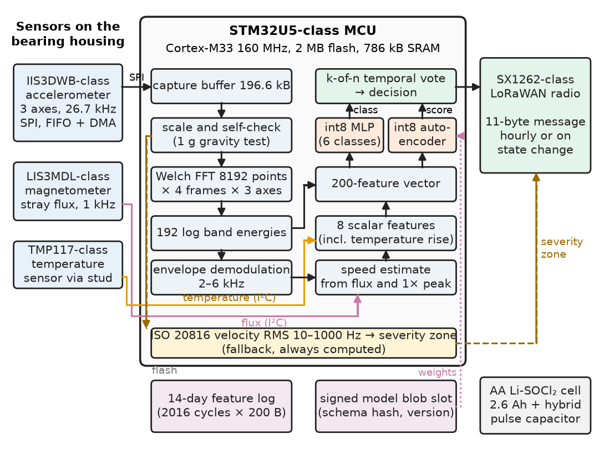
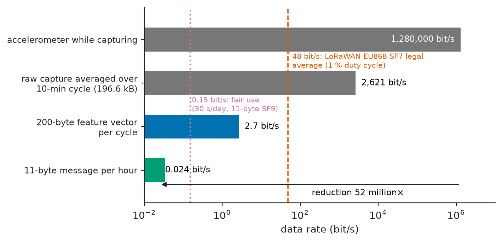
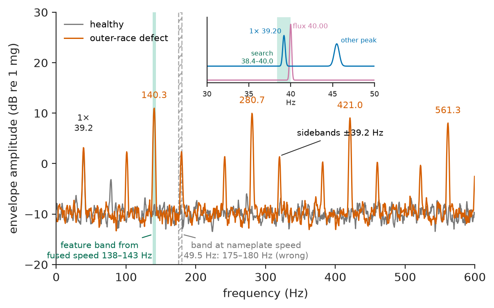
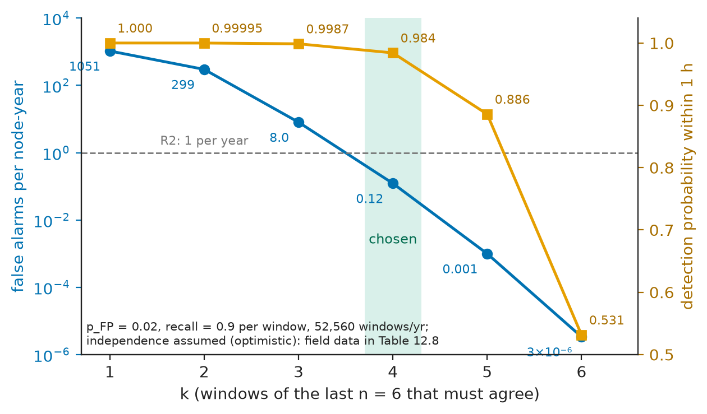
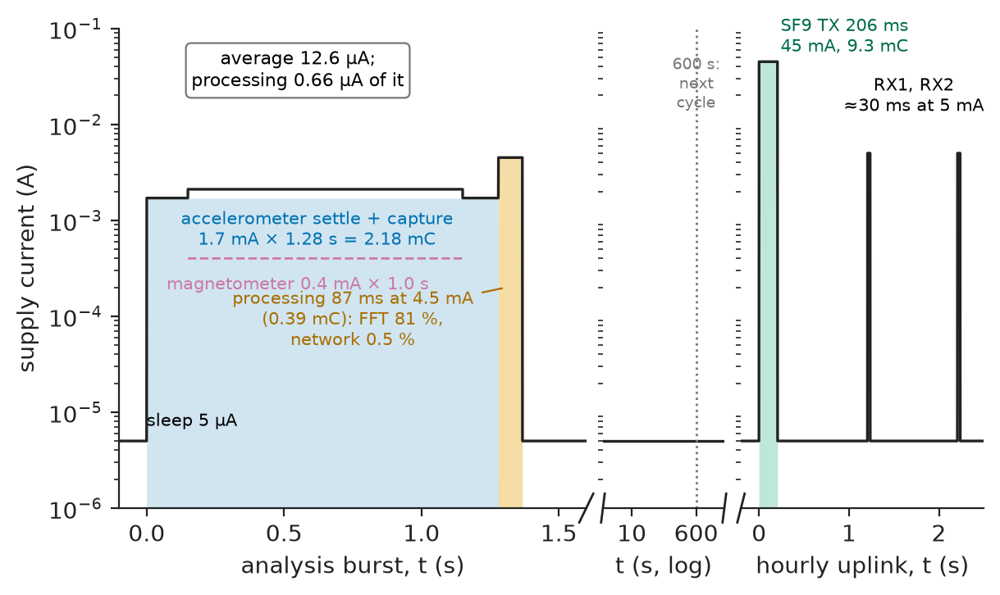
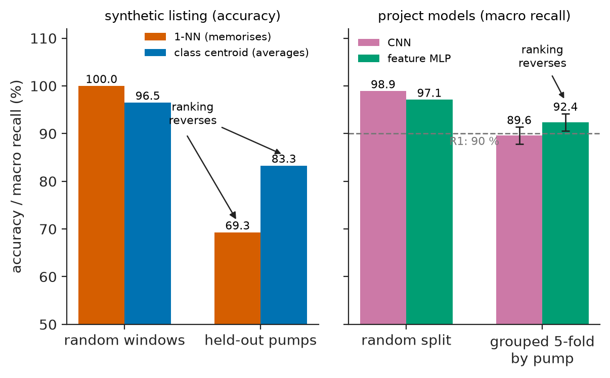

# Chapter 12 — Edge Computing and Embedded AI

*Part III · Embedded and Connected Systems*

A water utility fits 400 battery-powered condition-monitoring nodes to the 7.5 kW centrifugal pumps of its booster stations. Each node listens to its pump's vibration, classifies the pump's condition on the device and sends a few bytes over LoRaWAN. In the lab, on a test rig with seeded faults, the classifier scored 98.7 % accuracy. In the first week of service, 152 of the 400 pumps, all of them healthy, reported "imbalance". Two causes were found, and neither was in the model. The training data had been recorded with the accelerometer at ±16 g full scale. The production firmware configured ±4 g but kept the ±16 g conversion constant, so every amplitude it computed was four times too large: +12 dB on every band energy. A healthy pump with a four-times-too-large running-speed peak looks exactly like an unbalanced one. When that was fixed, field accuracy against technicians' inspections settled at 81 %, not 98.7 %. The lab score had been computed on randomly split windows, so every test window had near-identical siblings from the same pump in the training set, and the score measured how well the model recognised pumps, not faults. This chapter integrates such a node properly, from the decision to compute at the edge to the failure handling that keeps a learned model from becoming a confident source of false alarms.

> **When should data be turned into decisions on the device, and how is a learned model fitted into the memory, time and energy of a microcontroller?**
> **How is an embedded model validated so that the number measured in the lab is the number seen in the field, and what does the device do when the model is wrong?**

| Concept | Engineering destination |
|---|---|
| Edge versus cloud processing | Computing locally when the raw data is too large, too slow or too costly in energy to move |
| Resource constraints | MCU, NPU or Linux edge platform chosen against flash, SRAM, cycles and sleep current |
| Data preprocessing | A DSP front end (FFT, envelope, band energies) whose contract with the training pipeline is enforced |
| Model deployment | Model as a signed, versioned blob with a feature-schema hash, updatable without new firmware |
| Quantisation | int8 weights and activations, verified for agreement with the float reference |
| Inference performance | A cycle budget measured with the cycle counter, stage by stage |
| Memory and power constraints | Flash, SRAM and energy budgets with margins, and battery life |
| Sensor fusion | Shaft speed from magnetic flux to locate fault frequencies; temperature trend; k-of-n temporal voting |
| Model validation | Split by pump, golden-vector equivalence, shadow-mode field trial |
| Failure handling | Sensor self-checks, out-of-distribution detection, ISO 20816 fallback, "unknown" as an answer |

**Roadmap.** The node and its requirements (12.1) → edge versus cloud (12.2) → resource constraints and platform choice (12.3) → data preprocessing (12.4) → sensor fusion (12.5) → model deployment (12.6) → quantisation (12.7) → inference performance (12.8) → memory and power constraints (12.9) → model validation (12.10) → failure handling and verification (12.11).

---

## 12.1 The reference system: a pump condition-monitoring node

> **Boundary.** The deployment flow, int8 affine quantisation, integer requantisation and accelerator trade-offs are developed in *Electronics and Computing*, [Ch. 35 §35.5–35.7](https://github.com/The-Studio-of-Sadiq/Electronics-and-Computing/blob/main/part-8-integrated-circuits-and-vlsi/35-hardware-software-co-design.md). Training, feature engineering, classification, anomaly detection and model evaluation are the subject of [Chapter 32](../part-8-engineering-software-and-computational-tools/32-ai-and-machine-learning-for-eee.md); spectral analysis and feature extraction as DSP practice belong to [Chapter 27](../part-7-communications-signal-processing-and-biomedical/27-practical-signal-processing.md), whose mains-powered node for the same utility's 37 kW pump sets is the larger sibling of the battery node designed here. This chapter is the deployment side: the model as one component of an embedded system. The device-level integration method is that of [Chapter 10](10-embedded-system-integration.md), and the connectivity that of [Chapter 11](11-iot-systems.md).

The node clamps onto the pump's drive-end bearing housing with a stud. It contains a wide-band MEMS accelerometer, a three-axis magnetometer that senses the motor's stray flux, a temperature sensor coupled through the stud, a microcontroller, a LoRaWAN radio and an AA lithium–thionyl-chloride cell. Its architecture and pipeline are shown in Figure 12.1. Every 10 minutes it wakes, records 1.23 s of vibration and 1 s of flux, computes features, runs a classifier and an anomaly detector, and updates its state. Once an hour, or at once if the state changes, it sends a short message: condition class, confidence, an anomaly score and the ISO 20816 vibration severity.

**Table 12.1 — Requirements for the condition-monitoring node.**

| ID | Requirement | Target | Verification |
|---|---|---|---|
| R1 | Fault classification | Macro-averaged recall ≥ 90 % over normal, imbalance, misalignment, looseness, bearing defect and cavitation, on pumps not used in training | Grouped validation; field inspections |
| R2 | False alarms | ≤ 1 per node per year (95 % upper bound) | Pilot fleet, Poisson bound |
| R3 | Detection delay | A developing fault reported ≤ 2 h after it is detectable in single windows | Seeded-fault rig |
| R4 | Battery life | ≥ 5 years on one AA Li-SOCl₂ cell (2.6 Ah) | Charge-per-event measurement and budget |
| R5 | Uplink | ≤ 24 messages/day, ≤ 12 B payload; within EU868 1 % duty cycle and 30 s/day network fair use | Airtime calculation; network logs |
| R6 | Numerical equivalence | On-device features within 0.1 dB of the reference pipeline; int8 model agrees with float on ≥ 99 % of windows | Golden-vector test |
| R7 | Resources | Flash ≤ 75 %, SRAM ≤ 60 % | Linker map, stack watermark |
| R8 | Graceful degradation | Sensor faults detected within one cycle; out-of-distribution windows reported as "unknown"; ISO 20816 severity always reported | Fault injection |
| R9 | Model update | Signed, versioned, schema-checked; updatable without a firmware update | Update test, schema-mismatch test |

<!-- FIGURE 12.1 | figures/ch12/fig-12-1-edge-node-pipeline.png | block-diagram | Architecture and processing pipeline of the pump condition-monitoring node. | Content: left: sensors on the bearing housing: IIS3DWB-class accelerometer (3 axes, 26.7 kHz, SPI with FIFO and DMA), LIS3MDL-class magnetometer (stray flux, 1 kHz), TMP117-class temperature sensor via stud. Centre: STM32U5-class MCU (Cortex-M33 160 MHz, 2 MB flash, 786 kB SRAM) running the pipeline: capture buffer 196.6 kB -> scale and self-check (1 g gravity test) -> Welch FFT 8192 points x 4 frames x 3 axes -> 192 log band energies -> envelope demodulation 2 to 6 kHz -> speed estimate from flux and 1x peak -> 8 scalar features -> 200-feature vector -> int8 MLP classifier (6 classes) and int8 autoencoder (anomaly score) -> k-of-n temporal vote -> decision; parallel branch: ISO 20816 velocity RMS 10 to 1000 Hz -> severity zone (fallback). Right: SX1262-class LoRaWAN radio, 11-byte message hourly or on change; AA Li-SOCl2 cell with hybrid pulse capacitor. Below: signed model blob slot (schema hash, version) and 14-day feature log in flash. -->



*Figure 12.1 — Architecture and processing pipeline of the pump condition-monitoring node.*

---

## 12.2 Edge versus cloud processing

The first architecture decision is *where* the vibration becomes a decision. Four placements are possible, and the numbers decide quickly.

**Worked example — Can the raw data leave the device?** The accelerometer produces $26{,}667\ \mathrm{Hz}\times3\ \text{axes}\times16\ \text{bit}=1.28$ Mbit/s while it runs. One 1.23 s capture of 32,768 samples per axis is 196.6 kB. Sent once per 10-minute cycle, that is an average of $196{,}608\times8/600=2.62$ kbit/s. LoRaWAN in the EU868 band is limited to a 1 % duty cycle per sub-band. At the fastest data rate (SF7, 125 kHz), a maximum 222-byte frame occupies 369 ms of air, so the legal average throughput is about 48 bit/s, 54 times too little *before* any network fair-use policy. Over LTE-M the data could move, but at a cost in energy: about 7 s of radio time per capture at roughly 0.2 A, 1.45 C per cycle. The budget listing in Section 12.9 puts the average current at 2.42 mA, which would empty the AA cell in about 31 days instead of lasting 13 years. The raw data cannot leave the device. The decision has to be made on it.

**Table 12.2 — Placement options for the analysis.**

| Option | Data leaving the node | Node energy | Decision latency | Model update | Verdict |
|---|---|---|---|---|---|
| Stream raw to cloud (LTE-M) | 196.6 kB per cycle | About 2.4 mA average: 1 month on AA | Seconds | Trivial (cloud) | Fails R4 by 60× |
| Features on node, model in cloud | 200 B per cycle (2.7 bit/s) | Low | Minutes | Trivial | Fails R5: 144 messages/day of 200 B exceed fair use |
| **Features and model on node** | 11 B per hour or on change | 12.6 µA average | ≤ 10 min per window, ≤ 1 h after voting | Signed model blob over the air (Section 12.6) | **Chosen** |
| Wired sensors to a Linux edge box per station | Raw data on a local bus | Mains (5–15 W) | Seconds | Easy | Needs cabling and power in every station; kept for the 5 largest stations |

> **Status of the principle: Move the computation to the data when the data is the expensive thing**
> *Derived.* If moving a sample costs more energy or bandwidth than processing it, as it does whenever the radio's energy per bit times the data volume exceeds the energy of the computation, local processing minimises the total cost. The comparison is a ratio of measured quantities, and it reverses when links are wired and powered.

<!-- FIGURE 12.2 | figures/ch12/fig-12-2-data-rate-by-stage.png | plot | Data rate at each stage of the edge pipeline against the LoRaWAN capacity. | Content: horizontal bar chart on a logarithmic x axis from 0.01 to 10,000,000 bit/s. Bars: accelerometer while capturing 1,280,000 bit/s; raw capture averaged over the 10-min cycle 2,621 bit/s; 200-byte feature vector per cycle 2.7 bit/s; 11-byte message per hour 0.024 bit/s. Vertical dashed line at 48 bit/s labelled LoRaWAN EU868 SF7 legal average (1 percent duty cycle); dotted line at 0.15 bit/s labelled fair use, 30 s airtime per day of 11-byte SF9 messages. Annotation: reduction factor 52 million from sensor to message. -->



*Figure 12.2 — Data rate at each stage of the edge pipeline against the LoRaWAN capacity.*

Figure 12.2 puts the stages on one axis: from sensor to message the data shrinks 52-million-fold. The pipeline is a compressor that keeps only the evidence the decision needs. Its design, Sections 12.4 and 12.5, matters more to the result than the network that follows.

---

## 12.3 Resource constraints

> **Boundary.** MCU selection criteria are in *Electronics and Computing*, [Ch. 25 §25.3](https://github.com/The-Studio-of-Sadiq/Electronics-and-Computing/blob/main/part-6-embedded-and-real-time-systems/25-embedded-system-architecture.md); the roofline model and the cost of data movement in [Ch. 35 §35.4–35.5](https://github.com/The-Studio-of-Sadiq/Electronics-and-Computing/blob/main/part-8-integrated-circuits-and-vlsi/35-hardware-software-co-design.md).

The constraints come from the requirements. SRAM must hold a 196.6 kB capture plus FFT work buffers. The CPU must finish the processing within seconds, and the energy of the processing must be small next to the capture and the radio. The sleep current must be in single microamps. The platform must survive −20 to +60 °C in an unheated pump station.

**Table 12.3 — Compute-platform candidates (typical values; check current datasheets).**

| Platform | Compute | Flash / SRAM | Run current / sleep | ML acceleration | Assessment |
|---|---|---|---|---|---|
| **STM32U5-class MCU** | Cortex-M33 160 MHz, FPU, DSP extension | 2 MB / 786 kB | about 20 µA/MHz / 2–5 µA Stop2 with SRAM | CMSIS-NN on CPU, 0.5 MAC/cycle sustained | **Chosen**: holds capture and buffers, low sleep current, mature DSP libraries |
| nRF5340-class MCU | Cortex-M33 128 MHz + network core | 1 MB / 512 kB | similar / 2–4 µA | CPU only | Integrated BLE not needed; SRAM tight for full 3-axis capture |
| MCU with NPU (MCX N94x, Alif Ensemble E3, STM32N6 classes) | M33/M55 + NPU, 100–600 GOPS int8 | 1–4 MB / 1–13 MB | higher run, 10–100 µA sleep for large SRAM retention | NPU, 50–250 MAC/cycle on CNNs | Kept for Revision B if a CNN is adopted (Section 12.10) |
| Linux edge SoC (i.MX 8M Plus class) | 4 × Cortex-A53 + 2.3 TOPS NPU | eMMC / 1–4 GB DRAM | 2–4 W / no µA sleep | NPU, GPU | For the wired edge boxes only |

The decisive figure is not compute but SRAM, because the capture must sit in memory while it is transformed, and sleep current. The chosen part's compute is ample, as Section 12.8 shows: the network itself takes 0.35 ms per cycle. Choosing an NPU for this model would have bought a 100-fold speed-up of 0.4 % of the work.

---

## 12.4 Data preprocessing

> **Boundary.** Sampling, aliasing and anti-alias filtering are owned by *Circuits, Signals and Communications*, [Ch. 19](https://github.com/The-Studio-of-Sadiq/Circuits-Signals-and-Communications/blob/main/part-4-signals-and-systems/19-sampling-and-reconstruction.md); the DFT, windows and spectral leakage by [Ch. 22](https://github.com/The-Studio-of-Sadiq/Circuits-Signals-and-Communications/blob/main/part-5-digital-signal-processing/22-discrete-fourier-transform.md); filter design by [Ch. 23](https://github.com/The-Studio-of-Sadiq/Circuits-Signals-and-Communications/blob/main/part-5-digital-signal-processing/23-digital-filters.md). The filter chain, envelope spectrum, bearing kinematics and feature set are designed in [Chapter 27 §27.2–27.4](../part-7-communications-signal-processing-and-biomedical/27-practical-signal-processing.md) for a mains-powered node; here they are cut down to a battery budget and fixed as a contract with the training pipeline.

Preprocessing turns 196.6 kB of samples into a 200-number feature vector. Each step is a design choice with a number behind it.

- **Sampling.** The accelerometer's internal digital filter limits the band to about 6.3 kHz at 26.7 kHz output rate. Bearing-defect impacts excite housing resonances at 2–6 kHz, which the envelope stage demodulates, so this band is needed. Samples stream through the sensor's FIFO by SPI and DMA while the CPU sleeps.
- **Scaling and self-check.** Raw codes are converted to g with the sensitivity of the *configured* full scale, read back from the sensor's control register rather than assumed. The mean of each axis over the capture gives the gravity vector, whose magnitude must be 1 g (Section 12.11).
- **Spectrum.** For each axis, four 8,192-point frames (Hann window, 3.26 Hz bins) are averaged as a Welch estimate. Averaging four frames reduces the variance of each bin's power estimate fourfold, and that is what makes features repeatable from cycle to cycle.
- **Band energies.** 64 logarithmically spaced bands from 10 Hz to 6 kHz per axis, in dB re 1 (mg)². That gives 192 features that keep the shape of the spectrum without its fine detail.
- **Scalar features.** Velocity RMS 10–1,000 Hz (the ISO 20816 quantity), kurtosis and crest factor of the radial axis, envelope-spectrum energy at the bearing outer- and inner-race defect frequencies, the 1× and 2× running-speed amplitudes, and the bearing-housing temperature rise over ambient. Eight features. Several of them depend on knowing the shaft speed, which is where fusion enters (Section 12.5).

The most important property of the preprocessing is not any single step. It is that the device computes *exactly the same function* as the Python pipeline that produced the training data. Every parameter that defines that function goes into one feature-schema file: output data rate, full scale, window, frame length, band edges, units, feature order. A hash of that file is compiled into both the firmware and the model metadata (Section 12.6). The opening failure was a broken contract: the model had been trained on one function and was fed another.

> **Status of the principle: Training and serving must compute the same features**
> *Fundamental.* A learned model is a function of its inputs as they were defined during training. If deployment changes the definition (scale, units, window, order), the model's outputs are undefined, whatever its validated accuracy. This holds by construction for any model, and no amount of model quality compensates for it.

---

## 12.5 Sensor fusion

> **Boundary.** Induction-motor slip is from *Electrical Energy and Machines*, [Ch. 6 §6.3](https://github.com/The-Studio-of-Sadiq/Electrical-Energy-and-Machines/blob/main/part-2-transformers-and-electrical-machines/06-induction-machines.md). Kalman and complementary filters for fusing inertial sensors in robots and drones are applied in [Chapter 15](../part-4-robotics-and-mechatronics/15-robot-electronics-and-control.md) and [Chapter 16](../part-4-robotics-and-mechatronics/16-drones-and-aerial-robotics.md). Binomial probabilities and independence are from *The Mathematics Universe*, [Ch. 19 §19.4](https://github.com/The-Studio-of-Sadiq/engineering-mathematics/blob/main/part-6-probability-statistics/19-probability.md).

The node fuses information at three levels. Each one fixes a specific weakness of vibration alone.

### Signal level: shaft speed from flux

Fault frequencies scale with shaft speed. Imbalance appears at 1×, misalignment at 2×, a bearing's outer-race defect at about 3.58× for the drive-end bearing of these motors, and blade-pass at 6×. Half of the utility's pumps run on variable-frequency drives, between 30 and 50 Hz supply. A feature computed at a fixed nominal speed therefore looks in the wrong place.

**Worked example — Locating the outer-race frequency.** A 2-pole motor on a drive set to 40.00 Hz runs at 2 % slip, so the shaft turns at $40.00\times0.98=39.20$ Hz and the outer-race defect frequency is $3.58\times39.20=140.3$ Hz. A pipeline that assumed the nameplate speed of 2,970 rpm (49.5 Hz) would look at $3.58\times49.5=177.2$ Hz, 37 Hz and 11 bins away, and would never see the fault. Vibration alone gives a speed estimate from the largest peak near 1×, but at low load the 1× peak can be smaller than the blade-pass peak or a structural resonance. The magnetometer gives the supply frequency directly from the stray-flux spectrum, 40.00 Hz here, and for a 2-pole induction motor the shaft speed must lie between 0.96 and 1.00 times it. The fused estimate searches for the 1× vibration peak only inside that window, 38.4–40.0 Hz (Figure 12.3), and the peak found there, 39.20 Hz, sets all the order-based features. On the test rig this fusion cut speed-estimate failures from 6.1 % of windows (vibration alone, at low load) to 0.2 %.

<!-- FIGURE 12.3 | figures/ch12/fig-12-3-envelope-spectrum-bpfo.png | plot | Envelope spectra of the radial acceleration for a healthy pump and for a pump with an outer-race defect, at a shaft speed of 39.20 Hz on a 40 Hz drive. | Content: x axis frequency 0 to 600 Hz; y axis envelope amplitude in dB re 1 mg, -20 to 30. Healthy trace (grey): low floor near -10 dB with small peaks at 39.2 Hz (1x). Faulted trace (red): harmonic family at 140.3, 280.7, 421.0 and 561.3 Hz about 20 dB above the floor, each with sidebands at plus or minus 39.2 Hz. Vertical green band 138 to 143 Hz labelled feature band from fused speed; vertical grey dashed band 175 to 180 Hz labelled band at nameplate speed 49.5 Hz (wrong). Inset: flux spectrum peak at 40.00 Hz and vibration search window 38.4 to 40.0 Hz with the 1x peak at 39.20 Hz. -->



*Figure 12.3 — Envelope spectra of the radial acceleration for a healthy pump and for a pump with an outer-race defect, at a shaft speed of 39.20 Hz on a 40 Hz drive.*

### Feature level: temperature trend

Bearing temperature rises with friction, but it also rises with ambient temperature and load. The feature used is the bearing-housing temperature *minus* the station's ambient temperature, the latter estimated from the node's internal sensor at the end of the sleep period, smoothed over 24 h. It enters the classifier as one of the eight scalar features. Lubrication faults show in it days before any vibration change.

### Decision level: temporal voting

A per-window classifier with a 2 % false-positive rate, run 52,560 times a year, would raise about 1,050 false alarms per node per year, three orders of magnitude over R2. Faults develop over days and false positives are mostly isolated, so the node reports a fault only when at least $k$ of the last $n=6$ windows (one hour) agree.

**Worked example — Choosing k.** If window errors were independent with $p=0.02$, the probability that a sliding block of 6 windows contains at least $k$ false positives is a binomial tail. Multiplied by 52,560 evaluations per year (a union bound), it gives about 8 false alarms per year for $k=3$, 0.12 for $k=4$ and 0.001 for $k=5$. A real fault detected in single windows with recall 0.9 is reported within the hour with probability 0.9987, 0.984 and 0.886 for the same three values. $k=4$ meets R2 and R3 together. The independence assumption is optimistic, because errors cluster when a pump's operating point sits near a class boundary for hours. The computed 0.12 per year is therefore a design target, and R2 is verified on field data (Table 12.8), not on this calculation.

<!-- FIGURE 12.4 | figures/ch12/fig-12-4-k-of-n-voting.png | plot | False alarms per node-year and detection probability within one hour for k-of-6 voting. | Content: x axis k from 1 to 6. Left y axis (log, 0.0001 to 10,000): expected false alarms per year under independence with per-window false-positive rate 0.02: k=1 1051 (single-window), k=2 299, k=3 8.0, k=4 0.12, k=5 0.001, k=6 about 0.000003 (blue, log scale). Right y axis (linear 0.5 to 1.0): detection probability within 6 windows for per-window recall 0.9: k=1 1.000, k=2 0.99995, k=3 0.9987, k=4 0.984, k=5 0.886, k=6 0.531 (orange). Horizontal dashed line at 1 per year (R2); vertical highlight at k = 4 labelled chosen. Note: independence assumed; field data in Table 12.8. -->



*Figure 12.4 — False alarms per node-year and detection probability within one hour for k-of-6 voting.*

Figure 12.4 shows the trade-off. Below $k=4$ false alarms dominate; above it, missed and late detections do.

---

## 12.6 Model deployment

A model on a device is a piece of firmware with unusual properties. It is produced by a data pipeline rather than by a compiler. Its correctness depends on inputs defined elsewhere. And it will be replaced more often than the code around it. The deployment design makes those properties explicit.

**The artefact.** The trained model (Chapter 32) is exported as an int8 TensorFlow Lite flatbuffer. For a model this small, a generated C array of weights run by CMSIS-NN fully connected kernels would do just as well, at a smaller runtime cost. The blob carries a header with a magic number, model version, feature-schema hash, input and output dimensions, the int8 quantisation parameters, the out-of-distribution threshold, the training-data identifier, and a signature over all of it.

**The slot.** Firmware and model live in separate flash regions. A firmware update (A/B slots with signature check, Book 4 §25.9) changes code. A model update changes only the 64 kB model slot and can be delivered over LoRaWAN firmware-update-over-the-air multicast in about 900 fragments, or by a technician's phone over a maintenance BLE link. At boot and after every model update, the firmware checks the model's signature and its compatibility with the firmware's own feature schema, and refuses a mismatch. The previous model is kept, so a refused or failed update leaves the old one running.

```c
/* model_guard.c -- model compatibility and sensor-scale checks (C11, illustrative) */
#include <math.h>
#include <stdbool.h>
#include <stdint.h>

typedef struct {                  /* header of the signed model blob */
    uint32_t magic;               /* 0x4D4F444C, "MODL" */
    uint32_t model_version;
    uint32_t schema_hash;         /* hash of ODR, full scale, window, bands, units, order */
    uint16_t n_in, n_out;
    float    ood_threshold;       /* autoencoder error at the 99.5th training percentile */
} model_hdr_t;

/* Generated at build time from the same schema file that the training pipeline uses. */
extern const uint32_t FEATURE_SCHEMA_HASH;
bool signature_valid(const void *blob, uint32_t len);   /* ECDSA P-256, in bootloader lib */

bool model_compatible(const model_hdr_t *h, uint32_t len)
{
    return signature_valid(h, len) && h->magic == 0x4D4F444Cu
        && h->schema_hash == FEATURE_SCHEMA_HASH && h->n_in == 200u && h->n_out == 6u;
}

/* Static acceleration must be 1 g in magnitude at any mounting angle.
   mean_mg: per-axis mean of the capture in milli-g after scaling. */
bool accel_scale_ok(const float mean_mg[3])
{
    float g = sqrtf(mean_mg[0] * mean_mg[0] + mean_mg[1] * mean_mg[1]
                    + mean_mg[2] * mean_mg[2]);
    return g > 950.0f && g < 1050.0f;      /* +/-5 %: a x4 scale error gives 4000 or 250 */
}
```

The two functions are the deployment-side answers to the opening failure. The first makes a model and a pipeline that disagree about the feature definition refuse to run together. The second detects at run time a scale error that a schema check cannot see, because the configuration was right in the file and wrong in the register. Either one alone would have stopped the 152 false reports in the first cycle.

---

## 12.7 Quantisation

> **Boundary.** The affine int8 mapping $r=S(q-Z)$, per-channel weight scales, int32 accumulation, fixed-point requantisation and the comparison of post-training quantisation with quantisation-aware training are in *Electronics and Computing*, [Ch. 35 §35.6](https://github.com/The-Studio-of-Sadiq/Electronics-and-Computing/blob/main/part-8-integrated-circuits-and-vlsi/35-hardware-software-co-design.md); quantisation noise and fixed-point formats in *Circuits, Signals and Communications*, [Ch. 21 §21.2 and §21.5](https://github.com/The-Studio-of-Sadiq/Circuits-Signals-and-Communications/blob/main/part-5-digital-signal-processing/21-dsp-fundamentals.md). Here quantisation is a verification question: does the deployed model still make the same decisions?

The classifier is a multilayer perceptron, 200 → 64 → 32 → 6, with 15,142 parameters. The anomaly detector is an autoencoder, 200 → 32 → 8 → 32 → 200, with 13,584 parameters. At int8 they need 28.7 kB of flash instead of 115 kB at float32. Post-training quantisation with per-channel weight scales is used, calibrated on 2,000 training windows. The question that matters for integration is whether the int8 model *agrees* with the float model it was validated as, on data it has not seen. The answer must come from a test, not from an expectation.

The listing demonstrates the test on a synthetic stand-in for the real feature set: dB band energies from 48 pumps, six conditions, with pump-specific offsets. A softmax classifier is trained on 36 pumps and tested on 12 held-out pumps, in float and with int8 weights and inputs. The listing then repeats the int8 evaluation with the opening failure's +12 dB scale error applied to every feature.

```python
# Softmax classifier on dB band features: float vs int8, and a +12 dB scaling fault
import numpy as np

rng = np.random.default_rng(3)
P, W, D, C = 48, 60, 24, 6
cls = np.arange(P) % C
centres, sig = rng.normal(0, 1, (C, D)), rng.normal(0, 1.6, (P, D))
X = 6.0 * np.concatenate([centres[cls[p]] + sig[p] + rng.normal(0, 0.3, (W, D))
                          for p in range(P)])                      # dB
y, pump = np.repeat(cls, W), np.repeat(np.arange(P), W)
te = np.isin(pump, rng.choice(P, 12, replace=False))              # held-out pumps
mu, sd = X[~te].mean(0), X[~te].std(0)
Z = (X - mu) / sd
Wt, b = np.zeros((D, C)), np.zeros(C)
Y = np.eye(C)[y[~te]]
for _ in range(500):                                               # gradient descent
    p = np.exp(Z[~te] @ Wt + b); p /= p.sum(1, keepdims=True)
    g = (p - Y) / len(Y)
    Wt -= 0.5 * (Z[~te].T @ g + 1e-3 * Wt); b -= 0.5 * g.sum(0)

s_x = np.abs(Z[~te]).max() / 127                                   # per-tensor input scale
s_w = np.abs(Wt).max(0) / 127                                      # per-class weight scales
q_w = np.round(Wt / s_w).astype(np.int32)
q_b = np.round(b / (s_x * s_w)).astype(np.int32)

def predict_int8(Zin):
    q_x = np.clip(np.round(Zin / s_x), -128, 127).astype(np.int32)
    return ((q_x @ q_w + q_b) * s_w).argmax(1)                     # int32 acc, dequantised

f32 = (Z[te] @ Wt + b).argmax(1)
i8 = predict_int8(Z[te])
print(f"float accuracy {np.mean(f32 == y[te]):.1%}, int8 accuracy {np.mean(i8 == y[te]):.1%}, "
      f"agreement {np.mean(f32 == i8):.2%}, max |acc| {np.abs(np.clip(np.round(Z / s_x), -128, 127) @ q_w).max():.0f}")
bad = predict_int8((X[te] + 12.04 - mu) / sd)                      # full-scale mismatch, x4
print(f"+12 dB fault: accuracy {np.mean(bad == y[te]):.1%}, "
      f"predicted-class histogram {np.bincount(bad, minlength=C)}")
```

```text
float accuracy 81.1%, int8 accuracy 81.1%, agreement 100.00%, max |acc| 49646
+12 dB fault: accuracy 42.4%, predicted-class histogram [ 97  59   6   0 179 379]
```

**Worked example — Reading the quantisation result.** On the 720 held-out windows the int8 model agrees with the float model on every window, and its accuracy (81.1 % on this deliberately hard synthetic set) is unchanged. The largest accumulator magnitude, 49,646, needs 17 bits including sign, far inside int32. Quantisation therefore costs nothing measurable here. The real model met R6 with 99.7 % agreement on 6,400 validation windows; the 0.3 % of disagreements were all windows whose two top classes had confidences within 0.02 of each other. The same listing shows where the real risk is. A +12 dB error *in the input* halves the accuracy and drives 558 of 720 windows into just two classes, which is the signature of the field failure. In int8 there is a second effect: the shifted inputs saturate at the edge of the calibrated input range, so the model is not even computing on the shifted values correctly. Quantisation error is a fraction of a percent; a units error is a factor of two in accuracy.

> **Status of the principle: int8 post-training quantisation preserves decisions of small models**
> *Empirical.* For classifiers on well-scaled features and for convolutional networks, int8 post-training quantisation with per-channel weights typically changes accuracy by less than 1 %. The result must still be verified per model by an agreement test on held-out data, and it does not hold for inputs outside the calibration range.

---

## 12.8 Inference performance

"Inference performance" on a microcontroller means the time and energy of the *whole* decision, not of the network. The pipeline was profiled on the target with the Cortex-M33's DWT cycle counter around each stage, with caches warm and with the capture in SRAM. The listing in Section 12.9 reproduces the cycle budget from the per-stage estimates.

**Table 12.4 — Per-cycle processing budget (Cortex-M33 at 160 MHz).**

| Stage | Estimate | Measured | Share |
|---|---|---|---|
| 12 × 8,192-point real FFT (CMSIS-DSP, f32) | 71.25 ms | 69.8 ms | 81 % |
| Envelope demodulation (band-pass, rectify, decimate, 2,048-pt FFT) | 11.88 ms | 12.6 ms | 14 % |
| Band energies and scalar features | 4.00 ms | 3.7 ms | 4 % |
| MLP + autoencoder, int8 (28,352 MACs) | 0.35 ms | 0.41 ms | 0.5 % |
| **Total** | **87.5 ms** | **86.5 ms** | |
| Limit (soft: must finish well inside the 10-min cycle) | 1 s | | margin 91 % |

The network is half a percent of the computation. The design consequence: optimising inference (a faster kernel, an NPU) is pointless, and the right lever is the FFT. Two options were evaluated. Fixed-point q15 FFTs are about 1.6 times faster on this core but lose tens of decibels of dynamic range to per-stage scaling, which buries the weak low-frequency bands. Analysing only the radial axis at full resolution and the other two at 2,048 points would cut FFT time by 50 %, but it costs a measured 1.8 points of macro recall. Neither was needed. At 87 ms per 10 minutes, processing is 0.66 µA of the 12.6 µA budget (Figure 12.5).

**Worked example — The CNN alternative.** A 2-D convolutional network on a 64-band × 32-frame × 3-axis log-spectrogram was the obvious alternative. Its layers (three 3 × 3 convolutions to 16, 32 and 64 channels, a fourth at 64 channels, global pooling and a 6-way output) need $6.78\times10^6$ MACs and 60,902 parameters. At 0.5 MAC per cycle that is $6.78\times10^6/(0.5\times160\times10^6)=85$ ms, which would double the processing time, and its peak activation memory is 49 kB. Both fit. The CNN was not rejected for resources. It was rejected in validation (Section 12.10), and it is the candidate that would justify an NPU part in Revision B.

<!-- FIGURE 12.5 | figures/ch12/fig-12-5-cycle-current-profile.png | waveform | Supply current of the node over one 10-minute analysis cycle and one hourly uplink, on a logarithmic current axis. | Content: x axis time, broken axis: 0 to 1.6 s for the analysis burst, then 600 s cycle mark, then an uplink burst. Log current axis 1 uA to 100 mA. Sleep 5 uA; accelerometer settle and capture 0 to 1.28 s at 1.7 mA (shaded 2.18 mC); magnetometer capture 1.0 s at 0.4 mA overlapping; processing 87 ms at 4.5 mA (0.39 mC) labelled FFT 81 percent, network 0.5 percent; return to 5 uA. Uplink burst: SF9 transmission 206 ms at 45 mA (9.3 mC), two receive windows of about 30 ms at 5 mA. Annotation: average 12.6 uA; processing 0.66 uA of it. -->



*Figure 12.5 — Supply current of the node over one 10-minute analysis cycle and one hourly uplink, on a logarithmic current axis.*

---

## 12.9 Memory and power constraints

> **Boundary.** The average-current battery model and the power-mode ladder are from *Electronics and Computing*, [Ch. 25 §25.5](https://github.com/The-Studio-of-Sadiq/Electronics-and-Computing/blob/main/part-6-embedded-and-real-time-systems/25-embedded-system-architecture.md), applied as in [Chapter 10](10-embedded-system-integration.md). Li-SOCl₂ cell behaviour is from *Electrical Energy and Machines*, [Ch. 16 §16.2](https://github.com/The-Studio-of-Sadiq/Electrical-Energy-and-Machines/blob/main/part-4-power-generation/16-energy-storage.md).

**Table 12.5 — Memory budget (STM32U5-class, 2 MB flash, 786 kB SRAM).**

| Region | Size | Notes |
|---|---|---|
| Bootloader | 64 kB | Secure boot, signature verification |
| Firmware slots A and B | 2 × 448 kB | Image 236 kB (LoRaWAN stack, CMSIS-DSP/NN, RTOS, application) |
| Model slots current and previous | 2 × 64 kB | Model blob 35 kB (28.7 kB weights + metadata) |
| Configuration and calibration | 16 kB | |
| Feature log, 14 days | 400 kB | 2,016 cycles × 200 B, for re-analysis on request |
| **Flash used / total** | **1,504 / 2,048 kB** | **73 % (limit 75 %)** |
| Capture buffer (3 × 32,768 × int16) | 196.6 kB | Filled by DMA |
| FFT input and output (f32, 8,192 points) | 64 kB | Reused per frame |
| Features, band tables, envelope buffers | 12 kB | |
| Inference arena (MLP + autoencoder) | 8 kB | Largest pair of live tensors |
| LoRaWAN stack, RTOS, stacks (watermark + 25 %) | 36 kB | |
| **SRAM used / total** | **317 / 786 kB** | **40 % (limit 60 %)** |

The flash budget is the tight one, because of the feature log. A 14-day log allows the utility's analysts to download two weeks of features from a suspicious pump and re-analyse them with a newer model before deciding on a site visit. That capability was judged worth sitting just under the 75 % limit of R7. Flash margin is not left for firmware growth here, because the slots are sized separately with 47 % headroom over the image.

The energy budget computes the cycle's processing time, the average current and the life, and compares them with streaming raw data.

```python
# Edge pipeline budget: latency per cycle, average current, life; versus streaming raw data
F_CPU = 160e6
stages = {                       # cycles per analysis cycle (Cortex-M33, CMSIS-DSP/NN)
    "12 x 8192-pt real FFT":     12 * 0.95e6,
    "envelope demodulation":     1.9e6,
    "band energies, features":   0.64e6,
    "MLP + autoencoder (int8)":  28_352 / 0.5,          # MACs at 0.5 MAC/cycle
}
t_proc = sum(stages.values()) / F_CPU
for k, c in stages.items():
    print(f"{k:<26s} {c / F_CPU * 1e3:6.2f} ms")
CYCLE, HOUR = 600.0, 3600.0
charge = {                       # coulombs per period -> average current
    "sleep floor":        (5.0e-6 * CYCLE, CYCLE),
    "accel capture":      (1.7e-3 * 1.28, CYCLE),
    "flux capture":       (0.4e-3 * 1.0, CYCLE),
    "processing":         (4.5e-3 * t_proc, CYCLE),
    "LoRaWAN uplink SF9": (45e-3 * 0.206 + 0.3e-3, HOUR),
}
i_avg = sum(q / T for q, T in charge.values())
i_sd = 2.6 * 0.01 / 8760                                 # Li-SOCl2 AA self-discharge, A
life = 0.7 * 2.6 / (i_avg + i_sd) / 8760
i_raw = 1.45 / CYCLE + 5.0e-6                            # LTE-M upload of 196.6 kB per cycle
print(f"processing {t_proc * 1e3:.1f} ms; average {i_avg * 1e6:.1f} uA "
      f"(+{i_sd * 1e6:.1f} uA self-discharge); life {life:.1f} years")
print(f"stream raw over LTE-M: {i_raw * 1e3:.2f} mA, "
      f"life {0.7 * 2.6 / (i_raw + i_sd) / 24:.0f} days, {i_raw / i_avg:.0f}x the edge design")
```

```text
12 x 8192-pt real FFT       71.25 ms
envelope demodulation       11.88 ms
band energies, features      4.00 ms
MLP + autoencoder (int8)     0.35 ms
processing 87.5 ms; average 12.6 uA (+3.0 uA self-discharge); life 13.3 years
stream raw over LTE-M: 2.42 mA, life 31 days, 192x the edge design
```

**Table 12.6 — Energy budget summary (R4).**

| Item | Average current |
|---|---|
| Sleep floor (MCU Stop2 with SRAM retention, sensors off, radio sleep) | 5.0 µA |
| Accelerometer capture, 1.28 s per cycle | 3.6 µA |
| Uplink, SF9, 206 ms at 45 mA hourly | 2.7 µA |
| Magnetometer capture | 0.7 µA |
| Processing, 87.5 ms per cycle | 0.7 µA |
| **Total load / with self-discharge** | **12.6 µA / 15.6 µA** |
| Usable capacity (70 % of 2.6 Ah: pulse load, −20 °C) | 1.82 Ah |
| **Predicted life / requirement / margin** | **13.3 years / 5 years / 166 %** |

The large margin is deliberate and is spent in two places. The first is a 5-minute cycle at pump stations that request closer watch, which costs about 5 µA more. The second is a hybrid pulse capacitor across the cell, because a bare bobbin-type Li-SOCl₂ AA cell cannot deliver the 45 mA transmit pulse at −20 °C without a voltage delay that browns out the radio. That is the battery-as-a-resistance lesson of Chapter 10 in another chemistry.

The uplink message is 11 bytes: class (1), confidence (1), anomaly score (1), ISO 20816 velocity RMS (2), severity zone and flags (1), shaft speed (2), temperature rise (1), model version (1) and sequence (1). At SF9 its time on air is 206 ms, so 24 messages a day use 4.9 s of airtime, inside a 30 s/day fair-use policy, and a 0.006 % duty cycle, 0.6 % of the 1 % limit (R5).

---

## 12.10 Model validation

> **Boundary.** Metrics, cross-validation and uncertainty for trained models are developed in [Chapter 32](../part-8-engineering-software-and-computational-tools/32-ai-and-machine-learning-for-eee.md); confidence intervals in *The Mathematics Universe*, [Ch. 20 §20.7](https://github.com/The-Studio-of-Sadiq/engineering-mathematics/blob/main/part-6-probability-statistics/20-statistical-analysis.md). This section is about validating the *deployed* system.

Validating an embedded model is three different activities, and the opening failure skipped two of them.

### 1. Is the validation data independent of the training data?

Windows from one pump are not independent samples. They share the pump's mounting stiffness, resonances, impeller wear and sensor placement. A random split puts sibling windows of every pump on both sides, and a model that memorises pumps scores as if it had learned faults. The listing compares a memorising classifier (1-nearest-neighbour) with an averaging one (nearest class centroid) on the same synthetic feature set as Section 12.7, under a random-window split and under a split that holds out whole pumps.

```python
# Random-window split versus split by pump: how validation leaks
import numpy as np

rng = np.random.default_rng(3)
P, W, D, C = 48, 60, 24, 6                   # pumps, windows per pump, features, classes
cls_of_pump = np.arange(P) % C               # each pump recorded in one condition
centres = rng.normal(0, 1.0, (C, D))         # class signatures (log band energies)
sig = rng.normal(0, 1.6, (P, D))             # pump-specific mounting/resonance offset
X = np.concatenate([centres[cls_of_pump[p]] + sig[p] + rng.normal(0, 0.3, (W, D))
                    for p in range(P)])
y = np.repeat(cls_of_pump, W)
pump = np.repeat(np.arange(P), W)

def nn1(Xtr, ytr, Xte):                      # 1-nearest neighbour: memorises
    d = ((Xte[:, None, :] - Xtr[None, :, :]) ** 2).sum(-1)
    return ytr[d.argmin(1)]

def centroid(Xtr, ytr, Xte):                 # nearest class mean: averages pumps out
    m = np.stack([Xtr[ytr == c].mean(0) for c in range(C)])
    return ((Xte[:, None, :] - m[None]) ** 2).sum(-1).argmin(1)

test_rand = rng.random(len(y)) < 0.25
test_pump = np.isin(pump, rng.choice(P, 12, replace=False))
for split, te in (("random windows", test_rand), ("held-out pumps", test_pump)):
    for name, f in (("1-NN", nn1), ("class centroid", centroid)):
        acc = (f(X[~te], y[~te], X[te]) == y[te]).mean()
        print(f"{split:<15s} {name:<15s} accuracy {acc:6.1%}")
```

```text
random windows  1-NN            accuracy 100.0%
random windows  class centroid  accuracy  96.5%
held-out pumps  1-NN            accuracy  69.3%
held-out pumps  class centroid  accuracy  83.3%
```

**Worked example — The split reverses the ranking.** Under the random split (Figure 12.6) the memorising classifier wins, 100 % against 96.5 %, and a team choosing on that number would ship it. Under the pump split it loses, 69.3 % against 83.3 %, and both numbers fall by 13–31 points. The real project saw the same reversal. On randomly split windows the CNN of Section 12.8 scored 98.9 % and the feature MLP 97.1 %. With 9 pumps held out (grouped 5-fold cross-validation by pump, repeated), the MLP's macro recall was 92.4 % and the CNN's 89.6 %. The CNN had learned pump-specific spectral texture from only 38 training pumps. The MLP, fed speed-normalised physics features, generalised better. The MLP was chosen, and the CNN stays a Revision B candidate for when the labelled fleet data reaches a few hundred pumps.

<!-- FIGURE 12.6 | figures/ch12/fig-12-6-split-leakage.png | plot | Accuracy of a memorising and an averaging classifier under a random-window split and a held-out-pump split. | Content: grouped bar chart. Groups: random windows, held-out pumps. Bars: 1-NN (100.0, 69.3 percent), class centroid (96.5, 83.3 percent), from the synthetic listing. Second panel: project models, random split versus grouped 5-fold by pump: CNN 98.9 and 89.6 percent, MLP 97.1 and 92.4 percent macro recall, with error bars of plus or minus 1.8 points on the grouped values. Horizontal dashed line at 90 percent labelled R1. Annotation arrows showing ranking reversal. -->



*Figure 12.6 — Accuracy of a memorising and an averaging classifier under a random-window split and a held-out-pump split.*

### 2. Does the device compute what the reference computes?

**Golden vectors.** 500 raw captures, from the test rig and from field nodes, are stored with the firmware's test suite. The reference Python pipeline computes their features and model outputs. The firmware, run on the target in a HIL fixture that injects the raw capture through the sensor's SPI interface, must reproduce every feature within 0.1 dB and every class decision in at least 99 % of cases (R6). This test runs in CI for every firmware and every model build. It is the test that would have caught the full-scale error before deployment, because the HIL fixture configures the sensor through the same driver as production.

### 3. Does it work on the pumps it is installed on?

**Shadow mode.** For the first four weeks on each new station, the node reports its classes but raises no alarms. Its outputs are compared with technicians' scheduled inspections and with portable-analyser surveys. Field macro recall from shadow mode on 60 pilot pumps was 90.8 %, consistent with the grouped estimate within its uncertainty. Shadow mode also produced the first labelled field data for retraining, the loop that Chapter 32 and the digital-twin methods of Chapter 33 take further.

> **Status of the principle: Validate on the unit of deployment**
> *Empirical.* When data comes in correlated groups (machines, patients, sites, vehicles), held-out performance must be measured on held-out *groups*, because deployment always meets new groups. Grouped estimates are consistently lower than random-split estimates on such data, and the gap grows with model capacity.

---

## 12.11 Failure handling and verification

> **Boundary.** Fault handling on the device (watchdogs, safe states, reset policy) is from [Chapter 10 §10.7](10-embedded-system-integration.md); fleet-level detection of silent nodes from [Chapter 11 §11.7](11-iot-systems.md). Vibration-severity zones are from ISO 20816-1 (formerly ISO 10816-1).

A model can be wrong in two ways. It can be wrong on data like its training data, which is measured by validation and contained by voting. Or it can be confidently wrong on data unlike anything it has seen, which validation cannot measure. The node's failure handling is designed for the second kind.

**Layered defences.**

1. **Sensor self-checks, every cycle.** Gravity magnitude 1 g ± 5 % (scale and orientation). Noise floor above the sensor's datasheet floor (a dead or disconnected sensor reads too quiet). Saturation count below 0.01 % of samples (a loose node hammering its stud reads too loud). Flux supply frequency between 25 and 55 Hz (pump running). A failed check produces the outcome "sensor fault", never a class.
2. **Out-of-distribution detection.** The autoencoder's reconstruction error is compared with a threshold at the 99.5th percentile of the training distribution, stored in the model header. Above it, the window's class is reported as "unknown". The pump is doing something the model has not been trained on, perhaps a new pump type, a cracked baseplate or a different operating point.
3. **A physics fallback that is always computed.** The ISO 20816 velocity RMS (10–1,000 Hz) and its severity zone go into every message, whatever the model says. For this machine class the zone boundaries used are 0.71, 1.8 and 4.5 mm/s (A/B, B/C, C/D). A pump in zone D is reported as needing action even if the model says "normal" or "unknown".
4. **Temporal voting** (Section 12.5), so that a single bad window does not become an alarm.
5. **Model integrity and compatibility** (Section 12.6). A model that fails its signature or schema check is not loaded, and the node runs on the previous model or, if there is none, on the ISO fallback alone.

**Table 12.7 — FMEA of the condition-monitoring node.**

| Failure mode | Effect | Cause | Detection | Mitigation |
|---|---|---|---|---|
| Feature-scale mismatch (opening failure) | Healthy pumps classified as imbalance | Register configuration differs from training pipeline | Gravity check fails (4 g or 0.25 g); golden-vector HIL test | Full scale read back from register; schema hash; CI golden vectors |
| Optimistic validation | Field accuracy far below lab | Random-window split | Grouped vs random gap | Group k-fold by pump; shadow mode |
| Wrong speed estimate | Fault features computed at wrong frequency | Low load: 1× peak below blade-pass peak | Flux and vibration speed disagree by > 3 % | Flux-bounded search window |
| Out-of-distribution input | Confident wrong class | New pump type, structural fault | Autoencoder error above threshold | Report "unknown" plus ISO severity |
| Node loosened on stud | Spurious looseness and impacts | Vibration, thermal cycling | Saturation count, gravity vector direction changed > 10° | Report "sensor fault"; maintenance ticket |
| Model update incompatible | Undefined outputs | Model trained on new schema shipped to old firmware | Schema hash mismatch | Refuse model, keep previous |
| Brownout at transmit | Reset, lost uplink | Li-SOCl₂ voltage delay at −20 °C | Reset cause log | Hybrid pulse capacitor; transmit only after supply check |
| Drift of normal baseline | Slow increase in false alarms | Impeller wear, seasonal temperature | Rising share of low-confidence windows | Per-pump baseline normalisation after commissioning; retraining from shadow data |

### Verification

**Table 12.8 — Verification of the Revision B node (rig, HIL and 60-node pilot over 6 months).**

| Req. | Test | Limit | Result | Pass/fail |
|---|---|---|---|---|
| R1 | Grouped 5-fold CV by pump (47 pumps); shadow-mode field check (60 pumps) | Macro recall ≥ 90 % | 92.4 % (CV); 90.8 % (field) | Pass |
| R2 | Pilot: 30 node-years, 3 false alarms | ≤ 1 per node-year (95 % upper bound) | 0.10 observed; upper bound 7.75/30 = 0.26 | Pass |
| R3 | Seeded outer-race defect on rig, 20 runs | ≤ 2 h after first detectable window | Median 50 min, max 80 min | Pass |
| R4 | Charge per event measured; budget | ≥ 5 years | 13.3 years predicted | Pass |
| R5 | Network server logs, 30 days | ≤ 24 messages/day, ≤ 30 s airtime/day | 24.3 messages/day 30-day mean, 31 on 2 stormy days (state changes); 5.0 s/day mean | Pass after rate limiter added |
| R6 | 500 golden captures on target via HIL | Features ≤ 0.1 dB; agreement ≥ 99 % | Max feature error 0.04 dB; 99.6 % agreement | Pass |
| R7 | Linker map, SRAM watermark | Flash ≤ 75 %, SRAM ≤ 60 % | 73 %, 40 % | Pass |
| R8 | Fault injection: ±16 g/±4 g swap, sensor unplugged, loose stud, foreign pump type | Detected in one cycle; no class reported | 4/4 detected in first cycle | Pass |
| R9 | Model with wrong schema hash pushed over the air | Refused, previous model kept | Refused; event reported | Pass |

R2's row shows how a false-alarm requirement is verified honestly. Three events in 30 node-years is an observed rate of 0.10. The one-sided 95 % upper confidence bound on a Poisson rate with three events is 7.75 events, or 0.26 per node-year, and the requirement is judged on that bound. R5 initially failed: on two stormy days, cavitation alarms toggled state and generated 31 messages. A rate limiter that sends at most one state change per hour fixed it.

### Revision B

The changes from the first deployment are each traced to a mechanism: the full scale read back from the register, the gravity check and the schema hash (training–serving skew); grouped validation and shadow mode (leaky validation); flux-bounded speed search (wrong fault frequencies at low load); the "unknown" outcome and the ISO fallback (confident errors out of distribution); and the uplink rate limiter (fair-use overrun on unstable states). The next revision will reconsider the CNN on an NPU-equipped MCU once the fleet has provided labelled data from a few hundred pumps.

---

## What remains open

| Open question | Where it is answered |
|---|---|
| Training the classifier and the anomaly model: datasets, cleaning, features, evaluation, uncertainty | [Chapter 32](../part-8-engineering-software-and-computational-tools/32-ai-and-machine-learning-for-eee.md) |
| Spectral analysis, envelope demodulation and feature extraction as DSP practice | [Chapter 27](../part-7-communications-signal-processing-and-biomedical/27-practical-signal-processing.md) |
| A digital twin of the pump that turns condition data into remaining-life estimates | [Chapter 33](../part-8-engineering-software-and-computational-tools/33-engineering-simulation-and-digital-twins.md) |
| Sensor fusion with Kalman filters for attitude and localisation | [Chapter 15](../part-4-robotics-and-mechatronics/15-robot-electronics-and-control.md), [Chapter 16](../part-4-robotics-and-mechatronics/16-drones-and-aerial-robotics.md) |
| Edge processing inside a complete multi-node wireless sensor network | [Chapter 38](../part-9-interdisciplinary-engineering-projects/38-project-wireless-sensor-network.md) |
| Motor-drive context of the monitored pumps: VFDs and their effect on vibration and flux | [Chapter 20](../part-5-industrial-automation/20-industrial-motor-control.md); *Electrical Energy and Machines*, [Ch. 12](https://github.com/The-Studio-of-Sadiq/Electrical-Energy-and-Machines/blob/main/part-3-motor-drives/12-ac-motor-drives.md) |

**Next:** Chapter 13 leaves devices that only sense and decide and turns to machines that move, beginning with the architecture, frames and kinematics of robots.
