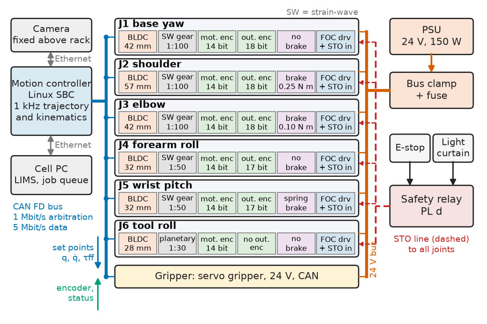
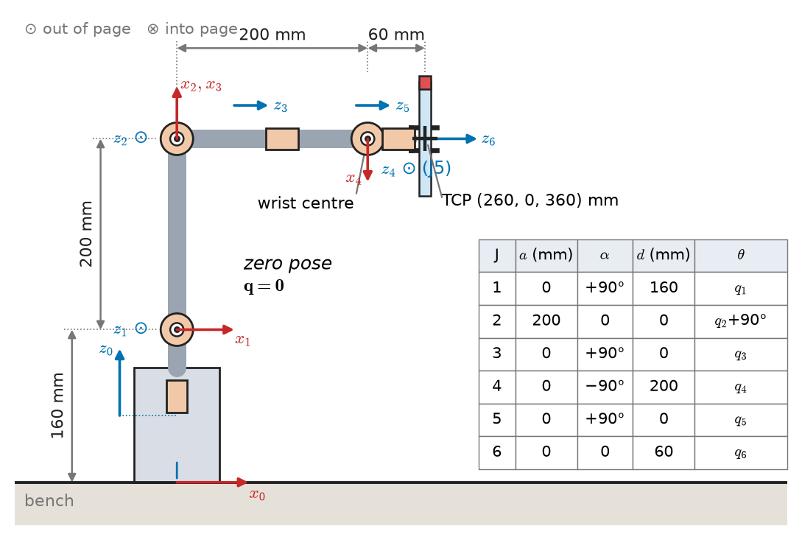
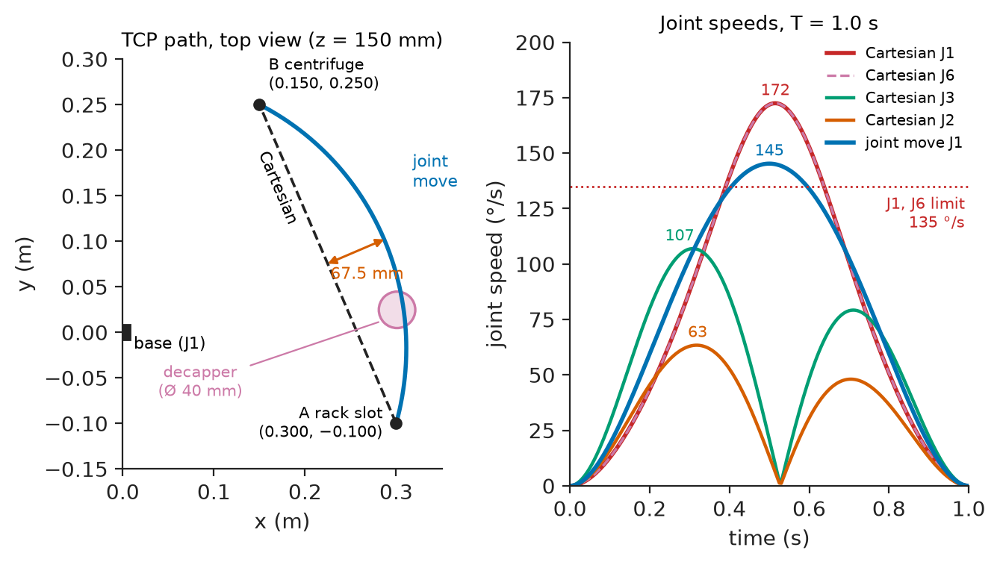
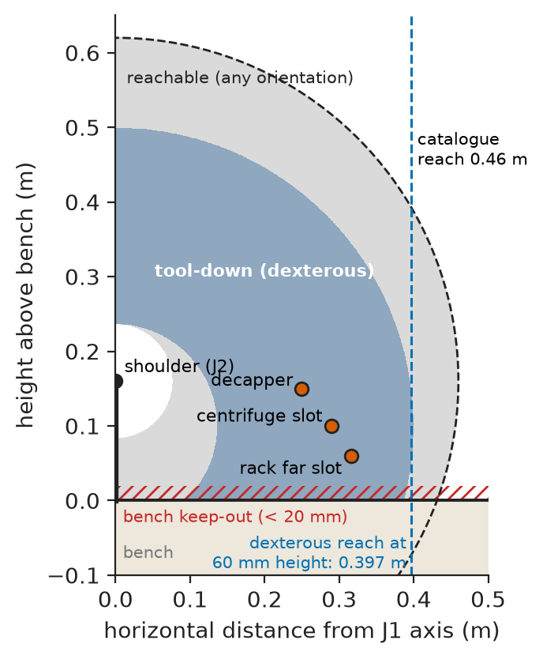
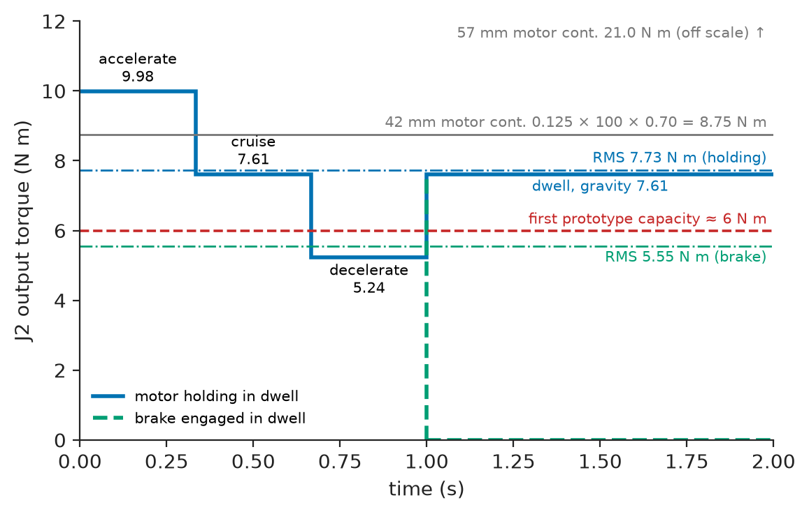

# Chapter 13 — Robotics Fundamentals

*Part IV · Robotics and Mechatronics*

A clinical laboratory wants a small arm that lifts sample tubes out of a rack, presents them to a decapper and loads them into the 45° slots of a benchtop centrifuge, on a 600 × 900 mm bench next to a technician. The first prototype, built in six weeks around a hobby-arm geometry with NEMA 17 steppers and planetary gearboxes, passed every bench test at its home pose and failed on its first real cycle: reaching for the far corner of the rack with a full tube, the shoulder lost steps and dropped the gripper 14 mm; with more current, tubes still landed 0.6 mm low at full reach and jammed on the rotor lip. Neither failure was bad luck. The shoulder had been sized from its static torque at the home pose, not at full extension with payload and acceleration, and the gripper position came from a rigid model with no budget for gearbox compliance. This chapter follows the second design of that arm, its reference system, from task to architecture, kinematics, motion, workspace, actuators and the mechanical–electrical details that decide whether it works.

> **How do a task and a bench turn into a robot architecture, a number of joints, a kinematic model and a set of joint actuators with known margins?**
> **Where do the position errors and the torque peaks of a real arm come from, and how are they budgeted, verified and designed out before the robot meets a person?**

| Concept | Engineering destination |
|---|---|
| Robot architectures | Choosing articulated, SCARA, delta, Cartesian or collaborative arms for a task and a budget |
| Degrees of freedom | Matching the joint count to the constraints a task actually imposes |
| Coordinate frames | Base, tool, work-object and camera frames; hand–eye and fixture calibration |
| Forward kinematics | Tool pose from joint readings; simulation, collision checks, error propagation |
| Inverse kinematics | Joint targets for a desired tool pose; branch selection; singularity handling |
| Joint and Cartesian motion | Time-optimal moves, straight-line insertions, speed limits near people |
| Workspace | Placing racks, instruments and the robot on a bench; reach and dexterity checks |
| Actuator selection | Motor, gearbox, encoder and brake per joint from torque, speed, stiffness and duty |
| Mechanical–electrical integration | Cabling through joints, encoders, brakes, bus power, resonance, safety functions |

**Roadmap.** Requirements and architecture (13.1) → degrees of freedom the task needs (13.2) → frames and transforms (13.3) → forward kinematics (13.4) → inverse kinematics (13.5) → joint and Cartesian motion (13.6) → workspace and placement (13.7) → actuator selection and the error budget (13.8) → mechanical–electrical integration (13.9) → verification and failure analysis (13.10).

---

## 13.1 Robot architectures

### The task and its requirements

The arm's job is a pick-and-place cycle: take a capped 13 × 75 mm tube from a 96-position rack, present it to a decapper, place it in a 45° fixed-angle rotor slot, and repeat. Two people share the bench, so the arm must be able to work slowly and softly when a person is inside its reach, and it must hold its load if power fails. Table 13.1 states the requirements the second design was built against (the method of writing them is Chapter 1's).

**Table 13.1 — Requirements of the desktop lab arm.**

| ID | Requirement | Target | Verification |
|---|---|---|---|
| R1 | Payload | 0.5 kg at the tool centre point (TCP), any pose in the work zone | Static hold and full-speed cycle with 0.5 kg test mass |
| R2 | Reach | Tool pointing down, TCP 60 mm above the bench, up to 390 mm from the base axis | Pose sweep out to 390 mm at 60 mm height |
| R3 | Repeatability | ±0.10 mm at the TCP (ISO 9283 pose repeatability) | 30-cycle dial-indicator test at three poses |
| R4 | Absolute accuracy | ±0.5 mm after calibration, anywhere in the work zone | Touch-off on a calibrated grid plate |
| R5 | Cycle time | Rack → decapper → centrifuge → rack in ≤ 6 s | Timed run of 100 cycles |
| R6 | Collaborative speed | TCP ≤ 250 mm/s while a person is inside the reach (ISO 10218-1 reduced speed) | Speed log during a light-curtain trigger |
| R7 | Power-loss hold | TCP drop < 1 mm when 24 V is removed at full reach with payload | Pull-the-plug test, dial indicator |
| R8 | Thermal | Joint motor winding rise < 40 K over 2 h of the R5 cycle | Thermocouples on the shoulder and elbow motors |
| R9 | Stop | Stop category 1 within 300 ms from E-stop; safe torque off afterwards | High-speed log of joint speed and STO line |
| R10 | Cost | Bill of materials ≤ \$4,500 at 10 units | Costed BOM |

### Architectures and where each fits

Architecture comes before any joint is sized, because it fixes how reach, payload, stiffness and cost trade. Table 13.2 compares the candidates.

**Table 13.2 — Robot architectures for small-part handling (typical catalogue values, 2026).**

| Architecture | Payload | Reach | Repeatability | Fit and limits | Price |
|---|---|---|---|---|---|
| Articulated 6R industrial (IRB 1200 class) | 5–7 kg | 0.7–0.9 m | ±0.02 mm | Any pose; needs guarding | \$25k–40k |
| Collaborative 6R (UR5e class) | 3–5 kg | 0.5–0.85 m | ±0.03 mm | Works beside people (ISO/TS 15066); slower | \$20k–35k |
| SCARA (T6 class) | 3–6 kg | 0.4–0.6 m | ±0.02 mm | 0.4 s cycles; tool always vertical (4 DOF) | \$8k–15k |
| Delta (parallel) | 1–3 kg | 0.8–1.3 m dia. | ±0.05 mm | 150+ picks/min; small stroke, 4 DOF | \$20k+ |
| Cartesian gantry | any | any | ±0.01–0.05 mm | Stiff, simple; covers the bench | \$3k–20k |
| Desktop stepper arm | 0.25–0.5 kg | 0.3–0.45 m | ±0.2 mm | Cheap; lost steps, compliance, no safety rating | \$1.5k–4k |

The bench rules out a gantry (it would cover the bench the technicians need), and the 45° rotor slots rule out SCARA and delta arms, whose tools stay vertical. A commercial collaborative arm would work but costs five to eight times R10 and is oversized at 0.5 kg. The design is therefore a **custom 6R articulated arm**: a base yaw joint, shoulder and elbow pitch joints, and a three-axis wrist whose axes intersect at one point (a *spherical wrist*), which makes the inverse kinematics solvable in closed form (Section 13.5).

### Architecture of the arm and its cell

Figure 13.1 shows the architecture. Each joint is a self-contained module — motor, gear, two encoders, brake and driver — on a 24 V bus and a CAN FD network, so the six modules differ only in size and parameters. A motion controller (a Linux single-board computer running the trajectory generator and kinematics at 1 kHz) sends position, velocity and feed-forward torque set points to the joints; each joint closes its own current, velocity and position loops (Chapter 15). A safety relay drives the safe-torque-off (STO) input of every joint driver from the E-stop and the light curtain.

<!-- FIGURE 13.1 | figures/ch13/fig-13-1-arm-architecture.png | block-diagram | Architecture of the desktop lab arm: motion controller, six joint modules on CAN FD and a 24 V bus, gripper, camera and the safety chain. | Content: left column Motion controller (Linux SBC, 1 kHz trajectory and kinematics) with Ethernet to Camera (fixed above rack) and to Cell PC (LIMS, job queue). Centre: CAN FD bus line (1 Mbit/s arbitration, 5 Mbit/s data) running through six stacked boxes J1 base yaw, J2 shoulder, J3 elbow, J4 J5 J6 wrist; inside each box small blocks BLDC motor, strain-wave gear, motor encoder 14 bit, output encoder 18 bit, spring brake, FOC driver with STO input. Gripper box (servo gripper, 24 V, CAN) after J6. Right column: 24 V 150 W PSU feeding the bus through a bus clamp and fuse; Safety relay (PL d) with inputs E-stop and Light curtain and output STO line to all joints. Arrows: set points down the CAN bus, encoder and status back; dashed red line for STO. -->



*Figure 13.1 — Architecture of the desktop lab arm: motion controller, six joint modules on CAN FD and a 24 V bus, gripper, camera and the safety chain.*

---

## 13.2 Degrees of freedom

### What the task constrains

A rigid object has six degrees of freedom. The joints a robot needs are the freedoms the task constrains, plus any redundancy deliberately added; each extra joint costs a module, mass at the end of the arm and a few hundred dollars.

**Table 13.3 — Constrained degrees of freedom per operation.**

| Operation | Position (x, y, z) | Tool tilt (two angles) | Rotation about tool axis | Total |
|---|---|---|---|---|
| Pick from vertical rack | 3 | 2 (must be vertical) | free (tube is round) | 5 |
| Present to decapper (grips cap from above) | 3 | 2 | 1 (cap thread start, ±20°) | 6 |
| Insert in 45° rotor slot, slot at any rotor angle | 3 | 2 (45° tilt toward rotor axis) | free | 5 |
| Return to rack | 3 | 2 | free | 5 |

The rotor slots need two tilt angles in a direction that depends on where the rotor stopped, and the decapper needs a controlled roll; together they need all six. A five-axis arm would serve the rotor but not the decapper.

### Mobility of the mechanism

For a serial chain the mobility is the joint count; for closed chains (a delta robot, a parallelogram forearm) the Grübler–Kutzbach count gives it:

$$
M = 6(n_l - 1 - n_j) + \sum_{i=1}^{n_j} f_i
$$

with $n_l$ links including the ground, $n_j$ joints and $f_i$ the freedoms of joint $i$.

> **Status of the principle: Grübler–Kutzbach mobility count**
> *Derived.* It follows from counting the six freedoms of each moving link and the constraints each joint removes; it can undercount when the geometry is special (parallel axes in a planar loop, overconstrained linkages that only move because of exact dimensions), so a real linkage is always checked in CAD as well.

For the arm, seven links and six revolute joints give $M=6(7-1-6)+6=6$; a redundant seventh joint would dodge some singularities, but the bench is uncluttered and the cost is not justified.

---

## 13.3 Coordinate frames

### The frames of the cell

Every position the arm uses is expressed in some frame, and most integration bugs in robot cells are frame bugs: the right number in the wrong frame. The cell defines five frames, all right-handed with $z$ up where it applies (the ROS REP 103 convention):

- **Base** $\{B\}$: on the J1 axis at the bench surface, $x$ toward the rack.
- **Flange** $\{F\}$ and **tool** $\{T\}$: the J6 flange, and the TCP between the gripper fingers, 60 mm out along the flange $z$ axis.
- **Work object** $\{W\}$: one per fixture, taught by touching three points, so moving a fixture means re-teaching one frame, not every point.
- **Camera** $\{C\}$: the fixed camera above the rack that reads barcodes and checks for empty slots.

A pose of frame $\{b\}$ in frame $\{a\}$ is a $4\times4$ homogeneous transform, a rotation matrix and a translation, and poses chain by matrix multiplication:

$$
{}^{B}\mathbf{T}_{T} = {}^{B}\mathbf{T}_{F}\,{}^{F}\mathbf{T}_{T},\qquad
{}^{a}\mathbf{T}_{b}=\begin{bmatrix}\mathbf{R} & \mathbf{p}\\ \mathbf{0}^{\mathsf T} & 1\end{bmatrix}
$$

> **Boundary.** Rotation matrices are orthogonal matrices with determinant +1, and a homogeneous transform is a linear map composed with a translation; their algebra (composition, inverse as transpose, change of basis) is in *The Mathematics Universe*, [Ch. 9 §9.5 and §9.7](https://github.com/The-Studio-of-Sadiq/engineering-mathematics/blob/main/part-3-linear-algebra/09-vector-spaces-and-linear-transformations.md). This section uses it.

### Orientation representations in practice

The controller stores orientations as unit quaternions (no singularity, cheap interpolation), shows them to technicians as roll–pitch–yaw angles, and never interpolates Euler angles, which jump near ±90° pitch. Every pose variable carries its frames in its name (`T_base_tool`, `p_cam_slot`), and every new frame is checked by jogging the robot 50 mm along each of its axes.

**Worked example — from camera to base, and what a half-degree costs.** Hand–eye calibration put the camera at $\mathbf p=(0.300,\,0.000,\,0.750)$ m in the base frame, looking straight down, so its rotation relative to the base is $\mathbf R=\mathrm{diag}(1,-1,-1)$ (camera $x$ along base $x$, camera $y$ and $z$ reversed). The vision system finds a slot centre at ${}^{C}\mathbf p=(0.000,\,0.100,\,0.690)$ m. Then

$$
{}^{B}\mathbf p = \mathbf p + \mathbf R\,{}^{C}\mathbf p = (0.300+0,\;0-0.100,\;0.750-0.690) = (0.300,\,-0.100,\,0.060)\ \mathrm{m},
$$

the rack slot used throughout this chapter. If the calibration has a 0.5° tilt error about the camera $x$ axis, the slot at 0.690 m range moves sideways by $0.690\sin 0.5^\circ = 6.0$ mm — twelve times R4. Orientation errors are multiplied by distance, so the camera is calibrated against a target at the working height and mounted as stiffly as the arm.

---

## 13.4 Forward kinematics

### The Denavit–Hartenberg model of the arm

Forward kinematics gives the tool pose from the joint angles. For a serial arm it is a product of one transform per joint; the Denavit–Hartenberg (DH) convention describes each with four numbers: link length $a_i$, link twist $\alpha_i$, link offset $d_i$ and joint angle $\theta_i$,

$$
{}^{i-1}\mathbf T_i = \mathrm{Rot}_z(\theta_i)\,\mathrm{Trans}_z(d_i)\,\mathrm{Trans}_x(a_i)\,\mathrm{Rot}_x(\alpha_i),\qquad
{}^{0}\mathbf T_6=\prod_{i=1}^{6}{}^{i-1}\mathbf T_i .
$$

Table 13.4 is the DH table of the arm (standard convention). The shoulder is 160 mm above the bench, the upper arm and the forearm are each 200 mm, and the TCP is 60 mm beyond the wrist centre. The 90° offset on J2 makes the *zero pose* an inverted L: upper arm vertical, forearm horizontal, tool pointing forward, which puts every joint mid-range at power-up.

**Table 13.4 — DH parameters of the desktop arm.**

| Joint | $a_i$ (mm) | $\alpha_i$ | $d_i$ (mm) | $\theta_i$ | Range |
|---|---|---|---|---|---|
| J1 base yaw | 0 | +90° | 160 | $q_1$ | ±170° |
| J2 shoulder | 200 | 0 | 0 | $q_2+90^\circ$ | −110° to +30° |
| J3 elbow | 0 | +90° | 0 | $q_3$ | −50° to +140° |
| J4 forearm roll | 0 | −90° | 200 | $q_4$ | ±180° |
| J5 wrist pitch | 0 | +90° | 0 | $q_5$ | ±120° |
| J6 tool roll | 0 | 0 | 60 | $q_6$ | ±270° |

Figure 13.2 draws the frames. J4, J5 and J6 axes intersect at the wrist centre, 200 mm along the forearm from the elbow.

<!-- FIGURE 13.2 | figures/ch13/fig-13-2-dh-frames.png | kinematic-diagram | Kinematic diagram of the 6R desktop arm with its DH frames in the zero pose. | Content: side view, bench line at bottom. Base cylinder with J1 axis vertical; frame 0 at bench on the axis (x0 toward right). Shoulder J2 at height 160 mm (dimension arrow), upper arm vertical 200 mm to elbow J3, forearm horizontal 200 mm to wrist centre (J4 axis along forearm, J5 axis into page, J6 axis along tool), tool 60 mm to TCP drawn as two gripper fingers holding a tube. Revolute joints drawn as cylinders with axis arrows labelled z0 to z5; small x arrows at each frame. Table inset with the DH rows a alpha d theta. Labels: wrist centre, TCP, zero pose. -->



*Figure 13.2 — Kinematic diagram of the 6R desktop arm with its DH frames in the zero pose.*

Listing 13.1 implements the model. It is the module every other tool in the cell imports: the simulator, the collision checker, the calibration fit and the inverse kinematics.

```python
import numpy as np
# Standard DH rows of the desktop arm: a [m], alpha [rad], d [m], joint offset [rad]
DH = [(0.000,  np.pi/2, 0.160, 0.0), (0.200, 0.0, 0.000, np.pi/2),
      (0.000,  np.pi/2, 0.000, 0.0), (0.000, -np.pi/2, 0.200, 0.0),
      (0.000,  np.pi/2, 0.000, 0.0), (0.000, 0.0, 0.060, 0.0)]

def dh(a, al, d, th):
    ca, sa, ct, st = np.cos(al), np.sin(al), np.cos(th), np.sin(th)
    return np.array([[ct, -st*ca, st*sa, a*ct], [st, ct*ca, -ct*sa, a*st],
                     [0.0, sa, ca, d], [0.0, 0.0, 0.0, 1.0]])

def fk(q):
    T = np.eye(4)
    for (a, al, d, off), qi in zip(DH, q):
        T = T @ dh(a, al, d, qi + off)
    return T

def pose_error(Tg, T):                    # 6-vector: position, small rotation
    dR = Tg[:3, :3] @ T[:3, :3].T
    w = 0.5*np.array([dR[2, 1]-dR[1, 2], dR[0, 2]-dR[2, 0], dR[1, 0]-dR[0, 1]])
    return np.concatenate([Tg[:3, 3] - T[:3, 3], w])

def jacobian(q, h=1e-6):                  # numerical geometric Jacobian, 6x6
    T0 = fk(q)
    return np.column_stack([pose_error(fk(q + h*np.eye(6)[i]), T0)/h for i in range(6)])

def ik(Tg, q, lam=0.01, iters=200):       # damped least squares
    for k in range(iters):
        e = pose_error(Tg, fk(q))
        if np.linalg.norm(e) < 1e-9:
            break
        J = jacobian(q)
        q = q + J.T @ np.linalg.solve(J @ J.T + lam**2*np.eye(6), e)
    return q, k, np.linalg.norm(e[:3])

if __name__ == "__main__":
    Tg = np.eye(4); Tg[:3, :3] = np.diag([1.0, -1.0, -1.0])   # tool pointing down
    Tg[:3, 3] = [0.300, -0.100, 0.060]                         # tube rack slot
    q, n, err = ik(Tg, np.radians([0, -45, -45, 0, -90, 0]))
    print("rack pose q [deg]:", np.round(np.degrees(q), 2))
    print(f"iterations {n}, residual {err*1e6:.4f} um, cond(J) {np.linalg.cond(jacobian(q)):.1f}")
    q[4] = np.radians(0.5)                                      # wrist almost straight
    print(f"cond(J) with q5 = 0.5 deg: {np.linalg.cond(jacobian(q)):.0f}")
```

Saved as `arm_kin.py`, it prints:

```text
rack pose q [deg]: [-18.43 -60.04  15.66   0.   -45.62 -18.43]
iterations 7, residual 0.0004 um, cond(J) 18.0
cond(J) with q5 = 0.5 deg: 730
```

The zero pose evaluates to a TCP at (260, 0, 360) mm, the first check of any kinematic model against a tape measure on the real arm.

### The Jacobian and why it is the integration tool

The Jacobian $\mathbf J(\mathbf q)$ maps joint velocities to the tool's linear and angular velocity, $\dot{\mathbf x}=\mathbf J\dot{\mathbf q}$, and does three integration jobs. It **propagates errors** ($\delta\mathbf x=\mathbf J\,\delta\mathbf q$, the basis of the budget in Section 13.8); it **maps forces** ($\boldsymbol\tau=\mathbf J^{\mathsf T}\mathbf f$, sizing joints for an insertion load); and it **flags singularities**, where it loses rank. The condition number printed by Listing 13.1 is the alarm: 18 at the rack pose, 730 with the wrist almost straight ($q_5=0.5^\circ$).

> **Status of the principle: Velocity and force mapping through the Jacobian**
> *Derived.* Differentiating the forward kinematics gives $\dot{\mathbf x}=\mathbf J\dot{\mathbf q}$, and virtual work across a frictionless, rigid chain gives $\boldsymbol\tau=\mathbf J^{\mathsf T}\mathbf f$; both are linearisations valid for small displacements about the current pose and ignore link and gear compliance.

---

## 13.5 Inverse kinematics

### Closed form for a spherical wrist

The controller needs the opposite map: joint angles that put the tool at a commanded pose. Because the wrist axes intersect, position and orientation separate (Pieper's decoupling). The wrist centre is 60 mm behind the TCP along the tool axis; J1, J2 and J3 place the wrist centre, then J4, J5 and J6 orient the tool.

**Worked example — the rack slot in closed form.** The TCP target is $(0.300,\,-0.100,\,0.060)$ m with the tool pointing straight down, so the wrist centre is 60 mm higher: $\mathbf p_w=(0.300,\,-0.100,\,0.120)$ m.

- Base yaw: $q_1=\operatorname{atan2}(-0.100,\,0.300)=-18.43^\circ$.
- In the arm's vertical plane the wrist centre is at horizontal distance $r=\sqrt{0.300^2+0.100^2}=0.3162$ m and height $s=0.120-0.160=-0.0400$ m from the shoulder, at distance $D=\sqrt{r^2+s^2}=0.3187$ m.
- The elbow bend $\psi$ (forearm angle relative to the upper arm's extension) follows from the cosine rule with two 0.200 m links: $\cos\psi=(D^2-0.200^2-0.200^2)/(2\cdot0.200\cdot0.200)=0.2700$, so $\psi=74.34^\circ$, elbow up.
- Upper-arm elevation: $\beta=\operatorname{atan2}(s,r)+\operatorname{atan2}(0.200\sin\psi,\ 0.200+0.200\cos\psi)=-7.21^\circ+37.17^\circ=29.96^\circ$.
- With the DH offsets of Table 13.4, $q_2=\beta-90^\circ=-60.04^\circ$ and $q_3=90^\circ-\psi=15.66^\circ$.

The wrist then solves ${}^{3}\mathbf R_{6}=({}^{0}\mathbf R_{3})^{\mathsf T}\,\mathbf R_{\text{goal}}$ as a Z–Y–Z Euler triple, giving $q_4=0$, $q_5=-45.62^\circ$, $q_6=-18.43^\circ$. Listing 13.1's numerical solver, started from a generic seed, converged in 7 iterations to the same six angles. That agreement is the regression test that guards both implementations.

### Branches, joint limits and the numerical fallback

A 6R arm with a spherical wrist has up to eight closed-form solutions for one pose: shoulder left or right, elbow up or down, wrist flipped or not. The controller picks the branch that respects joint limits and is closest to the current joint vector, and it **never changes branch in the middle of a Cartesian move**, because a branch change is a large, fast joint motion the TCP path does not show (Section 13.6 shows one).

The damped-least-squares iteration of Listing 13.1, $\Delta\mathbf q=\mathbf J^{\mathsf T}(\mathbf J\mathbf J^{\mathsf T}+\lambda^2\mathbf I)^{-1}\mathbf e$, is kept as the general solver: for tool offsets that change with each gripper, for calibrated kinematics in which the wrist axes no longer intersect exactly, and near singularities, where the damping $\lambda$ trades a small tracking error for bounded joint speeds. It is Newton-type iteration on the pose error; its convergence behaviour is in *The Mathematics Universe*, [Ch. 22 §22.4](https://github.com/The-Studio-of-Sadiq/engineering-mathematics/blob/main/part-7-numerical-computational/22-numerical-methods.md).

> **Status of the principle: Damped least-squares inverse kinematics**
> *Approximate.* It converges in a few iterations (close to quadratically for small $\lambda$) near a regular solution when started close to it, and it remains bounded near singularities at the price of a tracking error that grows with $\lambda$; it finds one solution near the seed, not all branches, so the seed decides the branch.

### Singularities of this arm

Three singular configurations matter, each with a physical meaning and a design response:

| Singularity | Condition | What happens | Response in the controller |
|---|---|---|---|
| Wrist | $q_5=0$ (J4 and J6 aligned) | Tool roll can be made by J4 or J6 in any mix; near it, small orientation changes need large J4/J6 speeds | Keep $\lvert q_5\rvert>10^\circ$ in taught poses; DLS with speed clamp in Cartesian moves |
| Elbow | Arm fully stretched, $\psi=0$ | No motion toward or away from the shoulder | Elbow kept at least 8° from straight: wrist distance ≤ 0.399 m of the 0.400 m physical maximum |
| Shoulder | Wrist centre on the J1 axis | J1 undefined | Fixtures placed at least 120 mm from the J1 axis |

---

## 13.6 Joint and Cartesian motion

### Two kinds of move

A **joint move** interpolates every joint with the same time scaling: fast, free of singularities, with a TCP path that is not obvious from the endpoints. A **Cartesian move** interpolates the TCP along a straight line (orientation by quaternion interpolation) and solves inverse kinematics at every sample; it is needed wherever the path matters, such as a 45° slot insertion, and can demand very high joint speeds near singularities.

Both use the quintic time scaling $s(\tau)=10\tau^3-15\tau^4+6\tau^5$, $\tau=t/T$, which starts and ends at zero velocity and acceleration (no torque step to excite the 23 Hz gear-compliance mode of Section 13.9); its peak rate is $1.875/T$.

Listing 13.2 compares the two for the transfer from the rack to the centrifuge, both at 150 mm above the bench, 381 mm apart, in $T=1.0$ s.

```python
import numpy as np
from arm_kin import fk, ik

def tool_down(p):
    T = np.eye(4); T[:3, :3] = np.diag([1.0, -1.0, -1.0]); T[:3, 3] = p
    return T

A, B, T_move = np.array([0.300, -0.100, 0.150]), np.array([0.150, 0.250, 0.150]), 1.0
seed = np.radians([0, -45, -45, 0, -90, 0])
qA, _, _ = ik(tool_down(A), seed)
qB, _, _ = ik(tool_down(B), qA)
qB = qA + (qB - qA + np.pi) % (2*np.pi) - np.pi                # nearest equivalent angles
t = np.linspace(0.0, T_move, 201)
s = 10*(t/T_move)**3 - 15*(t/T_move)**4 + 6*(t/T_move)**5       # quintic time scaling

# 1) joint-space move: every joint interpolated with the same s(t)
pj = np.array([fk(qA + si*(qB - qA))[:3, 3] for si in s])
u = (B - A)/np.linalg.norm(B - A)
dev = np.linalg.norm((pj - A) - np.outer((pj - A) @ u, u), axis=1)
print(f"joint move: max deviation from straight line {dev.max()*1e3:.1f} mm, "
      f"lowest z {pj[:, 2].min()*1e3:.1f} mm")

# 2) Cartesian move: IK at every sample, warm-started from the previous one
q, Q = qA.copy(), []
for si in s:
    q, _, _ = ik(tool_down(A + si*(B - A)), q)
    Q.append(q)
qd = np.gradient(np.array(Q), t, axis=0)
print("Cartesian move: peak joint speeds [deg/s]:", np.round(np.degrees(np.abs(qd).max(axis=0)), 0))
print("joint move:     peak joint speeds [deg/s]:", np.round(np.degrees(np.abs(qB - qA)*1.875/T_move), 0))
```

```text
joint move: max deviation from straight line 67.5 mm, lowest z 150.0 mm
Cartesian move: peak joint speeds [deg/s]: [172.  63. 107.   0.  44. 172.]
joint move:     peak joint speeds [deg/s]: [145.  12.  21.   0.   9. 145.]
```

**Worked example — choosing the move type and its duration.** The joint move swings the TCP up to 67.5 mm off the straight line, away from the base (it sweeps an arc around J1), and keeps its height. That is acceptable in free space above the fixtures, but not near the decapper, which stands 50 mm from the line. Both moves ask more than the 135 °/s joint limit of J1 and J6 (the sizing speed of Listing 13.3) at $T=1.0$ s: the joint move needs 145 °/s and the Cartesian move 172 °/s. Because every speed scales as $1/T$, the minimum durations are $1.0\times145/135=1.07$ s for the joint move and $1.0\times172/135=1.27$ s for the Cartesian move. The cycle uses a joint move of 1.1 s for the transfer and Cartesian moves only for the last 40 mm of each approach. The peak TCP speed of the Cartesian transfer would be $1.875\times0.381/1.27=0.56$ m/s; in collaborative mode (R6) the same path is scaled to 250 mm/s, which stretches it to $1.875\times0.381/0.25=2.86$ s.

Two details of the listing are design rules. The line that wraps `qB` to the nearest equivalent angle exists because the first version lacked it: the solver returned −301° for J1, which demanded 530 °/s and a swing through the technician's side of the bench. And J6 counter-rotates as much as J1 (both 172 °/s) to keep the gripper's orientation fixed while the base turns; a symmetric grip would let J6 stay still.

<!-- FIGURE 13.3 | figures/ch13/fig-13-3-joint-vs-cartesian.png | plot | Joint-space versus Cartesian transfer from rack to centrifuge: TCP paths seen from above, and joint speeds against time. | Content: left panel top view, x 0 to 0.35 m horizontal, y -0.15 to 0.30 m vertical; base at origin, rack slot A (0.300,-0.100), centrifuge B (0.150,0.250); straight dashed line A to B labelled Cartesian; curved solid arc bulging away from the base labelled joint move, max deviation 67.5 mm marked with a double arrow; decapper drawn as a 40 mm circle 50 mm from the line. Right panel: time 0 to 1.0 s, joint speed 0 to 200 deg/s; Cartesian move J1 and J6 curves peaking 172 deg/s, J3 107, J2 63; joint move J1 bell curve peaking 145 deg/s; horizontal red line at 135 deg/s labelled J1 J6 speed limit. -->



*Figure 13.3 — Joint-space versus Cartesian transfer from rack to centrifuge: TCP paths seen from above, and joint speeds against time.*

> **Status of the principle: Speed scaling of a time-parameterised path**
> *Derived.* For a fixed geometric path $\mathbf q(s)$ traversed with $s(t/T)$, every joint velocity scales as $1/T$ and every acceleration as $1/T^2$, so the shortest admissible duration is set by the most limited joint; torque limits that depend on speed and gravity make the real minimum time a little longer.

### Limits a real controller adds

The trajectory generator also enforces per-joint velocity, acceleration and jerk limits, TCP speed limits per zone (R6), 10 mm corner blending between successive moves, and a rule that a Cartesian move whose DLS residual exceeds 0.05 mm or whose condition number exceeds 300 is refused before it starts, not abandoned halfway.

---

## 13.7 Workspace

### Reachable and dexterous workspace

The **reachable workspace** is every point the TCP can reach in some orientation; the **dexterous workspace** is where it can reach with the orientation the task needs. For this arm the wrist centre must lie in a spherical shell around the shoulder between the folded and the stretched elbow, and with the tool pointing down the TCP is 60 mm below the wrist centre.

**Worked example — how far can the arm reach on the bench?** With the elbow kept at least 8° from straight, the wrist centre can be up to $0.400\cos4^\circ=0.399$ m from the shoulder; with the elbow folded to its 140° limit, no closer than $\sqrt{0.08+0.08\cos140^\circ}=0.137$ m. A tool-down TCP 60 mm above the bench has its wrist centre at 0.120 m, 0.040 m below the shoulder, so the horizontal reach is $\sqrt{0.399^2-0.040^2}=0.397$ m and the inner limit is $\sqrt{0.137^2-0.040^2}=0.131$ m. R2 asks for 0.390 m: the margin is 7 mm, which is thin but acceptable because no fixture needs it: the farthest pick point is at 0.36 m (Section 13.7), and R2 exists so that a rearranged bench still has room. A tool-down target at 0.420 m — inside the 0.46 m reachable envelope — has no solution, and the numerical solver of Listing 13.1 confirms it: after 200 iterations it stops with the elbow stretched and 53 mm of residual error. The gap between catalogue reach (0.46 m) and dexterous reach at the working height (0.397 m) is the most common surprise in robot-cell layout.

> **Status of the principle: Dexterous reach from the wrist-centre shell**
> *Derived.* For a spherical-wrist arm the wrist centre is fixed by the TCP pose and the tool length, so the dexterous workspace for a given orientation is the wrist-centre shell shifted by the tool vector; joint limits and self-collision then remove further regions.

<!-- FIGURE 13.4 | figures/ch13/fig-13-4-workspace-section.png | plot | Side section of the arm's workspace: reachable region, dexterous region with the tool pointing down, and the fixtures. | Content: x axis horizontal distance from J1 axis 0 to 0.50 m, y axis height above bench -0.10 to 0.65 m. Light grey filled region reachable by the TCP in any orientation (outer radius 0.46 m about shoulder point at 0.16 m height). Darker region where the wrist centre shell 0.137 to 0.399 m about the shoulder, shifted down 0.06 m, gives tool-down poses. Bench line at 0. Marked points: rack far slot at (0.316, 0.06), centrifuge slot at (0.29, 0.10), decapper at (0.25, 0.15). Dashed vertical line at 0.397 m labelled dexterous reach at 60 mm height; dashed circle 0.46 m labelled catalogue reach. Hatched area below 0.02 m labelled bench keep-out. -->



*Figure 13.4 — Side section of the arm's workspace: reachable region, dexterous region with the tool pointing down, and the fixtures.*

### Placing the fixtures

Workspace analysis decides the bench layout. Every pick and place point lies between 0.15 and 0.36 m from the J1 axis, where the Jacobian condition number stays below 30 for tool-down poses (computed with Listing 13.1: 21.8 at 0.15 m, 25.6 at 0.36 m, 54.8 at 0.39 m, all at 60 mm height); the rack's long side faces the arm, so its far corner is at 0.32 m; and the centrifuge is turned so the loading slot faces the arm, keeping $q_5$ away from zero. A layout needing a wrist flip between decapper and rotor was rejected in simulation: it swept the open tube through 180°.

---

## 13.8 Actuator selection

### From the motion to joint torque and speed

Joint sizing follows the duty cycle, not a steady load, using the peak-torque and RMS-torque checks and the inertia referred through the gear. Those rules are owned by *Electrical Energy and Machines*: referred inertia $J_L/n^2$ and the matching ratio in [Ch. 10 §10.1](https://github.com/The-Studio-of-Sadiq/Electrical-Energy-and-Machines/blob/main/part-3-motor-drives/10-drive-system-fundamentals.md), RMS torque against continuous torque in [Ch. 10 §10.2](https://github.com/The-Studio-of-Sadiq/Electrical-Energy-and-Machines/blob/main/part-3-motor-drives/10-drive-system-fundamentals.md) and the servo-sizing procedure in [Ch. 8 §8.7](https://github.com/The-Studio-of-Sadiq/Electrical-Energy-and-Machines/blob/main/part-2-transformers-and-electrical-machines/08-special-electrical-machines.md). What a robot adds is that the load torque depends on the **pose**. The shoulder carries everything outboard of it, and its gravity torque is largest with the arm stretched horizontally, not at the zero pose where the first prototype was sized.

> **Boundary.** Motor types (BLDC, PMSM, stepper), their torque–speed curves and lost-step behaviour are in *Electrical Energy and Machines*, [Ch. 8 §8.2, §8.4](https://github.com/The-Studio-of-Sadiq/Electrical-Energy-and-Machines/blob/main/part-2-transformers-and-electrical-machines/08-special-electrical-machines.md); gear trains as mechanical transformers in *Engineering Physics*, [Ch. 19 §19.2.2](https://github.com/The-Studio-of-Sadiq/Engineering-Physics/blob/main/CHAPTERS/CHAPTER%2019.md). The drive electronics of each joint are Chapter 15's.

Listing 13.3 sizes the shoulder for the worst case: arm horizontal with the 0.5 kg payload, a 90° move in 1.0 s with a trapezoidal velocity profile (one third accelerating, one third at constant speed, one third decelerating), then a 1.0 s hold. The masses come from the CAD model of the second design.

```python
import numpy as np
g = 9.81
# (mass kg, distance from shoulder axis with arm horizontal, m)
parts = {"upper link": (0.35, 0.10), "elbow module": (0.55, 0.20),
         "forearm": (0.25, 0.30), "wrist modules": (0.60, 0.40),
         "gripper": (0.20, 0.43), "payload": (0.50, 0.46)}
T_g = sum(m*r*g for m, r in parts.values())          # worst-case gravity torque
J_L = sum(m*r*r for m, r in parts.values())          # point-mass load inertia
n, eta, J_m = 100, 0.70, 4.8e-6                      # gear ratio, efficiency, rotor
theta, t_move, t_dwell = np.pi/2, 1.0, 1.0           # 90 deg move, then hold
t_a = t_move/3
w_max = theta/(t_move - t_a); alpha = w_max/t_a
T_acc = (J_L + J_m*n**2)*alpha
segs = [(T_g + T_acc, t_a), (T_g, t_a), (T_g - T_acc, t_a), (T_g, t_dwell)]
T_pk = max(abs(T) for T, _ in segs)
T_rms = np.sqrt(sum(T*T*t for T, t in segs)/sum(t for _, t in segs))
print(f"gravity {T_g:.2f} N m, J_load {J_L:.4f} kg m2, J_rotor referred {J_m*n**2:.4f}")
print(f"w_max {w_max:.3f} rad/s ({np.degrees(w_max):.0f} deg/s), alpha {alpha:.2f} rad/s2")
print(f"T_acc {T_acc:.2f}  T_peak {T_pk:.2f}  T_rms {T_rms:.2f} N m (joint output)")
print(f"motor: peak {T_pk/(n*eta):.3f} N m, rms {T_rms/(n*eta):.3f} N m, "
      f"speed {w_max*n*60/(2*np.pi):.0f} rpm")
print(f"peak output power {T_pk*w_max:.1f} W, inertia ratio {J_L/(J_m*n**2):.1f}")
```

```text
gravity 7.61 N m, J_load 0.2868 kg m2, J_rotor referred 0.0480
w_max 2.356 rad/s (135 deg/s), alpha 7.07 rad/s2
T_acc 2.37  T_peak 9.98  T_rms 7.73 N m (joint output)
motor: peak 0.143 N m, rms 0.110 N m, speed 2250 rpm
peak output power 23.5 W, inertia ratio 6.0
```

**Worked example — why the first shoulder failed and what the second one needs.** At the zero pose the shoulder carries only the forearm side, 3.15 N·m; the first prototype doubled that to about 6 N·m. The real worst case is 7.61 N·m of gravity at full horizontal reach and 9.98 N·m while accelerating, 1.66 times the prototype's capacity. Because gravity dominates, the RMS torque (7.73 N·m) is close to the gravity torque: the shoulder is a *holding* problem more than an *acceleration* problem. Through a 1:100 strain-wave gear the motor needs 0.143 N·m peak and 0.110 N·m RMS at 2250 rpm. A 42 mm, 24 V BLDC rated 0.125 N·m continuous (0.38 N·m peak, 4000 rpm) has 2.7 times peak margin but only 12 % thermal margin, below the 20 % design rule. Engaging the spring brake whenever a hold lasts more than 0.5 s removes the gravity term from the dwell, and the RMS falls to $\sqrt{(9.98^2+7.61^2+5.24^2)\times0.333/2}=5.55$ N·m at the output, 0.079 N·m at the motor, a 37 % margin. The design uses brake management on every gravity-loaded joint and, on J2 only, also a 57 mm motor (about 0.3 N·m continuous), whose extra 0.45 kg sits on the base turntable where it costs nothing.

The 1:100 ratio also sets the inertia ratio: referred load inertia (0.287 kg·m²) is 6.0 times the referred rotor inertia (0.048 kg·m²), inside the 1–10 band that tunes well, where a 1:50 gear would give 23.9. Its penalty is speed: the gear's 3500 rpm input rating caps the output at 210 °/s, above the 135 °/s sizing speed used as the working limit in Section 13.6.

### Actuator options compared

**Table 13.5 — Joint actuator options for the shoulder (2026 distributor prices, 10 pcs).**

| Option | Output torque (cont./peak) | Lost motion | Feedback | Mass | Cost | Verdict |
|---|---|---|---|---|---|---|
| NEMA 23 stepper + 1:20 planetary | 17 / 24 N·m, halves by 600 rpm | 15–30 arcmin | Open loop | 1.4 kg | \$110 | Lost steps unless oversized; backlash fails R3 |
| 57 mm BLDC + 1:100 strain-wave + dual encoders + brake | ~20 / 34 N·m (gear-limited) | < 1 arcmin | 14-bit motor, 18-bit output | 1.1 kg | \$620 | **Chosen for J2**: stiff, precise; brake for R7 |
| Smart servo (XM540 class) | ~4 / 10 N·m | ~0.25° | 12-bit output | 0.17 kg | \$500 | Too weak for J2; fits J5–J6 |
| Quasi-direct drive (90 mm BLDC + 1:9) | 6 / 18 N·m | 5–10 arcmin | 14-bit motor | 0.9 kg | \$350 | Ideal for force control; too compliant for ±0.1 mm |

### The error budget decides the encoders

Requirement R3 (±0.10 mm repeatability) and R4 (±0.5 mm accuracy) are budgets of small angles multiplied by lever arms through the Jacobian. Table 13.6 is the repeatability budget at full reach (lever 0.46 m for J1 and J2, 0.26 m for J3), with each contributor as a ± bound combined by root-sum-square.

**Table 13.6 — TCP repeatability budget at full reach.**

| Contributor | Basis | TCP error (µm) |
|---|---|---|
| Output encoders J1–J3 | 18-bit absolute (24.0 µrad per count), ±1 count, three joints RSS | 16.8 |
| Servo settling window | ±2 counts of the 14-bit motor encoder through 1:100 (3.83 µrad), three joints | 5.4 |
| Strain-wave hysteresis left over by the output-encoder loop | 10 % of 1 arcmin lost motion, J1 and J2 | 18.9 |
| Bearing runout, frame micro-slip | Measured on the first prototype | 20.0 |
| Warm-up thermal drift | 2 K over the hour after a 15 min warm-up, aluminium links, 0.46 m | 21.2 |
| **Total (RSS)** | | **39.0** |
| Requirement R3 | | 100 |
| Margin | | 2.6 × |

**Worked example — one encoder or two?** If each joint closed its position loop on the motor encoder only, the gear's lost motion would appear in full: 1 arcmin is 291 µrad, 134 µm at 0.46 m, and $\sqrt2\times134=189$ µm for J1 and J2 together, failing R3 on that line alone. A 14-bit output encoder would not do either (384 µrad, 176 µm at the TCP). An 18-bit off-axis absolute encoder on the output (AksIM-2 class, about \$95) lets the position loop see the output shaft; the motor encoder keeps commutation and the velocity loop. That dual-encoder scheme on J1–J3 is the cheapest way to meet R3.

The accuracy budget (R4) adds systematic terms that calibration reduces but does not remove: residual DH errors after kinematic calibration (150 µm), gravity sag after model compensation (20 % of 583 µm, 117 µm), twist from an unknown payload of 0–0.5 kg (86 µm), 10 K of uncompensated thermal expansion (106 µm) and the repeatability (39 µm). Their RSS is 0.24 mm against ±0.5 mm; their linear sum, 0.50 mm, just meets it. Gravity sag is the line prototype A ignored: at about 6000 N·m/rad, the shoulder's 7.61 N·m twists the gear by 1.27 mrad, 0.58 mm at the TCP, so the controller now adds the computed twist to each joint target.

> **Status of the principle: Root-sum-square error budget**
> *Derived.* Independent, zero-mean contributors combine in variance, so their standard uncertainties (or matched-confidence bounds) add as a root-sum-square; correlated or systematic terms must be added linearly or removed by calibration, which is why the accuracy budget is also checked as a linear sum.

### The rest of the arm

Run for each joint at its own worst pose, the same procedure gave Table 13.7.

**Table 13.7 — Joint actuator set of the second design.**

| Joint | Output torque peak / RMS | Motor | Gear | Brake |
|---|---|---|---|---|
| J1 base yaw | 3.1 / 1.6 N·m (inertia only) | 42 mm BLDC | Strain-wave 1:100, size 17 | No |
| J2 shoulder | 9.98 / 5.55 N·m (brake in dwell) | 57 mm BLDC | Strain-wave 1:100, size 17 | 0.25 N·m |
| J3 elbow | 4.3 / 3.0 N·m | 42 mm BLDC | Strain-wave 1:100, size 14 | 0.10 N·m |
| J4 forearm roll | 0.6 / 0.3 N·m | 32 mm BLDC | Strain-wave 1:50, size 11 | No |
| J5 wrist pitch | 1.6 / 0.9 N·m | 32 mm BLDC | Strain-wave 1:50, size 11 | Yes |
| J6 tool roll | 0.3 / 0.1 N·m | 28 mm BLDC | Planetary 1:30 | No |

J1–J3 carry 14-bit motor and 18-bit output encoders, J4–J5 a 17-bit output encoder, J6 the motor encoder only.

The brake on J2 must hold 1.5 times the worst gravity torque with power off (R7): $1.5\times7.61=11.4$ N·m at the output, 0.114 N·m at the motor, so a 24 V spring-applied brake rated 0.25 N·m is used, 2.2 times the need, because brake torque falls with wear and temperature.

<!-- FIGURE 13.5 | figures/ch13/fig-13-5-shoulder-torque-cycle.png | plot | Shoulder torque over the sizing cycle at full horizontal reach, with and without the brake engaged during the dwell. | Content: x axis time 0 to 2.0 s, y axis joint output torque 0 to 12 N m. Stepped profile: 9.98 N m from 0 to 0.333 s (accelerate), 7.61 N m from 0.333 to 0.667 s, 5.24 N m from 0.667 to 1.0 s (decelerate), then dwell 1.0 to 2.0 s at 7.61 N m (solid, motor holding) or 0 (dashed, brake engaged). Horizontal lines: RMS 7.73 N m (solid case) and RMS 5.55 N m (brake case), motor continuous rating referred 0.125 x 100 x 0.70 = 8.75 N m for the 42 mm motor and 21.0 N m for the 57 mm motor; first-prototype capacity 6 N m as red dashed line. -->



*Figure 13.5 — Shoulder torque over the sizing cycle at full horizontal reach, with and without the brake engaged during the dwell.*

---

## 13.9 Mechanical–electrical integration

### Cables through moving joints

One six-core cable (2 × 0.5 mm² for 24 V and 0 V, a twisted pair each for CAN FD and STO, overall braided shield) runs through a 10 mm hollow-shaft bore at every joint. It is a torsion-rated robot cable specified for 5 million cycles at ±180° over 300 mm of free length; J1, J4 and J6 have service loops sized for that twist. A slip ring for continuous J6 rotation was rejected: contact noise on CAN FD at 5 Mbit/s, and the ±270° limit costs the task nothing. M8 connectors at every module boundary let a joint be replaced in ten minutes.

### Encoders, magnets and noise

The 14-bit motor encoders are on-axis magnetic sensors (AS5047P class) read by the joint driver at 20 kHz; the 18-bit output encoders are off-axis rings around the hollow output shaft. Three details decided whether they met the datasheet: the magnet gap (1.0 ± 0.3 mm, set by a machined shoulder, not a shim); the brake coil, which shifted the motor encoder by 0.4° on the first module until it was moved 15 mm from the magnet; and PWM noise from the motor phases, cured by giving the output encoder its own shielded pair with a 360° shield clamp at the housing.

### Stiffness, resonance and servo bandwidth

The gear's torsional compliance and the arm's inertia form a spring–mass resonance that bounds the position-loop bandwidth. At the shoulder, $f_r=\frac{1}{2\pi}\sqrt{K/J_L}=\frac{1}{2\pi}\sqrt{6000/0.287}=23.0$ Hz with the arm stretched; with the arm folded the inertia falls and the resonance rises to about 40 Hz. A position loop closed on the output encoder through this compliance is non-collocated, so its crossover is held at about a third of the lowest resonance, 7–8 Hz, with a notch filter at 23 Hz in the velocity loop (the loop design is Chapter 15's; resonance in two-mass systems is in *Engineering Physics*, [Ch. 19 §19.3](https://github.com/The-Studio-of-Sadiq/Engineering-Physics/blob/main/CHAPTERS/CHAPTER%2019.md)). The quintic time scaling of Section 13.6 keeps the trajectory's spectral content well below 23 Hz.

> **Status of the principle: Bandwidth below the first structural resonance**
> *Empirical.* A position loop closed through a compliant transmission is usually given a crossover below one third to one fifth of the first anti-resonance or resonance; above that, phase lost to the resonance makes the loop oscillate or ring, and the ratio depends on damping and on whether the sensor is collocated with the motor.

### Bus power and regeneration

The six joints share a 24 V bus from a 150 W supply. The power budget (Table 13.8) is set by the simultaneous peak of J1–J3 during a fast transfer.

**Table 13.8 — Power budget of the arm on the 24 V bus.**

| Load | Average (W) | Peak (W) | Basis |
|---|---|---|---|
| Joint logic and encoders, 6 modules | 7.2 | 7.2 | 1.2 W each |
| Brakes released (J2, J3, J5) | 12.0 | 12.0 | 4 W each while moving |
| J2 shoulder motion | 14 | 42 | 23.5 W mechanical / (0.70 gear × 0.80 motor and driver) |
| J3 elbow motion | 6 | 18 | Same method |
| J1, J4–J6 motion | 5 | 20 | Same method |
| Gripper | 1 | 6 | Servo gripper, closing |
| **Total** | **45** | **105** | |
| Supply rating | 150 | 150 | 24 V, 6.25 A |
| Margin | 3.3 × | 1.43 × | |

Lowering the stretched arm returns energy to the bus: dropping the 2.45 kg outboard of the shoulder, whose combined centre of mass is about 0.32 m out, from horizontal to vertical releases $mgh\approx2.45\times9.81\times0.32=7.6$ J, minus gear and motor losses. A supply cannot absorb it, so the bus has 2200 µF of bulk capacitance and a 28 V shunt clamp in the power-entry module; Chapter 15 sizes such a clamp for a robot that returns much more energy.

### Safety functions

The E-stop and light curtain feed a safety relay rated for ISO 13849-1 performance level d. On a trip the controller makes a controlled stop on the trajectory (stop category 1 of IEC 60204-1), the relay removes gate-driver power through each joint's STO input after 300 ms, and the brakes drop. While a person is inside the reach, the R6 speed limit applies, and a torque monitor stops the arm if any joint's measured torque departs from the gravity model by more than 1.5 N·m. Transient contact limits come from ISO/TS 15066; validating the stop functions is Chapter 21's subject.

---

## 13.10 Verification and failure analysis

### Verification against the requirements

Table 13.9 closes every requirement with its test, measured on prototype B; repeatability used a 1 µm dial indicator (a laser tracker is planned for the production release).

**Table 13.9 — Verification of the desktop lab arm (prototype B).**

| ID | Test | Limit | Result | Pass/fail |
|---|---|---|---|---|
| R1 | Hold 0.5 kg at full horizontal reach; run 100 full-speed cycles | No following-error trip, J2 torque < 10 N·m | Peak 9.6 N·m, no trips | Pass |
| R2 | Tool-down pose sweep at 60 mm height out to the reach limit | 390 mm | 397 mm reached; cond(J) 55 at 390 mm | Pass |
| R3 | 30 approaches from the same direction, 3 poses | ±0.10 mm | ±0.046 mm worst (far pose) | Pass |
| R4 | Touch-off on 5 × 5 grid plate after calibration | ±0.5 mm | 0.31 mm worst, 0.17 mm RMS | Pass |
| R5 | 100 timed cycles | ≤ 6.0 s | 5.4 s mean, 5.6 s max | Pass |
| R6 | TCP speed with curtain triggered; pressure film at 250 mm/s | ≤ 250 mm/s; below ISO/TS 15066 hand limit | 243 mm/s max; 41 % of the transient limit | Pass |
| R7 | Remove 24 V at full reach with 0.5 kg | Drop < 1 mm | 0.22 mm | Pass |
| R8 | 2 h cycling, thermocouples on J2, J3 windings | Rise < 40 K | J2 26 K, J3 33 K | Pass |
| R9 | E-stop at full speed, log joint speed and STO | Stop ≤ 300 ms, STO after stop | 210 ms to standstill, STO at 300 ms | Pass |
| R10 | Costed BOM at 10 units | ≤ \$4,500 | \$4,180 | Pass |

The R3 result (±46 µm) exceeds the budget's 39 µm by frame micro-slip at the base, found by repeating the test with the base clamped; the production bench gets dowel pins as well as bolts.

### Failure analysis

Table 13.10 is the FMEA of the arm as built. Several rows are failures that happened on the prototypes; they are kept because the mitigation is now part of the design.

**Table 13.10 — FMEA of the desktop lab arm.**

| Failure mode | Effect | Cause | Detection | Mitigation |
|---|---|---|---|---|
| Shoulder stalls or loses position at full reach | Tool drops onto rack | Actuator sized at the zero pose, not the worst pose (prototype A) | Following-error trip | Size every joint at its worst pose with acceleration (Listing 13.3); torque margin check in design review |
| Tubes placed 0.6 mm low at full reach | Tube jams on rotor lip | Gear compliance not modelled | Touch-off grid test | Gravity-sag feed-forward; accuracy budget with compliance line |
| IK returns an equivalent angle outside limits | Fast 360° swing of J1 toward the operator | Missing angle wrap and limit check | Simulation of every taught path | Nearest-equivalent wrap, limit check before motion, refuse rather than clip |
| Wrist passes near $q_5=0$ in a Cartesian move | J4 and J6 spin at high speed, tube spills | Taught pose close to wrist singularity | Condition-number monitor > 300 | Refuse move; keep $\lvert q_5\rvert>10^\circ$ in taught poses |
| Cable fatigue at J4 after 0.8 million cycles | Intermittent CAN errors, joint drops out | Service loop too short, twist concentrated over 120 mm | Rising CAN error counters | Torsion-rated cable, 300 mm free length, error-counter alarm |
| Strain-wave gear ratchets in a collision | Permanent position offset of a few teeth | Momentary torque rating exceeded | Output and motor encoder disagree | Torque monitor stop, current limit below the gear's momentary rating; dual-encoder consistency check at every power-up |

### What changed between prototype A and prototype B

The opening's two failures were two calculations not done: torque at the worst pose, and a compliance line in the accuracy budget. Prototype B changed the shoulder actuator, added gravity-sag compensation, brake management and IK checks that refuse bad moves. The link lengths and joint count did not change: the architecture was right, the integration was not.

---

## What remains open

| Open question | Where it is answered |
|---|---|
| How a robot moves on wheels, keeps track of its pose and plans a path | Chapter 14 |
| How each joint's driver closes current, velocity and position loops, reads encoders and talks on the bus | Chapter 15 |
| How the arm's model is identified and the whole system tested in the loop before field use | Chapter 17 |
| Kinematic calibration of DH parameters from measured poses as a parameter-estimation problem | Chapter 17; Chapter 33 (calibration of models) |
| Validation of safety functions, safety relays and performance levels | Chapter 21 |
| Sensor principles for the camera, encoders and force sensing | Chapter 6 |
| Motor torque–speed behaviour, servo sizing rules and drive control | *Electrical Energy and Machines*, [Ch. 8](https://github.com/The-Studio-of-Sadiq/Electrical-Energy-and-Machines/blob/main/part-2-transformers-and-electrical-machines/08-special-electrical-machines.md) and [Ch. 10](https://github.com/The-Studio-of-Sadiq/Electrical-Energy-and-Machines/blob/main/part-3-motor-drives/10-drive-system-fundamentals.md) |

**Next:** Chapter 14 takes the robot off the bench and onto wheels: a differential-drive platform whose position is not measured but estimated, and whose errors grow with every metre it drives.
