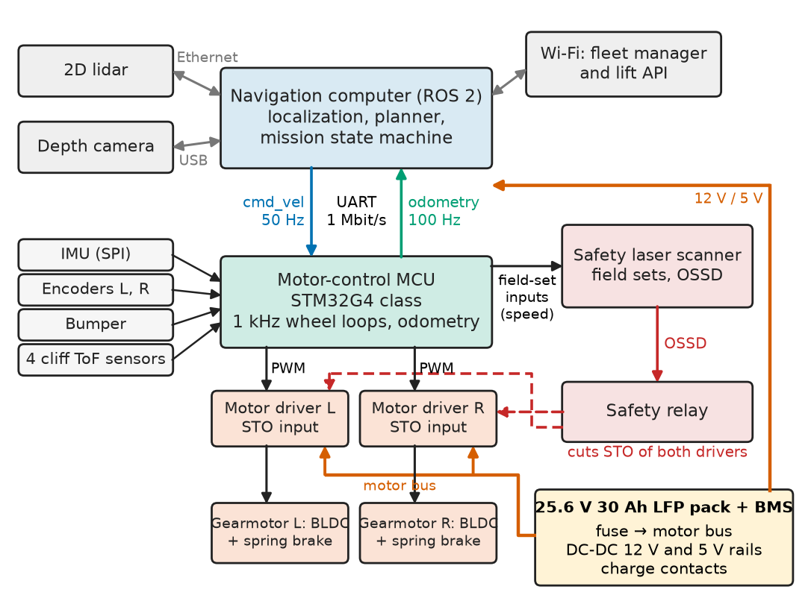
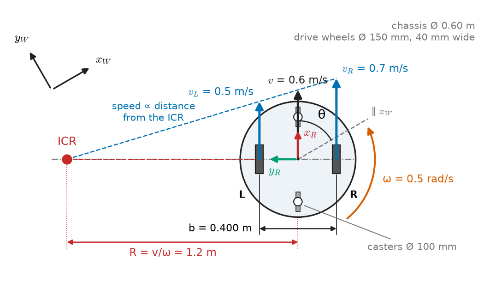
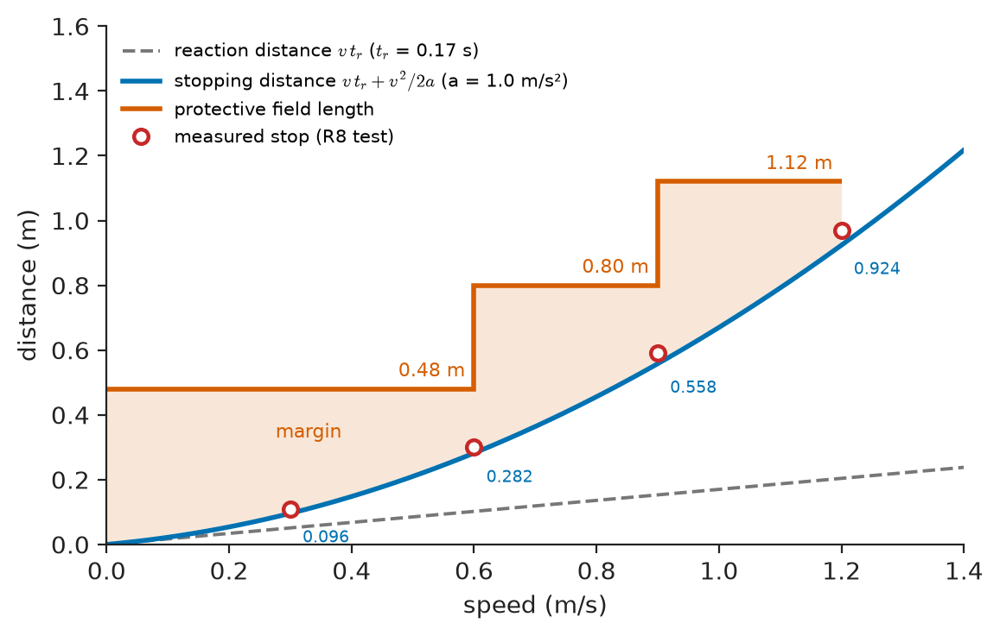
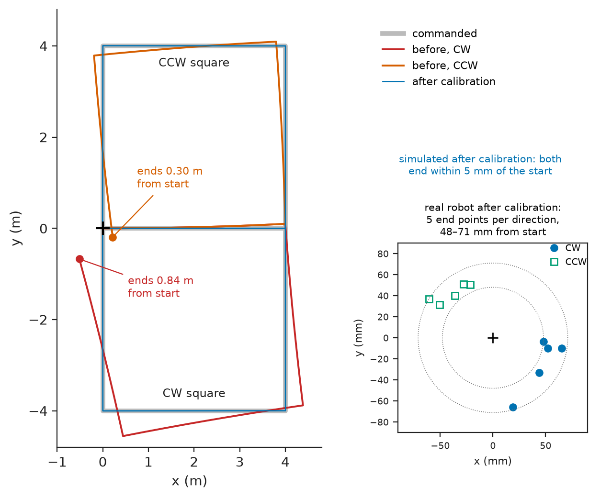
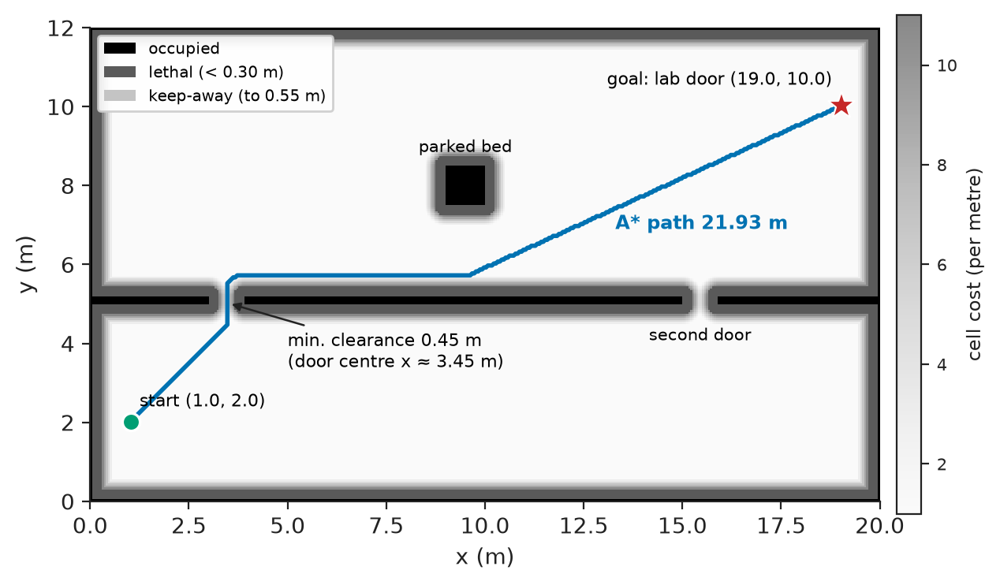

# Chapter 14 — Mobile Robotics

*Part IV · Robotics and Mechatronics*

A hospital runs a pilot of a small delivery robot that carries specimen totes from the wards to the laboratory: a differential-drive base, 20 kg empty and 30 kg loaded, with a 2D lidar, wheel encoders and an onboard computer running a standard navigation stack. In the first week it delivers 96 % of its missions. The failures cluster in one place: the 60 m basement corridor to the lab, where it repeatedly stops 0.9 m short of the lab door, turns into the wall and asks for help. The lidar was not at fault, and neither was the planner. The corridor has parallel, featureless walls, so scan matching fixes the robot's lateral position and heading but cannot say how far along the corridor it is; along that axis the position comes from wheel odometry alone, and the tyres, compressed by the payload and worn by a week of driving, had a rolling radius 1.5 % smaller than the value in the configuration file. A 1.5 % scale error over 60 m is 0.9 m. This chapter designs the second version of that robot, the reference system of the chapter, from wheel geometry and encoders through odometry and its calibration, obstacle detection, planning, localization and navigation, to the motor and battery sizing and the tests that close each requirement.

> **How does a wheeled robot know where it is, how wrong that knowledge becomes with every metre, and which sensors and calibrations keep the error inside a budget?**
> **How are its motors, battery and obstacle sensors sized so that it climbs the ramp, lasts the shift and stops before it touches anyone?**

| Concept | Engineering destination |
|---|---|
| Differential drive | Delivery and service robots, AGVs, robot vacuums, research platforms |
| Wheel encoders | Odometry, wheel-speed loops, slip detection |
| Line following | Tape-guided AGVs, education platforms, fixed-route tuggers (full project in Chapter 34) |
| Obstacle detection | Protective stops, speed-dependent safety fields, overhang and cliff detection |
| Odometry | Dead reckoning between absolute fixes; the motion model of every localizer |
| Path planning | Global routes on occupancy grids; clearance from walls and doors |
| Localization | Scan matching against a map, fiducials at docks, sensor fusion with a gyro |
| Navigation | Local path following, speed zones, recovery behaviours, mission state machines |
| Battery and motor sizing | Ramps, thresholds and shift length turned into motor, gear and pack ratings |
| Robot testing | Calibration runs, stopping tests, endurance runs, field pilots with metrics |

**Roadmap.** Requirements and architecture (14.1) → the differential drive (14.2) → wheel encoders (14.3) → line following as the fixed-route alternative (14.4) → obstacle detection and stopping (14.5) → odometry and its calibration (14.6) → path planning (14.7) → localization (14.8) → navigation (14.9) → battery and motor sizing (14.10) → testing and failure analysis (14.11).

---

## 14.1 Requirements and architecture

The robot works in wards, lifts and a basement corridor, among patients, staff and beds. Table 14.1 gives the requirements of version 2.

**Table 14.1 — Requirements of the hospital delivery robot.**

| ID | Requirement | Target | Verification |
|---|---|---|---|
| R1 | Payload | 10 kg tote; 30 kg gross | Loaded runs for all tests |
| R2 | Speed | 1.2 m/s in empty corridors; 0.6 m/s in shared zones | Speed log against zone map |
| R3 | Terrain | 1:12 ramp loaded; 15 mm threshold; 20 mm lift-door gap | Ramp and threshold track |
| R4 | Endurance | 8 h shift on an end-of-life pack with 20 % reserve | Energy budget, 8 h run |
| R5 | Odometry | Systematic drift < 1 % of distance after calibration | 4 m square test, both directions; 50 m straight |
| R6 | Localization | ±50 mm, ±2° (95 %) anywhere on the map, including the 60 m corridor | Ground truth at 20 marked points |
| R7 | Docking | ±10 mm, ±1° at the charger contacts | 100 docking cycles |
| R8 | Obstacle stop | Stop before contact with a standing person or a 70 mm table leg at any permitted speed; detect overhangs up to 1.2 m height | Stopping test with test pieces |
| R9 | Cliff | Stop before a drive wheel crosses a 50 mm drop | Platform-edge test |
| R10 | Availability | ≥ 99 % mission success; ≤ 1 intervention per 50 km | 4-week field pilot |

Figure 14.1 shows the architecture. The split follows the timing: a navigation computer (an 8-core ARM module of the Jetson Orin Nano class running ROS 2) does mapping, localization, planning and the mission logic at 10–20 Hz; a motor-control microcontroller (STM32G4 class) closes the wheel-speed loops at 1 kHz, integrates odometry, reads the IMU, bumpers and cliff sensors, and stops the motors on its own if the computer goes silent for 200 ms. A safety laser scanner with its own certified logic cuts the motor drivers' safe-torque-off line through a safety relay, independently of both processors. Chapter 15 designs the motor-control board; this chapter treats it as a block with an interface: wheel-velocity commands in at 50 Hz, odometry and status out at 100 Hz over a 1 Mbit/s UART.

<!-- FIGURE 14.1 | figures/ch14/fig-14-1-delivery-robot-architecture.png | block-diagram | Architecture of the hospital delivery robot: navigation computer, motor-control MCU, sensors, safety chain and power. | Content: top row Navigation computer (ROS 2, localization, planner, mission state machine) with links to 2D lidar (Ethernet), depth camera (USB), Wi-Fi to fleet manager and lift API. Middle: Motor-control MCU (STM32G4 class, 1 kHz wheel loops, odometry) connected to the computer by UART 1 Mbit/s (cmd_vel 50 Hz down, odometry 100 Hz up); MCU inputs IMU (SPI), encoders L and R, bumper, 4 cliff ToF sensors; MCU outputs PWM to two motor drivers driving left and right BLDC gearmotors with brakes. Right: safety laser scanner with field-set inputs from MCU speed and outputs OSSD to safety relay, which cuts STO of both drivers (red dashed). Bottom: 25.6 V 30 Ah LFP pack with BMS, fuse, DC-DC 12 V and 5 V rails, charge contacts. -->



*Figure 14.1 — Architecture of the hospital delivery robot: navigation computer, motor-control MCU, sensors, safety chain and power.*

---

## 14.2 Differential-drive robots

### Kinematics and the instantaneous centre of rotation

A differential-drive robot has two independently driven wheels on one axle and one or more passive casters. With wheel radius $r$, track width $b$ (distance between the wheels' contact lines) and wheel angular speeds $\omega_L,\omega_R$, the forward speed $v$ and yaw rate $\omega$ of the axle midpoint are

$$
v=\frac{r(\omega_R+\omega_L)}{2},\qquad \omega=\frac{r(\omega_R-\omega_L)}{b},
$$

and the inverse used by every controller is $v_{L,R}=v\mp\omega b/2$. The robot turns about an instantaneous centre of rotation on the axle line at radius $R=v/\omega$ from the midpoint; equal and opposite wheel speeds put that centre at the midpoint and the robot spins in place (Figure 14.2).

> **Status of the principle: Differential-drive kinematics**
> *Derived.* Follows from rigid-body motion of the axle with rolling without slip at both contact points; it fails when the wheels slip (wet floors, hard acceleration, turning in place with stiff casters) and when the effective contact points move across a wide tyre, which is why $b$ is calibrated, not measured with a ruler.

<!-- FIGURE 14.2 | figures/ch14/fig-14-2-diff-drive-kinematics.png | kinematic-diagram | Differential-drive geometry: wheels, track width, casters, robot frame and the instantaneous centre of rotation. | Content: top view of a round chassis 0.60 m in diameter; two drive wheels (150 mm diameter, drawn as rectangles 40 mm wide) on a transverse axle at the centre, track width b = 0.400 m dimensioned between wheel centre lines; two 100 mm casters front and rear. Robot frame at axle midpoint, x forward, y left, heading angle theta from world x. Velocity arrows vL = 0.5 m/s and vR = 0.7 m/s at the wheels, v = 0.6 m/s at the midpoint, curved arrow omega = 0.5 rad/s. Instantaneous centre of rotation on the axle line extended to the left at R = 1.2 m, dashed lines from it to both wheels. -->



*Figure 14.2 — Differential-drive geometry: wheels, track width, casters, robot frame and the instantaneous centre of rotation.*

### Why differential drive, and its geometry

Table 14.2 compares the drive configurations considered.

**Table 14.2 — Drive configurations for an indoor delivery robot.**

| Configuration | Manoeuvrability | Odometry quality | Mechanical cost | Notes |
|---|---|---|---|---|
| Differential drive + casters | Turns in place; cannot move sideways | Good on hard floors | Lowest: two drives | Casters flutter and resist on thresholds |
| Skid steer (4 or 6 driven wheels) | Turns in place with scrubbing | Poor in turns: slip is part of steering | Medium | For outdoor and rough floors |
| Ackermann (car-like) | Minimum turning radius | Good | Medium, steering actuator | Cannot turn in a lift |
| Mecanum or omni wheels | Holonomic: any direction | Poor: rollers slip | High: four drives | Vibration on joints and tiles |

The robot must turn round in a 1.4 × 2.0 m lift car, which rules out Ackermann steering, and it runs on vinyl and tiles, where differential drive gives the best odometry for the lowest cost. The geometry follows from the corridors and lift: a round chassis 0.60 m in diameter with the axle through its centre, so turning in place sweeps no more than the footprint; 150 mm polyurethane-tread drive wheels on a 0.400 m track; and two 100 mm casters, one front and one rear, on a rocker so that all four wheels touch on uneven floors.

**Worked example — wheel speeds for a corridor turn.** Turning a 90° corner on a 1.2 m radius at $v=0.6$ m/s needs $\omega=v/R=0.5$ rad/s. The wheels must run at $0.6\mp0.5\times0.400/2$, so 0.5 m/s and 0.7 m/s, or $0.5/0.075=6.67$ and $0.7/0.075=9.33$ rad/s. At the top speed of 1.2 m/s the outer wheel of the same turn would need 1.40 m/s, beyond the drive's 1.31 m/s maximum (Section 14.10); the speed limiter therefore caps $v$ so that $\lvert v\rvert+\lvert\omega\rvert b/2\le1.25$ m/s, keeping a small reserve for the wheel-speed loops.

---

## 14.3 Wheel encoders

### Where to measure and with what

The odometry is only as good as the measurement of wheel rotation. Three options were compared (Table 14.3); counts are after 4× quadrature decoding where it applies.

**Table 14.3 — Wheel-rotation sensing options (1:18 gearbox, 150 mm wheel).**

| Option | Counts per wheel revolution | Distance per count | Notes |
|---|---|---|---|
| BLDC Hall sensors (4 pole pairs, 6 states per electrical revolution) | 432 | 1.09 mm | Free with the motor; too coarse for low-speed velocity |
| Magnetic encoder on motor shaft (4096 counts per motor revolution) | 73,728 | 6.4 µm | Sees gearbox backlash, not the floor |
| Optical encoder on the wheel shaft (2048 counts) | 2048 | 0.23 mm | Sees the wheel, not the motor; extra mechanics |

The robot uses the motor-shaft magnetic encoder, read by the timer's hardware quadrature decoder on the motor-control MCU (Chapter 15 covers the interface). Distance resolution is far finer than needed: odometry error is dominated by wheel radius and track width, not by counts. Resolution matters for **velocity**, and that is where the Halls fail.

**Worked example — speed resolution at walking-pace creep.** Docking (R7) ends at 0.05 m/s. The encoder gives $156{,}456$ counts per metre ($73{,}728/(\pi\times0.150)$), so at 0.05 m/s it produces 7823 counts/s, 7.8 counts in each 1 ms control period: a count-difference speed estimate has a quantization step of 13 % of the speed, acceptable with a short filter. The Hall sensors give 917 counts per metre, 46 counts/s at 0.05 m/s, one count every 22 ms; a 1 kHz loop would see zero, zero, zero, one. Docking with Hall-only feedback produced visible stick–slip on the first prototype. Methods that measure time between counts help at low speed; they are Chapter 15's subject.

> **Status of the principle: Count-difference speed quantization**
> *Derived.* A speed estimate from counts in a fixed window $T$ has a resolution of one count per window, $\Delta v=1/(N_m T)$ for $N_m$ counts per metre, so the relative resolution degrades in proportion to $1/v$ and is worst exactly where docking and slow manoeuvres happen.

The motor-side encoder sees through the gearbox's backlash (about 0.5° at the wheel, 0.65 mm at the rim). It does not affect straight-line odometry; it adds a small heading error on each reversal of one wheel, which is why the docking approach is planned to finish moving forward.

---

## 14.4 Line-following robots

The cheapest way to guide a robot along a fixed route is to stop localizing altogether and follow a line: a painted or taped stripe read by a reflectance array, or a magnetic tape read by a row of Hall elements. Tape-guided AGVs move parts in factories and carts in hospital basements, and the same idea is the classic first robot of an engineering course.

> **Boundary.** The complete line follower — sensor selection, steering-loop design and speed optimisation — is the project of [Chapter 34](../part-9-interdisciplinary-engineering-projects/34-project-autonomous-line-following-robot.md); this section only sets out what the method implies for the reference robot.

A line sensor reports the lateral offset of the line from the robot centreline. An eight-element reflectance array (QTR-8 class, 10 mm pitch) gives the offset as the reflectance-weighted centroid of the element positions, resolving about 1 mm over a ±35 mm range; a magnetic guide sensor (16 Hall elements) does the same to ±1 mm through dirt and floor polish, which is why industrial AGVs use magnetic tape. The steering controller turns the offset and its rate into a yaw-rate command, and the limiting physics is geometric: the sensor sits a distance $d$ ahead of the axle, so a heading error $\psi$ shows up as an offset $d\sin\psi$ immediately, and the loop is damped by that lead.

**Worked example — what limits speed on a tape route.** With the sensor 0.15 m ahead of the axle, a ±35 mm sensing range, a 20 ms loop period and 30 ms of motor response, a 0.6 m radius bend entered at 1.0 m/s requires a yaw rate of 1.67 rad/s; the 50 ms of total delay lets the robot run $1.0\times0.05=0.05$ m before the steering responds, during which the line moves sideways under the sensor by roughly $d_s^2/2R=0.05^2/(2\times0.6)\approx2$ mm plus the heading-induced $0.15\times\sin(1.67\times0.05)=12.5$ mm — inside the 35 mm range, but at 1.4 m/s the same calculation leaves a third less margin. This is the mechanism behind the oscillating line follower of Chapter 34.

The hospital rejected line guidance for the wards: tape is damaged by beds and cleaning machines, every route change needs new tape, and the robot cannot pass a parked trolley that sits on the line. It kept one use for it — a 600 mm strip of magnetic tape at the charger, which makes the last 0.5 m of docking repeatable to ±3 mm laterally regardless of localization (R7).

---

## 14.5 Obstacle detection

### Sensors and what each one misses

Obstacles in a hospital are people, beds, trolleys, wheelchairs, open drawers, overbed tables (a top at 0.75 m on a single column), glass doors and the top of a staircase. No single sensor sees all of them. Table 14.4 compares the candidates.

**Table 14.4 — Obstacle sensors for the delivery robot (2026 indicative prices).**

| Sensor (class) | Range, field | Sees | Misses | Safety-rated | Price |
|---|---|---|---|---|---|
| Safety laser scanner (nanoScan3 class) | 3 m protective, 275°, one plane | People, legs, bed frames at 0.18 m height | Overhangs, glass, cliffs | Yes, PL d, IEC 61496-3 | \$2,400 |
| 2D lidar (RPLIDAR S2 class) | 30 m, 360°, 10 Hz | Walls and furniture for mapping | Same plane limits; dark, glossy surfaces | No | \$400 |
| Depth camera (D435 class) | 0.3–3 m, 87° × 58° | Overhangs, table tops, low objects | Glass, direct sun, close range | No | \$300 |
| Ultrasonic (MB1xxx class) | 0.2–5 m, 30° cone | Glass doors, chair legs | Soft or angled surfaces; crosstalk | No | \$30 |
| Time-of-flight (VL53L1X class) | 0.04–4 m, 27° cone | Floor edges when aimed down | Dark carpet at range | No | \$6 |
| Bumper switch strip | Contact | Anything it touches | Everything before contact | Can be | \$60 |

The design uses the safety scanner as the only device in the protective-stop path; the 2D lidar for mapping and localization (mounted higher, at 0.32 m, where fewer moving legs hide the walls); the depth camera tilted down 25° for overhangs between 0.1 and 1.2 m (R8); two ultrasonic sensors at the front for glass; four downward ToF sensors at the chassis corners as cliff detectors (R9); and a bumper as the last resort. The non-safety sensors feed the navigation costmap; they slow and steer the robot but are not trusted to stop it.

### Stopping distance and field sizing

A protective field must be longer than the distance the robot travels after an obstacle enters it. That distance has a reaction part (detection, decision, actuation) and a braking part:

$$
s_{\text{stop}} = v\,t_r + \frac{v^2}{2a},
$$

> **Status of the principle: Stopping distance from reaction time and deceleration**
> *Derived.* Constant speed during the reaction time followed by constant deceleration; it underestimates when deceleration builds up gradually or traction is lost, so the field length adds the scanner's measurement tolerance and a margin, and the result is verified by measurement at each speed.

**Worked example — field length for 1.2 m/s and 0.6 m/s.** The reaction chain is: scanner response 80 ms (two scans), safety relay 20 ms, STO and drive braking onset 70 ms, total $t_r=0.17$ s. Deceleration is limited not by traction (μ = 0.6 on vinyl would allow over 4 m/s² with 70 % of the weight on the drive wheels) but by the payload: specimen tubes in a tote shift above about 1.5 m/s², so the controlled stop uses 1.0 m/s². At 1.2 m/s, $s_{\text{stop}}=1.2\times0.17+1.2^2/2=0.20+0.72=0.92$ m; adding 0.10 m of scanner tolerance and 0.10 m of margin gives a 1.12 m protective field. At 0.6 m/s the same calculation gives $0.10+0.18=0.28$ m, and a 0.48 m field. The scanner switches between field sets according to the speed reported by the MCU through two safety inputs, so the robot can pass through a 0.9 m door at walking pace without false stops and still stop in time at full speed. A field that is long enough at 1.2 m/s would stop the robot in every doorway, which is the real reason for R2's two speeds.

<!-- FIGURE 14.3 | figures/ch14/fig-14-3-stopping-distance.png | plot | Stopping distance of the loaded robot against speed, and the speed-dependent protective fields. | Content: x axis speed 0 to 1.4 m/s, y axis distance 0 to 1.6 m. Curve 1 reaction distance v x 0.17 s (straight line, dashed). Curve 2 total stopping distance v x 0.17 + v squared / (2 x 1.0) (solid), passing 0.096 m at 0.3, 0.282 m at 0.6, 0.558 m at 0.9, 0.924 m at 1.2 m/s. Step function of protective field length: 0.48 m up to 0.6 m/s, 0.80 m from 0.6 to 0.9 m/s, 1.12 m from 0.9 to 1.2 m/s. Measured stopping points as markers at 0.3, 0.6, 0.9, 1.2 m/s (0.11, 0.30, 0.59, 0.97 m). Shaded gap between field and stop curve labelled margin. -->



*Figure 14.3 — Stopping distance of the loaded robot against speed, and the speed-dependent protective fields.*

Standards set the frame: a driverless industrial truck falls under ISO 3691-4, which requires personnel detection and speed-dependent protective fields; a service robot in public spaces is typically assessed against ISO 13482. The hospital's risk assessment used both, and the stopping test of Section 14.11 is taken from them.

---

## 14.6 Odometry

### Dead reckoning from wheel increments

Odometry integrates wheel increments into a pose. In each 1 ms period the MCU reads the left and right count increments, converts them to distances $\Delta s_L,\Delta s_R$ with each wheel's own calibrated radius, and updates

$$
\Delta s=\frac{\Delta s_R+\Delta s_L}{2},\quad \Delta\theta=\frac{\Delta s_R-\Delta s_L}{b},\quad
x\mathrel{+}=\Delta s\cos\!\left(\theta+\tfrac{\Delta\theta}{2}\right),\quad
y\mathrel{+}=\Delta s\sin\!\left(\theta+\tfrac{\Delta\theta}{2}\right),\quad
\theta\mathrel{+}=\Delta\theta .
$$

> **Status of the principle: Odometry from wheel increments**
> *Derived.* A midpoint integration of the differential-drive kinematics over each sample; with millimetre increments its numerical error is negligible, and every real error comes from the parameters ($r_L$, $r_R$, $b$) and from slip, which the equations cannot see.

### Systematic and random errors

Two kinds of error accumulate. **Systematic** errors repeat every time: unequal wheel radii (from tolerance, wear or an off-centre payload compressing one tyre more), an effective track width different from the nominal one, and a mean radius error that scales every distance. **Random** errors do not repeat: slip on wet floors and tile joints, floor unevenness, encoder quantization. Systematic errors are removed by calibration; random errors are bounded by fusing other sensors. The asymmetry that matters is that a heading error turns into a lateral position error that grows with distance: 1° of heading error is $20\sin1^\circ=0.35$ m sideways after 20 m and 1.05 m after 60 m.

### Calibration: the bidirectional square test

The bidirectional square test (UMBmark, after Borenstein and Feng) separates the two dominant systematic errors. The robot drives a 4 m square clockwise and anticlockwise, several times each, under odometry control; at the end, its true position is marked on the floor and compared with the start. An unequal wheel-radius ratio $E_d=r_R/r_L$ curves every straight leg, and a track-width error makes every turn too large or too small. In one direction the two errors add and in the other they partly cancel, so a single-direction test can look excellent while the robot is badly calibrated. Listing 14.1 simulates the test and recovers the two parameters by least squares from the four end-point coordinates (least-squares fitting is in *The Mathematics Universe*, [Ch. 23 §23.8](https://github.com/The-Studio-of-Sadiq/engineering-mathematics/blob/main/part-7-numerical-computational/23-optimization.md)).

```python
import numpy as np
from scipy.optimize import least_squares

def square(true, model, cw, L=4.0, n=200):
    """Drive a 4 m square using the odometry model (rL, rR, b) the robot believes;
    integrate the motion the floor produces with the true (rL, rR, b). End point."""
    (rL, rR, b), (mL, mR, mb) = true, model
    s = -1.0 if cw else 1.0
    seg = [(L/mL, L/mR), (-s*np.pi/4*mb/mL, s*np.pi/4*mb/mR)]   # wheel angles, rad
    x = y = th = 0.0
    for _ in range(4):
        for pL, pR in seg:
            for _ in range(n):
                dL, dR = rL*pL/n, rR*pR/n
                ds, dth = 0.5*(dL + dR), (dR - dL)/b
                x += ds*np.cos(th + dth/2); y += ds*np.sin(th + dth/2); th += dth
    return np.array([x, y])

def wheels(Ed, b, r=0.075):          # diameter ratio Ed = rR/rL, mean radius r
    return (2*r/(1 + Ed), 2*r*Ed/(1 + Ed), b)

true, nominal = wheels(1.005, 0.406), wheels(1.0, 0.400)
ends = lambda model: np.concatenate([square(true, model, cw) for cw in (True, False)])
rng = np.random.default_rng(1)
meas = ends(nominal) + rng.normal(0, 0.005, 4)   # floor marks, +-5 mm tape
print("before: CW %.3f m, CCW %.3f m" % tuple(np.hypot(*meas.reshape(2, 2).T)))
fit = least_squares(lambda p: np.concatenate(
          [square(wheels(*p), nominal, cw) for cw in (True, False)]) - meas,
          [1.0, 0.400], diff_step=1e-4)
Ed, b = fit.x
print("estimated Ed = %.4f, b = %.4f m" % (Ed, b))
after = ends(wheels(Ed, b))
print("after:  CW %.4f m, CCW %.4f m" % tuple(np.hypot(*after.reshape(2, 2).T)))
```

```text
before: CW 0.842 m, CCW 0.295 m
estimated Ed = 1.0050, b = 0.4059 m
after:  CW 0.0044 m, CCW 0.0054 m
```

**Worked example — reading the square test.** The simulated robot has a 0.5 % wheel-diameter mismatch and an effective track width of 0.406 m against the nominal 0.400 m (a 1.5 % error, typical when 40 mm-wide treads contact on their outer edges under load). Over 16 m of path (Figure 14.4) the clockwise run ends 0.842 m from its start (5.3 % of the distance) and the anticlockwise run 0.295 m (1.8 %): the two errors add in one direction and partly cancel in the other. The fit recovers both parameters — $E_d=1.0050$ and $b=0.4059$ m — even with ±5 mm of measurement scatter on the floor marks, and with the corrected model the simulated squares close to within 5 mm. On the real robot, five runs each way after calibration closed to 48–71 mm (0.3–0.45 %), the remainder being slip and floor joints that the model does not contain; R5's 1 % limit is met with margin. The square test does not see the third systematic parameter, the **mean** radius, because it scales the whole square; that is calibrated separately by driving 50 m along a surveyed line and comparing with the count. That is the parameter that sent the pilot robot 0.9 m short of the lab door, and it changes with payload and tyre wear, so version 2 re-estimates it on line (Section 14.8).

<!-- FIGURE 14.4 | figures/ch14/fig-14-4-umbmark-squares.png | plot | Bidirectional 4 m square test: true paths of the robot before and after odometry calibration. | Content: x axis -0.5 to 4.8 m, y axis -4.8 to 4.8 m, equal aspect. Commanded square drawn thin grey from origin, CW square below the x axis and CCW square above. Before calibration: CW true path in red spiralling outward, ending 0.84 m from the origin; CCW true path in orange ending 0.30 m away. After calibration: both true paths in blue nearly on the commanded squares, ending within 5 mm (simulated) and inset showing five measured end points per direction scattered within 48 to 71 mm of the origin. Legend: commanded, before CW, before CCW, after. -->



*Figure 14.4 — Bidirectional 4 m square test: true paths of the robot before and after odometry calibration.*

---

## 14.7 Path planning fundamentals

### Maps, costmaps and planners

The robot plans on an **occupancy grid**: the floor divided into 5 cm cells, each free, occupied or unknown, built once by driving the robot around with a mapping (SLAM) tool and then edited by hand to add keep-out zones (stairwells, the top of the loading ramp) and speed zones. Planning on a grid treats the robot as a point, so obstacles are first **inflated**: every cell within the robot's circumscribed radius (0.30 m) of an obstacle becomes lethal, and a band beyond it, out to 0.55 m, gets a cost that falls with distance, so that the planner prefers the middle of a corridor and the centre of a door without forbidding a squeeze.

The global planner is A*: a best-first graph search that expands cells in order of cost so far plus an admissible estimate (the straight-line distance) of the cost to go, and returns the cheapest path on the grid. Its alternatives are listed in Table 14.5.

**Table 14.5 — Global planners for indoor robots.**

| Planner | Optimal | Handles robot shape and turning limits | Typical use |
|---|---|---|---|
| Dijkstra / A* on a grid | Yes, on the grid | No: point robot on inflated map | Differential-drive robots indoors |
| Hybrid A* / state lattice | Near-optimal | Yes: heading and curvature in the state | Car-like robots, tuggers, AGVs with trailers |
| RRT* and sampling planners | Asymptotically | Yes | Arms, high-dimensional spaces |
| Visibility graph / topological | No | No | Route networks between waypoints |

Listing 14.2 builds a 12 × 20 m section of the ward floor (two rooms separated by a wall with two 0.9 m doors, plus a parked bed), inflates it and plans with A*.

```python
import heapq, math, time
import numpy as np
from scipy.ndimage import distance_transform_edt

res = 0.05                                       # m per cell
occ = np.zeros((240, 400), bool)                 # 12 m x 20 m floor section
occ[[0, -1], :] = occ[:, [0, -1]] = True         # outer walls
occ[100:104, :] = True; occ[100:104, 60:78] = False    # wall with 0.9 m door
occ[100:104, 300:318] = False                          # second 0.9 m door
occ[150:170, 180:200] = True                     # parked bed, 1.0 m x 1.0 m
dist = distance_transform_edt(~occ)*res          # distance to nearest obstacle, m
r_robot, r_infl = 0.30, 0.55
cost = np.where(dist <= r_robot, np.inf,         # lethal: robot would touch
       1.0 + 10.0*np.clip((r_infl - dist)/(r_infl - r_robot), 0, 1))   # keep-away
C = cost.tolist()                                # plain lists: faster in pure Python

def astar(start, goal):
    moves = [(1, 0), (-1, 0), (0, 1), (0, -1), (1, 1), (1, -1), (-1, 1), (-1, -1)]
    h = lambda c: res*math.hypot(c[0] - goal[0], c[1] - goal[1])
    g, parent, todo, n = {start: 0.0}, {start: None}, [(h(start), start)], 0
    while todo:
        _, c = heapq.heappop(todo); n += 1
        if c == goal:
            path = []
            while c: path.append(c); c = parent[c]
            return path[::-1], g[goal], n
        for dr, dc in moves:
            nb = (c[0] + dr, c[1] + dc)
            step = res*math.hypot(dr, dc)*C[nb[0]][nb[1]]
            if step < math.inf and g[c] + step < g.get(nb, math.inf):
                g[nb], parent[nb] = g[c] + step, c
                heapq.heappush(todo, (g[nb] + h(nb), nb))
    return None, np.inf, n

t0 = time.perf_counter()
path, J, n = astar((40, 20), (200, 380))         # ward corridor -> lab door
p = np.array(path)*res
length = np.sum(np.hypot(*np.diff(p, axis=0).T))
print(f"path {length:.2f} m, {len(path)} cells, {n} expansions, "
      f"min clearance {dist[tuple(np.array(path).T)].min():.2f} m, "
      f"{(time.perf_counter() - t0)*1e3:.0f} ms")
```

```text
path 21.93 m, 382 cells, 76372 expansions, min clearance 0.45 m, 651 ms
```

**Worked example — what the planner's numbers say.** The straight-line distance from start (1.0, 2.0) m to goal (19.0, 10.0) m is 19.70 m; the path (Figure 14.5) is 21.93 m because it must pass through the first door, whose centre it finds exactly: the minimum clearance of 0.45 m is half of the 0.9 m door width, leaving 0.15 m on each side of the 0.30 m robot radius. The search expanded 76,372 of the 92,876 free cells — the keep-away cost makes the heuristic weak, because the straight-line estimate assumes the cheapest cost of 1 per metre everywhere — and took 0.65 s in pure Python on a laptop. The navigation stack's C++ planner does the same job on the robot in about 40 ms, and replans at 1 Hz; the Python version is the reference implementation used in regression tests, not the onboard planner.

> **Status of the principle: A* optimality with an admissible heuristic**
> *Derived.* If the heuristic never overestimates the remaining cost, A* returns a least-cost path on the graph it searches; the path is optimal for the grid, the inflation and the cost function chosen, not for the continuous floor or the robot's dynamics, which is why a local controller smooths and tracks it.

<!-- FIGURE 14.5 | figures/ch14/fig-14-5-astar-costmap.png | plot | Occupancy grid of the ward section after inflation, with the A* path from the ward corridor to the lab door. | Content: 20 m by 12 m map at 0.05 m cells, x 0 to 20 m, y 0 to 12 m. Black occupied cells: outer walls, horizontal wall at y = 5.0 to 5.2 m with two 0.9 m gaps at x = 3.0 to 3.9 m and x = 15.0 to 15.9 m, parked bed square at x 9.0 to 10.0 m, y 7.5 to 8.5 m. Dark grey lethal band 0.30 m around obstacles; gradient grey keep-away band to 0.55 m. Start marker at (1.0, 2.0) m, goal marker at (19.0, 10.0) m. A* path as a blue line through the first door at x about 3.45 m, length 21.93 m labelled; minimum clearance 0.45 m annotated at the door. Colour bar for cell cost 1 to 11. -->



*Figure 14.5 — Occupancy grid of the ward section after inflation, with the A* path from the ward corridor to the lab door.*

---

## 14.8 Localization

### What each source contributes

Odometry drifts; the robot needs absolute fixes. Version 2 combines four sources, each with a known role:

| Source | Rate | Typical accuracy | Fails when |
|---|---|---|---|
| Wheel odometry (calibrated) | 100 Hz | 0.3–0.5 % of distance; heading drift on slip | Wet floor, thresholds, wheel lifted |
| Gyro (ICM-42688 class, bias re-estimated at every stop) | 100 Hz | Heading drift about 0.5°/min residual | Long periods without a stop; temperature steps |
| Lidar scan matching against the map (particle filter) | 10 Hz | ±30 mm, ±1° where geometry is rich | Long featureless corridors; crowds hiding walls |
| Fiducial markers (AprilTag class) at docks and corridor ends | On sight | ±5 mm, ±0.3° | Not in view |

An extended Kalman filter fuses odometry and gyro into a smooth, high-rate pose (the gyro replaces the wheel-difference heading during turns, where casters cause slip); a particle filter (adaptive Monte Carlo localization with 500–2000 particles) corrects it against the map at 10 Hz; and fiducials snap the estimate at the places where accuracy is required.

> **Boundary.** The filters weight each source by its stated uncertainty; Bayesian updating and Gaussian error propagation are owned by *The Mathematics Universe*, [Ch. 19 §19.3](https://github.com/The-Studio-of-Sadiq/engineering-mathematics/blob/main/part-6-probability-statistics/19-probability.md) and [Ch. 21 §21.5](https://github.com/The-Studio-of-Sadiq/engineering-mathematics/blob/main/part-6-probability-statistics/21-random-processes.md), and the observer idea that the Kalman filter makes optimal is in *Circuits, Signals and Communications*, [Ch. 35 §35.7](https://github.com/The-Studio-of-Sadiq/Circuits-Signals-and-Communications/blob/main/part-7-control-system-fundamentals/35-control-design-fundamentals.md).

> **Status of the principle: Kalman fusion of odometry, gyro and absolute fixes**
> *Approximate.* The Kalman filter is the minimum-variance estimator for linear models with Gaussian, white, correctly specified noise; the extended version linearises the motion model, and both become overconfident when errors are systematic (an uncalibrated radius) or correlated, which is why systematic errors are calibrated out first and the noise parameters are tuned on logged data.

### The corridor problem and the fix

Scan matching needs geometry in every direction. In the 60 m basement corridor, two parallel walls constrain the lateral position and the heading but not the position along the corridor: every along-track shift fits the scan equally well. The particle cloud stretches along the corridor and the filter falls back on odometry — exactly the axis where the pilot robot's 1.5 % radius error accumulated.

**Worked example — the along-track error budget in the corridor.** The requirement is ±50 mm at the lab door (R6). With the mean radius calibrated to 0.3 % and slip adding about 0.2 % of distance, the along-track error after 60 m is $60\times\sqrt{0.003^2+0.002^2}=0.22$ m, still four times too large. Version 2 therefore adds (a) a fiducial marker on the wall at each end of the corridor and one at the midpoint, so no stretch of odometry-only travel exceeds 30 m and the error at a marker is at most $30\times0.0036=0.11$ m before the marker snaps it to ±5 mm, and (b) on-line estimation of the mean wheel radius: each time two markers are passed, the ratio of surveyed to odometric distance updates the radius, so that payload and wear changes are tracked within a day. Between the last marker (8 m from the door) and the door, the error grows to $8\times0.0036=0.029$ m, inside the 50 mm requirement with a margin of 1.7.

---

## 14.9 Navigation

### From path to wheel commands

Navigation turns the planned path into motion that is safe and smooth. The stack has three layers. The **global planner** (Section 14.7) produces a path on the static map, replanned at 1 Hz. The **local controller**, running at 20 Hz on a 4 × 4 m rolling costmap that also contains what the lidar, depth camera and ultrasonic sensors see now, tracks the path while avoiding new obstacles. The **mission layer**, a state machine, sequences the job: leave dock, drive to the lift, call it through the building API, enter, ride, exit, drive to the ward, wait for the nurse's badge, return.

The local controller is a regulated pure-pursuit tracker: it picks a goal point on the path a look-ahead distance $L_d$ ahead and steers along the circular arc through it, with curvature

$$
\kappa=\frac{2\,y_g}{L_d^{2}},\qquad \omega=v\,\kappa,
$$

where $y_g$ is the goal point's lateral offset in the robot frame. Its speed is regulated down near obstacles (by the costmap value under the robot) and in tight curvature, and capped by the zone map (R2).

> **Status of the principle: Pure-pursuit steering law**
> *Derived.* The arc through the robot's position, tangent to its heading and through a point at distance $L_d$ and lateral offset $y_g$, has curvature $2y_g/L_d^2$; it assumes the robot follows commanded curvature instantly, so a short look-ahead oscillates when delays are present and a long one cuts corners.

**Worked example — look-ahead and wheel speeds.** At 0.6 m/s with $L_d=0.6$ m, a goal point 0.15 m to the left gives $\kappa=2\times0.15/0.36=0.833$ m⁻¹ and $\omega=0.5$ rad/s, so the wheels run at 0.5 and 0.7 m/s as in Section 14.2. The look-ahead is scheduled with speed ($L_d=1.0\times v$, limited to 0.4–1.2 m): too short and the 60 ms of command latency between computer and wheels makes the robot weave; too long and it cuts the inside of door frames by up to $L_d^2/(8R)$ — 0.15 m for a 1.2 m look-ahead on a 1.2 m-radius corner, which the costmap's keep-away band (0.25 m wide) absorbs.

### Behaviours that make it work in a building

The behaviours that keep the success rate at 99 % were all added after a field failure: wait-then-replan when the path is blocked by a person (2 s, then a detour if one exists, then a polite voice prompt, then a call for help after 60 s); a "narrow passage" mode that drops to 0.3 m/s and the smallest protective field to pass a door with a trolley beside it; lift entry backwards-out logic (enter forwards, turn in place inside, exit forwards); and recovery behaviours (clear the local costmap, rotate in place, back up 0.3 m) when the controller reports no progress for 10 s.

---

## 14.10 Battery and motor sizing

### Torque and speed at the wheel

The drive is sized for four cases: acceleration on the level, climbing the 1:12 ramp, mounting the 15 mm threshold and holding on the ramp with power off. The rolling-resistance coefficient of polyurethane on vinyl is taken as 0.015; drive wheels carry 70 % of the 30 kg gross mass. The motor and drive fundamentals (referred torque, gear efficiency, torque–speed limits) are those of *Electrical Energy and Machines*, [Ch. 10 §10.1–10.2](https://github.com/The-Studio-of-Sadiq/Electrical-Energy-and-Machines/blob/main/part-3-motor-drives/10-drive-system-fundamentals.md).

**Worked example — ramp, threshold and gear ratio.** On the 1:12 ramp (4.76°) while accelerating at 0.5 m/s², the traction force is $F=m\,(a+g\sin\theta+gC_{rr}\cos\theta)=30\times(0.5+0.814+0.147)=43.8$ N, or 21.9 N and 1.64 N·m per wheel. The threshold is worse. A wheel of radius $r$ mounting a step of height $h$ quasi-statically pivots about the step edge, which lies a horizontal distance $d=\sqrt{r^2-(r-h)^2}=\sqrt{0.075^2-0.060^2}=0.045$ m ahead of the axle, so the wheel torque needed to lift the drive wheel's 103 N share of the weight is $103\times0.045=4.6$ N·m — 2.8 times the ramp case. The top speed fixes the ratio: 1.2 m/s is 153 rpm at the wheel, so a 3000 rpm motor through a 1:18 planetary gear (efficiency 0.85) gives 1.31 m/s maximum, and the threshold needs $4.6/(18\times0.85)=0.30$ N·m at the motor for a fraction of a second. A 60 W, 24 V BLDC gearmotor rated 0.19 N·m continuous and 0.57 N·m peak covers it with a peak margin of 1.9, while the ramp needs only 0.107 N·m continuous at the motor, a thermal margin of 1.8. The casters, not the motors, turned out to be the threshold problem: a 50 mm caster mounting a 15 mm step needs a horizontal push of $44\times0.0229/0.010=101$ N, more than the 124 N traction limit of both drive wheels leaves after they climb themselves; 100 mm casters need 45 N.

> **Status of the principle: Quasi-static step-climbing torque**
> *Approximate.* Treats the wheel as rigid, pivoting about the step edge with no momentum; a soft tyre and approach speed both reduce the torque needed, so the result is a conservative bound used for motor peak torque, checked on the threshold track.

The motor options are compared in Table 14.6.

**Table 14.6 — Drive motor options (per wheel, 2026 prices, 100 pcs).**

| Option | Continuous / peak torque at wheel | Encoder | Brake | Efficiency at cruise | Price | Verdict |
|---|---|---|---|---|---|---|
| Brushed DC gearmotor 24 V 60 W, 1:18 | 2.9 / 8.7 N·m | Add-on | Add-on | 0.60 | \$85 | Brush wear in 8 h × 365 d duty |
| BLDC gearmotor 24 V 60 W, 1:18, integrated encoder and brake | 2.9 / 8.7 N·m | 4096 counts per motor revolution | Spring-applied | 0.70 | \$160 | **Chosen** |
| BLDC hub motor 6.5 in, 250 W (scooter class) | 8 / 20 N·m | Halls only | None | 0.75 | \$70 | Coarse feedback, no brake, too large |
| Stepper + belt | 2 / 3 N·m falling with speed | Open loop | None | 0.35 | \$60 | Loses steps on the threshold; poor efficiency |

The spring-applied brake is a safety requirement, not an option: on the ramp with power off, gravity applies $30\times9.81\times\sin4.76^\circ\times0.075/2=0.92$ N·m to each wheel, which a backdrivable planetary gear would turn into a runaway.

### The energy budget

The battery is sized from an 8 h shift in which the robot drives 40 % of the time at an average of 0.8 m/s, about 9.2 km.

**Table 14.7 — Energy budget for one 8 h shift.**

| Load | Power (W) | Duty | Energy (Wh) | Basis |
|---|---|---|---|---|
| Navigation computer | 10.0 | 100 % | 80.0 | 15 W mode, 65 % average utilisation |
| Safety laser scanner | 4.0 | 100 % | 32.0 | Datasheet typical |
| 2D lidar | 2.5 | 100 % | 20.0 | |
| Depth camera | 2.5 | 100 % | 20.0 | |
| MCU, IMU, ToF, ultrasonic | 1.5 | 100 % | 12.0 | |
| Motor drivers, idle | 1.0 | 100 % | 8.0 | |
| Wi-Fi and LTE modem | 2.0 | 100 % | 16.0 | |
| Lights, display, speaker | 3.0 | 100 % | 24.0 | |
| Traction while driving | 10.0 | 40 % | 32.0 | 3.5 W rolling + accelerations and ramps, drivetrain 0.55 |
| DC–DC conversion losses | 10 % of the above | | 24.4 | |
| **Total** | | | **268** | 33.5 W average |
| Usable from 25.6 V 30 Ah LFP at end of life | | | 553 | 768 Wh × 0.90 depth of discharge × 0.80 capacity at end of life |
| Required with 20 % reserve | | | 322 | 268 × 1.2 |
| **Margin** | | | **1.72 ×** | |

**Worked example — what dominates the battery.** Traction is 32 Wh out of 268, 12 %; the computer, sensors and radios are 180 Wh, 67 %. Halving the motors' losses would buy 16 Wh; putting the depth camera to sleep when the robot is parked, and running the computer at 10 W instead of 15 W when not planning, saves about 30 Wh. A 25.6 V 20 Ah pack (512 Wh) would have given 369 Wh usable at end of life, a margin of only 1.15 over the 322 Wh required, too little for a budget that has not yet met the field, so the 30 Ah pack was chosen; it also carries the 23 A peak of both motors at full peak torque within its 1C (30 A) continuous rating. Battery ratings, depth of discharge and ageing are treated in *Electrical Energy and Machines*, [Ch. 16 §16.2](https://github.com/The-Studio-of-Sadiq/Electrical-Energy-and-Machines/blob/main/part-4-power-generation/16-energy-storage.md); the pack and BMS design belong to Chapter 23, and the bus transients when both motors brake at once to Chapter 15.

> **Status of the principle: Battery runtime from capacity and average power**
> *Derived.* Energy conservation with a constant usable fraction; it is approximate in two ways — usable capacity falls at low temperature and high current, and average power hides peaks — so the pack is also checked for peak current and for voltage sag at the end of discharge.

---

## 14.11 Robot testing

### A test plan in layers

Mobile robots fail in the field in ways that bench tests do not expose, so testing is layered, each layer cheaper and earlier than the next:

1. **Simulation regression** — 40 scenarios (blocked door, crowd, lift, corridor, glass door) run in a physics simulator on every software change, with pass criteria on arrival accuracy, time and minimum clearance.
2. **Bench** — counts per metre on a roller, wheel-speed loop step responses, brake hold, watchdog stop when the computer is unplugged.
3. **Test track** — the bidirectional square, the 50 m surveyed straight, the ramp and threshold track, stopping distance with test pieces at four speeds, cliff edge.
4. **Endurance** — 8 h continuous missions on a full-life-equivalent pack (aged by cycling or simulated by a capacity limit in the BMS).
5. **Field pilot** — four weeks in the hospital with every intervention logged and categorised.

### Verification results

**Table 14.8 — Verification of the hospital delivery robot (version 2).**

| ID | Test | Limit | Result | Pass/fail |
|---|---|---|---|---|
| R1 | All track tests at 30 kg gross | No faults | No faults | Pass |
| R2 | Speed log against zone map, 200 km of field driving | ≤ 1.2 / 0.6 m/s | 1.19 / 0.61 m/s max (0.61 in a 2 s transient) | Pass with note |
| R3 | 1:12 ramp from standstill; 15 mm threshold; 20 mm lift gap, 50 runs each | No stall, no stop | No failures | Pass |
| R4 | 8 h mission run, pack capacity limited to 80 % | ≥ 20 % reserve at end | 50 % remaining (305 Wh used, 14 % above budget) | Pass |
| R5 | 4 m square × 5 each direction; 50 m straight | < 1 % of distance | 0.45 % worst; 0.21 % on the straight | Pass |
| R6 | Pose at 20 surveyed points, 10 visits each | ±50 mm, ±2° (95 %) | 38 mm, 1.4° (95 %); 44 mm at corridor end | Pass |
| R7 | 100 docking cycles | ±10 mm, ±1° | 4 mm, 0.6° worst | Pass |
| R8 | Stopping with standing test piece at 0.3, 0.6, 0.9, 1.2 m/s; overhang table | No contact | Stopped 0.11/0.30/0.59/0.97 m after entry; no contact | Pass |
| R9 | Approach 50 mm platform edge at 0.6 m/s, 4 headings | Stop before wheel crosses | Stopped 85 mm before edge worst | Pass |
| R10 | 4-week field pilot | ≥ 99 % success; ≤ 1 intervention per 50 km | 99.4 %; 0.7 per 50 km | Pass |

The stopping distances measured in the R8 test (Figure 14.3) are 15–45 mm longer than the calculation, because the braking deceleration takes about 30 ms to build up; the field margin of 0.10 m absorbs it.

### Failure analysis

**Table 14.9 — FMEA of the delivery robot (field and track findings).**

| Failure mode | Effect | Cause | Detection | Mitigation |
|---|---|---|---|---|
| Stops 0.9 m short in corridor | Mission fails, robot turns into wall | Mean wheel radius 1.5 % smaller under load and wear; corridor gives no along-track fix | Large scan-match residual at door | Fiducials every 30 m; on-line radius estimation |
| Heading drifts after turns on wet floor | Lateral error, near-misses with walls | Wheel slip during turn-in-place | Gyro and wheel-difference heading disagree | Gyro heading in EKF; slip flag reduces speed |
| Glass door not seen by lidar | Bumper contact | Lidar passes through glass | Bumper event | Ultrasonic pair at front; glass marked as keep-out edge in map |
| Overbed table hit at 0.75 m height | Tote strikes table top | Single-plane lidar and scanner see only the column | Bumper on tote frame | Depth camera tilted 25° feeding costmap |
| Stuck at lift-door gap | Lift leaves without robot; mission delayed | 50 mm casters cannot mount 15–20 mm gap edge | No-progress timer | 100 mm casters on rocker; approach gap square-on |
| Robot pushed by a person while powered | Pose lost ("kidnapped") | Wheels backdriven, odometry counts but map match fails | Particle-filter likelihood collapse | Global relocalization on fiducial; ask for help if none in view |
| Computer brown-out when both motors accelerate up the ramp | Navigation reboot, robot stops | 5 V rail droop from shared DC–DC and long ground return | Reset-cause log | Separate DC–DC for the computer, star ground (Chapter 15) |
| Cliff sensor false triggers on black floor strip | Robot refuses to cross | ToF return weak on matt black vinyl | Repeated stops at one location | Threshold on signal rate and distance; map-marked exemptions |

### What version 2 changed and why

Every change from the pilot traces to a number: the corridor failure to an along-track error budget, the lift-gap failure to a caster step-climbing force, the overbed-table contact to a sensor that sees only one plane, and the brown-out to a power-distribution flaw that Chapter 15 takes up in detail. None of it required a better algorithm; all of it required the error, force, field and energy budgets to be written down before the robot met the building.

---

## What remains open

| Open question | Where it is answered |
|---|---|
| How the wheel-speed loops, encoder interface, IMU fusion and power distribution are implemented on the motor-control board | Chapter 15 |
| A complete line-following robot with sensor choice, control tuning and speed optimisation | Chapter 34 |
| How the robot is identified, tested in the loop and field-tested as an integrated system | Chapter 17 |
| Sensor principles of lidar, ToF, ultrasonic and IMUs | Chapter 6 |
| Battery pack, BMS and state-of-charge estimation | Chapter 23 |
| Safety functions, safety controllers and performance-level validation | Chapter 21 |
| Probability, Bayesian updating and Gaussian processes behind the filters | *The Mathematics Universe*, [Ch. 19](https://github.com/The-Studio-of-Sadiq/engineering-mathematics/blob/main/part-6-probability-statistics/19-probability.md) and [Ch. 21](https://github.com/The-Studio-of-Sadiq/engineering-mathematics/blob/main/part-6-probability-statistics/21-random-processes.md) |

**Next:** Chapter 15 opens the motor-control board that this chapter treated as a block: motor drivers, encoder interfaces, sensor fusion, PID loops, timing, buses, power distribution and what the robot does when something fails.
