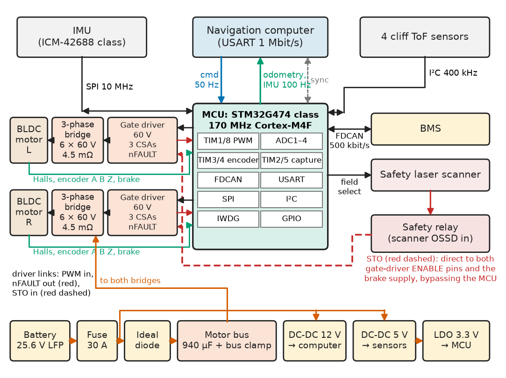
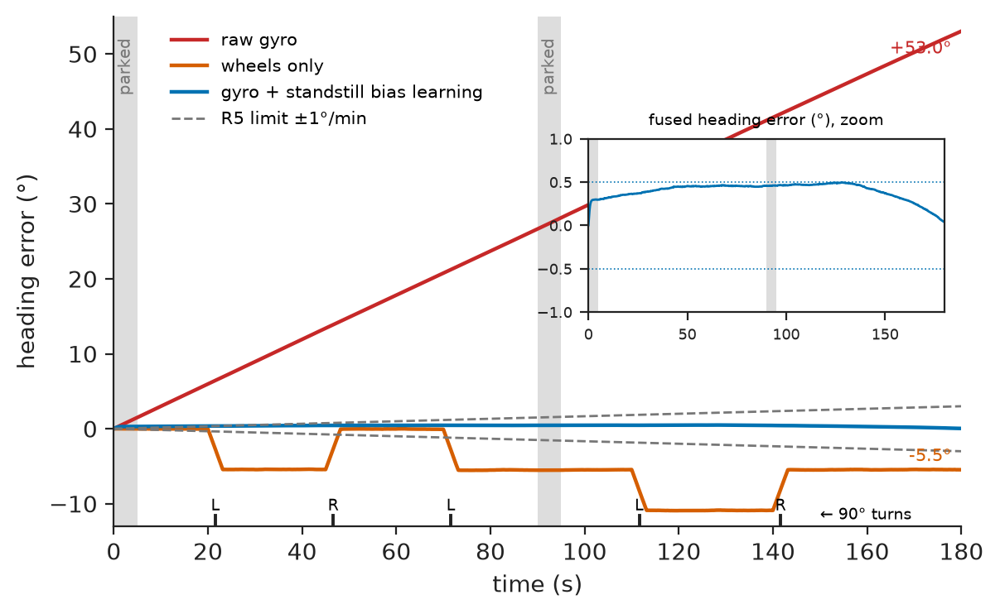
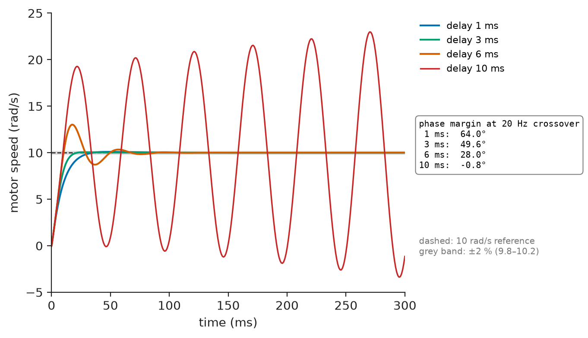
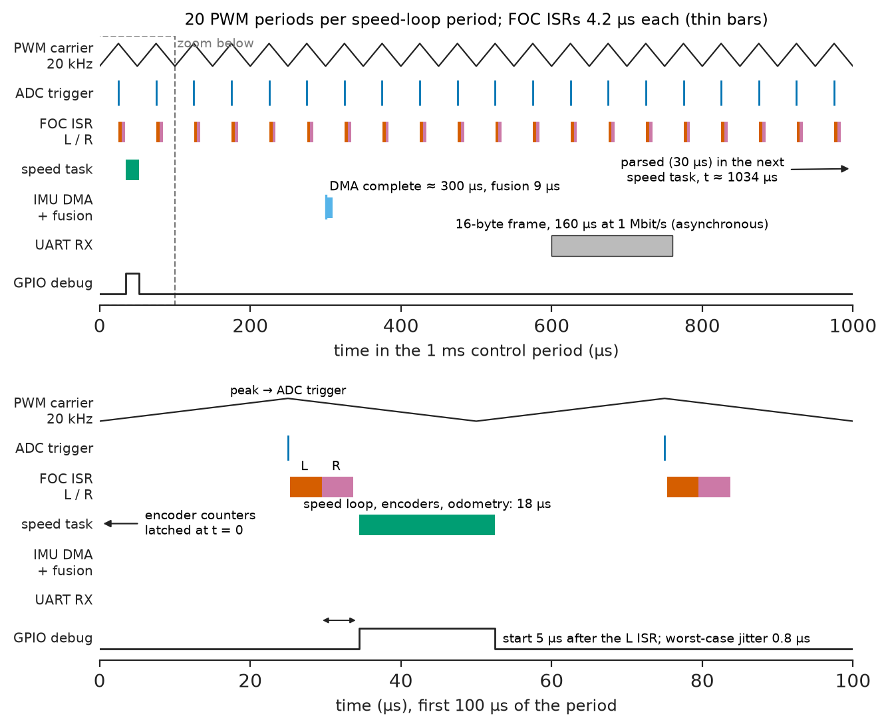
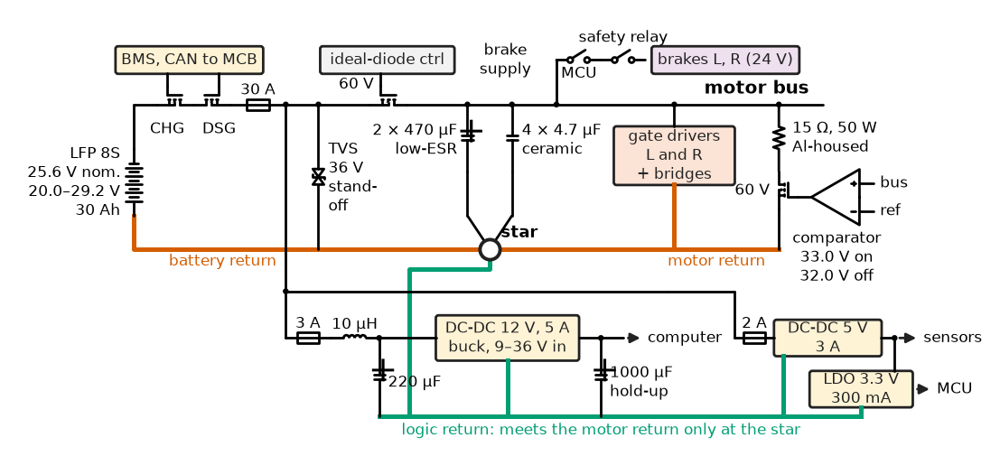
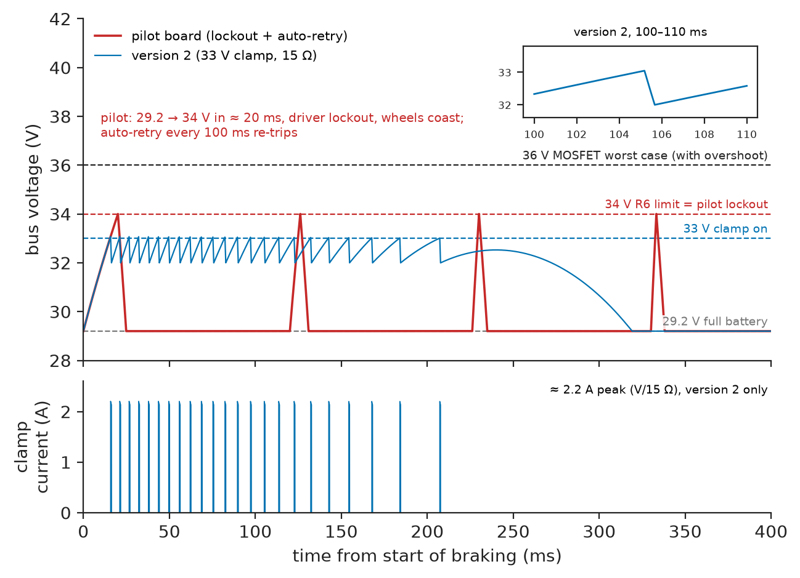

# Chapter 15 — Robot Electronics and Control

*Part IV · Robotics and Mechatronics*

On the third day of the hospital pilot of Chapter 14, the delivery robot left its dock fully charged and drove down the 10 m loading ramp. Halfway down, both wheels went limp and the robot accelerated until the safety scanner saw the wall at the bottom and dropped the brakes. At 100 % state of charge the battery management system had opened its charge MOSFET, as it should. Braking down the ramp, the drives pushed about 37 W of regenerated power onto the 29 V bus; the computer and sensors used 29 W of it, and the rest had nowhere to go but 940 µF of capacitance. The bus reached the integrated motor drivers' 34 V overvoltage lockout in about 20 ms, the drivers disabled their outputs, the wheels coasted, and the drivers' auto-retry re-enabled them every 100 ms into the same condition; the spring brakes stayed released because the robot was still powered. Every part met its datasheet; the design had no path for regenerated energy and treated an overvoltage as a nuisance to retry. This chapter designs version 2 of the robot's motor-control board, its reference system, from drivers to fault handling.

> **Which drivers, interfaces, loops and timing turn a navigation computer's velocity commands into wheel motion that is accurate, fast and safe?**
> **How are power distribution and fault recovery designed so that a full battery, a missing message or a stuck sensor ends in a controlled stop instead of a runaway?**

| Concept | Engineering destination |
|---|---|
| Motor drivers | Voltage, current and protection ratings of H-bridges and three-phase stages for robot joints and wheels |
| Encoder interfaces | Position and speed from quadrature, Hall and absolute encoders at every speed |
| Sensor fusion | Gyro bias handling, slip detection, heading for odometry and balancing |
| Embedded controllers | MCU choice for multi-axis motor control with timers, ADCs and buses |
| PID implementation | Discrete controllers with limits, anti-windup, feed-forward and bumpless start |
| Feedback loops | Cascaded current, speed and position loops and how they are tuned |
| Timing and latency | Loop periods, jitter, the delay budget and where loops must not run |
| Communication buses | UART, SPI, I²C and CAN links inside a robot; framing, load and fault handling |
| Power distribution | Rails, fusing, brown-out immunity and regenerated energy |
| Fault recovery | Detection, safe states, retry policy and latching faults |

**Roadmap.** Requirements (15.1) → drivers (15.2) → encoders (15.3) → fusion (15.4) → controller (15.5) → PID (15.6) → loops (15.7) → timing (15.8) → buses (15.9) → power (15.10) → faults (15.11) → verification (15.12).

---

## 15.1 Requirements and architecture

The motor-control board (MCB) sits between the navigation computer and the robot's two drive motors (24 V, 60 W BLDC gearmotors with 1:18 planetary gears, Hall sensors, 4096-count magnetic encoders and spring-applied brakes, chosen in Chapter 14 §14.10). Table 15.1 gives its requirements; the pilot failed R6 and R8.

**Table 15.1 — Requirements of the motor-control board (version 2).**

| ID | Requirement | Target | Verification |
|---|---|---|---|
| R1 | Wheel-speed control | Steady-state error < 1 % from 0.05 to 1.3 m/s; small-step overshoot < 5 %, 2 % settling < 50 ms | Step and ramp tests on the loaded robot |
| R2 | Torque | 10.5 A phase current per motor for 2 s; current-loop bandwidth ≥ 1 kHz | Locked-rotor test; current-loop frequency response |
| R3 | Odometry and IMU stream | 100 Hz, time-stamped to ±0.5 ms against the computer's clock | Logic analyser on sync pulse |
| R4 | Command latency | Velocity command received → new speed reference in < 2 ms | GPIO timing on target |
| R5 | Heading drift | Gyro-based heading < 1°/min while driving between stops | 3 min mission log against fiducials |
| R6 | Bus voltage | ≤ 34 V under any regeneration, including with the battery charge path open | Ramp descent at 100 % SOC; bench regen test |
| R7 | Brown-out immunity | Computer rail 12 V ±5 % during 25 A motor transients and battery at 20 V | Load-step test with oscilloscope |
| R8 | Fault reaction | Over-current: PWM off < 5 µs; command loss: controlled stop started ≤ 200 ms; any latched fault: motors off, brakes on | Fault-injection test per fault |
| R9 | ESD | ±8 kV contact at the charge contacts and connectors without reset (IEC 61000-4-2) | ESD gun test |
| R10 | Quiescent power | MCB with drivers enabled at standstill < 2.5 W | Bench measurement |

Figure 15.1 shows the architecture. One STM32G474-class microcontroller runs both motors' current loops at 20 kHz, the wheel-speed loops and odometry at 1 kHz, the IMU fusion and the fault manager. Each motor has a 60 V gate driver with current-sense amplifiers and six 60 V MOSFETs. Power enters through a fuse and a reverse-polarity stage onto a clamped motor bus; separate DC–DC converters feed the computer and the sensors. The safety relay's STO line reaches the gate drivers directly, bypassing the MCU.

<!-- FIGURE 15.1 | figures/ch15/fig-15-1-mcb-architecture.png | block-diagram | Architecture of the motor-control board of the delivery robot. | Content: centre block MCU (STM32G474 class, 170 MHz Cortex-M4F) with internal blocks TIM1 and TIM8 PWM, ADC1 to ADC4, TIM3 and TIM4 encoder mode, TIM2 and TIM5 capture, FDCAN, USART, SPI, I2C, IWDG. Left: two motor channels each with Gate driver (60 V, 3 CSAs, nFAULT) driving a 3-phase MOSFET bridge (6 x 60 V 4.5 mOhm) to a BLDC gearmotor with Halls, 4096-count encoder (A B Z) and brake driver. Top: USART 1 Mbit/s to Navigation computer (cmd 50 Hz down, odometry and IMU 100 Hz up, sync pulse line); SPI 10 MHz to IMU (ICM-42688 class); I2C 400 kHz to four cliff ToF sensors; FDCAN 500 kbit/s to BMS. Right: Safety relay STO line (red dashed) direct to both gate-driver ENABLE pins and brake supply; safety scanner field-select outputs from MCU. Bottom: power path battery 25.6 V LFP, fuse 30 A, ideal-diode, motor bus with 940 uF and bus clamp, DC-DC 12 V for computer, DC-DC 5 V for sensors, LDO 3.3 V for MCU. -->



*Figure 15.1 — Architecture of the motor-control board of the delivery robot.*

---

## 15.2 Motor drivers

### What the driver must survive

A motor driver is sized by the voltage it must block, the current it must carry and the faults it must survive. On a battery robot the voltage rating is set not by the battery but by the highest voltage the bus can reach, and on a robot that brakes, regeneration sets it.

> **Boundary.** The three-phase bridge, PWM, dead time and synchronised current sampling are in *Electronics and Computing*, [Ch. 32 §32.1–32.4](https://github.com/The-Studio-of-Sadiq/Electronics-and-Computing/blob/main/part-7-power-electronics/32-motor-drives-and-power-conversion.md), with regenerative operation and the brake chopper in §32.6; field-oriented control of a PM motor is in *Electrical Energy and Machines*, [Ch. 12 §12.6 and §12.8](https://github.com/The-Studio-of-Sadiq/Electrical-Energy-and-Machines/blob/main/part-3-motor-drives/12-ac-motor-drives.md). This section chooses parts and ratings.

**Table 15.2 — Driver options for one 24 V, 60 W BLDC wheel motor (2026 prices, 100 pcs).**

| Option | Voltage rating | Current (peak) | Current sensing | Protection | Cost | Verdict |
|---|---|---|---|---|---|---|
| Integrated 3-phase driver with FETs (DRV8316 class) | 40 V abs. max; OV lockout ~34 V | 8 A | Integrated | OCP, OTP, OV/UV, auto-retry | \$3.90 | Pilot choice; no headroom above a 29.2 V bus |
| Smart gate driver (DRV8323 class) + 6 × 60 V, 4.5 mΩ MOSFETs | 60 V | > 40 A (FET-limited) | 3 CSAs, external shunts | VDS sensing OCP, gate-drive faults, configurable latch or retry | \$7.60 | **Chosen**: 2 × voltage headroom, latching OCP |
| Trapezoidal Hall driver (sensor-commutated IC) | 30–60 V | 5–15 A | Average only | Basic | \$2.50 | Torque ripple at low speed; no FOC |

**Worked example — voltage and current ratings of the bridge.** The 8S LFP pack reaches 29.2 V at the end of charge. With the bus clamp of Section 15.10 at 33 V and 3 V of switching overshoot from the commutation loop's inductance, the MOSFETs see up to 36 V; a 60 V rating gives a factor of 1.67, inside the usual 1.5–2 derating. The pilot's 40 V driver had 1.11, and its 34 V lockout sat 4.8 V above a full battery. On current, the motor's continuous 0.19 N·m at $K_t=0.054$ N·m/A is 3.5 A (amplitude), and Chapter 14's threshold climb needs 10.5 A for two seconds. With 4.5 mΩ MOSFETs (6.8 mΩ hot) the bridge's conduction loss is $3\times(3.5/\sqrt2)^2\times0.0068=0.13$ W continuous and $3\times(10.5/\sqrt2)^2\times0.0068=1.1$ W at peak, plus about 0.2 W of switching loss at 20 kHz. Thermal design is trivial; the ratings are set by voltage and by fault current, which the gate driver's drain–source monitor catches within 4 µs (R8).

> **Status of the principle: Voltage derating of power semiconductors**
> *Empirical.* Practice for low-voltage drives is to rate MOSFETs at 1.5–2 times the highest steady bus voltage including regeneration, to cover switching overshoot, avalanche margin and transients from cables and connectors; the factor is not a law but a record of what fails in the field.

### Current sensing and the gate-driver configuration

Each phase has a 5 mΩ low-side shunt read by the gate driver's amplifier at a gain of 20, biased at mid-rail, so ±16 A spans ±1.6 V and a 12-bit ADC, triggered by the PWM timer, resolves 8 mA. The gate driver is configured over SPI: 200 ns dead time, an OCP threshold of 0.5 V drain–source (about 74 A at 6.8 mΩ: a short, not an overload) and **latched** OCP; overload is the current loop's job. The configuration is read back after every write and every 100 ms, because ESD at the charge contacts once reset them without resetting the MCU.

---

## 15.3 Encoder interfaces

### Quadrature decoding in hardware

The 4096-count encoders produce up to $3000/60\times4096=204{,}800$ counts/s at full motor speed, decoded by the MCU's timers in encoder mode with a programmable input filter; software only reads the counter. Reliability was decided electrically: the encoder sits 0.6 m of cable away, beside phases switching 29 V at 20 kHz. Single-ended 5 V signals miscounted about once per 10⁵ counts during hard acceleration on the first board, bending odometry by 0.1° per turn. Version 2 uses the encoder's RS-422 outputs, a receiver at the board edge, shielded twisted pairs and an input filter that rejects pulses shorter than 0.5 µs (the shortest legitimate edge interval is 4.9 µs).

> **Boundary.** Quadrature decoding as logic, and its implementation in an FPGA, is in *Electronics and Computing*, [Ch. 19](https://github.com/The-Studio-of-Sadiq/Electronics-and-Computing/blob/main/part-4-computer-architecture-and-digital-hardware/19-hardware-description-languages.md); encoder principles are in [Chapter 6](../part-2-instrumentation-and-measurement-systems/06-sensors-and-transducers.md).

### Speed from counts: the M/T method

Chapter 14 (§14.3) showed that counting edges in a 1 ms window resolves only 7.8 counts at the 0.05 m/s docking speed. The fix is to measure time as well as counts: a second, free-running 32-bit timer at 170 MHz latches its value on every encoder edge (the timer's XOR input combines A and B), and the speed estimate divides the counts by the time between the last edge of the previous window and the last edge of this one. Listing 15.1 shows the update; register names are STM32G4-style and illustrative.

```c
/* enc.c -- wheel encoder: timer encoder mode + edge time stamps, M/T speed (C11) */
#include <stdint.h>

#define CPR_MOTOR  4096.0f          /* counts per motor revolution after x4 */
#define TCLK_HZ    170.0e6f         /* time-stamp timer clock */
#define STILL_S    0.05f            /* no edge for 50 ms: standstill */

typedef struct {
    volatile uint32_t *cnt;         /* encoder-mode timer counter (16-bit) */
    volatile uint32_t *edge_ts;     /* capture register: time of latest edge */
    uint16_t last_cnt;
    uint32_t last_ts;
    int32_t  pos;                   /* extended position, counts */
    float    omega;                 /* motor speed, rad/s */
} enc_t;

/* Called every 1 ms by the speed-loop task; now_ts = time-stamp timer value now. */
void enc_update(enc_t *e, uint32_t now_ts)
{
    uint16_t c  = (uint16_t)*e->cnt;
    uint32_t ts = *e->edge_ts;
    int16_t  d  = (int16_t)(uint16_t)(c - e->last_cnt);  /* wrap-safe, |d| < 32768 */
    e->last_cnt = c;
    e->pos += d;
    if (d != 0) {
        float dt = (float)(uint32_t)(ts - e->last_ts) / TCLK_HZ;
        e->last_ts = ts;
        e->omega = (dt > 0.0f) ? 6.2831853f * (float)d / (CPR_MOTOR * dt) : e->omega;
    } else if ((float)(uint32_t)(now_ts - e->last_ts) / TCLK_HZ > STILL_S) {
        e->omega = 0.0f;
    }
}
```

The casts make both wraparounds safe: the 16-bit count difference is reinterpreted as signed, and the 32-bit time difference is unsigned, correct across the timer's 25 s wrap.

**Worked example — speed resolution with time stamps.** At 0.05 m/s the motor turns at 12.0 rad/s and produces 7823 edges/s. In a 1 ms window the M method sees 7 or 8 counts, a 13 % quantization. The M/T method divides the same counts by a time measured to 5.9 ns in about 1 ms, a resolution better than 10⁻⁵; what remains is the encoder's edge-placement error (typically ±0.1 count interval), about ±1 % after a two-period average. Below about 0.6 mm/s (fewer than one edge per 10 ms) the estimate holds its last value until the 50 ms standstill rule sets it to zero.

> **Status of the principle: M/T speed estimation**
> *Derived.* Speed equals counted displacement over the time between the edges that bound it; count quantization leaves the time base, and what remains is edge-placement error and, at very low speed, the wait for the next edge, hence the standstill timeout.

The Hall sensors are still read: for commutation at power-up, and as a plausibility check — the encoder count between two Hall transitions must be $4096/(6\times4)=170.7$ ±10 %, which catches a slipped magnet or a broken line within one electrical revolution (Section 15.11).

---

## 15.4 Sensor fusion

### Heading from a gyro, kept honest by the wheels

Chapter 14 (§14.8) assigned heading to the gyro because wheel-difference heading under-reads in turns, where casters scrub and tyres slip. A MEMS gyro (ICM-42688 class, SPI, 1 kHz) has the opposite weakness: a turn-on bias of up to ±0.5 °/s, which integrates to 30° per minute. The fusion uses each where it is good: the wheels say when the robot is **stationary** (no encoder edge for 0.5 s), and then the gyro output is pure bias, which a first-order filter learns; while moving, heading is integrated from the bias-corrected gyro.

Listing 15.2 simulates a 3-minute mission: five 90° turns, two parking stops, a 0.30 °/s gyro bias with slow drift, 0.02 °/s rms gyro noise, and wheels that under-read turns by 6 %.

```python
import numpy as np
rng = np.random.default_rng(7)
dt, T = 0.01, 180.0                               # 100 Hz, 3 minutes
t = np.arange(0, T, dt)
# true yaw rate: stops, straights and 90 deg turns at 0.5 rad/s (3.14 s each)
r = np.zeros_like(t)
for t0, sgn in [(20, 1), (45, -1), (70, 1), (110, 1), (140, -1)]:
    r[(t >= t0) & (t < t0 + np.pi/2/0.5)] = 0.5*sgn
moving = ~(((t >= 0) & (t < 5)) | ((t >= 90) & (t < 95)))   # parked 0-5 s, 90-95 s
# wheel-derived yaw rate: 6 % under-read in turns (caster scrub and slip on wet vinyl)
wheel = 0.94*r + moving*rng.normal(0, 0.002, t.size)
# gyro: 0.30 deg/s turn-on bias, slow drift, white noise 0.02 deg/s rms
bias = np.radians(0.30) + np.cumsum(rng.normal(0, np.radians(0.0001), t.size))
gyro = r + bias + rng.normal(0, np.radians(0.02), t.size)

b_est, n_still, est = 0.0, 0, []
for k in range(t.size):                           # firmware loop, 100 Hz
    still = not moving[k] and abs(wheel[k]) < 1e-3
    n_still = n_still + 1 if still else 0
    if n_still > 50:                              # parked > 0.5 s: learn bias
        b_est += 0.02*(gyro[k] - b_est)           # first-order, 0.5 s time constant
    est.append(gyro[k] - b_est)
head = lambda w: np.degrees(np.cumsum(w)*dt)
truth = head(r)
for name, w in [("wheels only", wheel), ("raw gyro", gyro), ("gyro + standstill bias", np.array(est))]:
    e = head(w) - truth
    print(f"{name:24s} heading error at 60 s {e[t.searchsorted(60)]:+6.2f} deg, "
          f"at 180 s {e[-1]:+6.2f} deg")
```

```text
wheels only              heading error at 60 s  -0.03 deg, at 180 s  -5.47 deg
raw gyro                 heading error at 60 s +17.83 deg, at 180 s +53.04 deg
gyro + standstill bias   heading error at 60 s  +0.45 deg, at 180 s  +0.04 deg
```

**Worked example — reading the fusion result.** The raw gyro's 0.30 °/s bias integrates to 18° in the first minute. Wheel heading is excellent on straights but loses 6 % of every turn, $0.06\times90^\circ=5.4^\circ$ per net turn; the run has one net left turn, hence −5.5°. Learning the bias in the first 5 s park, and again at 90 s, keeps the error inside ±0.5° for 3 minutes (Figure 15.2), about 0.15 °/min against R5's 1 °/min; four other noise seeds give final errors between −0.41° and +0.46°. The simulation omits the gyro's scale-factor error (±0.5 % for this class, calibrated once on a turntable) and temperature-driven bias drift between stops, which is why the mission planner inserts a 1 s standstill at least every 3 minutes.

<!-- FIGURE 15.2 | figures/ch15/fig-15-2-heading-fusion.png | plot | Heading error over a 3-minute mission for wheel-only heading, raw gyro and gyro with standstill bias learning. | Content: x axis time 0 to 180 s, y axis heading error -10 to +55 deg (inset zoom -1 to +1 deg for the fused curve). Shaded grey bands for parked windows 0 to 5 s and 90 to 95 s; tick marks for 90 deg turns at 20 s (left), 45 s (right), 70 s (left), 110 s (left), 140 s (right). Raw gyro rising linearly to +53 deg; wheel-only stepping by about plus or minus 5.4 deg at each turn and ending at -5.5 deg; gyro with bias learning staying within plus or minus 0.5 deg. Legend and annotation R5 limit 1 deg per min as dashed sloped lines. -->



*Figure 15.2 — Heading error over a 3-minute mission for wheel-only heading, raw gyro and gyro with standstill bias learning.*

> **Status of the principle: Complementary use of gyro and wheel odometry**
> *Approximate.* Assumes the wheels report standstill reliably and that gyro bias changes slowly compared with the interval between stops; a robot that never stops, or a gyro whose bias steps with temperature, needs a full Kalman filter with a bias state and absolute heading fixes, as Chapter 14 adds with the lidar and fiducials.

### Slip detection and tilt

The same signals detect slip: if wheel and gyro yaw rates differ by more than 0.1 rad/s for 100 ms, the MCB flags it and the computer slows down and inflates the odometry covariance. The accelerometer gives pitch to ±0.5° at standstill, used on the ramp as a torque feed-forward (Section 15.6).

---

## 15.5 Embedded controllers

### Choosing the microcontroller

The processor must run two current loops at 20 kHz, generate two sets of three-phase PWM with dead time, sample six currents synchronously, decode two encoders with time stamps and serve four buses, with a fault path that does not depend on software. Selection as a method is Chapter 10's (§10.2) and *Electronics and Computing*, [Ch. 25 §25.3](https://github.com/The-Studio-of-Sadiq/Electronics-and-Computing/blob/main/part-6-embedded-and-real-time-systems/25-embedded-system-architecture.md); Table 15.3 applies it.

**Table 15.3 — Controller options for a two-motor robot drive board (2026 prices, 1k pcs).**

| Part class | Core | Motor-control timers | ADC | Encoder support | Buses | Price | Verdict |
|---|---|---|---|---|---|---|---|
| STM32G474 | Cortex-M4F 170 MHz, CORDIC, FMAC | 2 advanced (TIM1, TIM8) + HRTIM, break inputs | 5 × 12-bit, 4 Msps, hardware oversampling | Several encoder-mode timers, 32-bit capture | 3 FDCAN, USART, SPI, I²C | \$6.80 | **Chosen** |
| dsPIC33CK | DSP core 100 MIPS | Motor PWM with dead time, fault inputs | 3 × 12-bit, 3.5 Msps | QEI | CAN FD, UART, SPI | \$3.50 | Capable; smaller ecosystem in the team |
| RP2040 | Dual Cortex-M0+ 133 MHz, no FPU | General PWM, no hardware break input | 4-channel 500 ksps | PIO state machines | No CAN | \$0.80 | No hardware fault shutdown; too slow for two FOC loops in floating point |

The decisive features are not clock speed but the **break inputs** (hardware PWM shutdown within nanoseconds, wired to the gate-driver fault outputs and a bus-voltage comparator), PWM-triggered ADC sampling and CAN FD.

### CPU load budget

**Table 15.4 — CPU budget of the MCB at 170 MHz.**

| Task | Rate | Execution time | Load |
|---|---|---|---|
| FOC current loop, motor L (ISR) | 20 kHz | 4.2 µs | 8.4 % |
| FOC current loop, motor R (ISR) | 20 kHz | 4.2 µs | 8.4 % |
| Speed loops, encoder update, odometry | 1 kHz | 18 µs | 1.8 % |
| IMU read (DMA complete), fusion | 1 kHz | 9 µs | 0.9 % |
| UART framing, command parse, telemetry | 100 Hz | 120 µs | 1.2 % |
| Fault manager, gate-driver register check | 1 kHz / 10 Hz | 6 µs | 0.6 % |
| Cliff sensors (I²C, DMA), BMS CAN | 50 Hz | 150 µs | 0.8 % |
| **Total** | | | **22.1 %** |
| Design limit | | | 50 % |
| **Margin** | | | **2.3 ×** |

Execution times are worst cases over a 10-minute run, measured by toggling a GPIO at task entry and exit; the FOC ISR uses the CORDIC unit and runs from core-coupled RAM so flash wait states add no jitter.

---

## 15.6 PID implementation

### What a usable controller contains

A usable controller needs output limits, anti-windup, a set-point weight, feed-forward and a bumpless start as well as its gains. The structure and its discretisation are owned by *Circuits, Signals and Communications*, [Ch. 35 §35.2 and §35.8](https://github.com/The-Studio-of-Sadiq/Circuits-Signals-and-Communications/blob/main/part-7-control-system-fundamentals/35-control-design-fundamentals.md); Listing 15.3 is the implementation used for every loop on the MCB. The speed loop needs no derivative action.

```c
/* pi.c -- discrete PI with set-point weight, conditional integration,
   output limits, feed-forward and bumpless start (C11, float on Cortex-M4F) */
typedef struct {
    float kp, ki, ts;        /* gains (A per rad/s, A per rad) and period (s) */
    float b;                 /* set-point weight on the P term, 0..1 */
    float u_min, u_max;      /* actuator limits, A */
    float integ;             /* integrator state, A */
} pi_t;

float pi_step(pi_t *c, float ref, float meas, float ff)
{
    float e = ref - meas;
    float u = c->kp * (c->b * ref - meas) + c->integ + ff;
    if (u > c->u_max) {
        u = c->u_max;
        if (e < 0.0f) c->integ += c->ki * e * c->ts;   /* only integrate back */
    } else if (u < c->u_min) {
        u = c->u_min;
        if (e > 0.0f) c->integ += c->ki * e * c->ts;
    } else {
        c->integ += c->ki * e * c->ts;
    }
    if (c->integ > c->u_max) c->integ = c->u_max;      /* bound the state too */
    if (c->integ < c->u_min) c->integ = c->u_min;
    return u;
}

/* Bumpless start: choose the integrator so the first output equals u_now. */
void pi_start(pi_t *c, float u_now, float ref, float meas, float ff)
{
    c->integ = u_now - c->kp * (c->b * ref - meas) - ff;
}
```

Three choices in the listing come from failures. **Conditional integration** removed a 0.3 s overshoot after every threshold climb, where the pilot's integrator had wound up against the current limit. **Bounding the integrator state** keeps it finite if the measurement fails. **Bumpless start** preloads the integrator with the holding current when the brakes release on a ramp, so the robot does not drop back.

> **Status of the principle: Anti-windup by conditional integration**
> *Empirical.* One of several practical anti-windup schemes (clamping, back-calculation, conditional integration); all prevent the integrator from accumulating error the saturated actuator cannot act on, and they differ in recovery speed and tuning effort rather than in principle.

**Worked example — the ramp feed-forward.** On the 1:12 ramp, gravity pulls each wheel with $30\times9.81\times\sin4.76^\circ\times0.075/2=0.92$ N·m. Through the 1:18 gear (efficiency 0.85) and $K_t=0.054$ N·m/A that is $0.92/(18\times0.85\times0.054)=1.11$ A per motor. The MCB computes it from the filtered pitch angle and adds it as `ff`; with it, the robot stopping on the ramp rolls back 2 mm while the brake engages, against 31 mm without it.

---

## 15.7 Feedback loops

### The cascade

The drive has three nested loops, each well over five times faster than the one around it:

1. **Current (torque) loop** — FOC in the rotor frame, 20 kHz sampling, PI controllers on the d and q currents, closed-loop bandwidth about 1 kHz.
2. **Wheel-speed loop** — PI on motor speed from the M/T estimate, 1 kHz, crossover 20 Hz, output is the q-axis current reference, limited to ±10.5 A.
3. **Motion commands** — the navigation computer's linear and angular velocity at 50 Hz, converted to wheel speeds (Chapter 14 §14.2), rate-limited to 0.5 m/s² and 1.0 rad/s².

The robot's pose is closed by the computer's path tracker, not on the MCB. Tuning follows standard drive practice: the current loop's PI zero cancels the winding's electrical pole ($K_p=L\omega_c$, $K_i=R\omega_c$), and the speed loop is designed on the total inertia with the current loop as a small lag (*Electrical Energy and Machines*, [Ch. 11 §11.5](https://github.com/The-Studio-of-Sadiq/Electrical-Energy-and-Machines/blob/main/part-3-motor-drives/11-dc-motor-drives.md)).

> **Status of the principle: Cascade separation of loop bandwidths**
> *Empirical.* An inner loop five to ten times faster than the outer one adds only a few degrees of phase at the outer crossover, so each loop can be tuned as if the inner one were ideal; the rule fails when delays or resonances, not the inner loop, set the phase budget.

### The speed loop on the loaded robot

The inertia the speed loop sees is dominated by the robot, not the motor. Each motor moves half the 30 kg gross mass, which referred through the wheel radius and the gear is $15\times0.075^2/18^2=2.60\times10^{-4}$ kg·m², twenty-two times the rotor's $1.2\times10^{-5}$ kg·m²; the total is $2.72\times10^{-4}$ kg·m². For a 20 Hz crossover ($\omega_c=125.7$ rad/s) with the PI zero at $\omega_c/4$, $K_p=J\omega_c/K_t=0.633$ A per rad/s and $K_i=K_p\omega_c/4=19.9$ A/rad. A set-point weight of 0.7 on the proportional term removes most of the PI zero's step overshoot.

The loop is tuned loaded: unloaded (20 kg) the inertia falls to 68 % and the crossover rises to 29 Hz, which the phase budget tolerates, whereas a loop tuned unloaded would fall to 14 Hz when loaded.

---

## 15.8 Timing and latency

### Why the pilot's loop rang

The pilot robot closed its wheel-speed loops on the navigation computer over a USB serial link, with a measured loop delay of 4–12 ms depending on the computer's load. On the ramp, wheel speeds oscillated at about 6 Hz. A delay $T_d$ costs $\omega_cT_d$ radians of phase at crossover, and the phase budget at 20 Hz is small.

> **Boundary.** Latency, jitter and their effect on control loops are analysed in *Electronics and Computing*, [Ch. 27 §27.10](https://github.com/The-Studio-of-Sadiq/Electronics-and-Computing/blob/main/part-6-embedded-and-real-time-systems/27-real-time-computing.md); the phase of a time delay in the Nyquist and Bode picture is in *Circuits, Signals and Communications*, [Ch. 34 §34.8](https://github.com/The-Studio-of-Sadiq/Circuits-Signals-and-Communications/blob/main/part-7-control-system-fundamentals/34-feedback-and-stability.md).

Listing 15.4 simulates the loaded speed loop with the PI of Listing 15.3, the closed current loop as a 160 µs lag, the current limit and a loop delay of 1, 3, 6 and 10 ms, and prints the phase margin estimated at crossover.

```python
import numpy as np
# Wheel-speed loop of one drive, referred to the motor shaft
Kt, J, B = 0.054, 2.72e-4, 2.0e-4        # N m/A, kg m2 (robot share + rotor), N m s/rad
tau_i, Ts = 160e-6, 1e-3                 # closed current loop (~1 kHz), speed-loop period
wc = 2*np.pi*20                          # target crossover, rad/s
Kp, Ki = J*wc/Kt, J*wc/Kt*wc/4           # PI with its zero at wc/4
b_sp, I_max = 0.7, 10.5                  # set-point weight on P, current limit (A)

def step(delay_ms, w_ref=10.0, t_end=0.3, sub=20):
    h = Ts/sub; buf = [0.0]*delay_ms
    w = i = integ = 0.0; out = []
    for k in range(int(t_end/Ts)):
        meas = buf.pop(0); buf.append(w)            # sensing + transport delay
        u = Kp*(b_sp*w_ref - meas) + integ
        if abs(u) < I_max:                           # conditional integration
            integ += Ki*(w_ref - meas)*Ts
        i_ref = np.clip(u, -I_max, I_max)
        for _ in range(sub):                         # plant between samples
            i += h*(i_ref - i)/tau_i
            w += h*(Kt*i - B*w)/J
        out.append(w)
    y = np.array(out)
    late = np.nonzero(np.abs(y - w_ref) > 0.02*w_ref)[0]
    return 100*(y.max() - w_ref)/w_ref, (late[-1] + 1)*Ts*1e3

print(f"Kp = {Kp:.3f} A/(rad/s), Ki = {Ki:.1f} A/rad")
for d in (1, 3, 6, 10):
    lag = np.degrees(wc*(d*1e-3 + Ts/2 + tau_i))     # delay + hold + current loop
    pm = np.degrees(np.arctan(4)) - lag
    ov, ts = step(d)
    print(f"delay {d:2d} ms: phase margin {pm:5.1f} deg, overshoot {ov:5.1f} %, "
          f"2 % settling {ts:4.0f} ms")
```

```text
Kp = 0.633 A/(rad/s), Ki = 19.9 A/rad
delay  1 ms: phase margin  64.0 deg, overshoot   0.9 %, 2 % settling   28 ms
delay  3 ms: phase margin  49.6 deg, overshoot   0.5 %, 2 % settling   17 ms
delay  6 ms: phase margin  28.0 deg, overshoot  30.2 %, 2 % settling   62 ms
delay 10 ms: phase margin  -0.8 deg, overshoot 129.7 %, 2 % settling  300 ms
```

**Worked example — the delay budget of the speed loop.** With 1 ms of delay (the MCB's own sample-and-compute delay) the loop has 64° of phase margin, 0.9 % overshoot and 28 ms settling (Figure 15.3), meeting R1; at 3 ms it is still well behaved. At 6 ms, mid-range for the pilot, the margin falls to 28° and a small step overshoots by 30 %; at 10 ms the loop oscillates. Each millisecond costs $125.7\times0.001$ rad, 7.2°, so a 45° minimum margin leaves about 3.6 ms for delay in total, which the pilot's 4–12 ms could never meet. A loop belongs on the processor whose *worst-case* delay fits its phase budget; a general-purpose computer on a USB link has a worst case of tens of milliseconds even when its average is 2 ms.

<!-- FIGURE 15.3 | figures/ch15/fig-15-3-speed-step-delay.png | plot | Wheel-speed step responses of the loaded robot for loop delays of 1, 3, 6 and 10 ms. | Content: x axis time 0 to 300 ms, y axis motor speed 0 to 25 rad/s for a 10 rad/s reference step. Four curves: 1 ms (overshoot 0.9 %, settles 28 ms), 3 ms (0.5 %, 17 ms), 6 ms (30 % overshoot, rings, settles 62 ms), 10 ms (growing oscillation about 20 Hz, peak 23 rad/s). Dashed reference line at 10 rad/s and 2 % band 9.8 to 10.2. Annotation box with phase margins 64.0, 49.6, 28.0, -0.8 deg. -->



*Figure 15.3 — Wheel-speed step responses of the loaded robot for loop delays of 1, 3, 6 and 10 ms.*

> **Status of the principle: Phase cost of loop delay**
> *Derived.* A pure delay $T_d$ has unit gain and phase $-\omega T_d$, so at crossover it subtracts $\omega_c T_d$ from the phase margin; the zero-order hold of a sampled loop adds about half a sample period, so loop periods, transport delays and computation all count against the same budget.

### The timing of one control period

Figure 15.4 shows how the MCB orders its work. The PWM timer is the master clock: its centre triggers the current samples, and the FOC ISR writes the next duty cycles within the same period. Every twentieth period the speed-loop task reads the encoder counters and capture registers (latched by hardware at the timer update, so position is sampled at a known instant), updates speeds and odometry, and writes current references for the next FOC ISR. IMU samples arrive by DMA on the IMU's data-ready pin and are time-stamped by the same 32-bit timer.

<!-- FIGURE 15.4 | figures/ch15/fig-15-4-control-period-timing.png | timing-diagram | One 1 ms control period of the motor-control board: PWM, ADC triggers, ISRs and tasks. | Content: horizontal time axis 0 to 1000 us. Row 1 PWM carrier (triangle) 20 kHz, 20 periods of 50 us. Row 2 ADC trigger pulses at each carrier peak. Row 3 FOC ISR motor L (4.2 us bars) and motor R (4.2 us bars) after each trigger. Row 4 speed-loop task 18 us starting at 5 us after the first FOC ISR of the period. Row 5 IMU DMA complete at about 300 us followed by 9 us fusion. Row 6 UART RX frame (16 bytes, 160 us at 1 Mbit/s) arriving asynchronously at 600 us, parsed in 30 us within the next speed task. Row 7 GPIO debug toggle used for measurement. Annotations: encoder counters latched at t = 0; worst-case jitter of speed task 0.8 us. -->



*Figure 15.4 — One 1 ms control period of the motor-control board: PWM, ADC triggers, ISRs and tasks.*

### The command and telemetry latency

**Table 15.5 — Latency budget from navigation command to wheel torque.**

| Stage | Worst case | Basis |
|---|---|---|
| Command frame on UART (16 bytes, 1 Mbit/s) | 0.16 ms | 160 bits including framing |
| Wait for next speed-loop task | 1.0 ms | 1 kHz task |
| Parse, convert to wheel speeds, rate limit | 0.03 ms | Measured |
| Speed loop to current reference | 0.02 ms | Measured |
| Next FOC ISR applies torque | 0.05 ms | One PWM period |
| **Total** | **1.26 ms** | |
| Requirement R4 (to new speed reference) | 2.0 ms | |
| **Margin** | **1.6 ×** | |

Telemetry carries the MCU time stamp of the encoder latch; a sync pulse every second on a dedicated GPIO, time-stamped on both sides, gives the computer the clock offset for R3 without depending on UART buffering.

---

## 15.9 Communication buses

### One bus per job

**Table 15.6 — Buses on the motor-control board.**

| Link | Bus and rate | Traffic | Load | Fault handling |
|---|---|---|---|---|
| Navigation computer | UART 1 Mbit/s, COBS framing, CRC-16 | Down: 16 B at 50 Hz. Up: odometry 48 B at 100 Hz, IMU 32 B at 100 Hz, status 32 B at 10 Hz | 8.3 % up, 0.8 % down | CRC reject, sequence numbers, 200 ms command timeout |
| IMU | SPI 10 MHz, DMA | 14 B at 1 kHz | 1.1 % | WHO_AM_I check, data-ready timeout 5 ms |
| Cliff sensors (4) | I²C 400 kHz | 4 × 6 B at 50 Hz | 3 % | Bus-clear on stuck SDA, per-sensor timeout |
| BMS | CAN 500 kbit/s | 4 frames at 10 Hz in, 1 out | 1.1 % | Heartbeat timeout 300 ms → degrade to voltage-only limits |
| Gate drivers | SPI 1 MHz | Configuration at start, read-back at 10 Hz | — | Mismatch → reconfigure, latch after 3 |
| Debug | USB, SWD | On demand | — | Not used in operation |

> **Boundary.** The physical and link layers of UART, SPI, I²C and CAN, I²C bus-hang recovery and CAN bit timing are in *Electronics and Computing*, [Ch. 26 §26.2–26.5](https://github.com/The-Studio-of-Sadiq/Electronics-and-Computing/blob/main/part-6-embedded-and-real-time-systems/26-embedded-interfaces.md); this section is about the choice and the robustness rules.

**Worked example — UART load and framing.** Upstream traffic is $48\times100+32\times100+32\times10=8320$ bytes/s; at 1 Mbit/s (100,000 bytes/s with 10 bits per byte) the load is 8.3 %, and COBS framing adds at most one byte in 254. The pilot's 115.2 kbit/s link would have run at 72 % load, where a burst of status messages after a fault delayed odometry by up to 15 ms. CRC-16 is there because a corrupted but plausible command (1.3 m/s instead of 0.3) is worse than a lost one; the 200 ms timeout is three missed commands plus margin.

Two rules came from bring-up. The four VL53L1X-class cliff sensors share one fixed I²C address, so each has its shutdown pin on a GPIO and the MCB brings them up one at a time with new addresses; one reset by ESD returns at the default address and is re-addressed. And the IMU's SPI clock is held at 10 MHz, below its 24 MHz maximum, because its 80 mm ribbon rang at higher rates.

---

## 15.10 Power distribution

### The power tree

Figure 15.5 shows the version-2 power distribution, built on three rules: motors and computer share neither a converter nor a ground return, regenerated energy always has somewhere to go, and every rail has a defined behaviour at low battery.

<!-- FIGURE 15.5 | figures/ch15/fig-15-5-power-distribution.png | schematic | Power distribution of the delivery robot, version 2. | Content: left LFP pack 25.6 V nominal, 20.0 to 29.2 V, 30 Ah with BMS (charge FET and discharge FET drawn back-to-back) and CAN. Main fuse 30 A, ideal-diode controller with 60 V MOSFET (reverse polarity), TVS 36 V standoff. Node motor bus with 2 x 470 uF low-ESR electrolytic plus 4 x 4.7 uF ceramic, feeding Gate driver L and R bridges; bus clamp: comparator at 33.0 V on, 32.0 V off driving a 60 V MOSFET in series with 15 Ohm 50 W aluminium-housed resistor. Separate branch from the fused node through 3 A fuse and pi filter (10 uH, 220 uF) to DC-DC 12 V 5 A buck (input 9 to 36 V) for the navigation computer, with 1000 uF hold-up. Branch 2 A fuse to DC-DC 5 V 3 A for sensors and LDO 3.3 V 300 mA for MCU. Star ground point at the bus capacitor negative; motor return and logic return drawn as separate traces meeting only at the star. Brake supply 24 V switched by MCU and by safety relay in series. -->



*Figure 15.5 — Power distribution of the delivery robot, version 2.*

### Regeneration and the bus clamp

**Worked example — where the pilot's 37 W went, and the clamp that takes it.** Descending the 1:12 ramp at 1.0 m/s, gravity delivers $30\times9.81\times\sin4.76^\circ\times1.0=24.4$ W; rolling resistance takes 4.4 W, and gear and motor in generating mode pass about 72 % ($0.85\times0.85$) of the remaining 20.0 W, so 14.5 W reach the bus. Braking from 1.2 m/s at 1.0 m/s² adds a peak of $30\times1.0\times1.2=36$ W; less 5.3 W of rolling resistance at 1.2 m/s, 72 % of it, 22.2 W, reaches the bus: together about 37 W. With the charge FET open, the only sinks are the hotel loads on the same bus (29 W with conversion losses, Table 14.7) and the bus capacitance: raising 940 µF from 29.2 V to 34 V stores $\tfrac12\times940\times10^{-6}\times(34^2-29.2^2)=0.14$ J, which the remaining 8 W supplies in about 18 ms — the pilot's trip. The version-2 clamp switches a 15 Ω resistor across the bus above 33 V, absorbing $33^2/15=72.6$ W, twice the worst case even with the hotel loads shed. A full 10 m descent at 100 % SOC dissipates at most $(245-44)\times0.72=145$ J, and the 50 W resistor on the chassis plate rises about 12 K. When the charge path is open the MCB also limits downhill speed to 0.6 m/s.

> **Status of the principle: Energy balance of a regenerating drive bus**
> *Fundamental.* Energy returned by the drives must be absorbed by the battery, stored in the bus capacitance or dissipated; when the battery cannot accept charge, the bus voltage rises at a rate set by power over capacitance, so a clamp or brake chopper sized for the peak regenerated power is mandatory, not optional.

Normally the battery absorbs regeneration; the clamp covers charge path open (full, or below 0 °C), a BMS fault, or a blown fuse while moving, when clamp, hold-up and brake logic must stop the robot with no battery at all (Table 15.8, R6).

### Brown-out immunity

Chapter 14's FMEA recorded a computer reset when both motors accelerated up the ramp: the pilot's computer rail and the motors shared a DC–DC input filter and a long ground return, and a 25 A step pulled the converter below its undervoltage threshold for 2 ms. Version 2 gives the computer its own fused branch, a π filter, a 9–36 V-input converter, 1000 µF of hold-up and a star ground at the bus capacitors. With a 25 A step at a 20 V battery the 12 V rail dipped to 11.62 V for 0.4 ms, inside R7's 11.4 V. At low charge the MCB limits motor current to 6 A below 22.4 V and sends the robot home, and below 21.0 V stops and brakes it so the computer can shut down before the BMS disconnects at 20.0 V.


---

## 15.11 Fault recovery

### Detection, reaction and the decision to retry

For each fault the design answers: how it is detected, how fast, what the robot does, and whether it may recover on its own. The pilot answered the last question once for all faults (auto-retry); version 2 classifies faults by what a retry could cause.

**Table 15.7 — Fault handling on the motor-control board.**

| Fault | Detection | Time to detect | Reaction | Recovery |
|---|---|---|---|---|
| Phase short / shoot-through | Gate driver VDS monitor → break input | < 4 µs | PWM off in hardware, brakes on | Latched; needs power cycle and service |
| Bus over-voltage > 34 V | Comparator → break input | < 2 µs | PWM off, clamp stays on, brakes on | Latched until bus < 30 V and operator reset |
| Bus over-voltage > 31.5 V | ADC, 1 kHz | 1 ms | Limit regenerative current, slow down | Automatic |
| Command timeout | No valid frame for 200 ms | 200 ms | Controlled stop at 1.0 m/s², then brakes | Automatic when commands resume and robot is stopped |
| Encoder implausible | Counts per Hall interval outside ±10 % | One electrical revolution | Controlled stop on the other wheel's speed and gyro | Latched for that boot; computer informed |
| Gate-driver register mismatch | SPI read-back, 10 Hz | 100 ms | Reconfigure | Latched after 3 in 60 s |
| Watchdog | Independent watchdog, 50 ms window | 50 ms | MCU reset: outputs default off, brakes on | Reboot; reset cause reported |
| STO from safety relay | Hardware line to gate drivers and brakes | < 10 ms | Torque off and brakes on, independent of MCU | Safety relay reset by operator |

The rule behind the Recovery column: a fault may clear itself only if a retry cannot make things worse and its cause is observably gone. An over-voltage retry caused loss of braking on a slope, so it latches; a command timeout is benign once the robot has stopped.

> **Status of the principle: Fail to a defined safe state, retry only what is benign**
> *Empirical.* Practice codified in functional-safety standards (IEC 61508, ISO 13849) and in drive design: every detected fault drives the system to a state whose safety does not depend on the failed function, and automatic recovery is allowed only for faults whose recurrence is harmless; the classification is a design decision recorded in the FMEA, not a property of the fault.

### The fault manager

Listing 15.5 is the core of the MCB's fault manager, run every 1 ms after the speed loop. Hardware paths (break input, STO) act without it; the manager decides the state, the brake output and whether a fault may clear.

```c
/* fault.c -- MCB fault manager, called at 1 kHz (C11) */
#include <stdbool.h>
#include <stdint.h>

typedef enum { ST_READY, ST_RUN, ST_STOPPING, ST_LATCHED } mcb_state_t;
enum { F_COMMS = 1u << 0, F_OVERVOLT = 1u << 1, F_SHORT = 1u << 2,
       F_ENCODER = 1u << 3, F_OVERTEMP = 1u << 4, F_DRVCFG = 1u << 5 };
#define LATCHING (F_OVERVOLT | F_SHORT | F_ENCODER | F_DRVCFG)

typedef struct { mcb_state_t st; uint32_t active, latched; } fault_mgr_t;

extern void pwm_enable(bool on);           /* board support, illustrative */
extern void brakes_release(bool release);
extern bool robot_stopped(void);           /* both wheel speeds below 0.01 m/s */

void fault_step(fault_mgr_t *m, uint32_t detected, bool cmd_valid, bool operator_reset)
{
    m->active = detected;
    m->latched |= detected & LATCHING;
    if (operator_reset && (detected & LATCHING) == 0u) m->latched = 0u;

    switch (m->st) {
    case ST_READY:
    case ST_RUN:
        if (m->latched != 0u)            { m->st = ST_LATCHED; }
        else if (m->active != 0u)        { m->st = ST_STOPPING; }
        else                             { m->st = cmd_valid ? ST_RUN : ST_READY; }
        break;
    case ST_STOPPING:                      /* speed loop ramps reference to 0 */
        if (m->latched != 0u)            { m->st = ST_LATCHED; }
        else if (robot_stopped())        { m->st = (m->active == 0u) ? ST_READY : ST_STOPPING; }
        break;
    case ST_LATCHED:
        if (m->latched == 0u && robot_stopped()) { m->st = ST_READY; }
        break;
    }
    bool drive = (m->st == ST_RUN) || (m->st == ST_STOPPING && !robot_stopped());
    pwm_enable(drive);                     /* safe default: off, brakes on */
    brakes_release(drive);
}
```

Safe outputs are the default: PWM is enabled and brakes released only while running or still decelerating under control, so a reset or a corrupted state variable leaves the motors off and the brakes on. A command timeout enters `ST_STOPPING`, where the speed loop brings the robot to rest; a latching fault goes to `ST_LATCHED`, where hardware has already removed PWM. Host-side unit tests with fake board-support functions drive the function through every fault sequence in the FMEA, the practice of Chapter 10 (§10.7).

---

## 15.12 Verification and failure analysis

### Verification results

**Table 15.8 — Verification of the motor-control board (version 2).**

| ID | Test | Limit | Result | Pass/fail |
|---|---|---|---|---|
| R1 | 0.05 m/s and 1.3 m/s steady runs; 10 rad/s motor-speed steps, loaded | Error < 1 %; overshoot < 5 %; settling < 50 ms | 0.4 % at 0.05 m/s; 1.2 % overshoot; 31 ms | Pass |
| R2 | Locked rotor 10.5 A for 2 s; current-loop sweep | 2 s without trip; ≥ 1 kHz | Held; 1.15 kHz bandwidth | Pass |
| R3 | Sync pulse vs telemetry time stamps, 1 h | ±0.5 ms | ±0.21 ms | Pass |
| R4 | GPIO from UART frame end to new reference | < 2 ms | 1.21 ms worst over 10⁵ frames | Pass |
| R5 | 3 min missions, heading against fiducials | < 1°/min | 0.22°/min worst of 20 runs | Pass |
| R6 | Ramp descent at 100 % SOC (charge FET open); bench test with battery fuse pulled at 1.2 m/s | ≤ 34 V | 33.4 V peak; controlled stop with no battery | Pass |
| R7 | 25 A load step at 20 V battery | 12 V ±5 % | 11.62 V minimum | Pass |
| R8 | Fault injection: short, OV, comms loss, encoder unplug | OCP < 5 µs; stop ≤ 200 ms; brakes on when latched | 3.2 µs; stop began at 201–203 ms; brakes on in all latched cases | Pass with note |
| R9 | ESD ±8 kV contact at charge contacts | No reset | No reset; gate-driver register restored by read-back once | Pass |
| R10 | Standstill power, drivers enabled | < 2.5 W | 1.9 W | Pass |

The R8 note: the timeout is checked in the 1 kHz task, so the stop began 1–3 ms after 200 ms; the requirement was rewritten as ≤ 205 ms, immaterial at Chapter 14's stopping distances. Figure 15.6 compares the bus voltage of the pilot board and version 2 in the R6 ramp test.

<!-- FIGURE 15.6 | figures/ch15/fig-15-6-bus-voltage-regen.png | waveform | Motor-bus voltage during braking on the ramp at 100 percent state of charge: pilot board against version 2. | Content: x axis time 0 to 400 ms from start of braking, y axis bus voltage 28 to 42 V; 29 W hotel load on the bus in both. Pilot trace (red): rises from 29.2 V to 34 V in about 20 ms, driver lockout, falls back to 29.2 V while wheels coast, auto-retry re-trips at about 125, 230, 335 ms. Version 2 trace (blue): rises to 33 V, clamp switches on, sawtooth between 32.0 and 33.1 V until about 210 ms, then back to 29.2 V as braking power falls below the hotel load. Horizontal dashed lines: 29.2 V full battery, 33 V clamp on, 34 V R6 limit and old lockout, 36 V MOSFET-side worst case with overshoot. Second panel below: clamp resistor current 0 to 2.3 A, pulsing on for the version 2 trace. -->



*Figure 15.6 — Motor-bus voltage during braking on the ramp at 100 percent state of charge: pilot board against version 2.*

### Failure analysis

**Table 15.9 — FMEA of the motor-control board.**

| Failure mode | Effect | Cause | Detection | Mitigation |
|---|---|---|---|---|
| Bus rises above driver lockout during regeneration | Wheels coast on a ramp; robot rolls away (pilot) | No energy path when BMS charge FET open; auto-retry of OV | Bus voltage log | Bus clamp 33 V / 72.6 W; latched OV; downhill speed limit when charge path open |
| Wheel-speed oscillation on ramp | Jerky motion, tote spills | Speed loop closed over USB on the computer, 4–12 ms delay (pilot) | Speed ripple at 6 Hz | Speed loops on MCB at 1 kHz; delay budget 3.6 ms |
| Computer resets when motors accelerate | Navigation lost, robot stops | Shared converter and ground return (pilot) | Reset-cause log | Separate fused branch, π filter, hold-up, star ground |
| Encoder miscounts during acceleration | Odometry bends 0.1° per turn | Single-ended encoder lines beside motor phases | Hall plausibility check | RS-422 encoder lines, shielded pairs, input filter |
| Integrator wind-up after threshold climb | 0.3 s overshoot, bump into door frame | No anti-windup in pilot PI | Overshoot in logs | Conditional integration, bounded state (Listing 15.3) |
| Gate-driver registers reset by ESD | Dead time and OCP revert to defaults | ESD at charge contacts couples into driver supply | 10 Hz register read-back | TVS at contacts, read-back and reconfigure, latch after 3 |

### What the second board changed

Every change from the pilot board is one of three kinds: a **rating** reconsidered with the real worst case (60 V devices, because regeneration sets the bus voltage), a **location** changed to fit a budget (speed loops moved to the MCB to fit a 3.6 ms delay budget), or a **policy** made explicit (which faults latch and which retry). None needed new theory; each needed a number that had not been written down.

---

## What remains open

| Open question | Where it is answered |
|---|---|
| How these drives, loops and buses come together in a multirotor with ESCs and an attitude loop | [Chapter 16](16-drones-and-aerial-robotics.md) |
| System identification of the drive and robot, hardware-in-the-loop testing of the MCB and field testing | Chapter 17 |
| A complete closed-loop motor drive designed, built and characterised as a project | [Chapter 37](../part-9-interdisciplinary-engineering-projects/37-project-closed-loop-motor-drive.md) |
| A complete line-following robot using these drivers, encoders and PID loops | [Chapter 34](../part-9-interdisciplinary-engineering-projects/34-project-autonomous-line-following-robot.md) |
| Battery packs, BMS charge paths and state estimation | Chapter 23 |
| Safety relays, STO validation and performance levels | [Chapter 21](../part-5-industrial-automation/21-industrial-communication-and-safety.md) |
| Field-oriented control and PM-motor current control in depth | *Electrical Energy and Machines*, [Ch. 12](https://github.com/The-Studio-of-Sadiq/Electrical-Energy-and-Machines/blob/main/part-3-motor-drives/12-ac-motor-drives.md) |

**Next:** Chapter 16 takes the same drivers, sensors and loops into the air, where the plant is unstable, the loops are faster and a fault cannot end with the brakes on.
