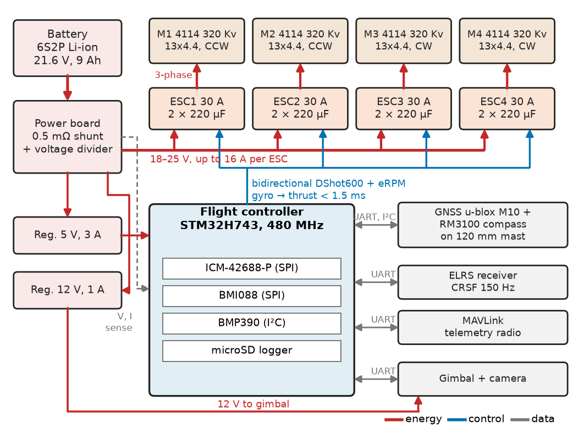
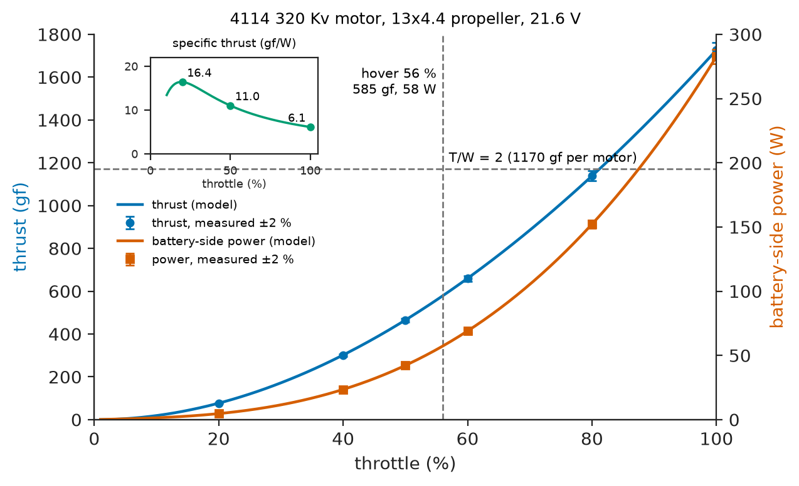
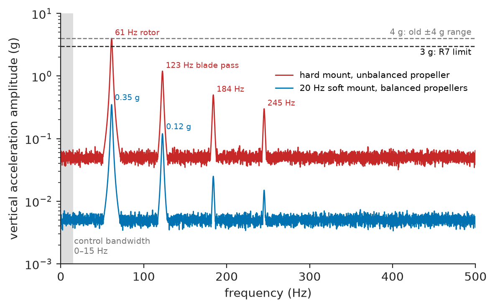
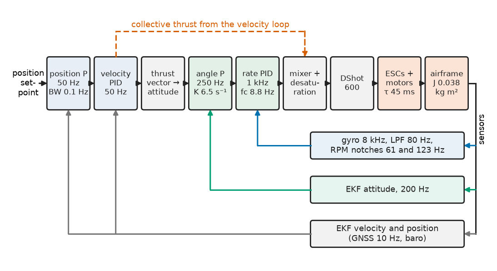
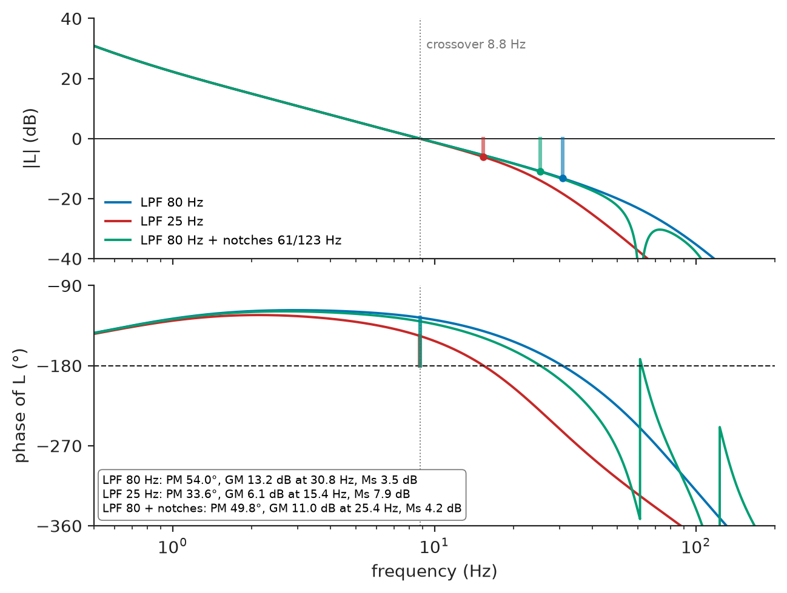
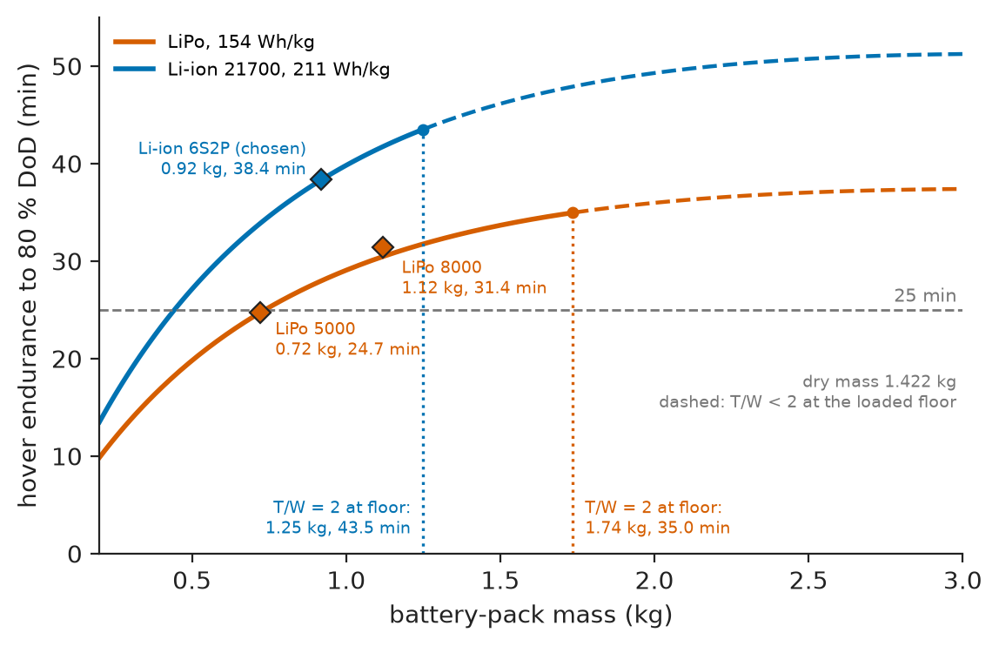

# Chapter 16 — Drones and Aerial Robotics

*Part IV · Robotics and Mechatronics*

A bridge-inspection company commissions a 2.3 kg quadcopter that must hover beside a pier for 20 minutes with a stabilised camera. On the bench every subsystem passes: the motors make their thrust on the stand, the flight controller holds level on a gimbal rig, the battery delivers its watt-hours. On the first outdoor hover the aircraft climbs 4 m on its own within a minute, and the log shows why: the flight controller is screwed hard to the frame, one propeller is out of balance, and the accelerometer, set to a ±4 g range, clips on the vibration peaks. Clipping on one side only rectifies the vibration into a false 1.5 m/s² of vertical acceleration, and the height estimator believes it. The team lowers the gyro filter cut-off from 80 Hz to 25 Hz to "hide the noise"; the next flight wobbles at 12 Hz in every gust, because the filter has eaten the phase margin of the attitude loop. Nothing was broken. A mechanical interface (the mount), a sensor setting (the range), a signal-processing choice (the filter) and a control budget (the phase margin) were each chosen alone, and a multirotor is the machine that punishes that most quickly.

> **How are the motors, propellers, speed controllers, battery and flight controller of a multirotor sized together against a hover-time, thrust and stability requirement?**
> **How is a flight-control stack made to work on a vibrating airframe, and how is a multirotor tested so that its first failure happens on the bench and not over a river?**

| Concept | Engineering destination |
|---|---|
| Multirotor architecture | Quad, hexa or coaxial layout for payload and redundancy; mass budget |
| Brushless motors | Kv and size for a propeller and a pack voltage; hover efficiency and heating |
| Electronic speed controllers | Commutation method, DShot or DroneCAN, current rating, input capacitors |
| Propeller selection | Thrust and power at hover, figure of merit, endurance versus agility |
| Flight-controller architecture | MCU, sensor buses, task rates, CPU and latency budgets |
| IMUs | Range, anti-alias filtering, vibration isolation, clipping |
| Attitude estimation | Complementary filter versus EKF; why a multirotor's accelerometer misleads |
| Flight-control loops | Cascaded rate, angle, velocity and position loops; mixer; filter and delay budget |
| Battery sizing | Endurance versus pack mass, LiPo versus Li-ion, voltage floor, C-rate |
| Safety and testing | Pre-arm checks, failsafes, staged test campaign, FMEA, regulatory class |

**Roadmap.** Requirements and architecture (16.1) → propulsion chain: motors (16.2), ESCs (16.3), propellers (16.4) → flight controller (16.5) and IMU (16.6) → estimation (16.7) and control loops (16.8) → the battery that closes the mass loop (16.9) → safety, verification and failure analysis (16.10).

---

## 16.1 Multirotor architecture

> **Boundary.** Kinematics, frames and actuator selection in general belong to Chapter 13; motor drivers, encoders and PID implementation on robots to Chapter 15. The aerodynamic and electrical theory under each block lives in the sibling books and is cited where used. This chapter owns the multirotor as an integrated design.

### The reference system

The running system is an **infrastructure-inspection quadcopter**: X configuration, 650 mm motor-to-motor diagonal, 13-inch propellers, a six-cell battery and a 250 g two-axis camera gimbal. It hovers beside bridge piers and wind-turbine towers in winds up to 10 m/s, within visual line of sight of a pilot. The requirements are written before any part is chosen (Chapter 1):

**Table 16.1 — Requirements of the inspection quadcopter.**

| ID | Requirement | Target | Verification |
|---|---|---|---|
| R1 | Mission endurance with 250 g payload, 20 °C, sea level | Mission of Table 16.11 with ≥ 20 % pack energy left at landing | Energy budget, then logged flights |
| R2 | Thrust-to-weight ratio at the loaded pack-voltage floor | ≥ 2.0 | Thrust stand at floor voltage |
| R3 | Maximum take-off mass (MTOW) | ≤ 2.5 kg | Weighing |
| R4 | Attitude step response (20° roll command) | 10–90 % rise ≤ 0.30 s, overshoot ≤ 10 % | Logged step tests |
| R5 | Rate-loop stability margins | PM ≥ 45°, GM ≥ 6 dB | Injected frequency sweep in hover |
| R6 | Position hold in 8 m/s wind | ±1.0 m horizontal, ±0.3 m vertical (95 %) | GNSS/RTK log |
| R7 | Vibration at the IMU | ≤ 3 g peak per axis; zero accelerometer clip events | Log analysis, 10 flights |
| R8 | Motor and ESC temperature after 25 min hover, 35 °C ambient | ≤ 100 °C | Thermocouples |
| R9 | Link loss and low battery | Return-to-home within 1.0 s of link loss; land at 15 % energy | Fault-injection flights |
| R10 | Arming safety | No motor output unless pre-arm checks pass and arm switch set with throttle low | Bench test, props off |

### Configuration

Four rotors are the minimum for full control of a fixed-pitch multirotor: collective thrust and three body torques. Roll and pitch come from differential thrust across the arms; yaw comes from the **reaction torque** of the propellers, so adjacent rotors spin in opposite directions and yaw is commanded by speeding up one diagonal pair and slowing the other. Yaw authority is therefore much weaker than roll and pitch authority, which shapes the mixer of Section 16.8.

**Table 16.2 — Multirotor layouts for the inspection role.**

| Layout | Motor-out tolerance | Propulsion mass | Efficiency (same span) | Verdict |
|---|---|---|---|---|
| **Quad X** | None | Lowest | Best (largest props) | **Chosen**: 2.5 kg, VLOS |
| Hexa | Controlled landing after one motor loss | +30–40 % | Slightly lower | Above about 5 kg or over people |
| Coaxial octo (X8) | Good | Compact | 15–25 % coaxial loss | Heavy payloads, small footprint |
| VTOL hybrid | Special | High | Far better in cruise | Long-range mapping |

The price of the quad is that a single propulsion failure is catastrophic, which the FMEA of Section 16.10 has to carry.

### Architecture and interfaces

Figure 16.1 shows the blocks and their interfaces. Three energy paths (battery to ESCs at 18–25 V and up to 65 A; a 5 V avionics rail; a 12 V gimbal rail), one fast control path (gyro to rate loop to DShot to ESC, under 1.5 ms) and several slow data paths (GNSS at 10 Hz, compass at 100 Hz, telemetry at 2–10 Hz) are drawn separately, because each has its own budget.

<!-- FIGURE 16.1 | figures/ch16/fig-16-1-quadcopter-architecture.png | block-diagram | Architecture of the inspection quadcopter: energy, control and data paths. | Content: battery 6S2P Li-ion 21.6 V 9 Ah -> power board with 0.5 mOhm shunt and divider -> four arrows 18-25 V up to 16 A to ESC1-ESC4 (30 A, 2x220 uF each) -> four 4114 320 Kv motors with 13x4.4 props, directions CCW, CCW, CW, CW. Regulators 5 V 3 A to flight controller and 12 V 1 A to gimbal. Flight controller STM32H743 with ICM-42688-P and BMI088 on SPI, BMP390 on I2C, microSD. GNSS u-blox M10 and RM3100 compass on 120 mm mast (UART, I2C). ELRS receiver (CRSF 150 Hz), MAVLink telemetry radio, gimbal on UARTs. FC to ESCs: bidirectional DShot600 with eRPM. Colours: energy red, control blue labelled 1.5 ms, data grey. -->



*Figure 16.1 — Architecture of the inspection quadcopter: energy, control and data paths.*

### Mass budget

Endurance, thrust and inertia all depend on mass, so the mass budget is the first budget written and the one most often overrun. Table 16.3 is the final configuration (battery from Section 16.9).

**Table 16.3 — Mass budget.**

| Item | Mass (g) |
|---|---|
| Frame: carbon plates, 4 arms, landing gear (650 mm) | 430 |
| Motors, 4 × 4114-class 320 Kv | 392 |
| Propellers, 4 × 13x4.4 carbon | 68 |
| ESCs, 4 × 30 A, arm-mounted | 72 |
| Avionics: FC, GNSS mast, receiver, telemetry, power board | 140 |
| Wiring and connectors | 70 |
| Payload: gimbal and camera | 250 |
| Battery, 6S2P Li-ion 21700 | 920 |
| **All-up mass** | **2342** |
| Limit (R3) and margin | 2500; 158 g (6.3 %) |

A 6 % margin is thin; cable ties, a bigger antenna and a sun hood typically add 3–5 % before first flight. The margin is defended by a rule: any addition is weighed and booked against this table before it is fitted.

---

## 16.2 Brushless motors

> **Boundary.** The BLDC motor, its back-EMF, commutation and the $K_v$–$K_t$ relation are in *Electrical Energy and Machines*, Ch. 8 §8.2 ([link](https://github.com/The-Studio-of-Sadiq/Electrical-Energy-and-Machines/blob/main/part-2-transformers-and-electrical-machines/08-special-electrical-machines.md)), including a worked drone-motor example. Here they are used to choose a motor.

### Choosing $K_v$

A multirotor motor is an outrunner PM machine driving a fixed-pitch propeller directly, so it runs where its torque–speed line meets the propeller's load curve. The sizing relations from Book 5 are $E=n/K_v$ ($n$ in rpm), $K_t=60/(2\pi K_v)$ in N·m/A, $Q=K_t(I-I_0)$ and $V_m=E+IR$, with $V_m$ the duty-averaged motor voltage and $R$ the line-to-line resistance.

> **Status of the principle: DC-equivalent motor model for sizing**
> *Approximate.* Treating a BLDC/PMSM motor as $V_m=E+IR$, $Q=K_t(I-I_0)$ ignores commutation ripple, speed-dependent iron loss and the rise of $R$ with temperature (+0.39 %/K); it predicts operating points within about 5–10 % below about 80 % of rated current.

$K_v$ is a choice of winding turns, bracketed by three conditions: **hover near 50–60 % throttle** at nominal voltage (equal control headroom above and below hover); **T/W ≥ 2 at the loaded voltage floor** (R2); and **full-throttle current within the motor and ESC rating** on a fresh pack (25.2 V).

**Table 16.4 — Motor candidates for 13x4.4 propellers on 6S (indicative values, 2026).**

| Motor class | $K_v$ (rpm/V) | $R$ (Ω) | Mass (g) | Hover throttle | T/W at floor | Full-throttle current | Verdict |
|---|---|---|---|---|---|---|---|
| 4014 | 400 | 0.105 | 105 | 0.42 | > 3.5 | 22–27 A | Over-powered; poor resolution at hover |
| **4114** | **320** | **0.15** | **98** | **0.56** | **2.28** | **15.8 A** | **Chosen** |
| 3510 | 360 | 0.20 | 78 | 0.53 | 2.4 | ≈ 17 A | Lighter; 15 °C hotter at hover |
| 4116 | 260 | 0.20 | 125 | 0.70 | < 2 | ≈ 11 A | Fails R2 on a sagging pack |

**Worked example — the hover operating point.** Each motor lifts $T=2.342\times9.81/4=5.74$ N (585 gf). With the propeller model of Section 16.4 ($C_T=0.105$, $C_P=0.042$, $D=0.330$ m), the speed is $n=\sqrt{T/(C_T\rho D^4)}=61.3$ rev/s (3677 rpm) and the torque $Q=C_P\rho n^2D^5/2\pi=0.121$ N·m. With $K_t=60/(2\pi\times320)=0.0298$ N·m/A, $I=0.121/0.0298+0.5=4.55$ A. The back-EMF is $3677/320=11.49$ V and $V_m=11.49+4.55\times0.15=12.17$ V, a duty of $12.17/21.6=0.56$. Shaft power is $0.121\times2\pi\times61.3=46.5$ W, electrical input $12.17\times4.55=55.3$ W, efficiency 84 %, copper loss $4.55^2\times0.15=3.1$ W.

The thermal limit (R8) matters only in sustained climbs. With roughly 4–6 K/W from winding to air in downwash, hover losses (3.1 W copper plus 2–3 W iron) give about 30 K of rise; a sustained 9 A climb gives about 65 K, which at 35 °C ambient approaches the 100 °C limit chosen to protect magnet adhesive and bearing grease.

---

## 16.3 Electronic speed controllers

> **Boundary.** The three-phase bridge and six-step commutation are in *Electronics and Computing*, Ch. 32 §32.5 ([link](https://github.com/The-Studio-of-Sadiq/Electronics-and-Computing/blob/main/part-7-power-electronics/32-motor-drives-and-power-conversion.md)); PMSM field-oriented control in *Electrical Energy and Machines*, Ch. 12 §12.8 ([link](https://github.com/The-Studio-of-Sadiq/Electrical-Energy-and-Machines/blob/main/part-3-motor-drives/12-ac-motor-drives.md)).

### Commutation method

Propeller ESCs are sensorless. **Six-step** firmware (BLHeli_32, AM32, Bluejay class) times commutation from back-EMF zero crossings: fast, cheap and light, but prone to **desynchronisation** after a large throttle step on a heavy propeller or during demagnetisation at high current. **Sensorless FOC** (sinusoidal drive with a rotor-angle observer) is quieter and 2–5 % more efficient at part load, at the cost of a faster MCU; its low-speed weakness does not matter for a propeller. On a quad a desync is a crash, so the reference design uses FOC ESCs, or six-step firmware with demagnetisation compensation and a throttle slew limit.

### Protocol between flight controller and ESC

**Table 16.5 — ESC command protocols.**

| Protocol | Signal | Update rate | Frame latency | Error detection | Telemetry |
|---|---|---|---|---|---|
| Standard PWM | 1000–2000 µs pulse | 50–490 Hz | up to 2 ms | None | None |
| OneShot125 / Multishot | 125–250 µs / 5–25 µs pulse | up to 4–32 kHz | 0.25 ms / 25 µs | None | None |
| **DShot600** | 16 bits: 11 throttle, 1 telemetry, 4 CRC; 1.67 µs/bit | up to 8 kHz | 26.7 µs | 4-bit CRC | Bidirectional: eRPM every frame |
| DroneCAN | CAN 1 Mbit/s | 400 Hz typical | ≈ 0.2 ms | CRC | Current, voltage, temperature, rpm |

Pulse protocols have no error detection: a glitch is a throttle command. The design uses **bidirectional DShot600** for integration reasons: the CRC rejects corrupted frames, and the eRPM from every motor feeds the RPM-tracking notch filters of Section 16.6. Aircraft above about 10 kg move to DroneCAN.

### Current rating and input capacitors

Full-throttle current on a fresh pack is 15.8 A per motor; a 30 A ESC gives a factor of 1.9 for a bent propeller and 45 °C ambient.

**Worked example — input capacitor of one ESC.** The bridge draws pulsed current that the battery leads (0.25 µH of loop inductance for 300 mm of 12 AWG pair) cannot supply. The RMS ripple current is $I\sqrt{D(1-D)}$ (*Electronics and Computing*, Ch. 30 §30.6), worst at $D=0.5$: for 12.4 A, 6.2 A RMS. The voltage ripple $\Delta V\approx ID(1-D)/(f_sC)$ with $f_s=24$ kHz and $C=440$ µF is $12.4\times0.25/(24\,000\times440\times10^{-6})=0.29$ V, 1.3 % of 21.6 V. Two 220 µF, 35 V polymer capacitors rated 3.5 A RMS each share the 6.2 A; one electrolytic of the same value rated 1.5 A would overheat. Without local capacitance, a 20 A edge of 100 ns in the lead inductance makes $L\,di/dt=0.25\times10^{-6}\times20/10^{-7}=50$ V of spike on a 25 V bus, which is how 30 V MOSFETs die on the first punch-out.

---

## 16.4 Propeller selection

### Thrust, power and the figure of merit

Propeller data are dimensionless coefficients from thrust-stand or wind-tunnel tests:

$$
T=C_T\,\rho\,n^2D^4,\qquad P=C_P\,\rho\,n^3D^5,
$$

with $n$ in rev/s and $D$ in metres. For the 13x4.4 carbon propeller static values $C_T\approx0.105$ and $C_P\approx0.042$ are typical; manufacturer stand data beat generic tables because coefficients fall 10–20 % at small-prop Reynolds numbers.

Ideal (momentum-theory) hover power is $P_{\text{ideal}}=T^{3/2}/\sqrt{2\rho A}$, and the **figure of merit** $FM=P_{\text{ideal}}/P_{\text{shaft}}$. Here $A=0.0856$ m², disc loading $5.74/0.0856=67$ N/m², $P_{\text{ideal}}=30.1$ W and $FM=30.1/46.5=0.65$, typical of good small propellers (0.6–0.75).

> **Status of the principle: Momentum-theory hover power**
> *Approximate.* The actuator-disc result assumes uniform inflow, no swirl and no profile drag; it is a lower bound corrected by a measured figure of merit, and it gives the design rule that hover power per newton falls with disc loading, that is, with larger propellers.

### The endurance–agility trade

Bigger, slower propellers cut hover power, but their inertia grows roughly as $D^5$, and so does the thrust time constant that limits attitude bandwidth (Section 16.8): about 45 ms for the 13-inch propeller on a 4114 motor, 10–15 ms for a 5-inch racing propeller.

**Table 16.6 — Propeller options for the 2.34 kg quad (indicative, at hover).**

| Propeller | Disc loading (N/m²) | Hover rpm | Battery-side power per motor (W) | Thrust time constant | Comment |
|---|---|---|---|---|---|
| 11x4.5 | 94 | ≈ 5100 | ≈ 70 | ≈ 35 ms | +20 % power; more agile |
| **13x4.4** | **67** | **3677** | **58** | **≈ 45 ms** | **Chosen** |
| 15x5 | 50 | ≈ 2800 | ≈ 50 | ≈ 65 ms | Needs 700 mm+ frame; slower gust recovery |

At hover the rotor frequency is 61.3 Hz and the two-blade passing frequency 123 Hz; both reappear in Sections 16.6 and 16.8.

Each motor–propeller–ESC set is characterised on a thrust stand (load cell, shunt, optical tachometer) before integration, to check the model and to confirm the monotonic throttle-to-thrust curve the mixer assumes. Figure 16.2 shows the result: hover at 56 % throttle, and specific thrust falling from 16 gf/W at low throttle to 6 gf/W at full throttle, which is why sustained high throttle costs endurance far out of proportion to the extra thrust.

<!-- FIGURE 16.2 | figures/ch16/fig-16-2-thrust-stand.png | plot | Thrust-stand characterisation of one 4114 320 Kv motor with 13x4.4 propeller at 21.6 V. | Content: x-axis throttle 0 to 100 percent. Left y-axis thrust 0 to 1800 gf through (20, 77), (40, 302), (50, 465), (60, 660), (80, 1139), (100, 1727). Right y-axis battery-side power 0 to 300 W through (20, 4.7), (40, 23.5), (50, 42.2), (60, 69), (80, 152), (100, 283). Inset: specific thrust 16.4 gf/W at 20 percent, 11.0 at 50 percent, 6.1 at 100 percent. Dashed vertical line at 56 percent labelled hover 585 gf, 58 W; dashed horizontal line at 1170 gf labelled T/W = 2. Measured points with plus or minus 2 percent error bars. -->



*Figure 16.2 — Thrust-stand characterisation of one 4114 320 Kv motor with 13x4.4 propeller at 21.6 V.*

---

## 16.5 Flight-controller architecture

> **Boundary.** MCU selection and firmware architecture are owned by Chapter 10 of this book and by *Electronics and Computing*, Ch. 25 §25.3; SPI and I²C by Ch. 26 §26.3–26.4 ([link](https://github.com/The-Studio-of-Sadiq/Electronics-and-Computing/blob/main/part-6-embedded-and-real-time-systems/26-embedded-interfaces.md)); scheduling and jitter by Ch. 27 §27.3 and §27.10 ([link](https://github.com/The-Studio-of-Sadiq/Electronics-and-Computing/blob/main/part-6-embedded-and-real-time-systems/27-real-time-computing.md)).

### Hardware and stack

- **MCU**: STM32H743 (Cortex-M7, 480 MHz, double-precision FPU), enough for an EKF at 200 Hz beside the fast loops. Racing boards use F4/F7 parts because they run no EKF.
- **Two IMUs of different makes on separate SPI buses** (ICM-42688-P and BMI088), so that a fault or resonance in one does not affect both identically.
- **Barometer** (BMP390 class) under open-cell foam, shielded from propeller wash and light.
- **GNSS and magnetometer on a 120 mm mast**: 60 A in a conductor 10 cm away makes $\mu_0I/2\pi r=120$ µT, more than the Earth's 50 µT.
- **microSD logger**, the instrument that diagnoses every failure in this chapter.

The aircraft needs position hold, failsafes and missions, so it runs **PX4** (NuttX, EKF2) or **ArduPilot** (ChibiOS, EKF3) rather than a rate-only racing stack such as Betaflight. The integration work is configuration, tuning and verification, not writing the stack.

### CPU and latency budgets

**Table 16.7 — Task-rate and CPU budget on the STM32H743 (measured with a cycle counter).**

| Task | Rate | Execution time | CPU load |
|---|---|---|---|
| IMU FIFO read (DMA), gyro low-pass and notch filters | 8 kHz | 6 µs | 4.8 % |
| Rate controller and mixer | 1 kHz | 35 µs | 3.5 % |
| Attitude controller | 250 Hz | 15 µs | 0.4 % |
| EKF (24 states) | 200 Hz | 400 µs | 8.0 % |
| Position and velocity control | 50 Hz | 60 µs | 0.3 % |
| Logging, MAVLink, failsafe and mission logic | mixed | | 12 % |
| **Total; margin to 70 % ceiling** | | | **29 %; 41 points** |

The 70 % ceiling leaves room for bursts (SD-card write stalls, GNSS reacquisition) that averages hide. The rate loop's total delay is a phase cost at crossover (*Circuits, Signals and Communications*, Ch. 35 §35.8), so it is budgeted per link:

**Table 16.8 — Gyro-to-thrust latency budget of the rate loop.**

| Link | Delay |
|---|---|
| IMU anti-alias filter and 8 kHz ODR | 0.25 ms |
| SPI/DMA and interrupt | 0.03 ms |
| Filtering and controller computation | 0.07 ms |
| DShot600 frame | 0.03 ms |
| ESC processing and next PWM period | 0.12 ms |
| Zero-order hold of the 1 kHz output (half sample) | 0.50 ms |
| **Sum; budget used in Section 16.8; margin** | **1.00 ms; 1.50 ms; 0.50 ms (33 %)** |

The gyro filters are not in this table; their frequency-dependent lag is designed into the loop in Section 16.8.

---

## 16.6 IMUs

> **Boundary.** Sensor selection belongs to Chapter 6; aliasing and anti-alias filters to *Circuits, Signals and Communications*, Ch. 19 §19.4 and §19.9 ([link](https://github.com/The-Studio-of-Sadiq/Circuits-Signals-and-Communications/blob/main/part-4-signals-and-systems/19-sampling-and-reconstruction.md)); noise density to *The Mathematics Universe*, Ch. 21 §21.4–21.6.

### What a flight IMU must survive

Noise is not the limit: the ICM-42688-P's gyro noise over an 80 Hz bandwidth is $0.0028\times\sqrt{80\times1.11}\approx0.026$ °/s RMS, three orders of magnitude below the vibration on a hard-mounted board. What decides the choice is **behaviour under vibration**: range, anti-alias filtering before the internal ADC, output data rate and proof-mass resonance.

**Table 16.9 — MEMS IMUs for flight controllers (typical datasheet values).**

| Part class | Gyro noise (°/s/√Hz) | Accel noise (µg/√Hz) | Accel range | Max ODR gyro / accel | Programmable AAF |
|---|---|---|---|---|---|
| MPU-6000 (legacy) | 0.005 | 400 | ±16 g | 8 / 1 kHz | Limited |
| ICM-20602 | 0.004 | 100 | ±16 g | 8 / 4 kHz | DLPF |
| **ICM-42688-P (primary)** | **0.0028** | **70** | **±16 g** | **32 / 32 kHz** | **Yes** |
| **BMI088 (secondary)** | **0.014** | **175** | **±24 g** | **2 / 1.6 kHz** | Fixed; vibration-robust design |

### Clipping, rectification and aliasing

Vibration at the IMU is dominated by the rotor frequency (imbalance, 61 Hz here), the blade-passing frequency (123 Hz), their harmonics and the frame resonances they excite. Two mechanisms turn it into a slow error that no filter after the ADC can remove: **clipping**, which rectifies vibration into a bias, and **aliasing**, which folds vibration above half the sampling rate onto low frequencies.

**Worked example — the opening failure, in numbers.** The hard-mounted board saw 4.0 g of vertical vibration at 61 Hz on top of the 1 g hover specific force, so the signal swung from $-5$ g to $+3$ g. In the ±4 g range the negative peaks were cut at $-4$ g. Averaging the clipped sine numerically gives $-0.848$ g instead of $-1.000$ g: a false 0.152 g, or 1.49 m/s², reduction in specific force, which the estimator read as a downward acceleration; the altitude controller added thrust and the aircraft climbed. At 3.5 g amplitude the bias is 0.56 m/s²; at 3.0 g it is zero; in the ±16 g range nothing clips. The range went to ±16 g, and R7 was written as a 3 g peak limit with zero clip events, checked from the log on every flight.

**Worked example — aliasing of a frame resonance.** On an earlier board the accelerometer sampled at 1 kHz behind a weak filter, and an arm bending mode at 1,030 Hz appeared in the log at $\lvert1030-1000\rvert=30$ Hz, inside the velocity estimator's bandwidth. Raising the ODR to 8 kHz with the programmable anti-alias filter set near 1 kHz puts the line below the 4 kHz Nyquist frequency, where the filters attenuate it before decimation.

> **Status of the principle: Vibration rectification by clipping**
> *Derived.* A zero-mean vibration added to a non-zero mean and clipped asymmetrically changes the mean, as averaging the clipped waveform shows for any waveform; the only cure is not to clip (range and isolation), not filtering afterwards.

### Isolation, balancing and RPM notches

An isolator attenuates only above $\sqrt2$ times its natural frequency (*Engineering Physics*, Ch. 19 §19.1.3, [link](https://github.com/The-Studio-of-Sadiq/Engineering-Physics/blob/main/CHAPTERS/CHAPTER%2019.md)); a 15–25 Hz mount attenuates the 61 Hz line by a factor of about 5–15. The mount must stay away from the 8.8 Hz attitude crossover, or the IMU moves relative to the airframe inside the loop. Silicone grommets or a gel pad under the IMU carrier typically give 18–30 Hz. Balanced propellers (under 0.1 g·cm) and true shafts reduce the excitation itself. Figure 16.3 shows the spectra before and after.

<!-- FIGURE 16.3 | figures/ch16/fig-16-3-imu-vibration-spectrum.png | plot | Vertical accelerometer spectrum in hover: hard mount with an unbalanced propeller versus 20 Hz soft mount with balanced propellers. | Content: x-axis 0 to 500 Hz; y-axis amplitude 0.001 to 10 g logarithmic. Red trace (hard mount): 4.0 g at 61 Hz, 1.2 g at 123 Hz, 0.5 g at 184 Hz, 0.3 g at 245 Hz, floor 0.05 g. Blue trace (soft mount, balanced): 0.35 g at 61 Hz, 0.12 g at 123 Hz, harmonics below 0.03 g, floor 0.005 g. Dashed lines at 3 g (R7 limit) and 4 g (old range). Shaded band 0 to 15 Hz labelled control bandwidth. -->



*Figure 16.3 — Vertical accelerometer spectrum in hover: hard mount with an unbalanced propeller versus 20 Hz soft mount with balanced propellers.*

What isolation leaves, the filters remove at known frequencies: the eRPM telemetry centres a notch on each motor's rotor frequency and its second harmonic, tracking throttle. Narrow notches (eight in all, coinciding on two frequencies in steady hover) cost far less phase at crossover than one low-pass at 25 Hz (Section 16.8), the quantitative reason the opening's filter change was the wrong fix.

---

## 16.7 Attitude estimation

> **Boundary.** Observers and the Kalman filter are in *Circuits, Signals and Communications*, Ch. 35 §35.7 ([link](https://github.com/The-Studio-of-Sadiq/Circuits-Signals-and-Communications/blob/main/part-7-control-system-fundamentals/35-control-design-fundamentals.md)); Gauss–Markov bias models in *The Mathematics Universe*, Ch. 21 §21.5. Sensor fusion as an embedded task is introduced in Chapters 12 and 15.

### Gyro, accelerometer and the fusion trade

The gyro measures body rates with low noise but a bias that drifts with temperature (0.1–0.5 °/s on consumer parts during warm-up). The accelerometer measures **specific force**, not gravity; on a static IMU that gives tilt. A complementary filter blends the two with one time constant $\tau$:

$$
\hat\theta_k=\alpha\left(\hat\theta_{k-1}+\omega_k\,\Delta t\right)+(1-\alpha)\,\theta_{\text{acc},k},\qquad \alpha=\frac{\tau}{\tau+\Delta t}.
$$

### Why a multirotor's accelerometer misleads

A multirotor's thrust is along body $z$. In a drag-free idealisation an aircraft banked at $\theta$ accelerates sideways at $g\tan\theta$ and its accelerometer reads only thrust, perpendicular to the rotor plane: **it reads "level" while banked**. What the lateral axis actually senses is rotor drag, roughly proportional to airspeed, which builds up as the aircraft gains speed. Accelerometer tilt is right in steady flight and wrong in every manoeuvre, with an error decaying at the drag time constant $m/k$ (about 3 s here). A short $\tau$ pulls the estimate toward zero during manoeuvres; a long $\tau$ lets gyro bias through.

**Worked example — the best complementary filter is not good enough.** A 300 s simulation at 250 Hz (Python, fixed seed) of manoeuvres in 6 s legs of ±15° bank or hover, a gyro with 0.3 °/s residual bias and the ICM-42688-P's noise, and a lateral accelerometer sensing rotor drag ($k/m=0.3$ s⁻¹) plus 0.03 g of residual vibration gives these RMS roll errors:

| Estimator | Gyro only | Accel only | CF $\tau$=0.3 s | 1 s | 3 s | 10 s | 30 s |
|---|---|---|---|---|---|---|---|
| RMS error (°) | 51.9 | 8.0 | 7.5 | 6.7 | 4.9 | 3.7 | 8.3 |

The best filter ($\tau\approx10$ s) still has 3.7° RMS error. Near hover it does much better, which is why simple filters fly racing quads (the pilot closes the outer loop), but the ±1 m position hold of R6 needs about 1° of attitude accuracy.

> **Status of the principle: Accelerometer tilt on a multirotor**
> *Approximate.* "The accelerometer measures thrust, not gravity" holds for a rigid multirotor with thrust along body $z$ and drag proportional to airspeed; it explains why accelerometer tilt is valid only in unaccelerated flight and why velocity aiding (GNSS, optical flow) is needed in manoeuvres.

### The EKF in practice

PX4's EKF2 and ArduPilot's EKF3 estimate attitude, velocity, position, gyro and accelerometer biases, magnetic fields and wind (22–24 states). GNSS velocity makes attitude observable in manoeuvres (an accelerating aircraft must be tilted to produce the measured velocity change). The integrator's job is to give the filter honest inputs: the **GNSS delay** (100–200 ms) and the antenna **lever arm** (0.12 m up) as parameters; **noise parameters** that match the isolated IMU (inflating them "for vibration" makes the filter trust nothing); **innovation logging** (the opening climb shows as barometer innovations saturating); and a **compass-motor calibration**, fitted from a tethered throttle sweep, because 60 A of battery current shifts the field at the compass by several microtesla.

---

## 16.8 Flight-control loops

> **Boundary.** PID structure, anti-windup and derivative filtering are in *Circuits, Signals and Communications*, Ch. 35 §35.2; margins and loop shaping in Ch. 35 §35.4 and Ch. 34 §34.9 ([link](https://github.com/The-Studio-of-Sadiq/Circuits-Signals-and-Communications/blob/main/part-7-control-system-fundamentals/34-feedback-and-stability.md)); PID implementation on robot hardware in Chapter 15.

### The cascade

The controller is a cascade (Figure 16.4): **position** (about 0.1 Hz bandwidth) commands velocity; **velocity** (about 0.3 Hz) commands acceleration, converted to a thrust vector and a desired attitude; **angle** (a proportional gain of 6.5 s⁻¹, about 1 Hz) commands body rates; **rate** (8.8 Hz crossover here, 30–100 Hz on a racing quad) commands torques, which the **mixer** turns into four motor commands. Each loop is at least three times slower than the one inside it, so each is tuned treating its inner loop as ideal.

<!-- FIGURE 16.4 | figures/ch16/fig-16-4-cascaded-flight-control.png | block-diagram | Cascaded flight-control structure with the rate of each loop. | Content: left to right: position setpoint -> position P (50 Hz, 0.1 Hz bandwidth) -> velocity PID (50 Hz) -> thrust vector to attitude -> angle P (250 Hz, K = 6.5 1/s) -> rate PID (1 kHz, crossover 8.8 Hz) -> mixer with desaturation -> DShot600 -> ESCs and motors (45 ms thrust lag) -> airframe (J = 0.038 kg m2). Feedback beneath: gyro (8 kHz, LPF 80 Hz, RPM notches 61 and 123 Hz) to rate loop; EKF attitude (200 Hz) to angle loop; EKF velocity and position (GNSS 10 Hz, baro) to outer loops. Collective thrust from velocity loop into mixer. -->



*Figure 16.4 — Cascaded flight-control structure with the rate of each loop.*

### The rate-loop plant

From normalised torque command $u$ to body rate, the plant is an integrator behind the motor lag and the delay:

$$
\frac{\omega(s)}{u(s)}=\frac{\tau_{\max}/J_{xx}}{s\,(\tau_m s+1)}\,e^{-sT_d}.
$$

Each motor is at 5.74 N in hover and can fall to about 0.3 N, so the symmetric differential thrust is 5.44 N; with a lateral arm of $0.325/\sqrt2=0.230$ m the maximum roll torque is $4\times5.44\times0.230=5.0$ N·m. The roll inertia, estimated from the mass budget and confirmed by a bifilar-pendulum test, is $J_{xx}=0.038$ kg·m² (132 rad/s² peak). $\tau_m=45$ ms and $T_d=1.5$ ms (Table 16.8).

**Worked example — what the gyro filter costs.** The listing computes crossover, phase margin, gain margin and the peak of the sensitivity $\lvert1/(1+L)\rvert$ for the chosen PID gains with three filter configurations: the original 80 Hz second-order low-pass, the opening's 25 Hz low-pass, and 80 Hz plus RPM notches at the hover rotor frequency and its second harmonic.

```python
import numpy as np
J, Tmax, tau_m, Td = 0.038, 5.0, 0.045, 1.5e-3      # kg m^2, N m, s, s
Kp, Ki, Kd, fD = 0.6, 2.0, 0.016, 40.0              # rate PID (u per rad/s), D-filter Hz
w = 2*np.pi*np.logspace(-1, 2.7, 20000); s = 1j*w

def lpf2(fc):                                       # 2nd-order Butterworth gyro filter
    wc = 2*np.pi*fc; return wc**2/(s**2 + np.sqrt(2)*wc*s + wc**2)
def notch(f0, q=3.0):                               # RPM-tracking notch, frozen at hover
    w0 = 2*np.pi*f0; return (s**2 + w0**2)/(s**2 + w0/q*s + w0**2)

def margins(gyro):
    C = Kp + Ki/s + Kd*s/(1 + s/(2*np.pi*fD))
    P = (Tmax/J)/(s*(tau_m*s + 1))*np.exp(-s*Td)
    L = C*P*gyro
    ic = np.argmin(np.abs(np.abs(L) - 1))
    pm = 180 + np.degrees(np.angle(L[ic]))
    x = np.where((np.sign(L.imag[:-1]) != np.sign(L.imag[1:])) & (L.real[:-1] < 0))[0]
    k = x[np.argmax(np.abs(L[x]))]                  # worst crossing of the negative real axis
    ms = np.max(np.abs(1/(1 + L))); im = np.argmax(np.abs(1/(1 + L)))
    return w[ic]/2/np.pi, pm, -20*np.log10(np.abs(L[k])), w[k]/2/np.pi, 20*np.log10(ms), w[im]/2/np.pi

for name, gy in [("LPF 80 Hz", lpf2(80)), ("LPF 25 Hz", lpf2(25)),
                 ("LPF 80 Hz + notches 61/123 Hz", lpf2(80)*notch(61)*notch(123))]:
    fc, pm, gm, f180, ms, fms = margins(gy)
    print(f"{name:30s} fc={fc:4.1f} Hz PM={pm:4.1f} deg GM={gm:4.1f} dB at {f180:4.1f} Hz"
          f" Ms={ms:3.1f} dB at {fms:4.1f} Hz")
```

```text
LPF 80 Hz                      fc= 8.8 Hz PM=54.0 deg GM=13.2 dB at 30.8 Hz Ms=3.5 dB at 17.1 Hz
LPF 25 Hz                      fc= 8.7 Hz PM=33.6 deg GM= 6.1 dB at 15.4 Hz Ms=7.9 dB at 12.0 Hz
LPF 80 Hz + notches 61/123 Hz  fc= 8.8 Hz PM=49.8 deg GM=11.0 dB at 25.4 Hz Ms=4.2 dB at 15.7 Hz
```

The 25 Hz filter leaves the crossover unchanged but costs 20° of phase margin and drops the gain margin to 6.1 dB; the 7.9 dB sensitivity peak amplifies gusts near 12 Hz 2.5 times. That is the opening's 12 Hz wobble, predicted before flight. Two tracking notches cost only 4° and keep both margins inside R5 (Figure 16.5).

<!-- FIGURE 16.5 | figures/ch16/fig-16-5-rate-loop-bode.png | plot | Open-loop frequency response of the roll-rate loop for three gyro-filter configurations. | Content: two panels, x-axis 0.5 to 200 Hz logarithmic. Top: magnitude of L from -40 to +40 dB for LPF 80 Hz (blue), LPF 25 Hz (red), LPF 80 Hz plus notches at 61 and 123 Hz (green, narrow dips); all cross 0 dB at 8.8 Hz. Bottom: phase -360 to -90 degrees with a -180 line; annotate PM 54.0, 33.6, 49.8 degrees and GM 13.2 dB at 30.8 Hz, 6.1 dB at 15.4 Hz, 11.0 dB at 25.4 Hz; note sensitivity peaks 3.5, 7.9, 4.2 dB. -->



*Figure 16.5 — Open-loop frequency response of the roll-rate loop for three gyro-filter configurations.*

> **Status of the principle: Filter phase lag at crossover**
> *Derived.* A second-order Butterworth low-pass at $f_c$ lags by $\arctan\!\big(\sqrt2\,x/(1-x^2)\big)$ with $x=f/f_c$, about $9^\circ$ at $x=0.11$ and $30^\circ$ at $x=0.35$; every filter in the feedback path subtracts its lag at crossover from the phase margin, so filter design on a flight controller is part of loop design, not a separate noise fix.

A time-domain simulation of the same loop at 1 kHz (motor lag, delay, filters, saturation) gives, for a 20° roll command, a 10–90 % rise time of 219 ms and no overshoot (R4); a 1 rad/s rate step overshoots 10 % with the 80 Hz filter and 16 % with 25 Hz. These are simulated; Section 16.10 compares them with flight logs.

### Implementation: rate PID and mixer

The listing is the core of the 1 kHz task: a rate PID with derivative on measurement, a first-order derivative filter and conditional-integration anti-windup, then the quad-X mixer with **desaturation**. If a large torque and high collective would push a motor past full throttle, the mixer shifts the collective so that torque, which keeps the aircraft upright, is preserved at the expense of thrust; if the torque request alone spans more than the full range, the outputs saturate and the PID stops integrating.

```c
/* rate_ctrl.c -- body-rate PID and quad-X mixer, 1 kHz task (C11, illustrative) */
#include <math.h>
#include <stdbool.h>

typedef struct {
    float kp, ki, kd, d_alpha, i_lim;   /* gains in normalised torque per rad/s */
    float integ, meas_prev, d_filt;
} rate_pid_t;

static float clampf(float x, float lo, float hi) { return x < lo ? lo : (x > hi ? hi : x); }

float rate_pid_step(rate_pid_t *c, float ref, float meas, float dt, bool saturated)
{
    float e = ref - meas;
    float d = -(meas - c->meas_prev) / dt;          /* derivative on measurement */
    c->meas_prev = meas;
    c->d_filt += c->d_alpha * (d - c->d_filt);      /* first-order D-term filter */
    if (!saturated)                                 /* conditional-integration anti-windup */
        c->integ = clampf(c->integ + c->ki * e * dt, -c->i_lim, c->i_lim);
    return clampf(c->kp * e + c->integ + c->kd * c->d_filt, -1.0f, 1.0f);
}

/* PX4 quad-X order: 1 front-right CCW, 2 rear-left CCW, 3 front-left CW, 4 rear-right CW */
static const float MIX[4][3] = { /* roll, pitch, yaw */
    { -1.0f,  1.0f,  1.0f }, {  1.0f, -1.0f,  1.0f },
    {  1.0f,  1.0f, -1.0f }, { -1.0f, -1.0f, -1.0f } };

/* thrust in [0,1], tau[] in [-1,1]; returns true when torque could not be delivered */
bool mix_quad_x(float thrust, const float tau[3], float out[4])
{
    float lo = 2.0f, hi = -2.0f;
    for (int i = 0; i < 4; ++i) {
        out[i] = thrust + 0.5f * (MIX[i][0] * tau[0] + MIX[i][1] * tau[1])
                        + 0.25f * MIX[i][2] * tau[2];
        lo = fminf(lo, out[i]); hi = fmaxf(hi, out[i]);
    }
    bool sat = (hi - lo) > 1.0f;
    float shift = 0.0f;
    if (sat)             shift = 0.5f - 0.5f * (hi + lo);   /* centre the spread */
    else if (hi > 1.0f)  shift = 1.0f - hi;                 /* trade thrust for torque */
    else if (lo < 0.0f)  shift = -lo;
    for (int i = 0; i < 4; ++i) out[i] = clampf(out[i] + shift, 0.0f, 1.0f);
    return sat;
}
```

Yaw gets half the roll and pitch coefficient because reaction-torque authority is weak and a large yaw demand must not consume the differential thrust that roll and pitch need. Before first flight the mixer is checked props-off: rolling the frame right by hand must speed up the two left motors, a nose-up pitch must slow the front motors, and each motor must turn the way the yaw sign assumes. A mixer sign error is the classic cause of a multirotor flipping at take-off. Tuning then follows the cascade from the inside out (rate, angle, velocity, position); autotune routines that inject steps or chirps converge well only on a clean IMU, so R7 is verified before any autotune.

---

## 16.9 Battery sizing

> **Boundary.** Chemistries, C-rate, internal resistance and usable energy are in *Electrical Energy and Machines*, Ch. 16 §16.1–16.2 ([link](https://github.com/The-Studio-of-Sadiq/Electrical-Energy-and-Machines/blob/main/part-4-power-generation/16-energy-storage.md)); electrode materials in *Materials Science and Engineering*, Ch. 40 §40.2. Pack architecture and BMS design are owned by Chapter 23.

### The mass loop

A heavier pack stores more energy but raises hover power, which grows as mass to the power 1.5 by momentum theory; endurance rises with pack mass, flattens and eventually falls, and before that the thrust-to-weight requirement (R2) cuts it off. The listing closes the loop with the propulsion model of Sections 16.2–16.4: all-up mass, hover battery power (95 % ESC efficiency, 10 W for avionics and gimbal), hover endurance to 80 % depth of discharge, and T/W at the loaded floor (3.5 V/cell LiPo, 3.2 V/cell Li-ion, less 2 % wiring drop).

```python
import numpy as np
from scipy.optimize import brentq
rho, g = 1.225, 9.81
D, CT, CP = 13*0.0254, 0.105, 0.042      # 13x4.4 carbon prop, static coefficients
Kv, R, I0 = 320.0, 0.15, 0.5             # 4114-class motor
Kt = 60/(2*np.pi*Kv)
eta_esc, P_aux, m_dry = 0.95, 10.0, 1.422

def point_T(T):                          # motor operating point for thrust T (N)
    n = np.sqrt(T/(CT*rho*D**4))
    I = CP*rho*n**2*D**5/(2*np.pi)/Kt + I0
    return n, I, n*60/Kv + I*R
def point_V(Vm):                         # full throttle at motor voltage Vm
    f = lambda n: n*60/Kv + (CP*rho*n**2*D**5/(2*np.pi)/Kt + I0)*R - Vm
    n = brentq(f, 1, 500); I = CP*rho*n**2*D**5/(2*np.pi)/Kt + I0
    return n, I, CT*rho*n**2*D**4
def p_hover(m):
    n, I, V = point_T(m*g/4)
    return 4*V*I/eta_esc + P_aux, n, I, V

packs = {"LiPo 6S 5000": (111.0, 0.72, 22.2), "LiPo 6S 8000": (177.6, 1.12, 22.2),
         "Li-ion 6S1P 4.5Ah": (97.2, 0.47, 21.6), "Li-ion 6S2P 9Ah": (194.4, 0.92, 21.6)}
for name, (E, mb, Vn) in packs.items():
    m = m_dry + mb
    P, n, I, V = p_hover(m)
    t = 0.8*E/P*60
    nf, If, Tf = point_V(0.98*(3.5 if 'LiPo' in name else 3.2)*6)  # loaded floor voltage
    print(f"{name:18s} AUW={m:.2f} kg P={P:5.0f} W I_batt={P/Vn:4.1f} A "
          f"hover {n*60:4.0f} rpm thr={V/Vn:.2f} t={t:4.1f} min T/W_floor={4*Tf/(m*g):.2f} Imax={4*If:.0f} A")
```

```text
LiPo 6S 5000       AUW=2.14 kg P=  216 W I_batt= 9.7 A hover 3517 rpm thr=0.52 t=24.7 min T/W_floor=2.95 Imax=46 A
LiPo 6S 8000       AUW=2.54 kg P=  272 W I_batt=12.2 A hover 3831 rpm thr=0.57 t=31.4 min T/W_floor=2.48 Imax=46 A
Li-ion 6S1P 4.5Ah  AUW=1.89 kg P=  183 W I_batt= 8.5 A hover 3305 rpm thr=0.50 t=25.5 min T/W_floor=2.82 Imax=39 A
Li-ion 6S2P 9Ah    AUW=2.34 kg P=  243 W I_batt=11.3 A hover 3677 rpm thr=0.56 t=38.4 min T/W_floor=2.28 Imax=39 A
```

(`Imax` is total motor current at full throttle on the floor voltage; on a fresh pack the model gives 63 A.) Sweeping pack mass continuously at 154 Wh/kg (LiPo, pack level) and 211 Wh/kg (Li-ion 21700, pack level) gives Figure 16.6: 25 min of hover needs a 0.74 kg LiPo or 0.45 kg Li-ion pack, and T/W = 2 at the floor caps the pack at 1.74 kg (LiPo, 35.0 min) or 1.25 kg (Li-ion, 43.5 min).

<!-- FIGURE 16.6 | figures/ch16/fig-16-6-endurance-vs-pack-mass.png | plot | Hover endurance versus battery-pack mass for LiPo and Li-ion packs (dry mass 1.422 kg). | Content: x-axis pack mass 0.2 to 3.0 kg; y-axis endurance to 80 percent depth of discharge 0 to 55 min. LiPo at 154 Wh/kg (orange) rising and flattening: 29.1 min at 1.0 kg, 37.4 min at 3.0 kg. Li-ion at 211 Wh/kg (blue): 39.8 min at 1.0 kg, 51.2 min at 3.0 kg. Dotted verticals where T/W at the floor reaches 2.0: LiPo 1.74 kg (35.0 min), Li-ion 1.25 kg (43.5 min); curves dashed beyond. Dashed line at 25 min. Points: LiPo 5000 (0.72 kg, 24.7 min), LiPo 8000 (1.12 kg, 31.4 min), Li-ion 6S2P (0.92 kg, 38.4 min, chosen). -->



*Figure 16.6 — Hover endurance versus battery-pack mass for LiPo and Li-ion packs (dry mass 1.422 kg).*

**Table 16.10 — Battery options against R1–R3.**

| Option | AUW (kg) | Hover endurance (min) | T/W at floor | Full-throttle current at floor | Verdict |
|---|---|---|---|---|---|
| LiPo 6S 5000 mAh | 2.14 | 24.7 | 2.95 | 46 A (9.2 C) | Fails R1 once wind is added |
| LiPo 6S 8000 mAh | 2.54 | 31.4 | 2.48 | 46 A (5.8 C) | Fails R3 |
| Li-ion 6S1P 4.5 Ah | 1.89 | 25.5 | 2.82 | 39 A (8.7 C) | Fails R1 margin |
| **Li-ion 6S2P 9 Ah (21700, P45B class)** | **2.34** | **38.4** | **2.28** | **39 A (4.3 C); 63 A (7.0 C) fresh** | **Chosen; pre-warm below 5 °C** |

Li-ion 21700 cells store about 35 % more energy per kilogram than LiPo at pack level, with higher resistance and a lower voltage floor. That rules them out for a racing quad, but here hover is 11.3 A (1.25 C) and the 63 A peak is within the 90 A continuous rating of two 45 A cells in parallel by a factor of 1.4. The pack resistance (about 48 mΩ including interconnects) sags 0.5 V at hover and 3 V at the peak, which is why R2 is written at the loaded floor.

**Worked example — mission energy budget.** Hover endurance is not mission endurance. Table 16.11 books the mission with power factors relative to the 243 W hover, taken from logged flights of a similar aircraft.

**Table 16.11 — Mission energy budget (6S2P 9 Ah, 194.4 Wh nominal).**

| Phase | Duration (min) | Power (W) | Energy (Wh) |
|---|---|---|---|
| Pre-arm, GNSS lock (avionics only) | 1.0 | 10 | 0.2 |
| Climb to 40 m at 2 m/s | 0.33 | 328 (1.35 × hover) | 1.8 |
| Transit out and back at 10 m/s | 4.0 | 304 (1.25 ×) | 20.3 |
| Inspection hover in 8 m/s wind | 20.0 | 279 (1.15 ×) | 93.2 |
| Descent and landing | 1.0 | 219 (0.9 ×) | 3.7 |
| **Mission total** | **26.3** | | **119.1** |
| Usable to 20 % reserve (0.8 × 194.4) | | | 155.5 |
| **Margin at 20 °C; at 0 °C (capacity −10 %)** | | | **36.4 Wh (23 %); 20.9 Wh (15 %)** |

The low-battery failsafe (R9) acts on energy remaining (coulomb count corrected by voltage under load), not on voltage alone: the sloped, sagging Li-ion curve would trigger a voltage threshold in every gust recovery or too late on a cold pack.

> **Status of the principle: Endurance from usable energy and average power**
> *Derived.* $t=E_{\text{usable}}/\bar P$ follows from energy conservation; its error lies in $E_{\text{usable}}$, which falls with temperature, discharge rate and ageing (about 20 % over 300 cycles for high-power cells), so the budget is re-run with end-of-life capacity before release.

---

## 16.10 Safety and testing

### Safety functions

A quad has no glide and no tolerance to a lost rotor, so its safety rests on not starting a flight in a bad state and on predictable degradation:

- **Pre-arm checks** (R10): the two IMUs agree (gyro within 5 °/s, accelerometer within 0.75 m/s²), estimator converged, magnetic field within 15 % of expected, GNSS 3D fix with HDOP under 1.5, battery above 90 %, log open, arm switch with throttle low.
- **Failsafes** (R9): link loss → return to home after 1.0 s; low energy → return, critical energy → land; estimator failure → altitude-only landing; geofence breach → return; missing ESC telemetry → land. A kill switch independent of flight mode is tested every pre-flight.
- **Regulatory class**: in the EU the aircraft is class C2 under Delegated Regulation (EU) 2019/945 (under 4 kg, low-speed mode, remote ID); in the US it flies under 14 CFR Part 107. A parachute for flight over people would be tested to ASTM F3322. Class obligations become further rows of Table 16.1.

### The staged test campaign

Tests escalate in energy and consequence; each stage passes before the next: (1) component tests (thrust stand per set, ESC thermal at 15 A for 10 min, battery capacity and resistance); (2) props-off bench (mixer signs, motor order, failsafe triggers, logging); (3) tethered vibration run at hover throttle, R7 checked before any free flight; (4) tethered and low hover for rate tuning, chirp injection (R5) and steps (R4); (5) free flight for position hold, deliberate link cuts, endurance and thermal tests; (6) a representative mission at the inspection site's conditions.

### Verification

**Table 16.12 — Verification of the inspection quadcopter (prototype B).**

| Req. | Test | Limit | Result | Pass/fail |
|---|---|---|---|---|
| R1 | Logged mission profile, 20 °C | ≥ 20 % energy at landing | 31 % ± 2 % (3 flights) | Pass |
| R2 | Thrust stand at 18.8 V | T/W ≥ 2.0 | 2.21 ± 0.04 (4 sets) | Pass |
| R3 | Weighing, flight-ready | ≤ 2.5 kg | 2.371 kg | Pass |
| R4 | 20° roll steps, 10 flights | rise ≤ 0.30 s, OS ≤ 10 % | 0.24 ± 0.02 s, 3 % | Pass |
| R5 | Chirp 1–40 Hz in hover | PM ≥ 45°, GM ≥ 6 dB | PM 47° ± 3°, GM 10 dB | Pass |
| R6 | Position hold, 8 m/s gusts, RTK reference | ±1.0 m / ±0.3 m (95 %) | 0.72 m / 0.21 m | Pass |
| R7 | IMU log, 10 flights | ≤ 3 g peak, 0 clips | 0.4 g peak, 0 clips | Pass |
| R8 | 25 min hover, 35 °C | ≤ 100 °C | winding 71 °C, ESC 64 °C | Pass |
| R9 | Link cut ×5; energy failsafe | RTH ≤ 1.0 s; land at 15 % | 0.6 s; 15.3 % | Pass |
| R10 | Bench, props off, 20 trials | No output unless armed correctly | 0 false starts | Pass |

The measured phase margin (47°) is 3° below the simulated 49.8°, consistent with a motor time constant a few milliseconds longer on the aircraft than on the stand; the mass grew 29 g over budget, still inside R3.

### Failure analysis

**Table 16.13 — FMEA of the inspection quadcopter (top items).**

| Failure mode | Effect | Cause | Detection | Mitigation |
|---|---|---|---|---|
| Accelerometer clipping | Height bias; uncommanded climb | Hard mount, imbalance, ±4 g range | Clip counter; vibration metrics | ±16 g, 20 Hz soft mount, balancing, R7 every flight |
| Attitude-loop wobble | Poor image; loss of control in gusts | Gyro LPF lowered; phase margin eroded | Sensitivity peak in chirp test | RPM notches; R5 test after any filter change |
| ESC desynchronisation | Motor stops; aircraft lost | Throttle step on heavy prop; demagnetisation | eRPM to zero | FOC or demag compensation; slew limit; land on missing telemetry |
| Propeller crack or loss | Aircraft lost | Fatigue, loose hub, ground strike | Inspection; vibration rise | Self-locking hubs; replace after strike; hexa over people |
| Cold-pack sag | Early failsafe or brown-out | Li-ion resistance doubles at 0 °C | Voltage under load at arm | Pre-warm to ≥ 15 °C; energy-based failsafe |
| Compass interference | Yaw error, circling in position hold | Battery current near compass | Innovation ratio; mag–current correlation | Mast, compass-motor calibration, dual-antenna GNSS yaw |
| ESC input capacitor failure | MOSFET overvoltage | Ripple over rating; long leads | ESC temperature; scope | Two polymer caps at the ESC; short leads |

The opening story is the first two rows. A symptom in one domain (climb, wobble) had its cause in another (mount, range, filter phase), and only the numbers written down in advance (R5, R7) told the team which fix was right.

### Revision notes

Prototype B carries three changes, each traced to a test: the soft-mounted IMU carrier and propeller balancing (R7), RPM notches replacing the 25 Hz low-pass (R5), and the energy-based failsafe (R9). The next airframe adds dual-antenna GNSS heading, removing the compass from the yaw solution near steel girders, and a hexacopter variant for operations over people, where a motor failure becomes a controlled landing rather than a loss.

---

## What remains open

| Open question | Where it is answered |
|---|---|
| Kinematics, frames and actuator choice for arms and ground robots | Chapter 13 |
| Motor drivers, encoder interfaces and PID loops on robot hardware in general | Chapter 15 |
| Integrating, identifying and testing a whole robot with hardware in the loop | Chapter 17 |
| Battery packs with a full BMS and cell safety testing | Chapter 23 |
| Radio links for telemetry and video: budgets and robustness | Chapter 26 |
| Vibration spectra and notch filters as embedded DSP | Chapter 27 |
| Calibrating the onboard estimator against a model in a digital twin | Chapter 33 |
| PMSM control theory behind FOC ESCs | *Electrical Energy and Machines*, Ch. 12 §12.8 |
| Observers and Kalman filtering as control theory | *Circuits, Signals and Communications*, Ch. 35 §35.7 |

**Next:** Chapter 17 steps back from the aircraft to the method behind it: integrating the mechanics, electronics, firmware, power and communications of a robot, identifying it, and testing it in the loop and in the field.
