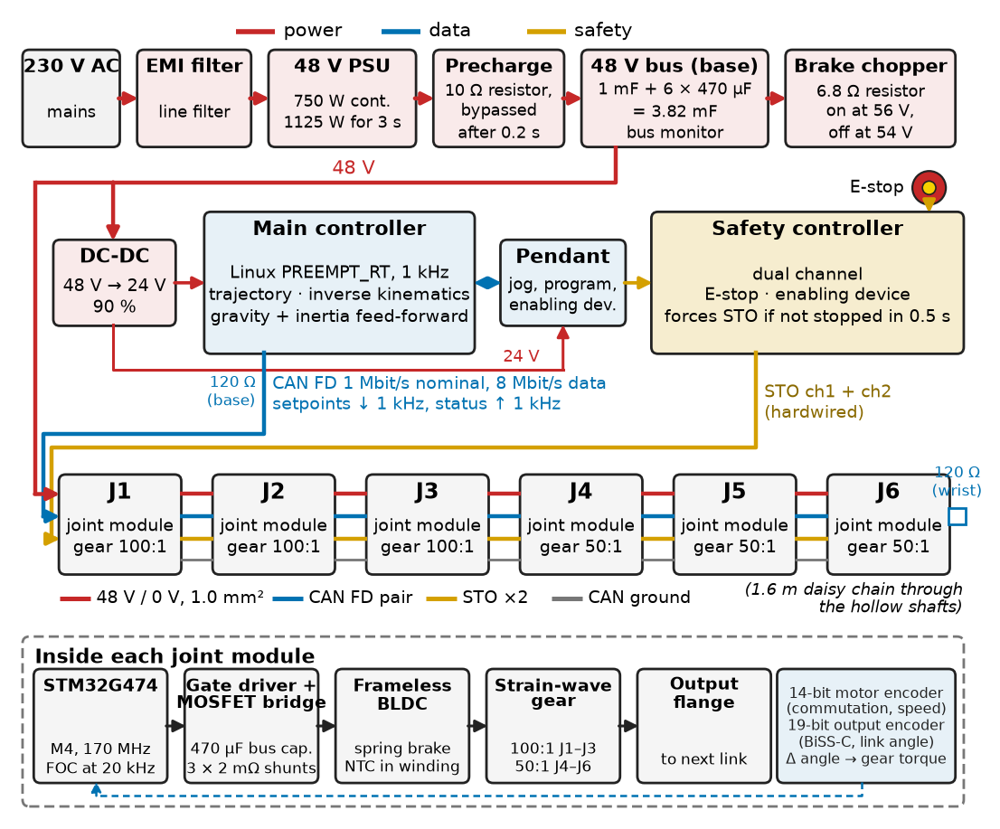
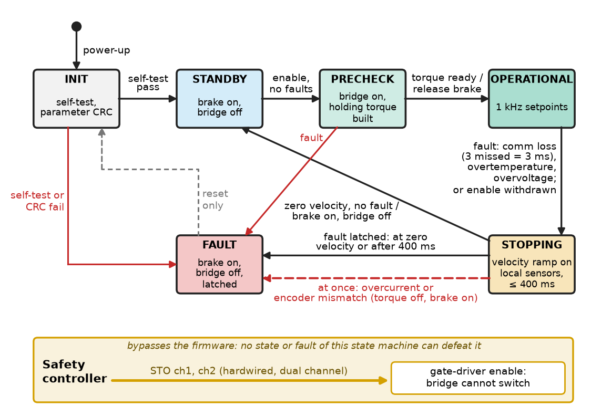
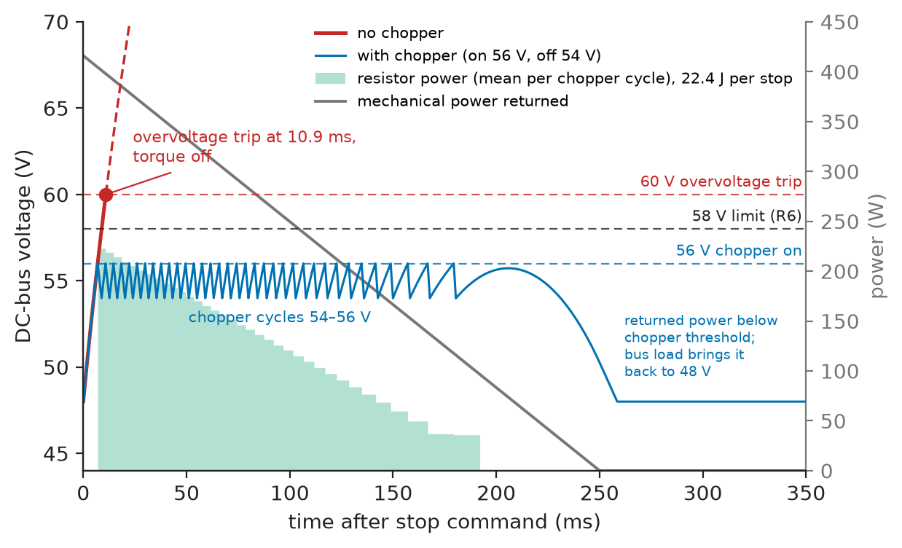
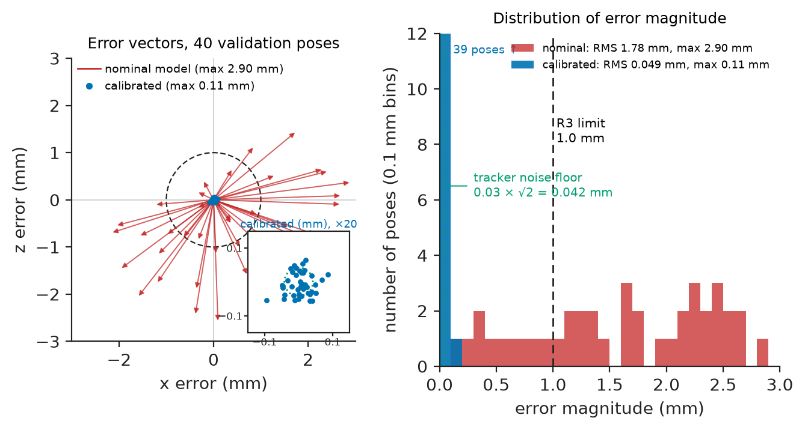
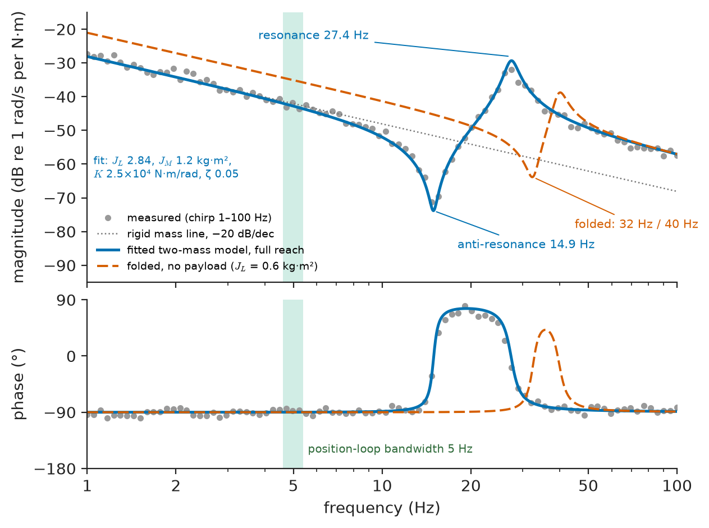
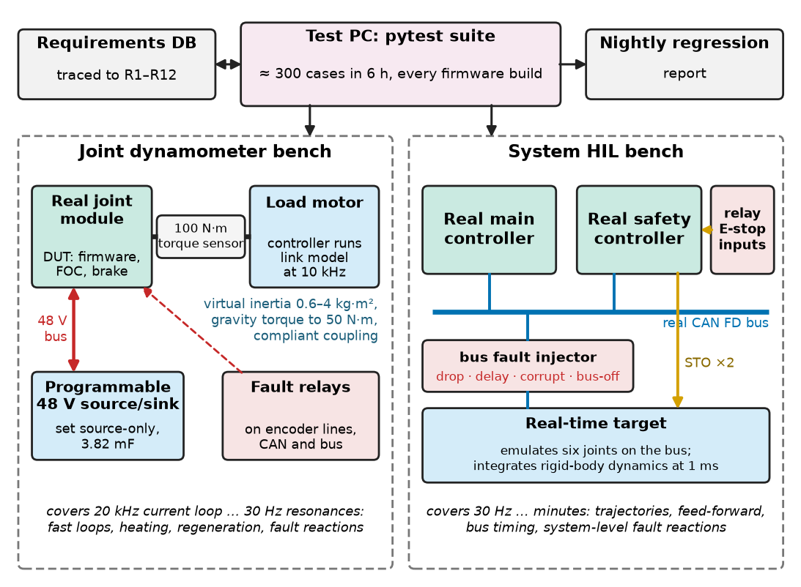

# Chapter 17 — Robotic System Integration

*Part IV · Robotics and Mechatronics*

A start-up builds a six-axis collaborative arm for small-parts assembly. Each joint module passes its bench test on a laboratory supply: torque, speed, encoder accuracy, temperature. The main controller passes its tests against a simulated arm. Assembled, the arm runs its first full-speed demonstration and, at the first fast stop, every joint faults at once, the brakes drop, and the arm overruns its programmed stop by 165 mm. On the bench each joint's laboratory supply sank its regenerated energy; in the arm six joints decelerating together return about 23 J to a shared 48 V bus whose only storage is 3.8 mF of capacitance, the bus reaches the drives' 60 V overvoltage trip in 11 ms, and a trip removes torque. Integration is the discipline that finds such failures on paper: the shared bus, cable, clock, structure and fault reaction belong to no single module, so they have to be designed, budgeted and tested as a system.

> **Which interfaces (mechanical, electrical, firmware, timing, power, communication) must be specified between the modules of a robot, and what numbers go into each specification?**
> **How is an integrated robot calibrated, identified, tested in the loop and in the field so that its first system-level failure happens in the lab and not on a customer's line?**

| Concept | Engineering destination |
|---|---|
| Mechanical design interfaces | Flanges, datums, stiffness and the first resonance; thermal paths; cable pass-through |
| Electronics integration | Joint-module electronics, grounding, harnesses through rotating joints, EMC |
| Firmware | Joint state machines, fault reactions, parameter and version management |
| Control | Central trajectory and feed-forward, joint cascades, bandwidth allocation |
| Power distribution | Shared DC bus, peak and regenerative power, brake chopper, STO and stop categories |
| Communication | Bus choice, frame design, bus load, synchronisation and timeouts |
| Calibration | Joint zero offsets, kinematic parameters, torque constants |
| System identification | Inertia, friction and gravity parameters; frequency response and resonances |
| Hardware-in-the-loop testing | Controller and joint test benches, fault injection, regression |
| Field testing | ISO 9283 performance tests, endurance, collision-force tests, pilot deployment |

**Roadmap.** The reference arm, its requirements and architecture (17.1) → the interfaces between its modules: mechanical (17.2), electronic (17.3), firmware (17.4), control (17.5), power (17.6), communication (17.7) → making the assembled arm match its model: calibration (17.8) and identification (17.9) → proving it: hardware in the loop (17.10), field tests (17.11) → failure analysis and the second iteration (17.12).

---

## 17.1 The reference arm: requirements and architecture

> **Boundary.** Requirements method and traceability are owned by Chapter 1, architecture and trade studies by Chapter 2, test planning and regression by Chapter 4. Kinematics, frames and actuator selection are in Chapter 13; motor drivers, encoder interfaces and PID implementation in Chapter 15. This chapter applies them to one robot and owns what lies between the modules: integration, identification, HIL and field testing (TOC boundary table).

### The reference system

The running system is a **six-axis collaborative arm** for assembly next to people: 3 kg payload, 700 mm reach, six joint modules on a 48 V bus, a central motion controller and a dual-channel safety controller. J1–J3 use a frameless BLDC motor and a size-25 strain-wave gear at 100:1; the wrist joints J4–J6 a smaller motor and a size-14 gear at 50:1. Every joint has a motor-side and an output-side encoder.

**Table 17.1 — Requirements of the collaborative arm.**

| ID | Requirement | Target | Verification |
|---|---|---|---|
| R1 | Payload at full reach | 3.0 kg at 700 mm, all poses | Static load test, thermal run |
| R2 | Pose repeatability (ISO 9283 RP) | ≤ ±0.05 mm | ISO 9283 test, laser tracker |
| R3 | Pose accuracy after calibration (ISO 9283 AP) | ≤ 1.0 mm | ISO 9283 test, laser tracker |
| R4 | Joint speed | J1–J3 180 °/s, J4–J6 360 °/s | Logged moves |
| R5 | Path accuracy at 250 mm/s (ISO 9283 AT) | ≤ 0.5 mm | Tracker, linear and circular paths |
| R6 | Controlled stop from full speed (IEC 60204-1 category 1) | Stop ≤ 0.30 s, bus ≤ 58 V, no fault trip | Instrumented stop tests |
| R7 | Supply | 230 V AC; mean power ≤ 250 W in the standard cycle | Power analyser |
| R8 | Joint communication | 1 kHz cycle, jitter ≤ 20 µs, worst-case bus load ≤ 50 % | Bus analyser, timing log |
| R9 | Quasi-static contact force in collaborative mode (ISO/TS 15066, hand region) | ≤ 140 N | Force-measurement device, 3 sites |
| R10 | Endurance | 100,000 standard cycles without fault | Endurance run |
| R11 | Touchable housing temperature, 25 °C ambient, standard cycle | ≤ 60 °C | Thermocouples |
| R12 | EMC | IEC 61000-6-2 immunity, IEC 61000-6-4 emissions | Accredited lab |

### Architecture

Figure 17.1 shows the blocks and the interfaces that this chapter specifies. The architecture is distributed: each joint closes its current, velocity and position loops locally, and the central controller sends synchronised setpoints with feed-forward torques at 1 kHz. Centralised current control would need high-bandwidth links and many more conductors through six hollow joints.

<!-- FIGURE 17.1 | figures/ch17/fig-17-1-arm-architecture.png | block-diagram | Architecture of the six-axis collaborative arm with its power, communication and safety interfaces. | Content: 230 V AC -> EMI filter -> 48 V PSU (750 W, 1125 W for 3 s) -> precharge -> 48 V bus (1 mF in base) with brake chopper (6.8 ohm, on at 56 V) and bus monitor. 48-to-24 V DC-DC feeds main controller (Linux PREEMPT_RT: trajectory, kinematics, gravity and inertia feed-forward, 1 kHz) and pendant. Dual-channel safety controller (E-stop, enabling device) drives two STO lines. Daisy-chained CAN FD (1 Mbit/s nominal, 8 Mbit/s data, terminated at base and wrist), 48 V, STO and ground pass through hollow shafts to joints J1-J6. Each joint: STM32G474, gate driver and MOSFET bridge (470 uF), shunts, frameless BLDC, strain-wave gear (100:1 J1-J3, 50:1 J4-J6), 14-bit motor encoder, 19-bit output encoder, brake, NTCs. Setpoints down at 1 kHz, status up. Colours: power red, data blue, safety yellow. -->



*Figure 17.1 — Architecture of the six-axis collaborative arm with its power, communication and safety interfaces.*

### The interface list

An integrated robot is specified as much by its interface control document (ICD) as by its modules: for each pair of blocks, the physical interface, the quantities crossing it with ranges and timing, and the owner of each side. The chapter is organised around those interfaces, because most integration failures are interfaces whose numbers were never written down.

---

## 17.2 Mechanical design interfaces

### What the joint–link interface carries

Through each joint flange pass load (including the dynamic loads of fast stops), alignment of the joint axis to the link datums, stiffness, heat and the cable. The ICD fixes each:

**Table 17.2 — Mechanical ICD for the J2 (shoulder) joint–link interface.**

| Item | Specification | Reason |
|---|---|---|
| Flange | 8 × M5 on 86 mm bolt circle, 2 dowel pins H7/m6, 12.9 screws at 9.5 N·m | Transfers the gear's 157 N·m repeated peak plus overturning moment without slip |
| Axis datum | Output flange face and pilot diameter; perpendicularity 0.02 mm per 100 mm | Kinematic accuracy; residual absorbed by calibration (Section 17.8) |
| Torsional stiffness | Gear ≥ 2.5 × 10⁴ N·m/rad at rated load; link ≥ 5 × 10⁴ N·m/rad | Sets the first resonance (worked example below) |
| Heat path | Flange contact ≥ 1,500 mm², thermal pad 3 W/(m·K); link acts as heat spreader | Housing temperature R11 |
| Cable pass-through | 18 mm bore, ±360° torsion, bend radius ≥ 10 × cable diameter | Cable life (R10) |
| Mass and centre of gravity | 1.6 kg; CG within 5 mm of axis | Gravity and inertia budget |

### Stiffness and the first resonance

A strain-wave gear is the softest element in the drive chain; with the reflected motor inertia on one side and the arm on the other it forms a two-mass system.

**Worked example — the shoulder's first resonance at full reach.** With the arm horizontal and extended, the masses beyond the shoulder (upper-arm link 0.5 kg, elbow module 1.6 kg at 0.35 m, forearm link 0.4 kg, wrist modules 2.1 kg at about 0.62 m, payload and gripper 3.5 kg at 0.70 m) give a gravity moment of $4.60\ \mathrm{kg\,m}\times9.81=45.1$ N·m and an inertia about the shoulder axis of $J_L=2.84$ kg·m². The rotor inertia of $1.2\times10^{-4}$ kg·m² reflected through 100:1 is $J_M=1.2$ kg·m². With gear stiffness $K=2.5\times10^4$ N·m/rad, the two-mass model (*Engineering Physics*, Ch. 19 §19.3, [link](https://github.com/The-Studio-of-Sadiq/Engineering-Physics/blob/main/CHAPTERS/CHAPTER%2019.md)) has an anti-resonance at $\frac{1}{2\pi}\sqrt{K/J_L}=14.9$ Hz and a resonance at $\frac{1}{2\pi}\sqrt{K(1/J_L+1/J_M)}=27.4$ Hz. Folded and without payload, $J_L$ falls to about 0.6 kg·m² and the anti-resonance rises to about 32 Hz, so the plant changes by a factor of two across the workspace and the position loop is designed for the lowest value: about $14.9/3\approx5$ Hz (Section 17.5). Strain-wave gears are also two to three times stiffer at high load than near zero torque, so the resonance moves with gravity load too; Section 17.9 measures it.

> **Status of the principle: Position-loop bandwidth below the first resonance**
> *Empirical.* Practice in servo design keeps the position-loop bandwidth at or below about one third of the lowest anti-resonance seen from the output sensor; tighter loops are possible with notch filters, input shaping or state feedback, but the rule sets a safe first design and holds for lightly damped compliant drives.

### Thermal path

Through the housing alone (about 2 K/W to air), the shoulder's 20 W would reach 65 °C at 25 °C ambient, failing R11. Bolting the module through a thermal pad to the aluminium link, which spreads the heat, brings the combined resistance to about 1.2 K/W and the surface to $25+20\times1.2=49$ °C. Contact area, flatness and pad are therefore mechanical interface items.

### Tolerances and what calibration absorbs

A perpendicularity error of 0.02 mm per 100 mm is 0.011°, or 0.14 mm at a 0.7 m lever; six joints of such errors, link tolerances of ±0.1 mm and encoder offsets of up to a degree accumulate to millimetres. Repeatability (R2) is a property of the hardware; accuracy (R3) is restored by calibration. The ICD therefore specifies *stability* of the geometry (dowels, no slip at peak load, bounded thermal growth) rather than absolute precision.

---

## 17.3 Electronics integration

> **Boundary.** Gate drivers, MOSFET bridges and current sensing are in *Electronics and Computing*, Ch. 32 ([link](https://github.com/The-Studio-of-Sadiq/Electronics-and-Computing/blob/main/part-7-power-electronics/32-motor-drives-and-power-conversion.md)); PMSM field-oriented control in *Electrical Energy and Machines*, Ch. 12 §12.8 ([link](https://github.com/The-Studio-of-Sadiq/Electrical-Energy-and-Machines/blob/main/part-3-motor-drives/12-ac-motor-drives.md)); encoder interfaces on robots in Chapter 15.

### The joint module

The joint actuator is the arm's repeated building block; its make-or-buy decision sets cost, size and how much of the integration the team owns.

**Table 17.3 — Joint-actuator options for J1–J3 (indicative 2026 prices, 100 pcs).**

| Option | Torque (rated / peak) | Backlash, stiffness | Mass | Price | Integration effort | Verdict |
|---|---|---|---|---|---|---|
| Commercial integrated cobot joint | 60 / 150 N·m | < 20 arcsec; specified | 1.5 kg | \$1,200–1,800 | Low; closed firmware | Fault behaviour not controllable |
| **In-house: frameless BLDC + size-25 strain-wave gear + own driver** | **67 / 157 N·m** | **< 20 arcsec; 2.5 × 10⁴ N·m/rad** | **1.6 kg** | **\$650 BOM** | **High** | **Chosen: owns firmware, faults, cost** |
| BLDC + cycloidal gear | 70 / 180 N·m | ≈ 1 arcmin; stiffer | 2.1 kg | \$450 BOM | High | Candidate for J1 in Revision B |
| Smart bus servo (hobby class) | 6–10 N·m | 0.2–0.5° | 0.2 kg | \$300 | Low | Fails R1 tenfold |

Its electronics: an STM32G474 (Cortex-M4, 170 MHz, CORDIC, FDCAN), a DRV8353-class gate driver with six 100 V, 5 mΩ MOSFETs at 20 kHz, three 2 mΩ low-side shunts, a 14-bit magnetic encoder on the motor shaft, a 19-bit absolute encoder on the output, a power-off spring brake, NTCs in the winding and on the bridge, and 470 µF of polymer and film bus capacitance.

### Two encoders, one more sensor

The motor encoder gives commutation angle and a clean velocity for the fast loops; the output encoder gives link position free of the gear's 1–2 arcmin cyclic transmission error. Their difference is the **gear deflection and hence the output torque**, $\tau\approx K(\theta_m/N-\theta_{out})$. A 45 N·m load deflects the gear by 1.8 mrad (0.10°), about 150 counts of the 19-bit output encoder (0.3 N·m per count). The transmission error would by itself look like 7–15 N·m, so it is removed with the table measured in the joint calibration (Section 17.8); the joint then measures its own torque to a few N·m without a torque sensor, for collision detection (R9) and as a cross-check on the current-based estimate.

### Grounding, harness and EMC

- **Conductors through the arm**: 48 V and 0 V (1.0 mm² each), CAN FD pair, CAN ground, two STO lines, in a torsion-rated cable whose braid is bonded 360° to the housing at every joint.
- **Voltage drop**: 1.5 m out and back of 1.0 mm² copper (52 mΩ in total) drops 1.3 V at a 25 A peak, acceptable for drives that work down to 36 V.
- **Ground reference**: the 0 V conductor carries motor current, so a separate CAN ground keeps the transceivers inside their ±12 V common-mode range.
- **Encoder noise**: the output-encoder link runs past motor phases switching at about 5 V/ns, so it is differential (BiSS-C, RS-422 levels) with a CRC on every position word; CRC failures are counted as a health metric.
- **Immunity**: IEC 61000-4-4 bursts at 2 kV on the AC input and coupled onto the arm cable (R12) find missing shield bonds.

---

## 17.4 Firmware

> **Boundary.** Firmware architecture, timing and fault handling for embedded systems are owned by Chapter 10 of this book; RTOS scheduling and watchdogs by *Electronics and Computing*, Ch. 27 §27.3 and §27.11; explicit state machines and validation by Ch. 28 §28.4 and §28.10 ([link](https://github.com/The-Studio-of-Sadiq/Electronics-and-Computing/blob/main/part-6-embedded-and-real-time-systems/28-embedded-system-design.md)).

### Joint firmware structure and timing

The joint firmware is interrupt-driven with three fixed-rate layers (Table 17.4).

**Table 17.4 — Joint MCU timing budget (STM32G474 at 170 MHz, measured with a cycle counter).**

| Task | Rate | Execution time | CPU load |
|---|---|---|---|
| Current loop (FOC with CORDIC, PWM update, encoder read via DMA) | 20 kHz | 12 µs | 24 % |
| Velocity loop and filters | 5 kHz | 4 µs | 2 % |
| Position loop, setpoint interpolation, state machine | 1 kHz | 20 µs | 2 % |
| CAN FD frame handling (two frames per cycle) | 1 kHz | 8 µs | 0.8 % |
| Diagnostics, temperature model, parameter service | 100 Hz | 150 µs | 1.5 % |
| **Total** | | | **30 %** |
| Margin to 60 % ceiling (current-loop jitter protection) | | | **30 points** |

### The joint state machine

Every joint runs the same state machine (Figure 17.2); the central controller only commands transitions, and **the fault reaction is chosen per fault**: after a communication loss or overtemperature the joint can still control itself, so it performs a controlled stop on its own sensors; after an overcurrent or encoder disagreement it cannot trust its control, so it removes torque and drops the brake at once.

<!-- FIGURE 17.2 | figures/ch17/fig-17-2-joint-state-machine.png | state-diagram | Joint-module state machine with fault reactions. | Content: states INIT (self-test, parameter CRC), STANDBY (brake on, bridge off), PRECHECK (bridge on, holding torque built), OPERATIONAL (1 kHz setpoints), STOPPING (velocity ramp on local sensors, max 400 ms), FAULT (brake on, bridge off, latched). Transitions: INIT to STANDBY on self-test pass, else FAULT; STANDBY to PRECHECK on enable with no faults; PRECHECK to OPERATIONAL when torque ready, brake released; OPERATIONAL to STOPPING on fault (comm loss 3 ms, overtemperature, overvoltage) or enable withdrawn; STOPPING to STANDBY at zero velocity without fault, to FAULT with fault or after 400 ms; red dashed STOPPING to FAULT at once on overcurrent or encoder mismatch; FAULT to INIT on reset only. Separate STO path from safety controller to gate-driver enable bypassing the firmware. -->



*Figure 17.2 — Joint-module state machine with fault reactions.*

```c
/* joint_fsm.c -- joint-module state machine, called once per 1 kHz tick (C11, illustrative) */
#include <stdbool.h>
#include <stdint.h>

typedef enum { ST_INIT, ST_STANDBY, ST_PRECHECK, ST_OPERATIONAL, ST_STOPPING, ST_FAULT } jstate_t;
enum { F_OVERVOLT = 1u << 0, F_OVERTEMP = 1u << 1, F_ENC_MISMATCH = 1u << 2,
       F_COMM_LOSS = 1u << 3, F_OVERCURRENT = 1u << 4, F_PARAM_CRC = 1u << 5, F_STOP_TIMEOUT = 1u << 6 };
#define F_LOSE_CONTROL (F_OVERCURRENT | F_ENC_MISMATCH)  /* torque off and brake at once */
#define CMD_TIMEOUT 3u                                   /* missed 1 ms commands */
#define STOP_MAX    400u                                 /* ms allowed for a controlled stop */

typedef struct { jstate_t st; uint32_t faults; uint16_t missed, stop_ticks; } joint_t;

extern bool selftest_ok(void), hold_torque_ready(void), velocity_is_zero(void);
extern void brake_engage(void), brake_release(void), bridge_enable(bool on);
extern void ramp_velocity_to_zero(void);                 /* one tick of the stop ramp */

void joint_step(joint_t *j, bool cmd_valid, bool enable_req, bool reset_req, uint32_t new_faults)
{
    if (cmd_valid) j->missed = 0u;
    else if (j->missed < UINT16_MAX) j->missed++;
    if (j->st == ST_OPERATIONAL && j->missed >= CMD_TIMEOUT) new_faults |= F_COMM_LOSS;
    j->faults |= new_faults;                             /* latched until reset */

    switch (j->st) {
    case ST_INIT:
        j->st = selftest_ok() ? ST_STANDBY : ST_FAULT; break;
    case ST_STANDBY:
        if (enable_req && j->faults == 0u) { bridge_enable(true); j->st = ST_PRECHECK; } break;
    case ST_PRECHECK:
        if (j->faults != 0u) { bridge_enable(false); j->st = ST_FAULT; }
        else if (hold_torque_ready()) { brake_release(); j->st = ST_OPERATIONAL; }
        break;
    case ST_OPERATIONAL:
        if (j->faults != 0u || !enable_req) { j->stop_ticks = 0u; j->st = ST_STOPPING; } break;
    case ST_STOPPING:
        if ((j->faults & F_LOSE_CONTROL) == 0u) ramp_velocity_to_zero();
        if (++j->stop_ticks >= STOP_MAX) j->faults |= F_STOP_TIMEOUT;   /* stop too slow */
        if ((j->faults & (F_LOSE_CONTROL | F_STOP_TIMEOUT)) != 0u || velocity_is_zero()) {
            brake_engage(); bridge_enable(false);
            j->st = (j->faults != 0u) ? ST_FAULT : ST_STANDBY;
        }
        break;
    case ST_FAULT:
    default:
        brake_engage(); bridge_enable(false);
        if (reset_req) { j->faults = 0u; j->st = ST_INIT; } else j->st = ST_FAULT;  /* reset: re-test */
        break;
    }
}
```

The brake is released only after the joint holds the load with torque, so the arm does not drop by its backlash on enable, and applied only at zero velocity in a controlled stop, because a spring brake is a holding device rated for few dynamic stops. Safe torque off (STO) is not in this code: it is a dual-channel hardware path from the safety controller to the gate-driver enable that no firmware fault can defeat (IEC 61800-5-2; performance level d per ISO 13849-1 is typical for a collaborative arm).

### Versions and parameters

Eight firmware images and parameter sets (six joints, main and safety controllers) must be compatible. Each joint reports firmware, hardware and parameter versions with a CRC at INIT, and the main controller enables only combinations in a signed compatibility table. Joint calibration data (Sections 17.8–17.9) live in the joint's own flash with its serial number, so a replaced joint brings its calibration with it.

---

## 17.5 Control

> **Boundary.** PID structure, tuning and digital-control delay are in *Circuits, Signals and Communications*, Ch. 35 §35.2–35.4 and §35.8 ([link](https://github.com/The-Studio-of-Sadiq/Circuits-Signals-and-Communications/blob/main/part-7-control-system-fundamentals/35-control-design-fundamentals.md)); servo sizing in *Electrical Energy and Machines*, Ch. 8 §8.7; PID implementation on robot hardware in Chapter 15 of this book.

### Where each loop runs

**Table 17.5 — Control-loop allocation and bandwidths.**

| Loop | Runs on | Rate | Sensor | Closed-loop bandwidth | Limited by |
|---|---|---|---|---|---|
| Current (FOC) | Joint | 20 kHz | Phase shunts | ≈ 2 kHz | PWM and sampling delay |
| Velocity (PI) | Joint | 5 kHz | Motor encoder | ≈ 80 Hz | Resonance at 27 Hz handled by notch and motor-side feedback |
| Position (P) | Joint | 1 kHz | Output encoder | ≈ 5 Hz | Anti-resonance 14.9 Hz (Section 17.2) |
| Trajectory, inverse kinematics, gravity and inertia feed-forward | Main controller | 1 kHz | Commanded state | — | Model accuracy (Section 17.9) |
| Collision detection | Joint and main controller | 1 kHz | Torque estimate versus model | — | Friction model error |

### Feed-forward does the work

A 5 Hz position loop cannot follow a fast trajectory on feedback alone. Every millisecond the central controller therefore sends the position setpoint plus the velocity and the **torque the model predicts** (gravity, inertia times commanded acceleration, friction), and the feedback loops correct only the residual. The quality of the model (Section 17.9) becomes the quality of the motion.

**Worked example — what gravity feed-forward saves.** At full reach the shoulder holds 45.1 N·m. Without feed-forward the velocity-loop integrator must build it from error: on the dynamometer (Section 17.10), a 10 N·m load step then gives a 0.4 mrad peak error (0.28 mm at the tool) for 100–200 ms, most of R5's 0.5 mm budget. With feed-forward accurate to 2 % (limited by payload uncertainty; Section 17.9 identifies $G$ to 0.05 %) the transient is under 0.01 mm. Holding 45.1 N·m through a 100:1 gear of 85 % efficiency takes $45.1/(100\times0.85)=0.53$ N·m at the motor, 4.4 A at $K_t=0.12$ N·m/A and about 10 W of copper loss, which enters the power and thermal budgets.

### Collaborative operation

In collaborative mode the arm limits power and force (ISO 10218-1, ISO/TS 15066) and compares the measured joint torque with the model torque. An 8 N·m residual threshold at the shoulder corresponds to about $8/0.7\approx11$ N at the tool at full reach; the friction model error sets how low it can go without false trips, which makes the friction identification of Section 17.9 a safety item.

---

## 17.6 Power distribution

> **Boundary.** Drive braking, regenerative operation and brake choppers are in *Electronics and Computing*, Ch. 32 §32.6 and *Electrical Energy and Machines*, Ch. 10 §10.4–10.5 ([link](https://github.com/The-Studio-of-Sadiq/Electrical-Energy-and-Machines/blob/main/part-3-motor-drives/10-drive-system-fundamentals.md)); stop categories, emergency stop and safety of machinery wiring in Chapter 20 and Chapter 21 of this book and IEC 60204-1.

### The power budget

**Table 17.6 — Power budget of the arm on the 48 V bus.**

| Load | Steady (W) | Peak (W) | Note |
|---|---|---|---|
| Joint logic and encoders, 6 × 3 W | 18 | 18 | |
| Brakes released (power-to-release), pull-in then 50 % hold | 18 | 36 | Pull-in 100 ms |
| Gravity holding, worst pose (copper and inverter) | 17 | 17 | Shoulder 10 W |
| Main controller, pendant, gripper (via 24 V DC-DC, 90 %) | 53 | 70 | |
| Motion: all major axes accelerating to full speed in 0.25 s | — | 612 | 416 W mechanical at 68 % efficiency |
| **Total** | **106** | **753** | |
| PSU rating: 750 W continuous, 1,125 W for 3 s | | | Peak margin 33 % |
| Standard-cycle mean (measured target R7) | 180 | | Margin 28 % to 250 W |

Rather than buy a larger supply, the trajectory planner caps the total commanded mechanical power at 500 W: a power budget enforced in software.

### Regeneration: the opening failure

Decelerating joints return energy to the bus. The PSU only sources current, the bus loads take about 50 W, and the bus capacitance (six joints × 470 µF plus 1 mF in the base, 3.82 mF) stores very little energy per volt.

**Worked example — the bus during a controlled stop.** At full speed (180 °/s on J1–J3) the arm's kinetic energy, including reflected rotor inertias, is about 52 J (20 J each in J1 and J2, 9 J in J3, 3 J in the wrist). A linear stop in 0.25 s peaks at $2\times52/0.25=416$ W mechanical; with 68 % reaching the bus and 50 W of bus load, the bus absorbs up to 233 W, while the capacitors hold only $\tfrac12\times3.82\times10^{-3}\times(60^2-48^2)=2.5$ J below the 60 V trip. The listing integrates the bus energy balance with and without a brake chopper (switched on at 56 V, off at 54 V).

```python
import numpy as np
E0, td, eta = 52.0, 0.25, 0.68       # J kinetic energy at full speed, s stop time, regen fraction
C, V0, P_load = 3.82e-3, 48.0, 50.0  # F bus capacitance, V, W drawn by logic and brakes
V_ov, V_on, V_off, Rb = 60.0, 56.0, 54.0, 6.8   # trip and chopper thresholds, ohm
dt = 1e-5; t = np.arange(0, 0.35, dt)
P_mech = np.where(t < td, 2*E0/td*(1 - t/td), 0.0)  # linear speed ramp to zero

def run(chopper):
    V, on, Vt, Eb, trip = V0, False, [], 0.0, None
    for k, tk in enumerate(t):
        P_in = eta*P_mech[k] - P_load
        if chopper:
            on = V > V_on or (on and V > V_off)
        P_r = V*V/Rb if on else 0.0
        V = np.sqrt(max(V*V + 2*(P_in - P_r)*dt/C, 0.0))
        V = max(V, V0)                # PSU output diode: PSU holds 48 V floor
        Eb += P_r*dt; Vt.append(V)
        if trip is None and V >= V_ov: trip = tk
    return np.array(Vt), Eb, trip

Vn, _, trip = run(False)
Vc, Eb, _ = run(True)
print(f"peak mechanical power {P_mech.max():.0f} W, peak bus input {eta*P_mech.max()-P_load:.0f} W")
print(f"no chopper : overvoltage trip ({V_ov:.0f} V) at {1000*trip:.1f} ms")
print(f"with chopper: peak bus {Vc.max():.1f} V, energy in resistor {Eb:.1f} J, "
      f"resistor peak power {V_on**2/Rb:.0f} W")
```

```text
peak mechanical power 416 W, peak bus input 233 W
no chopper : overvoltage trip (60 V) at 10.9 ms
with chopper: peak bus 56.0 V, energy in resistor 22.4 J, resistor peak power 461 W
```

Without the chopper the bus trips in 10.9 ms, the opening failure. The joints then coast with torque off through about 30 ms of brake-engagement delay, gravity accelerating the downward-moving shoulder, and stop on the brake (about 90 N·m at the output, 45 N·m of it consumed by gravity): 0.63 rad of shoulder travel, 440 mm at the tool, against 0.39 rad (275 mm) planned, the 165 mm overrun. With the chopper the bus holds at 56 V and the resistor absorbs 22.4 J per stop; its 461 W at 56 V is twice the 233 W peak input. A 6.8 Ω, 50 W aluminium-clad resistor with a pulse rating of several hundred joules handles a full-speed stop every 2 s (about 11 W mean).

<!-- FIGURE 17.3 | figures/ch17/fig-17-3-bus-voltage-stop.png | plot | DC-bus voltage during a controlled stop from full speed, without and with a brake chopper. | Content: x-axis 0 to 350 ms. Left y-axis 44 to 70 V: red curve without chopper rising from 48 V to 60 V at 10.9 ms (marker: overvoltage trip, torque off), dashed beyond; blue curve with chopper reaching 56 V at 6.9 ms, sawtooth between 54 and 56 V until about 180 ms, then a 55.7 V peak with the chopper off and back to 48 V at 258 ms. Dashed lines at 60 V (trip), 58 V (R6), 56 V (chopper on). Right y-axis 0 to 450 W: grey mechanical power falling linearly from 416 W to 0 at 250 ms; green shaded resistor power, annotated 22.4 J. -->



*Figure 17.3 — DC-bus voltage during a controlled stop from full speed, without and with a brake chopper.*

> **Status of the principle: Bus energy balance during regeneration**
> *Derived.* The bus voltage follows from $\tfrac12C\,dV^2/dt=P_{\text{in}}-P_{\text{out}}$, energy conservation on the capacitor; the result is exact for the stated powers, and its uncertainty lies in the regenerated fraction (60–80 % depending on gear efficiency in back-driving and copper loss at the stop current), so the chopper is sized for the upper value.

### Precharge, STO and stop categories

A 10 Ω precharge resistor, bypassed after 0.2 s, limits the bus inrush to 4.8 A. Stops are layered as IEC 60204-1 defines them: **category 1** (controlled deceleration, then STO) for E-stop and protective stops, which needs the bus to survive regeneration, hence the chopper; **category 0** (immediate STO and brakes) only when the drives cannot be trusted. The safety controller forces STO if the arm has not stopped within 0.5 s, bounding the stop even if the main controller fails.

---

## 17.7 Communication

> **Boundary.** CAN and CAN FD frames, bit timing and arbitration are in *Electronics and Computing*, Ch. 26 §26.5 ([link](https://github.com/The-Studio-of-Sadiq/Electronics-and-Computing/blob/main/part-6-embedded-and-real-time-systems/26-embedded-interfaces.md)); robot buses in Chapter 15 and industrial networks (EtherCAT, CANopen) in Chapter 21 of this book.

### Requirements on the bus

Six joints exchange a setpoint and a status every millisecond (R8). Setpoints must take effect at all joints at the same instant, or the Cartesian path bends; status must arrive before the next cycle; a lost frame must be detected within a few cycles. CAN FD and EtherCAT are the credible candidates; RS-485 with a custom protocol is cheaper but has no arbitration or standard error handling.

**Worked example — CAN FD bus load.** The listing computes worst-case CAN FD frame durations (11-bit identifier, bit-rate switching, worst-case stuffing, field sizes from ISO 11898-1) for three frame designs at 1 Mbit/s arbitration rate, and compares an EtherCAT frame carrying the same data.

```python
import math
def canfd_us(nbytes, f_nom=1e6, f_data=5e6):
    """Worst-case CAN FD frame time, 11-bit ID, bit-rate switch (ISO 11898-1 field sizes)."""
    nom = 17 + math.ceil(17/4) + 13            # SOF..BRS with stuffing; CRC delimiter..IFS
    crc, fixed = (17, 6) if nbytes <= 16 else (21, 7)
    dyn = 5 + 8*nbytes                          # ESI, DLC, data: dynamic stuffing
    data = dyn + math.ceil(dyn/4) + 4 + crc + fixed
    return 1e6*(nom/f_nom + data/f_data)

designs = {  # name: list of frame payload sizes sent every 1 ms cycle (6 joints)
    "A per-joint 16 B cmd + 16 B status + SYNC": [16]*6 + [16]*6 + [0],
    "B broadcast 48 B cmd + 16 B status":        [48] + [16]*6,
    "C broadcast 48 B cmd + 12 B status":        [48] + [12]*6,
}
for name, frames in designs.items():
    for fd in (5e6, 8e6):
        t = sum(canfd_us(n, f_data=fd) for n in frames)
        print(f"{name:42s} {fd/1e6:.0f} Mbit/s: {t:6.1f} us/cycle, load {t/10:5.1f} %")
# EtherCAT: one frame carrying 6 x (16 + 16) B, 100 Mbit/s, about 1 us forwarding per node
eth = (8 + 14 + 2 + 10 + 6*32 + 2 + 4 + 12)*8/100e6*1e6 + 6*1.0
print(f"{'D EtherCAT, one frame':42s} 100 Mbit/s: {eth:6.1f} us/cycle, load {eth/10:5.1f} %")
```

```text
A per-joint 16 B cmd + 16 B status + SYNC  5 Mbit/s:  927.4 us/cycle, load  92.7 %
A per-joint 16 B cmd + 16 B status + SYNC  8 Mbit/s:  750.2 us/cycle, load  75.0 %
B broadcast 48 B cmd + 16 B status         5 Mbit/s:  581.6 us/cycle, load  58.2 %
B broadcast 48 B cmd + 16 B status         8 Mbit/s:  455.4 us/cycle, load  45.5 %
C broadcast 48 B cmd + 12 B status         5 Mbit/s:  533.6 us/cycle, load  53.4 %
C broadcast 48 B cmd + 12 B status         8 Mbit/s:  425.4 us/cycle, load  42.5 %
D EtherCAT, one frame                      100 Mbit/s:   25.5 us/cycle, load   2.6 %
```

Design A fits in the millisecond but loads the bus to 75–93 %, far over R8's 50 %, because every CAN FD frame spends 35 bits at the slow arbitration rate whatever its payload. One 48-byte broadcast command (B, C) removes six arbitration phases; a 12-byte status (32-bit position, 16-bit velocity, torque and state word, temperature, alive counter) and an 8 Mbit/s data phase bring the worst case to 42.5 %, inside R8.

> **Status of the principle: Worst-case CAN FD frame time**
> *Derived.* The frame time follows from the ISO 11898-1 field lengths and worst-case stuffing (one bit per four); real frames are 5–15 % shorter, so the budget is conservative, provided arbitration runs at 1 Mbit/s over the arm's bus.

**Table 17.7 — Communication options for the arm.**

| Option | Worst-case load at 1 kHz | Sync jitter | Cost per joint (2026) | Fit |
|---|---|---|---|---|
| CAN FD, design A, 5 Mbit/s | 93 % | ≈ 5 µs | \$2 (transceiver) | Fails R8 |
| **CAN FD, design C, 8 Mbit/s, SIC transceivers** | **42.5 %** | **≈ 2 µs** | **\$3** | **Chosen** |
| EtherCAT (slave controller via SPI, two ports) | 2.6 % | < 1 µs (distributed clocks) | \$15–20 plus connectors | Upgrade path for faster cycles or more axes |
| RS-485, 10 Mbit/s, custom protocol | ≈ 30 % | ≈ 5 µs | \$2 | No standard error handling; rejected |

8 Mbit/s needs signal-improvement-capability (SIC) transceivers of the TJA1462 or TCAN1462 class, short stubs and terminations only at the ends; the 1.6 m daisy chain through the arm satisfies that.

### Synchronisation, timeouts and integrity

The broadcast command is also the synchronisation event: each joint timestamps its reception and applies the setpoint and samples its encoders 150 µs later, so all joints act within a few microseconds. Each frame carries a 4-bit alive counter and an application CRC (end-to-end protection in the style of AUTOSAR E2E), so a stale or replayed setpoint is rejected. Three missing or invalid commands (3 ms) start the joint's controlled stop; the main controller declares a joint lost after 3 ms of missing status. CAN error counters are logged at 10 Hz; a climbing transmit counter flags a damaged cable first.

---

## 17.8 Calibration

> **Boundary.** Calibration procedures, uncertainty and traceability are owned by Chapter 4 and Chapter 7 of this book; least-squares estimation by *The Mathematics Universe*, Ch. 25 §25.8 ([link](https://github.com/The-Studio-of-Sadiq/engineering-mathematics/blob/main/part-7-numerical-computational/25-mathematical-modeling.md)); forward kinematics by Chapter 13.

### What is calibrated, at which level

At the **joint** level, after module assembly: current-sensor offsets and gains, commutation offset, the gear's cyclic transmission-error table and the torque constant on a dynamometer, stored in the joint. At the **arm** level: joint zero offsets and kinematic parameters, base and tool frames. At the **cell** level: tool centre point and fixture frame, by touching reference points.

### Kinematic calibration

A laser tracker measures a retroreflector on the flange at a set of poses, and nonlinear least squares adjusts the kinematic parameters until forward kinematics matches. The listing shows the method on the planar J2–J3–J5 sub-chain in the arm's vertical plane: three link lengths, three joint offsets and the base position in the tracker frame, with tracker noise of 0.03 mm, 40 identification poses and 40 different validation poses.

```python
import numpy as np
from scipy.optimize import least_squares
rng = np.random.default_rng(17)
nom = np.array([0.350, 0.300, 0.100, 0, 0, 0, 0, 0])   # a2, a3, a5 (m); dq2, dq3, dq5 (rad); x0, z0 (m)
true = nom + np.array([0.8e-3, -0.6e-3, 0.4e-3, np.radians(0.60), np.radians(-0.90),
                       np.radians(0.50), 1.5e-3, -2.0e-3])

def fk(p, q):                       # planar J2-J3-J5 chain in the arm's vertical plane
    a, dq, base = p[:3], p[3:6], p[6:8]
    th = np.cumsum(q + dq, axis=1)
    x = base[0] + (a*np.cos(th)).sum(axis=1)
    z = base[1] + (a*np.sin(th)).sum(axis=1)
    return np.column_stack([x, z])

def poses(n):
    return np.column_stack([rng.uniform(-0.3, 1.3, n), rng.uniform(-2.2, -0.3, n), rng.uniform(-1.5, 1.5, n)])
q_id, q_val = poses(40), poses(40)
meas = lambda q: fk(true, q) + 30e-6*rng.standard_normal((len(q), 2))   # tracker noise 0.03 mm
m_id, m_val = meas(q_id), meas(q_val)

res = least_squares(lambda p: (fk(p, q_id) - m_id).ravel(), nom)
err = lambda p: 1e3*np.linalg.norm(fk(p, q_val) - m_val, axis=1)
for name, p in (("nominal", nom), ("calibrated", res.x)):
    e = err(p); print(f"{name:10s}: validation RMS {np.sqrt(np.mean(e**2)):.3f} mm, max {e.max():.3f} mm")
J = res.jac; print(f"Jacobian condition number: {np.linalg.cond(J):.0f}")
```

```text
nominal   : validation RMS 1.781 mm, max 2.897 mm
calibrated: validation RMS 0.049 mm, max 0.108 mm
Jacobian condition number: 33
```

**Worked example — reading the calibration result.** The validation error falls from 1.78 mm to 0.049 mm RMS, and what remains is the tracker noise itself ($0.03\times\sqrt2=0.042$ mm for a two-coordinate distance). The parameter set is **identifiable**: a base rotation was left out because in a planar chain it is indistinguishable from the J2 offset, and the condition number of 33 confirms that the other eight are well separated by the poses. Identification and validation use different poses, so the result measures prediction, not fit. On the real arm the same procedure over all six joints (24 modified Denavit–Hartenberg parameters, 60 poses) reduces ISO 9283 pose accuracy from 3.1 mm to 0.42 mm; the residual is non-geometric (gear compliance under payload, thermal growth), which a kinematic model cannot remove. Figure 17.4 shows the distributions.

<!-- FIGURE 17.4 | figures/ch17/fig-17-4-calibration-errors.png | plot | Tool-position error at 40 validation poses before and after kinematic calibration of the J2-J3-J5 chain. | Content: left panel: error vectors in the x-z plane from -3 to 3 mm, nominal model red (up to 2.9 mm), calibrated blue dots within 0.11 mm. Right panel: histogram of error magnitude 0 to 3 mm in 0.1 mm bins: nominal RMS 1.78 mm, max 2.90 mm; calibrated RMS 0.049 mm. Dashed line at 1.0 mm (R3) and dotted line at 0.042 mm (tracker noise floor). -->



*Figure 17.4 — Tool-position error at 40 validation poses before and after kinematic calibration of the J2-J3-J5 chain.*

> **Status of the principle: Identifiability of calibration parameters**
> *Derived.* Least squares can estimate a parameter set only if the identification Jacobian has full column rank over the poses; near-dependent parameters show as a large condition number and inflate the estimate variance, so parameter sets are pruned and poses chosen to keep the condition number in the tens, not thousands.

---

## 17.9 System identification

> **Boundary.** Model structure, step-response and least-squares identification, ARX models and validation are in *The Mathematics Universe*, Ch. 25 §25.7–25.8 and *Circuits, Signals and Communications*, Ch. 33 §33.7 ([link](https://github.com/The-Studio-of-Sadiq/Circuits-Signals-and-Communications/blob/main/part-7-control-system-fundamentals/33-dynamic-system-modeling.md)); the modelling and validation workflow is owned by Chapter 3 of this book.

### What the controller needs to know

Feed-forward needs each joint's inertia, friction and gravity parameters, and loop tuning needs the frequency response with its resonances. Both are measured on the assembled arm, because datasheets do not include the links, cable drag, gear preload or payload.

### Rigid-body parameters by least squares

For one joint with the others locked, torque is linear in the parameters: $\tau=J\ddot q+b\dot q+\tau_c\,\mathrm{sgn}(\dot q)+G\cos q$. The joint follows an **exciting trajectory** (a multisine with incommensurate frequencies, so that acceleration, velocity and position are not collinear), torque is estimated from motor current, and linear least squares gives the parameters. The simulated shoulder has Stribeck friction (static 9 N·m falling to 6 N·m above about 0.05 rad/s), which the model does not contain.

```python
import numpy as np
rng = np.random.default_rng(170)
fs = 1000.0; t = np.arange(0, 20, 1/fs)
# excitation: multisine shoulder motion about horizontal (rad), six incommensurate tones
f = np.array([0.1, 0.23, 0.37, 0.61, 0.89, 1.3])
q = sum(0.12/(k + 1)*np.sin(2*np.pi*fk*t + k) for k, fk in enumerate(f))
qd = np.gradient(q, 1/fs); qdd = np.gradient(qd, 1/fs)
J, b, tc, ts, vs, G = 4.04, 8.0, 6.0, 9.0, 0.05, 45.1   # "true" joint, Stribeck friction
fric = (tc + (ts - tc)*np.exp(-(qd/vs)**2))*np.sign(qd) + b*qd
tau_meas = J*qdd + fric + G*np.cos(q) + 1.5*rng.standard_normal(t.size)  # from motor current

def fit(mask):
    Y = np.column_stack([qdd, qd, np.sign(qd), np.cos(q)])[mask]
    th, *_ = np.linalg.lstsq(Y, tau_meas[mask], rcond=None)
    r = tau_meas[mask] - Y @ th
    se = np.sqrt(np.diag(np.var(r)*np.linalg.inv(Y.T @ Y)))
    return th, se
for label, mask in (("all samples", np.ones(t.size, bool)),
                    ("|qd| > 0.15 rad/s", np.abs(qd) > 0.15)):
    th, se = fit(mask)
    print(f"{label:18s} J={th[0]:.3f}+-{se[0]:.3f}  b={th[1]:.2f}+-{se[1]:.2f}  "
          f"tau_c={th[2]:.2f}+-{se[2]:.2f}  G={th[3]:.2f}+-{se[3]:.2f}")
print(f"true               J={J}  b={b}  tau_c={tc} (static {ts})  G={G}")
```

```text
all samples        J=4.036+-0.010  b=3.07+-0.10  tau_c=7.27+-0.02  G=45.07+-0.01
|qd| > 0.15 rad/s  J=4.043+-0.015  b=7.82+-0.19  tau_c=6.07+-0.05  G=45.12+-0.02
true               J=4.04  b=8.0  tau_c=6.0 (static 9.0)  G=45.1
```

**Worked example — a precise but wrong friction estimate.** Fitted to all samples, the viscous coefficient is $3.07\pm0.10$ N·m·s/rad against a true 8.0: good to 3 % by its standard error, wrong by 62 %. Low-velocity samples, where Stribeck friction lifts the torque, pull the Coulomb term up (7.27 instead of 6.0) and the viscous slope down. Fitting only above 0.15 rad/s, where the structure is valid, recovers $b=7.82\pm0.19$ and $\tau_c=6.07$; inertia and gravity are good either way. So the friction model for feed-forward and collision detection is fitted only where it is valid, with a separate low-speed table, and every identification is validated on a different trajectory, where a structural error shows as a residual correlated with velocity.

### Frequency response and resonances

The velocity loop is tuned on a measured frequency response: with a low-gain velocity loop stabilising the joint, a 1–100 Hz chirp is added to the torque command. Figure 17.5 shows the shoulder at full reach, with the anti-resonance near 15 Hz and resonance near 27 Hz of the two-mass prediction (Section 17.2) matched within 10 %; folded and unloaded, the anti-resonance moves to about 32 Hz. The velocity-loop notch is therefore scheduled with pose, and the 5 Hz position bandwidth is fixed by the worst case.

<!-- FIGURE 17.5 | figures/ch17/fig-17-5-shoulder-frf.png | plot | Frequency response of the shoulder from torque command to motor-side velocity at full reach, with the fitted two-mass model. | Content: x-axis 1 to 100 Hz logarithmic. Top: magnitude in dB, measured grey dots on a -20 dB per decade mass line with anti-resonance at 14.9 Hz and resonance at 27.4 Hz; fitted model (JL 2.84, JM 1.2 kg m2, K 2.5e4 N m per rad, damping 0.05) solid blue; dashed curve for folded pose without payload: anti-resonance 32 Hz, resonance 40 Hz. Bottom: phase -180 to +90 degrees. Vertical band at 5 Hz labelled position-loop bandwidth. -->



*Figure 17.5 — Frequency response of the shoulder from torque command to motor-side velocity at full reach, with the fitted two-mass model.*

---

## 17.10 Hardware-in-the-loop testing

> **Boundary.** The HIL concept, simulator fidelity and the delay-as-phase-lag rule are in *Electronics and Computing*, Ch. 28 §28.9 ([link](https://github.com/The-Studio-of-Sadiq/Electronics-and-Computing/blob/main/part-6-embedded-and-real-time-systems/28-embedded-system-design.md)); regression testing as a method is owned by Chapter 4 of this book; co-simulation and digital twins by Chapter 33.

### Two benches for two speeds of physics

The arm's physics spans 20 kHz current loops, 15–30 Hz resonances and multi-second programs, so the plan uses two benches (Figure 17.6). On the **joint dynamometer** a load motor emulates the link (virtual inertia, gravity torque, compliance) to test the fast loops, heating, regeneration into a programmable source/sink and the joint's fault reactions under real power. The **system HIL** connects the real main and safety controllers through the real CAN FD bus to a real-time target that emulates six joints' bus behaviour and integrates the arm's rigid-body dynamics at 1 ms, testing trajectories, feed-forward, timing and system-level fault reactions without risking the arm.

<!-- FIGURE 17.6 | figures/ch17/fig-17-6-hil-benches.png | block-diagram | The two hardware-in-the-loop benches of the arm program. | Content: left, joint dynamometer bench: real joint module coupled through a 100 N m torque sensor to a load motor whose controller runs a link model at 10 kHz (virtual inertia 0.6 to 4 kg m2, gravity torque to 50 N m, compliant coupling); programmable 48 V source/sink; fault relays on encoder lines and bus. Right, system HIL bench: real main and safety controllers on the real CAN FD bus to a real-time target emulating six joints and integrating rigid-body dynamics at 1 ms; bus fault injector (drop, delay, corrupt, bus-off); relay-driven E-stop inputs. Top: test PC running pytest against both benches, linked to requirements database and nightly regression report. Notes: dyno covers 20 kHz to 30 Hz physics, system HIL 30 Hz to minutes. -->



*Figure 17.6 — The two hardware-in-the-loop benches of the arm program.*

### Fidelity

The system HIL integrates the arm at 1 ms behind up to 1 ms of bus latency; 2 ms of delay costs $360\times5\times0.002=3.6^\circ$ at the 5 Hz position bandwidth, negligible, but about 19° at the 27 Hz resonance, so the resonance and notch are tested on the dynamometer. Matching each bench to the physics it must reproduce is the first HIL design decision.

### Fault injection and the regression suite

**Table 17.8 — Representative HIL test cases with pass limits.**

| Test | Bench | Injection | Pass limit |
|---|---|---|---|
| Communication loss | System | Drop all commands to J3 from t = 0 | J3 detects in 3 ms; all joints in controlled stop; arm stopped in ≤ 0.30 s |
| Bus-off of one joint | System | Force J5 to bus-off | Main controller declares J5 lost in ≤ 3 ms; category 1 stop of the arm |
| Encoder disagreement | Dyno | Offset output encoder by 1° | Fault in ≤ 1 ms; torque off; brake |
| Overvoltage | Dyno | Source/sink drives bus to 59 V during motion | Chopper holds ≤ 58 V; no trip |
| Category 1 stop at full speed | Dyno | E-stop input at 180 °/s with 4 kg·m² virtual load | Stop ≤ 0.30 s, bus ≤ 58 V (R6) |
| Parameter mismatch | System | Load J2 parameter set into J3 | Arm refuses to enable; diagnostic message |

Every firmware build runs the suite unattended overnight (about 300 cases in 6 hours), traced to Table 17.1. The full-speed stop case was added after the opening failure, and the dynamometer supply was reconfigured to behave like the arm's bus (source only, 3.82 mF) instead of a laboratory supply, the bench assumption that had hidden the problem.

---

## 17.11 Field testing

### From lab to line

Field tests answer what HIL cannot: whether the whole machine, with flexing cables, real heat and people nearby, keeps meeting its requirements: **ISO 9283** pose and path tests (five poses of the test cube, 30 cycles, laser tracker; R2, R3, R5); **collision-force tests** with a device having the ISO/TS 15066 hand spring constant of 75 N/mm at three sites (R9); **endurance** of 100,000 standard cycles (about 35 h) with temperatures, CAN error counters, encoder CRC failures and friction drift logged (R10); **thermal soak and EMC** (R11, R12); and a two-week **pilot** in a customer's cell with logging on.

### Verification

**Table 17.9 — Verification of the arm (build 2, after the changes of this chapter).**

| Req. | Test | Limit | Result | Pass/fail |
|---|---|---|---|---|
| R1 | Static and thermal run with 3.0 kg at 700 mm | No fault, R11 met | Pass, shoulder winding 92 °C | Pass |
| R2 | ISO 9283 RP, 5 poses × 30 cycles | ≤ ±0.05 mm | ±0.028 mm | Pass |
| R3 | ISO 9283 AP after calibration | ≤ 1.0 mm | 0.42 mm (3.1 mm before) | Pass |
| R4 | Logged maximum joint speeds | 180 / 360 °/s | 180 / 360 °/s | Pass |
| R5 | ISO 9283 AT at 250 mm/s | ≤ 0.5 mm | 0.31 mm | Pass |
| R6 | Category 1 stops, 20 at full speed | ≤ 0.30 s, ≤ 58 V, no trip | 0.26 s, 56.3 V max, no trip | Pass |
| R7 | Power analyser, standard cycle | ≤ 250 W mean | 176 W ± 3 W | Pass |
| R8 | Bus analyser and timing log, 24 h | jitter ≤ 20 µs, load ≤ 50 % | jitter 4 µs; load 38 % mean | Pass |
| R9 | ISO/TS 15066 force measurement, 3 sites | ≤ 140 N quasi-static | 96–118 N | Pass |
| R10 | 100,000-cycle endurance | No fault | 1 fault at 61,200 cycles (cable); pass after fix, rerun | Pass (after rerun) |
| R11 | Thermocouples, standard cycle, 25 °C | ≤ 60 °C | 48 °C shoulder housing | Pass |
| R12 | Accredited EMC lab | IEC 61000-6-2/-6-4 | Pass after shield-bond fix at J4 | Pass |

Two results needed changes. The endurance fault at 61,200 cycles is analysed in Section 17.12. The EMC burst test reset J5 at 2 kV until a missing 360° shield bond at the J4 cable gland, which let burst current flow on the CAN ground, was added.

---

## 17.12 Failure analysis and the second iteration

**Table 17.10 — FMEA of the integrated arm (top items).**

| Failure mode | Effect | Cause | Detection | Mitigation |
|---|---|---|---|---|
| Bus overvoltage on stop | All joints trip; arm overruns by 165 mm on brakes | Regenerated energy into 3.82 mF; bench supply hid it | Bus voltage log; HIL stop test | Brake chopper at 56 V; dyno source/sink set to source-only |
| Cable fatigue in torsion joint | Intermittent CAN errors, then joint lost | Cable twisted beyond its rated angle by a routing clip | CAN error counters, alive-counter gaps | Torsion-rated cable, clip removed, torsion length set to 25 × diameter |
| Friction model error | False collision trips or insensitive detection | Stribeck friction outside the fitted model | Residual statistics in log | Fit only where valid; low-speed table; per-joint thresholds |
| Gear compliance under payload | Pose error beyond geometric calibration | Strain-wave stiffness at low load | Tracker validation | Compliance compensation from torque estimate (Revision B) |
| Joint parameter mix-up after repair | Wrong offsets; collision | Calibration stored outside the joint | Version/CRC check at INIT | Calibration in joint flash with serial number |
| Encoder EMI | Position jumps; fault | PWM coupling into single-ended encoder link | CRC failure counter | Differential BiSS-C link with CRC |

### The cable story

At about 60,000 endurance cycles J4 began logging bursts of CAN error frames; its transmit error counter twice reached error-passive, and once the main controller declared it lost. The counters pointed to the segment between J3 and J4, and resistance measured while flexing the cable showed one CAN conductor opening intermittently. The cable was rated for ±360° torsion over a free length of at least 20 diameters, but a clip added during assembly had halved the free length and doubled the shear strain in the conductors. The fix was mechanical (remove the clip, put the torsion length on the drawing and in the assembly check); the detection was firmware (counters logged at 10 Hz); the requirement that caught it was R10, an endurance test with telemetry left on.

### Revision B

| Change | Reason (trace) |
|---|---|
| Brake chopper and bus monitor on the base board | R6; opening failure |
| Torsion length and clip positions specified on the drawing; bond-resistance test in assembly | R10, R12; cable and EMC failures |
| Compliance compensation using the dual-encoder torque estimate | R3 residual of 0.42 mm is dominated by gear compliance |
| Evaluate EtherCAT | Headroom (2.6 % load) for faster cycles and added axes |
| Cycloidal gear for J1 | Higher stiffness raises the lowest anti-resonance and the position-loop bandwidth |

---

## What remains open

| Open question | Where it is answered |
|---|---|
| How are test plans, calibration procedures and regression organised as a method? | Chapter 4 |
| How are robot kinematics and actuator choice done for a new arm? | Chapter 13 |
| How do industrial networks (EtherCAT, CANopen) and functional safety work at plant level? | Chapters 18 and 21 |
| How are E-stops, interlocks and stop categories engineered in a machine panel? | Chapter 20 |
| How is a robot model calibrated against logged data and run as a digital twin? | Chapter 33 |
| Drive regeneration and braking theory | *Electrical Energy and Machines*, Ch. 10 §10.4–10.5 |

**Next:** Chapter 18 leaves the robot cell for the factory floor and its control architecture, the PLCs, remote I/O, DCS and SCADA systems that coordinate many machines like this arm.
