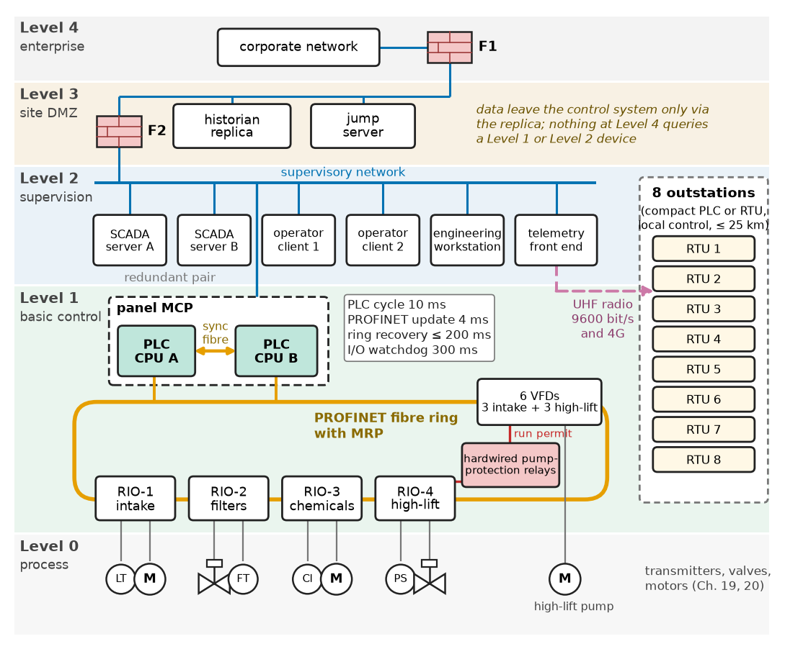
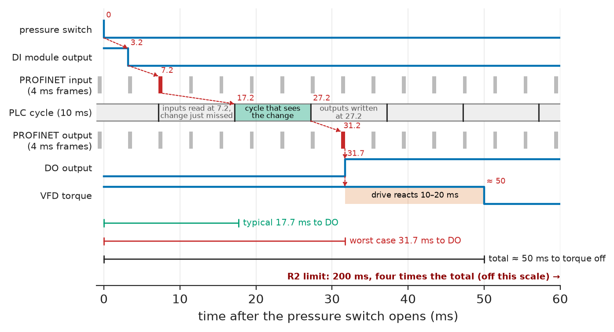
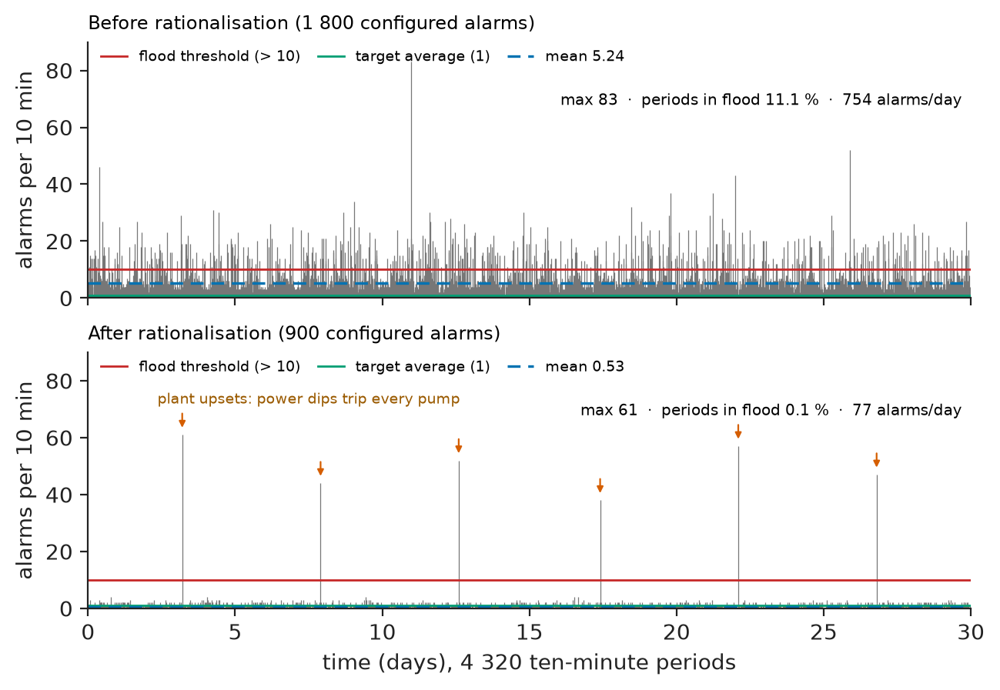
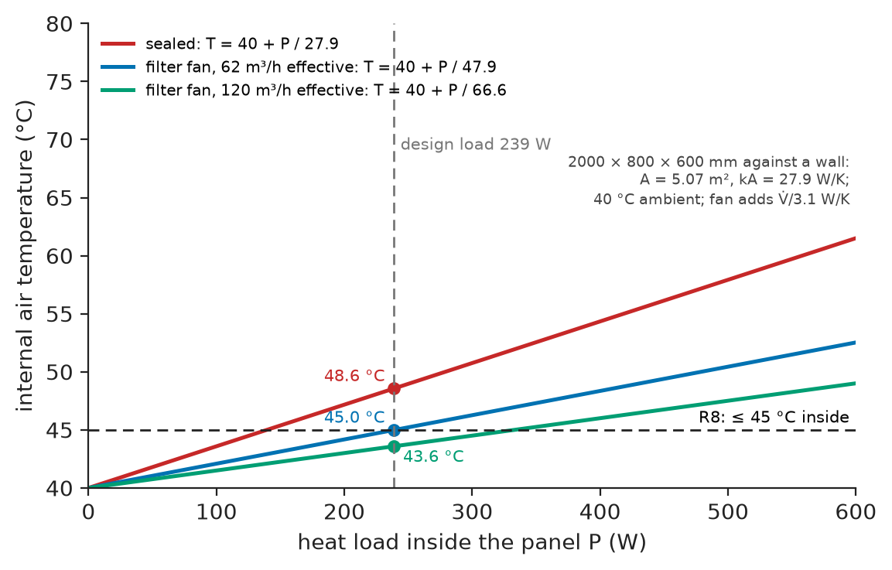
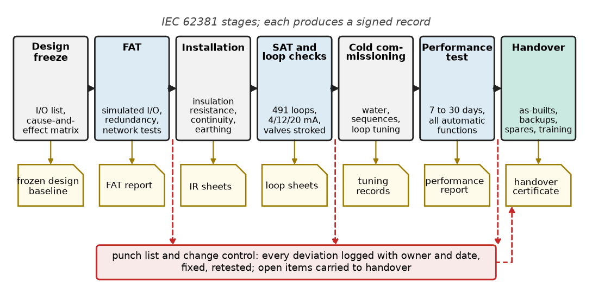

# Chapter 18 — Industrial Control Architecture

*Part V · Industrial Automation*

At 10:05 on a weekday morning a mini-digger laying a new main cuts a fibre-optic cable between two buildings of a 30 ML/day water-treatment works. The control network is a redundant ring, designed so that any single cable can be cut without effect, and within a fifth of a second it has healed. By then every valve and pump in the filter gallery has stopped, and the hypochlorite dosing pumps in the chemical building, on a drop that never lost communication, are still dosing into a contact tank whose flow has just fallen to zero. The chlorine residual leaving the works takes six hours to return to specification. The ring recovered in its guaranteed 200 ms; the filter I/O drops, still at the factory watchdog of 12 ms, gave up long before that and set their outputs to substitute values; and nothing tied the dosing to the flow it doses. The architecture was wrong, because nobody had decided how the network, the watchdogs and the substitute values work together, or what the plant should do when a drop goes quiet. This chapter is about those decisions.

> **How is an industrial control system partitioned into controllers, I/O, networks, operator stations and supervisory software, and how is each part sized?**
> **How is the assembled system shown to work, at the factory and on site, before it is trusted with the plant?**

| Concept | Engineering destination |
|---|---|
| Industrial control systems | ISA-95 levels, process versus discrete versus batch, requirements |
| PLCs | Controller class, response-time budgets, IEC 61131-3 sequences |
| Remote I/O | I/O lists, spare capacity, watchdogs and substitute values |
| Distributed control systems | When a DCS beats PLC plus SCADA; redundancy and availability |
| Supervisory control and data acquisition | Telemetry budgets, polling versus report by exception, historians |
| Human-machine interfaces | ISA-101 screens, ISA-18.2 alarm KPIs |
| Industrial networking | Ring redundancy versus watchdogs, traffic rules |
| Control panels | 24 V DC and heat budgets, IEC 61439 construction |
| System commissioning | FAT, SAT, loop checks, verification and FMEA |

**Roadmap.** The system and its requirements (18.1) → the controller and its timing (18.2) → bringing I/O to the controller (18.3) → when a DCS is the right answer, and redundancy (18.4) → supervising sites kilometres away (18.5) → the operator's screen and alarms (18.6) → the networks that tie it together (18.7) → the panels it lives in (18.8) → proving it before handover (18.9) → failure analysis and what remains open.

---

## 18.1 Industrial control systems

### The reference system

The running example of this chapter is the control system of a **30 ML/day surface-water treatment works** serving about 120 000 people, with eight remote sites (two raw-water intakes and six service reservoirs or booster stations) up to 25 km away. Its process trains are a raw-water intake with three 110 kW pumps on variable-frequency drives; coagulant, lime and hypochlorite dosing paced to flow; six rapid gravity filters, each with inlet, modulating outlet, drain, air-scour and backwash valves and a backwash sequence every 24–72 h; a backwash plant of two wash-water pumps and two air-scour blowers; a chlorine contact tank and three 160 kW high-lift pumps on VFDs feeding the trunk main; and site utilities with a standby generator.

The works is staffed 08:00–16:00 and runs unattended at night, with an on-call operator who can reach it in about an hour. That one fact, together with the population served, drives most of the architecture.

### The control hierarchy

Every industrial control system, whatever the vendor, is arranged in the levels of ISA-95 / IEC 62264, which the zone model of IEC 62443 (Chapter 21) also follows: **Level 0** the process (sensors, valves, motors; Chapters 19 and 20); **Level 1** basic control (PLCs, DCS controllers, remote I/O, drives, safety controllers), with cycles of 1–100 ms; **Level 2** supervision (HMIs, SCADA, alarm servers), seconds; **Level 3** site operations (historian, maintenance systems), minutes to hours; **Level 4** the enterprise network, hours to days.

The design rule that follows is simple and frequently broken: **each level must survive the loss of every level above it**. A filter must keep filtering when the SCADA server reboots; the high-lift pumps must keep pumping when the corporate network is down. Figure 18.1 shows the architecture chosen for the reference works, which Sections 18.2–18.8 justify piece by piece.

<!-- FIGURE 18.1 | figures/ch18/fig-18-1-wtw-control-architecture.png | block-diagram | Control architecture of the 30 ML/day water-treatment works, arranged by ISA-95 level. | Content: five horizontal bands, Level 4 enterprise to Level 0 process. Level 4 corporate network and firewall F1; Level 3 DMZ with historian replica, jump server, firewall F2; Level 2 redundant SCADA servers, two operator clients, engineering workstation, telemetry front end linked by 9600 bit/s UHF radio and 4G to eight outstation RTUs drawn at right; Level 1 redundant PLC pair (CPU A, CPU B, sync fibre) in panel MCP, PROFINET fibre ring with MRP to drops RIO-1 intake, RIO-2 filters, RIO-3 chemicals, RIO-4 high-lift and six VFDs, plus a hardwired pump-protection relay chain beside RIO-4; Level 0 transmitter, valve and motor icons. Annotations: update 4 ms, PLC cycle 10 ms, ring recovery 200 ms, I/O watchdog 300 ms. -->



*Figure 18.1 — Control architecture of the 30 ML/day water-treatment works, arranged by ISA-95 level.*

### Requirements

**Table 18.1 — Requirements for the reference control system.**

| ID | Requirement | Target | Verification |
|---|---|---|---|
| R1 | Loss of automatic control of high-lift pumping | ≤ 1 h per year (predicted) | Reliability calculation (§18.4); switchover test at SAT |
| R2 | Pump protective trip (low suction pressure) response | ≤ 200 ms sensor to contactor or STO | Timed test with calibrator step and scope (§18.9) |
| R3 | Filter level control | ±50 mm steady state, no valve hunting | Trend at SAT over 24 h |
| R4 | Outstation data age at control room | ≤ 10 s analogues, ≤ 5 s alarms | Telemetry budget (§18.5); timed alarm test |
| R5 | Spare capacity | ≥ 20 % installed spare I/O per type, ≥ 20 % rack space, ≥ 30 % CPU cycle headroom | I/O schedule and CPU load report at FAT |
| R6 | Alarm load on the operator | Average ≤ 1 per 10 min; ≤ 1 % of 10-min periods above 10 alarms | Alarm KPI report after 30 days (§18.6) |
| R7 | Each level keeps running if all higher levels fail | No process interruption | Disconnection tests at FAT and SAT |
| R8 | Panel internal temperature | ≤ 45 °C at 40 °C ambient | Heat-run test, thermal calculation (§18.8) |
| R9 | 24 V DC control supply | Survives loss of one PSU; ≥ 30 min on UPS | PSU pull test at FAT |
| R10 | Commissioning evidence | Every I/O point, interlock and sequence tested and signed at FAT and SAT | Test records to IEC 62381 (§18.9) |

R1 comes from the hydraulic design, not from a brochure: the service reservoirs hold about 6 h of demand at night, the on-call operator needs about 1 h to arrive and a further hour to run the plant by hand, so the system can tolerate occasional outages of a few hours but must not make them routine. R2 comes from the pump supplier: a high-lift pump that loses suction pressure cavitates, and the supplier's warranty demands a trip within 0.5 s. The control system is given 200 ms of that.

### Process, discrete and batch control

Industrial control falls into recognisable families. **Discrete manufacturing** (packaging lines, assembly cells, the conveyors of Chapter 20) is mostly digital I/O, interlocks and motion at 1–10 ms cycles, on PLCs and motion controllers. **Continuous process** (water, power, refining, chemicals) is 30–50 % analogue, dominated by PID loops, cascades and ratio control at 0.1–1 s per loop, on PLC plus SCADA or a DCS. **Batch** (pharmaceuticals, food) adds recipes and phases to ISA-88, usually on a DCS with a batch manager. **Infrastructure** (pipelines, water networks, grids) has few points per site but many sites, connected by telemetry. The reference works is a continuous process with sequences in it (the backwash) on site and infrastructure across its catchment: the natural territory of **PLC plus SCADA**, and Section 18.4 checks the alternative.

> **Boundary.** PID design and tuning are owned by *Circuits, Signals and Communications*, [Ch. 35 §35.2–35.3](https://github.com/The-Studio-of-Sadiq/Circuits-Signals-and-Communications/blob/main/part-7-control-system-fundamentals/35-control-design-fundamentals.md); requirements and architecture method by [Chapter 1](../part-1-engineering-design-methodology/01-from-requirement-to-working-system.md) and [Chapter 2](../part-1-engineering-design-methodology/02-system-architecture.md), applied here to industrial control.

---

## 18.2 PLCs

### What a PLC is, from the outside

A **programmable logic controller** is a hardened computer with a fixed execution model. It reads all its inputs into an image table, executes the user program once from top to bottom using that image, writes the output image to the outputs, performs communication and diagnostics, and repeats. On top of the cyclic program, modern PLCs run **cyclic interrupt** tasks at fixed periods (typically 1–1000 ms, used for PID loops so that their sample time is constant) and **event** tasks for hardware interrupts and diagnostics.

Programs are written in the IEC 61131-3 languages (Ladder, Function Block Diagram, Structured Text, Sequential Function Chart). A sensible convention is LD or FBD for interlocks that maintenance electricians must read at 3 a.m., ST for calculations and sequences, and vendor PID function blocks for loops.

> **Boundary.** Hard and firm real-time deadlines, scan-based versus preemptive scheduling and watchdogs are treated in *Electronics and Computing*, [Ch. 27 §27.1 and §27.11](https://github.com/The-Studio-of-Sadiq/Electronics-and-Computing/blob/main/part-6-embedded-and-real-time-systems/27-real-time-computing.md), which lists the PLC I/O scan at 1–10 ms among its examples.

### Response time of a scanned controller

Because inputs are sampled once per scan, an input change that arrives just after the input image was read waits almost a full scan before the program sees it, and the program's reaction is written at the end of the following scan. With distributed I/O on a cyclic network, the network update period adds in both directions. The worst-case response from a field input to a field output is

$$
t_{resp,max}=t_{in}+T_{net}+2\,T_{scan}+T_{net}+t_{out}
$$

where $t_{in}$ is the input module's filter delay, $T_{net}$ the I/O network update time, $T_{scan}$ the PLC cycle time and $t_{out}$ the output module delay. The typical response is roughly half the scan and network terms.

> **Status of the principle: Worst-case response of a cyclic controller**
> *Derived.* Follows from sampling each input once per cycle and writing each output once per cycle, for unsynchronised input, network and program cycles; isochronous (clock-synchronised) I/O replaces the sum of independent worst cases with a fixed, shorter latency.

**Worked example — does the pump trip meet R2?** The low-suction-pressure trip of a high-lift pump is a pressure switch wired to remote I/O drop RIO-4; the trip output is a digital output that opens the drive's run command.

- Input filter of the DI module: 3.2 ms (the factory default; it can be set from 0.1 to 20 ms).
- PROFINET update time: 4 ms in each direction.
- PLC cycle: the main program is estimated at 6 ms, so the cycle is fixed at 10 ms.
- Transistor output delay: 0.5 ms.

Worst case: $3.2+4+2\times10+4+0.5=31.7$ ms. Typical: $3.2+2+10+2+0.5=17.7$ ms. Then the drive must act on the removed run command: a VFD in coast-stop mode removes torque within about 10–20 ms. The total, about 50 ms worst case, is a quarter of R2's 200 ms. The margin is large, so the trip stays in the standard PLC; Section 18.7 adds the condition this budget hides, which is that the network must actually deliver every frame on time. A trip whose budget were within a factor of two of its limit would be hardwired instead. Figure 18.2 draws the chain on one time axis.

<!-- FIGURE 18.2 | figures/ch18/fig-18-2-scan-response-timing.png | timing-diagram | Worst-case response of the high-lift pump trip through remote I/O and the PLC scan. | Content: time axis 0 to 60 ms, rows top to bottom: pressure switch opens at 0; DI module output at 3.2 ms; PROFINET input frames every 4 ms, change carried at 7.2 ms; PLC cycles of 10 ms, input image read just missed so the change enters the cycle starting at 17.2 ms and the output image is written at 27.2 ms; PROFINET output frame at 31.2 ms; DO output at 31.7 ms; VFD torque off at about 50 ms. Brackets: worst case 31.7 ms, typical 17.7 ms, total about 50 ms against the R2 limit of 200 ms. -->



*Figure 18.2 — Worst-case response of the high-lift pump trip through remote I/O and the PLC scan.*

### Choosing the controller class

**Table 18.2 — Controller classes for the reference works (2026 indicative prices, CPU only).**

| Class | Examples of the class | I/O capacity | Redundancy | Typical price | Verdict for the works |
|---|---|---|---|---|---|
| Compact PLC | S7-1200, CompactLogix 5380 small, Modicon M241 class | 100–1 000 | None | \$400–\$1 200 | Outstations only |
| Modular PLC | S7-1500, ControlLogix 5580, Modicon M580 class | 1 000–10 000 | Optional in some families | \$1 500–\$5 000 | Meets everything except R1 without redundancy |
| Redundant PLC pair | S7-1500R/H, ControlLogix redundancy, M580 Hot Standby class | 1 000–10 000 | Hot standby, bumpless switchover in 50–300 ms | \$12 000–\$25 000 per pair | **Chosen** for the main controller (R1) |
| PC-based / soft PLC | CODESYS or TwinCAT runtime on an industrial PC | Large | Possible but less common | \$1 000–\$3 000 plus licence | Strong for motion; weaker 20-year support story |
| DCS controller | Process controllers of a DCS family | 500–5 000 per controller | Standard | Priced per system | Evaluated in §18.4 |

R1, quantified in Section 18.4, decides the main controller; the outstations get compact PLCs or RTUs with telemetry protocols built in. Above all, the choice is constrained by what the maintenance staff already know: a water company with two hundred sites on one PLC family will not thank a designer for a third.

### A sequence in Structured Text

The filter backwash shows the pattern every robust PLC sequence follows: a step number held in one variable, transitions that require both a timer *and* proven feedback, a watchdog on every step that waits for the field, a single safe state, and outputs decoded from the step number so that no output can be left on by a forgotten assignment. Listing 18.1 is the core of the function block in IEC 61131-3 Structured Text; scheduling, operator holds and the filter-to-waste step are omitted.

```text
FUNCTION_BLOCK FB_FilterBackwash
VAR_INPUT
    xStart, xPermissive, xAbort, xReset : BOOL;
    rLevel_m : REAL;                                   (* water above media, m *)
    xInletClosed, xAirOpen, xWashOpen   : BOOL;        (* limit-switch feedback *)
END_VAR
VAR_OUTPUT
    xInlet, xDrain, xAir, xWash, xBlower, xWashPump, xFault : BOOL;
    iStep : INT := 0;
END_VAR
VAR
    iPrev : INT := -1;
    tStep : TON;                                       (* time in current step *)
END_VAR

tStep(IN := (iStep = iPrev), PT := T#1H);              (* restarts on step change *)
iPrev := iStep;
IF xAbort AND iStep <> 0 THEN iStep := 90; END_IF;

CASE iStep OF
  0:  IF xStart AND xPermissive THEN iStep := 10; END_IF;          (* filtering *)
  10: IF xInletClosed AND rLevel_m < 0.2 THEN iStep := 20;         (* drain down *)
      ELSIF tStep.ET > T#20M THEN xFault := TRUE; iStep := 90; END_IF;
  20: IF NOT xAirOpen AND tStep.ET > T#60S THEN xFault := TRUE; iStep := 90;
      ELSIF tStep.ET >= T#3M THEN iStep := 30; END_IF;              (* air scour *)
  30: IF NOT xWashOpen AND tStep.ET > T#60S THEN xFault := TRUE; iStep := 90;
      ELSIF tStep.ET >= T#2M THEN iStep := 40; END_IF;              (* air + water *)
  40: IF tStep.ET >= T#6M THEN iStep := 50; END_IF;                 (* high-rate wash *)
  50: IF rLevel_m > 1.5 THEN iStep := 0;                            (* refill *)
      ELSIF tStep.ET > T#30M THEN xFault := TRUE; iStep := 90; END_IF;
  90: IF xReset AND NOT xAbort THEN xFault := FALSE; iStep := 0; END_IF;  (* safe *)
END_CASE;

xInlet    := (iStep = 0) OR (iStep = 50);
xDrain    := (iStep = 10);
xAir      := (iStep = 20) OR (iStep = 30);
xWash     := (iStep = 30) OR (iStep = 40);
xBlower   := xAir AND xAirOpen;          (* never run the blower against a shut valve *)
xWashPump := xWash AND xWashOpen;
END_FUNCTION_BLOCK
```

The timer is a stopwatch, reset on the one scan in which the step changes. The safe state (step 90) closes every valve and stops both machines, because every output is decoded as FALSE there; a fault therefore leaves the filter isolated and drained rather than half-washed. The blower and wash pump each require proven-open feedback from their valve, which protects the pipework if a valve sticks. A scheduler never allows two of the six filters to wash at once: the wash-water tank holds one wash.

---

## 18.3 Remote I/O

### The I/O list comes first

Every design starts from the **I/O list**: one line per field signal with tag, type, range, location and drawing. Controller, modules, panels, cabling and test plan are all counted from it. For the reference works it summarises as Table 18.3.

**Table 18.3 — I/O summary of the reference works.**

| Area | DI | DO | AI | AO |
|---|---|---|---|---|
| Intake (3 raw-water pumps) | 36 | 12 | 18 | 3 |
| Chemical dosing | 40 | 20 | 24 | 8 |
| Filters (6 cells) | 84 | 48 | 24 | 6 |
| Backwash pumps and blowers | 24 | 8 | 8 | 2 |
| Clear water and high-lift | 42 | 12 | 21 | 3 |
| Utilities and building | 30 | 10 | 8 | 0 |
| **Total (491 points)** | **256** | **110** | **103** | **22** |

The six VFDs appear only through their hardwired run-permit and STO circuits; reference, status and diagnostics come over PROFINET, saving about 15 points per drive (Chapter 20).

**Worked example — module count with spare capacity.** R5 asks for at least 20 % installed spare per signal type. With 16-channel DI and DO modules, 8-channel AI and 4-channel AO modules:

- DI: $256\times1.2=307.2$, so 20 modules (320 channels), giving 25 % spare.
- DO: $110\times1.2=132$, so 9 modules (144 channels), 31 % spare.
- AI: $103\times1.2=123.6$, so 16 modules (128 channels), 24 % spare.
- AO: $22\times1.2=26.4$, so 7 modules (28 channels), 27 % spare.

That is 52 I/O modules, split over the main panel and four drops, each rack then left with at least 20 % empty slots. The spare is not generosity: I/O counts typically grow 10–15 % between design and handover, and every point without a spare channel costs a module, a panel modification and a retest.

> **Status of the principle: 20 % installed spare, 20 % space**
> *Empirical.* A planning rule from project practice and utility specifications, covering I/O growth before handover and later modifications; it is a contractual number, not a physical one.

### Central versus distributed I/O

Two ways exist to bring 491 signals to one controller: run every field cable to a marshalling cabinet beside the controller (**central I/O**), or put I/O modules in panels near each process area and connect them to the controller over industrial Ethernet (**distributed or remote I/O**), so that one fibre pair replaces hundreds of cores.

**Table 18.4 — I/O distribution options for the reference works (indicative 2026 installed costs).**

| Criterion | Central marshalling | Remote I/O drops on PROFINET (chosen) | IO-Link / field-mounted I/O blocks |
|---|---|---|---|
| Field cable length (average per signal) | About 180 m | About 35 m | About 10 m to the block, network beyond |
| Copper cable and installation | About \$95 000 | About \$30 000 | About \$20 000 |
| Panels and network hardware | One large marshalling room | Four drop panels and fibre ring: about +\$45 000 | Many IP67 blocks: about +\$35 000 |
| Lightning and earth-potential exposure | High: long cables between buildings | Low: fibre between buildings | Low |
| Loss of one network link | Not applicable | One drop to safe state, unless ring (§18.7) | One block or segment |

The comparison is decided less by cable cost, which roughly cancels against panel cost, than by the separate buildings of a water works: copper multicores between buildings with separate earths are the classic route for lightning surges into I/O cards, and fibre removes it.

### Watchdogs and the safe state

Every remote I/O drop runs a **watchdog**: if it receives no valid output frame from its controller within the watchdog time, usually 3 to 10 update cycles (12 ms by default here, 3 × 4 ms; Section 18.7 explains why the design lengthens it), it sets every output to a configured **substitute value**, which for most outputs is "off". This is the behaviour of the opening story. It is correct and must be designed, signal by signal:

- A filter outlet valve that fails shut is safe but takes the works output down.
- A chlorine dosing pump that stops while water keeps flowing is a public-health risk, so the dosing pump and the flow it doses sit on the same drop, or the dosing is interlocked locally.
- A high-lift pump may "hold last value" on its speed reference, but never on its trip outputs.

The list of substitute values belongs in the I/O list beside each output, signed off by the process engineer, not left at the factory default.

---

## 18.4 Distributed control systems

### What a DCS adds

A **distributed control system** is a family of controllers, I/O, operator stations, historian and engineering tools sold and engineered as one system with one database. A tag defined once, with its range, alarms, faceplate and trend, exists everywhere. Controller redundancy, online changes and change tracking are standard rather than options. PLC plus SCADA achieves the same with separate products and tag-import discipline.

**Table 18.5 — PLC plus SCADA versus DCS for the reference works.**

| Criterion | PLC plus SCADA (chosen) | DCS |
|---|---|---|
| Natural size | Up to a few thousand I/O, many sites | Thousands to tens of thousands of I/O, one site |
| Engineering database | Separate PLC and SCADA databases, linked by tag import | Single database |
| Redundancy | Option (chosen here) | Standard |
| Telemetry to remote sites | Strong: SCADA is built for it | Usually via a separate RTU/SCADA layer |
| Batch (ISA-88) and advanced control | Add-on | Integrated |
| Lifecycle cost at 500 I/O | Lower | Higher: licences priced per tag, specialist engineers |

At 491 I/O, eight remote sites and a utility owner with in-house PLC skills, PLC plus SCADA wins. A 50 000-I/O refinery with batch blending would go the other way. The boundary is not a number but a question: is the engineering cost of keeping several databases consistent larger than the licence cost of one?

### How much redundancy is enough

R1 limits the predicted loss of automatic control of high-lift pumping to 1 h per year. For a single repairable element with mean time between failures MTBF and mean time to repair MTTR, the steady-state unavailability is

$$
U=\frac{\mathrm{MTTR}}{\mathrm{MTBF}+\mathrm{MTTR}}
$$

For elements in series, unavailabilities add (when small); for a redundant pair with independent failures, the pair is unavailable only when both are down, $U^2$, plus the outages caused by switchovers that fail.

> **Status of the principle: Availability of series and redundant elements**
> *Approximate.* Assumes constant failure rates, independent failures and repair restoring the element to new; common-cause failures (a shared power feed, a firmware bug present in both CPUs, the same flood) break the independence and in practice set the floor of redundant availability.

**Worked example — single or redundant controller?** Take MTTR = 8 h (an on-call technician, a spare on the shelf and a night drive) and switchover coverage $c=0.99$ (1 % of failures are not caught and need a 1 h manual restart). Typical MTBF values from vendor reliability data:

**Table 18.6 — Predicted loss of control of high-lift pumping (minutes per year).**

| Element in the path | MTBF | Single (min/yr) | Redundant (min/yr) |
|---|---|---|---|
| CPU | 100 000 h | 42.0 | 0.11 |
| 24 V DC supply | 200 000 h | 21.0 | 0.05 |
| Network switch or ring segment | 300 000 h | 14.0 | 0.04 |
| Remote I/O head, drop RIO-4 | 400 000 h | 10.5 | 0.03 |
| **Total** | | **87.6 (1.46 h)** | **0.22** |
| R1 limit | | 60 | 60 |

The single-channel design exceeds R1 by about 46 %. Removing only the CPU's contribution is not enough: the supply, the network and the I/O head would still sum to 45.5 min, inside the limit but with little margin for the I/O modules and field devices not in the table. The chosen design therefore duplicates every element in the path: a redundant CPU pair, two 24 V supplies with a redundancy module, a fibre ring (Section 18.7) and a dual-headed RIO-4 with **system redundancy** (each drop connected to both CPUs). The residual 0.22 min/yr is theoretical; common cause dominates in reality, which is why the two CPUs sit in separate panel sections with separate supplies fed from separate distribution boards.

---

## 18.5 Supervisory control and data acquisition

### What SCADA does here

**SCADA** gathers data from controllers and outstations, presents it to operators, records it, raises alarms and sends commands. On the reference works it does two jobs. On site, the SCADA servers read the main PLC over Ethernet and serve the HMI clients (Section 18.6). Across the catchment, a **telemetry front end** talks to eight outstations, each a compact PLC or **RTU** (remote terminal unit) that runs its own local control: a reservoir outlet valve closes on low level whether or not the radio is working.

Two telemetry patterns are in use. In **polling** (Modbus RTU and TCP) the master asks each outstation in turn; it is simple and deterministic, data age is set by the poll cycle, and bandwidth is spent whether or not anything changed. In **report by exception** (DNP3, IEEE 1815; IEC 60870-5-104) outstations send only changes, time-stamped by a local clock and buffered while the link is down, and the master runs a slow **integrity poll** to resynchronise.

> **Boundary.** The Modbus frame, function codes and register model, CAN-based networks and industrial Ethernet protocols themselves are owned by [Chapter 21](21-industrial-communication-and-safety.md); radio link budgets by [Chapter 26](../part-7-communications-signal-processing-and-biomedical/26-communication-system-integration.md); MQTT-based telemetry for IoT devices by [Chapter 11](../part-3-embedded-and-connected-systems/11-iot-systems.md). This section budgets the telemetry; it does not define the protocols.

### The telemetry budget

R4 requires analogues no older than 10 s and alarms at the control room within 5 s. The existing licensed UHF radio network runs at 9600 bit/s half duplex, with a 40 ms transmitter key-up time on every transmission. Listing 18.2 computes the poll cycle for eight outstations of 60 registers each, and compares a 4G alternative by monthly data volume.

```python
# SCADA telemetry budget: polled radio versus cellular for 8 outstations
BITS_PER_CHAR = 11            # Modbus RTU: start + 8 data + parity + stop
def radio_poll_ms(n_regs, baud=9600, keyup_ms=40, rtu_proc_ms=20, turn_ms=10):
    req, resp = 8, 5 + 2 * n_regs                 # bytes on the air
    t_chr = BITS_PER_CHAR / baud * 1e3            # ms per character
    return (keyup_ms + req * t_chr + rtu_proc_ms  # master transmits, RTU answers
            + keyup_ms + resp * t_chr + turn_ms)

stations, n_regs = 8, 60
t1 = radio_poll_ms(n_regs)
for retry in (0.0, 0.05):                          # fraction of polls repeated
    cycle = stations * t1 * (1 + retry) / 1e3
    print(f"radio 9600 bit/s, retries {retry:4.0%}: {t1:5.0f} ms/station, "
          f"scan cycle {cycle:4.2f} s")

# cellular: bytes per Modbus TCP poll incl. IP/TCP headers (40 B) and two ACKs
poll_bytes = (12 + 40) + (9 + 2 * n_regs + 40) + 2 * 40
month_s = 30 * 24 * 3600
for period_s in (5, 60):
    mb = poll_bytes * month_s / period_s / 1e6
    print(f"cellular polled every {period_s:2d} s: {mb:6.1f} MB/month per station")
# report by exception: 40 events/day of 60 B + hourly integrity poll + 15-min keep-alive
rbe = (40 * 60 + 24 * poll_bytes + 96 * 3 * 40) * 30 / 1e6
print(f"cellular report-by-exception:   {rbe:6.2f} MB/month per station")
```

```text
radio 9600 bit/s, retries   0%:   262 ms/station, scan cycle 2.10 s
radio 9600 bit/s, retries   5%:   262 ms/station, scan cycle 2.20 s
cellular polled every  5 s:  156.0 MB/month per station
cellular polled every 60 s:   13.0 MB/month per station
cellular report-by-exception:     0.63 MB/month per station
```

**Worked example — reading the budget.** Each radio poll costs 262 ms, of which 80 ms is key-up time and 143 ms is the 125-byte response; eight stations take 2.1 s, or 2.2 s with 5 % retries. Data age is then at most one cycle plus processing, about 2.5 s, a fourfold margin on R4's 10 s. An alarm, though, can occur just after its station was polled and wait a full 2.2 s cycle plus the SCADA server's own scan of 1 s: 3.2 s worst case against R4's 5 s, a margin of only 36 %, which a ninth and tenth station would consume. The design therefore keeps the radio for the eight existing sites but configures the outstations for DNP3 with unsolicited event reporting, so that an alarm is sent the moment it occurs (with collision avoidance on the shared channel), and the poll only refreshes analogues. On 4G, polling every 5 s would cost 156 MB per month per station, a commercial rather than technical problem; report-by-exception costs 0.63 MB. Table 18.7 records the budget.

**Table 18.7 — Telemetry timing budget (radio, eight outstations).**

| Item | Budget | Design value | Margin |
|---|---|---|---|
| Analogue data age (R4) | 10 s | 2.2 s cycle + 0.3 s processing = 2.5 s | 75 % |
| Alarm latency, polled only | 5 s | 2.2 s + 1.0 s server scan = 3.2 s | 36 % |
| Alarm latency, DNP3 unsolicited | 5 s | About 0.5 s on an idle channel, 1.5 s with one collision backoff | 70 % |
| Channel occupancy | ≤ 60 % (to leave room for events) | Polls every 5 s: 2.2 s / 5 s = 44 % | 16 points |

### Historian and data

The historian stores analogues with a deadband (say 0.5 % of span, or at least every 15 min) and every event with its time stamp. Its time base matters more than its size: outstation clocks are synchronised by NTP or by the telemetry protocol, the site PLC by NTP from a local GPS-disciplined server, so that a pressure transient at a reservoir and a pump trip at the works can be put in the right order when a burst main is investigated. Data leave the control network only through a replica historian in the DMZ (Figure 18.1); nothing at Level 4 queries a Level 1 or 2 device directly (Chapter 21).

---

## 18.6 Human-machine interfaces

### Screens for situation awareness

The **HMI** is where the system meets the operator, and its design follows ANSI/ISA-101.01. The rules that matter most:

- **Grey is normal.** Equipment is drawn in muted greys and colour is reserved for abnormal states, so that one red symbol stands out.
- **A display hierarchy**: a one-screen overview of the whole works, process-area screens for control, equipment detail screens, diagnostics.
- **Analogue indicators with context** (a bar with its normal band and alarm limits), **faceplates** from one library so every pump is operated the same way, and every command confirmed by PLC feedback rather than by the button press.

### Alarm management

An **alarm** is a signal to the operator that requires a response. A message that does not require a response is an event and goes to a log, not to the alarm list. The lifecycle of ANSI/ISA-18.2 (IEC 62682) and the guidance of EEMUA 191 give the targets used for R6: about one alarm per 10 min per operator on average is manageable, above about two is over-demanding; an **alarm flood** is more than 10 alarms in 10 min, and the proportion of 10-min periods in flood should be below about 1 %; the ten most frequent alarms should account for only a few percent of the total.

> **Status of the principle: Alarm-rate targets**
> *Empirical.* Set from observed operator performance in process control rooms (EEMUA 191, ISA-18.2); they assume one operator per console and alarms that each require a distinct action, and they are targets for steady operation, not for the first minutes of a major upset.

The works inherited a SCADA alarm database from a previous system with 1 800 configured alarms. Table 18.8 gives the ISA-18.2 key performance indicators computed with a short numpy script (bin the alarm time stamps into 10-min periods, count, rank tags) from 30-day logs before and after an alarm rationalisation; the logs used here are synthetic, generated to match the statistics typically seen in such a review (chattering alarms on two level switches, a bad actor that alarmed on every pump start, standing alarms from out-of-service equipment).

**Table 18.8 — Alarm KPIs over 30 days (synthetic logs).**

| KPI | Target (R6) | Before | After |
|---|---|---|---|
| Configured alarms | — | 1 800 | 900 |
| Alarms per day | About 150 | 754 | 77 |
| Average per 10 min | ≤ 1 | 5.24 | 0.53 |
| Maximum in one 10-min period | — | 83 | 61 |
| 10-min periods in flood (> 10) | ≤ 1 % | 11.1 % | 0.1 % |
| Share of the ten most frequent tags | A few percent | 76 % | 3 % |

**Worked example — what the KPIs say.** Before rationalisation the operator received 754 alarms per day, 5.2 per 10 min on average, five times the R6 target, with 11 % of all 10-min periods in flood and ten tags producing three quarters of all alarms. That last figure says that fixing ten tags (deadband and on-delay on chattering switches, suppressing low-flow alarms while a pump starts, removing alarms on out-of-service equipment) removes most of the load. After rationalisation, which also halved the alarm count to 900 by deleting alarms that had no defined operator response, the average is 0.53 per 10 min and the flood fraction 0.1 %, both inside R6. The maximum of 61 in one 10-min period remains: it is a plant upset (a power dip that trips every pump), and the next step is **state-based suppression**, in which the PLC recognises "site power failure" and the alarm system shows one alarm for it instead of sixty consequences. Figure 18.3 shows the 10-min alarm counts before and after.

<!-- FIGURE 18.3 | figures/ch18/fig-18-3-alarm-rate-before-after.png | plot | Alarm count per 10-minute period over 30 days, before and after alarm rationalisation (synthetic logs of Table 18.8). | Content: two stacked panels, x-axis time 0 to 30 days (4320 bins), y-axis alarms per 10 min 0 to 90. Before: values mostly 2 to 10, spikes to 83, dashed mean 5.24, flood fraction 11.1 percent annotated. After: values mostly 0 to 2, six spikes to 61 labelled plant upset, dashed mean 0.53, flood fraction 0.1 percent. Both panels: red line at 10 (flood threshold), green line at 1 (target average). -->



*Figure 18.3 — Alarm count per 10-minute period over 30 days, before and after alarm rationalisation (synthetic logs of Table 18.8).*

---

## 18.7 Industrial networking

### Topology

The reference works uses three networks, each with one job: a **control network** (Level 1), PROFINET on a fibre ring between buildings, connecting the PLC pair, four drops and six VFDs, on which only devices in the I/O list are allowed; a **supervisory network** (Level 2) for SCADA servers, clients and the engineering workstation, on its own switches and reaching the PLC through its second interface; and a **site DMZ** (Level 3) between two firewalls.

The ring uses the **Media Redundancy Protocol** (MRP, IEC 62439-2): one switch is the ring manager and blocks one port; when a link breaks, it unblocks it within a guaranteed 200 ms (10 ms in the fast variants). With the default watchdog of 12 ms (3 × 4 ms), every drop beyond a fibre break would go to its substitute values before the ring healed, turning a single cable fault into a works-wide trip: exactly the opening incident. The watchdog of every drop is therefore set to 300 ms. That does not slow the pump trip of R2, which depends on the update time while communication works; it only lets outputs hold their last value for 0.3 s after communication stops, which is harmless for valves that take 30 s to stroke and for pumps whose protection is in any case backed by hardwired relays (Table 18.11). Where a process cannot tolerate even 200 ms of lost data, a bumpless scheme that sends every frame both ways round the ring (MRPD, or PRP and HSR of IEC 62439-3) removes the recovery time altogether.

> **Status of the principle: Ring recovery versus I/O watchdog**
> *Derived.* A device stays in data exchange through a network reconfiguration only if its watchdog time exceeds the worst-case recovery time of the redundancy protocol; otherwise a single link break becomes a process trip, which is acceptable only if the substitute values are safe and the process can tolerate it.

### The traffic budget

Cyclic real-time traffic on the control network is small. PROFINET RT frames are about 60–100 bytes; each device exchanges one frame in each direction per update cycle. For the 10 devices (four drops, six drives) at a 4 ms update time on 100 Mbit/s links:

$$
\frac{10\times2\times100\ \mathrm{B}\times8\ \mathrm{bit/B}}{4\ \mathrm{ms}}=4.0\ \mathrm{Mbit/s}
$$

or 4 % of a 100 Mbit/s link. The threat is uncontrolled traffic: a loop, a backfill, a network scan, a camera. PROFINET RT frames carry a high VLAN priority, so managed switches forward them ahead of other traffic; an unmanaged switch has no such queueing, so bulk traffic through it delays real-time frames (the incident that opens Chapter 21), and a cable loop through it multiplies broadcasts until the links saturate. The design rules: only managed switches with priority queueing and broadcast-storm limiting on the control network; unused ports disabled and others locked to known MAC addresses; engineering laptops only on the supervisory network, never inside a panel; and port statistics, ring status and update-time violations read by the PLC and alarmed on SCADA.

> **Boundary.** Industrial Ethernet protocols, their real-time classes and network diagnostics tools are owned by [Chapter 21](21-industrial-communication-and-safety.md), as is OT security (IEC 62443 zones and conduits). Ethernet physical and MAC layers are in *Electronics and Computing*, [Ch. 26 §26.7](https://github.com/The-Studio-of-Sadiq/Electronics-and-Computing/blob/main/part-6-embedded-and-real-time-systems/26-embedded-interfaces.md).

---

## 18.8 Control panels

### Construction and standards

The control equipment lives in panels: the main control panel (MCP) with the PLC pair, network core and UPS; four remote I/O panels; and outstation kiosks. Assemblies are designed and verified to IEC 61439-1 and -2 (UL 508A in North America), and their electrical equipment to IEC 60204-1 where they form part of a machine. The rules that matter most: 24 V DC, analogue, communication and mains wiring in separate ducts crossing at right angles, with analogue screens bonded at the entry by 360° clamps; terminals for every field cable, with disconnect terminals on each transmitter loop so it can be opened for calibration without lifting a wire; one electronic circuit protector per 24 V group, so a short on one solenoid cable does not take down the CPU; every wire labelled at both ends; and IP54 or better against humidity and the chlorine atmosphere near dosing, with hygrostat-controlled heaters in outdoor kiosks.

### The 24 V DC budget

**Table 18.9 — 24 V DC budget of the main control panel.**

| Load | Current |
|---|---|
| CPU pair and backplanes | 1.20 A |
| 14 I/O modules (local rack) | 1.68 A |
| 3 managed switches | 1.05 A |
| HMI panel (15 in local operator panel) | 1.25 A |
| Firewall and router | 0.60 A |
| 32 local 2-wire transmitters at 22 mA | 0.70 A |
| 40 three-wire sensors at 15 mA | 0.60 A |
| 60 interposing relays, half energised, 21 mA each | 0.63 A |
| 8 local solenoid valves at 0.17 A (all energised) | 1.36 A |
| **Total** | **9.07 A** |
| Supply: two 20 A units with redundancy module (N+1) | 20 A available with one failed |
| **Margin** | **55 %** |

The two supplies feed a redundancy module, so either alone carries the whole load (R9); the UPS behind them gives 30 min of operation after a mains failure, long enough for the generator to start and for SCADA to log the event. The margin is deliberately large, for inrush at power-up.

### The heat budget

Electronics in a closed panel heat the air inside; the panel's surfaces lose that heat to the room. For a sheet-steel enclosure the effective surface area $A$ depends on how it is installed (IEC/TR 60890 and DIN VDE 0660-507), and the temperature rise at a dissipation $P$ is

$$
\Delta T=\frac{P}{kA},\qquad k\approx5.5\ \mathrm{W/(m^2K)}\ \text{for painted sheet steel in still air}
$$

When that rise is too high, a filter fan moves ambient air through the panel. Air at sea level carries about $1/3.1$ W per (m³/h) per kelvin, so a fan of flow $\dot V$ in m³/h lowers the rise to

$$
\Delta T=\frac{P}{kA+\dot V/3.1}
$$

> **Status of the principle: Enclosure heat balance**
> *Approximate.* A lumped single-node model: uniform internal air temperature, still ambient air, no solar gain, and a constant surface coefficient; real panels have a top-to-bottom gradient of 5–15 K, so the hottest electronics, mounted high, see more than the mean rise, and the constant 3.1 m³·K/(W·h) assumes sea-level air density.

**Worked example — does the main panel need a fan?** The MCP is a 2000 × 800 × 600 mm (H × W × D) floor-standing enclosure against a wall. For that installation the effective surface is $A=1.4W(H+D)+1.8DH=1.4\times0.8\times2.6+1.8\times0.6\times2.0=5.07$ m². The losses inside are the CPU pair 15 W, I/O modules 49 W, switches 24 W, HMI 30 W, firewall and router 15 W, UPS module 20 W, relays 30 W, terminals and wiring 40 W, and 16 W lost by the 24 V supplies in delivering 218 W at 93 % efficiency.

Total $P=239$ W. Sealed, the rise is $239/(5.5\times5.07)=8.6$ K, and at the 40 °C summer ambient of the pump hall the inside reaches 48.6 °C, which fails R8 (45 °C). Holding a 5 K rise needs the fan to remove $239-5.5\times5.07\times5=100$ W, a flow of $3.1\times100/5=62$ m³/h. Filter fans lose 30–50 % of their free-blowing flow through the outlet filter, so a fan rated about 105 m³/h free-blowing is fitted, low in the door with the outlet filter high on the opposite side. Figure 18.4 shows the internal temperature against heat load for the sealed panel and two fan sizes.

<!-- FIGURE 18.4 | figures/ch18/fig-18-4-panel-temperature-vs-load.png | plot | Internal air temperature of the 2000 x 800 x 600 mm main control panel against heat load at 40 degC ambient. | Content: x-axis heat load 0 to 600 W, y-axis 40 to 80 degC. Lines: sealed T = 40 + P/27.9 (48.6 degC at 239 W); filter fan 62 m3/h effective T = 40 + P/(27.9 + 20.0) (45.0 degC at 239 W); filter fan 120 m3/h effective T = 40 + P/(27.9 + 38.7). Dashed horizontal line at 45 degC labelled R8, dashed vertical line at 239 W labelled design load. -->



*Figure 18.4 — Internal air temperature of the 2000 x 800 x 600 mm main control panel against heat load at 40 degC ambient.*

---

## 18.9 System commissioning

### From factory to plant

Commissioning is the process that turns a correctly built system into a trusted one, and IEC 62381 divides it into stages, each with its own test records (Figure 18.5):

1. **Factory acceptance test (FAT)** at the integrator's works with the I/O simulated, witnessed by the client: every I/O point checked on the HMI, every interlock and sequence run against the cause-and-effect matrix, redundancy switchover, network break, supply failure and watchdog behaviour tested.
2. **Installation**: field cables terminated, insulation-resistance, continuity and earth-bonding tests.
3. **Site acceptance test (SAT) and loop checks**: every device tested end to end, a calibrator injecting 4, 12 and 20 mA and the HMI value recorded, every valve stroked, every motor run for direction and feedback.
4. **Cold commissioning** with water: sequences run, loops tuned.
5. **Performance test**: treated water to specification for 7–30 days with all automatic functions in service.
6. **Handover**: as-built documents, program and configuration backups, spares, training records and a punch list of open items with owners and dates.

<!-- FIGURE 18.5 | figures/ch18/fig-18-5-commissioning-stages.png | flowchart | Commissioning stages from design freeze to handover, with the record each stage produces. | Content: left-to-right boxes Design freeze (I/O list, cause-and-effect matrix) -> FAT (simulated I/O, redundancy and network tests) -> Installation (IR, continuity, earthing) -> SAT and loop checks (491 loops) -> Cold commissioning (water, loop tuning) -> Performance test (7 to 30 days) -> Handover. Under each box its record: FAT report, IR sheets, loop sheets, tuning records, performance report, handover certificate. Feedback arrows from FAT, SAT and performance test to a punch list and change-control box. -->



*Figure 18.5 — Commissioning stages from design freeze to handover, with the record each stage produces.*

**Worked example — how long do the loop checks take?** A two-person team (one in the field with a calibrator and radio, one at the HMI) checks a digital point in about 5 min and an analogue loop, at three points with the calibrator, in about 15 min, including paperwork. For the works: $(256+110)\times5+(103+22)\times15=1830+1875=3705$ min, or 62 h of team time: eight working days if nothing is wrong. Typically 5–10 % of loops fail first time (wiring errors, wrong ranges, swapped tags), each costing about an hour, adding 25–50 h: 87–112 h, or 11–14 team-days, is the honest plan.

### Verification

**Table 18.10 — Verification of the reference control system.**

| Req. | Test | Limit | Result | Pass/fail |
|---|---|---|---|---|
| R1 | Reliability prediction; CPU switchover with pumps running | ≤ 1 h/yr; no trip | 0.22 min/yr; switchover 110 ms, no trip | Pass |
| R2 | Pressure-switch step, scope on DO and drive, 20 repeats | ≤ 200 ms | 13–31 ms to DO; 29–50 ms to torque off | Pass |
| R3 | 24 h trend of filter levels | ±50 mm | ±22 mm after a 0.5 % valve deadband was added | Pass |
| R4 | Timed alarm from each outstation (DNP3 unsolicited) | ≤ 5 s | 0.4–1.6 s | Pass |
| R5 | I/O schedule audit; CPU cycle load report | ≥ 20 % spare; ≥ 30 % headroom | 24–31 % spare; cycle 6–9 ms of 10 ms (10 % headroom at peak) | **Fail**, see below |
| R6 | 30-day alarm KPI report | ≤ 1 per 10 min; ≤ 1 % flood | 0.53; 0.1 % | Pass |
| R7 | Disconnect SCADA servers, then supervisory network, 1 h each | No interruption | None; outstation events buffered and delivered | Pass |
| R8 | 8 h heat run, thermocouples in panel | ≤ 45 °C at 40 °C | 44.1 °C mean, 47.5 °C at top rail | Conditional: CPU moved down one rail |
| R9 | Pull each PSU in turn under full load; mains off for 30 min | No reset | No reset; UPS 41 min | Pass |
| R10 | FAT and SAT records audit | 100 % of points and interlocks signed | 100 %, 37 punch items, all closed | Pass |

The R5 failure is typical. The 10 ms cycle was fixed when the program was estimated at 6 ms; with alarm logic, diagnostics and network monitoring added, peak cycle time reached 9 ms. The fix was architectural: PID loops and analogue scaling moved to a 100 ms cyclic interrupt, where a loop belongs anyway because it wants a constant sample period (*Circuits, Signals and Communications*, [Ch. 35 §35.8](https://github.com/The-Studio-of-Sadiq/Circuits-Signals-and-Communications/blob/main/part-7-control-system-fundamentals/35-control-design-fundamentals.md)), and the main cycle fell to 5–6 ms.

### Failure analysis

**Table 18.11 — FMEA of the control architecture (selected modes).**

| Failure mode | Effect | Cause | Detection | Mitigation |
|---|---|---|---|---|
| Remote I/O drop loses communication | All outputs of the drop to substitute values; area stops | Cable cut with watchdog shorter than ring recovery; traffic burst through unmanaged switch | Drop diagnostic alarm; port statistics | Watchdog 300 ms above ring recovery; managed switches; substitute values designed per output; dosing interlocked locally to flow |
| Primary CPU fails | Switchover to standby | Hardware fault, firmware fault | Redundancy status alarm | Hot standby; separate supplies and panel sections for the two CPUs against common cause |
| Same firmware fault in both CPUs | Loss of control | Common-cause defect | CPU-stop alarm via RTU and autodialler | Hardwired pump protection; local manual control; firmware staged on a spare first |
| 24 V supply output short | Loss of field power to a group | Damaged sensor cable | Circuit-protector trip alarm | One protector per group; N+1 supplies |
| Telemetry link down | Stale outstation data | Radio fault, repeater power loss | Stale-data flag per value | Local control at outstations; DNP3 event buffering |
| Alarm flood during upset | Critical alarm missed | Consequential alarms | Flood KPI | State-based suppression |
| Panel overheating | Shortened life, spurious faults | Clogged fan filter, load growth | Panel temperature alarm at 45 °C | Filter changes in maintenance plan; thermal margin |

The opening incident is the first line of this table; its mitigation column is what changed. The lesson is the one this chapter started with: the network, the watchdog and the substitute values are one design decision, and they must be made together and written down.

---

## What remains open

| Open question | Where it is answered |
|---|---|
| Which sensors, transmitters, valves and actuators sit at Level 0, and how their signals reach the I/O | [Chapter 19](19-industrial-sensors-and-actuators.md) |
| How motor starters, VFDs, interlocks and E-stops are designed and wired, and how a motor-control panel differs from a control panel | [Chapter 20](20-industrial-motor-control.md) |
| How Modbus, PROFINET, EtherNet/IP and CAN-based networks work, how a network is diagnosed, and how the control system is protected against cyber attack | [Chapter 21](21-industrial-communication-and-safety.md) |
| When a protective function must be a safety function with a SIL or PL, and how that is achieved | [Chapter 21](21-industrial-communication-and-safety.md) |
| How the loops of Section 18.2 are tuned | *Circuits, Signals and Communications*, [Ch. 35](https://github.com/The-Studio-of-Sadiq/Circuits-Signals-and-Communications/blob/main/part-7-control-system-fundamentals/35-control-design-fundamentals.md) |

**Next:** Chapter 19 goes down to Level 0 and designs the sensors, transmitters, valves and actuators that the I/O of this chapter connects to.
