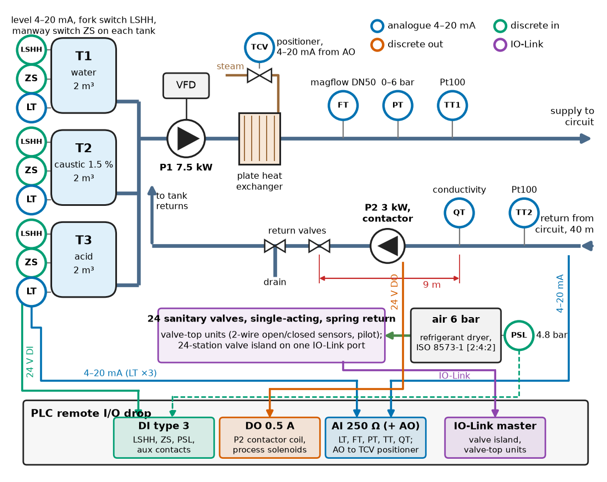
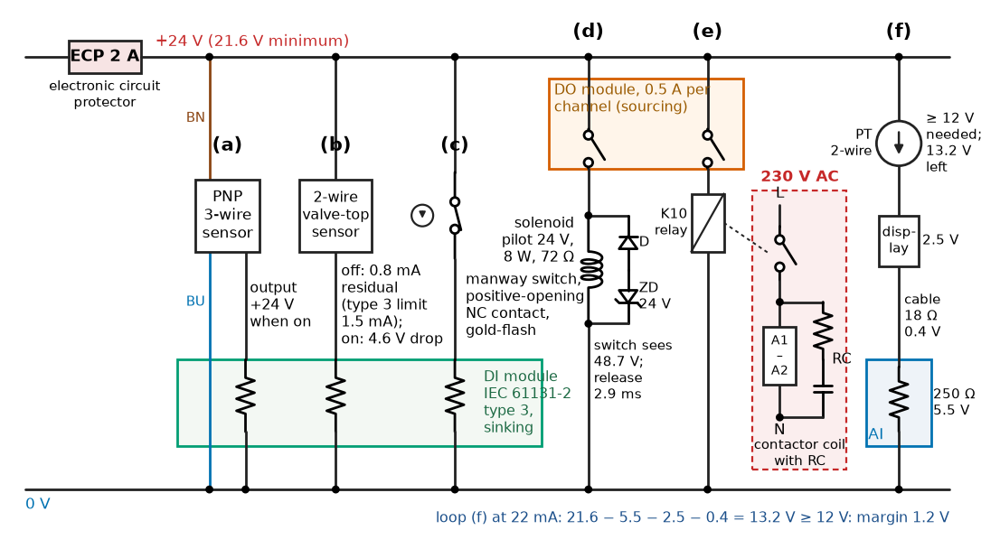
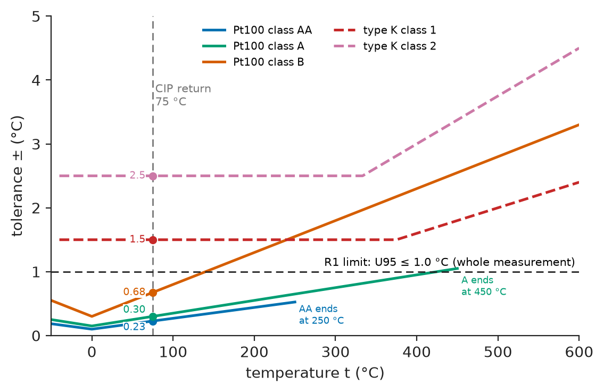
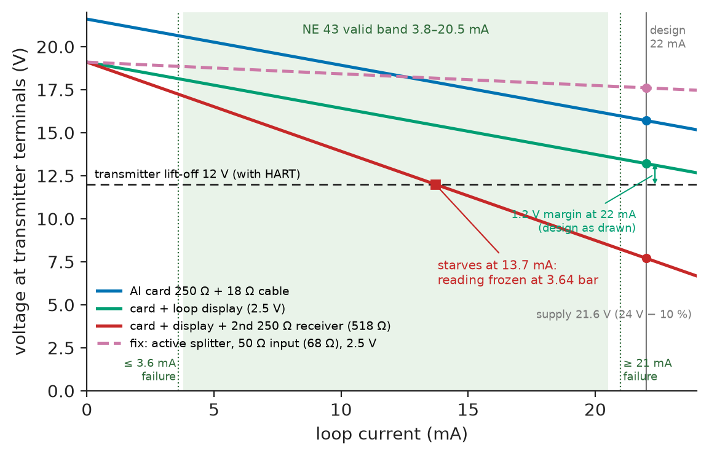
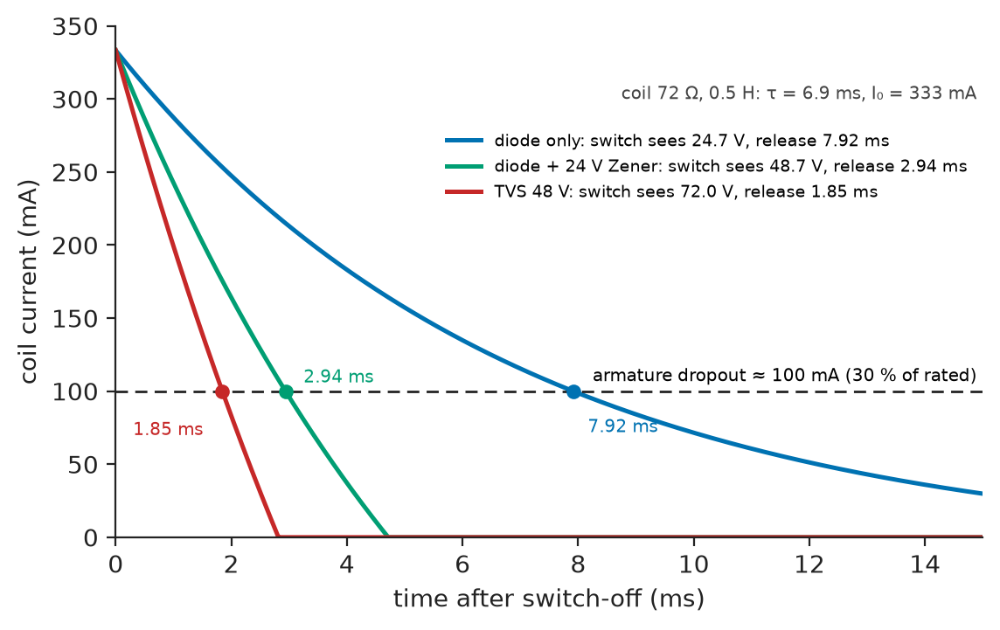

# Chapter 19 — Industrial Sensors and Actuators

*Part V · Industrial Automation*

On a new clean-in-place skid in a dairy, the supply-pressure reading flat-lines at 3.6 bar whenever the supply pump runs above about 70 % speed, while the mechanical gauge beside the transmitter climbs to 4.8 bar. A new transmitter does the same. Its 4–20 mA output is never outside the NAMUR "healthy" band, so the PLC raises no fault. The cause is arithmetic. The skid supplier had wired the plate heat exchanger's local controller, with its own 250 Ω input, in series with the PLC's 250 Ω input and a loop-powered display, and at 13.7 mA the 24 V supply had no voltage left for the transmitter. Nobody had written the loop's one-line voltage budget. Industrial sensors and actuators are mature; systems built from them fail at the interfaces, where a sensor meets an input card, a coil meets an output, or an actuator meets the air supply.

> **How are industrial sensors, transmitters, valves, contactors, relays and actuators chosen against a requirement, and how is each one interfaced to a PLC without losing accuracy, speed or fail-safety?**
> **Which budgets (loop voltage, uncertainty, sensing distance, coil energy, force, air) must be written down before the skid is built?**

| Concept | Engineering destination |
|---|---|
| Proximity sensors | Valve-position feedback, part detection, speed and end-of-travel sensing |
| Limit switches | Guard and manway interlocks, overtravel, positive-opening contacts |
| Industrial temperature sensors | RTDs and thermocouples in thermowells with head transmitters; uncertainty budgets |
| Pressure transmitters | Line pressure, hydrostatic level, filter differential pressure; 4–20 mA loop budgets |
| Flow measurement | Choosing among magnetic, Coriolis, vortex, differential-pressure and ultrasonic meters |
| Solenoid valves | Pilot valves for actuators, valve islands, coil suppression and release time |
| Contactors | Switching heaters, pumps and other power loads from PLC outputs |
| Relays | Interposing relays, solid-state relays and their life and heat |
| Pneumatic and hydraulic interfaces | Actuator force and air budgets, pressure switches, proportional valves |
| Industrial motor actuators | Electric valve actuators, duty classes, choice against pneumatic actuators |

**Roadmap.** The reference skid and its requirements (19.1) → discrete sensing: proximity sensors (19.2) and limit switches (19.3) → analogue measurement: temperature (19.4), pressure and the loop budget (19.5), flow (19.6) → actuation: solenoid valves (19.7), contactors (19.8), relays (19.9), pneumatic and hydraulic interfaces (19.10), electric actuators (19.11) → verification and failure analysis (19.12).

---

## 19.1 The reference skid and its requirements

### The skid

The running example is a **clean-in-place (CIP) skid** for a dairy: the plant that cleans process pipework, tanks and heat exchangers between production runs by circulating rinse water, hot caustic (1.5 % NaOH at 75 °C) and acid in a validated sequence. It has three 2 m³ tanks (water, caustic, acid), a 7.5 kW supply pump on a VFD, a plate heat exchanger heated by steam through a modulating control valve, a 3 kW return pump, and 24 automated sanitary valves, all on DN50 and DN65 stainless pipework. Cleaning is proven only if the right chemical reached the right temperature at the right velocity for the right time, so the instrumentation is part of the food-safety case.

Figure 19.1 shows the instruments and actuators and how each reaches the PLC's remote I/O.

<!-- FIGURE 19.1 | figures/ch19/fig-19-1-cip-skid-instrumentation.png | block-diagram | Instrumentation and actuation of the dairy CIP skid and their interfaces to the PLC. | Content: left, tanks T1 water, T2 caustic, T3 acid, each with level transmitter LT 4-20 mA, fork switch LSHH and manway switch ZS. Centre: supply pump P1 7.5 kW on VFD, plate heat exchanger with steam valve TCV and positioner, magnetic flowmeter FT DN50, pressure PT 0-6 bar, temperature TT1. Right: 40 m return line with TT2, conductivity QT 9 m upstream of the return valves, return pump P2 3 kW on contactor. 24 sanitary valves with valve-top units and a 24-station valve island on IO-Link. Bottom: remote I/O with DI type 3, DO 0.5 A, AI 250 ohm, IO-Link master; arrows labelled by signal type; air supply 6 bar with pressure switch PSL. -->



*Figure 19.1 — Instrumentation and actuation of the dairy CIP skid and their interfaces to the PLC.*

### Requirements

**Table 19.1 — Requirements for the CIP skid instrumentation and actuation.**

| ID | Requirement | Target | Verification |
|---|---|---|---|
| R1 | Return temperature measurement | Expanded uncertainty (95 %) ≤ 1.0 °C at 75 °C | Uncertainty budget (§19.4); dry-block comparison |
| R2 | Supply flow | ±2 % of reading, 8–25 m³/h | Master-meter comparison (§19.6) |
| R3 | Supply pressure loop | 0–6 bar, ±0.5 % of span; loop must carry 22 mA with ≥ 1 V margin at 21.6 V supply | Loop budget (§19.5); calibrator at 22 mA |
| R4 | Phase separation | Return diverted within 5 s of the caustic–water interface reaching the sensor; ≤ 5 L caustic to drain per changeover | Timed interface test (§19.6) |
| R5 | Valve position | Every valve proven in its commanded position within 3 s; discrepancy alarm | Stroke test of all 24 valves (§19.2) |
| R6 | Tank level | ±20 mm from 15 to 80 °C; independent high-high switch | Dipstick comparison at 20 and 75 °C (§19.5) |
| R7 | Fail-safe | Loss of air, 24 V or communication: valves to spring position, steam valve shut, pumps off | Pull tests (§19.12) |
| R8 | Manway interlock | Pumps cannot run with a tank manway open | Functional test (§19.3) |
| R9 | Hygiene and washdown | Wetted parts to EHEDG / 3-A; IP69K at washdown points | Document review |
| R10 | Return temperature control | 75 ± 2 °C during the caustic step | 24 h trend |

### Signal standards at the I/O

Every device in Figure 19.1 meets the PLC through one of a small set of standardised interfaces, and most integration errors are mismatches between them:

**Table 19.2 — Signal interfaces on the skid (typical values).**

| Interface | Standard | Levels | Used for |
|---|---|---|---|
| 24 V DC digital input | IEC 61131-2 types 1, 2, 3 | ON ≥ 15 V (type 1) or ≥ 11 V (types 2, 3); OFF current ≤ 0.5 mA (type 1), 2 mA (type 2), 1.5 mA (type 3) | Proximity sensors, switches |
| 24 V DC digital output | IEC 61131-2 | 0.5 A or 2 A per channel, short-circuit protected, internal clamp for inductive loads | Solenoid pilots, contactor coils, relays |
| 4–20 mA analogue input | IEC 60381-1, NAMUR NE 43 | 3.8–20.5 mA valid; ≤ 3.6 or ≥ 21 mA failure; 50–250 Ω burden | Transmitters |
| HART on 4–20 mA | IEC 62591 (wired HART) | 1200 Hz FSK superimposed, ≥ 230 Ω loop resistance | Configuration, diagnostics |
| IO-Link | IEC 61131-9 | 24 V, 3-wire, point-to-point, 4.8/38.4/230.4 kbit/s | Smart sensors, valve islands, valve-top units |

> **Boundary.** Sensing principles and generic sensor selection are owned by [Chapter 6](../part-2-instrumentation-and-measurement-systems/06-sensors-and-transducers.md), signal conditioning and uncertainty propagation by [Chapter 7](../part-2-instrumentation-and-measurement-systems/07-measurement-and-signal-conditioning.md); the 4–20 mA transmitter as a series–series feedback circuit is in *Electronics and Computing*, [Ch. 9 §9.2](https://github.com/The-Studio-of-Sadiq/Electronics-and-Computing/blob/main/part-2-analog-electronics/09-feedback-and-oscillators.md), and sensor output types at a microcontroller in [Ch. 26 §26.9](https://github.com/The-Studio-of-Sadiq/Electronics-and-Computing/blob/main/part-6-embedded-and-real-time-systems/26-embedded-interfaces.md). This chapter takes those as given and engineers the industrial versions: packaged, rated, wired, budgeted and made fail-safe. Controller, I/O and panels are owned by [Chapter 18](18-industrial-control-architecture.md); motor starters by [Chapter 20](20-industrial-motor-control.md).

---

## 19.2 Proximity sensors

### Families

**Inductive** proximity sensors detect metal by the eddy-current loading of an oscillator's coil and are the workhorse of industrial position sensing: no contact, no wear, sealed to IP67–IP69K, switching at up to 1–5 kHz. **Capacitive** sensors detect any material with a permittivity different from air, including liquids and powders through a plastic wall. **Photoelectric** sensors (through-beam, retro-reflective, diffuse) reach metres; **ultrasonic** sensors detect anything that reflects sound, independent of colour. On the CIP skid every valve's position is sensed inductively, inside a **valve-top control unit** that carries two sensors (open and closed), the pilot solenoid and sometimes an IO-Link interface, mounted on the valve stem.

### Sensing distance

IEC 60947-5-2 defines a chain of sensing distances. The **nominal** distance $S_n$ is the catalogue figure for a standard mild-steel target (Fe 360, 1 mm thick, square with side equal to the sensing-face diameter or $3S_n$, whichever is larger). The **real** distance of an individual sensor lies within ±10 % of $S_n$; temperature and supply variation move it a further ±10 %. The **assured operating distance**, within which every sensor of the type is guaranteed to switch, is

$$
S_a\le0.81\,S_n
$$

and the target material reduces it further by a correction factor: about 1.0 for mild steel, 0.6–0.8 for austenitic stainless steel, 0.35–0.5 for brass and aluminium, 0.25–0.45 for copper (typical, from manufacturers' data). Factor-1 sensors, with a modified oscillator, detect all metals at the same distance.

> **Status of the principle: Assured operating distance $S_a\le0.81\,S_n$**
> *Empirical.* A standardised design margin ($0.9\times0.9$) covering unit-to-unit spread and drift with temperature and supply; material correction factors are measured per sensor family and vary between manufacturers.

**Worked example — valve-top sensing gap.** The valve-top unit uses M12-class flush sensors with $S_n=4$ mm sensing a target ring of 1.4301 stainless steel (correction factor 0.7). Then $S_a=0.81\times4\times0.7=2.27$ mm. The valve stroke positions the target 1.2 mm from the sensor face when open or closed; the margin is $1-1.2/2.27=47$ %. A sensor with $S_n=2$ mm (flush M8) would give $S_a=1.13$ mm, below the 1.2 mm gap: it would work on the bench with a fresh sensor at 20 °C and fail on the first hot caustic cycle. The second check is the *release*: the sensor's hysteresis is up to 20 % of the real distance, so with the largest possible usable distance of $1.21S_n=4.8$ mm the target must retreat beyond about 6 mm to guarantee release; the 40 mm stroke gives that easily.

### Two-wire, three-wire and the input card

Three-wire DC sensors are **PNP** (output switched to +24 V, the European norm) or **NPN** (switched to 0 V); a PNP sensor needs a sinking input, and mixing them reads every sensor as permanently off. **Two-wire** sensors are wired in series with the input like a switch, and must draw their own supply through the load: they leave a **residual current** of about 0.5–1.5 mA flowing when off and drop 3–5 V when on.

**Worked example — will a two-wire sensor work on this input?** A two-wire DC sensor has a residual current of 0.8 mA and an on-state drop of 4.6 V. On a type 1 input (OFF current limit 0.5 mA), the 0.8 mA off-state current can be read as ON: the input may never switch off. On a type 3 input (OFF limit 1.5 mA) the off state is safe, and the on state leaves $24-4.6=19.4$ V at the input, above the 11 V threshold even with the supply at 20.4 V (−15 %): it works. The skid uses three-wire PNP sensors except in the valve tops, which are two-wire on type 3 inputs, recorded on the I/O list.

Figure 19.2 shows the field-side interfaces of this chapter on one wiring diagram.

<!-- FIGURE 19.2 | figures/ch19/fig-19-2-field-interface-wiring.png | wiring-diagram | Field-side wiring of the skid's discrete sensors, actuators and one analogue loop to the PLC remote I/O. | Content: 24 V and 0 V rails with a 2 A electronic circuit protector. (a) 3-wire PNP sensor to sinking DI type 3; (b) 2-wire valve-top sensor in series with DI type 3, residual 0.8 mA; (c) manway switch, positive-opening NC contact; (d) solenoid pilot 24 V 8 W on DO 0.5 A with diode plus 24 V Zener; (e) interposing relay on DO switching a 230 V contactor coil with RC suppressor; (f) 2-wire transmitter loop with display and 250 ohm AI input, voltage drops annotated. -->



*Figure 19.2 — Field-side wiring of the skid's discrete sensors, actuators and one analogue loop to the PLC remote I/O.*

### Valve feedback in the PLC

R5 asks that each valve be proven in position within 3 s. Listing 19.1, in IEC 61131-3 Structured Text, is the feedback function block used for all 24 valves: it decodes the two sensors, raises a discrepancy if the valve has not reached its commanded position within the travel time, and treats "both sensors on" as an immediate sensor fault.

```text
FUNCTION_BLOCK FB_ValveFb
VAR_INPUT
    xCmdOpen : BOOL;                  (* command from the sequence *)
    xZSO, xZSC : BOOL;                (* open / closed position sensors *)
    xReset   : BOOL;
    tTravel  : TIME := T#3S;          (* R5 *)
END_VAR
VAR_OUTPUT
    xOpen, xClosed, xFault : BOOL;
END_VAR
VAR
    tonDisc : TON;
END_VAR

xOpen   := xZSO AND NOT xZSC;
xClosed := xZSC AND NOT xZSO;
tonDisc(IN := (xCmdOpen AND NOT xOpen) OR (NOT xCmdOpen AND NOT xClosed),
        PT := tTravel);
IF tonDisc.Q OR (xZSO AND xZSC) THEN
    xFault := TRUE;                   (* latched until reset *)
ELSIF xReset THEN
    xFault := FALSE;
END_IF;
END_FUNCTION_BLOCK
```

The sequence never uses the command as evidence: a step that needs a valve open waits for `xOpen`, not for `xCmdOpen`, so a valve with a broken air line holds the sequence and raises an alarm instead of letting caustic into a circuit that is still connected to product.

---

## 19.3 Limit switches

A **limit switch** is a mechanically actuated switch: a plunger, roller lever or hinge that operates contacts when a machine part or door reaches a position. Compared with proximity sensors it is bigger and wears, but it has two properties no electronic sensor has: it can switch a load directly, and its normally closed contact can be made **positive opening** (IEC 60947-5-1 Annex K, marked with an arrow in a circle): the actuator forces the contacts apart through a rigid path, so that a welded contact is broken mechanically. That is why guard and manway interlocks use limit switches, or coded safety switches built on the same principle (ISO 14119), and not plain inductive sensors.

On the skid, each tank manway has a hinge-actuated switch with a positive-opening NC contact wired to the safety-related part of the control system, which removes the run permit from both pumps when any manway is open (R8). Its functional-safety design (performance level, channels, diagnostics) belongs to Chapter 21.

**Table 19.3 — Limit-switch selection points (typical values).**

| Property | Typical value | Why it matters |
|---|---|---|
| Mechanical life | 1–30 million operations | Door switches rarely wear out; roller levers on cams do |
| Contact rating | AC-15 3 A at 230 V; DC-13 0.27 A at 250 V, 3 A at 24 V | AC-15 and DC-13 are the utilisation categories for switching coils (IEC 60947-5-1) |
| Minimum switching current | Silver contacts about 5–10 mA at 24 V; gold-flash contacts about 1 mA at 5 V | A PLC input draws 2–3 mA: silver contacts can build an oxide film and read open intermittently |
| Positive opening | NC contact, Annex K | Required for safety functions |
| Enclosure | IP67, IP69K for washdown | Caustic washdown at 80 °C and 80 bar spray |

The minimum-current row explains a recurring nuisance: a silver-contact switch, chosen for its 10 A rating, flickers on a 3 mA PLC input after a year in a humid hall. Switches feeding PLC inputs get gold-flash contacts.

---

## 19.4 Industrial temperature sensors

### RTD, thermocouple or thermistor

Industrial temperature measurement uses three sensor families, nearly always packaged as an insert in a **thermowell** (which protects the sensor and lets it be removed without draining the process) with a **head-mounted transmitter** that linearises the signal and converts it to 4–20 mA, HART or IO-Link.

**Table 19.4 — Temperature sensor selection for the return line (typical values).**

| Option | Tolerance at 75 °C | Range | Drift | Verdict |
|---|---|---|---|---|
| Pt100 class A, 4-wire, head transmitter (IEC 60751) | ±0.30 °C | −100 to +450 °C (class A, wire-wound) | ≤ 0.05 °C/yr typical | **Chosen**: meets R1 with margin |
| Pt100 class B | ±0.68 °C | −196 to +600 °C | Similar | Meets R1 only marginally (U95 0.85 °C) |
| Thermocouple type K class 1 (IEC 60584-1) | ±1.5 °C | −40 to +1000 °C | Larger; inhomogeneity after heat cycling | Fails R1 alone; right for ovens and kilns |
| NTC thermistor | ±0.1–0.5 °C over a narrow range | −40 to +125 °C typical | Larger at high temperature | Not standard in hygienic thermowells; no interchangeability standard |

The tolerance formulas behind the first three rows are class A $\pm(0.15+0.002\lvert t\rvert)$ °C, class B $\pm(0.3+0.005\lvert t\rvert)$ °C and type K class 1 $\pm1.5$ °C or $\pm0.004\lvert t\rvert$, whichever is larger. Figure 19.3 plots them: class A beats type K over its whole range to 450 °C, class B only below 240 °C, and thermocouples own everything hotter.

<!-- FIGURE 19.3 | figures/ch19/fig-19-3-temperature-sensor-tolerances.png | plot | Tolerance of industrial temperature sensors against temperature (IEC 60751 and IEC 60584-1). | Content: x-axis temperature -50 to 600 degC, y-axis tolerance 0 to 5 degC. Lines: Pt100 class AA 0.1 + 0.0017 abs(t) (to 250 degC); class A 0.15 + 0.002 abs(t) (to 450 degC); class B 0.3 + 0.005 abs(t); thermocouple type K class 1 max(1.5, 0.004 abs(t)); type K class 2 max(2.5, 0.0075 abs(t)). Vertical dashed line at 75 degC labelled CIP return with markers at 0.23, 0.30, 0.68, 1.5 and 2.5 degC; horizontal dashed line at 1.0 degC labelled R1 limit (U95). -->



*Figure 19.3 — Tolerance of industrial temperature sensors against temperature (IEC 60751 and IEC 60584-1).*

### The measurement budget

R1 is a requirement on the whole measurement, not on the sensor. Table 19.5 lists every contributor with its limit value, treated as a rectangular distribution (standard uncertainty = limit / √3), combined by root-sum-square and expanded with $k=2$.

> **Status of the principle: Root-sum-square combination of independent contributions**
> *Derived.* The GUM (JCGM 100) law of propagation for uncorrelated inputs with unit sensitivity; correlated contributions (for example, a transmitter and AI card drifting together with panel temperature) add linearly and must be grouped first.

**Table 19.5 — Uncertainty budget of the return temperature at 75 °C.**

| Contribution | Limit (± °C) | Standard uncertainty (°C) |
|---|---|---|
| Pt100 class A tolerance | 0.30 | 0.173 |
| Head transmitter accuracy | 0.10 | 0.058 |
| Transmitter D/A, 0.03 % of 150 °C span | 0.045 | 0.026 |
| Transmitter ambient effect | 0.05 | 0.029 |
| Transmitter drift, 1 year | 0.10 | 0.058 |
| PLC AI card, 0.1 % of 150 °C span | 0.15 | 0.087 |
| Immersion and stem conduction in the thermowell | 0.20 | 0.115 |
| **Combined standard uncertainty** | | **0.243** |
| **Expanded (k = 2)** | | **0.49 °C** |
| R1 limit | | 1.0 °C |
| **Margin** | | **51 %** |

**Worked example — what the budget decides.** With class A the expanded uncertainty is 0.49 °C, half of R1. With class B the sensor term grows to $0.675/\sqrt3=0.390$ °C and the total to 0.85 °C: inside R1 but with 15 % margin, too little for a validation record that must survive a year of drift. A type K thermocouple fails on its tolerance alone. The budget also shows where to improve next: a digital link (HART or IO-Link) removes the card's 0.15 °C, an immersion of at least ten tip diameters keeps stem conduction below 0.1 °C, and a loop calibration in a dry block replaces the class tolerance by a calibration uncertainty of 0.05–0.1 °C.

The thermowell also sets the **response time**: $t_{90}$ of about 8–15 s with heat-transfer paste, 30–60 s without. With the 19 s transport delay of the return line (Section 19.6), the R10 loop is dead-time dominated and must be tuned gently (*Circuits, Signals and Communications*, [Ch. 35 §35.3](https://github.com/The-Studio-of-Sadiq/Circuits-Signals-and-Communications/blob/main/part-7-control-system-fundamentals/35-control-design-fundamentals.md)).

> **Boundary.** The Seebeck effect and thermoelectric circuits are in *Engineering Physics*, [Ch. 14 §14.3](https://github.com/The-Studio-of-Sadiq/Engineering-Physics/blob/main/CHAPTERS/CHAPTER%2014.md); RTD excitation, lead resistance and the Callendar–Van Dusen equation at a microcontroller in *Electronics and Computing*, [Ch. 26 §26.9](https://github.com/The-Studio-of-Sadiq/Electronics-and-Computing/blob/main/part-6-embedded-and-real-time-systems/26-embedded-interfaces.md). Here they are packaged in a transmitter.

---

## 19.5 Pressure transmitters

### What a transmitter adds to a sensor

A **pressure transmitter** packages a sensing element (a piezoresistive silicon die behind an oil-filled diaphragm, or a ceramic capacitive cell) with compensation electronics and an output stage. Its IEC 61298 figures are accuracy as a percentage of calibrated span (0.04–0.1 % high-end, 0.2–0.5 % compact), **turndown** (10:1 to 100:1), temperature effect per 10 K, stability per year and overpressure limit. Hygienic versions have **flush diaphragms** on sanitary fittings, so that no dead leg holds product.

On the skid they measure supply pressure (0–6 bar), hydrostatic tank level (0–400 mbar) and supply-filter differential pressure.

### Hydrostatic level and density

A transmitter at the bottom of a tank measures $p=\rho g h$; the PLC computes $h=p/(\rho g)$ with an assumed density.

**Worked example — level error from density.** Tank T2 holds 1.5 % caustic, whose density is about 1015 kg/m³ at 20 °C and about 990 kg/m³ at 75 °C. At a true level of 2.00 m and 75 °C the transmitter reads $990\times9.81\times2.00=19\,424$ Pa (194.2 mbar). A PLC that assumes 1000 kg/m³ computes 1.98 m: a 20 mm error, the whole of R6's allowance, before the transmitter's own error is counted. The fix costs nothing: the PLC computes density from the tank temperature (a fitted curve from three laboratory points) and the residual error is about 3 mm. Where density varies with composition, a second transmitter at a known height or a radar gauge, which ignores density, is used instead.

### The loop budget

A two-wire transmitter takes its power from its own 4–20 mA loop. It needs a minimum voltage across its terminals (its **lift-off voltage**, typically 10–12 V with HART), and everything else in the loop (input resistors, cable, loop-powered displays, isolators, barriers) drops voltage that the supply must provide at the *highest* current the loop must carry. With NAMUR NE 43 the transmitter signals a failure by driving at least 21 mA, so a loop must be designed for about 22 mA, not 20 mA. The condition is

$$
V_{supply,min}-V_{tx,min}-\sum V_{fixed}\ \ge\ I_{max}\sum R
$$

> **Status of the principle: Loop voltage budget**
> *Fundamental.* Kirchhoff's voltage law around a series loop; the only judgement is in the inputs, which must be the worst-case supply (low line, end of the 24 V cable run), the transmitter's guaranteed minimum voltage at its maximum current, and every series element.

Listing 19.2 computes the budget for the supply-pressure loop of the opening story, configuration by configuration.

```python
# 4-20 mA loop voltage budget: what current can the transmitter still drive?
V_SUPPLY_MIN = 24.0 * 0.90     # 24 V PSU at -10 % (brown-out / end of cable run)
V_TX_MIN     = 12.0            # transmitter lift-off voltage incl. HART
I_DESIGN     = 0.022           # A, highest current the loop must carry (alarm)
R_CABLE      = 2 * 250 * 0.036 # ohm: 250 m of 0.5 mm^2 pair, both cores

def loop(name, r_series, v_fixed):
    """r_series: ohmic burdens; v_fixed: constant drops (displays, isolators)."""
    r = r_series + R_CABLE
    margin = V_SUPPLY_MIN - V_TX_MIN - v_fixed - I_DESIGN * r
    i_max = (V_SUPPLY_MIN - V_TX_MIN - v_fixed) / r   # current at which tx starves
    span = 6.0 * (min(i_max, 0.0205) - 0.004) / 0.016  # bar, 0-6 bar range
    print(f"{name:31s} margin at 22 mA {margin:5.2f} V, "
          f"starves above {i_max*1e3:5.1f} mA -> reads up to {span:4.2f} bar")

loop("AI card 250 ohm",                  250, 0.0)
loop("+ loop display (2.5 V)",           250, 2.5)
loop("+ display + skid controller 250",  500, 2.5)
loop("fix: active splitter 50 ohm",       50, 2.5)
```

```text
AI card 250 ohm                 margin at 22 mA  3.70 V, starves above  35.8 mA -> reads up to 6.19 bar
+ loop display (2.5 V)          margin at 22 mA  1.20 V, starves above  26.5 mA -> reads up to 6.19 bar
+ display + skid controller 250 margin at 22 mA -4.30 V, starves above 13.7 mA -> reads up to 3.64 bar
fix: active splitter 50 ohm     margin at 22 mA  5.60 V, starves above 104.4 mA -> reads up to 6.19 bar
```

**Worked example — reading the loop budget.** The design as drawn (AI card plus loop display) had 1.2 V of margin at 22 mA: tight but compliant with R3. The supplier's second 250 Ω input raised the loop resistance to 518 Ω and left only 7.1 V for it, so the transmitter starved at $7.1/518=13.7$ mA, which is 3.64 bar on a 0–6 bar range. Because 13.7 mA lies inside NE 43's valid band, no diagnostic in the PLC could see it: the reading was plausible and wrong. The fix was an active signal splitter with a 50 Ω input that powers the transmitter loop and drives two isolated outputs, one to the PLC and one to the exchanger controller, restoring 5.6 V of margin. (The "starves above" figure for the fixed loop is only the limit the loop would allow; the transmitter itself saturates at about 21–22.5 mA.) Figure 19.4 shows the same budget graphically as load lines.

<!-- FIGURE 19.4 | figures/ch19/fig-19-4-loop-load-lines.png | plot | Voltage available at the transmitter terminals against loop current for four loop configurations. | Content: x-axis loop current 0 to 24 mA, y-axis 0 to 22 V. Lines V = 21.6 - Vfixed - I R: card 250 ohm + 18 ohm cable; card + display (Vfixed 2.5 V); card + display + second 250 ohm receiver (R 518 ohm), crossing 12 V at 13.7 mA; active splitter (R 68 ohm, 2.5 V). Dashed line at 12 V labelled transmitter lift-off. Shaded band 3.8 to 20.5 mA labelled NE 43 valid, lines at 3.6 and 21 mA, design point 22 mA marked; annotation reading frozen at 3.64 bar. -->



*Figure 19.4 — Voltage available at the transmitter terminals against loop current for four loop configurations.*

### Scaling in the PLC

Listing 19.3 is the analogue-input block used for every transmitter on the skid. It assumes the common S7-class raw format in which 4–20 mA maps to 0–27 648 counts (with over- and underrange beyond), converts to milliamperes, applies NE 43, and holds the last good value with a fault flag rather than passing a wire-break reading to a control loop.

```text
FUNCTION_BLOCK FB_AnalogIn
VAR_INPUT
    iRaw     : INT;                   (* 0..27648 = 4..20 mA *)
    rLo, rHi : REAL;                  (* engineering range, e.g. 0.0 / 6.0 bar *)
END_VAR
VAR_OUTPUT
    rValue     : REAL;                (* engineering units *)
    xFault     : BOOL;                (* NE 43 failure: <= 3.6 or >= 21 mA *)
    xUncertain : BOOL;                (* outside 3.8..20.5 mA, not failed *)
END_VAR
VAR
    rmA    : REAL;
    xBad   : BOOL;
    tonFlt : TON;
END_VAR

rmA := 4.0 + 16.0 * INT_TO_REAL(iRaw) / 27648.0;
xBad := (rmA <= 3.6) OR (rmA >= 21.0);
tonFlt(IN := xBad, PT := T#1S);
xFault := tonFlt.Q;
xUncertain := NOT xFault AND ((rmA < 3.8) OR (rmA > 20.5));
IF NOT xBad THEN                    (* hold last good value while failing *)
    rValue := rLo + (rHi - rLo) * (LIMIT(4.0, rmA, 20.0) - 4.0) / 16.0;
END_IF;
END_FUNCTION_BLOCK
```

The value freezes on the first scan of a failure, while the 1 s on-delay keeps transients from latching the fault, so a broken wire never reaches a controller as "0 bar". No scaling block catches a starved loop; only the budget does.

---

## 19.6 Flow measurement

### Choosing the principle

**Table 19.6 — Flowmeter selection for the CIP supply line (DN50, 8–25 m³/h, water, caustic, acid, 5–85 °C; typical values).**

| Principle | Accuracy | Pressure loss | Needs | Hygienic | Indicative price | Verdict |
|---|---|---|---|---|---|---|
| Electromagnetic | ±0.2–0.5 % of reading | None (full bore) | Conductivity ≥ 5 µS/cm | Yes (PFA liner) | \$1 500–\$2 500 | **Chosen** |
| Coriolis | ±0.1 % of reading, plus density | 0.2–0.5 bar at full flow | Nothing; measures mass | Yes | \$5 000–\$9 000 | Overkill here; right for dosing |
| Vortex | ±0.75–1 % | Low | Reynolds number above about 20 000; no low flows | Limited | \$2 000–\$3 500 | Poor turndown here |
| Differential pressure (orifice) | ±1–2 % of rate | 0.1–0.5 bar permanent | Straight pipe runs | No (dead legs) | \$1 500 with transmitter | Unhygienic |
| Clamp-on ultrasonic | ±1–3 % | None | Known pipe wall; filled pipe | No contact at all | \$2 000–\$6 000 | Retrofit checks only |

The magnetic flowmeter works by Faraday induction in the conducting liquid; it has no moving parts and no obstruction, and its only demand is conductivity. Rinse water at 50–500 µS/cm and caustic at tens of mS/cm both qualify. Its liner and electrodes must resist hot caustic and nitric acid: PFA liner and 1.4435 stainless or Hastelloy electrodes. Deionised water below 5 µS/cm would have ruled it out and forced a Coriolis meter.

> **Boundary.** The fluid mechanics behind each principle (Bernoulli for differential pressure, vortex shedding, pipe networks and pump curves) are in *Engineering Physics*, [Ch. 19 §19.7](https://github.com/The-Studio-of-Sadiq/Engineering-Physics/blob/main/CHAPTERS/CHAPTER%2019.md). Here the meter is a component with an accuracy, a range and a set of installation rules.

**Worked example — flow, velocity and accuracy.** A DN50 hygienic tube has an internal diameter of 50 mm and a cross-section of $1.963\times10^{-3}$ m². Cleaning validation demands at least 1.5 m/s in every line, which in DN50 is $1.5\times1.963\times10^{-3}\times3600=10.6$ m³/h and in DN65 (66 mm bore) 18.5 m³/h; the 20 m³/h design flow gives 2.83 m/s in DN50 and 1.62 m/s in DN65. A magnetic meter specified at ±0.2 % of reading ±1.5 mm/s has an error at 10.6 m³/h (1.5 m/s) of $0.2+0.1=0.3$ % and at 20 m³/h of 0.25 %: a margin of six to eight on R2's ±2 %. The meter needs 5 diameters of straight pipe upstream and 2 downstream; on a compact skid that is the hardest requirement, and the layout is drawn around it.

### Phase separation: a timing problem

At each change of medium (rinse water to caustic, caustic to rinse) the return flow must be diverted from drain to tank, or tank to drain, as the interface between the two liquids arrives. An inductive conductivity sensor in the return line sees the interface; the PLC switches the return valves.

**Worked example — where to put the conductivity sensor.** Return flow is 15 m³/h in a 40 m DN50 return line: $v=15/3600/1.963\times10^{-3}=2.12$ m/s, a transport delay of 18.8 s from circuit to skid. After the interface reaches the sensor, the sensor needs about 3 s to settle ($t_{90}$ of an inductive conductivity cell with temperature compensation), the PLC 0.1 s, and the return valve 1.0 s to stroke: 4.1 s, which meets R4's 5 s. But in 4.1 s, $15/3.6\times4.1=17$ L of caustic would pass the valves into the drain, three times R4's 5 L. Moving the sensor upstream of the valves by the distance the liquid travels in 4.1 s, $2.12\times4.1=8.7$ m (9 m installed), means the valves switch exactly as the interface reaches them; the residual loss is the mixed zone of the interface itself, about 1.5 m of pipe or 3 L. A pipe layout, not a faster sensor, met the requirement.

---

## 19.7 Solenoid valves

### Where solenoid valves sit

A **solenoid valve** converts an electrical command into a fluid path. On the skid there are two kinds. **Pilot valves** switch air to the 24 valve actuators from a **valve island**, a 24-station manifold with one IO-Link connection that replaces 24 output wires. **Process solenoid valves** switch the process medium directly: a 2/2-way valve on the steam condensate drain and on the water make-up.

Selection follows the function:

- **Configuration**: 2/2 for a medium, 3/2 to pilot a spring-return actuator, 5/2 for a double-acting cylinder, each **monostable** (spring return) or **bistable** (latching).
- **Direct-acting or pilot-operated**: a pilot-operated valve uses line pressure to move its main stage and needs a minimum differential pressure, typically 0.2–0.5 bar; on a gravity-fed tank outlet it never opens, a common first-week fault.
- **Flow** as $Q_n$ (standard L/min at 6 bar, 1 bar drop) or $K_v$; **coil** 24 V DC, 1–8 W, often with reduced holding current.
- **Fail-safe position**: R7 rules out bistable pilots; every pilot is a monostable 3/2 and every actuator single-acting with spring return.

### Coil suppression and release time

When an output switches off an inductive coil, the current must keep flowing somewhere. Without a path it drives the switch voltage up until something breaks down; PLC outputs therefore have an internal clamp, and coils are fitted with suppressors. The choice of suppressor sets how quickly the current decays, and therefore how quickly the valve releases.

> **Boundary.** The flyback and TVS diodes themselves, and how they protect a switch, are covered in *Electronics and Computing*, [Ch. 2 §2.10](https://github.com/The-Studio-of-Sadiq/Electronics-and-Computing/blob/main/part-1-electronic-devices/02-semiconductor-junction-devices.md); the first-order RL decay in *Circuits, Signals and Communications*, [Ch. 6 §6.2](https://github.com/The-Studio-of-Sadiq/Circuits-Signals-and-Communications/blob/main/part-2-transient-and-ac-analysis/06-first-order-circuits.md). The listing only applies them.

```python
# Release time of a 24 V DC solenoid coil for three suppression circuits
import math
V, P, L = 24.0, 8.0, 0.5           # supply, coil power (W), coil inductance (H)
R = V**2 / P                       # 72 ohm
I0, I_DROP = V / R, 0.30 * V / R   # armature drops out near 30 % of rated current
tau = L / R
print(f"R = {R:.0f} ohm, I0 = {I0*1e3:.0f} mA, tau = {tau*1e3:.1f} ms, "
      f"stored energy {0.5*L*I0**2*1e3:.1f} mJ")
for name, v_clamp in [("diode only", 0.7), ("diode + 24 V Zener", 24.7),
                      ("TVS 48 V", 48.0)]:
    # L di/dt = -(v_clamp + R i)  ->  exponential decay towards -v_clamp/R
    t_rel = tau * math.log((I0 + v_clamp / R) / (I_DROP + v_clamp / R))
    v_peak = V + v_clamp            # voltage across the switching transistor
    a = v_clamp / R
    t0 = tau * math.log((I0 + a) / a)                 # current reaches zero
    e_clamp = v_clamp * (tau * I0 - a * t0)           # integral of v_clamp * i
    print(f"{name:20s} release {t_rel*1e3:5.2f} ms, switch sees {v_peak:4.1f} V, "
          f"clamp absorbs {e_clamp*1e3:4.1f} mJ")
```

```text
R = 72 ohm, I0 = 333 mA, tau = 6.9 ms, stored energy 27.8 mJ
diode only           release  7.92 ms, switch sees 24.7 V, clamp absorbs  1.5 mJ
diode + 24 V Zener   release  2.94 ms, switch sees 48.7 V, clamp absorbs 17.2 mJ
TVS 48 V             release  1.85 ms, switch sees 72.0 V, clamp absorbs 21.0 mJ
```

**Worked example — choosing the suppressor.** The process solenoid valve on the water make-up has an 8 W, 24 V coil (72 Ω, 333 mA, about 0.5 H). A plain freewheeling diode clamps the coil at 0.7 V, so the current decays with the coil's own time constant of 6.9 ms and the armature releases after 7.9 ms. A diode with a 24 V Zener in series lets the coil voltage reverse to about 25 V, the current decays almost linearly and the armature releases in 2.9 ms, at the price of the switch seeing 48.7 V and the Zener absorbing 17 mJ per operation. A 48 V TVS releases fastest but puts 72 V across the output transistor. The make-up valve has no timing requirement, so a diode does; the valve-island pilots, which execute the phase separation of Section 19.6, use the island's built-in diode-Zener suppression. Figure 19.5 plots the three decays.

<!-- FIGURE 19.5 | figures/ch19/fig-19-5-coil-current-decay.png | plot | Current in the 8 W, 24 V solenoid coil after switch-off for three suppression circuits. | Content: x-axis 0 to 15 ms, y-axis 0 to 350 mA. From 333 mA: diode only, exponential with tau 6.9 ms, crossing the 100 mA dropout line at 7.9 ms; diode plus 24 V Zener reaching 100 mA at 2.9 ms; TVS 48 V reaching 100 mA at 1.85 ms. Dashed line at 100 mA labelled armature dropout. Legend gives the switch voltage of each: 24.7, 48.7 and 72 V. -->



*Figure 19.5 — Current in the 8 W, 24 V solenoid coil after switch-off for three suppression circuits.*

> **Status of the principle: Release time set by the clamp voltage**
> *Approximate.* Treats the coil as a constant inductance in series with its resistance; a real solenoid's inductance falls as the armature moves and the eddy currents in its iron slow the flux decay, so measured release times are typically 1.5–3 times the electrical estimate, but the ranking of suppressors holds.

---

## 19.8 Contactors

A **contactor** is an electromagnetically operated switch for power circuits, rated for frequent operation, with a coil that a PLC output can drive and auxiliary contacts that report its state. On the skid it switches two loads: the 3 kW return pump (direct-on-line) and the 18 kW electric heater in the water tank used for hot rinse when steam is off.

The contactor's rating depends on what it switches, expressed as a **utilisation category** of IEC 60947-4-1 (power) and IEC 60947-5-1 (control):

**Table 19.7 — Utilisation categories that matter on the skid.**

| Category | Load | Make / break duty | Skid example |
|---|---|---|---|
| AC-1 | Non-inductive or slightly inductive (cos φ ≥ 0.8) | Rated current | 18 kW heater |
| AC-3 | Squirrel-cage motors: start, switch off while running | Make 6–8 × $I_e$, break about 1 × $I_e$ | 3 kW return pump |
| AC-4 | Motors: plugging, inching | Make and break 6–8 × $I_e$ | (Chapter 20) |
| AC-15 | Control of AC electromagnetic loads (coils) | Make 10 × $I_e$, break 1 × $I_e$ | Contacts switching contactor coils |
| DC-13 | Control of DC electromagnets | Break with $L/R$ up to about 300 ms | Contacts switching DC solenoids |

**Worked example — driving the coils.** The 18 kW, 400 V heater draws $18\,000/(\sqrt3\times400)=26.0$ A, so it needs an AC-1 rating of at least 26 A; a frame rated 40 A AC-1 (25 A, 11 kW AC-3) is chosen, leaving 35 % margin for supply-voltage rise and element tolerance. Its coil can be AC or DC. An AC coil at 230 V draws about 70 VA at pull-in (0.30 A) and 8 VA holding (35 mA), so it cannot be driven from a 24 V transistor output: it needs an **interposing relay** (Section 19.9). A 24 V DC coil of the same frame draws about 5.4 W (0.23 A), within a 0.5 A PLC output, but with an inductive kick that needs the suppression of Section 19.7; contactors are sold with plug-in diode, RC or varistor modules for this. The skid uses DC coils on all contactors, which removes 230 V from the control circuit and keeps the coil supply on the 24 V UPS; and an auxiliary NO contact from each contactor returns to a PLC input, so that "commanded on, not confirmed on" raises an alarm within 0.5 s, the same discrepancy logic as Listing 19.1.

> **Boundary.** Contactors as motor starters (AC-3 and AC-4 electrical life, overload relays, reversing interlocks, mirror contacts for safety circuits) are owned by [Chapter 20](20-industrial-motor-control.md).

---

## 19.9 Relays

### Interposing relays

An **interposing relay** sits between a PLC output and a load the output cannot drive directly: a 230 V AC contactor coil, a load on another supply, a signal into another vendor's panel that must remain galvanically separate. Their limits:

- **Electrical life** depends on the load: a typical 6 A relay offers 10–30 million mechanical operations but only 100 000–300 000 at its rated resistive load, fewer for inductive loads; a life curve in the datasheet, not the headline current, decides.
- **Minimum load**: the same oxide-film problem as limit switches (Section 19.3); relays that switch PLC inputs need gold-flash contacts.

### Solid-state relays

A **solid-state relay** (SSR, IEC 62314) switches AC loads with thyristors or a triac, usually at zero crossing. It has no contacts to wear and can switch every second for years. It pays with heat (about 1–1.5 W per ampere per pole), a leakage current of a few milliamperes in the off state, and a failure mode that matters: SSRs usually fail **short**, leaving the load on.

**Worked example — contactor or SSR for the heater?** The tank heater is controlled by time-proportioning: the PLC's temperature loop switches it on for a fraction of each 20 s cycle. Running 16 h a day for 300 days, that is $3600/20\times16\times300=864\,000$ switching operations per year. An AC-1 contactor rated for about 1 million operations at full load would wear out in a little over a year. A two-pole SSR (switching two of three phases is enough to stop a three-phase heater in delta) dissipates about $1.2\times26=31$ W per pole, 62 W in all. Holding the thyristor at a design junction temperature of 100 °C in a 45 °C panel, with 0.4 K/W from junction to heatsink, needs a heatsink of at most $(100-45)/31-0.4=1.36$ K/W per pole. The design uses the SSR for switching, a contactor upstream as the isolating and safety device (opened by the over-temperature switch and the tank low-level switch, so that an SSR failed short cannot boil the tank dry), and adds the 62 W to the panel heat budget of Chapter 18.

> **Status of the principle: Switching life scales with operations, not with time**
> *Empirical.* Contactor and relay electrical life is given by manufacturers' life curves measured under the standard test conditions of each utilisation category; real life varies with load power factor, inrush and ambient, so the curves are design guides with margins of two or more, not guarantees.

---

## 19.10 Pneumatic and hydraulic interfaces

### Compressed air as a power supply

The 24 sanitary valves are driven by single-acting, spring-return pneumatic actuators: air opens, the spring closes. Compressed air is therefore a utility with its own requirements, specified like a power supply:

- **Pressure**: 6 bar nominal at the skid, 4.5 bar minimum (the compressor cut-in pressure less the line drop), monitored by a pressure switch (PSL) whose low alarm stops the CIP sequence before valves fail to open.
- **Quality**: ISO 8573-1 classes for particles, water and oil, typically class [2:4:2] for valve islands, with a refrigerant dryer (pressure dew point +3 °C) so that no condensate reaches the pilots.
- **Flow**: enough for the worst-case simultaneous valve movements without the pressure dipping below the minimum.

**Worked example — actuator force and air budget.** A DN50 valve actuator has an 80 mm piston (5027 mm²) and a 1100 N spring at full compression; the line pressure of 5 bar acting on the 50 mm valve seat opposes opening with $5\times10^5\times1.963\times10^{-3}=982$ N.

- At 6 bar the piston force is 3016 N; at the 4.5 bar minimum, 2262 N. The net opening force at minimum air is $2262-1100=1162$ N, 18 % above the 982 N needed. That is why the PSL is set at 4.8 bar, not 4.0.
- Each opening fills the 40 mm stroke (0.201 L) and 3 m of 6/4 mm tube (0.038 L) to 6 bar gauge. In free air that is $(0.201+0.038)\times(7.013/1.013)=1.65$ NL per operation.
- At the busiest point of the sequence, 24 valves each operate twice a minute: $24\times2\times1.65=79$ NL/min, or 4.8 Nm³/h. The skid's share of the site compressor is specified at 10 Nm³/h, a margin of two that also covers leakage.

### Hydraulic interfaces

Where forces are large, hydraulics replace air: a 200 bar press cylinder of 180 mm bore produces $2\times10^7\times\pi\times0.09^2=509$ kN. The CIP skid has no hydraulics, but the interface pattern is the same at a cheese press or a filling machine on the same site. A hydraulic power unit reaches the PLC through pressure transmitters and switches, a filter-clog switch, oil level and temperature switches, and **proportional valves** whose spool position follows a command from an on-board or panel-mounted amplifier, driven by ±10 V or 4–20 mA from the PLC, with spool-position feedback for diagnostics. Hydraulic safety (ISO 4413) adds what air does not need: pressure relief on every circuit, load-holding valves on vertical axes, and the rule that stored hydraulic energy in accumulators must be dumped before maintenance. ISO 4414 is the pneumatic counterpart.

---

## 19.11 Industrial motor actuators

### Electric actuators

An **electric actuator** is a geared motor with position and torque sensing, mounted on a valve or a mechanism: **multi-turn** for gate and globe valves, **quarter-turn** for butterfly and ball valves (to ISO 5211 mounting flanges), and **linear** for control valves and dampers. Industrial valve actuators include their own motor starter, torque switches that stop the motor when the valve seats or jams, end-of-travel limit switches, a handwheel, and an interface: hardwired open/close/stop with feedback, 4–20 mA positioning, or a fieldbus. EN 15714-2 classifies them by duty: class A on/off, class B inching and positioning, class C modulating, class D continuous modulating, with motor duty ratings to IEC 60034-1 (S2 short-time, S4 intermittent with starts).

### Pneumatic or electric

**Table 19.8 — Actuator choice for the skid (typical values).**

| Criterion | Pneumatic spring-return | Electric quarter-turn | Servo-electric linear |
|---|---|---|---|
| Fail-safe on power loss | Inherent (spring) | Needs a spring pack or battery module | Needs brake or spring |
| Speed | 0.2–2 s per stroke | 10–60 s per 90° | Programmable, fast |
| Washdown and hygiene | Excellent (IP69K, simple housing) | Good (IP67–68), larger | Good with stainless versions |
| Utilities | Air supply | 24 V or 400 V | 24–48 V or 400 V, drive |
| Positioning | On/off, or positioner for modulating | Modulating built in | Precise, with force control |
| Cost per DN50 valve | About \$400–\$700 with valve-top unit | About \$900–\$1 600 | \$1 500 and up |

The 24 skid valves stay pneumatic: they need sub-second strokes for phase separation (Section 19.6), a spring for R7, and hygienic washdown. The one electric actuator on the system is on a DN150 effluent valve 120 m from the skid, where no air line exists: a 250 N·m quarter-turn actuator (the valve's breakaway torque of 120 N·m times a safety factor of 1.5 needs at least 180 N·m) with class A duty, a 30 s stroke, and a spring-return pack to close on power loss. The supply and return pumps are motor actuators of another kind; their starters and VFD are the subject of Chapter 20.

> **Boundary.** The machines inside actuators (induction, BLDC and stepper motors, gearing) are owned by *Electrical Energy and Machines*, [Ch. 6](https://github.com/The-Studio-of-Sadiq/Electrical-Energy-and-Machines/blob/main/part-2-transformers-and-electrical-machines/06-induction-machines.md) and [Ch. 8](https://github.com/The-Studio-of-Sadiq/Electrical-Energy-and-Machines/blob/main/part-2-transformers-and-electrical-machines/08-special-electrical-machines.md); actuator sizing for robots and mechatronics by [Chapter 13](../part-4-robotics-and-mechatronics/13-robotics-fundamentals.md).

---

## 19.12 Verification and failure analysis

### Verification

**Table 19.9 — Verification of the skid instrumentation and actuation.**

| Req. | Test | Limit | Result | Pass/fail |
|---|---|---|---|---|
| R1 | Return TT in dry block against reference probe at 60, 75, 85 °C | U95 ≤ 1.0 °C | Max deviation 0.21 °C; budget 0.49 °C | Pass |
| R2 | Comparison with portable master meter at 10, 15, 20 m³/h | ±2 % | −0.4 to +0.3 % | Pass |
| R3 | Calibrator in simulate mode at 4, 12, 20, 22 mA with all loop elements fitted, supply at 21.6 V | Reading within 0.5 % span; 22 mA reached | Within 0.15 %; 22.0 mA reached after splitter fitted | Pass (failed before fix) |
| R4 | Interface test: caustic followed by water, conductivity and valve logged, drain volume measured | ≤ 5 s; ≤ 5 L | 4.0–4.4 s; 2.6–3.8 L | Pass |
| R5 | Stroke all 24 valves at 4.8 bar air | ≤ 3 s, feedback correct | 0.6–1.8 s; one valve top with swapped sensors found and corrected | Pass after fix |
| R6 | Level against dipstick at 20 °C and 75 °C | ±20 mm | ±4 mm with density compensation (±21 mm without) | Pass |
| R7 | Remove air; remove 24 V; disconnect IO-Link master | Valves to spring position, steam shut, pumps off | All as specified | Pass |
| R8 | Open each manway with pumps running and in standby | No run | Pumps stop in < 50 ms; cannot start | Pass |
| R9 | Material certificates, EHEDG / 3-A documents, IP69K ratings | All wetted parts and washdown devices | Complete; one non-IP69K junction box replaced | Pass |
| R10 | 24 h trend of caustic step | 75 ± 2 °C | 74.1–76.3 °C | Pass |

### Failure analysis

**Table 19.10 — FMEA of the skid's sensors and actuators (selected modes).**

| Failure mode | Effect | Cause | Detection | Mitigation |
|---|---|---|---|---|
| Transmitter loop starved | Reading frozen at a plausible value | Extra series burden; low supply | None by NE 43; only by comparison or test at 22 mA | Loop budget for every loop; 22 mA test at SAT; active splitters for shared signals |
| Proximity sensor fails to switch when hot | False discrepancy alarms during caustic step | Gap beyond $S_a$ for stainless target at temperature | Discrepancy logic | Design to $0.81\times S_n\times$ material factor with margin |
| Silver contact on PLC input intermittent | Spurious manway-open trips | Oxide film at 3 mA | Event log | Gold-flash contacts for low-level circuits |
| Pilot valve slow to release | Late diversion, chemical to drain | Diode-only suppression | Interface test volume | Diode-Zener suppression on pilots |
| SSR fails short | Heater stays on, tank boils dry | Thyristor failure | Over-temperature switch | Upstream contactor opened by independent over-temperature and low-level switches |
| Air pressure low | Valves do not open fully, sequence hangs or cleans poorly | Compressor fault, leak | PSL at 4.8 bar | Force budget with margin at minimum pressure; air demand with margin of two |
| Conductivity sensor fouled | Late or missed phase change | Fat and protein deposits | Plausibility against expected interface time | Inductive (electrodeless) sensor; cleaning in the sequence itself |

The first line is the opening story, and its detection column is the point: a starved loop produces a plausible, steady, wrong number that no automatic diagnostic sees. The mitigation is therefore procedural: every 4–20 mA loop has a one-line voltage budget in the design file, every loop is tested at 22 mA with all its elements in place at SAT, and any device that needs the same signal gets it from a splitter or over the network, never by adding a second receiver in series.

---

## What remains open

| Open question | Where it is answered |
|---|---|
| How the PLC, remote I/O and panels these devices connect to are designed and commissioned | [Chapter 18](18-industrial-control-architecture.md) |
| How motor starters, overloads, VFDs, interlocks and E-stops for the pumps are designed | [Chapter 20](20-industrial-motor-control.md) |
| How IO-Link, Modbus and industrial Ethernet carry these signals, and how the manway interlock achieves its performance level | [Chapter 21](21-industrial-communication-and-safety.md) |
| How sensing principles are compared and calibrated in general | [Chapter 6](../part-2-instrumentation-and-measurement-systems/06-sensors-and-transducers.md), [Chapter 7](../part-2-instrumentation-and-measurement-systems/07-measurement-and-signal-conditioning.md) |
| How the dead-time-dominated temperature loop is tuned | *Circuits, Signals and Communications*, [Ch. 35 §35.3](https://github.com/The-Studio-of-Sadiq/Circuits-Signals-and-Communications/blob/main/part-7-control-system-fundamentals/35-control-design-fundamentals.md) |

**Next:** Chapter 20 takes the motors that drive the pumps, conveyors and fans of a plant and designs their starters, protection, drives, interlocks and emergency stops.
