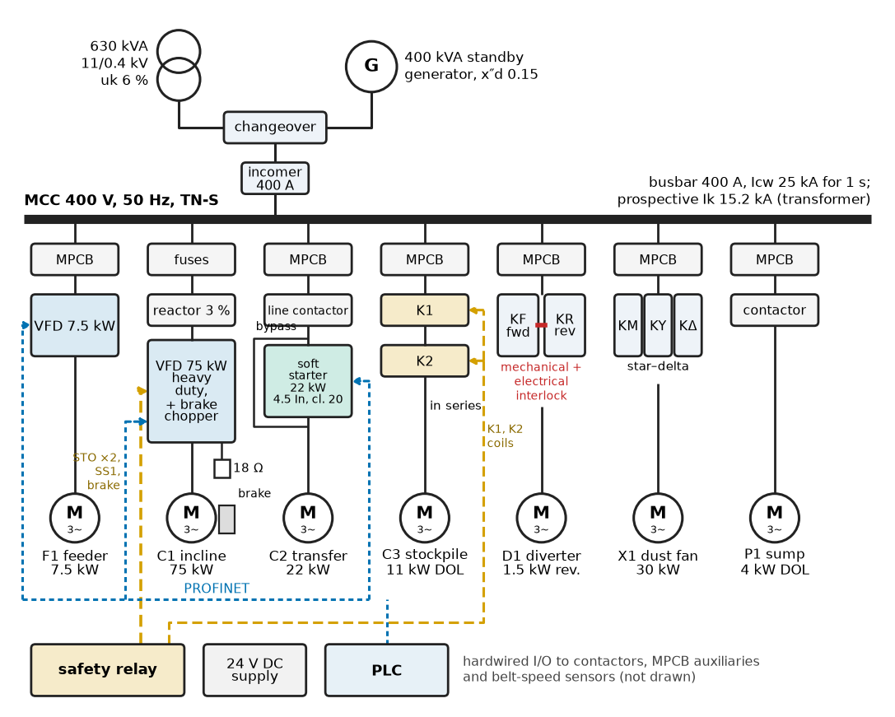
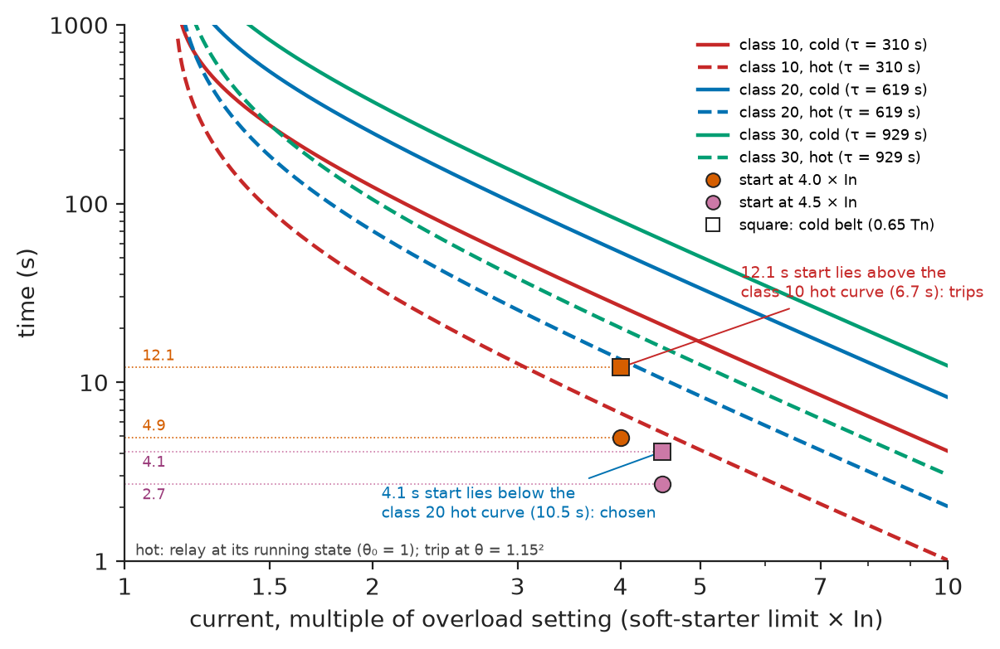
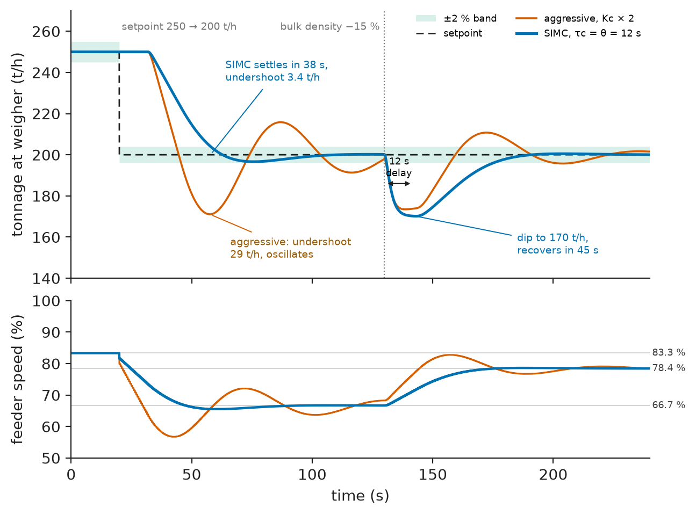
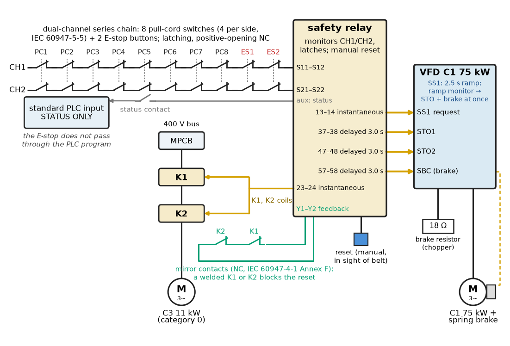
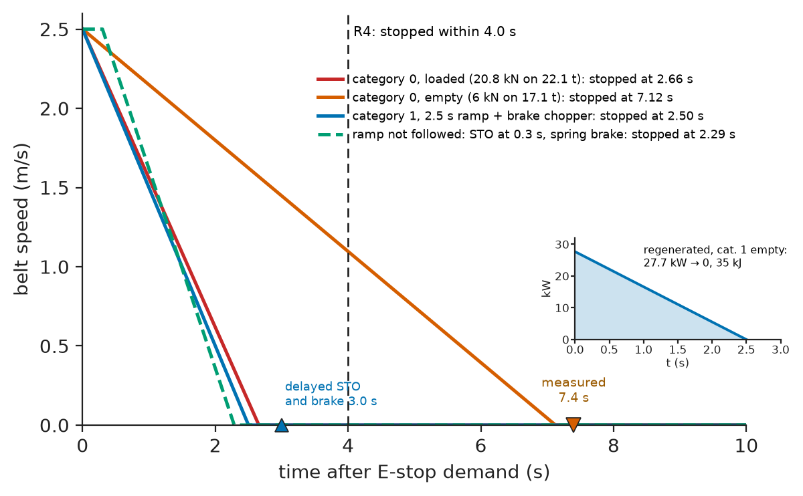

# Chapter 20 — Industrial Motor Control

*Part V · Industrial Automation*

The validation of a new conveyor line at an aggregate quarry stops on its first morning. The inspector pulls the trip wire beside the 180 m incline conveyor with the belt running empty, and the belt takes 7.4 s to stop; the risk assessment allows 4 s. He then asks the integrator to put the PLC into STOP and pulls the wire again: nothing happens at all, because the pull-cord switches are wired to an ordinary PLC input and the PLC tells the drive to coast. Both failures have the same root. The motor-control design treated the emergency stop as one more input to the program, and the stopping performance as something the drive would sort out, instead of as a function with its own circuit, its own stop category and its own number written down before the panel was built. The fix took a safety relay, the drive's safe torque off, a brake chopper and two days of retesting. This chapter is about designing motor control so that such fixes are not needed.

> **How is each motor of a plant started, protected, controlled in speed, interlocked and stopped, and how are those choices traced to requirements?**
> **What goes into the motor-control panel, and how is the whole line commissioned and proved, emergency stops included?**

| Concept | Engineering destination |
|---|---|
| Motor starters | DOL, star–delta, soft starter or VFD against dip, torque and cost |
| Contactors | AC-3 and AC-4 duty, electrical life, mirror contacts, reversing |
| Overload protection | Trip class against start time, hot restarts, MPCBs, Type 2 coordination |
| Variable-frequency drives | Duty rating, starting torque, braking, EMC and fieldbus interface |
| Speed regulation | Speed accuracy by control mode; process loops that set the speed |
| Interlocks | Start and stop sequences, permissives, reversing interlocks |
| Emergency stops | Stop categories, pull-cords, safety relays, STO, stopping-time validation |
| Fault monitoring | Belt slip, contactor discrepancy, first-out alarms |
| Control-panel design | MCC short-circuit rating, forms of separation, heat |
| Commissioning | Rotation, autotune, interlock and E-stop validation |

**Roadmap.** The conveyor line and its requirements (20.1) → starters (20.2) → contactors (20.3) → overload protection (20.4) → VFDs (20.5) → speed regulation (20.6) → interlocks (20.7) → emergency stops (20.8) → fault monitoring (20.9) → the motor-control panel (20.10) → commissioning, verification and failure analysis (20.11).

---

## 20.1 The conveyor line and its requirements

### The reference system

The running example is the **motor control of an aggregate conveyor line** in a quarry: crushed rock at 150–300 t/h from a surge bin to a stockpile. Seven motors are fed from one motor-control centre (MCC) on a 400 V, 50 Hz TN-S supply from a 630 kVA, 6 % transformer, with a 400 kVA standby generator that must be able to run the whole line.

**Table 20.1 — Motors of the conveyor line (400 V, 4-pole, IE3; currents typical).**

| Tag | Duty | Rating | Full-load current | Starter (Section 20.2) |
|---|---|---|---|---|
| F1 | Apron feeder under the surge bin; sets the feed rate | 7.5 kW | 14.6 A | VFD |
| C1 | Incline conveyor, 180 m, lift 18 m, 2.5 m/s | 75 kW | 136 A | VFD, heavy duty, brake chopper |
| C2 | Transfer conveyor, 60 m, 2.0 m/s | 22 kW | 40 A | Soft starter |
| C3 | Stockpile conveyor, 80 m, 2.0 m/s | 11 kW | 21 A | DOL |
| D1 | Shuttle diverter at the stockpile | 1.5 kW | 3.3 A | Reversing DOL |
| X1 | Dust-extraction fan | 30 kW | 55 A | Star–delta |
| P1 | Sump pump | 4 kW | 8.0 A | DOL |

Figure 20.1 is the single-line diagram of the MCC.

<!-- FIGURE 20.1 | figures/ch20/fig-20-1-mcc-single-line.png | schematic | Single-line diagram of the conveyor-line motor-control centre. | Content: 630 kVA 6 percent transformer and 400 kVA generator via changeover to a 400 A incomer and busbar (Icw 25 kA 1 s, prospective 15.2 kA). Outgoing units: F1 MPCB + 7.5 kW VFD; C1 fuses + 3 percent reactor + 75 kW heavy-duty VFD with chopper, 18 ohm resistor, STO and brake lines to the safety relay; C2 MPCB + line contactor + 22 kW soft starter with bypass; C3 MPCB + contactors K1, K2 in series; D1 MPCB + reversing pair with mechanical interlock; X1 MPCB + star-delta contactors; P1 MPCB + contactor. Below: safety relay, 24 V supply, PLC on PROFINET to the drives and soft starter. -->



*Figure 20.1 — Single-line diagram of the conveyor-line motor-control centre.*

### Requirements

**Table 20.2 — Requirements for the motor control of the conveyor line.**

| ID | Requirement | Target | Verification |
|---|---|---|---|
| R1 | Start and stop sequence | Start downstream first, each conveyor proven at speed before the next starts; stop upstream first after belt-clearing time | Sequence test with every permissive (§20.7) |
| R2 | Belt slip and stall | Trip if belt speed < 80 % of nominal for > 3 s once running | Simulated slip test (§20.9) |
| R3 | Feed rate | 150–300 t/h, ±3 % on 10-min average | Belt-weigher trend (§20.6) |
| R4 | Emergency stop | Any pull-cord or E-stop stops the conveyors it protects within 4 s at any load, independently of the standard PLC; latched, manual reset | Stopping-time tests, PLC-in-STOP test (§20.8) |
| R5 | Motor overload protection | Every motor protected; no nuisance trip on a loaded restart within 15 min of a stop | Start tests hot and cold (§20.4) |
| R6 | Short-circuit protection | Type 2 coordination (IEC 60947-4-1) at the prospective fault level | Manufacturer coordination tables; Isc calculation (§20.10) |
| R7 | Supply dip on starting | ≤ 5 % at the MCC busbar on transformer or generator | Dip calculation, recorded start on generator (§20.2) |
| R8 | MCC environment | IP54 (quarry dust); internal ≤ 40 °C at 45 °C ambient | Heat budget, heat run (§20.10) |
| R9 | Fault annunciation | Every trip reported on the HMI with its first-out cause within 1 s | Fault-injection tests (§20.9) |
| R10 | Commissioning record | Every interlock and E-stop tested, stopping times recorded | Test records (§20.11) |

R4's 4 s comes from the risk assessment of the tail pulley of C1, where a person caught in the in-running nip must be released before the belt has drawn them in; its performance level (PL d) and its proof belong to Chapter 21.

> **Boundary.** Starting methods and their current and torque, drive fundamentals, braking and drive protection are owned by *Electrical Energy and Machines*: [Ch. 6 §6.6](https://github.com/The-Studio-of-Sadiq/Electrical-Energy-and-Machines/blob/main/part-2-transformers-and-electrical-machines/06-induction-machines.md), [Ch. 10 §10.5 and §10.7](https://github.com/The-Studio-of-Sadiq/Electrical-Energy-and-Machines/blob/main/part-3-motor-drives/10-drive-system-fundamentals.md) and [Ch. 12 §12.3 and §12.9](https://github.com/The-Studio-of-Sadiq/Electrical-Energy-and-Machines/blob/main/part-3-motor-drives/12-ac-motor-drives.md); the VFD's power stage and gate drive by *Electronics and Computing*, [Ch. 32 §32.4](https://github.com/The-Studio-of-Sadiq/Electronics-and-Computing/blob/main/part-7-power-electronics/32-motor-drives-and-power-conversion.md). This chapter selects, wires, interlocks and commissions them. The PLC and panels in general are owned by [Chapter 18](18-industrial-control-architecture.md), the sensors on the conveyors by [Chapter 19](19-industrial-sensors-and-actuators.md).

---

## 20.2 Motor starters

### The options

Four ways of starting a cage induction motor cover nearly every industrial case. *Electrical Energy and Machines* [Ch. 6 §6.6](https://github.com/The-Studio-of-Sadiq/Electrical-Energy-and-Machines/blob/main/part-2-transformers-and-electrical-machines/06-induction-machines.md) gives their currents and torques: direct-on-line (DOL) draws 6–8 times rated current with full starting torque; star–delta cuts line current and torque to one third; a soft starter limits current to 2.5–4.5 times rated with torque falling as the square of the current ratio; a VFD gives rated torque at about rated current. Here the question is which to fit to each of seven motors, and the answer comes from four requirements at once: the supply dip (R7), the torque the load needs at standstill, the mechanical stress the load can accept, and whether speed control is needed anyway.

### The supply dip

A motor drawing apparent power $S_{start}$ from a source of short-circuit power $S_{sc}$ dips the busbar voltage by roughly

$$
\frac{\Delta V}{V}\approx\frac{S_{start}}{S_{sc}}
$$

> **Status of the principle: Starting dip from short-circuit power**
> *Approximate.* Treats source and motor impedances as in phase and the source as a constant impedance; it overstates the dip slightly when the motor's starting power factor (0.3–0.5) differs from the source's X/R angle, and for a generator it uses the subtransient reactance, ignoring the voltage regulator's recovery over the next 0.5–2 s. The phasor calculation is in *Electrical Energy and Machines*, Ch. 6 §6.6.

**Worked example — the dip on the generator.** On the transformer, $S_{sc}=630/0.06=10.5$ MVA; on the 400 kVA generator with subtransient reactance 0.15 pu, $S_{sc}=400/0.15=2.67$ MVA. The generator decides:

**Table 20.3 — Starting dip at the MCC busbar.**

| Motor and starter | Starting current | $S_{start}$ | Dip on transformer | Dip on generator | R7 (5 %) |
|---|---|---|---|---|---|
| X1 30 kW, DOL | 385 A | 267 kVA | 2.5 % | 10.0 % | Fails on generator |
| X1 30 kW, star–delta | 128 A | 89 kVA | 0.8 % | 3.3 % | Pass |
| X1 30 kW, soft starter 3.5 × $I_n$ | 193 A | 133 kVA | 1.3 % | 5.0 % | Marginal |
| C2 22 kW, soft starter 4.5 × $I_n$ | 180 A | 125 kVA | 1.2 % | 4.7 % | Pass |
| C3 11 kW, DOL | 147 A | 102 kVA | 1.0 % | 3.8 % | Pass |
| P1 4 kW, DOL | 56 A | 39 kVA | 0.4 % | 1.5 % | Pass |

On the transformer every motor could start DOL. On the generator the fan cannot, and it gets a star–delta starter, the cheapest method that passes. Star–delta suits a fan because a fan needs little torque at low speed; it would not suit a loaded conveyor, which needs close to rated torque to break away.

### Starter selection

**Table 20.4 — Starter selection for the conveyor line.**

| Motor | Load at start | DOL | Star–delta | Soft starter | VFD | Choice and reason |
|---|---|---|---|---|---|---|
| F1 feeder | Full bin on the apron: high breakaway | Possible | No | No | Yes | **VFD**: speed sets the feed rate (R3) |
| C1 incline | Loaded belt, 18 m lift; 1.1 × rated torque at breakaway | Torque shock, belt slip | No | Insufficient torque at 4 × $I_n$ | Yes | **VFD** heavy duty: controlled torque, controlled stop (R4) |
| C2 transfer | Loaded level belt, about 0.5–0.65 × rated | Belt stress | No | Yes with high current limit | Yes | **Soft starter**: cheaper; no speed control needed |
| C3 stockpile | Short belt, light | Yes | — | — | — | **DOL**: cheapest, dip 3.8 % |
| D1 diverter | Light, reversing | Yes | — | — | — | **Reversing DOL** |
| X1 fan | Low torque at low speed | Fails R7 on generator | Yes | Marginal | Not needed | **Star–delta** |
| P1 sump pump | Low | Yes | — | — | — | **DOL** |

A conveyor's real objection to DOL is mechanical, not electrical: DOL starting torque of two to three times rated, applied in a fraction of a second, slips the belt on the drive pulley, overstresses splices and lifts the belt off its idlers on concave curves. Conveyor design practice (DIN 22101, CEMA) limits starting torque to about 1.3–1.5 times the running requirement and acceleration to about 0.1–0.3 m/s², which is why long conveyors get soft starters, fluid couplings or VFDs.

---

## 20.3 Contactors

### Ratings that matter for motors

The contactor is the switching element of every starter in Table 20.4 except the VFD's output. Its motor ratings come from IEC 60947-4-1 (introduced in Chapter 19 for the general case):

- **AC-3**: starting a cage motor and switching it off while running. Making about 6–8 × $I_e$, breaking about 1 × $I_e$ at reduced voltage (the running motor's back-emf helps). The headline rating: an "11 kW contactor" is 11 kW AC-3 at 400 V.
- **AC-4**: plugging (reversing while running) and inching. The contactor breaks 6–8 × $I_e$ at full voltage. Electrical life at AC-4 is 10 to 50 times shorter than at AC-3 for the same current.
- **Electrical life** is given as a curve of operations against breaking current; mechanical life (10–20 million operations) is rarely the limit.
- **Mirror contacts** (IEC 60947-4-1 Annex F): an auxiliary NC contact that cannot be closed while any main contact is closed, even if a main contact is welded. It is the feedback that lets a safety relay detect a welded contactor and refuse to restart (Section 20.8).

### Reversing

The diverter D1 is driven by two contactors that swap two phases. Both closed at once is a phase-to-phase short circuit, so a reversing starter has three interlocks: a **mechanical interlock** between the two contactors (a rocker that physically prevents both armatures closing), an **electrical interlock** (an NC auxiliary of each contactor in the other's coil circuit), and a **time interlock** in the PLC (0.5 s off before reversing), which also turns plugging (AC-4) into ordinary AC-3 duty because the motor has nearly stopped when it reverses.

**Worked example — the life of the reversing contactors.** The shuttle diverter alternates every minute to layer the stockpile: 60 operations an hour, 16 h a day, 300 days a year, 288 000 operations a year, half per contactor. A 9 A AC-3 contactor switching a 3.3 A motor has an AC-3 electrical life of typically 2–3 million operations at that current: about 14–20 years. Plugged without the time interlock, the same contactor is at AC-4, where a typical life curve gives about 200 000 operations: 1.4 years. The 0.5 s pause in the PLC multiplies contactor life by ten; it is written into the functional design specification, not left to the programmer's taste.

> **Status of the principle: Contactor electrical life**
> *Empirical.* Taken from manufacturers' life curves measured under IEC 60947-4-1 test conditions for each utilisation category; actual life varies with supply voltage, inrush, ambient and switching frequency, so designs use the curve with a margin and inspect contacts at intervals.

---

## 20.4 Overload protection

### The protective chain of one motor

Each DOL, star–delta or soft-started motor has a **motor-protection circuit breaker** (MPCB) or a fuse–overload combination. The MPCB combines a magnetic trip at about 12–14 × setting with an overload trip set to full-load current; drives and soft starters carry their own electronic motor model.

The overload relay must trip on a sustained overload but not during a start. Its **trip class** (IEC 60947-4-1: class 10, 20, 30, with a cold trip at 7.2 × setting within 4–10 s, 6–20 s and 9–30 s) is chosen against the start time, and the dangerous case is a **hot restart**: a conveyor tripped or E-stopped under full load and restarted at once, when the relay's thermal model is already near its running state. *Electrical Energy and Machines*, [Ch. 10 §10.7](https://github.com/The-Studio-of-Sadiq/Electrical-Energy-and-Machines/blob/main/part-3-motor-drives/10-drive-system-fundamentals.md), gives the single-time-constant thermal model behind the relay; Listing 20.1 uses it.

### Sizing the soft start of C2

C2 restarts loaded after every stop of the line. Its total inertia referred to the motor shaft is 1.135 kg·m² (belt, idlers and 2.1 t of rock moving at 2.0 m/s, plus motor and gearbox), its running torque is 0.50 × rated normally and 0.65 × rated on a cold winter morning when the belt and idler grease are stiff. Under current limit $k\times I_n$ the motor's torque is about $T_{LR}(k/k_{LR})^2$ (Chapter 6 of *Electrical Energy and Machines*), with locked-rotor torque 2.3 × rated at 7 × rated current.

```python
# Soft-starter start of conveyor C2 (22 kW) versus overload trip class (hot restart)
import math
TN, W, J = 142.9, 153.9, 1.135        # rated torque N m, speed rad/s, total J kg m^2
LRT, ILR = 2.3, 7.0                   # locked-rotor torque (x Tn) and current (x In)
KT = 1.15                             # relay trips when theta reaches KT^2

def tau(cls):                         # time constant giving the class trip at 7.2 x, cold
    t_cold = 0.8 * cls                # typical trip time: 8, 16, 24 s
    return t_cold / math.log(7.2**2 / (7.2**2 - KT**2))

def t_trip(k, cls, theta0):           # first-order I^2 model from initial state theta0
    return tau(cls) * math.log((k**2 - theta0) / (k**2 - KT**2))

for load in (0.50, 0.65):             # running torque x Tn: normal, cold belt
    for k in (3.5, 4.0, 4.5):         # soft-starter current limit x In
        t_mot = LRT * (k / ILR) ** 2  # motor torque at current limit (x Tn)
        acc = (t_mot - load) * TN
        t_start = J * W / acc if acc > 0 else math.inf
        trips = "  ".join(f"cl{c}:{t_trip(k, c, 1.0):5.1f}" for c in (10, 20, 30))
        print(f"load {load:.2f} Tn, limit {k:.1f} In: torque {t_mot:.2f} Tn, "
              f"start {t_start:5.1f} s | hot trip s {trips}")
```

```text
load 0.50 Tn, limit 3.5 In: torque 0.57 Tn, start  16.3 s | hot trip s cl10:  9.0  cl20: 18.0  cl30: 27.0
load 0.50 Tn, limit 4.0 In: torque 0.75 Tn, start   4.9 s | hot trip s cl10:  6.7  cl20: 13.5  cl30: 20.2
load 0.50 Tn, limit 4.5 In: torque 0.95 Tn, start   2.7 s | hot trip s cl10:  5.2  cl20: 10.5  cl30: 15.7
load 0.65 Tn, limit 3.5 In: torque 0.57 Tn, start   inf s | hot trip s cl10:  9.0  cl20: 18.0  cl30: 27.0
load 0.65 Tn, limit 4.0 In: torque 0.75 Tn, start  12.1 s | hot trip s cl10:  6.7  cl20: 13.5  cl30: 20.2
load 0.65 Tn, limit 4.5 In: torque 0.95 Tn, start   4.1 s | hot trip s cl10:  5.2  cl20: 10.5  cl30: 15.7
```

**Worked example — current limit and trip class together.** The soft starter's default (4.0 × $I_n$, class 10) starts C2 in 4.9 s on a normal day, inside the hot trip time of 6.7 s, and would pass a summer commissioning test. On a cold morning the same setting takes 12.1 s and the overload trips at 6.7 s on a hot restart: a nuisance trip that would appear in the first winter. At 3.5 × $I_n$ the motor cannot start the cold belt at all (0.57 × rated torque against 0.65). The design takes 4.5 × $I_n$ (0.95 × rated torque, 4.1 s worst-case start) with class 20 (10.5 s hot): a margin of 2.6 on time. The 4.5 × $I_n$ is also the setting whose dip on the generator was checked in Table 20.3 (4.7 %). Current limit, trip class and supply dip are one decision, made with one table. Figure 20.2 shows the start current against the trip curves.

<!-- FIGURE 20.2 | figures/ch20/fig-20-2-overload-curves-vs-start.png | plot | Overload trip curves of class 10, 20 and 30 (cold and hot) against the soft-start current of conveyor C2. | Content: log-log axes, x multiple of setting 1 to 10, y trip time 1 to 1000 s; curves t = tau ln((k^2 - theta0)/(k^2 - 1.3225)) with tau 310, 619, 929 s, solid cold (theta0 = 0), dashed hot (theta0 = 1). Start markers: 4.0 x In at 4.9 s and 12.1 s (cold belt), 4.5 x In at 2.7 s and 4.1 s; the 12.1 s marker lies above the class 10 hot curve (6.7 s), the 4.1 s marker below class 20 hot (10.5 s). -->



*Figure 20.2 — Overload trip curves of class 10, 20 and 30 (cold and hot) against the soft-start current of conveyor C2.*

> **Status of the principle: Thermal overload model for trip-class selection**
> *Approximate.* A single time constant fitted to the class test point at 7.2 × setting, with the hot state taken as continuous operation at setting current; real relays and motor models differ in their hot/cold ratio, so the vendor's own hot curve must be checked before settings are frozen.

### Short-circuit protection and coordination

The MPCB or fuse must also clear a short circuit at the motor terminals or in the cable before the cable or the contactor is destroyed. IEC 60947-4-1 defines two levels of **coordination** between the short-circuit device, the contactor and the overload relay at a stated prospective current: **Type 1**, the starter may be unusable after the fault; **Type 2**, the starter must remain usable, with only light contact welding that can be separated. R6 requires Type 2, so every starter is built from a manufacturer's tested combination listed for the MCC's prospective current (Section 20.10). Cable protection follows *Electrical Energy and Machines*, [Ch. 29 §29.5](https://github.com/The-Studio-of-Sadiq/Electrical-Energy-and-Machines/blob/main/part-8-electrical-safety-and-engineering-practice/29-electrical-safety.md).

---

## 20.5 Variable-frequency drives

### Selecting the C1 drive

A VFD is specified by more than its kilowatts. For C1 the checks are:

1. **Duty**: drives are rated for **normal duty** (110 % for 60 s every 10 min; fans and pumps) and **heavy duty** (150 % for 60 s; conveyors, crushers, hoists). The same frame typically carries one size higher in normal duty.
2. **Starting torque**: running at full load, C1 needs 52 kW at the head pulley, $52/0.95=54.7$ kW at the motor (gearbox efficiency 0.95), or 0.73 × rated torque. At breakaway, static friction raises the running resistance by about 30 % and the 10 s acceleration ramp to 2.5 m/s (0.25 m/s²) adds $22\,070\times0.25=5.5$ kN on an equivalent moving mass of 22.1 t. The total, $1.3\times20.8+5.5=32.6$ kN at the belt, is 553 N·m at the motor, 1.14 × rated torque.
3. **Current**: with a magnetising current of about 0.35 × rated, the motor current at 1.14 × rated torque is about $I_n\sqrt{0.35^2+1.14^2(1-0.35^2)}=1.12\,I_n=153$ A.
4. **Braking**: whether the drive must absorb regenerated energy (Section 20.8).
5. **Environment and EMC**: IP54 or a cabinet; category C3 (industrial) EMC filter to IEC 61800-3; line reactor for harmonics and DC-link capacitor life; shielded symmetrical motor cable.
6. **Interface**: PROFINET for reference, status and diagnostics; hardwired STO and a hardwired run permit for anything safety-related.

**Worked example — normal or heavy duty?** A drive sold as "75 kW" in normal duty is typically rated about 145 A continuous with 110 % (160 A) for 60 s. That would carry the 153 A breakaway, but with 4 % margin, and nothing for a cold morning or a belt left loaded after a trip. A frame rated 75 kW in heavy duty (sold as 90 kW normal duty), 145 A continuous with 150 % (218 A) for 60 s, gives 42 % margin on breakaway current. The heavy-duty rating costs about 20 % more (2026 indicative: about \$7 500 against \$6 200 for the drive alone) and is chosen, because a conveyor that cannot restart loaded after an E-stop must be dug out by hand.

### What else the drive brings

The drive also brings, at no extra cost, a programmable ramp, a motor thermal model that includes reduced cooling at low speed, a thermistor input, underload detection (a broken belt shows as low torque at speed) and fieldbus diagnostics. Its costs are harmonic current on the supply (the 3 % line reactor holds the drive's current THD to about 35–40 %; *Electrical Energy and Machines*, [Ch. 25 §25.3](https://github.com/The-Studio-of-Sadiq/Electrical-Energy-and-Machines/blob/main/part-7-power-quality-and-grid-modernization/25-power-quality.md)), common-mode currents in motor bearings, and 1.5 kW of losses to remove from the MCC (Section 20.10).

---

## 20.6 Speed regulation

### How well does a drive hold speed?

A drive regulates speed only as well as its control mode allows (*Electrical Energy and Machines*, [Ch. 12 §12.3–12.6](https://github.com/The-Studio-of-Sadiq/Electrical-Energy-and-Machines/blob/main/part-3-motor-drives/12-ac-motor-drives.md)):

**Table 20.5 — Steady-state speed accuracy by control mode (typical, 4-pole induction motor with rated slip about 2 %).**

| Mode | Speed error from no load to full load | Typical use |
|---|---|---|
| Open-loop V/f | About rated slip: 1.5–3 % | Fans, pumps |
| V/f with slip compensation | 0.3–0.5 % | Conveyors, mixers |
| Sensorless vector | 0.1–0.5 % | Conveyors, extruders, general machinery |
| Closed-loop vector with encoder | 0.01 % | Winders, hoists, test rigs |

No conveyor here needs better than 1 %. What matters is what sets the speed: the feeder F1's speed is set by an outer loop holding the tonnage measured by a belt weigher on C1.

### The feed-rate loop

The belt weigher sits 30 m along C1 from the feeder discharge. Rock leaving the feeder reaches it after 30/2.5 = 12 s, so the loop from feeder speed to measured tonnage is dominated by that **transport delay**. Modelled as first order plus dead time (gain 3.0 t/h per % speed, 2 s lag from the feeder and chute, 12 s delay), it is tuned by the SIMC rules (*Circuits, Signals and Communications*, [Ch. 35 §35.3](https://github.com/The-Studio-of-Sadiq/Circuits-Signals-and-Communications/blob/main/part-7-control-system-fundamentals/35-control-design-fundamentals.md)) with the closed-loop time constant equal to the delay: $K_c=\tau/(K(\tau_c+\theta))=2/(3\times24)=0.028$ %/(t/h), $T_i=\min(\tau,4(\tau_c+\theta))=2$ s. Listing 20.2 simulates the loop, executed in a 0.5 s PLC cyclic task, for a setpoint step from 250 to 200 t/h and then a 15 % drop in bulk density of the rock, and compares a gain twice as high.

```python
# Feed-rate loop: feeder VFD speed -> belt-weigher tonnage, PI in a 0.5 s PLC task
import numpy as np
K, TAU, THETA = 3.0, 2.0, 12.0          # t/h per % speed, s, s (transport delay)
DT, TS = 0.05, 0.5                       # simulation step, PLC task period
def simulate(kc, ti, t_end=240.0):
    n = int(t_end / DT); delay = int(THETA / DT)
    u_hist = np.full(n + delay, 250.0 / K)   # start in steady state at 250 t/h
    y, yf, integ, u = 250.0, 250.0, 250.0 / K, 250.0 / K
    out = np.empty(n)
    for k in range(n):
        t = k * DT
        sp = 250.0 if t < 20 else 200.0                 # operator setpoint step
        dist = 0.0 if t < 130 else -0.15                # ore density drops 15 %
        if k % int(TS / DT) == 0:                       # PLC cyclic task
            e = sp - yf
            integ = np.clip(integ + kc * e * TS / ti, 0, 100)   # anti-windup
            u = np.clip(kc * e + integ, 0, 100)                 # % feeder speed
        u_hist[k + delay] = u
        y += DT / TAU * (K * (1 + dist) * u_hist[k] - y)        # chute/feeder lag
        yf += DT / 1.0 * (y - yf)                                # 1 s weigher filter
        out[k] = yf
    return out

t = np.arange(int(240 / DT)) * DT
for name, kc, ti in [("SIMC tau_c = theta", 2.0 / (3.0 * 24.0), 2.0),
                     ("aggressive x2", 2 * 2.0 / (3.0 * 24.0), 2.0)]:
    y = simulate(kc, ti)
    w = (t >= 20) & (t < 130)
    settle = t[w][np.abs(y[w] - 200) > 4][-1] - 20      # last exit from +/-2 %
    d = t >= 130
    rec = t[d][np.abs(y[d] - 200) > 4][-1] - 130
    print(f"{name:18s} Kc={kc:.4f} %/(t/h): undershoot {200 - y[w].min():4.1f} t/h, "
          f"settles {settle:4.1f} s; disturbance dip to {y[d].min():5.1f} t/h, "
          f"recovers {rec:4.1f} s")
```

```text
SIMC tau_c = theta Kc=0.0278 %/(t/h): undershoot  3.4 t/h, settles 37.8 s; disturbance dip to 170.2 t/h, recovers 45.1 s
aggressive x2      Kc=0.0556 %/(t/h): undershoot 28.9 t/h, settles 107.2 s; disturbance dip to 173.5 t/h, recovers 77.5 s
```

**Worked example — what the simulation says.** With the SIMC tuning the tonnage settles within ±2 % of the new setpoint 38 s after the step, undershooting by only 3.4 t/h; after the density drop it dips to 170 t/h, because the controller's correction needs 12 s to reach the weigher, and recovers in 45 s. On a 10-min average both transients cost well under 1 %, inside R3's 3 %. Doubling the gain, the natural reaction to a "sluggish" loop, makes it worse on both counts: 29 t/h of undershoot and 107 s to settle. A dead-time-dominated loop cannot be made faster than its delay, only worse. Figure 20.3 plots both responses.

<!-- FIGURE 20.3 | figures/ch20/fig-20-3-feed-rate-loop-response.png | plot | Simulated feed-rate loop: tonnage at the belt weigher and feeder speed for a setpoint step and a density disturbance. | Content: two stacked panels, x-axis 0 to 240 s. Top: tonnage 140 to 270 t/h, setpoint 250 to 200 at 20 s, SIMC response settling in 38 s with 3.4 t/h undershoot, aggressive x2 response oscillating with 29 t/h undershoot; at 130 s a 15 percent density drop, SIMC dipping to 170 t/h and recovering in 45 s; plus/minus 2 percent band shaded; 12 s delay annotated. Bottom: feeder speed 50 to 100 percent, from 83.3 percent to about 78.4 percent. -->



*Figure 20.3 — Simulated feed-rate loop: tonnage at the belt weigher and feeder speed for a setpoint step and a density disturbance.*

> **Status of the principle: First-order-plus-dead-time model of a conveyor feed loop**
> *Approximate.* Treats the feeder, chute and belt as a gain, a single lag and a pure delay at constant belt speed; it ignores the feeder's nonlinearity with bin level and material, and the delay changes if C1's speed changes, so the loop is retuned whenever the belt speed is altered.

---

## 20.7 Interlocks

### Sequence interlocks and permissives

An **interlock** prevents an action, or forces one, on the state of something else. A conveyor line has three kinds:

- **Sequence interlocks** (R1): a conveyor may run only while the conveyor it discharges onto is running at speed. Starting runs downstream to upstream (C3, C2, C1, then F1); stopping runs upstream to downstream, each belt running on for its **clearing time** (length over speed: 72 s for C1, 30 s for C2, 40 s for C3) so that no belt stops loaded. If a downstream conveyor stops for any reason, every upstream conveyor stops at once; otherwise C1 would bury the transfer point of a stopped C2 under 250 t/h of rock.
- **Permissives**: conditions that must be true to start but are not checked while running (air pressure available for the dust-filter cleaning, the diverter at an end position, no maintenance lock-off).
- **Equipment interlocks**: reversing interlocks (Section 20.3), and the dust fan X1 running before C2 may start.

"Running" must be proven, not assumed. A contactor's auxiliary contact proves only that the contactor closed, not that the belt moves. Each conveyor has a **belt-speed monitor**, an inductive sensor on a tail-pulley target (Chapter 19), and the sequence uses its "at speed" signal.

### The sequence in Structured Text

Listing 20.3 is the line sequence in IEC 61131-3 Structured Text, using the same step-and-stopwatch pattern as the filter backwash of Chapter 18. The run commands are decoded from the state and gated by the downstream speed signals, so the cascade stop of an upstream conveyor happens in the same scan in which a downstream one is lost.

```text
FUNCTION_BLOCK FB_ConveyorLine
VAR_INPUT
    xStart, xStop, xSafetyOK, xFault : BOOL;  (* xSafetyOK: status of safety relay *)
    xAt3, xAt2, xAt1 : BOOL;                   (* belt at speed: C3, C2, C1 *)
END_VAR
VAR_OUTPUT
    xRun3, xRun2, xRun1, xRunF : BOOL;
    iState : INT := 0;
END_VAR
VAR
    iLast : INT := -1;
    tState : TON;
END_VAR

tState(IN := (iState = iLast), PT := T#1H);    (* stopwatch, reset on change *)
iLast := iState;
IF xFault OR NOT xSafetyOK THEN iState := 0; END_IF;     (* trip: all stop *)

CASE iState OF
  0:  IF xStart AND xSafetyOK AND NOT xFault THEN iState := 10; END_IF;
  10: IF xAt3 THEN iState := 20; ELSIF tState.ET > T#10S THEN iState := 0; END_IF;
  20: IF xAt2 THEN iState := 30; ELSIF tState.ET > T#15S THEN iState := 0; END_IF;
  30: IF xAt1 THEN iState := 40; ELSIF tState.ET > T#20S THEN iState := 0; END_IF;
  40: IF xStop THEN iState := 50; END_IF;                 (* running, feeding *)
  50: IF tState.ET >= T#80S THEN iState := 60; END_IF;    (* clear C1: 72 s *)
  60: IF tState.ET >= T#35S THEN iState := 70; END_IF;    (* clear C2: 30 s *)
  70: IF tState.ET >= T#45S THEN iState := 0; END_IF;     (* clear C3: 40 s *)
END_CASE;

xRun3 := (iState >= 10) AND (iState <= 70);
xRun2 := (iState >= 20) AND (iState <= 60) AND xAt3;
xRun1 := (iState >= 30) AND (iState <= 50) AND xAt2 AND xAt3;
xRunF := (iState = 40) AND xAt1 AND xAt2 AND xAt3;
END_FUNCTION_BLOCK
```

Each start step has a timeout, so a conveyor that does not reach speed aborts the start rather than leaving the line half-running. `xSafetyOK` is only a status: the emergency stop does not pass through this code (Section 20.8), but when it acts, this block drops to state 0, so that nothing restarts by itself when the safety relay is reset.

---

## 20.8 Emergency stops

### Stop categories and what an E-stop must do

IEC 60204-1 defines three **stop categories**: **0**, immediate removal of power (the motor coasts or is braked mechanically); **1**, a controlled stop with power, then removal of power; **2**, a controlled stop with power left on. ISO 13850 requires an emergency stop to be category 0 or 1, chosen by risk assessment, to override every other function, to latch, and to need a deliberate manual reset that does not itself restart the machine.

For a conveyor the E-stop devices are buttons at the drives and **pull-cord switches** (rope-pull switches to IEC 60947-5-5) along the walkways: a wire rope on both sides of the belt that operates a latching switch with positive-opening contacts when pulled from any point, or when it breaks or goes slack. With switches serving up to 50 m of rope each, C1's 180 m needs four switches per side.

> **Boundary.** The required performance level, the category of the architecture, MTTFd and diagnostic coverage of the E-stop function, and the fault-masking limits on pull-cords wired in series, are owned by [Chapter 21](21-industrial-communication-and-safety.md); STO and SS1 inside the drive by *Electrical Energy and Machines*, [Ch. 10 §10.7](https://github.com/The-Studio-of-Sadiq/Electrical-Energy-and-Machines/blob/main/part-3-motor-drives/10-drive-system-fundamentals.md). This section designs the circuits and their stopping performance.

### Stopping C1: why the first design failed

The opening's first failure is kinematics. On a category 0 stop the belt is decelerated only by its own running resistance. Loaded, that resistance is 20.8 kN acting on an equivalent moving mass of 22.1 t (belt, idlers, rock and the motor's inertia referred to the belt); empty, the material's lift and friction are gone, leaving about 6 kN on 17.1 t.

**Worked example — stopping time and the brake chopper.** For a constant deceleration $a$ from $v=2.5$ m/s, time $v/a$ and distance $v^2/2a$:

**Table 20.6 — Stopping of C1 from 2.5 m/s.**

| Case | Deceleration | Time | Distance | R4 (4 s) |
|---|---|---|---|---|
| Category 0, loaded (20.8 kN on 22.1 t) | 0.94 m/s² | 2.65 s | 3.3 m | Pass |
| Category 0, empty (6.0 kN on 17.1 t) | 0.35 m/s² | 7.1 s | 8.9 m | **Fail** (measured 7.4 s) |
| Category 1, 2.5 s ramp, brake chopper | 1.0 m/s² | 2.5 s | 3.1 m | Pass |
| Ramp not followed: SS1 ramp monitor trips STO after 0.3 s, spring brake 250 N·m, empty | 1.26 m/s² | 0.3 + 2.0 = 2.3 s | 3.2 m | Pass |

The empty belt is the worst case: it coasts for 7.1 s because there is almost nothing to stop it. The redesign makes the E-stop a **category 1** stop: the drive ramps the belt to rest in 2.5 s and then removes torque. Decelerating the empty belt at 1.0 m/s² needs a braking force of $17\,070\times1.0-6000=11.1$ kN at the belt, a regenerated power of up to 27.7 kW and an energy of about 35 kJ per stop, which a diode-front-end drive can only dump into a **brake resistor** through its chopper. With the chopper switching on at about 760 V on the DC link, the resistor must be at most $760^2/27\,700=20.9$ Ω; an 18 Ω resistor rated for the E-stop duty (one full stop, then a cool-down) is fitted outside the MCC. Loaded, the belt already decelerates at 0.94 m/s² and the drive brakes only 1.3 kN.

> **Status of the principle: Constant-deceleration stopping**
> *Derived.* Time and distance follow from Newton's second law with a constant retarding force on a rigid equivalent mass; real belts stretch, so the tail pulley stops a little later than the head pulley, and running resistance rises as the belt slows, making the estimate slightly pessimistic for coasting.

### The circuit

Figure 20.4 shows the redesigned E-stop of C1. The pull-cords and E-stop buttons, dual-channel, go to a **safety relay** (or the safety program of a safety PLC), not to the standard PLC. On a demand the safety relay:

1. opens its instantaneous outputs, which command the drive's safe-stop input: the drive executes **SS1** (safe stop 1, IEC 61800-5-2) with its fast ramp of 2.5 s and **monitors** that the speed follows the ramp;
2. after 3.0 s, opens its delayed outputs to the drive's two **STO** channels and to the **safe brake control** output that drops the spring-applied motor brake;
3. if the drive's ramp monitor sees speed failing to fall, it applies STO and the brake at once (the last row of Table 20.6).

The standard PLC receives only a status contact. Contactor-started conveyors stop in category 0 through two contactors in series (C3: K1 and K2), each with a mirror contact in the safety relay's feedback loop, so that a welded contactor stops the relay re-arming. Reset is manual, at a button with sight of the conveyor, and starts nothing.

<!-- FIGURE 20.4 | figures/ch20/fig-20-4-estop-circuit.png | schematic | Emergency-stop circuit of incline conveyor C1 and stockpile conveyor C3. | Content: dual-channel series chain of 8 pull-cord switches and 2 E-stop buttons (positive-opening contacts, CH1 and CH2) into a safety relay with instantaneous outputs, outputs delayed 3.0 s, reset button and feedback loop. Instantaneous output to the VFD SS1 request; delayed outputs to STO1, STO2 and safe brake control; VFD with ramp monitor and chopper to 18 ohm resistor; spring brake on the 75 kW motor. C3: MPCB and contactors K1, K2 in series switched by the safety relay, their mirror contacts in the feedback loop. Status contact to a standard PLC input marked status only. -->



*Figure 20.4 — Emergency-stop circuit of incline conveyor C1 and stockpile conveyor C3.*

<!-- FIGURE 20.5 | figures/ch20/fig-20-5-c1-stopping-speed.png | plot | Belt speed of incline conveyor C1 after an emergency stop for the cases of Table 20.6. | Content: x-axis 0 to 10 s, y-axis 0 to 2.6 m/s, all from 2.5 m/s: category 0 loaded, zero at 2.65 s; category 0 empty, zero at 7.1 s with measured 7.4 s marker; category 1 ramp, zero at 2.5 s, STO marker at 3.0 s; ramp failed, flat to 0.3 s then braked to zero at 2.3 s. Dashed vertical line at 4.0 s labelled R4. Inset: regenerated power in the empty category 1 stop, 27.7 kW falling to zero over 2.5 s, 35 kJ. -->



*Figure 20.5 — Belt speed of incline conveyor C1 after an emergency stop for the cases of Table 20.6.*

Figure 20.5 plots the four stopping cases against the 4 s limit.

---

## 20.9 Fault monitoring

### What is monitored

**Table 20.7 — Fault monitoring on the conveyor line.**

| Fault | Sensor or source | Response |
|---|---|---|
| Overload or MPCB trip | MPCB auxiliary contact | Trip motor and upstream; alarm with tag |
| Drive or soft-starter fault | Fault word over PROFINET, plus hardwired fault relay | Trip; fault code shown in plain text |
| Belt slip or stall | Tail-pulley speed sensor below 80 % for 3 s after acceleration (R2) | Trip; a slipping belt on a lagged pulley can start a fire |
| Belt drift | Drift switches at both sides, both ends | Alarm at first stage, trip at second |
| Blocked chute | Tilt switch in each transfer chute | Trip upstream |
| Contactor welded or failed to close | Auxiliary contact against command after 1 s | Alarm, block restart |
| Phase loss or unbalance | Monitoring relay on the incomer | Block starts |
| Motor winding temperature | PTC thermistors on C1 (drive) and X1 (relay) | Trip |
| Pull-cord operated | Safety relay status | Stop; locate by walking the line, or by addressable switches (Chapter 21) |

R9 requires the **first-out** cause. When C2 trips, C1 and F1 stop by interlock and their "not at speed" conditions would also alarm; the PLC latches the first fault in a scan and suppresses the consequential ones, so that the operator sees "C2 belt slip" and not four alarms (the alarm philosophy of Chapter 18, Section 18.6).

### A monitoring block

Listing 20.4 shows the per-motor monitoring block: start failure, welded contactor and belt slip, each with its own delay, latched until reset.

```text
FUNCTION_BLOCK FB_MotorMonitor
VAR_INPUT
    xCmd, xFeedback : BOOL;           (* run command; contactor aux or drive running *)
    rSpeedPct       : REAL;           (* belt speed, % of nominal *)
    xReset          : BOOL;
END_VAR
VAR_OUTPUT
    xFailStart, xWelded, xSlip : BOOL;
END_VAR
VAR
    tonStart, tonWeld, tonAccel, tonSlip : TON;
END_VAR

tonStart(IN := xCmd AND NOT xFeedback, PT := T#1S);
tonWeld(IN := NOT xCmd AND xFeedback, PT := T#1S);
tonAccel(IN := xCmd AND xFeedback, PT := T#10S);          (* allow acceleration *)
tonSlip(IN := tonAccel.Q AND (rSpeedPct < 80.0), PT := T#3S);  (* R2 *)
xFailStart := (xFailStart OR tonStart.Q) AND NOT xReset;
xWelded    := (xWelded OR tonWeld.Q) AND NOT xReset;
xSlip      := (xSlip OR tonSlip.Q) AND NOT xReset;
END_FUNCTION_BLOCK
```

The 10 s acceleration allowance covers C2's 4.1 s worst-case start; for C1, with its 10 s ramp, it is a parameter set to 13 s. Too short, and every loaded start trips; too long, and a stalled belt burns for the whole allowance.

---

## 20.10 Control-panel design

### The motor-control centre

The MCC is a low-voltage switchgear and controlgear assembly to IEC 61439-1 and -2, verified by the manufacturer for its rated currents, short-circuit withstand and temperature rise. The design decisions specific to motor control are:

- **Rated busbar current** from the sum of motor currents with diversity: 278 A connected, 400 A busbar and incomer.
- **Short-circuit rating** against the prospective fault current at the busbar. Fed from the 630 kVA, 6 % transformer with an infinite source behind it, $I_k=630\,000/(\sqrt3\times400\times0.06)=15.2$ kA; the busbar is rated $I_{cw}=25$ kA for 1 s and every starter is a Type 2 combination tested at 25 kA (R6). The generator's fault level is lower and is checked separately for whether it can still trip the protective devices, not for withstand.
- **Form of separation** (IEC 61439-2, forms 1 to 4b): how far busbars, functional units and terminals are partitioned. Form 3b, each starter in its own compartment, lets one starter be worked on with the line running; it costs 15–25 % more than form 1, less than a stopped line.
- **Segregation and EMC**: drive sections separated from control, shielded motor cables with 360° glands (Chapter 18, Section 18.8).
- **Cable sizing** for each motor circuit from current, voltage drop and fault withstand, following *Electrical Energy and Machines*, [Ch. 30 §30.5–30.6](https://github.com/The-Studio-of-Sadiq/Electrical-Energy-and-Machines/blob/main/part-8-electrical-safety-and-engineering-practice/30-electrical-system-design.md).

### The heat budget

Motor-control panels are dominated by drive losses. The heat method is the enclosure balance of Chapter 18 (Section 18.8); what differs is the size of the numbers and the environment. The quarry is dusty, so filter fans would clog in weeks: R8 demands IP54 with a closed cooling circuit.

**Table 20.8 — Heat budget of the MCC.**

| Source | Loss inside the MCC |
|---|---|
| C1 VFD 75 kW, 2.0 % loss (1.5 kW), 85 % through a flange-mounted heatsink outside | 225 W |
| F1 VFD 7.5 kW, 2.5 % loss, fully inside | 188 W |
| C2 soft starter, bypassed when running | 22 W |
| Line reactor for C1, 3 % | 180 W |
| MPCBs and contactors, 6 starters | 72 W |
| Busbars and power wiring | 110 W |
| Safety relay, PLC I/O, 24 V supply, relays | 95 W |
| **Total internal load** | **892 W** |
| Heat entering through the walls at 45 °C ambient, 40 °C inside: $5.5\times11.8\times5$ | 324 W |
| **Cooling duty** | **1 216 W** |
| Cooling unit fitted | 1 500 W |
| **Margin** | **19 %** |

**Worked example — fans or a cooling unit?** The MCC is a row of four sections 2200 × 2400 × 600 mm against a wall, with an effective surface of $1.4\times2.4\times2.8+1.8\times0.6\times2.2=11.8$ m². Sealed, 892 W would raise it $892/(5.5\times11.8)=13.8$ K above ambient: 58.8 °C at 45 °C ambient, which fails R8 and would derate the drives. A filter fan cannot hold 40 °C inside when the air outside is 45 °C, and would fill the panel with dust. An air-to-air heat exchanger also needs the outside to be cooler than the inside. So the only option meeting R8 is a refrigerant cooling unit, which must remove the internal load plus the heat flowing in through the walls: 1216 W, met by a 1.5 kW door-mounted unit with 19 % margin. Mounting the C1 drive's heatsink through the back wall is what keeps the duty that low: inside, the drive alone would have added another 1275 W and required a 3 kW unit.

> **Status of the principle: Drive losses as a fixed fraction of rated power**
> *Empirical.* Low-voltage drives lose about 2–3 % of their rated power at full load, from manufacturers' loss data (IEC 61800-9-2 efficiency classes); at part load the fraction rises and the absolute loss falls, so the budget at rated load is the conservative design case.

---

## 20.11 Commissioning, verification and failure analysis

### The commissioning sequence

Motor-control commissioning follows the general FAT–SAT sequence of Chapter 18 (Section 18.9), with motor-specific steps:

1. **Before power**: insulation resistance at 500 V DC with drives disconnected (at least 1 MΩ, IEC 60204-1), bonding continuity, torque on power terminations.
2. **Settings recorded before first start**: MPCB currents and trip classes, soft-starter current limit and class, VFD motor data and limits.
3. **Rotation**: each motor bumped, uncoupled where possible.
4. **Drive identification and tuning**: stationary or rotating autotune and ramps, as in *Electrical Energy and Machines*, [Ch. 12 §12.9](https://github.com/The-Studio-of-Sadiq/Electrical-Energy-and-Machines/blob/main/part-3-motor-drives/12-ac-motor-drives.md).
5. **Interlock tests** against the cause-and-effect matrix: every permissive removed in turn, every downstream conveyor stopped while upstream ones run.
6. **E-stop validation**: every pull-cord pulled and every button pressed at least once, the stopping time measured each time at no load and at full load, the PLC in STOP for one test of each circuit, a contactor deliberately held closed to prove the mirror-contact monitoring.
7. **Load tests**: starts hot and cold, full-load running, belt-slip simulation, feed-loop tuning.

### Verification

**Table 20.9 — Verification of the conveyor-line motor control.**

| Req. | Test | Limit | Result | Pass/fail |
|---|---|---|---|---|
| R1 | Sequence with every permissive removed; downstream stop with line running | Downstream first; cascade stop | All correct; C1 stops 40 ms after C2 speed lost | Pass |
| R2 | Belt clamped at C2 tail with motor running | Trip within 3 s after acceleration | Trip 3.1 s after speed fell below 80 % | Pass |
| R3 | 8 h belt-weigher trend at 200 and 280 t/h | ±3 % on 10-min average | ±1.1 % | Pass |
| R4 | 18 pull-cord and button tests, empty and loaded; PLC in STOP | ≤ 4 s; works with PLC stopped | 2.4–2.7 s on C1, 1.2–1.9 s on C2 and C3; all stopped with PLC in STOP | Pass (failed before redesign) |
| R5 | C2 restart loaded within 2 min of a full-load stop, at 6 °C ambient | No trip | Start 3.6 s, no trip | Pass |
| R6 | Coordination tables, fault-level calculation | Type 2 at 15.2 kA | Combinations listed at 25 kA | Pass |
| R7 | Recorded start of X1 and C2 on the generator | ≤ 5 % | 3.0 % and 4.4 % | Pass |
| R8 | 8 h heat run at full load, 41 °C ambient | ≤ 40 °C inside at 45 °C ambient | 34.5 °C (extrapolated 38.5 °C at 45 °C) | Pass |
| R9 | 25 injected faults | First-out cause shown within 1 s | All correct, 0.2–0.6 s | Pass |
| R10 | Records audit | Every interlock and E-stop | Complete | Pass |

### Failure analysis

**Table 20.10 — FMEA of the conveyor-line motor control (selected modes).**

| Failure mode | Effect | Cause | Detection | Mitigation |
|---|---|---|---|---|
| E-stop routed through standard PLC | No stop if PLC or its I/O fails | E-stop treated as an ordinary input | PLC-in-STOP test | Safety relay with STO and contactors; PLC gets status only |
| Empty belt coasts beyond 4 s | Person drawn into nip | Category 0 stop with low running resistance | Stopping-time test empty | Category 1 with brake chopper; SS1 ramp monitoring and spring brake |
| Overload trips on cold, loaded restart | Line stopped; operator bypass temptation | Current limit and trip class chosen on a summer test | Winter trip log | 4.5 × $I_n$ and class 20 from the hot/cold start table |
| Welded contactor | Motor cannot be stopped by that contactor | Contact wear, overload of AC-4 duty | Mirror contact in safety feedback; discrepancy alarm | Two contactors in series; time interlock on reversing |
| Belt slip undetected | Pulley lagging burns, fire | Speed taken from motor, not belt | Tail-pulley speed sensor | Slip trip R2 on belt speed |
| Feed loop oscillates | Surging tonnage, spillage | Gain raised to "speed up" a dead-time loop | Tonnage trend | SIMC tuning documented; gain change under change control |
| Drive overheats in summer | Derating, trips | Panel heat underestimated; filter fans in dust | Drive heatsink temperature | Through-wall heatsink; cooling unit with margin |
| Generator cannot start fan | Dip trips other loads | DOL fan on a weak source | Recorded start on generator | Star–delta starter |

The first two rows are the opening story. The deeper lesson is the order of design: the stopping time, the dip on the generator and the hot-restart start time are each a short calculation that could have been made from the motor list before any hardware was bought; made afterwards, each cost a modification and a retest.

---

## What remains open

| Open question | Where it is answered |
|---|---|
| What performance level the E-stop needs, and how its architecture, MTTFd and diagnostic coverage achieve it; how series-wired pull-cords limit diagnostic coverage | [Chapter 21](21-industrial-communication-and-safety.md) |
| How the drives, soft starter and PLC communicate, and how the network is diagnosed and secured | [Chapter 21](21-industrial-communication-and-safety.md) |
| How the PLC, HMI and panels in general are designed and commissioned | [Chapter 18](18-industrial-control-architecture.md) |
| How belt-speed, drift and chute sensors are chosen and wired | [Chapter 19](19-industrial-sensors-and-actuators.md) |
| How a closed-loop drive is built from the power stage up | [Chapter 37](../part-9-interdisciplinary-engineering-projects/37-project-closed-loop-motor-drive.md) |
| How drive harmonics are assessed at the point of common coupling | *Electrical Energy and Machines*, [Ch. 25](https://github.com/The-Studio-of-Sadiq/Electrical-Energy-and-Machines/blob/main/part-7-power-quality-and-grid-modernization/25-power-quality.md) |

**Next:** Chapter 21 connects the controllers, drives and safety devices of this part over industrial networks, and shows how safety functions such as the E-stop of this chapter are specified, proven and protected.
