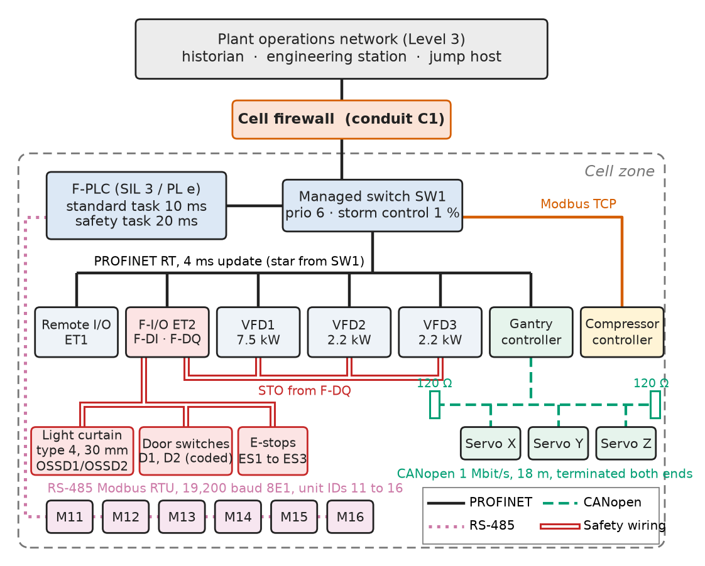
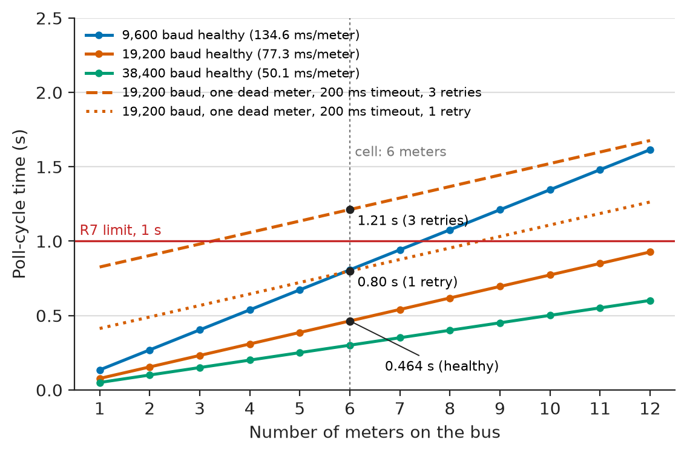
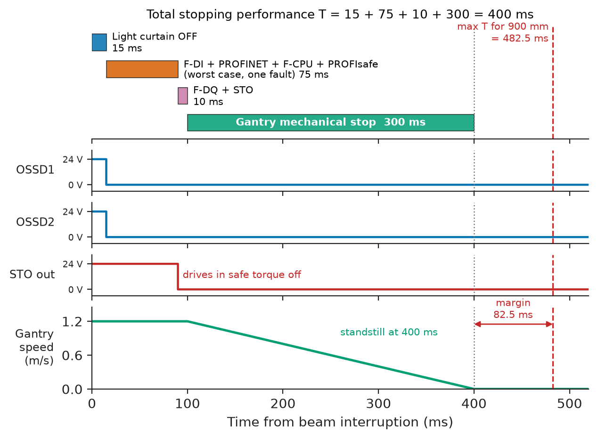
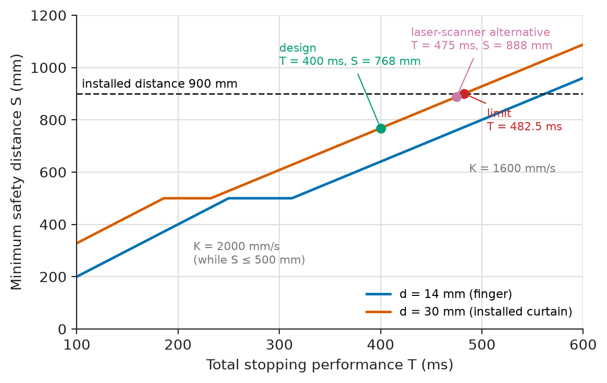
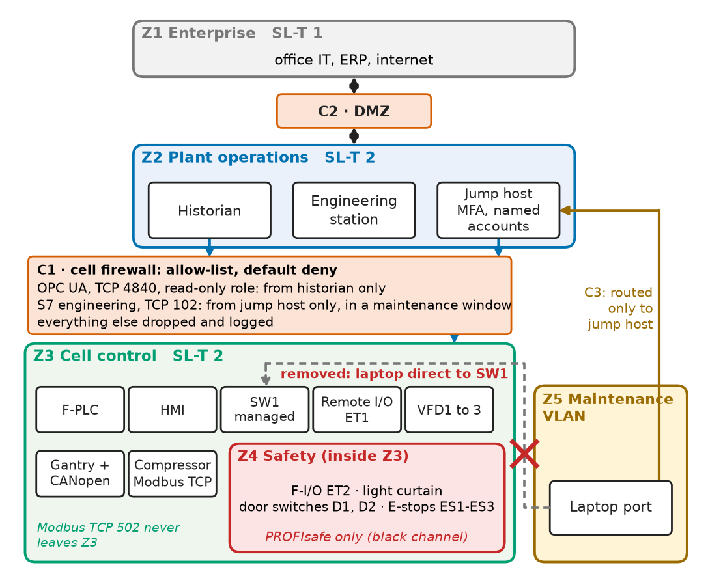

# Chapter 21 — Industrial Communication and Safety

*Part V · Industrial Automation*

An end-of-line palletising cell on a 24,000 bottle-per-hour beverage line passed its acceptance tests and then, in its third week, began stopping two or three times a shift: the safety PLC dropped the gantry and conveyors into safe torque off and logged a PROFIsafe watchdog timeout on the light-curtain input module. The light curtain was replaced twice. The real cause sat in the control cabinet: an unmanaged switch that the commissioning team had added for "one more port", and a maintenance laptop plugged into it that ran an inventory scan of the plant network every evening. The scan's broadcast and multicast traffic queued in front of the PROFINET frames in a switch that did not honour VLAN priorities; a few dozen full-length frames ahead of a cyclic frame delayed it by milliseconds, three missed cycles tripped the PROFINET watchdog, and the PROFIsafe layer, correctly, treated silence as danger. The cell had a communication design, a safety design and no security design, and the three met in one unmanaged switch.

> **How are the field networks of a machine (Modbus, CAN-based networks, industrial Ethernet) chosen, sized and diagnosed so that their timing is a number written down before commissioning?**
> **How is a safety function specified, built from certified parts, proven against ISO 13849-1, kept fail-safe over a network, and protected and documented so that it still works in year ten?**

| Concept | Engineering destination |
|---|---|
| Modbus RTU and TCP | Energy meters, compressor controllers, legacy instruments, gateways to building systems |
| CAN-based networks (CANopen, J1939) | Servo axes inside machines, mobile machinery, battery and EV subsystems |
| Industrial Ethernet (PROFINET, EtherNet/IP, EtherCAT) | PLC-to-drive and PLC-to-remote-I/O networks with millisecond cycles |
| Fieldbus fundamentals | Choosing cyclic versus acyclic traffic, topology, update time and watchdog for each device |
| Network diagnostics | Locating a bad cable, a duplicate address or a slow slave in minutes rather than shifts |
| Functional safety | Required performance level, architecture, MTTFd, diagnostic coverage, validation |
| Safety interlocks | Guard doors, light curtains, E-stops and their safety distances |
| Fail-safe behaviour | De-energise-to-trip, black-channel safety protocols, watchdogs and safe states |
| Industrial cybersecurity | IEC 62443 zones, conduits and security levels for a machine cell |
| Maintenance documentation | Network drawings, address plans, safety validation records, change control |

**Roadmap.** The reference cell and its requirements (21.1) → fieldbus fundamentals and timing budgets (21.2) → Modbus (21.3) → CAN-based networks (21.4) → industrial Ethernet (21.5) → network diagnostics (21.6) → functional safety fundamentals (21.7) → safety interlocks (21.8) → fail-safe behaviour (21.9) → industrial cybersecurity (21.10) → maintenance documentation (21.11) → verification and failure analysis (21.12).

---

## 21.1 The reference cell and its requirements

> **Boundary.** PLCs, remote I/O, HMIs, panels and commissioning are owned by [Chapter 18](18-industrial-control-architecture.md); the sensors and actuators on the network by [Chapter 19](19-industrial-sensors-and-actuators.md); starters, VFDs, interlocks and E-stop circuits by [Chapter 20](20-industrial-motor-control.md). This chapter connects them and makes them safe. The physical layers (RS-485, CAN, Ethernet PHYs) are in *Electronics and Computing*, [Ch. 26 §26.2, §26.5, §26.7](https://github.com/The-Studio-of-Sadiq/Electronics-and-Computing/blob/main/part-6-embedded-and-real-time-systems/26-embedded-interfaces.md); drive safety functions (STO, SS1) in *Electrical Energy and Machines*, [Ch. 10 §10.7](https://github.com/The-Studio-of-Sadiq/Electrical-Energy-and-Machines/blob/main/part-3-motor-drives/10-drive-system-fundamentals.md).

The running system is the palletising cell of the opening (Figure 21.1). A fail-safe PLC (an S7-1500F-class CPU certified to SIL 3 and PL e) runs a 10 ms standard task and a 20 ms safety task. Its PROFINET RT network, at a 4 ms update time, connects two remote I/O stations (one with fail-safe input and output modules), three VFDs for the infeed and pallet conveyors (7.5 kW and two 2.2 kW), a gantry controller whose three servo axes sit on a private CANopen network, and a managed cabinet switch. Six power meters on the cell's distribution board report over Modbus RTU at 19,200 baud; a screw compressor controller speaks Modbus TCP. A type 4 light curtain guards the pallet exit, two coded interlock switches guard the maintenance doors, and three E-stop buttons sit on the fence. Upward, an industrial firewall connects the cell to the plant's operations network, where the historian and the engineering station live.

<!-- FIGURE 21.1 | figures/ch21/fig-21-1-palletiser-cell-architecture.png | block-diagram | Communication and safety architecture of the palletising cell: PROFINET RT backbone, CANopen gantry network, Modbus RTU meter bus and the firewall to the plant network. | Content: top box Plant operations network (Level 3): historian, engineering station, jump host; below it a firewall labelled conduit C1. Cell zone: F-PLC (standard task 10 ms, safety task 20 ms) to managed switch SW1 (priority 6, storm control 1 percent). PROFINET RT 4 ms lines from SW1 to remote I/O ET1, fail-safe remote I/O ET2 (F-DI, F-DQ), VFD1 7.5 kW, VFD2 and VFD3 2.2 kW (STO wired from F-DQ), gantry controller, and a Modbus TCP line to the compressor. Gantry controller to CANopen 1 Mbit/s, 18 m, 120 ohm at both ends, servo X, Y, Z. RS-485 Modbus RTU 19200 8E1 chain of six meters, unit IDs 11 to 16. Safety devices on ET2: type 4 light curtain (30 mm, OSSD pair), door switches D1 D2, E-stops ES1 to ES3. Line styles: solid PROFINET, dashed CANopen, dotted RS-485, double line safety wiring. -->



*Figure 21.1 — Communication and safety architecture of the palletising cell: PROFINET RT backbone, CANopen gantry network, Modbus RTU meter bus and the firewall to the plant network.*

**Table 21.1 — Requirements of the palletising cell (communication and safety).**

| ID | Requirement | Target | Verification |
|---|---|---|---|
| R1 | SF1: light curtain at pallet exit stops gantry and conveyors | PL d (PLr from risk assessment) | ISO 13849-1 calculation; validation test per ISO 13849-2 |
| R2 | SF2: opening a maintenance door stops all hazardous motion | PL d | Calculation; fault-injection test |
| R3 | SF3: E-stop, stop category 1 (IEC 60204-1, ISO 13850) | PL d | Calculation; test of each button |
| R4 | Minimum safety distance of the light curtain (ISO 13855) | Not above installed 900 mm | Stopping-time measurement; calculation |
| R5 | PROFINET update time; no watchdog trip under stress | 4 ms; zero trips in 24 h with 1 % broadcast load injected | Load test with traffic generator |
| R6 | CANopen gantry cycle; bus load | 4 ms SYNC; load below 60 % worst case | Bus analyser, 1 h capture |
| R7 | Energy data from six meters | Every meter refreshed at least every 1 s; stale data flagged within 3 s | Poll-cycle log; disconnect test |
| R8 | Fault localisation | Any network fault located to device and port within 5 min from the HMI | Fault-injection drill |
| R9 | Security | Cell zone at SL 2 (IEC 62443-3-3); no IT-to-field traffic except through conduit C1 | Firewall rule review; port scan from Level 3 |
| R10 | Loss of any safety communication | Safe state within the configured watchdog time | Cable pull during motion |
| R11 | Documentation | As-built network drawing, address plan, safety validation report, program signatures | Document review at SAT |

The table follows the method of [Chapter 1](../part-1-engineering-design-methodology/01-from-requirement-to-working-system.md): every row has a number and a test.

---

## 21.2 Fieldbus fundamentals

### What every industrial network has to decide

All the networks of this chapter answer the same five questions, and choosing between them is mostly a matter of which answers a device's vendor has already given:

1. **Who speaks when**: master–slave polling (Modbus), priority arbitration (CAN), scheduled cyclic exchange (PROFINET, EtherNet/IP), or one frame through every slave (EtherCAT).
2. **Cyclic or acyclic**: process data travel cyclically at a fixed update time; parameters and diagnostics travel acyclically and must never steal the cyclic slots.
3. **Update time and watchdog**: the receiver declares a connection lost when the watchdog (a small multiple of the update time) expires, and drives its outputs to a defined substitute value.
4. **Topology**: line, star, ring or tree, and what one broken cable does to each.
5. **Addressing and description**: an address, device name or IP address, plus a description file (GSDML, EDS, ESI) that tells the engineering tool what the device exchanges.

**Table 21.2 — Industrial networks used in machine and process automation (typical values).**

| Network | Physical layer | Access | Typical cycle | Devices per segment |
|---|---|---|---|---|
| Modbus RTU | RS-485, 9.6–115.2 kbit/s | Master polls slaves | 100 ms–seconds | 32 unit loads (247 addresses) |
| Modbus TCP | Ethernet, 100 Mbit/s | Client–server | 10 ms–1 s | Limited by switch and server |
| CANopen | CAN, 125 kbit/s–1 Mbit/s | Priority arbitration | 1–10 ms | 127 node IDs |
| SAE J1939 | CAN, 250/500 kbit/s | Priority arbitration | 10–1000 ms | 253 addresses |
| PROFIBUS DP | RS-485, up to 12 Mbit/s | Token plus master–slave | 1–10 ms | 32 per segment, 126 total |
| PROFINET RT / IRT | Ethernet, 100 Mbit/s | Scheduled cyclic | 1–128 ms RT; 0.25–4 ms IRT | Hundreds |
| EtherNet/IP | Ethernet, 100 Mbit/s | Producer–consumer (CIP) | 1–100 ms | Hundreds |
| EtherCAT | Ethernet, 100 Mbit/s | One frame through all slaves | 50 µs–1 ms | 65,535 |

### The timing budget

A network's timing is designed, not discovered. A conveyor set-point travels from the PLC task (10 ms) over PROFINET (4 ms) to the VFD's control cycle (1–2 ms); because the three are not synchronised, its worst-case age is roughly the sum of the three periods. The budget writes this down for each loop and compares it with what the process needs.

> **Status of the principle: Worst-case age of asynchronously sampled data**
> *Derived.* When producer task, network and consumer task run on independent clocks, a change can just miss each of them, so the worst-case delay is the sum of the three periods plus the processing times; isochronous modes (PROFINET IRT, EtherCAT distributed clocks) remove the sum by aligning the cycles.

**Table 21.3 — Cyclic-communication budget of the reference cell.**

| Link | Requirement | Design value | Worst case | Margin |
|---|---|---|---|---|
| PLC task to VFD speed set-point | 50 ms (conveyor tracking) | 10 ms task + 4 ms PROFINET + 2 ms drive | 16 ms | 34 ms |
| PROFINET watchdog (3 × update time) | No trip under 1 % broadcast load | 12 ms | 4.3 ms measured cyclic gap (21.6) | 7.7 ms |
| CANopen gantry cycle at 1 Mbit/s | Bus load below 60 % | 4 ms SYNC, 6 PDOs | 21.9 %; 43.5 % if SYNC goes to 2 ms (21.4) | 38 points |
| Modbus RTU meter refresh | Each meter at least once per 1 s | 6 meters, 40 registers, 50 ms timeout, one retry | 464 ms; 500 ms with one dead meter (21.3) | 500 ms |
| Safety reaction SF1 (light curtain to standstill) | S not above 900 mm | 400 ms | S = 768 mm (21.8) | 132 mm, 82 ms |

---

## 21.3 Modbus

### The protocol in one paragraph

Modbus is request–response over a model of bits (coils, discrete inputs) and 16-bit registers (input, holding), accessed by public function codes. **Modbus RTU** runs on RS-485 with binary frames delimited by 3.5 character times of silence and a CRC-16; **Modbus TCP** wraps the same PDU in a 7-byte MBAP header on TCP port 502. It has no authentication, no data types beyond the 16-bit word and no standard register map, and those three gaps cause most of the integration work.

> **Boundary.** RS-485 levels, termination and failsafe biasing, and the 3.5-character frame gap, are in *Electronics and Computing*, [Ch. 26 §26.2](https://github.com/The-Studio-of-Sadiq/Electronics-and-Computing/blob/main/part-6-embedded-and-real-time-systems/26-embedded-interfaces.md); reflections on unterminated lines in *Circuits, Signals and Communications*, [Ch. 14](https://github.com/The-Studio-of-Sadiq/Circuits-Signals-and-Communications/blob/main/part-3-advanced-network-theory/14-transmission-lines.md). Endianness of multi-byte fields is in *Electronics and Computing*, [Ch. 11](https://github.com/The-Studio-of-Sadiq/Electronics-and-Computing/blob/main/part-3-digital-electronics/11-digital-number-systems.md).

### The register map is the interface

The cell's six meters (IEC 61557-12 class 0.5) publish their values as 32-bit floats across two registers, and two vendors can disagree on everything that matters: 0- or 1-based addresses, high word first ("ABCD") or second ("CDAB"), energy as a float in kWh or an integer in Wh. The integrator writes one register map per device type and tests it against a known load. The listing builds a request, checks a reply's CRC and decodes the floats in both word orders, the commonest error on site:

```python
# Modbus RTU: build a read-holding-registers request and decode a reply
import struct

def crc16_modbus(frame: bytes) -> int:
    crc = 0xFFFF
    for b in frame:
        crc ^= b
        for _ in range(8):
            crc = (crc >> 1) ^ 0xA001 if crc & 1 else crc >> 1
    return crc

def read_request(unit, start, count):
    pdu = struct.pack(">BBHH", unit, 0x03, start, count)
    return pdu + struct.pack("<H", crc16_modbus(pdu))       # CRC low byte first

def decode_floats(reply, swap_words=False):
    if crc16_modbus(reply) != 0:                             # CRC over frame+CRC is 0
        raise ValueError("CRC error")
    unit, fc, n = reply[0], reply[1], reply[2]
    if fc & 0x80:
        raise ValueError(f"exception code {reply[2]:02X} from unit {unit}")
    data = reply[3:3 + n]
    words = [data[i:i + 2] for i in range(0, n, 2)]
    if swap_words:                                           # "CDAB" meters
        words = [w for pair in zip(words[1::2], words[0::2]) for w in pair]
    return struct.unpack(">" + "f" * (n // 4), b"".join(words))

req = read_request(7, 0x0000, 4)             # L1 voltage and current, float32 each
print("request :", req.hex(" "))
body = struct.pack(">BBB", 7, 0x03, 8) + struct.pack(">ff", 231.4, 18.75)
reply = body + struct.pack("<H", crc16_modbus(body))
print("reply   :", reply.hex(" "))
print("ABCD    :", [round(x, 2) for x in decode_floats(reply)])
print("CDAB    :", [f"{x:.3g}" for x in decode_floats(reply, swap_words=True)])
```

```text
request : 07 03 00 00 00 04 44 6f
reply   : 07 03 08 43 67 66 66 41 96 00 00 2c 62
ABCD    : [231.4, 18.75]
CDAB    : ['2.72e+23', '2.35e-41']
```

The wrong word order does not produce an error; it produces a number, absurd here but plausible for some values, which is why commissioning compares each meter with a clamp meter on a known load.

### Poll-cycle budget

A Modbus RTU master asks one slave at a time, so the refresh period of every device is the sum of all transactions on the bus. One transaction costs the request, a 3.5-character gap, the slave's turnaround time (5–50 ms for meters, set by their firmware, not by the baud rate), the response and another gap. With 8E1 framing a character is 11 bits.

**Worked example — Is 19,200 baud enough for six meters?** At 19,200 baud a character takes $11/19\,200=0.573$ ms. Reading 40 registers needs an 8-byte request (4.58 ms), an 85-byte response (48.7 ms), two gaps of 3.5 characters (2.0 ms each) and a measured turnaround of 20 ms: 77.3 ms per transaction. Six meters take

$$
T_\text{poll}=6\times77.3\ \mathrm{ms}=464\ \mathrm{ms}
$$

against the 1 s of R7, a margin of 536 ms. Now one meter dies (its breaker is opened for maintenance). The master waits for a 200 ms timeout before each retry; with the vendor's default of three retries, the dead meter costs $4\times(200+4.6+2.0)=826$ ms and the cycle grows to 1.21 s, breaking R7 for the five healthy meters. With one retry and the dead unit then skipped for that cycle, the cycle is 800 ms; with the timeout also cut to 50 ms, 500 ms. At 9,600 baud the healthy cycle alone would be 808 ms. Figure 21.2 plots the cycle against the number of meters.

<!-- FIGURE 21.2 | figures/ch21/fig-21-2-modbus-poll-cycle.png | plot | Modbus RTU poll-cycle time against the number of meters for three baud rates, healthy and with one meter not responding. | Content: x-axis number of meters 1 to 12; y-axis poll-cycle time 0 to 2.5 s. Model: 8E1, 40-register read, 20 ms turnaround, 3.5-character gaps (fixed 1.75 ms at 38400 baud). Solid healthy lines: 9600 baud (134.6 ms per meter), 19200 baud (77.3 ms per meter, 0.464 s at 6), 38400 baud (50.1 ms per meter). Dashed: 19200 baud with one dead meter, 3 retries, 200 ms timeout (1.21 s at 6). Dotted: same with 1 retry (0.80 s at 6). Horizontal line at 1.0 s labelled R7. -->



*Figure 21.2 — Modbus RTU poll-cycle time against the number of meters for three baud rates, healthy and with one meter not responding.*

The fixes are cheap: one retry instead of three, a timeout set from the measured worst-case turnaround (50 ms) rather than the default, a staleness flag per device, and a second RS-485 port rather than a higher baud rate if the bus grows. The PLC side is a small function block in IEC 61131-3 Structured Text, here written against a generic vendor Modbus client block (`MB_RTU_READ` is illustrative; Siemens, Beckhoff and Codesys libraries differ in names, not in shape):

```text
TYPE ST_Meter : STRUCT
    Unit : USINT; Regs : ARRAY[0..39] OF WORD; Errors : UDINT;
END_STRUCT; END_TYPE

FUNCTION_BLOCK FB_MeterPoller
VAR_INPUT    Enable : BOOL; END_VAR
VAR_IN_OUT   Meter : ARRAY[1..6] OF ST_Meter; END_VAR
VAR_OUTPUT   Stale : ARRAY[1..6] OF BOOL; CommFault : ARRAY[1..6] OF BOOL; END_VAR
VAR
    MbRead : MB_RTU_READ;              (* vendor client block, illustrative *)
    Age    : ARRAY[1..6] OF TON;
    Idx    : INT := 1;
    Tries  : INT := 0;
    Req, Gap : BOOL;
    i      : INT;
END_VAR
VAR CONSTANT MAX_TRIES : INT := 2; END_VAR   (* first attempt plus one retry *)

IF Gap THEN Gap := FALSE;              (* one scan with REQ low between jobs *)
ELSIF Enable AND NOT Req THEN Req := TRUE;
END_IF;
MbRead(REQ := Req, UNIT := Meter[Idx].Unit, START := 16#0000, COUNT := 40,
       TIMEOUT := T#50MS, DATA := Meter[Idx].Regs);
IF MbRead.DONE THEN
    Age[Idx](IN := FALSE);             (* fresh data restarts the age timer *)
    CommFault[Idx] := FALSE; Tries := 0;
    Req := FALSE; Gap := TRUE; Idx := Idx MOD 6 + 1;
ELSIF MbRead.ERROR THEN
    Meter[Idx].Errors := Meter[Idx].Errors + 1; Tries := Tries + 1;
    Req := FALSE; Gap := TRUE;
    IF Tries >= MAX_TRIES THEN         (* give up on this unit for this cycle *)
        CommFault[Idx] := TRUE; Tries := 0; Idx := Idx MOD 6 + 1;
    END_IF;
END_IF;
FOR i := 1 TO 6 DO
    Age[i](IN := TRUE, PT := T#3S);
    Stale[i] := Age[i].Q;              (* R7: stale flagged within 3 s *)
END_FOR;
END_FUNCTION_BLOCK
```

The HMI shows the per-device error counter (R8): a slowly rising count without `CommFault` means a marginal cable or termination; `CommFault` means dead or misaddressed.

---

## 21.4 CAN-based industrial networks

### CANopen and J1939

CAN gives arbitration, error confinement and an 8-byte (CAN FD: 64-byte) frame; the application layer gives the frames meaning. **CANopen** (EN 50325-4, CiA 301) organises each device around an **object dictionary** (16-bit index, 8-bit subindex), exchanges process data in **PDOs** (up to 8 bytes, no overhead, triggered by SYNC, timer or change of state), parameters through confirmed **SDOs**, and manages nodes with **NMT** commands and **heartbeats**. Profiles fix the dictionary per device class: CiA 402 for drives (control word 0x6040, status word 0x6041), CiA 401 for I/O. **SAE J1939** does the same for vehicles and mobile machinery with 29-bit identifiers carrying a parameter-group number and source address.

> **Boundary.** The CAN physical layer, arbitration, stuffing, error states and bit timing, and the frame-length and bus-load formulas used below, are in *Electronics and Computing*, [Ch. 26 §26.5](https://github.com/The-Studio-of-Sadiq/Electronics-and-Computing/blob/main/part-6-embedded-and-real-time-systems/26-embedded-interfaces.md); fixed-priority response-time analysis of CAN in [Ch. 27](https://github.com/The-Studio-of-Sadiq/Electronics-and-Computing/blob/main/part-6-embedded-and-real-time-systems/27-real-time-computing.md).

### Sizing the gantry network

The gantry's three servo drives (CiA 402, cyclic synchronous position mode) each receive one RPDO (control word plus target position, 6–8 bytes) and send one TPDO (status word plus actual position) every SYNC period, and each node sends a 1-byte heartbeat every 100 ms.

**Worked example — Bus load at 4 ms and at 2 ms SYNC.** With worst-case bit stuffing a classical frame with 8 data bytes is 135 bits, a 0-byte SYNC is 55 bits and a 1-byte heartbeat 65 bits (Book 4 §26.5). Per 4 ms SYNC period the bus carries one SYNC and six 8-byte PDOs, plus the heartbeats spread over 100 ms:

$$
\text{load}=\frac{55/0.004+6\times135/0.004+4\times65/0.1}{500\,000}=43.8\ \%
$$

at 500 kbit/s, inside the 60 % limit of R6. The motion engineer then asks for a 2 ms SYNC to stiffen the position loop: the same arithmetic gives 87.0 %, unusable once an SDO download or an error retransmission lands. The gantry's bus is 18 m long, so 1 Mbit/s is legal (about 40 m at 1 Mbit/s with typical transceivers), and at 1 Mbit/s the 2 ms cycle loads the bus to 43.5 %. The project chose 1 Mbit/s and kept a 4 ms SYNC (21.9 % load) until tuning showed whether 2 ms was needed, which bought headroom for a fourth axis.

> **Status of the principle: Bus-load ceiling for CAN networks**
> *Empirical.* Integrators keep the worst-case load of a CAN network below about 50–70 % so that error frames, retransmissions and acyclic SDO traffic do not push low-priority messages past their deadlines; a response-time analysis replaces the rule when deadlines are tight.

A gateway to PROFINET maps the PDOs into the PLC's I/O image but hides the CAN error counters and heartbeat losses unless its diagnostic objects are mapped too; in the reference cell they are, which is what makes R8 testable on the CAN side.

---

## 21.5 Industrial Ethernet

### Three ways to make Ethernet deterministic

Standard Ethernet with TCP/IP is fast but not deterministic: frames queue in switches behind other traffic. Industrial Ethernet takes one of three routes:

- **Prioritised standard Ethernet** (PROFINET RT, EtherNet/IP, Modbus TCP): cyclic frames carry an IEEE 802.1Q priority (6 for PROFINET) that managed switches honour; 1–10 ms cycles, jitter set by the switches.
- **Scheduled Ethernet** (PROFINET IRT, TSN with IEEE 802.1Qbv): reserved time windows give sub-microsecond jitter at 250 µs–1 ms; every switch needs hardware support.
- **Processing on the fly** (EtherCAT): one frame passes through every slave, which reads and inserts its data in hardware; a hundred axes update in tens of microseconds, on a segment that is not ordinary switched Ethernet.

**Table 21.4 — Selecting the cell's backbone network.**

| Criterion | PROFINET RT | EtherNet/IP | EtherCAT | Modbus TCP |
|---|---|---|---|---|
| Fits the chosen F-PLC | Native | Needs a gateway | Needs a gateway | Native, but no safety |
| Cycle needed (4 ms) | Yes, 1–4 ms routine | Yes | Yes, far better | Polled, about 10–50 ms |
| Safety protocol | PROFIsafe | CIP Safety | FSoE | None |
| VFDs and remote I/O available | All three vendors short-listed | Two of three | Two of three | All, but polled |
| Decision | **Chosen** | Rejected (gateway for safety) | Used inside gantry alternative, rejected (vendor set) | Kept for compressor only |

PROFINET was chosen because the safety PLC, the safety protocol and all the field devices speak it natively, so the safety function crosses no gateway; EtherCAT would have been the choice for a 32-axis machine whose motion needed 250 µs cycles.

### Bandwidth is not the constraint; queueing is

Eight PROFINET devices exchanging frames of about 100 byte times in each direction every 4 ms use $8\times2\times100\times8/0.004=3.2$ Mbit/s, about 3 % of a 100 Mbit/s link. The cell's network does not fail on bandwidth. It fails, as in the opening, on queueing.

**Worked example — How many frames can stand in front of a PROFINET frame?** A full-length Ethernet frame (1500 bytes of payload) occupies 1538 byte times including preamble and interframe gap, $1538\times8/10^{8}=123$ µs at 100 Mbit/s. PROFINET declares a device's connection lost after three missed update cycles, $3\times4=12$ ms. A switch that does not prioritise therefore needs only $12/0.123\approx98$ full-length frames queued ahead of the cyclic frames on one port, or a series of shorter bursts across several cycles, to trip the watchdog; a laptop's discovery scan or a misconfigured camera stream produces that in a moment. Forty queued frames already delay one frame by 4.9 ms, a full update cycle. A managed switch with priority queuing, storm control at 1 % of port bandwidth for broadcast and unknown multicast, and the maintenance port on a separate VLAN reduces the queue in front of a priority-6 frame to at most the one frame already being transmitted, 123 µs.

> **Status of the principle: Store-and-forward queueing delay**
> *Fundamental.* A frame cannot leave a switch port until the frames ahead of it in the same queue have been serialised at the link rate, so the delay is the queued bytes divided by the link rate; priority queuing bounds it by one maximum-length frame per hop, which is why PROFINET line depth and switch class are planned, not left to chance.

### Topology and redundancy

A line through the devices' integrated switches saves cable but makes each device a single point of failure for everything downstream. The cell uses a star from the managed switch, with the drives in a short line. A ring with the Media Redundancy Protocol (IEC 62439-2) recovers from one break within 200 ms in its common profile, longer than a 12 ms watchdog, so stations behind the break may still drop once; bumpless redundancy (MRPD) is used where every cycle counts.

---

## 21.6 Network diagnostics

### Instruments and counters

Table 21.5 is the troubleshooting card left in the cell's cabinet.

**Table 21.5 — Symptom, likely cause and first test.**

| Symptom | Likely causes | First test |
|---|---|---|
| Modbus timeouts on one meter | Wrong unit ID, baud or parity; meter turnaround longer than timeout | Read the device's settings; scope the bus and measure reply delay |
| Modbus CRC errors on far meters | Missing termination, no failsafe bias, stub too long, shield grounded at both ends near a VFD | 120 Ω termination at both ends; idle differential above 200 mV |
| CAN error frames, nodes go error-passive | Termination wrong (measure 60 Ω between CAN_H and CAN_L with power off), bit-timing mismatch, ground offset | Ohmmeter; bus analyser error-frame count per minute |
| CAN node bus-off after power-up | Two nodes with the same ID; wrong bit rate | Heartbeat list; analyser |
| PROFINET device lost, intermittent | Damaged connector, cable beside a motor lead, queueing in an unmanaged switch | Port statistics: CRC errors and discards per port; LLDP topology |
| All devices lost at once | Broadcast storm, loop without spanning tree, switch power | Switch log; storm-control counters |

The managed switch is the most useful instrument on an Ethernet network: per-port counters separate a physical problem (CRC errors rising on one port) from congestion (egress discards with zero CRC errors), LLDP topology shows a cable in the wrong port at power-up, and port mirroring into a protocol analyser shows what was on the wire.

**Worked example — Locating the opening's fault.** The trips clustered between 19:00 and 19:35. The managed switch showed zero CRC errors on all ports, ruling out cabling; the unmanaged switch had no counters, so a port mirror on the uplink captured an evening: at 19:01:58 a laptop on the unmanaged switch began an ARP sweep and SSDP and mDNS discovery, about 2,000 broadcast and multicast frames per second for 40 s, with bursts of maximum-length frames. PROFINET cyclic frames from the remote I/O station behind the unmanaged switch showed gaps of up to 14 ms, more than the 12 ms watchdog. The fix removed the unmanaged switch, moved the maintenance port to its own VLAN behind the firewall (Section 21.10) and enabled storm control. A 24-hour test with a traffic generator injecting 1 % broadcast load (R5) then showed a worst-case cyclic gap of 4.3 ms and no watchdog trips.

> **Status of the principle: Counters before oscilloscopes**
> *Empirical.* In plant experience most intermittent network faults are located faster from per-port error and discard counters and topology comparison than from waveform measurement; the oscilloscope remains the tool for the RS-485 and CAN physical layers, where devices rarely keep counters.

---

## 21.7 Functional safety fundamentals

> **Boundary.** E-stop circuits, contactor interlocks and the stop categories of IEC 60204-1 at the level of one motor are in [Chapter 20](20-industrial-motor-control.md); STO and SS1 inside the drive in *Electrical Energy and Machines*, [Ch. 10 §10.7](https://github.com/The-Studio-of-Sadiq/Electrical-Energy-and-Machines/blob/main/part-3-motor-drives/10-drive-system-fundamentals.md); isolation and lockout for electrical work in [Ch. 29 §29.6](https://github.com/The-Studio-of-Sadiq/Electrical-Energy-and-Machines/blob/main/part-8-electrical-safety-and-engineering-practice/29-electrical-safety.md). The probability arithmetic used below is in *The Mathematics Universe*, [Ch. 19](https://github.com/The-Studio-of-Sadiq/engineering-mathematics/blob/main/part-6-probability-statistics/19-probability.md).

### From hazard to required performance level

Functional safety on machines runs through **ISO 12100** (risk assessment and reduction), **ISO 13849-1** (safety-related control parts, rated PL a–e), **IEC 62061** (the same in SIL 1–3) and, underneath, **IEC 61508** for the electronics and software; the process industry uses IEC 61511. The risk graph of ISO 13849-1 sets the required level from severity (S1 slight, S2 serious), exposure (F1 seldom, F2 frequent) and possibility of avoidance (P1 possible, P2 scarcely possible):

**Table 21.6 — Safety functions of the cell and their required performance levels.**

| Function | Hazard | S, F, P | PLr | Stop |
|---|---|---|---|---|
| SF1 light curtain at pallet exit | Crushing by gantry and pallet conveyor | S2, F1, P2 | d | Category 1 (ramp, then STO) |
| SF2 maintenance doors D1, D2 | Crushing and impact inside the fence | S2, F2, P1 | d | Category 1, guard locking not needed if S is met |
| SF3 E-stop ES1–ES3 | Complementary measure (ISO 13850) | — | d (set equal to the other functions) | Category 1 |
| SF4 safely limited speed in setup mode | Gantry moving with door open, hold-to-run | S2, F1, P1 | c | Monitored by the drive (SLS) |

### What determines the PL achieved

ISO 13849-1 rates a function from its **Category** (architecture; Category 3 is two channels, so a single fault does not lose the function, with most faults detected), the **MTTFd** of each channel (low 3–10 years, medium 10–30, high 30–100), the diagnostic coverage **DCavg** (low 60–90 %, medium 90–99 %, high at least 99 %), measures against **common-cause failure** (at least 65 of 100 points) and the software process. It turns these into an average probability of dangerous failure per hour, PFHd, and a PL: PL d is $10^{-7}\le\mathrm{PFH_d}<10^{-6}$ per hour, PL e is $10^{-8}\le\mathrm{PFH_d}<10^{-7}$.

Certified subsystems (a type 4 light curtain, an F-CPU, an F-I/O module, a drive's STO) come with their PL and PFHd from the manufacturer; the integrator adds them up. Electromechanical parts come with a $B_{10d}$, the number of operations at which 10 % of a sample fails dangerously, and the integrator converts it to an MTTFd for the actual duty:

$$
\mathrm{MTTF_d}=\frac{B_{10d}}{0.1\,n_\text{op}},\qquad
\frac{1}{\mathrm{MTTF_{d,channel}}}=\sum_i\frac{1}{\mathrm{MTTF_{d,i}}}
$$

> **Status of the principle: MTTFd from B10d and series combination of channel elements**
> *Derived.* Follows from a constant-failure-rate (exponential) model of each element, in which failure rates in series add; the $B_{10d}$ conversion assumes the wear-out of electromechanical parts can be represented by an equivalent constant rate over the mission time, which ISO 13849-1 limits by requiring replacement before $T_{10d}=B_{10d}/n_\text{op}$.

**Worked example — PL of SF2, the door interlock with contactors.** Door D2 is opened six times an hour, 16 hours a day, 220 days a year. Each of two channels is a coded tongue interlock contact ($B_{10d}=2\times10^{6}$), an F-DI channel (MTTFd 1,000 years from the vendor) and a contactor in the gantry brake circuit ($B_{10d}=1.3\times10^{6}$ at AC-3 rated load). The listing does the arithmetic and, for SF1, sums the vendors' PFHd values:

```python
# SF2 guard-door channel MTTFd (ISO 13849-1 B10d method) and SF1 PFHd sum
days, hours, cycles_per_h = 220, 16, 6
n_op = days * hours * cycles_per_h                    # operations per year
def mttfd_from_b10d(b10d, n_op):
    return b10d / (0.1 * n_op)                        # years
switch = mttfd_from_b10d(2.0e6, n_op)                 # coded tongue interlock
contactor = mttfd_from_b10d(1.3e6, n_op)              # AC-3 contactor at rated load
f_input = 1000.0                                       # F-DI channel, from vendor data (years)
channel = 1 / (1 / switch + 1 / contactor + 1 / f_input)
print(f"n_op = {n_op} /year; MTTFd switch {switch:.0f} y, contactor {contactor:.0f} y, "
      f"channel {channel:.0f} y -> capped at {min(channel, 100):.0f} y (high)")
t10 = 1.3e6 / n_op
print(f"contactor reaches B10d after {t10:.0f} years")

pfh = {"light curtain": 1.2e-8, "F-DI": 1.0e-9, "F-CPU": 2.0e-9, "F-DQ": 1.0e-9,
       "drive STO x2": 2 * 3.0e-9}
print(f"SF1 PFHd sum = {sum(pfh.values()):.2e} per hour")
```

```text
n_op = 21120 /year; MTTFd switch 947 y, contactor 616 y, channel 272 y -> capped at 100 y (high)
contactor reaches B10d after 62 years
SF1 PFHd sum = 2.20e-08 per hour
```

Each channel's MTTFd is capped at 100 years for Category 3, so the channels rate "high". The two channels are cross-compared in the F-PLC and the contactors' mirror contacts are read back (external device monitoring), which together give a DCavg in the medium band (90–99 %); CCF measures score 75 points. Category 3, MTTFd high and DCavg medium land in the PL e region of the standard's simplified bar chart, one level above the PLr d of SF2, and $T_{10d}=62$ years exceeds the 20-year mission time, so no scheduled contactor replacement is needed at this duty. SF1, built entirely from certified subsystems, sums to $\mathrm{PFH_d}=2.2\times10^{-8}$ per hour, PL e by probability, and no subsystem is rated below PL e. The SISTEMA tool (the IFA's free implementation of ISO 13849-1) produces the formal report for R1–R3.

**Table 21.7 — Component selection for the safety chain.**

| Function block | Option A | Option B | Option C | Choice and why |
|---|---|---|---|---|
| Pallet-exit sensing | Type 4 light curtain, 30 mm, PL e, PFHd $1.2\times10^{-8}$, 15 ms | Type 2 light curtain, PL c max | Safety laser scanner, PL d, 60–100 ms response | A: PL d needs type 4 or type 3 class; scanner response time costs about 120 mm of distance |
| Logic | Safety relays per function | Configurable safety controller | F-PLC with PROFIsafe | C: four functions, muting and SLS mode selection outgrow relays; one program, one validation |
| Door switches | Uncoded tongue switch | Coded interlock (type 2 tongue or type 4 RFID), ISO 14119 | Guard locking (solenoid) | B, type 2 coded tongue: defeat resistance; locking unnecessary because stopping is faster than access |
| Drive shutdown | Line contactor per drive | Drive STO via F-DQ, PL e | STO via PROFIsafe telegram | B: no contactor wear, fast restart; C kept as a later option |

---

## 21.8 Safety interlocks

### Interlocking guards

ISO 14119 classifies interlocking devices from type 1 (uncoded mechanical) to type 4 (coded non-contact) and requires measures against defeat in proportion to the motivation to defeat them: a door opened twenty times an hour to clear jams will be defeated with a spare actuator unless jam clearing is designed in (the setup mode SF4) and the switch is uniquely coded. Guard locking is needed only when the stopping time exceeds the time a person needs to reach the hazard after the door starts to open.

### Light curtains and the safety distance

An electro-sensitive protective device (IEC 61496) must be far enough from the hazard that the machine stops before a person who breaks the beams can reach it. ISO 13855 gives the minimum distance for a vertical curtain with resolution $d$ up to 40 mm:

$$
S=K\,T+8\,(d-14)
$$

with $T$ the total stopping performance from beam interruption to standstill, $K=2000$ mm/s if the result is at most 500 mm, otherwise $K=1600$ mm/s with a minimum of 500 mm.

> **Status of the principle: Approach-speed model of ISO 13855**
> *Empirical.* The approach speeds of 2.0 and 1.6 m/s and the reach-through allowance $8(d-14)$ are set from measured human body and hand movements; they are the standard's agreed values, not a physical law, and apply to the device geometries the standard covers.

The stopping performance is a chain (Figure 21.3), and every link must be the worst case: the light curtain's OFF response time, the F-input module and PROFIsafe transfer and F-CPU cycle in the worst case *with one fault*, which the vendor's response-time calculator gives as the PROFIsafe watchdog-governed figure, the F-output and the drive's STO response, and the mechanical stopping time measured on the machine with a stopping-time meter at maximum speed and load.

<!-- FIGURE 21.3 | figures/ch21/fig-21-3-sf1-response-chain.png | timing-diagram | Stopping-performance chain of safety function SF1 from beam interruption to gantry standstill. | Content: time axis 0 to 500 ms. Bars: light curtain OFF 0 to 15 ms; F-DI, PROFINET, F-CPU and PROFIsafe worst case with one fault 15 to 90 ms; F-DQ and STO 90 to 100 ms; gantry mechanical stop 100 to 400 ms. Traces below: OSSD1 and OSSD2 falling at 15 ms; STO output falling at 90 ms; gantry speed ramp 1.2 m/s at 100 ms to zero at 400 ms. Dashed line at 482.5 ms labelled maximum T for 900 mm; margin arrow 82.5 ms. -->



*Figure 21.3 — Stopping-performance chain of safety function SF1 from beam interruption to gantry standstill.*

**Worked example — Is the installed 900 mm enough?** With $T=15+75+10+300=400$ ms and $d=30$ mm, $C=8(30-14)=128$ mm. The trial $S=2000\times0.4+128=928$ mm exceeds 500 mm, so $K=1600$ mm/s and

$$
S=1600\times0.400+128=768\ \mathrm{mm}
$$

The curtain is mounted 900 mm from the nearest hazard, a margin of 132 mm, which corresponds to a stopping-performance margin of $(900-128)/1600-0.400=82.5$ ms. Brake wear lengthens the stopping time, so the maintenance plan (Section 21.11) measures it every six months with a limit of 360 ms, keeping 22.5 ms in hand. Figure 21.4 shows how fast the margin disappears with stopping time: a 14 mm finger-resolution curtain would have allowed a shorter distance ($S=1600\times0.4=640$ mm), and a safety laser scanner with a 90 ms response (instead of 15 ms) would have needed 888 mm, leaving no room for brake wear.

<!-- FIGURE 21.4 | figures/ch21/fig-21-4-safety-distance.png | plot | Minimum safety distance of a vertical light curtain against total stopping performance, for 14 mm and 30 mm resolution, with the cell's installed distance. | Content: x-axis T 100 to 600 ms; y-axis S 0 to 1200 mm. Curve d = 14 mm: S = 2000 T up to 500 mm, then 1600 T (minimum 500 mm). Curve d = 30 mm: same plus 128 mm. Horizontal line 900 mm labelled installed. Points: T 400 ms, S 768 mm (design); T 482.5 ms, S 900 mm (limit); T 475 ms, S 888 mm (laser-scanner alternative). -->



*Figure 21.4 — Minimum safety distance of a vertical light curtain against total stopping performance, for 14 mm and 30 mm resolution, with the cell's installed distance.*

### Muting at the pallet exit

Pallets leave through the curtain by **muting** (IEC 62046): the curtain is suspended only while sensors in a defined sequence confirm a pallet, within a 4 s window. The muting logic is part of SF1 and inherits its PL, and sensor geometry that a hand can trigger defeats it, so the geometry is part of the validation.

---

## 21.9 Fail-safe behaviour

### De-energise to trip

Every safety function in the cell is built so that the absence of energy, signal or message produces the safe state: light-curtain OSSD outputs fall to 0 V on interruption, power loss or internal fault; interlock contacts are normally closed and positively opened (IEC 60947-5-1 Annex K); STO inputs need 24 V to *enable* torque. A broken wire stops the machine instead of disabling the protection. Where it is cheap the rule extends to standard control: a VFD ramps to stop on PROFINET loss rather than holding its last speed.

> **Status of the principle: De-energise-to-trip**
> *Fundamental.* The most probable failures of wires, contacts, power supplies and messages are loss of signal; making loss of signal the safe state turns those failures into stops rather than lost protection. Where stopping is itself dangerous (a hoist, a press holding a load), the safe state must be analysed rather than assumed.

### Black-channel safety protocols

The safety PLC does not trust the network. **PROFIsafe** (IEC 61784-3-3), like CIP Safety and FSoE, is a *black-channel* protocol: safety data travel inside ordinary frames through ordinary switches, and the safety layer at each end detects every way a network can corrupt a message — a consecutive number against repetition, loss and reordering, a CRC over the data *and* the unique F-address against corruption and misrouting, and a watchdog time (F_WD_Time) against delay. Switches and cables therefore need no safety rating.

The watchdog has two failure modes: too short, and normal jitter trips the cell; too long, and the reaction time and the safety distance grow. The cell's F_WD_Time of 50 ms is about twice the measured worst-case round trip, and the 75 ms reaction time used in Section 21.8 comes from the vendor's calculator with that setting.

### Safe states and restart

After SF1 or SF2 trips, the drives sit in STO with brakes applied; restart needs the guard closed *and* a manual reset from a position with a view of the hazard zone (ISO 13849-1 §5.2.2), and passivated F-I/O modules need an acknowledgement, so a flapping cable cannot cycle the machine. The standard part has fail-safe responses too: a stale meter value is flagged, not replaced by zero, and a lost CANopen heartbeat puts the gantry into a quick stop.

---

## 21.10 Industrial cybersecurity

> **Boundary.** The principles of OT security (availability first, defence in depth, the Purdue model) and the grid-side standards (IEC 62351, NERC CIP) are in *Electrical Energy and Machines*, [Ch. 26 §26.9](https://github.com/The-Studio-of-Sadiq/Electrical-Energy-and-Machines/blob/main/part-7-power-quality-and-grid-modernization/26-smart-grids.md). Device-level security (secure boot, signed firmware, credentials on IoT devices) is in [Chapter 11](../part-3-embedded-and-connected-systems/11-iot-systems.md). This section applies IEC 62443 to one machine cell.

### Zones, conduits and security levels

For the system integrator IEC 62443 (parts 3-2 and 3-3) prescribes a method: divide the system into **zones** of assets with common security requirements, connect zones only through **conduits** whose traffic is defined and controlled, and assign each zone a target **security level** SL-T from 1 (protection against casual or accidental violation) to 4 (against state-level attackers). SL 2 means protection against intentional violation by simple means with low resources and generic skills, which is the usual target for a production cell (R9). The seven foundational requirements of 62443-3-3 (from identification and authentication to resource availability) are then met by system requirements at that level.

<!-- FIGURE 21.5 | figures/ch21/fig-21-5-zones-and-conduits.png | block-diagram | IEC 62443 zones and conduits of the palletising cell after the redesign. | Content: zones Z1 Enterprise (SL-T 1), Z2 Plant operations (SL-T 2: historian, engineering station, jump host with MFA), Z3 Cell control (SL-T 2: F-PLC, HMI, SW1, remote I/O, VFDs, gantry, compressor), Z4 Safety inside Z3 (F-I/O and safety devices, PROFIsafe only), Z5 Maintenance VLAN (laptop port, routed only to jump host). Conduits: C1 Z2 to Z3 through cell firewall (OPC UA 4840 read-only from historian; engineering TCP 102 from jump host only); C2 Z1 to Z2 through DMZ; C3 Z5 to jump host. Crossed-out arrow from laptop directly to SW1 labelled removed. -->



*Figure 21.5 — IEC 62443 zones and conduits of the palletising cell after the redesign.*

### What the cell's design changed

Figure 21.5 shows the cell after the redesign. The changes were unglamorous:

- **Restricted data flow.** A cell firewall implements conduit C1 with an allow-list: the historian may read the PLC over OPC UA (TCP 4840) with a certificate and a read-only role; the engineering protocol (S7 over TCP 102) is accepted only from the jump host, and only while a maintenance window is open. Everything else is dropped and logged. Modbus TCP (port 502), which has no authentication at all, never leaves the cell zone.
- **No unmanaged infrastructure.** Managed switches only, unused ports disabled, maintenance port on its own VLAN.
- **Hardening and authentication.** PLC write access protected, web servers disabled, firmware versions recorded; named accounts with multi-factor authentication on the jump host, vendor remote access only through it.
- **Recovery.** Offline, versioned backups of every configuration, tested by restoring to a spare CPU at SAT.

**Worked example — What a port scan tells the auditor.** After the redesign a scan from Level 3 against the cell must find one host, the firewall, with one open port, 4840, reachable only from the historian (R9). Before the redesign it found 14 hosts and 31 open TCP ports, including two drive web servers with default passwords and Modbus TCP on the compressor. Thirty-one exposed services reduced to one is the measurable part of SL 2 here, and the scan is rerun after every change.

> **Status of the principle: Allow-list conduits**
> *Empirical.* Industrial incident analyses repeatedly show attackers and malware moving laterally through flat networks and unauthenticated protocols; a default-deny conduit with an explicit list of flows removes most of those paths at little cost to availability, which is why IEC 62443 builds its system requirements around zones and conduits.

Security and safety meet in one rule: a security measure must never trip or disable a safety function, so firewalls stay out of the PROFIsafe path and F-PLC firmware updates are treated as safety changes that require revalidation.

---

## 21.11 Maintenance documentation

The cell is maintained for 15–20 years by people who did not build it. Each document below is part of the handover (R11), under the revision control of [Chapter 5](../part-1-engineering-design-methodology/05-engineering-documentation.md).

**Table 21.8 — Maintenance documentation of the cell.**

| Document | Content | Used when |
|---|---|---|
| Network drawing (as built) | Every device, port-to-port cable, switch port, VLAN, topology as LLDP sees it | Replacing a device or cable; reading a topology alarm |
| Address and name plan | PROFINET device names, IP addresses, Modbus unit IDs and serial settings, CANopen node IDs and bit rate, GSDML/EDS versions | Replacing a device: the new one must get the same name or ID |
| Safety requirements specification | Functions, PLr, stop categories, reaction times, restart rules | Any change to the machine or its use |
| Safety validation report | Calculations (SISTEMA), test records of every function and fault-injection test, stopping-time measurements | Audits; after any safety change |
| Program signatures | F-program collective signature (CRC), standard program version, firmware versions | Proving the running program is the validated one |
| Proof and periodic test plan | Function tests of each interlock, light curtain test-rod check, stopping-time measurement every 6 months (limit 360 ms) | Scheduled maintenance |

The F-program signature is the most useful single line: if the signature displayed by the running CPU differs from the one in the validation report, the program running the safety functions is not the one that was validated, whatever anyone remembers.

---

## 21.12 Verification and failure analysis

### Verification

**Table 21.9 — Verification of the reference cell (site acceptance test).**

| Req. | Test | Limit | Result | Pass/fail |
|---|---|---|---|---|
| R1 | SISTEMA calculation; light curtain test rod at 10 positions; muting sequence and timeout | PL ≥ d; stop on every interruption | PL e; 10/10 stops; mute window 4.0 s | Pass |
| R2 | Open each door in auto at full speed; short each channel; cross-short channels | Stop; discrepancy detected; restart blocked | All stops; discrepancy alarm in 1 cycle | Pass |
| R3 | Each E-stop at full speed | Category 1 stop | Ramp 0.25 s then STO | Pass |
| R4 | Stopping-time meter, 10 runs at full load and speed | T ≤ 482 ms | Gantry 284–300 ms; total T 400 ms | Pass |
| R5 | 24 h with 1 % broadcast injection at maintenance port and uplink | No watchdog trip | 0 trips; worst cyclic gap 4.3 ms | Pass |
| R6 | CAN analyser, 1 h, 1 Mbit/s, 4 ms SYNC | Load below 60 %; 0 error frames | 21.6 % mean, 22.4 % peak during an SDO download; 0 errors | Pass |
| R7 | Poll log 1 h; open meter 13's breaker | Refresh ≤ 1 s; stale flag ≤ 3 s | 470 ms healthy; 505 ms with 13 dead; flag at 3.0 s | Pass |
| R8 | Five injected faults (pulled cable, wrong device name, removed termination, CAN node off, dead meter) | Located in 5 min each from HMI | Worst 3 min 40 s (termination) | Pass |
| R9 | Port scan from Level 3; firewall rule review | One open port, from historian only | As specified | Pass |
| R10 | Pull ET2's cable during motion | Safe state within F_WD_Time | STO after 48 ms; reset required | Pass |
| R11 | Document review | All of Table 21.8 present and signed | Present; signature matches running CPU | Pass |

### Failure analysis

**Table 21.10 — FMEA of the cell's communication and safety design (after redesign).**

| Failure mode | Effect | Cause | Detection | Mitigation |
|---|---|---|---|---|
| PROFIsafe watchdog trips under traffic | Nuisance stops, pressure to "lengthen the watchdog" or bypass | Unprioritised switch; broadcast storm | Trip log with timestamps; switch discard counters | Managed switches only, priority 6, storm control, maintenance VLAN |
| Light curtain mounted too close after re-layout | Person reaches hazard before standstill | Safety distance not recomputed; brake wear | Periodic stopping-time measurement | Distance in safety requirements spec; change control triggers recalculation |
| Door switch defeated with spare actuator | Machine runs with door open | Jam clearing designed out of the procedure | Door-open-in-auto counter on HMI; audits | Coded switches; setup mode with SLS (SF4) for jam clearing |
| Welded contactor in brake circuit | Brake not applied on demand in one channel | Overcurrent, end of life | Mirror-contact feedback (EDM) at each start | Category 3 with EDM; restart blocked on discrepancy |
| Dead meter stalls the bus | All energy data stale | Default three retries, long timeout | Poll-cycle time logged | One retry, 50 ms timeout, per-device stale flag |
| Unauthorised program change | Unvalidated safety logic | Shared password; direct laptop access | F-signature check at each shift start | Jump host with MFA; access protection; signature comparison |

The opening's fault produced the first row, the program-change row and the maintenance VLAN: a communication fault, a security gap and a safety stop with one root cause. Networks, safety functions and the security boundary are designed separately but fail together, so the verification plan stresses them together — traffic injected while the light curtain is tested, a cable pulled while the port scan runs.

---

## What remains open

| Open question | Where it is answered |
|---|---|
| How are the PLC, remote I/O, HMI and panel of the cell architected and commissioned? | [Chapter 18](18-industrial-control-architecture.md) |
| How are the E-stop circuits, contactor interlocks and VFDs of each motor designed? | [Chapter 20](20-industrial-motor-control.md) |
| How do wireless sensor networks handle reliability and security on a constrained radio link? | [Chapter 38](../part-9-interdisciplinary-engineering-projects/38-project-wireless-sensor-network.md) |
| How are communication links budgeted at the RF level? | [Chapter 26](../part-7-communications-signal-processing-and-biomedical/26-communication-system-integration.md) |
| How is a battery system's BMS interfaced over CAN and Modbus to its power converter? | [Chapter 23](../part-6-renewable-energy-and-electric-mobility/23-battery-energy-systems.md) |
| How is the timing of CAN messages analysed formally? | *Electronics and Computing*, [Ch. 27](https://github.com/The-Studio-of-Sadiq/Electronics-and-Computing/blob/main/part-6-embedded-and-real-time-systems/27-real-time-computing.md) |
| How are earthing and electrical safety designed for the installation? | *Electrical Energy and Machines*, [Ch. 29](https://github.com/The-Studio-of-Sadiq/Electrical-Energy-and-Machines/blob/main/part-8-electrical-safety-and-engineering-practice/29-electrical-safety.md) |

**Next:** Chapter 22 leaves the factory floor for the roof, designing a PV system from the solar resource to the inverter and its protection.
