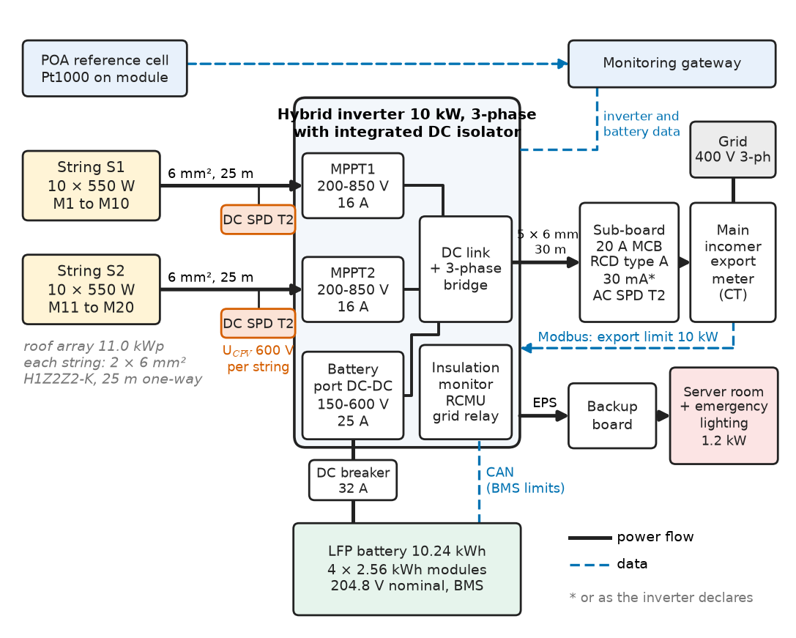
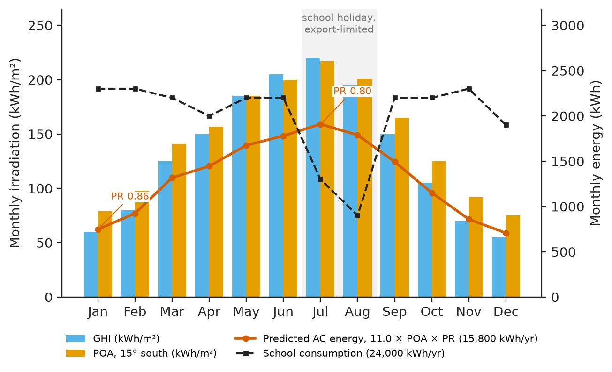
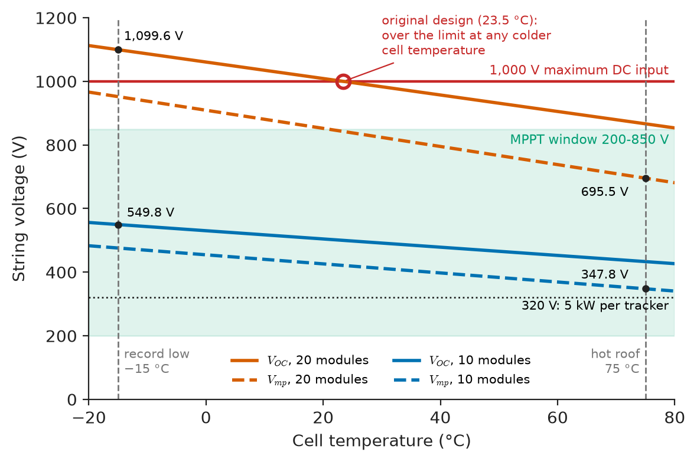
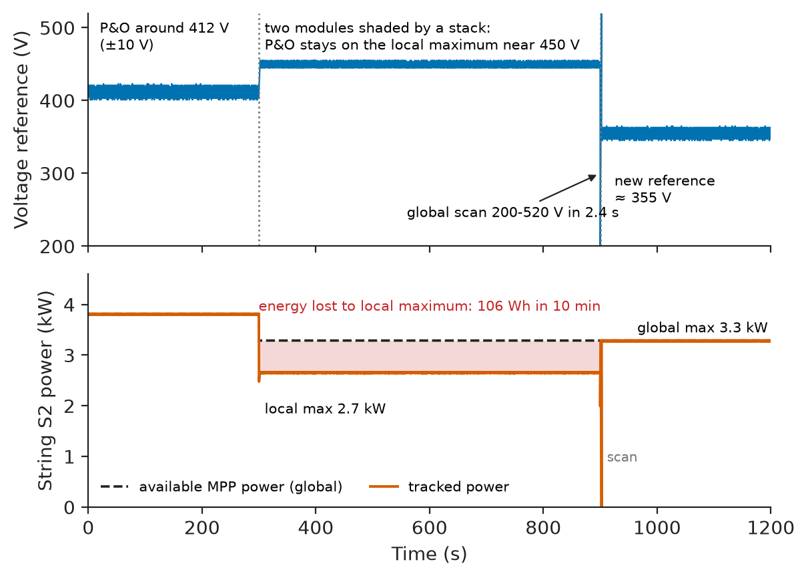
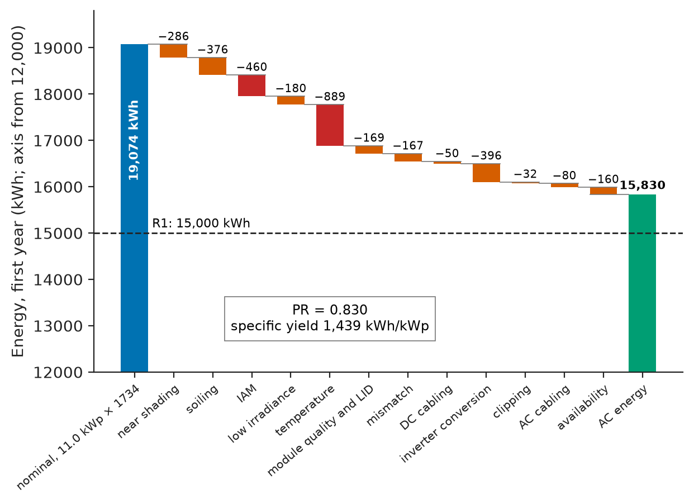
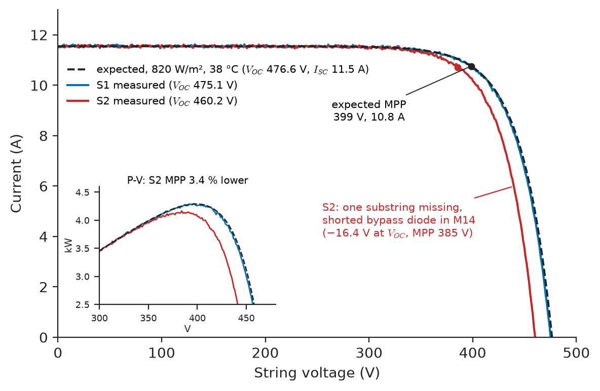

# Chapter 22 — Solar PV System Design

*Part VI · Renewable Energy and Electric Mobility*

A secondary school on a continental plateau at 40° N commissioned an 11.0 kWp rooftop PV system in October. Its installer had wired all twenty 550 W modules in one string on a 10 kW three-phase hybrid inverter rated for 1,000 V DC, because the datasheet open-circuit voltage, $20\times49.8=996$ V, fitted. On the first clear January morning, at −12 °C, the inverter logged "PV overvoltage" at sunrise and refused to start; on two later mornings it started late, after the sun had warmed the modules. The arithmetic missed one line: open-circuit voltage rises as cells cool, and on a −15 °C dawn the string reaches 1,100 V. The inverter had protected itself, this time. The redesign of this roof — two strings of ten modules on the inverter's two trackers, a 10.24 kWh battery, cables and protection rechecked, a monitoring plan with a performance-ratio target — is the running example of this chapter.

> **How is a PV system sized from the solar resource to the grid connection, so that every string, cable and protective device stays inside its limits on the coldest morning and the hottest afternoon?**
> **How are its losses budgeted, its yield predicted and its performance proven after commissioning?**

| Concept | Engineering destination |
|---|---|
| Solar resource assessment | Plane-of-array irradiation from site data; yield estimates for financing and sizing |
| PV module characteristics | Choosing a module class; temperature coefficients that set string limits |
| String sizing | Number of modules per string inside the inverter's voltage and current window |
| Inverters | String, hybrid and module-level architectures; DC/AC ratio; grid-code compliance |
| MPPT | Tracking efficiency, perturbation step, global scans under partial shading |
| Battery integration | DC- versus AC-coupled storage, backup reserve, battery-port sizing |
| Protection | Fuses, isolators, SPDs, insulation monitoring, residual-current and arc-fault protection |
| Cable sizing | DC and AC conductors sized on current, voltage drop and voltage rise |
| System losses | Loss tree from irradiance to AC energy; performance ratio |
| Performance evaluation | IEC 62446-1 commissioning tests; IEC 61724-1 monitoring; PR tracking |

**Roadmap.** Requirements and architecture (22.1) → the solar resource (22.2) → the module (22.3) → string sizing (22.4) → the inverter (22.5) → MPPT (22.6) → battery integration (22.7) → protection (22.8) → cables (22.9) → losses and yield (22.10) → performance evaluation (22.11) → failure analysis (22.12).

---

## 22.1 Requirements and architecture

> **Boundary.** The physics of the solar cell is in *Engineering Physics*, [Ch. 14 §14.5.5](https://github.com/The-Studio-of-Sadiq/Engineering-Physics/blob/main/CHAPTERS/CHAPTER%2014.md); PV absorber materials in *Materials Science and Engineering*, [Ch. 40 §40.1](https://github.com/The-Studio-of-Sadiq/Materials-Science-and-Engineering/blob/main/Chapters/CHAPTER%2040.md). Module ratings, the NOCT cell-temperature model, string sizing at plant scale and inverter architectures are introduced in *Electrical Energy and Machines*, [Ch. 15 §15.1](https://github.com/The-Studio-of-Sadiq/Electrical-Energy-and-Machines/blob/main/part-4-power-generation/15-renewable-energy-systems.md); the MPPT boost stage and transformerless inverter topologies in *Electronics and Computing*, [Ch. 32 §32.8](https://github.com/The-Studio-of-Sadiq/Electronics-and-Computing/blob/main/part-7-power-electronics/32-motor-drives-and-power-conversion.md); grid codes and anti-islanding in *Electrical Energy and Machines*, [Ch. 27 §27.4–27.5](https://github.com/The-Studio-of-Sadiq/Electrical-Energy-and-Machines/blob/main/part-7-power-quality-and-grid-modernization/27-grid-integration-of-renewable-energy.md). This chapter designs one real system with those results.

The school's roof is a 15° south-facing pitch with a parapet and two ventilation stacks. The school consumes about 24 MWh a year, mostly on weekdays between 08:00 and 17:00, with a sports hall used in the evenings and a server room and emergency lighting that the head teacher wants kept alive through the grid outages the region sees a few times a winter. The grid connection is three-phase 400 V; the distribution operator's code (EN 50549-1 in this region) limits export to 10 kW.

**Table 22.1 — Requirements of the school PV system.**

| ID | Requirement | Target | Verification |
|---|---|---|---|
| R1 | Annual AC energy, first year (P50) | ≥ 15,000 kWh | Yield model; 12-month metered energy |
| R2 | Performance ratio, first year | ≥ 0.80 annual; monthly temperature-corrected PR within 3 % of model | Monitoring per IEC 61724-1 |
| R3 | DC voltage at record-low cell temperature (−15 °C) | ≤ 1,000 V inverter limit, ≥ 5 % margin | Calculation; Voc test at commissioning |
| R4 | String MPP voltage at hottest cell temperature (75 °C) | ≥ MPPT floor 200 V with ≥ 30 % margin | Calculation |
| R5 | Export and grid compliance | ≤ 10 kW export; EN 50549-1 settings; certified anti-islanding | Inverter certificate; settings record |
| R6 | DC voltage drop at STC; AC voltage rise at full export | ≤ 1 % each | Calculation; measured at commissioning |
| R7 | Protection and insulation | IEC 60364-7-712 and IEC 62548 compliant; array insulation ≥ 1 MΩ | IEC 62446-1 tests |
| R8 | Backup for server room and emergency lighting | 1.2 kW for 3 h during an outage, switchover ≤ 20 ms | Outage simulation |
| R9 | Monitoring | 5-min data: POA irradiance, module temperature, DC and AC per tracker, battery SoC; alarms | Data review at handover |

<!-- FIGURE 22.1 | figures/ch22/fig-22-1-school-pv-architecture.png | block-diagram | Architecture and single-line diagram of the 11.0 kWp school PV system with DC-coupled battery. | Content: left, roof array: string S1 (10 x 550 W, modules M1 to M10) and string S2 (M11 to M20), each with its own pair of 6 mm2 H1Z2Z2-K cables, 25 m one-way, to a DC combiner-free connection. DC SPD type 2 (Ucpv 600 V) per string at the inverter. Centre: 10 kW three-phase hybrid inverter with integrated DC isolator, MPPT1 and MPPT2 (200 to 850 V, 16 A), battery port (150 to 600 V, 25 A), insulation monitor, RCMU, grid relay. Below: LFP battery 10.24 kWh, 4 modules x 2.56 kWh, 204.8 V nominal, BMS on CAN to inverter, DC breaker 32 A. Right: AC output 5 x 6 mm2, 30 m, to sub-board: 20 A MCB, type A RCD 30 mA (or as inverter declares), AC SPD type 2, export meter (CT, Modbus) at main incomer, grid 400 V three-phase. Separate backup (EPS) output to a backup board feeding server room and emergency lighting, 1.2 kW. Monitoring gateway with POA reference cell and back-of-module Pt1000. Arrows: power flow solid, data dashed. -->



*Figure 22.1 — Architecture and single-line diagram of the 11.0 kWp school PV system with DC-coupled battery.*

Figure 22.1 is the architecture after the redesign: two strings, each on its own tracker; a hybrid inverter whose battery port is fed through an internal bidirectional DC–DC converter; an export meter at the main incomer that lets the inverter limit export to 10 kW; and a separate backup output for the protected loads.

---

## 22.2 Solar resource assessment

### From GHI to plane-of-array irradiation

The design starts from long-term irradiation data for the site: satellite-derived global horizontal irradiation (GHI) and its diffuse fraction, available as typical-meteorological-year files (PVGIS, NSRDB, Meteonorm, Solcast). For a roof system, ten-year satellite averages are accurate to about ±4–5 % in annual GHI; ground measurement is not worth its cost below a few hundred kilowatts. The design quantity is the irradiation on the plane of the array (POA), obtained by splitting GHI into beam and diffuse parts and transposing each to the tilted plane. The ideas and the P50/P90 method are in *Electrical Energy and Machines*, [Ch. 15 §15.6](https://github.com/The-Studio-of-Sadiq/Electrical-Energy-and-Machines/blob/main/part-4-power-generation/15-renewable-energy-systems.md); here they are applied with the monthly-average isotropic-sky method (Liu–Jordan transposition with Klein's beam factor and the Erbs diffuse correlation), adequate for a low-tilt roof, and checked against a PVGIS run.

**Table 22.2 — Monthly irradiation at the school (GHI from a satellite TMY; POA by isotropic transposition, 15° tilt, south, albedo 0.2).**

| Month | Jan | Feb | Mar | Apr | May | Jun | Jul | Aug | Sep | Oct | Nov | Dec | Year |
|---|---|---|---|---|---|---|---|---|---|---|---|---|---|
| GHI (kWh/m²) | 60 | 80 | 125 | 150 | 185 | 205 | 220 | 195 | 150 | 105 | 70 | 55 | 1,600 |
| Clearness index | 0.46 | 0.50 | 0.53 | 0.52 | 0.54 | 0.59 | 0.63 | 0.62 | 0.60 | 0.54 | 0.51 | 0.46 | — |
| POA/GHI | 1.32 | 1.23 | 1.12 | 1.05 | 1.00 | 0.98 | 0.99 | 1.03 | 1.10 | 1.19 | 1.31 | 1.36 | 1.084 |
| POA (kWh/m²) | 79 | 98 | 141 | 157 | 185 | 200 | 217 | 201 | 165 | 125 | 92 | 75 | 1,734 |

The 15° tilt gains 8.4 % over horizontal for the year, most of it in winter; a 30° tilt would gain about 12 % but needs racking on this pitched roof, and was not worth the wind-load design for 3–4 % more energy. Figure 22.2 shows the monthly profile against the school's consumption: summer production peaks fall in the school holidays, which matters for battery sizing (Section 22.7).

<!-- FIGURE 22.2 | figures/ch22/fig-22-2-monthly-resource-and-yield.png | plot | Monthly irradiation, predicted AC energy and school consumption for the 11.0 kWp roof. | Content: x-axis months Jan to Dec. Grouped bars on left axis kWh/m2 (0 to 250): GHI (60, 80, 125, 150, 185, 205, 220, 195, 150, 105, 70, 55) and POA (79, 98, 141, 157, 185, 200, 217, 201, 165, 125, 92, 75). Right axis kWh (0 to 3000): line of predicted AC energy = 11.0 x POA x monthly PR (PR 0.86 in Dec-Jan falling to 0.80 in Jul), annual 15,800 kWh; dashed line of school consumption (about 2,400 kWh per month in term, 900 kWh in August). Shade July-August labelled school holiday, export-limited. -->



*Figure 22.2 — Monthly irradiation, predicted AC energy and school consumption for the 11.0 kWp roof.*

### Shading survey

Near shading is the loss a resource dataset cannot know. The installer's survey with a sun-path tool placed each ventilation stack's shadow on the array: in December at solar noon the sun stands at $90-40-23.4=26.6°$, and a 1.2 m parapet throws a shadow $1.2/\tan 26.6°=2.4$ m long, so the first module row starts 2.5 m from the parapet. The stacks shade two modules for about an hour on winter mornings; those modules were placed at the ends of string S2 so that only one tracker is affected. The simulated annual near-shading loss is 1.5 %.

---

## 22.3 PV module characteristics

### What the datasheet must give

The design uses a handful of datasheet numbers: STC power, $V_{OC}$, $I_{SC}$, $V_{mp}$ and $I_{mp}$; the temperature coefficients of $V_{OC}$, $I_{SC}$ and $P_{max}$; NOCT or NMOT; maximum system voltage; maximum series-fuse rating; the power tolerance; and the warranted degradation. Certification to IEC 61215 (design qualification) and IEC 61730 (safety, class II) is a condition of the grid connection, not a choice.

**Table 22.3 — Module classes considered for the school (2026 distributor prices, pallet quantities).**

| Class | Example rating | Efficiency | $\gamma_{P}$ (%/K) | $\beta_{V_{OC}}$ (%/K) | Price | Assessment |
|---|---|---|---|---|---|---|
| Mono PERC, 108 half-cells | 410 W, $V_{OC}$ 37.3 V | 21.0 % | −0.35 | −0.27 | \$0.13/W | Cheapest; more modules and connectors for 11 kW; worst in heat |
| TOPCon, 144 half-cells | 550 W, $V_{OC}$ 49.8 V, $I_{SC}$ 14.0 A | 21.3 % | −0.30 | −0.26 | \$0.14/W | **Chosen**: 20 modules fill the roof; current fits a 16 A tracker |
| Heterojunction (HJT) | 430 W, $V_{OC}$ 40.6 V | 22.0 % | −0.25 | −0.24 | \$0.19/W | Best hot-roof yield (+1 %); price premium not repaid in this climate |
| Large-format 210 mm cells | 650 W, $I_{SC}$ 18.4 A | 22.5 % | −0.29 | −0.25 | \$0.14/W | $I_{mp}$ (17.3 A) over the 16 A operating limit of most residential trackers |

The large-format module shows why module selection cannot be separated from inverter selection: its MPP current exceeds the 16 A operating input current of the residential inverter class, so the tracker would clip every sunny hour. The chosen module's parameters used throughout are: $V_{OC}=49.8$ V, $V_{mp}=41.9$ V, $I_{SC}=14.0$ A, $I_{mp}=13.13$ A, $\beta_{V_{OC}}=-0.26$ %/K, $\alpha_{I_{SC}}=+0.046$ %/K, $\gamma_{P}=-0.30$ %/K. The temperature coefficient of $V_{mp}$ is rarely printed; it is approximately $\gamma_P-\alpha_{I_{SC}}=-0.34$ %/K, which is the value used for string sizing.

> **Status of the principle: Linear temperature coefficients**
> *Empirical.* Datasheet coefficients are measured near STC and the linear model holds to about ±1 % over −20 to +80 °C for crystalline silicon; the $V_{mp}$ coefficient estimated as $\gamma_P-\alpha_{I_{SC}}$ assumes the fill factor's temperature dependence follows $V_{mp}$, which is adequate for sizing but not for yield simulation.

### Cell temperature on a roof

Cell temperature follows the NOCT model of *Electrical Energy and Machines* §15.1, $T_c\approx T_a+(\mathrm{NOCT}-20)G/800$, but that model describes an open rack. Modules mounted 10 cm above a pitched roof run 5–10 K hotter. For the school, with a 38 °C design ambient, 1,000 W/m² and NOCT 44 °C, the open-rack estimate is 68 °C; adding 7 K for the roof gives the design hot-cell temperature of 75 °C. The cold design temperature is the record minimum ambient, −15 °C: at dawn, before any heating, irradiance of 100–200 W/m² is enough to bring a string almost to its full open-circuit voltage while the cells are still at air temperature.

---

## 22.4 String sizing

### The voltage and current window

String sizing places the array's operating envelope inside the inverter's window (Figure 22.3):

- **Upper limit.** The string's open-circuit voltage at the coldest cell temperature must not exceed the inverter's maximum DC input voltage (and the module's maximum system voltage). This is the limit the original design broke.
- **MPPT range.** The string's MPP voltage must stay above the tracker's lower limit at the hottest cell temperature, with margin for degradation and for low irradiance, and below the upper MPPT limit in cold weather.
- **Current.** The string's $I_{mp}$ must not exceed the tracker's maximum operating current, and its $I_{SC}$ at the hottest temperature must not exceed the inverter's maximum short-circuit input current.

$$
N_{\max}=\left\lfloor\frac{V_\text{DC,max}}{V_{OC}\left[1+\beta_{V_{OC}}(T_\text{cold}-25)\right]}\right\rfloor,\qquad
N_{\min}=\left\lceil\frac{V_\text{MPPT,min}}{V_{mp}\left[1+\beta_{V_{mp}}(T_\text{hot}-25)\right]}\right\rceil
$$

> **Status of the principle: String voltage at the coldest cell temperature**
> *Derived.* Series modules add their voltages and the open-circuit voltage rises linearly as temperature falls; the coldest-cell assumption is the worst case because irradiance at dawn is enough to reach near-full $V_{OC}$ before the cells warm. Very high albedo (snow) or cloud-edge enhancement can raise irradiance, but $V_{OC}$ depends only logarithmically on it.

The listing computes the window for the chosen module and inverter. It is the first file in the project's design repository, rerun whenever a part changes:

```python
# String-sizing window for the school roof: 550 W TOPCon module, 10 kW hybrid inverter
from math import floor, ceil
mod = dict(Voc=49.8, Vmp=41.9, Isc=14.0, Imp=13.13,
           b_voc=-0.0026, b_vmp=-0.0034, a_isc=0.00046)     # per K
inv = dict(Vdc_max=1000, Vmppt_min=200, Vmppt_max=850, Imax=16.0, Isc_max=20.0)
T_cold, T_hot = -15.0, 75.0          # cell temperature: record-low dawn, hot roof noon

voc_cold = mod["Voc"] * (1 + mod["b_voc"] * (T_cold - 25))
vmp_hot  = mod["Vmp"] * (1 + mod["b_vmp"] * (T_hot - 25))
vmp_cold = mod["Vmp"] * (1 + mod["b_vmp"] * (T_cold - 25))
isc_hot  = mod["Isc"] * (1 + mod["a_isc"] * (T_hot - 25))
n_max = floor(inv["Vdc_max"] / voc_cold)
n_min = ceil(inv["Vmppt_min"] / vmp_hot)
n_mppt_max = floor(inv["Vmppt_max"] / vmp_cold)
print(f"Voc at {T_cold:.0f} C = {voc_cold:.2f} V, Vmp at {T_hot:.0f} C = {vmp_hot:.2f} V, "
      f"Vmp at {T_cold:.0f} C = {vmp_cold:.2f} V")
print(f"N_max (1000 V) = {n_max}, N_min (MPPT floor) = {n_min}, N_max (MPPT ceiling) = {n_mppt_max}")
for n in (10, 20):
    print(f"N = {n:2d}: Voc,cold = {n*voc_cold:6.1f} V  Vmp,hot = {n*vmp_hot:5.1f} V  "
          f"Vmp,STC = {n*mod['Vmp']:5.1f} V  -> {'OK' if n <= n_max else 'EXCEEDS 1000 V'}")
print(f"Isc at {T_hot:.0f} C = {isc_hot:.2f} A (limit {inv['Isc_max']} A), "
      f"Imp = {mod['Imp']} A (limit {inv['Imax']} A)")
```

```text
Voc at -15 C = 54.98 V, Vmp at 75 C = 34.78 V, Vmp at -15 C = 47.60 V
N_max (1000 V) = 18, N_min (MPPT floor) = 6, N_max (MPPT ceiling) = 17
N = 10: Voc,cold =  549.8 V  Vmp,hot = 347.8 V  Vmp,STC = 419.0 V  -> OK
N = 20: Voc,cold = 1099.6 V  Vmp,hot = 695.5 V  Vmp,STC = 838.0 V  -> EXCEEDS 1000 V
Isc at 75 C = 14.32 A (limit 20.0 A), Imp = 13.13 A (limit 16.0 A)
```

**Worked example — Why the original string failed and what replaced it.** At −15 °C each module's open-circuit voltage is $49.8\times[1-0.0026\times(-40)]=54.98$ V, so twenty in series reach 1,099.6 V, 10 % above the inverter's 1,000 V limit; even at 0 °C the string is at 1,060 V. The window allows 6 to 17 modules per string (the MPPT ceiling, 850 V at cold MPP, is the tighter upper limit in operation, the 1,000 V limit the absolute one). Two strings of ten, one per tracker, give 549.8 V cold (45 % margin to 1,000 V, R3) and 347.8 V hot (74 % above the 200 V floor, R4). Each tracker then carries 5.5 kWp at 13.13 A, inside its 16 A limit. Ten modules is also below the 400–850 V range in which this inverter reaches full power from one tracker, but with two trackers sharing 10 kW each needs only 5 kW, which the tracker delivers from 320 V upward.

<!-- FIGURE 22.3 | figures/ch22/fig-22-3-string-voltage-window.png | plot | String voltage against cell temperature for 10- and 20-module strings inside the inverter's voltage window. | Content: x-axis cell temperature -20 to 80 C; y-axis string voltage 0 to 1200 V. Lines: Voc of 20 modules (996 V at 25 C, 1099.6 V at -15 C), Vmp of 20 modules (838 V at 25 C, 695.5 V at 75 C), Voc of 10 modules (498 V at 25 C, 549.8 V at -15 C), Vmp of 10 modules (419 V at 25 C, 347.8 V at 75 C). Horizontal limits: 1000 V maximum DC input (red), MPPT window 200 to 850 V (shaded green band), 320 V minimum for 5 kW per tracker (dotted). Vertical dashed lines at -15 C (record low) and 75 C (hot roof). Red marker where the 20-module Voc line crosses 1000 V at about 23.5 C, labelled original design: over the limit at any colder cell temperature. -->



*Figure 22.3 — String voltage against cell temperature for 10- and 20-module strings inside the inverter's voltage window.*

### Mixed orientations and unequal strings

Each tracker accepts one string length and one orientation. Strings of different lengths or orientations in parallel on one tracker run at a compromise voltage; a 9-module string paralleled with a 10-module string loses about 2–4 % of the pair's energy. The school's two equal strings on two trackers avoid the question; a roof with east and west faces would give each face its own tracker.

---

## 22.5 Inverters

### Architecture choice

Three architectures compete at this size:

**Table 22.4 — Inverter architectures considered for the school.**

| Criterion | String inverter + AC-coupled battery inverter | Three-phase hybrid inverter, DC-coupled battery | Microinverters + AC battery |
|---|---|---|---|
| Conversion stages PV → battery → load | 3 (DC–AC, AC–DC, DC–AC) | 2 (DC–DC, DC–AC) | 3 |
| Backup output | Battery inverter, often single-phase | Integrated EPS output, < 20 ms switchover | Needs separate gateway |
| Shading tolerance | Per tracker | Per tracker | Per module |
| Module-level shutdown | Needs optimisers | Needs optimisers | Inherent |
| Parts on the roof | None | None | 20 inverters at 70 °C |
| Cost (2026, installed electronics) | \$2,900 | \$2,300 | \$3,800 |
| Decision | Rejected (cost, single-phase backup) | **Chosen** | Rejected (cost, roof electronics) |

The hybrid inverter's data that matter: maximum DC input 1,000 V; two MPPTs, 200–850 V, 16 A operating and 20 A short-circuit input each; battery port 150–600 V, 25 A charge and discharge; 10 kW AC, 16 A per phase; European efficiency 97.6 %, maximum 98.2 %; backup output 10 kVA with automatic transfer; certificates to IEC 62109-1/-2 (safety), IEC 62116 (anti-islanding test) and EN 50549-1. A transformerless topology is assumed, so the array's leakage current and insulation are monitored by the inverter itself (Section 22.8).

### DC/AC ratio and clipping

The array is 11.0 kWp on a 10 kW inverter, a DC/AC ratio of 1.10. At this site, cell temperature, soiling and wiring losses mean the array rarely delivers more than about 85 % of its STC power at the inverter's input, so clipping costs about 0.2 % a year. A ratio of 1.3 would clip 1.5–2 % but fill the inverter more often, the right choice when the inverter is expensive relative to modules or when export is capped. Here the export cap (10 kW, R5) is enforced by the inverter's export-limiting loop against the CT meter at the main incomer, and since the school's own daytime load is rarely below 3 kW in term time, the cap bites only in holidays.

> **Status of the principle: Optimal DC/AC ratio**
> *Empirical.* Ratios of 1.1–1.4 are chosen from simulated clipping losses against the relative cost of modules, inverters and grid capacity; the optimum moves with module price, climate and export rules, and is a design-study result, not a constant.

---

## 22.6 MPPT

### What the inverter's tracker must do

Each tracker holds its string at the knee of the P–V curve by adjusting its input-voltage reference. The perturb-and-observe and incremental-conductance algorithms, and the hardware details of the boost stage that implements them, are in *Electronics and Computing*, [Ch. 32 §32.8](https://github.com/The-Studio-of-Sadiq/Electronics-and-Computing/blob/main/part-7-power-electronics/32-motor-drives-and-power-conversion.md). The integrator does not write the tracker but must understand its parameters, because they decide the energy lost to shading, to fast clouds and to the tracker's own oscillation, and because a wrong installer setting (a disabled global scan, a narrowed MPPT window) is a common cause of under-performance. The listing shows the structure of a typical tracker with a periodic global scan; it is illustrative firmware for a C11 target, not any vendor's code.

```c
/* mppt.c -- perturb-and-observe with periodic global scan (C11, illustrative) */
#include <stdint.h>
#include <stdbool.h>

#define V_MIN        200.0f   /* MPPT floor, V                          */
#define V_MAX        850.0f   /* MPPT ceiling, V                        */
#define V_SCAN_HI    520.0f   /* upper end of global scan (~0.95 Voc)   */
#define V_STEP         2.0f   /* perturbation step, V                   */
#define P_DEADBAND     5.0f   /* W, above the power-measurement noise   */
#define SCAN_PERIOD 9000u     /* calls between scans: 15 min at 10 Hz   */
#define SCAN_POINTS   24u     /* 2.4 s sweep                            */

typedef struct {
    float v_ref, p_prev, dir, best_v, best_p;
    uint32_t ticks, k;
    bool scanning;
} mppt_t;

void mppt_init(mppt_t *m, float v_start) { *m = (mppt_t){ .v_ref = v_start, .dir = 1.0f }; }

/* Called every 100 ms with averaged tracker voltage and current; returns the new reference. */
float mppt_step(mppt_t *m, float v, float i)
{
    const float p = v * i;
    if (m->scanning) {                              /* coarse sweep of the whole curve */
        if (p > m->best_p) { m->best_p = p; m->best_v = v; }
        if (++m->k < SCAN_POINTS) {
            m->v_ref = V_MIN + (V_SCAN_HI - V_MIN) * (float)m->k / (float)(SCAN_POINTS - 1u);
        } else {                                    /* resume P&O at the global maximum */
            m->scanning = false;
            m->v_ref = m->best_v;
            m->p_prev = m->best_p;
        }
        return m->v_ref;
    }
    if (++m->ticks >= SCAN_PERIOD) {                /* start a global scan */
        *m = (mppt_t){ .v_ref = V_MIN, .dir = m->dir, .scanning = true, .best_v = m->v_ref };
        return m->v_ref;
    }
    if (p - m->p_prev < -P_DEADBAND) m->dir = -m->dir;   /* power fell: reverse */
    m->p_prev = p;
    m->v_ref += m->dir * V_STEP;
    if (m->v_ref < V_MIN) { m->v_ref = V_MIN; m->dir = 1.0f; }
    if (m->v_ref > V_MAX) { m->v_ref = V_MAX; m->dir = -1.0f; }
    return m->v_ref;
}
```

### Step size, deadband and scan cost

Three parameters trade against each other, and each has a number:

**Worked example — What do the step, deadband and scan cost?** Near the MPP the P–V curve of a ten-module string is a flat parabola. With an explicit single-diode-type model fitted to the datasheet points, a ±2 V oscillation about 419.6 V (three-level P&O) costs 0.013 % of 5.50 kW, about 0.7 W, below the 5 W deadband. The tracker therefore does not reverse on a 2 V step: it walks until the power drop exceeds the deadband, about 5–6 V from the MPP, where the loss is still under 0.1 %. The deadband exists to stop measurement noise, not the curve, from steering the tracker. The scan is costlier: a 2.4 s sweep every 15 minutes during which the string delivers on average about 60 % of its MPP power loses $0.4\times2.4/900=0.11$ % of the energy, against a gain, on the school's string S2, of several per cent during the winter mornings when the ventilation stacks create a second local maximum. A sweep every minute would cost 1.6 %, which is why scans are periodic and, in better inverters, triggered by a sudden change in the string's apparent fill factor.

The tracker is verified as a black box: EN 50530 defines static MPPT efficiency (energy delivered relative to the available MPP energy at fixed irradiance, typically above 99.7 %) and dynamic efficiency over irradiance ramps from 0.5 to 100 W/m²/s (typically 99–99.8 %). Figure 22.4 shows a simulated trace of the tracker on string S2 through a shading event.

<!-- FIGURE 22.4 | figures/ch22/fig-22-4-mppt-trace.png | plot | Simulated perturb-and-observe tracking on string S2 through a winter-morning shading event, with a periodic global scan. | Content: x-axis time 0 to 1200 s. Top panel: string voltage reference (V, 200 to 520) oscillating within plus or minus 10 V around 412 V (3.8 kW); at t = 300 s two modules shaded (stack shadow), the P&O settles near 450 V on a local maximum of 2.7 kW; at t = 900 s the global scan sweeps 200 to 520 V in 2.4 s and the reference jumps to 355 V, global maximum 3.3 kW. Bottom panel: string power (kW, 0 to 4) available MPP power dashed, tracked power solid, shaded area between t = 300 and 900 s labelled energy lost to local maximum. -->



*Figure 22.4 — Simulated perturb-and-observe tracking on string S2 through a winter-morning shading event, with a periodic global scan.*

---

## 22.7 Battery integration

> **Boundary.** Cell chemistry, the battery-management system, state estimation, thermal management and battery protection are owned by [Chapter 23](23-battery-energy-systems.md); the converter that charges the battery from the DC link is in *Electronics and Computing*, [Ch. 32 §32.7](https://github.com/The-Studio-of-Sadiq/Electronics-and-Computing/blob/main/part-7-power-electronics/32-motor-drives-and-power-conversion.md). Here the battery is a block with a voltage window, a current limit, an efficiency and a CAN interface.

### Coupling

The battery can sit on the DC side of the hybrid inverter (DC coupling) or behind its own inverter on the AC side (AC coupling). DC coupling saves a conversion and lets the battery absorb energy the inverter would otherwise clip; AC coupling allows retrofitting to any existing PV inverter and siting the battery anywhere on the AC network.

**Worked example — How much does DC coupling save?** On the path PV → battery → evening load, the DC-coupled system passes the energy through the battery's DC–DC converter (98 %), the battery (95 % round trip) and the inverter (96.5 % at the battery-discharge operating point): $0.98\times0.95\times0.965=0.898$. An AC-coupled system passes it through the PV inverter (97 %), the battery inverter charging (95.5 %), the battery (95 %) and the battery inverter discharging (95.5 %): $0.97\times0.955\times0.95\times0.955=0.840$. With 5.1 kWh cycled on each of 200 school days (1,020 kWh a year), the difference is $1{,}020\times(0.898-0.840)=59$ kWh a year, about \$10 at the school's \$0.17/kWh tariff. The efficiency argument is real but small; the decision was made on equipment cost and the three-phase backup output.

### Sizing the battery

Two uses share the battery (R8). The **backup reserve** must cover 1.2 kW for 3 h, 3.6 kWh, plus the battery's own lowest 10 % that the BMS will not deliver. The **daily shift** moves midday surplus to the evening sports-hall load, about 5 kWh on a weekday. A 10.24 kWh LFP stack (four 2.56 kWh modules, 64 cells in series, 204.8 V nominal, 180–233 V operating) gives 9.2 kWh between 10 % and 100 % SoC. The reserve must deliver 3.6 kWh of AC, $3.6/0.965=3.73$ kWh from the cells, 36 % of capacity above the 10 % floor, so the backup SoC floor is set at 50 %, leaving $10.24\times(1-0.50)=5.1$ kWh for daily cycling. Its voltage window lies inside the inverter's 150–600 V battery port, and the port's 25 A limit allows $25\times204.8=5.1$ kW of charge or discharge, 0.5C for this battery, comfortably inside the cells' rating. A larger battery would sit full through the summer holidays, when the school is closed and the surplus is exported anyway.

The battery talks to the inverter over CAN (the battery's BMS sends charge and discharge current limits and voltage set-points every second, the inverter obeys them and stops if the messages stop) — the closed-loop interface whose BMS side is designed in Chapter 23.

---

## 22.8 Protection

> **Boundary.** Protection principles, earthing systems and protective devices are in *Electrical Energy and Machines*, [Ch. 29 §29.3–29.5](https://github.com/The-Studio-of-Sadiq/Electrical-Energy-and-Machines/blob/main/part-8-electrical-safety-and-engineering-practice/29-electrical-safety.md); the hazards of PV and batteries that cannot be switched off at the source in [§29.6](https://github.com/The-Studio-of-Sadiq/Electrical-Energy-and-Machines/blob/main/part-8-electrical-safety-and-engineering-practice/29-electrical-safety.md).

### What is different about a PV array

A PV array is a current source limited to about $1.25\,I_{SC}$: it cannot deliver a fault current large enough to blow a fuse in its own string, it cannot be switched off while the sun shines, and DC arcs do not extinguish at a current zero. Protection is built around those three facts (IEC 60364-7-712, IEC 62548):

- **String overcurrent.** A fault in one string can be fed in reverse by the other strings in parallel with it. String fuses (gPV, IEC 60269-6) are required only when $(N_p-1)\times1.25\,I_{SC}$ exceeds the module's reverse-current rating (typically 25–30 A), which needs three or more strings in parallel. With one string per tracker the school needs no string fuses.
- **Isolation.** A DC switch-disconnector rated for the full string voltage and current under DC-PV2 utilisation (IEC 60947-3), here integrated in the inverter, isolates the array from the inverter. It does not make the array cables dead.
- **Surge protection.** Type 2 SPDs (IEC 61643-31) at the inverter's DC input with $U_{CPV}\ge V_{OC,\max}$ (600 V class against 549.8 V) and on the AC side; type 1 if the building has a lightning-protection system whose separation distance to the array cannot be kept.
- **Insulation and residual current.** A transformerless inverter measures the array's insulation resistance before connecting each morning and refuses to start below $V_{\max}/30\ \mathrm{mA}$ (IEC 62109-2; 18 kΩ here, with practical settings around 100 kΩ), and monitors residual current during operation (trip on a 30 mA step or 300 mA continuous). The external RCD type (A or B) follows the inverter's declaration of whether it can feed smooth DC fault current.
- **Arc faults and rapid shutdown.** In North America NEC 690.11 requires arc-fault detection (UL 1699B) and NEC 690.12 module-level rapid shutdown for firefighter safety; in Europe IEC 63027 arc-fault detection is increasingly specified, and some countries require a firefighter switch. The school's insurer asked for an AFCI-equipped inverter.
- **Anti-islanding and grid protection.** The inverter's certified functions (voltage and frequency trips, loss-of-mains detection, *Electrical Energy and Machines* §27.5) with settings fixed by EN 50549-1 and recorded at commissioning.
- **Battery.** A DC breaker or fuse rated for the battery's prospective short-circuit current at the battery terminals, and the BMS contactors behind it (Chapter 23).

> **Status of the principle: Reverse-current rule for string fuses**
> *Derived.* A short in one string makes it a load for the other $N_p-1$ strings on the same tracker, each limited to about $1.25\,I_{SC}$; fuses are needed only when that sum can exceed the module's tested reverse-current rating, which is why one or two strings per tracker need none.

---

## 22.9 Cable sizing

> **Boundary.** Current-carrying capacity, derating and voltage-drop calculation for LV cables are in *Electrical Energy and Machines*, [Ch. 30 §30.5–30.6](https://github.com/The-Studio-of-Sadiq/Electrical-Energy-and-Machines/blob/main/part-8-electrical-safety-and-engineering-practice/30-electrical-system-design.md).

### DC cables

PV string cables are double-insulated, UV- and ozone-resistant single cores (H1Z2Z2-K to EN 50618, 1.5 kV DC, 90 °C continuous and 120 °C for 20,000 h). IEC 62548 requires their current-carrying capacity, after derating, to be at least $1.25\,I_{SC}=17.5$ A for an unfused string. A 4 mm² cable in free air carries about 55 A at 60 °C ambient, so current never decides the size on a residential roof; voltage drop and losses do.

**Worked example — DC and AC conductors.** Each string runs 25 m from the array to the inverter, a 50 m loop. Copper at a 70 °C conductor temperature has $\rho=0.0175\times[1+0.00393\times50]=0.0209\ \Omega\,\mathrm{mm^2/m}$. With 4 mm², $R=0.0209\times50/4=0.262\ \Omega$ and at $I_{mp}=13.13$ A the drop is 3.44 V, 0.82 % of 419 V, a loss of 45 W at STC. With 6 mm², $R=0.174\ \Omega$, 2.29 V (0.55 %) and 30 W. Both satisfy R6; because cable loss scales with current squared and most energy arrives at part load, the annual energy loss is roughly 60 % of the STC fraction, about 0.5 % for 4 mm² and 0.3 % for 6 mm². The installer chose 6 mm² for an extra \$18 per string and cooler MC4-type connectors. On the AC side the inverter's 16 A per phase runs 30 m to the sub-board. Balanced three-phase current produces a voltage rise per phase of $I\,R_\text{phase}$: with 4 mm² ($5.52\ \Omega$/km at 70 °C) the rise is $16\times0.030\times5.52=2.65$ V, 1.15 % of 230 V; with 6 mm² ($3.69\ \Omega$/km) it is 1.77 V, 0.77 %. The voltage rise matters more than the drop: at the end of this rural feeder the grid sits at up to 244 V on light-load afternoons, and the DSO's volt–watt setting starts reducing inverter power at $1.07\,U_n=246$ V (the 10-minute over-voltage trip of EN 50549-1 is at 253 V). With 4 mm² the inverter terminals reach 246.7 V and the system would curtail on sunny holiday afternoons; with 6 mm², 245.8 V. 6 mm² was chosen; a 20 A MCB protects it.

**Table 22.5 — Budgets for the school PV system.**

| Quantity | Limit | Design value | Margin |
|---|---|---|---|
| String $V_{OC}$ at −15 °C | 1,000 V | 549.8 V | 45 % |
| String $V_{mp}$ at 75 °C | 200 V | 347.8 V | 74 % |
| Tracker current $I_{mp}$ | 16 A | 13.13 A | 18 % |
| Tracker $I_{SC}$ at 75 °C | 20 A | 14.32 A | 28 % |
| DC voltage drop at STC (6 mm²) | 1 % | 0.55 % | 0.45 points |
| AC voltage rise at 16 A (6 mm²) | 1 % | 0.77 % | 0.23 points |
| Battery current | 25 A port; cells 50 A (1C) | 25 A at 5.1 kW (0.5C) | 50 % to cell rating |
| First-year energy (R1) | ≥ 15,000 kWh | 15,800 kWh (P50) | 5.3 % |

---

## 22.10 System losses

### The loss tree

Yield is predicted by following the irradiation on the array through each loss in turn. The listing applies the loss tree used for the school, each fraction taken from the shading survey, the module and inverter datasheets, the cable calculation and a monthly temperature simulation:

```python
# Loss chain, performance ratio and first-year yield of the 11.0 kWp school roof
P_stc = 20 * 0.550                      # kWp
H_poa = 1734                            # kWh/m2/yr on 15 deg, south (Table 22.2)
losses = {                              # fraction lost at each step, in order
    "near shading (parapet, vents)": 0.015, "soiling": 0.020,
    "angle of incidence (IAM)": 0.025,  "low irradiance": 0.010,
    "module temperature": 0.050,       "module quality and LID": 0.010,
    "mismatch": 0.010,                 "DC cabling": 0.003,
    "inverter conversion": 0.024,      "inverter clipping": 0.002,
    "AC cabling": 0.005,               "availability": 0.010,
}
E = P_stc * H_poa                       # reference yield x power, kWh
print(f"{'step':32s} {'loss':>6s} {'kWh':>8s}")
for name, f in losses.items():
    dE = E * f
    E -= dE
    print(f"{name:32s} {f:6.1%} {dE:8.0f}")
PR = E / (P_stc * H_poa)
print(f"AC energy {E:.0f} kWh/yr, specific yield {E/P_stc:.0f} kWh/kWp, PR = {PR:.3f}")
```

```text
step                               loss      kWh
near shading (parapet, vents)      1.5%      286
soiling                            2.0%      376
angle of incidence (IAM)           2.5%      460
low irradiance                     1.0%      180
module temperature                 5.0%      889
module quality and LID             1.0%      169
mismatch                           1.0%      167
DC cabling                         0.3%       50
inverter conversion                2.4%      396
inverter clipping                  0.2%       32
AC cabling                         0.5%       80
availability                       1.0%      160
AC energy 15830 kWh/yr, specific yield 1439 kWh/kWp, PR = 0.830
```

The predicted first-year energy is 15,800 kWh, 1,439 kWh/kWp, with a performance ratio of 0.830 (Figure 22.5). Temperature is the largest single loss, then angle-of-incidence reflection, the inverter and soiling. The **performance ratio**, $\mathrm{PR}=E_{AC}/(P_\text{STC}\,H_\text{POA}/G_\text{STC})$, removes the resource from the comparison and is the number the contract and R2 are written against.

> **Status of the principle: Multiplicative loss chain**
> *Approximate.* Treating losses as independent factors applied in sequence is the convention of yield software; it is accurate to a fraction of a per cent when each loss is small, but interacting losses (shading with mismatch, temperature with clipping) are captured properly only by hourly simulation.

<!-- FIGURE 22.5 | figures/ch22/fig-22-5-loss-waterfall.png | plot | Energy loss waterfall from plane-of-array irradiation to AC energy for the school system, first year. | Content: waterfall bars in kWh. Start bar: nominal energy 11.0 kWp x 1734 kWh/m2 = 19,074 kWh. Down steps: near shading 286, soiling 376, IAM 460, low irradiance 180, temperature 889, module quality and LID 169, mismatch 167, DC cabling 50, inverter conversion 396, clipping 32, AC cabling 80, availability 160. End bar: AC energy 15,830 kWh. Annotation PR = 0.830, specific yield 1,439 kWh/kWp. Horizontal dashed line at 15,000 kWh labelled R1. -->



*Figure 22.5 — Energy loss waterfall from plane-of-array irradiation to AC energy for the school system, first year.*

**Worked example — Uncertainty and P90.** The yield model's uncertainty combines, in quadrature, interannual irradiation variability (4.5 %), the satellite dataset (4.5 %), transposition (2 %), the loss model (3 %) and degradation and availability (1.5 %): $\sigma=\sqrt{4.5^2+4.5^2+2^2+3^2+1.5^2}=7.5$ %. The one-year P90 is $15{,}800\times(1-1.282\times0.075)=14{,}300$ kWh, below R1's 15,000 kWh. R1 is therefore written, and verified, as a P50 commitment with weather correction: the 12-month metered energy is compared with the model rerun on the measured POA irradiation, not with 15,000 kWh directly.

---

## 22.11 Performance evaluation

### Commissioning tests

IEC 62446-1 defines the tests that hand a grid-connected system over: visual inspection, continuity of protective conductors, polarity, string open-circuit voltage and short-circuit (or operating) current, functional tests of switches and the inverter, and insulation resistance of the array (test voltage 1,000 V DC for arrays above 500 V, pass at ≥ 1 MΩ). Category 2 tests add an I–V curve trace of each string and an infrared survey.

**Worked example — A string 16 V low.** At commissioning the reference cell reads 820 W/m² and the back-of-module Pt1000 38 °C. The expected string $V_{OC}$ is $10\times49.8\times[1-0.0026\times13]=481.2$ V, less the logarithmic irradiance effect of about 0.46 V per module (72 cell-equivalents, $n\approx1.2$, $\ln 0.82$), so 476.6 V. String S1 measures 475.1 V (−0.3 %); S2 measures 460.2 V, 16.4 V low. One module's open-circuit voltage is 47.7 V at these conditions and one of its three substrings 15.9 V: S2 has a substring that contributes nothing — a shorted bypass diode. The I–V trace of S2 showed the same step-free curve 3.4 % lower in voltage, and an infrared image found the junction box of module M14 18 K warmer than its neighbours. The module was replaced under warranty before handover; with the diode shorted, S2 would have lost about 3 % of its energy for 25 years.

<!-- FIGURE 22.6 | figures/ch22/fig-22-6-commissioning-iv-curves.png | plot | Commissioning I-V traces of strings S1 and S2 at 820 W/m2 and 38 C, showing the shorted bypass diode in S2. | Content: x-axis string voltage 0 to 500 V; y-axis current 0 to 13 A. Dashed: expected curve from the datasheet translated to 820 W/m2, 38 C (Voc 476.6 V, Isc 11.5 A, MPP about 399 V, 10.8 A). Solid blue: S1 measured, Voc 475.1 V, overlapping expected. Solid red: S2 measured, Voc 460.2 V, curve shifted left over its whole length (no step), 16.4 V at Voc and about 13 V at the MPP, MPP about 385 V. Inset: power curves, S2 MPP 3.4 percent lower. Annotation on S2: one substring missing, shorted bypass diode in M14. -->



*Figure 22.6 — Commissioning I-V traces of strings S1 and S2 at 820 W/m2 and 38 C, showing the shorted bypass diode in S2.*

### Monitoring and the monthly PR check

IEC 61724-1 sets the monitoring classes; for a system of this size Class C (estimated irradiance) is common, but the school specified a Class B-like set (R9): a POA reference cell, a back-of-module temperature sensor, DC and AC power per tracker from the inverter, export and import from the CT meter, and battery data, all at 5-minute resolution. The PR is computed monthly and compared with the model's monthly PR after correcting both to 25 °C, because a raw summer PR is always lower than a winter one.

**Worked example — The June check.** In June the reference cell recorded 196 kWh/m² and the meter 1,668 kWh of AC energy: $\mathrm{PR}=1{,}668/(11.0\times196)=0.774$. The irradiance-weighted module temperature for the month was 47 °C, so the temperature factor is $1-0.0030\times22=0.934$ and the temperature-corrected PR is $0.774/0.934=0.828$. The model's temperature-corrected PR is $0.830/(1-0.050)=0.874$. June was 5.2 % below the model, outside R2's 3 % band. The per-tracker data located it: both trackers lost power between 13:00 and 16:00 on hot days, with the inverter's own log showing thermal derating at an internal temperature of 75 °C. The inverter had been mounted in a south-facing plant room that reached 44 °C; it derates above 40 °C ambient. A louvre and a thermostat-controlled fan (60 W, running about 400 h a year) brought the room below 35 °C, and July's corrected PR was 0.866, within 1 % of the model.

**Table 22.6 — Verification of the school system.**

| Req. | Test | Limit | Result | Pass/fail |
|---|---|---|---|---|
| R1 | Model rerun with measured POA vs 12-month metered energy | Metered ≥ 97 % of weather-corrected model | 98.6 % (after June fix) | Pass |
| R2 | Monthly temperature-corrected PR | Within 3 % of model | June −5.2 % (fixed); other months −1.8 to +0.6 % | Pass after fix |
| R3 | $V_{OC}$ per string, translated to −15 °C | ≤ 950 V | S1 548 V, S2 549 V (after module swap) | Pass |
| R4 | Calculation; lowest logged MPP voltage in July | ≥ 260 V | 351 V | Pass |
| R5 | Export test with school load switched off | ≤ 10.0 kW | 9.96 kW peak, 10-min mean 9.8 kW | Pass |
| R6 | Voltage at inverter and sub-board at 16 A | Rise ≤ 1 % | 0.8 % | Pass |
| R7 | Insulation at 1,000 V DC; continuity; polarity; SPD check | ≥ 1 MΩ | S1 85 MΩ, S2 92 MΩ | Pass |
| R8 | Open main breaker with 1.2 kW load on backup board | Switchover ≤ 20 ms; 3 h | 12 ms; 3 h 15 min from the 50 % SoC floor | Pass |
| R9 | Data completeness over 30 days | ≥ 99 % | 99.6 % | Pass |

---

## 22.12 Failure analysis

**Table 22.7 — FMEA of the school PV system.**

| Failure mode | Effect | Cause | Detection | Mitigation |
|---|---|---|---|---|
| String over-voltage on cold mornings | Inverter refuses to start; possible input-stage damage | String sized on STC $V_{OC}$ | Inverter alarm log; design check | Size at record-low temperature (Section 22.4); design script in repository |
| Shorted bypass diode | 1/3 module lost, hot junction box | Transport damage, lightning surge | $V_{OC}$ and I–V test; IR survey | IEC 62446-1 category 2 tests at handover |
| Tracker stuck on local maximum | Several per cent loss on shaded mornings | Global scan disabled or too rare | Per-tracker PR on clear mornings | Scan every 15 min; shaded modules grouped on one string |
| Inverter thermal derating | Afternoon power lost in summer | Hot plant room | Monthly corrected PR; inverter temperature log | Ventilation; derating curve in siting rules |
| Insulation fault (wet connector) | Inverter refuses to start on damp mornings | Unmated or poorly crimped connector, cable chafing | Riso alarm, morning start delay | Same-brand connectors, crimp-tool control, cable clips |
| Over-voltage curtailment | Export lost on sunny holidays | AC cable voltage rise on a high-voltage feeder | Inverter event log; voltage logging | 6 mm² AC cable; reactive-power setting agreed with the DSO |
| DC arc at a connector | Fire risk | Mismated connectors, loose crimp | AFCI trip | Connector discipline, AFCI inverter, torque checks |
| Battery not available at outage | Server room lost | SoC floor eroded by self-consumption setting | SoC log; quarterly outage test | 50 % backup floor locked in installer menu |

The original failure in the opening was a missing line in a calculation. The second iteration put that calculation into a script that runs on every change of module or inverter, wrote both temperature limits into the requirements (R3, R4), and made the commissioning test translate the measured $V_{OC}$ to the record-low temperature, so a wrong string length cannot pass handover even if the design check is skipped. Most of the remaining rows were found the same way: by a number written down before the build (a PR band, an insulation limit, a voltage-rise limit) that the real system failed to meet.

---

## What remains open

| Open question | Where it is answered |
|---|---|
| How is the battery stack's BMS, protection and state estimation designed? | [Chapter 23](23-battery-energy-systems.md) |
| How is a PV array combined with wind, storage and a generator into a microgrid with an energy-management system? | [Chapter 25](25-microgrids-and-hybrid-energy-systems.md) |
| How is a complete off-grid solar battery system sized and costed from the load up? | [Chapter 36](../part-9-interdisciplinary-engineering-projects/36-project-solar-battery-system.md) |
| How is the energy meter that measures the system's export designed? | [Chapter 35](../part-9-interdisciplinary-engineering-projects/35-project-smart-energy-monitor.md) |
| How do grid-connected inverters synchronise, control P and Q and ride through faults? | *Electrical Energy and Machines*, [Ch. 27](https://github.com/The-Studio-of-Sadiq/Electrical-Energy-and-Machines/blob/main/part-7-power-quality-and-grid-modernization/27-grid-integration-of-renewable-energy.md) |
| How are the inverter's boost and bridge stages designed? | *Electronics and Computing*, [Ch. 32](https://github.com/The-Studio-of-Sadiq/Electronics-and-Computing/blob/main/part-7-power-electronics/32-motor-drives-and-power-conversion.md) |
| How do PV materials degrade over 25 years? | *Materials Science and Engineering*, [Ch. 40 §40.9](https://github.com/The-Studio-of-Sadiq/Materials-Science-and-Engineering/blob/main/Chapters/CHAPTER%2040.md) |

**Next:** Chapter 23 opens the battery block of this system and designs a battery energy system from the cell up.
