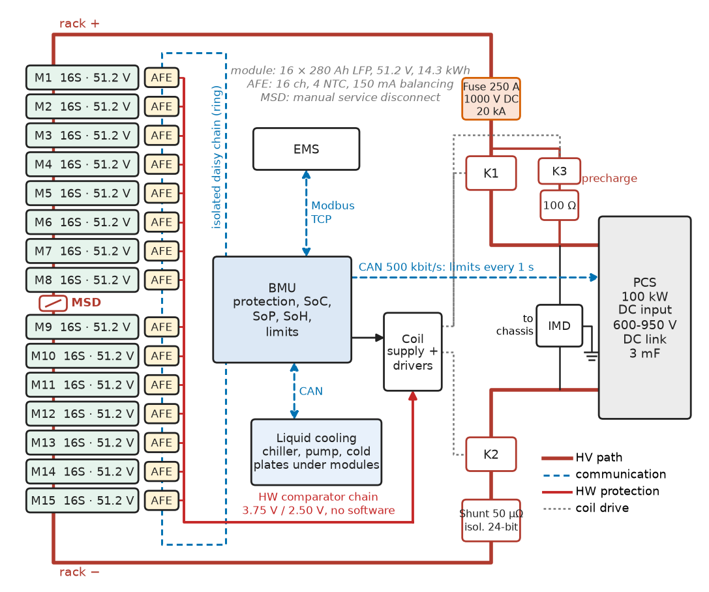
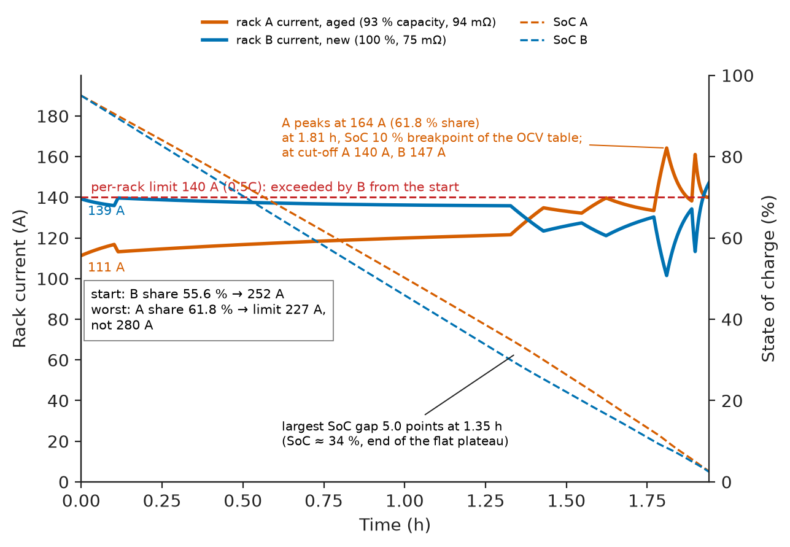
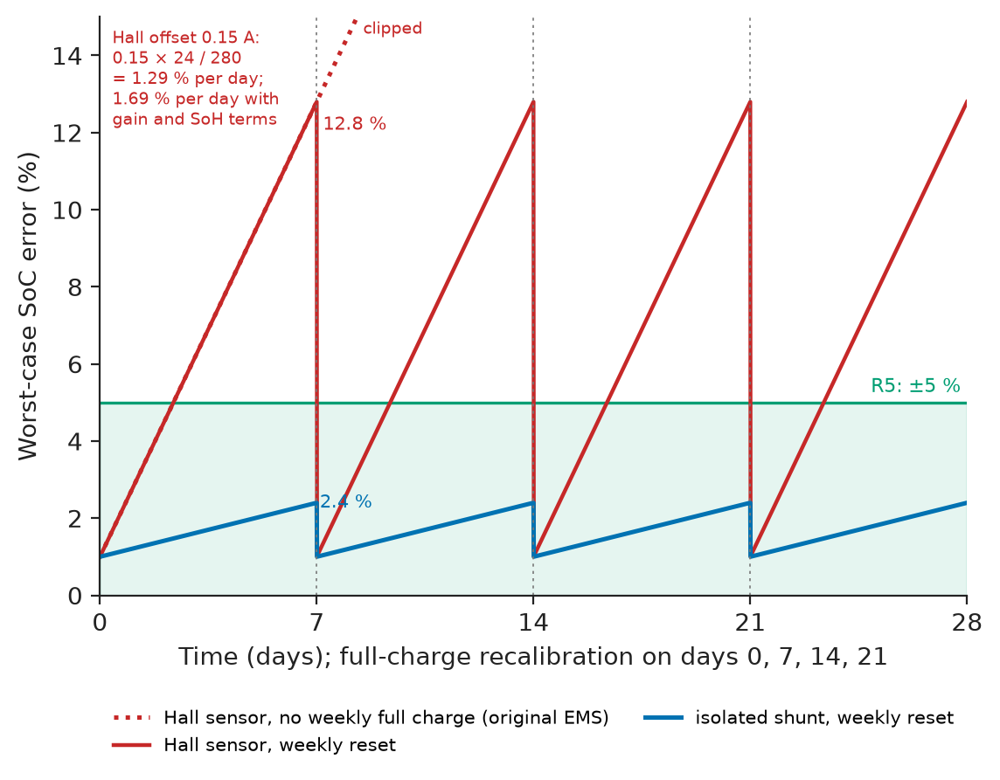
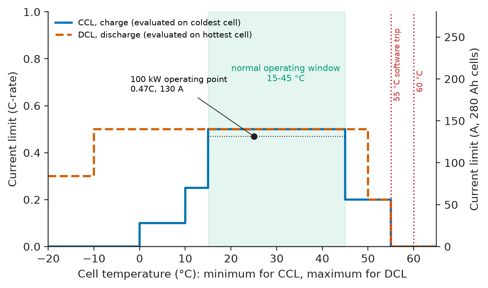
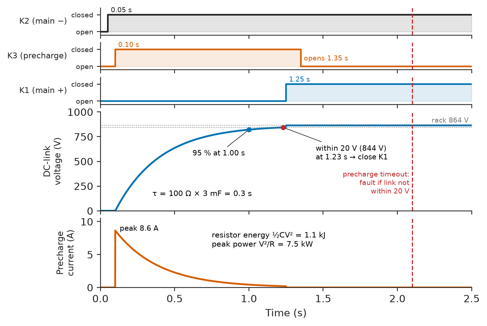
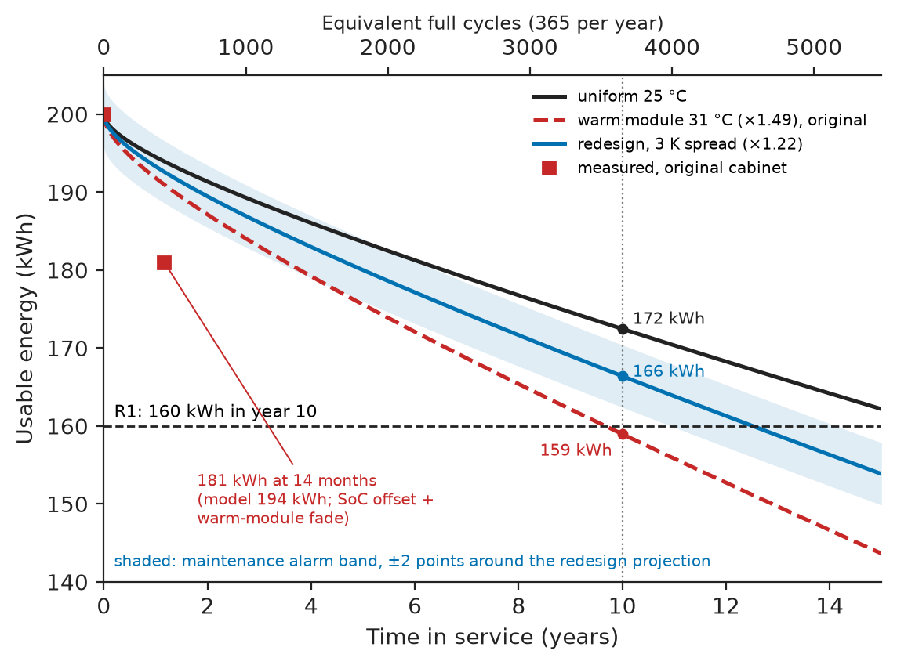

# Chapter 23 — Battery Energy Systems

*Part VI · Renewable Energy and Electric Mobility*

A food-processing plant bought a 215 kWh, 100 kW lithium-iron-phosphate battery cabinet to shave its afternoon demand peaks and soak up its rooftop PV. The contract said 200 kWh usable. In the fourteenth month a peak-shaving test delivered 181 kWh, and the battery stopped with its display showing 14 % state of charge, when the first cell reached its 2.80 V cut-off. Nothing was broken. The air-cooled cabinet's top module sat in the exhaust of the power-conversion system and ran 6 K warmer than the rest, so its sixteen cells had aged faster and self-discharged faster than the other 224; the balancing circuit, sized to trim manufacturing spread at 50 mA, could not keep up; and a Hall-effect current sensor with a 0.15 A offset had let the coulomb counter drift through weeks in which the controller never charged the battery full, on a chemistry whose flat voltage curve gives the estimator almost nothing to correct against. Every part met its datasheet. The system did not meet its contract, because thermal design, balancing, sensing and state estimation had been specified separately. This chapter designs that cabinet again, from the cell up.

> **How is a battery pack architected, from cell choice and series–parallel configuration to contactors, fuses and the battery-management system, so that it delivers its rated energy and power safely over its whole life?**
> **How are its state of charge, temperature and health measured well enough to keep that promise, and how is it tested before anyone is allowed near it?**

| Concept | Engineering destination |
|---|---|
| Battery-pack architecture | Cell–module–rack hierarchy, contactors, precharge, fuses, current sensing, isolation monitoring |
| Cell selection | Chemistry and format chosen against energy, power, life, safety and cost |
| Series and parallel configurations | Voltage window matched to the converter; parallel strings and current sharing |
| Battery-management systems | Analog front ends, daisy chains, protection logic, balancing, interfaces |
| State estimation | SoC, SoH and power limits with an error budget behind each |
| Thermal management | Heat generation, cooling choice, cell-to-cell temperature spread |
| Charging | CC–CV profiles, temperature-dependent current limits, the BMS–charger handshake |
| Protection | Layered limits, fuse–contactor coordination, short-circuit and insulation faults |
| Degradation monitoring | Capacity and resistance tracking, fade projection against warranty |
| Safety testing | IEC 62619, UL 9540A, UN 38.3, HIL fault injection |

**Roadmap.** Requirements and architecture (23.1) → cell selection (23.2) → series and parallel configuration (23.3) → the BMS (23.4) → state estimation (23.5) → thermal management (23.6) → charging (23.7) → protection (23.8) → degradation monitoring (23.9) → safety testing and verification (23.10) → failure analysis (23.11).

---

## 23.1 Requirements and pack architecture

> **Boundary.** Battery chemistries, energy and power ratings, the functions of a BMS, SoC and SoH definitions and estimators, ageing mechanisms and storage safety are covered at system level in *Electrical Energy and Machines*, [Ch. 16 §16.1–16.5 and §16.11](https://github.com/The-Studio-of-Sadiq/Electrical-Energy-and-Machines/blob/main/part-4-power-generation/16-energy-storage.md); electrode and electrolyte materials in *Materials Science and Engineering*, [Ch. 40 §40.2–40.3](https://github.com/The-Studio-of-Sadiq/Materials-Science-and-Engineering/blob/main/Chapters/CHAPTER%2040.md); the CC–CV charger and bidirectional converter hardware in *Electronics and Computing*, [Ch. 32 §32.7](https://github.com/The-Studio-of-Sadiq/Electronics-and-Computing/blob/main/part-7-power-electronics/32-motor-drives-and-power-conversion.md). This chapter owns the integration: the pack, the BMS as a product, its budgets and its tests. Chapters 24, 25 and 36 apply it.

### Requirements

The cabinet serves a 100 kW bidirectional power-conversion system (PCS) whose DC input accepts 600–950 V, under a site energy-management system (EMS) that schedules one full cycle a day: charging from PV and off-peak grid, discharging into the afternoon peak.

**Table 23.1 — Requirements of the 215 kWh cabinet.**

| ID | Requirement | Target | Verification |
|---|---|---|---|
| R1 | Usable AC-side energy at 0.5C, 25 °C | ≥ 200 kWh at commissioning; ≥ 160 kWh in year 10 | Capacity test (IEC 62933-2-1); ageing projection |
| R2 | Power | 100 kW charge and discharge, ambient −10 to 45 °C | Full-power test at 45 °C ambient |
| R3 | DC voltage | Inside PCS window 600–950 V at all SoC, temperature and current | Calculation; logged extremes |
| R4 | Cell-voltage measurement | ≤ ±5 mV total error, 3.0–3.6 V, −10 to 60 °C | AFE characterisation; error budget |
| R5 | SoC accuracy | ±5 % between recalibrations, recalibration at least weekly | Reference coulometer over 30 days |
| R6 | Cell temperature | Max ≤ 40 °C at 45 °C ambient, cell-to-cell spread ≤ 3 K | 24 h test with 40 thermocouples |
| R7 | Protection | Over-voltage detected and contactors open ≤ 1.2 s; independent hardware layer; short circuit cleared by fuse | HIL fault injection; fuse coordination study |
| R8 | Insulation | Alarm at 500 Ω/V, trip at 100 Ω/V | IMD test with calibrated resistor |
| R9 | Communications | Limits to PCS every 1 s over CAN; PCS stops ≤ 3 s after loss | Cable-pull test |
| R10 | Health reporting | SoH (capacity) estimate within ±3 % of a reference test | Annual capacity test |
| R11 | Safety | IEC 62619 certified cells and modules; UL 9540A module test without propagation; UN 38.3 for transport | Certificates; test reports |

### Architecture

Figure 23.1 shows the hierarchy. Two hundred and forty 280 Ah LFP cells sit in fifteen 16-cell modules, all in series (1P240S). Each module carries one 16-channel analog front end (AFE) that measures its cells and temperatures and drives the balancing; the AFEs talk in an isolated daisy chain to the battery-management unit (BMU), which owns the high-voltage switchgear: a main positive and a main negative contactor, a precharge contactor and resistor, a DC fuse, a shunt current sensor, an insulation-monitoring device and a manual service disconnect near the electrical midpoint. The BMU sends current and voltage limits to the PCS over CAN, reports to the EMS over Modbus TCP, and commands the cabinet's liquid-cooling unit.

<!-- FIGURE 23.1 | figures/ch23/fig-23-1-cabinet-architecture.png | block-diagram | Architecture of the 215 kWh, 100 kW LFP battery cabinet: cell, module and rack hierarchy, high-voltage switchgear and BMS communication. | Content: left column of 15 module boxes, each 16S of 280 Ah LFP cells (51.2 V, 14.3 kWh), each with an AFE (16-channel, 4 NTC inputs, passive balancing 150 mA) linked by an isolated daisy chain drawn as a dashed loop (ring for redundancy) to the BMU. Manual service disconnect between modules 8 and 9. High-voltage path on the right: rack positive through DC fuse 250 A (1000 V DC, 20 kA breaking), main positive contactor K1 with precharge branch K3 plus 100 ohm resistor in parallel, shunt (50 microohm, isolated 24-bit sensor), main negative contactor K2, to PCS DC input (600 to 950 V, DC-link capacitance 3 mF). Insulation monitoring device across rack positive and negative to chassis. BMU outputs: contactor drivers, CAN 500 kbit/s to PCS (limits every 1 s), Modbus TCP to EMS, CAN to liquid-cooling unit (chiller, pump, cold plates under each module). Independent hardware over-voltage comparator chain in red to K1 and K2 coil supply. -->



*Figure 23.1 — Architecture of the 215 kWh, 100 kW LFP battery cabinet: cell, module and rack hierarchy, high-voltage switchgear and BMS communication.*

The architecture fixes three interfaces that the rest of the chapter designs: the AFE–BMU chain (measurement and balancing), the BMU–PCS link (limits and the handshake that lets the PCS charge or discharge), and the BMU–switchgear path (the last line of protection).

---

## 23.2 Cell selection

### What decides the chemistry

For stationary storage cycling once a day for fifteen years, cycle life, calendar life, safety and cost per kWh delivered over life outweigh energy density. That combination has made lithium iron phosphate the default; NMC wins where mass and volume matter (vehicles, Chapter 24), lithium titanate where very high power or extreme cycle counts matter, and sodium-ion is entering stationary service where its cold-weather behaviour and freedom from lithium supply matter.

**Table 23.2 — Cell options for the cabinet (2026 indicative, 10,000-cell quantities).**

| Cell | Nominal | Energy | Cycle life to 80 % (0.5C, 25 °C) | Thermal runaway onset | Price | Assessment |
|---|---|---|---|---|---|---|
| LFP prismatic 280 Ah | 3.2 V, 0.896 kWh, $R_{DC}$ ≈ 0.25 mΩ | 165 Wh/kg | 6,000–8,000 | ≈ 200–270 °C, little oxygen release | \$45 (\$50/kWh) | **Chosen**: life, safety, a cabinet of 240 cells |
| LFP prismatic 314 Ah | 3.2 V, 1.005 kWh | 175 Wh/kg | 6,000–8,000 | Similar | \$49 | Newer; 214 cells for the same energy, odd module count; second source pending |
| NMC 811 pouch 60 Ah | 3.65 V, 0.219 kWh | 260 Wh/kg | 1,500–2,500 | ≈ 150–200 °C, oxygen release | \$20 (\$90/kWh) | Rejected: life and propagation risk |
| Sodium-ion prismatic 160 Ah | 3.1 V, 0.496 kWh | 140 Wh/kg | 3,000–6,000 | Lower energy release | \$37 (\$75/kWh) | Watched: better below 0 °C; supply still thin |
| LTO cylindrical 40 Ah | 2.3 V, 0.092 kWh | 75 Wh/kg | 15,000–25,000 | Very stable | \$40 (\$435/kWh) | Rejected: cost per kWh |

The cost that matters is levelised over life. A 280 Ah LFP cell at \$50/kWh delivering 6,000 cycles at 93 % depth costs about $50/(6000\times0.93)=0.9$ cents per kWh cycled; an NMC cell at \$90/kWh and 2,000 cycles costs 4.8 cents. Format matters too: one large prismatic cell per 0.9 kWh keeps the cabinet to 240 voltage taps and 240 welds, against about 1,000 for the pouch option.

### What the datasheet must give, and what to test anyway

The selection depends on datasheet numbers that are not always comparable: capacity at a stated rate and temperature, DC resistance at a stated pulse length and SoC, cycle life at a stated depth, rate, temperature and end-of-life criterion, and the charge-current limits against temperature. Incoming inspection therefore measures every cell (capacity class, 1 kHz AC resistance, OCV after a rest, self-discharge from a 7–14 day voltage decay), and the module builder bins cells so that each module's cells match within about 0.5 % in capacity and 5 % in resistance.

> **Status of the principle: Cycle life against depth, rate and temperature**
> *Empirical.* Datasheet cycle lives are accelerated-test results at one condition; extrapolation to other depths and temperatures uses fitted models (Arrhenius in temperature, power laws in depth of discharge) that the cell vendor's warranty, not physics, makes binding.

---

## 23.3 Series and parallel configurations

### The voltage window

The number of cells in series is set by the converter's window, at the extremes of SoC, current and temperature, not by the nominal voltage. With $N_s$ cells, the rack's operating range is $N_s V_{\min}$ to $N_s V_{\max}$, and under load the terminal voltage departs from the open-circuit voltage by $I\,R_\text{rack}$.

**Worked example — How many cells in series?** The PCS accepts 600–950 V and needs at least 640 V at its terminals to deliver full AC power at the high end of the grid tolerance. The rack's resistance is 240 cells × 0.25 mΩ plus 15 mΩ of busbars, fuse, contactors and shunt, 75 mΩ; at 0.5C (140 A) that drops 10.5 V. At the bottom, with the discharge cut-off at 2.90 V per cell under load, 240 cells give 696 V, and at the top of charge, 3.55 V per cell plus a 10.5 V charging rise gives 862 V; the absolute cell limit of 3.65 V gives 876 V. The window 696–876 V sits inside 640–950 V with 56 V margin at the bottom and 74 V at the top. With 216 cells the bottom would be 626 V, below the full-power floor; with 256 cells the top would be 934 V at the 3.65 V limit, inside the PCS rating but within 16 V of it. 240 cells also divide into fifteen 16-cell modules, matching the 16-channel AFE.

> **Status of the principle: Weakest-cell limit of a series string**
> *Derived.* The same current flows through every cell in series, so the first cell to reach a voltage limit ends charge or discharge for all; the usable capacity of the string is that of its weakest cell, adjusted by how far its SoC is offset from the others. Balancing corrects SoC offsets, never capacity differences (*Electrical Energy and Machines* §16.3).

### Cells in parallel and racks in parallel

Paralleling cells inside a module (2P of 140 Ah cells instead of 1P of 280 Ah, say) halves the voltage-tap count per kWh and gives the cells a common voltage, so they self-balance; the cost is that one internally shorted cell is fed by its parallel neighbours, which demands a fusible link per cell in cylindrical-cell packs, and that the BMS can no longer see an individual cell's capacity loss.

Paralleling *racks* is how a site grows: the plant's expansion plan adds a second cabinet in year 3. Two racks on one DC bus share current in inverse proportion to their resistances, modified by any difference in open-circuit voltage, and an aged rack has both less capacity and more resistance. The listing simulates a 200 kW discharge of a three-year-old rack (93 % capacity, 25 % higher resistance) in parallel with a new one, using a piecewise LFP open-circuit-voltage curve:

```python
# Two 240S LFP racks in parallel on one PCS: current sharing during a 200 kW discharge
import numpy as np
soc_pts = np.array([0, 5, 10, 20, 30, 50, 70, 90, 95, 100]) / 100
ocv_pts = np.array([2.80, 3.10, 3.20, 3.25, 3.28, 3.30, 3.32, 3.34, 3.37, 3.45])
ocv = lambda soc: 240 * np.interp(soc, soc_pts, ocv_pts)       # rack OCV, V
A = dict(Q=280 * 0.93, R=0.075 * 1.25, soc=0.95)                # aged rack, year 3
B = dict(Q=280 * 1.00, R=0.075, soc=0.95)                       # new rack
P, dt, E, log = 200e3, 1.0, 0.0, []                             # W, s, Wh
ga, gb = 1 / A["R"], 1 / B["R"]
while True:
    ea, eb = ocv(A["soc"]), ocv(B["soc"])
    s = ea * ga + eb * gb                     # solve ga(ea-V) + gb(eb-V) = P/V for V
    V = (s + np.sqrt(s * s - 4 * (ga + gb) * P)) / (2 * (ga + gb))
    ia, ib = (ea - V) * ga, (eb - V) * gb
    if V / 240 < 2.90 or min(A["soc"], B["soc"]) <= 0:
        break
    log.append((A["soc"], B["soc"], ia, ib))
    A["soc"] -= ia * dt / 3600 / A["Q"]
    B["soc"] -= ib * dt / 3600 / B["Q"]
    E += P * dt / 3600
for label, (sa, sb, ia, ib) in (("start", log[0]), ("end", log[-1])):
    print(f"{label:5s}: I_A = {ia:3.0f} A, I_B = {ib:3.0f} A (B share {ib/(ia+ib):.1%}), "
          f"SoC_A = {sa:.1%}, SoC_B = {sb:.1%}")
k = max(range(len(log)), key=lambda n: log[n][2])           # rack A's peak
sa, sb, ia, ib = log[k]
print(f"peak A: I_A = {ia:3.0f} A (A share {ia/(ia+ib):.1%}) at {k/3600:.2f} h, SoC_A = {sa:.1%}")
share = max(max(ia, ib) / (ia + ib) for _, _, ia, ib in log)    # worst rack, worst moment
print(f"delivered {E/1e3:.0f} kWh in {len(log)/3600:.2f} h; "
      f"max system current for a 140 A rack limit = {140/share:.0f} A")
```

```text
start: I_A = 111 A, I_B = 139 A (B share 55.6%), SoC_A = 95.0%, SoC_B = 95.0%
end  : I_A = 140 A, I_B = 147 A (B share 51.2%), SoC_A = 2.6%, SoC_B = 2.4%
peak A: I_A = 164 A (A share 61.8%) at 1.81 h, SoC_A = 10.0%
delivered 388 kWh in 1.94 h; max system current for a 140 A rack limit = 227 A
```

The racks end the discharge within 0.2 % SoC of each other: a shared bus voltage self-balances parallel racks, because the one that falls behind sits at a lower OCV and takes less current. The design problem is current, not energy, and the share does not stay put. The new rack carries 55.6 % of the current at the start and runs 5.0 SoC points behind by 1.35 h; when it reaches the steep tail of the curve below 10 % first, its OCV drops and the aged rack takes up to 164 A (61.8 %) at 1.81 h, above its own 140 A limit, while the start and end lines of the output both look harmless. If each rack is limited to 140 A (0.5C), the system must be limited to 227 A, not 280 A (or 252 A from the opening share alone) — a 19 % power derating that must be in the system controller's limit calculation, which takes, continuously, the minimum over racks of (rack limit ÷ that rack's measured share). Figure 23.2 plots the two currents through the discharge.

<!-- FIGURE 23.2 | figures/ch23/fig-23-2-parallel-rack-sharing.png | plot | Current sharing between an aged and a new LFP rack in parallel during a 200 kW discharge. | Content: x-axis time 0 to 1.94 h. Left y-axis rack current 0 to 190 A: aged rack A (93 percent capacity, 94 milliohm) rising from 111 A to a peak of 164 A at 1.81 h (about 10 percent SoC), ending at 140 A; new rack B (100 percent, 75 milliohm) from 139 A to 147 A; horizontal dashed line at 140 A labelled per-rack limit, exceeded by B from the start and by A near the end. Right y-axis SoC 0 to 100 percent: SoC_A and SoC_B dashed, both from 95 percent to about 2.5 percent, nearly overlapping; the gap peaks at 5.0 points at 1.35 h (SoC about 34 percent, end of the flat plateau). Annotation: system limit 227 A from max share 61.8 percent. -->



*Figure 23.2 — Current sharing between an aged and a new LFP rack in parallel during a 200 kW discharge.*

Connecting a rack to a live bus has its own rule: the contactors close only when the rack's voltage is within a few volts of the bus (here 10 V, giving at most $10/0.15=67$ A of circulating current through the two 75 mΩ racks), otherwise the PCS first moves the bus voltage or the new rack is precharged and equalised.

---

## 23.4 Battery-management systems

### The analog front end and its error budget

The AFE decides how well the BMS can see the cells. The 16-channel class used here (BQ79616-, ADBMS1818- or MC33775A-class parts) samples all cells simultaneously with a sigma-delta or SAR converter, filters them, measures NTC thermistors, runs passive balancing, and communicates over an isolated daisy chain (capacitor- or transformer-coupled differential links, often arranged as a ring so that one broken link does not blind the BMU). On an LFP plateau whose slope is 0.5 mV per per cent SoC (*Electrical Energy and Machines* §16.4), millivolts matter.

**Table 23.3 — Cell-voltage measurement error budget (R4: ±5 mV).**

| Source | Value | Note |
|---|---|---|
| AFE gain and offset over −10 to 60 °C | ±2.5 mV | Datasheet total error, factory-trimmed |
| Reference drift over 10 years | ±1.0 mV | Datasheet lifetime drift |
| Busbar IR drop in the sense path at 140 A | ±0.3 mV | Sense wires welded at cell terminals, not on busbars (2.8 mV otherwise) |
| Sense-wire drop from balancing current | 0 mV | Balancing paused 2 ms before each conversion |
| Noise after 16-sample averaging | ±0.3 mV | — |
| Worst-case sum | ±4.1 mV | Margin 0.9 mV to R4 |
| Root-sum-square | ±2.7 mV | Used for SoC uncertainty |

The table records two design decisions that a datasheet will not make: sensing on the cell terminal rather than the busbar (a 20 µΩ busbar carrying 140 A adds 2.8 mV, enough on its own to break the budget), and synchronising balancing with conversion, because balancing current through a shared sense wire distorts the reading of two cells.

### Balancing

Passive balancing bleeds the high cells through resistors near the top of charge. Its required current is set by the worst-case divergence it must cancel, which is dominated not by manufacturing spread but by **self-discharge differences**, and those follow temperature.

**Worked example — Why 50 mA was not enough.** LFP self-discharge is about 1.0 % per month at 25 °C and rises with temperature roughly as the ageing rate does, about 1.5 times faster 6 K warmer, so the warm module's cells lost an extra 0.49 % per month, $0.0049\times280/30=0.046$ Ah per day. The original balancer bled the other 224 cells at 50 mA only while their voltage exceeded 3.40 V, about 30 minutes a day: 0.025 Ah per day. The imbalance grew by 0.021 Ah a day, 8.8 Ah or 3.1 % SoC in 425 days, and the warm cells, already 1.5 % lower in capacity, ended every discharge early. The redesign uses the AFE's 150 mA internal balancing, a balancing window of 30 minutes daily plus a 2-hour constant-voltage hold in a weekly full charge (about 0.12 Ah per day on average), and liquid cooling that cuts the spread to 3 K (Section 23.6), which shrinks the self-discharge difference to about 0.02 Ah per day. Balancing now has a factor of six in hand.

### Firmware and the protection core

The BMU runs a 100 ms main loop (measurement, protection, limits), a 1 s loop (state estimation, limits to the PCS, logging) and slower housekeeping, with the protection core developed to IEC 61508 SIL 2 practice (or ISO 26262 ASIL C in vehicles). The listing is the shape of that core: debounced limits on the extreme cell values, a latched trip that requires a service reset, and the rule that data the BMU cannot trust are treated as a fault.

```c
/* bms_protect.c -- cell-level protection with debounce and latching (C11, illustrative) */
#include <stdint.h>
#include <stdbool.h>

#define N_CELLS 240u
typedef enum { PROT_OK = 0, PROT_DERATE, PROT_TRIP } prot_level_t;
typedef struct { int16_t warn, trip; uint16_t trip_ms; } limit_t;  /* mV or 0.1 degC */

static const limit_t OV = { 3600, 3650, 1000 };
static const limit_t UV = { 2900, 2800, 2000 };   /* trips when below */
static const limit_t OT = {  500,  550, 5000 };   /* 0.1 degC */

typedef struct { uint16_t ov_ms, uv_ms, ot_ms; bool latched; } prot_state_t;

/* Every 100 ms with fresh AFE data; afe_ok is false on CRC error, stale data or chain break. */
prot_level_t bms_protect(prot_state_t *st, const uint16_t v_mv[N_CELLS],
                         const int16_t t_dc[], uint8_t n_t, bool afe_ok)
{
    uint16_t vmax = 0u, vmin = UINT16_MAX;
    int16_t tmax = INT16_MIN;
    if (st->latched) return PROT_TRIP;                /* service reset required */
    if (!afe_ok) { st->latched = true; return PROT_TRIP; }  /* unknown is unsafe */
    for (uint16_t k = 0u; k < N_CELLS; ++k) {
        if (v_mv[k] > vmax) vmax = v_mv[k];
        if (v_mv[k] < vmin) vmin = v_mv[k];
    }
    for (uint8_t k = 0u; k < n_t; ++k) if (t_dc[k] > tmax) tmax = t_dc[k];

    st->ov_ms = (vmax >= (uint16_t)OV.trip) ? (uint16_t)(st->ov_ms + 100u) : 0u;
    st->uv_ms = (vmin <= (uint16_t)UV.trip) ? (uint16_t)(st->uv_ms + 100u) : 0u;
    st->ot_ms = (tmax >= OT.trip) ? (uint16_t)(st->ot_ms + 100u) : 0u;
    if (st->ov_ms >= OV.trip_ms || st->uv_ms >= UV.trip_ms || st->ot_ms >= OT.trip_ms) {
        st->latched = true;
        return PROT_TRIP;
    }
    if (vmax >= (uint16_t)OV.warn || vmin <= (uint16_t)UV.warn || tmax >= OT.warn)
        return PROT_DERATE;                           /* limits to PCS go to zero */
    return PROT_OK;
}
```

In the full product an under-voltage trip blocks discharge but permits a supervised recovery charge, and a separate hardware comparator chain in the AFEs (set at 3.75 V and 2.50 V) opens the contactor coil supply without software (Section 23.8). The debounce times are part of the safety argument: the 1.0 s over-voltage debounce plus about 100 ms of contactor opening time meets R7's 1.2 s, and the cell vendor's test data show no damage for brief excursions to 3.75 V lasting several seconds at the charge currents the PCS can deliver.

---

## 23.5 State estimation

### SoC: budget first, estimator second

The estimator (coulomb counting with OCV correction, or an extended Kalman filter on an equivalent-circuit model, *Electrical Energy and Machines* §16.4) is only as good as its inputs. On LFP the OCV correction is weak through the 30–90 % plateau, so between full charges the estimate is essentially a coulomb count, and its error is the current sensor's error integrated over time. The budget decided the sensor before anyone chose an algorithm.

**Table 23.4 — SoC error budget over one week between full charges (280 Ah, one 260 Ah cycle a day; R5: ±5 %).**

| Source | Hall sensor (original) | Isolated shunt (redesign) |
|---|---|---|
| Offset integrated for 168 h | 0.15 A → 9.0 % | 0.01 A → 0.6 % |
| Asymmetric gain error on 7 × 260 Ah | 0.2 % → 1.3 % | 0.05 % → 0.3 % |
| Capacity (SoH) error at 50 % depth | 3 % → 1.5 % | 1 % → 0.5 % |
| Reset accuracy at full charge | 1.0 % | 1.0 % |
| Worst-case sum | 12.8 % (fails) | 2.4 % (margin 2.6 points) |

A Hall sensor's offset changes with temperature and with remanence after large currents, so it cannot be calibrated out once; an isolated shunt sensor with a 24-bit converter and an offset below 10 mA (IVT-class, or a shunt with an INA228-class monitor behind an isolator) costs about \$120 more and removes the dominant term. Figure 23.3 shows the two designs between weekly resets.

<!-- FIGURE 23.3 | figures/ch23/fig-23-3-soc-error-growth.png | plot | Worst-case SoC error between full-charge recalibrations for the original Hall-sensor design and the redesigned shunt design. | Content: x-axis time 0 to 28 days; y-axis SoC error 0 to 15 percent. Sawtooth for Hall sensor: grows linearly from 1.0 percent after each weekly reset (days 0, 7, 14, 21) to 12.8 percent at day 7; a second Hall trace without weekly reset (original EMS schedule) growing to over 15 percent by day 10 (clipped). Shunt sawtooth: 1.0 percent rising to 2.4 percent each week. Horizontal band at plus 5 percent labelled R5. Annotation on Hall trace: 0.15 A offset = 1.29 percent per day. -->



*Figure 23.3 — Worst-case SoC error between full-charge recalibrations for the original Hall-sensor design and the redesigned shunt design.*

The second design rule is behavioural: the EMS must allow a full charge, with the CV taper that lets the BMS reset SoC to 100 % and balance, at least weekly (R5). The original EMS, optimising tariff arbitrage, had kept the battery between 10 % and 90 % for six weeks at a time.

> **Status of the principle: Coulomb-count drift**
> *Derived.* Integrating a current measurement with a constant offset $\Delta I$ gives an SoC error growing as $\Delta I\,t/Q$ and a gain error growing with charge throughput; without an absolute reference these errors are unbounded, which is why every SoC estimator needs a periodic anchor, and why a flat OCV curve makes the anchor rare.

### Near the ends, report the weakest cell

A pack SoC computed from the average cell tells the EMS how much charge is in the pack, not how much it can deliver. The redesign reports a blended SoC that follows the average in mid-range and converges to the lowest cell's SoC as the pack approaches empty (and the highest cell's as it approaches full), so that "0 %" coincides with the first cell's cut-off. The 14 % that the original display showed at cut-off was the sum of two errors: about 5 % that the average cool cell still held, and about 9 % of coulomb-count drift since the estimator's last low-SoC OCV correction.

### State of power and state of health

**State of power** is the current the pack can deliver or accept for the next 2, 10 or 30 s without any cell crossing its voltage limit: $I_\text{max}=(V_\text{OCV}-V_\text{min})/R_{t}$ for the worst cell, with $R_t$ the pulse resistance at that duration, SoC and temperature from a lookup table refreshed by online estimates. It is sent to the PCS every second as the discharge and charge current limits (DCL, CCL). **State of health** is treated in Section 23.9.

---

## 23.6 Thermal management

> **Boundary.** Thermal-resistance networks are in *Engineering Physics*, [Ch. 14 §14.7](https://github.com/The-Studio-of-Sadiq/Engineering-Physics/blob/main/CHAPTERS/CHAPTER%2014.md); the Arrhenius rate law used below in [Ch. 20 §20.7.1](https://github.com/The-Studio-of-Sadiq/Engineering-Physics/blob/main/CHAPTERS/CHAPTER%2020.md).

### Heat generation and what cooling is really for

At 100 kW and 768 V nominal the rack carries 130 A, 0.47C. Each 0.25 mΩ cell dissipates $130^2\times0.25\times10^{-3}=4.2$ W, the rack 1.0 kW plus about 0.25 kW in busbars, fuse and contactors; the reversible (entropic) heat of LFP is small at this rate. A 5.4 kg cell with a heat capacity of about 1.0 kJ/(kg·K) would warm only 5.7 K in a two-hour discharge with no cooling at all. Cooling in a stationary LFP cabinet is therefore less about removing cycling heat than about two other things: holding the cells near 25 °C when the container sits at 45 °C, and keeping every cell at the *same* temperature, because ageing and self-discharge follow temperature exponentially.

**Worked example — What 6 K costs.** With an activation energy of 50 kJ/mol, the ageing rate at 31 °C relative to 25 °C is $\exp[(50{,}000/8.314)(1/298.15-1/304.15)]=1.49$. The fade model fitted to the cell vendor's data (Section 23.9) gives 13.8 % capacity loss in 10 years at 25 °C, so 200 kWh usable becomes 172 kWh, inside R1's 160 kWh. Multiply the fade by 1.49 for the warm module and the pack, limited by its weakest cells, falls to 159 kWh: a 6 K spread alone fails R1. A 3 K spread (factor 1.22) leaves 166 kWh.

**Table 23.5 — Thermal-management options.**

| Option | Cell-to-cell spread | Max cell at 45 °C ambient | Parasitic power | Cost | Assessment |
|---|---|---|---|---|---|
| Forced air, cabinet air conditioner (original) | 6–10 K | 32 °C | 1.5–2.5 kW in summer | \$3,000 | Spread fails R6 and R1 |
| Forced air with ducted plenum and baffles | 4–6 K | 31 °C | 1.5–2.5 kW | \$3,800 | Better, still marginal |
| Liquid cold plates, 50 % glycol, 3 kW chiller | 2–3 K | 29 °C | 0.6–1.2 kW | \$5,500 | **Chosen** |
| Immersion in dielectric fluid | ≤ 2 K | 28 °C | 0.5–1 kW | \$9,000 | Best propagation barrier; cost |

**Worked example — Sizing the coolant loop.** The chiller must remove the cells' 1.0 kW, the switchgear's 0.25 kW and about 1.2 kW of heat leaking into a 45 °C cabinet, 2.5 kW, so a 3 kW unit has 20 % margin. With 15 L/min of 50 % glycol ($\rho\approx1{,}060$ kg/m³, $c_p\approx3.4$ kJ/(kg·K), mass flow 0.265 kg/s), the coolant warms by $1.25/(0.265\times3.4)=1.4$ K across the cell plates at full power. With a cell-to-coolant thermal resistance of 1.5 K/W, each cell runs $4.2\times1.5=6.3$ K above its local coolant. A 22 °C supply then puts the coolest cell near 28 °C and the hottest near 29.7 °C at full power: a spread under 2 K from the coolant rise, plus manufacturing spread in contact resistance, inside R6's 3 K.

<!-- FIGURE 23.4 | figures/ch23/fig-23-4-current-limits-vs-temperature.png | plot | Charge and discharge current limits of the LFP cabinet against cell temperature, as sent by the BMS to the PCS. | Content: x-axis minimum or maximum cell temperature -20 to 65 C; y-axis current limit 0 to 1.0 C (0 to 280 A). Charge limit CCL (solid): 0 below 0 C; 0.1 C from 0 to 10 C; 0.25 C from 10 to 15 C; 0.5 C from 15 to 45 C; 0.2 C from 45 to 55 C; 0 above 55 C. Discharge limit DCL (dashed): 0.3 C from -20 to -10 C; 0.5 C from -10 to 50 C; 0.2 C from 50 to 55 C; 0 above 55 C. Shaded band 15 to 45 C labelled normal operating window, with the 100 kW operating point at 0.47 C marked. Vertical dotted lines at 55 C (software trip) and 60 C. Charge limit evaluated on the coldest cell, discharge limit on the hottest. -->



*Figure 23.4 — Charge and discharge current limits of the LFP cabinet against cell temperature, as sent by the BMS to the PCS.*

---

## 23.7 Charging

### CC–CV and the handshake

LFP is charged at constant current to a cell-voltage limit and then at constant voltage until the current tapers; the converter that does it is in *Electronics and Computing* §32.7. In a stationary system the PCS is the charger and the BMS is its master: every second the BMS sends the charge-voltage limit (here $240\times3.50=840$ V for daily cycles, 3.55 V per cell for the weekly full charge), the CCL and DCL (Figure 23.4) and its status, and the PCS must obey the lowest of its own limit, the BMS limit and the EMS request. If the BMS messages stop for 3 s, the PCS stops (R9). The voltage limit is applied to the pack, but the BMS derates the CCL as soon as the *highest cell* passes 3.45 V, because with a 2 % SoC spread one cell can reach the steep end of the curve while the pack average is still on the plateau.

### Temperature limits

Charging LFP below 0 °C plates lithium metal on the graphite anode, which consumes capacity and can grow dendrites (*Electrical Energy and Machines* §16.5). The CCL is therefore evaluated on the coldest cell and the DCL on the hottest. On winter mornings a 4 kW heater in the coolant loop warms the cells (about 1,300 kJ/K for 240 cells) from −10 °C to 10 °C, about 7.2 kWh of heat, in roughly two hours before the EMS may schedule a charge; that is about 4 % of a day's throughput on the coldest days, and keeping the insulated cabinet above 5 °C overnight costs less.

**Worked example — The weekly full charge.** The weekly charge runs CC at 0.47C to an average of 3.45 V per cell, then CV at 852 V (3.55 V per cell) until the current falls to 0.05C, 14 A. LFP's top-of-charge region is steep, so in the last 2–3 % of SoC the cell voltages spread by tens of millivolts and the balancer can see and correct imbalance; with 150 mA balancing held for two hours, each high cell is trimmed by up to 0.3 Ah (0.11 % SoC), and the BMS resets the SoC of every cell to 100 % when the taper current is reached. The cost is time at high SoC (calendar ageing accelerates there), which is why the full charge is weekly, not daily.

---

## 23.8 Protection

> **Boundary.** Protection principles and DC fault interruption are in *Electrical Energy and Machines*, [Ch. 29 §29.4–29.5](https://github.com/The-Studio-of-Sadiq/Electrical-Energy-and-Machines/blob/main/part-8-electrical-safety-and-engineering-practice/29-electrical-safety.md); the fact that a battery cannot be isolated internally and its terminals are always live, in [§29.6](https://github.com/The-Studio-of-Sadiq/Electrical-Energy-and-Machines/blob/main/part-8-electrical-safety-and-engineering-practice/29-electrical-safety.md).

### Layers

Protection is layered so that no single failure lets a cell leave its safe window:

1. **Limits.** The CCL and DCL keep a healthy system away from every limit.
2. **Software trips.** The BMU opens the contactors on debounced over- or under-voltage, over-temperature, over-current, insulation fault, loss of AFE data or loss of the PCS link (Section 23.4).
3. **Independent hardware.** AFE comparators at 3.75 V and 2.50 V, wired in a daisy-chained fault line that de-energises the contactor coils directly.
4. **Fuse.** A DC fuse clears short circuits that are beyond the contactors' breaking capacity.
5. **Cell and module.** The cell's own vent, and module-level barriers against propagation (Section 23.10).

**Table 23.6 — Protection thresholds of the cabinet.**

| Quantity | Derate | Software trip (debounce) | Hardware | Action |
|---|---|---|---|---|
| Max cell voltage | 3.45 V (CCL ramps down), 3.60 V (CCL = 0) | 3.65 V (1.0 s) | 3.75 V comparator | Open K1, K2 |
| Min cell voltage | 2.95 V (DCL ramps down), 2.90 V (DCL = 0) | 2.80 V (2.0 s) | 2.50 V comparator | Open; allow supervised recovery charge |
| Max cell temperature | 45 °C (CCL), 50 °C (DCL) | 55 °C (5 s) | 65 °C thermal cut-out in coil circuit | Open; cooling stays on |
| Rack current | Limits from SoP | 1.1 × limit for 10 s | Fuse 250 A | Open (≤ contactor rating) |
| Insulation resistance | 500 Ω/V alarm (432 kΩ) | 100 Ω/V (86 kΩ) | — | Alarm; trip and lock out |

### Short circuit: who interrupts what

**Worked example — Fuse–contactor coordination.** A bolted short at the PCS terminals is limited only by the rack's 75 mΩ: $792/0.075\approx10.6$ kA at mid-SoC, rising toward 11.5 kA at full charge. The main contactors are rated to break about 2.5 kA at 800 V DC a few times in their life; opening them into 10 kA would weld or destroy them. Coordination therefore says: below about 2 kA (overloads, soft faults), the BMS opens the contactors; above it, the BMS must *not* command an opening and the fuse clears the fault. The fuse is a 250 A, 1,000 V DC battery-protection fuse (IEC 60269-7 gBat class) with a 20 kA breaking capacity; at 10.6 kA its melting $I^2t$ is reached in a few milliseconds, well inside the cells' and busbars' withstand. The BMS's current-sense logic reads the shunt every 1 ms and, above 2 kA, inhibits the contactor command until the current has fallen to zero. The manual service disconnect between modules 8 and 9 splits the pack during maintenance into halves of 410 V and 358 V, so no point inside it sees the full 768 V.

> **Status of the principle: Prospective short-circuit current of a battery**
> *Derived.* A charged battery is a voltage source behind its internal and connection resistance, so the prospective fault current is the open-circuit voltage divided by the loop resistance; it rises as cells are paralleled and falls only slightly with SoC and temperature, which is why the interrupting device is chosen for the full-charge, warm, new-cell case.

### Precharge

The PCS DC link holds about 3 mF. Closing the main contactors onto a discharged link would draw a current limited only by the loop resistance, kiloamperes for a millisecond, welding the contactor tips. The precharge contactor K3 closes first through a 100 Ω resistor (Figure 23.5): the inrush is limited to $864/100=8.6$ A, the time constant is $100\times3\times10^{-3}=0.3$ s, the link reaches 95 % of the rack voltage in 0.9 s and comes within 20 V of it after $0.3\ln(864/20)=1.13$ s, and the resistor absorbs $\tfrac12CV^2=1.1$ kJ with a peak power of 7.5 kW, so it is a pulse-rated wirewound part. The BMU closes K1 when the link is within 20 V of the rack voltage, opens K3, and declares a fault if that has not happened within 2 s — the signature of a shorted link or a failed PCS capacitor.

<!-- FIGURE 23.5 | figures/ch23/fig-23-5-precharge-sequence.png | timing-diagram | Contactor and precharge sequence when the cabinet connects to the PCS DC link. | Content: time axis 0 to 2.5 s. Digital traces: K2 main negative closes at 0.05 s; K3 precharge closes at 0.10 s; K1 main positive closes at 1.25 s; K3 opens at 1.35 s. Analog traces: DC-link voltage rising as 864 x (1 - exp(-(t - 0.1)/0.3)), 95 percent at 1.0 s, within 20 V (844 V) at 1.23 s, then 864 V after K1 closes; precharge current peaking at 8.6 A at 0.1 s and decaying with tau 0.3 s. Dashed vertical line at 2.1 s labelled precharge timeout fault if link not within 20 V. Annotations: resistor energy 1.1 kJ, peak power 7.5 kW. -->



*Figure 23.5 — Contactor and precharge sequence when the cabinet connects to the PCS DC link.*

---

## 23.9 Degradation monitoring

### Measuring capacity and resistance in service

A full capacity test interrupts service, so the BMS estimates SoH from partial data: charge counted between two well-defined anchors (the full-charge reset and a rest-OCV reading below 15 % SoC, where the LFP curve is steep again), and pulse resistance from the voltage step at each large current change, normalised to 25 °C and 50 % SoC. Per-cell trends matter more than pack averages: in the opening's cabinet, a per-module capacity estimate would have shown the warm module falling away from the others by the fourth month.

### Projecting fade against the warranty

The cell vendor's ageing data fit a calendar term proportional to $\sqrt t$ and a cycle term proportional to equivalent full cycles (EFC), both multiplied by the Arrhenius factor $k_T$ of the cell's temperature:

$$
\Delta Q(\%)=k_T\left(a\sqrt{t}+b\,N_\text{EFC}\right),\qquad a=2.0\ \%/\sqrt{\mathrm{yr}},\ b=0.00204\ \%/\mathrm{EFC}\ (25\ ^\circ\mathrm{C})
$$

which reproduces the vendor's 80 % at 6,000 cycles over 15 years at 25 °C.

> **Status of the principle: Square-root calendar plus linear cycle fade**
> *Empirical.* A two-term fit to accelerated tests of one cell design; it misses the late-life knee at which fade accelerates, and the Arrhenius factor is fitted over a limited temperature range, so the projection is a monitoring baseline that measured SoH must keep confirming.

**Worked example — The opening's numbers, and year 10.** After 14 months and about 400 EFC, the model gives $2.0\sqrt{1.17}+0.00204\times400=3.0$ % fade at 25 °C and $1.49\times3.0=4.4$ % for the warm module, matching the field estimates of 3.0 % and 4.5 %. Add the 3.1 % SoC offset of Section 23.4 and the warm cells reached empty about 4.6 % of capacity before the cool cells would have, which with resistance growth explains the 181 kWh against an expected 194 kWh. At year 10 and 3,650 EFC the model gives 13.8 % fade (172 kWh usable) for a uniform 25 °C pack, 159 kWh with the original 6 K hot spot, and 166 kWh with the redesign's 3 K spread. The BMS compares measured per-module SoH monthly with this projection and raises a maintenance alarm when any module falls more than 2 points below it (Figure 23.6).

<!-- FIGURE 23.6 | figures/ch23/fig-23-6-capacity-fade-projection.png | plot | Projected and measured capacity fade of the cabinet's modules against the year-10 requirement. | Content: x-axis time 0 to 15 years (EFC 365 per year on top axis); y-axis usable energy 140 to 205 kWh. Model curves: uniform 25 C (200 to 172 kWh at year 10), warm module 31 C, factor 1.49 (to 159 kWh at year 10), redesign 3 K spread, factor 1.22 (to 166 kWh at year 10). Horizontal dashed line at 160 kWh labelled R1 year 10. Measured points from the original cabinet: 200 kWh at commissioning, 181 kWh at 14 months (red, below the model because of the SoC offset). Shaded tolerance band plus or minus 2 points around the redesign curve labelled maintenance alarm threshold. -->



*Figure 23.6 — Projected and measured capacity fade of the cabinet's modules against the year-10 requirement.*

---

## 23.10 Safety testing and verification

### The standards and what they test

Safety evidence is built from the cell up. **UN 38.3** is the precondition for shipping any lithium cell or battery: altitude, thermal cycling, vibration, shock, external short circuit, impact or crush, overcharge and forced discharge. **IEC 62619** (industrial lithium cells and batteries) adds safety tests of the cell and battery — external short, impact, drop, thermal abuse, overcharge, forced discharge, and an internal-short propagation test at battery level — and requires the BMS's protective functions to be assessed for functional safety. **UL 1973** covers stationary batteries in North America, **IEC 62933-5-2** the safety of the whole energy-storage system. **UL 9540A** is not a pass/fail standard but a test method: it forces thermal runaway in one cell, then one cell in a module, then a module in the unit, and measures gas composition, heat release and whether runaway propagates; installation codes (NFPA 855, the IFC) use its results to set spacing, ventilation and deflagration venting. The cabinet's modules passed UL 9540A at module level with no propagation, owing to 2 mm aerogel sheets between cells and a mica barrier above the vents.

### Testing the BMS without a battery

The BMS's protection functions are verified on a hardware-in-the-loop rig before they ever connect to cells: 240 channels of programmable cell simulators (each sourcing and sinking current at a commanded voltage), resistor-decade NTC simulators, a current-sensor simulator and a PCS model on CAN. The rig injects every fault in the FMEA — a cell at 3.66 V, a broken sense wire, a reversed thermistor, a stuck AFE, a daisy-chain break, a corrupted CAN message, a 50 kΩ insulation fault — and records the BMS's reaction and timing. Only then is the BMS connected to real modules for the abuse and performance tests.

**Table 23.7 — Verification of the redesigned cabinet.**

| Req. | Test | Limit | Result | Pass/fail |
|---|---|---|---|---|
| R1 | Capacity test at 0.5C, 25 °C, AC side | ≥ 200 kWh | 203.6 kWh | Pass |
| R2 | 100 kW charge and discharge in 45 °C climatic room | No derating | Max cell 29.5 °C; no derating | Pass |
| R3 | Logged rack voltage over 30 days | 600–950 V | 701–858 V | Pass |
| R4 | AFE vs 6.5-digit DMM, 32 cells, −10/25/60 °C | ≤ ±5 mV | Worst −2.9 mV at 60 °C | Pass |
| R5 | SoC vs reference coulometer, 30 days, weekly full charge | ±5 % | Max error 2.1 % | Pass |
| R6 | 40 thermocouples, 24 h of cycling at 45 °C ambient | ≤ 40 °C; spread ≤ 3 K | 29.5 °C; 2.4 K | Pass |
| R7 | HIL: cell at 3.66 V; hardware chain with software halted | Open ≤ 1.2 s; hardware opens alone | 1.13 s; hardware 42 ms after 3.75 V | Pass |
| R8 | IMD with 400 kΩ and 80 kΩ from each pole to chassis | Alarm at 500 Ω/V; trip at 100 Ω/V | Alarm at 400 kΩ; trip at 80 kΩ | Pass |
| R9 | Pull BMS–PCS CAN cable at 100 kW | PCS stops ≤ 3 s | 2.2 s | Pass |
| R10 | Annual capacity test vs BMS SoH | ±3 % | +1.1 % | Pass |
| R11 | Certificates and test reports | IEC 62619, UL 9540A module, UN 38.3 | On file | Pass |

---

## 23.11 Failure analysis

**Table 23.8 — FMEA of the battery cabinet.**

| Failure mode | Effect | Cause | Detection | Mitigation |
|---|---|---|---|---|
| Module-level capacity loss and SoC offset | Usable energy below contract | Temperature spread; balancing too weak | Per-module SoH and SoC spread trend | Liquid cooling (≤ 3 K); 150 mA balancing; weekly full charge |
| SoC drift on the LFP plateau | Unexpected stop at reported 10–20 % | Hall offset; no full charge for weeks | Reference test; SoC jump at full charge | Isolated shunt; EMS forced weekly full charge; min-cell blending |
| Sense wire broken | Cell unmonitored; possible overcharge | Vibration, poor crimp | AFE open-wire diagnostic | Treat as fault (trip); welded tabs; strain relief |
| AFE daisy-chain break | Loss of all data beyond break | Connector, isolation barrier damage | Ring topology reports break location | Ring chain; trip if any cell unseen > 1 s |
| Contactor welded | Cannot isolate rack | Opening under fault current; precharge failure | Weld check (voltage across open contactor) at every open | Fuse coordination; precharge timeout; two contactors in series path |
| Lithium plating | Capacity loss; internal short risk | Charging below 0 °C or above CCL | Coldest-cell CCL; capacity trend | Heater pre-conditioning; CCL on coldest cell |
| Insulation fault | Shock hazard; second fault becomes short | Coolant leak, condensation, damaged cable | IMD | Alarm and trip thresholds; leak sensor in drip tray |
| Thermal runaway in one cell | Fire, toxic and flammable gas | Internal short, manufacturing defect | Cell voltage drop, temperature rate, gas sensor | Aerogel barriers; UL 9540A no propagation; deflagration vent; fire-service interface |
| Loss of BMS–PCS link | Uncontrolled charge or discharge | Cable, software crash | 1 s heartbeat | PCS stops in 3 s; hardware layer independent |

The redesign that answered the opening changed five things, each traceable to a row: liquid cooling with a 3 K spread requirement, a balancer sized on self-discharge spread rather than manufacturing spread, an isolated shunt chosen from an SoC error budget, an EMS rule that forces a weekly full charge, and an SoC report that converges on the weakest cell. None of the five needed a new cell. They needed the requirements of Table 23.1 to be written for the system, and its budgets — measurement, SoC, thermal, current sharing — to be computed before the parts were bought.

---

## What remains open

| Open question | Where it is answered |
|---|---|
| How is a traction battery integrated with a vehicle's inverter, DC–DC converter, charger and thermal system? | [Chapter 24](24-electric-vehicles.md) |
| How does an energy-management system dispatch the battery together with PV, wind and the grid, islanded and grid-connected? | [Chapter 25](25-microgrids-and-hybrid-energy-systems.md) |
| How is a small solar battery system sized, protected and costed end to end? | [Chapter 36](../part-9-interdisciplinary-engineering-projects/36-project-solar-battery-system.md) |
| How is a battery-monitoring instrument built and calibrated? | [Chapter 9](../part-2-instrumentation-and-measurement-systems/09-instrumentation-projects.md) |
| How is a battery digital twin calibrated and used to forecast degradation? | [Chapter 33](../part-8-engineering-software-and-computational-tools/33-engineering-simulation-and-digital-twins.md) |
| How is the bidirectional converter that charges the battery built? | *Electronics and Computing*, [Ch. 32](https://github.com/The-Studio-of-Sadiq/Electronics-and-Computing/blob/main/part-7-power-electronics/32-motor-drives-and-power-conversion.md) |
| What happens inside the electrodes as the cell ages? | *Materials Science and Engineering*, [Ch. 40 §40.9](https://github.com/The-Studio-of-Sadiq/Materials-Science-and-Engineering/blob/main/Chapters/CHAPTER%2040.md) |

**Next:** Chapter 24 puts a battery on wheels and integrates it with the traction motor, inverter, chargers and thermal system of an electric vehicle.
