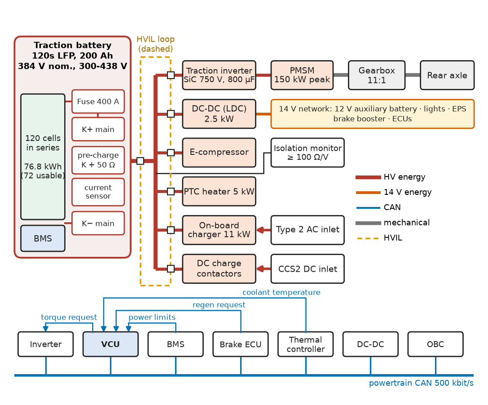
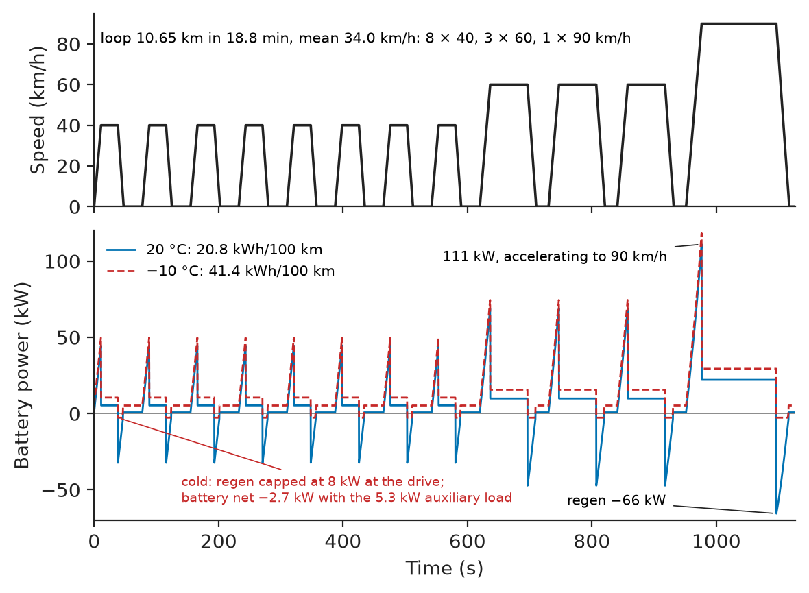
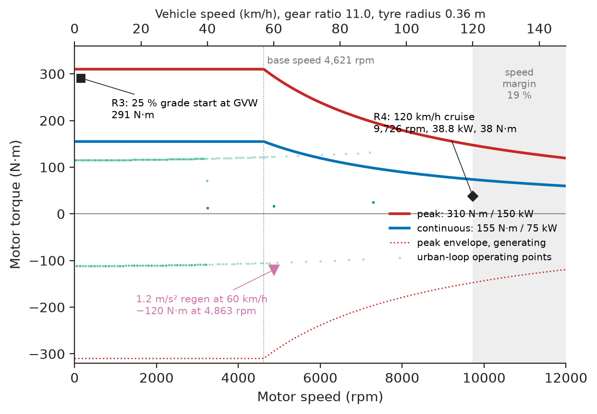
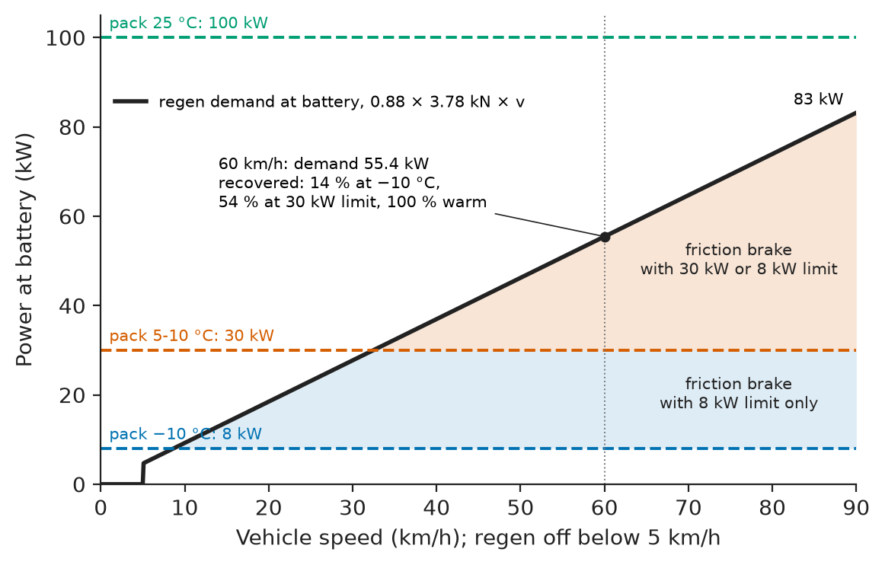
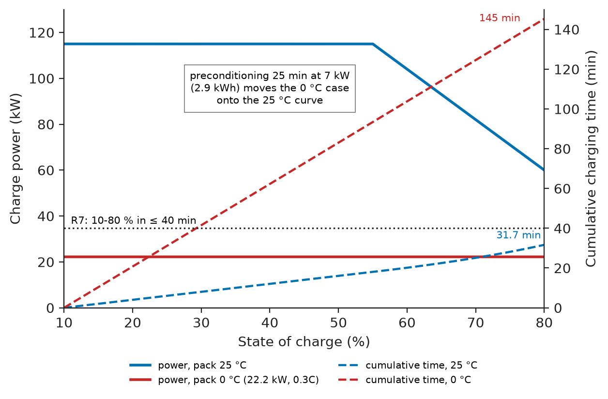
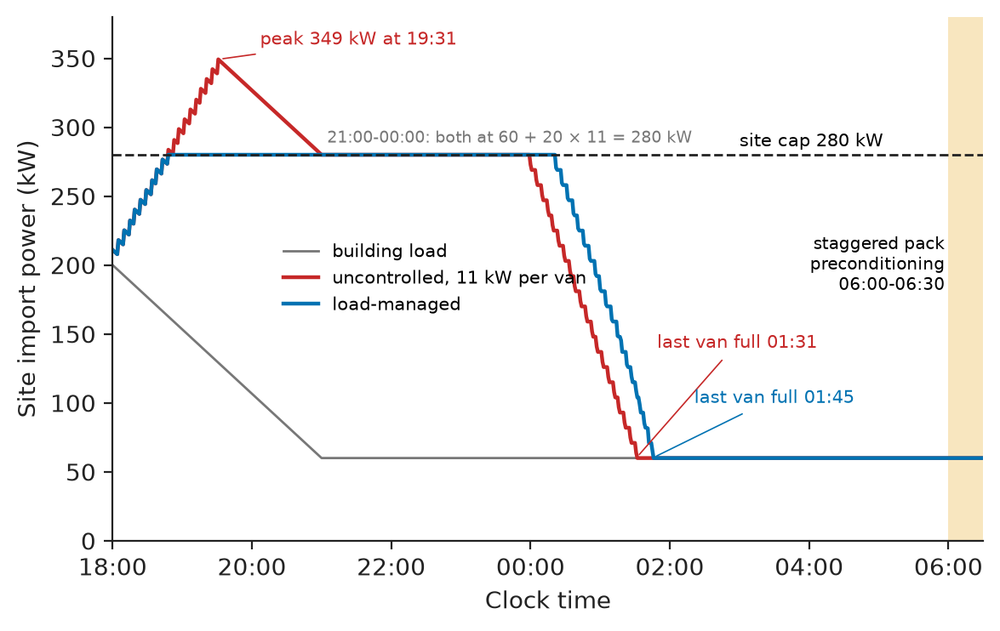

# Chapter 24 — Electric Vehicles

*Part VI · Renewable Energy and Electric Mobility*

A parcel company puts twenty battery-electric delivery vans into service in October. Each van has a 3.5 t gross mass, a 76.8 kWh lithium-iron-phosphate pack and a type-approval range of more than 300 km, and the daily routes are 150 km, so the fleet manager expects to charge them overnight and never think about range again. In the first cold week of January, at −10 °C, two vans stop on their routes at about 139 km, and a third, sent to a public DC fast charger, charges at 22 kW instead of the 115 kW on the data sheet and takes almost two and a half hours. Nothing is broken. The energy budget was written per kilometre, but the heater draws power per hour and a delivery van spends half its shift parked with the doors opening; the cold pack accepted almost no regeneration or charge current, and nobody had planned to warm it. This chapter follows that van from requirements to a second iteration: architecture, energy consumption, traction motor, inverter, DC–DC converter, pack, regeneration, thermal limits, charging and the depot that feeds the fleet.

> **How is an electric vehicle's powertrain sized from a duty cycle, and which component limits each requirement: range, gradeability, acceleration, charging time?**
> **What must the vehicle, the charger and the depot agree on, electrically and thermally, so that the energy budget holds in winter and the fleet is recharged inside the site's power limit?**

| Concept | Engineering destination |
|---|---|
| EV architecture | HV and LV networks, contactors, interlocks, control units and their CAN interfaces |
| Traction motors | Motor and gear-ratio choice from gradeability, top speed and acceleration |
| Inverters | Switch technology, current rating, DC-link voltage window, junction-temperature margin |
| DC–DC converters | 14 V supply for lights, steering, brakes and controllers; HV draw and redundancy |
| Battery packs | Voltage window, power capability at low temperature, isolation and pre-charge |
| Charging systems | On-board AC charger, DC fast charging, control pilot and ISO 15118 communication |
| Regenerative braking | Blending with friction brakes; battery acceptance as the real limit |
| Vehicle energy consumption | Drive-cycle model, kWh/100 km, range and reserve |
| Thermal constraints | Coolant loops, heat pump versus resistive heating, pack preconditioning |
| Charging infrastructure | Depot sizing, dynamic load management, standards and connectors |

**Roadmap.** Requirements and architecture (24.1) → the energy budget from a drive cycle (24.2) → motor and gear ratio (24.3) → inverter (24.4) → DC–DC converter (24.5) → battery pack as a vehicle component (24.6) → regenerative braking (24.7) → thermal limits (24.8) → on-board and off-board charging (24.9) → the depot (24.10) → verification, failure analysis and Revision B (24.11).

---

## 24.1 EV architecture

### Requirements

The reference system for the whole chapter is a 3.5 t rear-wheel-drive urban delivery van. Its requirements come from the operator's routes (150 km per shift, 9 h per shift, about 100 stops), from the depot (20 vans, one shared grid connection) and from regulation. Table 24.1 lists them with the verification method fixed before any part was chosen (the requirement-writing method is Chapter 1's).

**Table 24.1 — Requirements for the reference delivery van.**

| ID | Requirement | Target | Verification |
|---|---|---|---|
| R1 | Shift range at −10 °C, full shift including parked heating | 150 km with ≥ 10 % of usable energy left | Cold chamber chassis-dyno test, urban loop plus timed dwell |
| R2 | Range at 20 °C on the urban loop | ≥ 300 km | Chassis dyno |
| R3 | Gradeability at 3,500 kg | Start and climb 25 % | Ramp test, motor torque log |
| R4 | Top speed, continuous | 120 km/h | Test track, 20 min hold, temperatures logged |
| R5 | Acceleration at 3,000 kg | 0–50 km/h ≤ 6.0 s | Track, GNSS speed logger |
| R6 | AC charging | 11 kW three-phase; 20–100 % in ≤ 6.5 h | Depot EVSE, energy meter |
| R7 | DC charging | 10–80 % in ≤ 40 min with pack at 25 °C | CCS2 charger, charger log |
| R8 | 14 V supply | 2.0 kW continuous | Electronic load on 14 V bus, thermal soak |
| R9 | HV safety | Isolation ≥ 100 Ω/V; HV interlock; active discharge to ≤ 60 V in ≤ 3 s | Isolation tester, HVIL break test, discharge scope capture |
| R10 | Depot | 20 vans full by 06:30 with site import ≤ 280 kW | Depot simulation, then site meter log |

R9 follows ISO 6469-3 and UN ECE R100 (isolation and protection against electric shock); the functional-safety goals (no unintended acceleration, no unintended loss of braking torque) are classified under ISO 26262 and typically land at ASIL C or D for the torque path.

### Architecture and interfaces

Figure 24.1 shows the architecture. Energy flows from the pack through the main contactors and a fuse to the HV bus, which feeds the traction inverter, the DC–DC converter, the electric air-conditioning compressor and the heater; the on-board charger and the DC inlet feed the same bus in the other direction. Control flows over two CAN networks: a powertrain bus at 500 kbit/s (vehicle control unit, inverter, BMS, DC–DC, charger) and a body bus. The vehicle control unit (VCU) owns the torque request: it reads the pedals, asks the BMS for its live charge and discharge power limits every 10 ms, asks the brake controller how much deceleration it wants, and sends the inverter a torque command inside all those limits.

<!-- FIGURE 24.1 | figures/ch24/fig-24-1-ev-architecture.png | block-diagram | Architecture of the reference 3.5 t delivery van: HV energy paths, 14 V network and powertrain CAN. | Content: left, battery pack block (120s LFP 200 Ah, 384 V nominal, 300 to 438 V) containing BMS, main contactors K+ and K-, pre-charge contactor with 50 ohm resistor, 400 A fuse, current sensor. Thick HV bus to the right feeding: traction inverter (SiC 750 V, 800 uF DC link) to PMSM 150 kW peak to 11:1 single-speed gearbox to rear axle; DC-DC converter 2.5 kW to 14 V bus with 12 V auxiliary battery and loads (lights, EPS, brake booster, ECUs); e-compressor; PTC heater 5 kW; on-board charger 11 kW from Type 2 AC inlet; DC inlet CCS2 with DC charge contactors. Dashed HVIL loop through every HV connector. Isolation monitor on HV bus. Bottom, powertrain CAN 500 kbit/s connecting VCU, BMS, inverter, DC-DC, OBC, brake ECU, thermal controller; labels on arrows: torque request, charge/discharge power limits, regen request, coolant temperature. Colour key: HV energy, 14 V energy, CAN. -->



*Figure 24.1 — Architecture of the reference 3.5 t delivery van: HV energy paths, 14 V network and powertrain CAN.*

Table 24.2 lists the interfaces that cause most integration faults. Each carries a number on both sides, and the test in Section 24.11 checks both sides.

**Table 24.2 — Key interfaces of the reference van.**

| Interface | From → to | What crosses | Number that must match |
|---|---|---|---|
| HV DC bus | Pack → inverter, DC–DC, OBC, heater | 300–438 V, up to 520 A | Every load must operate across the full window, including cold sag |
| Power limits | BMS → VCU | Charge and discharge power limits, 10 ms | VCU must clamp regen and drive torque within 20 ms of a change |
| Torque command | VCU → inverter | Torque request, mode, enable | Message timeout 30 ms; inverter goes to zero torque on timeout |
| Brake blending | Brake ECU ↔ VCU | Requested deceleration, delivered regen torque | Sum must equal driver demand within 0.05 g |
| HVIL | All HV connectors | 10 mA loop current | Contactors open within 100 ms of loop break |
| Charging | EVSE ↔ OBC/VCU | Control pilot, proximity, ISO 15118 PLC | Pilot duty → current per IEC 61851-1 |
| Coolant | Thermal module → inverter, motor, pack | Flow, inlet temperature | Inverter inlet ≤ 65 °C at 10 L/min |

> **Boundary.** Machine theory (PMSM equivalent circuit, field weakening) is in *Electrical Energy and Machines*, [Ch. 8 §8.1](https://github.com/The-Studio-of-Sadiq/Electrical-Energy-and-Machines/blob/main/part-2-transformers-and-electrical-machines/08-special-electrical-machines.md) and [Ch. 12 §12.8](https://github.com/The-Studio-of-Sadiq/Electrical-Energy-and-Machines/blob/main/part-3-motor-drives/12-ac-motor-drives.md); converter topologies are in *Electronics and Computing*, [Ch. 30](https://github.com/The-Studio-of-Sadiq/Electronics-and-Computing/blob/main/part-7-power-electronics/30-dc-dc-converters.md)–[32](https://github.com/The-Studio-of-Sadiq/Electronics-and-Computing/blob/main/part-7-power-electronics/32-motor-drives-and-power-conversion.md); cell physics and BMS design are in *Electrical Energy and Machines*, [Ch. 16](https://github.com/The-Studio-of-Sadiq/Electrical-Energy-and-Machines/blob/main/part-4-power-generation/16-energy-storage.md) and this book's Chapter 23. This chapter chooses, sizes, connects and tests them in one vehicle.

### Architecture choices

Three decisions are made at architecture level and fix much of what follows:

- **400 V rather than 800 V class.** 800 V halves current and makes charging above about 200 kW practical, but every HV component must then be rated 1,200 V. A van whose LFP cells cap DC charging at about 115 kW gains little.
- **One rear motor.** It uses the load transfer onto the rear axle when loaded and climbing (R3), but puts all regeneration on one axle (Section 24.7).
- **Single-speed reduction.** The PMSM's wide constant-power region covers 0–120 km/h; the ratio is chosen in Section 24.3.

---

## 24.2 Vehicle energy consumption

### The road-load equation

The force at the wheels is Newton's second law with three resistances: rolling, aerodynamic and grade,

$$
F_{w}=k_m m\frac{dv}{dt}+m g\left(C_{rr}\cos\theta+\sin\theta\right)+\tfrac12\rho C_d A\,v^{2},
$$

where $k_m\approx1.05$ accounts for rotating inertia. The van's parameters are $m=3{,}000$ kg (test mass, half payload), $C_{rr}=0.009$ on warm tyres, $C_dA=0.36\times3.6=1.30\ \mathrm{m^2}$, $\rho=1.20\ \mathrm{kg/m^3}$ at 20 °C. At steady speed the road-load power is 5.8 kW at 50 km/h, 14.4 kW at 80 km/h and 37.6 kW at 120 km/h. At urban speeds the inertial term dominates, which is why regeneration matters so much for this van.

> **Status of the principle: Road-load equation**
> *Fundamental.* It is Newton's second law for the vehicle as a point mass (*Engineering Physics*, [Ch. 19 §19.1](https://github.com/The-Studio-of-Sadiq/Engineering-Physics/blob/main/CHAPTERS/CHAPTER%2019.md)); the coefficients $C_{rr}$ and $C_dA$ are empirical, measured by coast-down, and $C_{rr}$ rises 15–30 % on cold tyres.

### A drive-cycle model

Type-approval cycles (WLTP) give comparable numbers, not this operator's. GNSS logs from its diesel vans reduce the route to an urban loop of micro-trips: eight to 40 km/h with 30 s stops, three to 60 km/h, one to 90 km/h, accelerating at 1.0 m/s² and braking at 1.2 m/s². The listing turns the loop into battery energy with a constant drivetrain efficiency $\eta_d=0.88$ (inverter, motor, gearbox); a measured map replaces it later.

```python
import numpy as np

def cycle(dt=0.1):
    """Synthetic urban delivery loop: (target km/h, cruise m, dwell s)."""
    legs = [(40, 300, 30)]*8 + [(60, 1000, 20)]*3 + [(90, 3000, 10)]
    v, out = 0.0, []
    for vk, cruise, dwell in legs:
        vt = vk / 3.6
        while v < vt:  v = min(vt, v + 1.0*dt); out.append(v)   # 1.0 m/s^2
        for _ in range(int(cruise / vt / dt)): out.append(vt)
        while v > 0:   v = max(0.0, v - 1.2*dt); out.append(v)  # 1.2 m/s^2
        out += [0.0] * int(dwell / dt)
    return np.array(out)

def battery_energy(v, dt=0.1, m=3000.0, crr=0.009, CdA=1.296, rho=1.20,
                   eta_d=0.88, p_chg_max=100e3, p_aux=0.8e3):
    a = np.gradient(v, dt)
    p_wheel = (1.05*m*a + m*9.81*crr + 0.5*rho*CdA*v**2) * v
    p_drive = np.where(p_wheel > 0, p_wheel/eta_d, p_wheel*eta_d)
    regen_ok = v > 5/3.6                                   # regen fades below 5 km/h
    p_drive = np.where(p_drive < 0, np.where(regen_ok,
                       np.maximum(p_drive, -p_chg_max), 0.0), p_drive)
    p_batt = p_drive + p_aux
    e = lambda p: p.sum()*dt/3.6e6                          # kWh
    return e(np.clip(p_wheel, 0, None)), e(np.clip(-p_wheel, 0, None)), \
           e(np.clip(-p_drive, 0, None)), e(p_batt)

v = cycle(); dist = v.sum()*0.1/1000
print(f"loop: {dist:.2f} km, {len(v)*0.1/60:.1f} min, mean {dist/(len(v)*0.1/3600):.1f} km/h")
for name, kw in [("warm 20 C", {}),
                 ("cold -10 C", dict(crr=0.0104, rho=1.34, p_chg_max=8e3, p_aux=5.3e3))]:
    ep, en, er, eb = battery_energy(v, **kw)
    print(f"{name}: wheel+ {ep:.3f} kWh, wheel- {en:.3f} kWh, regen {er:.3f} kWh,"
          f" battery {eb:.3f} kWh = {100*eb/dist:.1f} kWh/100 km, range {72/(eb/dist):.0f} km")
```

```text
loop: 10.65 km, 18.8 min, mean 34.0 km/h
warm 20 C: wheel+ 2.467 kWh, wheel- 0.961 kWh, regen 0.838 kWh, battery 2.216 kWh = 20.8 kWh/100 km, range 346 km
cold -10 C: wheel+ 2.657 kWh, wheel- 0.945 kWh, regen 0.268 kWh, battery 4.411 kWh = 41.4 kWh/100 km, range 174 km
```

The cold case changes four inputs, each with a physical cause: rolling resistance +15 % (stiff cold tyres), air density 1.34 kg/m³, a 5.3 kW auxiliary load (0.8 kW base plus a 4.5 kW PTC heater), and a charge-power limit of 8 kW because a cold LFP pack cannot accept current without lithium plating. As in the VCU of Section 24.7, it limits the drive's regenerated power, so with the heater on the pack charges at 2.7 kW at most. Figure 24.2 shows the loop and the battery power in both cases.

<!-- FIGURE 24.2 | figures/ch24/fig-24-2-urban-loop-power.png | plot | Urban delivery loop and battery power at 20 °C and at −10 °C. | Content: two stacked panels sharing x-axis time 0 to 1130 s. Top: vehicle speed 0 to 95 km/h, eight trapezoids to 40 km/h with 30 s stops, three to 60 km/h, one to 90 km/h. Bottom: battery power -70 to +110 kW; warm trace (solid) with motoring peaks up to about 110 kW during the 90 km/h acceleration and regen dips to about -65 kW; cold trace (dashed) offset upward by the 5.3 kW auxiliary load, regen clipped flat at -2.7 kW (8 kW at the drive). Annotations: loop 10.65 km, mean 34.0 km/h; 20.8 kWh/100 km warm, 41.4 kWh/100 km cold. -->



*Figure 24.2 — Urban delivery loop and battery power at 20 °C and at −10 °C.*

**Worked example — the energy budget for one shift.** Scale the loop to 150 km (a factor of $150/10.65=14.1$). Table 24.3 splits the battery energy into traction, regeneration credit and auxiliaries. Warm, the van uses 31.2 kWh of its 72 kWh usable, a 57 % reserve. Cold, the drive-cycle number is 62.1 kWh and the reserve 13.7 %, which passes R1 on paper. But the loop takes 18.8 min per 10.65 km, so 150 km is 4.4 h of driving in a 9 h shift; for 4.5 h of the remaining 4.6 h the van is parked at drops with the heater holding the cab warm against open doors, averaging 3.5 kW. That adds $4.5\times3.5=15.8$ kWh, the shift needs 77.9 kWh, and at $77.9/150=0.519$ kWh/km the 72 kWh pack is empty at $72/0.519=139$ km — where the two vans stopped.

**Table 24.3 — Energy budget for a 150 km shift (kWh, 72 kWh usable).**

| Item | 20 °C | −10 °C, PTC heater, cold pack | −10 °C, Revision B (heat pump, preconditioned pack) |
|---|---|---|---|
| Traction, $E_{wheel+}/\eta_d$ | 39.5 | 42.5 | 42.5 |
| Regeneration credit | −11.8 | −3.8 | −10.1 |
| Auxiliaries and HVAC while driving | 3.5 | 23.4 | 13.5 |
| **Drive-cycle total** | **31.2** | **62.1** | **45.9** |
| Parked heating, 4.5 h | 0.0 | 15.8 (3.5 kW) | 6.8 (1.5 kW) |
| **Shift total** | **31.2** | **77.9** | **52.6** |
| Margin to 72 kWh usable | 40.8 (57 %) | −5.9 (fails R1) | 19.4 (27 %) |

> **Status of the principle: Battery energy from a drive cycle with constant drivetrain efficiency**
> *Approximate.* Energy conservation is exact; the constant $\eta_d$ hides the low efficiency of a PMSM at light load and high speed, so the model is within about 5 % on urban cycles and optimistic on motorway cycles. A measured efficiency map replaces it for the final budget.

Loads that scale with time must be budgeted against time, not distance (the same mistake kills IoT nodes whose radio listens per hour, Chapter 11), and in the cold the heater, not the motor, decides the range.

---

## 24.3 Traction motors

### Sizing from the requirements

R3 sets the peak wheel force, R4 the maximum motor speed and R5 the peak power.

**Worked example — gear ratio and motor rating.** Climbing 25 % ($\theta=14.0°$) at 3,500 kg needs $F=mg(\sin\theta+C_{rr}\cos\theta)=8{,}627$ N at the wheels. A candidate PMSM with 310 N·m peak torque, 150 kW peak power and 12,000 rpm maximum speed, through a gearbox of efficiency 0.97 and a 0.36 m tyre radius, gives a wheel force of $310\times G\times0.97/0.36$. With $G=10.5$ that is 8,770 N, a margin of 1.7 %, which is no margin once tyre radius tolerance and a hot motor are included. With $G=11.0$ it is 9,188 N, a 6.5 % margin. At 120 km/h the wheel turns at 884 rpm and the motor at $884\times11=9{,}726$ rpm, 19 % below its 12,000 rpm limit. The base speed (where 310 N·m meets 150 kW) is 4,621 rpm, or 57 km/h of road speed. Integrating the torque–power envelope against the road load gives 0–50 km/h in 5.2 s at 3,000 kg (R5 passes with 0.8 s margin) and 0–100 km/h in 12.2 s. Continuous rating: 120 km/h needs 37.6 kW at the wheels, 38.8 kW at the shaft, against a 75 kW continuous rating.

Figure 24.3 plots the envelope against the operating points that set it.

<!-- FIGURE 24.3 | figures/ch24/fig-24-3-torque-speed-envelope.png | plot | Traction-motor torque–speed envelope with the operating points that size it (gear ratio 11.0). | Content: x-axis motor speed 0 to 12,000 rpm with secondary axis vehicle speed 0 to 148 km/h. Peak envelope: 310 N m flat to 4,621 rpm then constant 150 kW hyperbola to 12,000 rpm (119 N m). Continuous envelope: 155 N m flat to 4,621 rpm then 75 kW hyperbola. Points: 25 percent grade start at GVW (motor torque 291 N m near 0 rpm, labelled R3); 120 km/h cruise at 9,726 rpm, 38.8 kW (38 N m, labelled R4); urban-loop operating cloud (scatter, 0 to 7,000 rpm, mostly below 150 N m); 1.2 m/s^2 regen at 60 km/h (-120 N m at 4,863 rpm). Shaded band between 9,726 and 12,000 rpm labelled speed margin 19 percent. -->



*Figure 24.3 — Traction-motor torque–speed envelope with the operating points that size it (gear ratio 11.0).*

### Motor technology

**Table 24.4 — Traction-motor options for the van (150 kW peak class).**

| Option | Peak efficiency | Urban-cycle efficiency | Power density | Cost and supply | Fault behaviour | Choice |
|---|---|---|---|---|---|---|
| Interior PMSM (NdFeB) | 96–97 % | 90–93 % | High (4–6 kW/kg) | Rare-earth magnet price and supply risk | Back-EMF at high speed if inverter trips: uncontrolled generation | **Chosen** |
| Induction motor (copper rotor) | 94–95 % | 86–90 % | Medium | No magnets | De-excites when inverter stops; benign | Rejected: rotor losses cost about 3 % range in urban duty |
| Externally excited synchronous (EESM) | 95–96 % | 90–92 % | Medium | No magnets, needs rotor slip rings or wireless excitation | Field removable: benign | Considered for Revision B if magnet price doubles |

The PMSM's weakness is its magnets: the supplier's back-EMF constant gives a line-to-line peak of about 520 V at 12,000 rpm, above the 438 V pack maximum, so an inverter that opens all switches at high speed lets the machine rectify into the bus. The inverter's safe state at high speed must therefore be an **active short circuit** (all low-side switches on; *Electrical Energy and Machines*, Ch. 12 §12.8).

> **Status of the principle: Gear ratio from gradeability and maximum speed**
> *Derived.* The ratio window follows from the wheel-force and speed limits of the motor; it assumes the motor reaches peak torque at stall for the 5–10 s of a hill start, which must be confirmed against the motor's thermal limit (Section 24.8).

---

## 24.4 Inverters

### Rating

The inverter must deliver 150 kW at the lowest bus voltage it will ever see at full power. Section 24.6 shows that a cold, partly discharged pack sags to about 332 V at 515 A; the inverter is specified for full power down to 330 V and derates linearly below. With space-vector modulation the maximum fundamental line voltage is $V_{dc}/\sqrt2=233$ V rms at 330 V (*Electronics and Computing*, [Ch. 31 §31.3](https://github.com/The-Studio-of-Sadiq/Electronics-and-Computing/blob/main/part-7-power-electronics/31-ac-dc-and-dc-ac-conversion.md)). With a motor power factor of 0.92 and efficiency 0.95 at that point, the phase current is $150{,}000/(\sqrt3\times233\times0.92\times0.95)=425$ A rms, 601 A peak.

**Table 24.5 — Power-switch options for a 400 V class, 150 kW traction inverter.**

| Option | Blocking voltage | Rating class | Inverter loss, urban cycle | Relative cost | Choice |
|---|---|---|---|---|---|
| Si IGBT six-pack (HybridPACK Drive class) | 750 V | 820 A | Base (efficiency about 96 % cycle average) | 1.0 | Rejected for Revision A cost reasons; see text |
| SiC MOSFET six-pack | 750 V | 700–800 A peak | 40–60 % lower; cycle average about 98 % | 1.6–2.0 | **Chosen** |
| SiC MOSFET, 1,200 V | 1,200 V | 400–600 A | Similar | 2.2 | Only for 800 V class |

At the light loads of an urban cycle an IGBT's switching and knee-voltage losses dominate, where a SiC MOSFET's resistive conduction is lowest. Running the drive-cycle model with $\eta_d=0.90$ instead of 0.88 lowers consumption from 20.8 to 20.0 kWh/100 km at 20 °C: 3.7 % less energy, which is either 13 km more range or a 2.8 kWh smaller pack for the same range. At a 2026 pack price of about \$110 per kWh and a SiC module premium of about \$250, the smaller pack pays for the module. The inverter switches at 10 kHz; the 750 V rating leaves 312 V above the 438 V maximum for overshoot from commutation loop inductance, which the gate driver's soft turn-off on short circuit must respect.

### Thermal check

**Worked example — junction temperature at continuous and peak power.** At 75 kW continuous the inverter dissipates about 1.1 kW (98.5 % efficiency at that point), about 183 W per switch position. With a junction-to-coolant thermal resistance of 0.15 K/W per position (pin-fin baseplate, from the module data sheet) and 65 °C coolant, the junction runs at $65+183\times0.15=92.5$ °C. At 150 kW peak the loss is about 3 kW, 500 W per position, and the junction rises to $65+500\times0.15=140$ °C after its thermal time constants settle, inside the 175 °C rating with a 35 K margin. The coolant itself rises only $1{,}100/(10/60\times1.07\times3{,}400)=1.8$ K through the inverter at 10 L/min of 50/50 glycol, so the coolant inlet temperature, not the flow rate, is the parameter to control.

### Control and safe states

The inverter runs FOC with MTPA and field weakening (*Electrical Energy and Machines*, Ch. 12 §12.8) at 10 kHz with a resolver for position. VCU and inverter must agree on three safe states: **zero torque** on CAN timeout, **active short circuit** above the back-EMF crossover (about 10,100 rpm, where the back-EMF peak meets 438 V) and **freewheel** below it; the hand-over is tested on a dynamometer.

---

## 24.5 DC–DC converters

The 14 V network still runs lights, wipers, electric power steering, the brake booster, door locks, infotainment and every control unit. In a combustion van the alternator fed it; here an isolated DC–DC converter (the "LDC") from the HV bus does, with a 12 V lead-acid or LFP auxiliary battery to supply the network before the HV contactors close and to absorb load steps.

**Worked example — sizing the LDC.** The LV load list totals 1.1 kW average while driving and 2.0 kW peak (steering assist during parking, wipers, heated mirrors and screen, lights). At 14 V, 2.0 kW is 143 A on the output; at 95 % efficiency and 360 V, the HV draw is $2{,}000/(0.95\times360)=5.8$ A. A 2.5 kW unit gives 25 % margin on the peak and covers the 0.5 kW the auxiliary battery recharges at. Phase-shifted full-bridge and LLC topologies (*Electronics and Computing*, [Ch. 30](https://github.com/The-Studio-of-Sadiq/Electronics-and-Computing/blob/main/part-7-power-electronics/30-dc-dc-converters.md)) are both used; the choice is driven by the 300–438 V input window, which an LLC handles less gracefully, so a phase-shifted full bridge with synchronous rectification is chosen.

Steering and brake assist depend on the LDC, so if it fails the VCU warns the driver and limits speed while the 12 V battery carries the vehicle; steer-by-wire vehicles fit two.

**Table 24.6 — DC–DC converter specification.**

| Parameter | Value | Reason |
|---|---|---|
| Input | 280–450 V | Pack window plus cold sag and charger overshoot |
| Output | 13.5–14.8 V settable | Auxiliary battery charge voltage by temperature |
| Power | 2.5 kW continuous at 65 °C coolant | R8 plus 25 % margin |
| Isolation | Reinforced, 2.5 kV test | ISO 6469-3 |
| Efficiency | ≥ 94 % at 1 kW | 0.1 kWh/h of loss matters in Table 24.3 |
| Interface | CAN set-point and status | VCU raises output to charge the 12 V battery |

---

## 24.6 Battery packs

> **Boundary.** Cell selection, series–parallel arrangement, BMS architecture, state estimation and pack safety testing are owned by Chapter 23; cell chemistry and ratings by *Electrical Energy and Machines*, [Ch. 16 §16.1–16.3](https://github.com/The-Studio-of-Sadiq/Electrical-Energy-and-Machines/blob/main/part-4-power-generation/16-energy-storage.md). Here the pack is treated as a vehicle component with a voltage window, a power capability and safety interfaces.

The pack is 120 prismatic LFP cells of 200 Ah in series (120s1p): 384 V nominal, 300–438 V between the 2.5 V and 3.65 V cell limits, 76.8 kWh gross and 72 kWh usable when the BMS keeps a few percent at each end. The cells alone weigh about 470 kg; with modules, cooling plates, BMS and enclosure the pack is about 620 kg, 124 Wh/kg at pack level. LFP was chosen over NMC for cycle life (more than 3,000 full cycles at the 50 % daily depth of a delivery route), thermal stability and cost; its price is lower energy density and poor low-temperature power, which the rest of the chapter has to manage.

**Worked example — voltage sag sets the inverter's minimum voltage.** At full power the pack supplies $150/0.92$ kW to the inverter plus about 10 kW of auxiliaries and DC–DC load, about 170 kW, which at 330 V is 515 A, or 2.6C. Each cell's DC resistance is about 0.25 mΩ at 25 °C, so the series string is 30 mΩ, plus 10 mΩ of busbars, fuse and contactors: 40 mΩ. At 10 % SOC (OCV about 3.20 V per cell, 384 V) the sag is $515\times0.040=20.6$ V and the terminal voltage 363 V. At −10 °C the cell resistance roughly triples, the pack is 100 mΩ, the sag 52 V and the terminal voltage 332 V. This is why Section 24.4 specified full power to 330 V with a derating below: a lower minimum costs inverter current rating, a higher one costs power in the cold.

### Safety interfaces

**Pre-charge.** The inverter's 800 µF DC link must be charged through a resistor before the main contactor closes, or the inrush welds the contacts. With 50 Ω the time constant is 40 ms, the peak current $438/50=8.8$ A, and the link reaches 95 % of pack voltage in $3\tau=120$ ms; the resistor absorbs $\tfrac12CV^2=77$ J per pre-charge. The BMS closes the main positive contactor only when the link voltage is within 5 % of the pack voltage, and declares a fault if that has not happened within 500 ms, which catches both a shorted link and an open pre-charge path.

**Isolation monitoring.** The HV bus floats with respect to chassis. An isolation monitor injects a low-frequency test signal and measures the resistance from each rail to chassis. ISO 6469-3 and UN ECE R100 require at least 100 Ω/V for DC circuits, that is $438\times100=43.8$ kΩ; the van warns at 500 Ω/V (219 kΩ) so that coolant ingress or a chafed cable is found long before it is dangerous.

**HV interlock loop and discharge.** A 10 mA loop runs through every HV connector and service disconnect; breaking it opens the contactors within 100 ms. After the contactors open, the inverter discharges its DC link actively (by circulating current in the motor windings with zero torque) to below 60 V in under 3 s, with a passive bleed resistor as back-up (R9).

> **Status of the principle: Pack voltage window at full power**
> *Approximate.* Terminal voltage is OCV minus $IR$ with a temperature-dependent DC resistance; it ignores the diffusion polarisation that adds a further 5–10 % sag in a 10 s pulse, so a cold pulse dips through the 330 V design point into the inverter's derating.

---

## 24.7 Regenerative braking

### What limits regeneration

When the driver lifts or presses the brake, the VCU asks the motor for negative torque. Four limits apply, and the smallest one wins:

1. **Motor and inverter.** 310 N·m and 150 kW; never the binding limit in this van.
2. **Battery acceptance.** The BMS's live charge-power limit, which depends on SOC, cell voltage and temperature. For the LFP pack it is about 100 kW warm, 30 kW at 5–10 °C, 8 kW at −10 °C, and it tapers to zero as the highest cell approaches 3.65 V.
3. **Vehicle stability.** Braking unloads the rear axle, so more than about 0.25 g of rear-only braking risks rear-wheel lock on a slippery road; the brake ECU caps regen and can cancel it within milliseconds.
4. **Low speed.** Below about 5 km/h regen fades out and the friction brakes stop the van.

The energy that regen returns is set out in *Electrical Energy and Machines*, [Ch. 3 §3.2](https://github.com/The-Studio-of-Sadiq/Electrical-Energy-and-Machines/blob/main/part-1-magnetic-circuits-and-energy-conversion/03-energy-conversion-principles.md) and the four-quadrant hardware in *Electronics and Computing*, Ch. 32 §32.6; the integration task is the blending.

**Worked example — what the cold pack accepts.** Braking at 1.2 m/s² from 60 km/h needs $1.05\times3{,}000\times1.2=3{,}780$ N at the wheels, 63 kW at that speed. The motor torque is $3{,}780\times0.36\times0.97/11=120$ N·m, well inside 310 N·m. The motor turns at $16.67/0.36\times11=509$ rad/s. Since $\eta_d=0.88$ (wheel to battery) already includes the gearbox, a battery that accepts 8 kW allows $8/0.88=9.1$ kW at the wheels, 14 % of the demand (17.3 N·m at the motor); the friction brakes turn the rest into heat. Preconditioned to the 30 kW limit, the pack allows 34.1 kW, 54 %. Over the whole loop this is the difference between 0.27 kWh and 0.72 kWh recovered, the regeneration rows of Table 24.3.

Figure 24.4 plots this across speed.

<!-- FIGURE 24.4 | figures/ch24/fig-24-4-regen-acceptance.png | plot | Regenerative power demanded at 1.2 m/s² deceleration versus the battery's charge-power limit at three pack temperatures. | Content: x-axis vehicle speed 0 to 90 km/h. y-axis power at battery 0 to 100 kW. Demand curve: 0.88 times 3.78 kN times v, rising linearly from 0 to about 55 kW at 60 km/h and 83 kW at 90 km/h, set to zero below 5 km/h. Horizontal lines: 100 kW (pack 25 C), 30 kW (pack 5 to 10 C), 8 kW (pack -10 C). Shaded area between demand and each limit labelled friction brake. Annotation at 60 km/h: 14 percent recovered at -10 C, 54 percent at 30 kW limit, 100 percent warm. -->



*Figure 24.4 — Regenerative power demanded at 1.2 m/s² deceleration versus the battery's charge-power limit at three pack temperatures.*

### Implementation

The listing is the core of the VCU's 10 ms regen-limit function (C11; signal names illustrative): zero on stale BMS data, battery power limit converted to torque at the present speed, a low-speed fade and a taper as the highest cell approaches the LFP limit.

```c
/* regen_limit.c -- regenerative torque limit, called every 10 ms by the VCU (C11).
   SI units. Signal names are illustrative. */
#include <math.h>

typedef struct {
    float p_chg_lim_w;    /* BMS live charge-power limit, W (>= 0) */
    float v_cell_max_v;   /* highest cell voltage, V */
    float speed_rad_s;    /* motor speed, rad/s */
    int   bms_fresh;      /* 1 if a BMS frame arrived in the last 100 ms */
} regen_in_t;

#define T_REGEN_MAX  310.0f  /* motor regen torque capability, N*m */
#define ETA_REGEN    0.91f   /* shaft-to-battery efficiency: eta_d 0.88 / gearbox 0.97 */
#define W_FADE_LO    8.5f    /* rad/s, about 1 km/h: no regen below */
#define W_FADE_HI    42.4f   /* rad/s, about 5 km/h: full regen above */
#define V_CELL_SOFT  3.55f   /* V, LFP: start tapering */
#define V_CELL_HARD  3.62f   /* V, LFP: no regen */

/* Returns the magnitude of the allowed regenerative torque, N*m (>= 0). */
float regen_torque_limit(const regen_in_t *in)
{
    if (!in->bms_fresh) return 0.0f;                    /* no BMS data: no regen */
    float w = fabsf(in->speed_rad_s);
    if (w < W_FADE_LO) return 0.0f;

    float t = fminf(T_REGEN_MAX, in->p_chg_lim_w / (ETA_REGEN * w));
    if (w < W_FADE_HI)
        t *= (w - W_FADE_LO) / (W_FADE_HI - W_FADE_LO);  /* low-speed fade */

    float k = (V_CELL_HARD - in->v_cell_max_v) / (V_CELL_HARD - V_CELL_SOFT);
    return t * fminf(1.0f, fmaxf(0.0f, k));              /* cell-voltage taper */
}
```

The brake ECU makes up the difference between demand and the torque the inverter reports as delivered, so the driver feels the same deceleration with a cold, full or warm pack. The taper, the live limit and zero torque on an open-contactor bit prevent the fault of regenerating into a full pack described in *Electronics and Computing*, Ch. 32 §32.6.

> **Status of the principle: Regen limited by battery acceptance**
> *Derived.* Torque equals power divided by speed; the limit is exact for a given BMS power limit, but the limit itself comes from an empirical lithium-plating model of the cell, so its accuracy is that of the cell supplier's low-temperature charge map.

---

## 24.8 Thermal constraints

### Three loops, three temperature windows

The van has three thermal masters with different targets:

**Table 24.7 — Thermal windows of the reference van.**

| Component | Operating window | Limit set by | Cooling or heating path |
|---|---|---|---|
| Inverter (SiC) | Coolant inlet ≤ 65 °C; junction ≤ 175 °C | Module rating, solder fatigue | Glycol loop with motor, front radiator |
| Motor | Winding ≤ 180 °C (class H); magnet ≤ 140–150 °C | Insulation life; demagnetisation | Same loop plus oil spray on end windings |
| Pack (LFP) | Discharge −20 to 55 °C; charge 0 to 45 °C; best 15–35 °C | Lithium plating cold; ageing hot | Cooling plates; chiller from A/C circuit; PTC heater or heat pump |
| Cabin | 18–22 °C | Driver comfort, screen demisting | Heat pump or PTC heater |

A refrigerant heat pump can move the 1–3 kW of motor and inverter waste heat into cabin and pack, and chill the pack during fast charging; its coefficient of performance is about 2 at −10 °C, falling toward 1.2 at −20 °C, where the PTC heater takes over.

### Pack preconditioning

**Worked example — warming the pack before a fast charge.** The 470 kg of cells have a specific heat of about 1,100 J/(kg·K). Raising them from 0 to 20 °C stores $470\times1{,}100\times20=10.3$ MJ, 2.86 kWh. A 7 kW coolant heater does it in 25 min (lossless). Done from the grid before departure, it costs the shift nothing; done from the pack while driving to a fast charger, it costs 2.9 kWh (about 7 km of cold range) and saves an hour and fifty minutes of charging (Section 24.9). Preconditioning is therefore triggered by the navigation system when a DC charger is set as the destination and by the depot schedule before departure.

> **Status of the principle: Lumped heat capacity of the pack**
> *Approximate.* It treats the cells as one isothermal mass (*Engineering Physics*, [Ch. 14](https://github.com/The-Studio-of-Sadiq/Engineering-Physics/blob/main/CHAPTERS/CHAPTER%2014.md)); in practice the cells nearest the cooling plate warm first, and the BMS uses the coldest cell temperature for its charge limit, so real warm-up takes 20–40 % longer than the lumped estimate.

The motor's thermal limit sets how long peak ratings last: the supplier's model allows 30 s at 310 N·m from a 90 °C winding, enough for a hill start (R3) but not for repeated starts on a steep ramp, so the VCU derates toward the 155 N·m continuous rating as the estimated winding temperature approaches 165 °C.

---

## 24.9 Charging systems

### AC charging through the on-board charger

The 11 kW on-board charger (OBC) is a PFC stage plus an isolated DC–DC stage (*Electronics and Computing*, [Ch. 32 §32.7](https://github.com/The-Studio-of-Sadiq/Electronics-and-Computing/blob/main/part-7-power-electronics/32-motor-drives-and-power-conversion.md)). On a 400 V three-phase supply at 16 A it draws $\sqrt3\times400\times16=11.1$ kW. **Worked example — R6.** Charging from 20 % to 100 % puts $0.8\times76.8=61.4$ kWh into the pack; at 94 % charger efficiency and 11 kW input that takes $61.4/(11\times0.94)=5.9$ h, inside the 6.5 h of R6, with 0.6 h margin.

The connection is governed by IEC 61851-1 (charging modes and the control pilot) and IEC 62196-2 (the Type 2 connector). The EVSE (wall box) generates a ±12 V, 1 kHz PWM **control pilot**; the vehicle loads it with a resistor and diode, which steps the positive level from 12 V (state A, not connected) to 9 V (state B, connected) and, when the vehicle closes a switch to add a second resistor, to 6 V (state C, charging requested). The EVSE announces the current available by the pilot's duty cycle $D$: for $10\,\%\le D\le85\,\%$,

$$
I_{max}=0.6\ \mathrm{A}\times D[\%],
$$

so 26.7 % means 16 A and the minimum 10 % means 6 A. A resistor in the cable plug from the proximity contact to earth tells the vehicle the cable's current rating (1.5 kΩ for 13 A, 680 Ω for 20 A, 220 Ω for 32 A). The OBC charges at the minimum of the pilot current, the cable rating and its own and the BMS's limits. This simple analogue interface is what the depot's load management (Section 24.10) uses to throttle twenty vans.

### DC fast charging

For DC charging the off-board charger feeds the pack directly through the DC inlet and two DC contactors; the OBC is bypassed. The vehicle (not the charger) is in charge: over ISO 15118 or DIN 70121 messages carried by power-line communication on the control-pilot wire, the vehicle requests a voltage and current every 50–100 ms, and the charger follows. The charger performs an insulation test of the cable and inlet before energising, and the vehicle checks that the charger's output voltage matches its pack (within about 20 V) before closing its DC contactors.

The van's limit is the cells, not the charger. The LFP cell supplier allows about 1.5C (300 A) at 25 °C up to 55 % SOC, tapering to 0.8C at 80 %; at 0 °C the allowance is about 0.3C.

**Worked example — R7 and the cold charge.** With a charge power of 115 kW from 10 to 55 % SOC tapering linearly to 60 kW at 80 %, numerical integration of $dt=E\,ds/P(s)$ for $E=76.8$ kWh gives 31.7 min from 10 to 80 %: R7 passes with an 8 min margin. At 115 kW and 370 V the current is 311 A, inside the 500 A of a liquid-cooled CCS2 cable. With the pack at 0 °C the limit is $0.3\times200\times370=22.2$ kW and the same 53.8 kWh takes 145 min — the van of the opening paragraph. Preconditioning for 25 min (Section 24.8) restores the 32 min charge (Figure 24.5).

<!-- FIGURE 24.5 | figures/ch24/fig-24-5-dc-charge-curve.png | plot | DC fast-charge power and cumulative time versus state of charge, pack at 25 °C and at 0 °C. | Content: x-axis SOC 10 to 80 percent. Left y-axis charge power 0 to 130 kW: 25 C curve flat at 115 kW to 55 percent then linear taper to 60 kW at 80 percent; 0 C curve flat at 22.2 kW. Right y-axis cumulative time 0 to 150 min, dashed curves: 25 C reaching 31.7 min at 80 percent, 0 C reaching 145 min. Horizontal dotted line at 40 min labelled R7 limit. Annotation: preconditioning 25 min at 7 kW moves the 0 C case onto the 25 C curve. -->



*Figure 24.5 — DC fast-charge power and cumulative time versus state of charge, pack at 25 °C and at 0 °C.*

**Table 24.8 — Charging options for the reference van.**

| Mode (IEC 61851) | Supply | Power | Use | 20–100 % or 10–80 % time |
|---|---|---|---|---|
| Mode 2, portable cable with in-cable control box | 230 V, 10 A single phase | 2.3 kW | Emergency only | About 28 h (20–100 %) |
| Mode 3, Type 2 EVSE | 400 V three-phase, 16 A | 11 kW | Depot, overnight | 5.9 h (20–100 %) |
| Mode 4, CCS2 DC | 400–500 V DC, up to 500 A | 115 kW (vehicle limit) | En route | 32 min (10–80 %), 25 °C pack |

---

## 24.10 Charging infrastructure

### The depot problem

Twenty vans returning between 18:00 and 19:30 each need, on a cold day, the 62.1 kWh drive-cycle figure of Table 24.3 restored (the drive figure, not the shift total), which is $62.1/0.94=66.1$ kWh from the grid. The depot's existing building load (lighting, a cold store, offices) peaks at 200 kW at 18:00 and falls to 60 kW by 21:00. The site connection is a 400 kVA transformer whose loading the network operator caps at 280 kW of import.

Uncontrolled, every van starts at 11 kW as it plugs in, and the site peaks at 349 kW at 19:30, 25 % over the cap. Upgrading the connection to 630 kVA would cost (2026, typical distribution-network quote) \$60,000–\$120,000 and take months. A **dynamic load-management** controller instead reads the site meter every few seconds and shares the headroom (cap minus building load) among the connected vans by setting each EVSE's pilot duty cycle, never below the 6 A floor of IEC 61851-1.

```python
import numpy as np

N, P_EVSE, P_MIN, CAP = 20, 11.0, 4.16, 280.0        # vans, kW per EVSE, 6 A floor, site cap kW
dt = 1/60                                           # h
t = np.arange(18.0, 30.5, dt)                       # 18:00 to 06:30 next day
building = 60 + 140*np.clip((21 - t)/3, 0, 1)       # 200 kW at 18:00 falling to 60 kW by 21:00
arrive = np.linspace(18.0, 19.5, N)
need = np.full(N, 62.1/0.94)                        # kWh from the grid per van (cold shift)

def run(managed):
    left, site, done = need.copy(), [], np.full(N, np.nan)
    for k, tk in enumerate(t):
        active = (tk >= arrive) & (left > 0)
        p = np.where(active, P_EVSE, 0.0)
        if managed and active.any():
            share = (CAP - building[k]) / active.sum()  # equal share of headroom
            p = np.where(active, np.clip(share, P_MIN, P_EVSE), 0.0)
        p = np.minimum(p, left/dt)
        left -= p*dt
        done[(left <= 1e-9) & np.isnan(done)] = tk
        site.append(building[k] + p.sum())
    return np.array(site), done

for managed in (False, True):
    site, done = run(managed)
    print(f"managed={managed}: peak site {site.max():.0f} kW at {t[site.argmax()] % 24:.2f} h,"
          f" last van full at {np.nanmax(done) % 24:.2f} h, all full: {not np.isnan(done).any()}")
```

```text
managed=False: peak site 349 kW at 19.52 h, last van full at 1.52 h, all full: True
managed=True: peak site 280 kW at 19.65 h, last van full at 1.75 h, all full: True
```

**Worked example — what load management costs.** Holding the site at 280 kW delays the last van's finish from 01:31 to 01:45 against a 06:30 departure: R10 passes with 4.75 h of margin, and the transformer upgrade is avoided. The margin is also what pays for preconditioning every pack from the grid in the last 30 min before departure ($20\times2.9=58$ kWh, at most about 140 kW if all 20 heaters run at 7 kW together; the controller staggers them). Figure 24.6 shows both profiles.

<!-- FIGURE 24.6 | figures/ch24/fig-24-6-depot-load.png | plot | Depot import power overnight for 20 vans, uncontrolled and with dynamic load management. | Content: x-axis clock time 18:00 to 06:30. y-axis site power 0 to 380 kW. Thin grey: building load 200 kW at 18:00 falling linearly to 60 kW at 21:00 then flat. Red: uncontrolled total, rising as vans plug in at 11 kW each to a peak of 349 kW at 19:31, flat at 280 kW (60 + 20 x 11) from 21:00 to 00:00, last van full at 01:31. Blue: managed total, flat at the 280 kW cap from 18:48, last van full at 01:45. Dashed horizontal line at 280 kW labelled site cap. Shaded block 06:00 to 06:30 labelled staggered pack preconditioning. -->



*Figure 24.6 — Depot import power overnight for 20 vans, uncontrolled and with dynamic load management.*

> **Status of the principle: Headroom sharing under a site cap**
> *Derived.* Energy delivered equals the integral of shared headroom; it holds while the 6 A pilot floor times the number of active vans ($20\times4.16=83$ kW at most) stays below the headroom; a larger fleet needs a scheduler that admits vans in turn.

### Standards and equipment

Charging equipment is specified against IEC 61851-1 and -23, IEC 62196 (connectors), ISO 15118-2/-20 (including Plug & Charge and bidirectional power), OCPP 1.6 or 2.0.1 to the back-office (through which the depot controller sets EVSE limits), and IEC 60364-7-722, which requires a Type A RCD with 6 mA DC detection or a Type B RCD per outlet. The installation design itself (cable sizing, protection selection, earthing) follows *Electrical Energy and Machines*, [Ch. 30](https://github.com/The-Studio-of-Sadiq/Electrical-Energy-and-Machines/blob/main/part-8-electrical-safety-and-engineering-practice/30-electrical-system-design.md). A depot with on-site PV and a stationary battery is a microgrid, and Chapter 25 takes it up there.

---

## 24.11 Verification, failure analysis and Revision B

### Verification

Table 24.9 closes each requirement with the test fixed in Table 24.1. The results are those of a prototype test programme (chassis dyno in a climatic chamber, ramp, track, charger and depot simulation); values are illustrative of what such a programme records, quoted with their measurement uncertainty.

**Table 24.9 — Verification of the reference van, Revision B prototype.**

| Req. | Test | Limit | Result | Pass/fail |
|---|---|---|---|---|
| R1 | Climatic dyno, −10 °C, 14 urban loops plus 4.5 h dwell with doors cycling | ≥ 7.2 kWh usable left after 150 km | 17.6 ± 1.0 kWh left | Pass |
| R2 | Dyno, 20 °C, loops to empty | ≥ 300 km | 338 ± 6 km | Pass |
| R3 | 25 % ramp at 3,500 kg, 3 starts | Start and climb; motor torque < 310 N·m | Peak 292 N·m; climbed | Pass |
| R4 | Track, 120 km/h for 20 min | Winding ≤ 180 °C, junction ≤ 175 °C | 128 °C winding, 96 °C junction (model) | Pass |
| R5 | 0–50 km/h, 3,000 kg, 5 runs | ≤ 6.0 s | 5.3 ± 0.1 s | Pass |
| R6 | Depot EVSE, 20–100 % | ≤ 6.5 h | 6.0 h | Pass |
| R7 | CCS2 charger, 10–80 %, pack 25 °C | ≤ 40 min | 33 min | Pass |
| R7 | Same after 25 min preconditioning from −10 °C soak | ≤ 40 min (charge only) | 35 min | Pass |
| R8 | 2.0 kW load on 14 V bus, 65 °C coolant, 2 h | 13.5–14.8 V, no derating | 14.1 V, no derating | Pass |
| R9 | Isolation, HVIL break, active discharge | ≥ 43.8 kΩ; contactors open ≤ 100 ms; ≤ 60 V in ≤ 3 s | 12 MΩ; 42 ms; 1.1 s | Pass |
| R10 | Depot controller on site with 20 vans | Import ≤ 280 kW, all full by 06:30 | Peak 278 kW; last full 01:52 | Pass |

### Failure analysis

**Table 24.10 — FMEA extract for the reference van.**

| Failure mode | Effect | Cause | Detection | Mitigation |
|---|---|---|---|---|
| Range shortfall in winter | Vans stranded at 139 km | Heater energy budgeted per km, not per hour; cold pack rejects regen | Fleet telematics; Table 24.3 | Heat pump, zonal heating, depot preconditioning, dwell-time budget (Revision B) |
| Slow DC charge when cold | 145 min instead of 32 min | Cell plating limit at 0 °C | Charger log | Navigation-triggered preconditioning |
| Main contactor weld | HV cannot be disconnected | Closing without pre-charge; opening under load after a crash | Contactor-state check (link voltage after opening) | Pre-charge timeout check; open contactors only at low current except in emergency |
| Uncontrolled generation at high speed | Bus overvoltage, capacitor and pack damage | Inverter freewheels above back-EMF crossover | Bus overvoltage comparator | Active short circuit above 10,100 rpm |
| Regen into full or cold pack | BMS opens contactor while braking; loss of regen braking | Constant regen limit; stale BMS data | BMS cell-voltage alarm | Live limit, taper, stale-data zero (Section 24.7 listing) |
| Isolation fault | Shock hazard on second fault | Coolant leak into HV connector; chafed cable | Isolation monitor < 219 kΩ warning | Connector sealing to IP6K9K; harness routing review |
| LDC failure | Loss of steering and brake assist after 12 V battery drains | Converter fault, thermal shutdown | 12 V bus voltage and LDC status | Driver warning, speed limit, 12 V battery sized for 15 min |
| Depot overload | Transformer trips; no van charged | Uncontrolled simultaneous charging | Site meter | Dynamic load management with fail-safe 6 A default if controller is lost |

The worked fault story is the opening winter. Telematics showed energy per kilometre while moving matching the cold model's 41 kWh/100 km, but SOC also falling about 5 % per hour while standing: 3.5 kW of heater against 72 kWh. The mechanism was a budget written in the wrong unit (Table 24.3, last two rows); the regen and fast-charge shortfalls had the same root, a pack that nobody had planned to warm.

### Revision B

| Change | Reason | Effect |
|---|---|---|
| Refrigerant heat pump (COP about 2 at −10 °C) with motor and inverter waste-heat recovery; PTC kept for below −20 °C | Heating dominated the cold budget | Driving auxiliaries 5.3 → 3.05 kW |
| Seat and steering-wheel heating, air curtain at the side door, cab-only heating zone when parked | Parked heating with doors cycling | Parked heating 3.5 → 1.5 kW |
| Depot preconditioning of cabin and pack to 20 °C before 06:30 from grid power | Cold pack rejects regen and charge | Regen limit 8 → 30 kW for the first hours; R1 margin 27 % |
| Navigation-triggered pack heating before DC charging | 145 min cold charge | 35 min charge after 25 min preheat |
| Measured efficiency map replaces constant $\eta_d$ in the energy model | Model optimistic at motorway speeds | Budget agreed with dyno within 3 % |
| Depot controller default: 6 A per EVSE if the controller's communication fails | A failed controller must not overload the site | 20 × 4.16 kW = 83 kW worst case |

---

## What remains open

| Open question | Where it is answered |
|---|---|
| How is the pack's BMS designed, and how are SOC and power limits estimated? | Chapter 23 |
| How does a depot with PV and stationary storage schedule its charging against a tariff? | Chapter 25 |
| How do the VCU, inverter and BMS share a CAN network safely, and how is it diagnosed? | Chapter 21; *Electronics and Computing*, [Ch. 26](https://github.com/The-Studio-of-Sadiq/Electronics-and-Computing/blob/main/part-6-embedded-and-real-time-systems/26-embedded-interfaces.md) |
| How is the FOC current loop of the traction drive built and tuned? | Chapter 37 (closed-loop drive); *Electrical Energy and Machines*, Ch. 12 |
| How are the van's thermal and energy models calibrated against fleet data and used as a digital twin? | Chapter 33 |
| How are energy-model sweeps and optimisation of gear ratio and pack size automated? | Chapter 30 |
| How does vehicle-to-grid change the depot and the grid connection? | Chapter 25; *Electrical Energy and Machines*, [Ch. 27](https://github.com/The-Studio-of-Sadiq/Electrical-Energy-and-Machines/blob/main/part-7-power-quality-and-grid-modernization/27-grid-integration-of-renewable-energy.md) |

**Next:** Chapter 25 takes the depot's grid connection, adds PV, wind, a stationary battery and a generator, and asks how such a hybrid system is controlled when the grid is there and when it is not.
