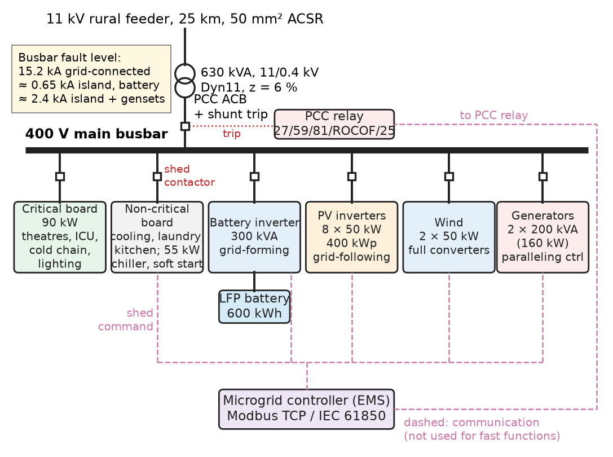
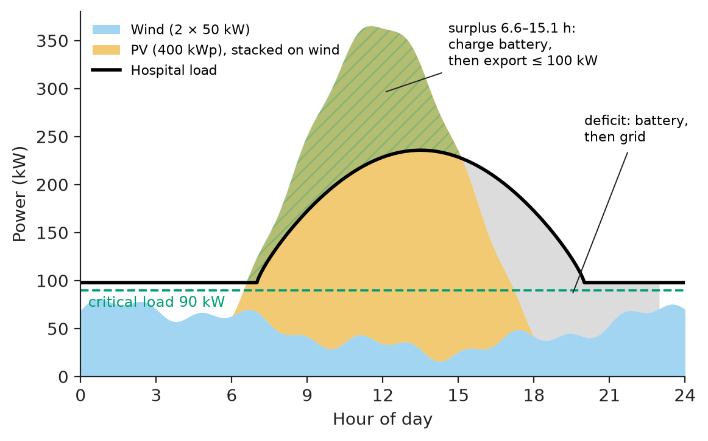
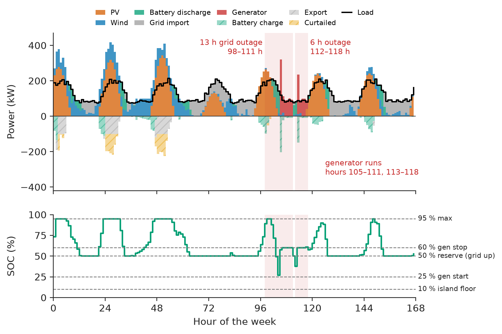
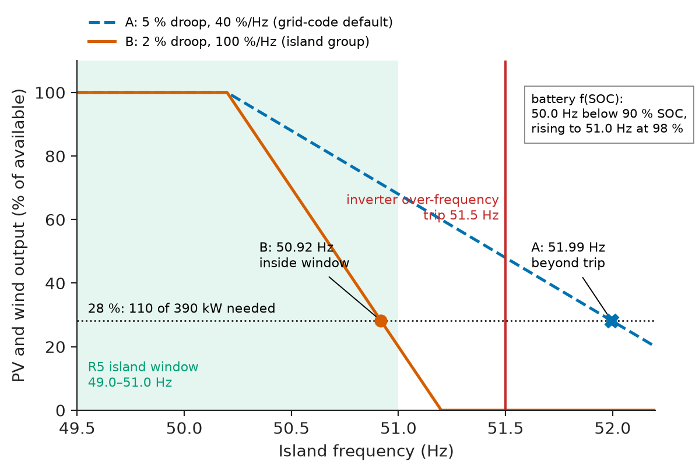
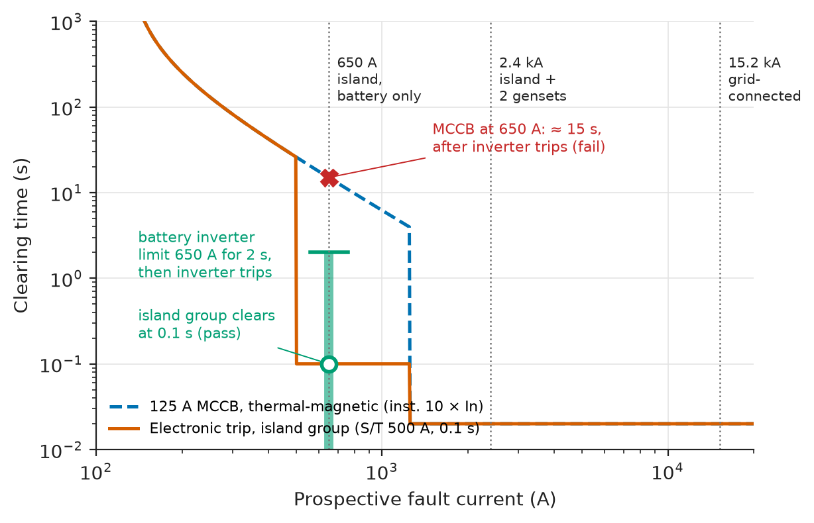
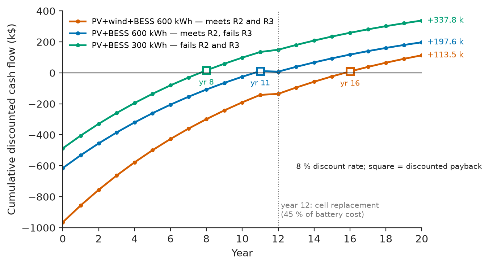

# Chapter 25 — Microgrids and Hybrid Energy Systems

*Part VI · Renewable Energy and Electric Mobility*

A district hospital at the end of a 25 km rural 11 kV feeder loses grid power about forty times a year. Its two diesel generators start in ten seconds, and for years the operating theatres have ridden through on UPS batteries. A donor funds a hybrid system: 400 kWp of PV on the roofs and car park, two 50 kW wind turbines on the ridge behind the laundry, and a 600 kWh lithium-iron-phosphate battery with a grid-forming inverter, so that the hospital islands without a gap. Three weeks after commissioning, at noon on a Sunday, the feeder trips. The battery takes the island cleanly. But the load is only 110 kW, the PV is producing 330 kW, the battery is at 95 % state of charge, and nothing tells the PV inverters to back off. In forty seconds the highest cell reaches its limit, the battery inverter trips to protect itself, the island collapses, and the hospital is back on generators and UPS — exactly the event the project was paid to prevent. Every component worked. The *coordination* between them had not been specified: the PV inverters' frequency-watt response, the battery's way of asking for it, and the test that would have shown the gap. This chapter designs that hospital microgrid from load profile to economics.

> **How are PV, wind, storage and generators sized and dispatched together so that a site meets an energy target, a resilience target and a budget at the same time?**
> **What must each inverter, relay and controller be set to do so that the system works both connected to the grid and as an island, and moves between the two without a blackout?**

| Concept | Engineering destination |
|---|---|
| Solar–wind–storage integration | Complementary resources; storage sized for both energy shifting and outage ride-through |
| Hybrid architectures | AC- versus DC-coupling; grid-forming and grid-following converters; where the diesel fits |
| Load profiles | Peak, base, load factor, critical load; the number every other size depends on |
| Energy management | Hourly dispatch rules, reserve state of charge, export limits, generator scheduling |
| Grid-connected operation | Export limitation, voltage rise on weak feeders, grid-code functions |
| Islanded operation | Grid-forming source, transition, motor starting, generator minimum load |
| Inverter coordination | Frequency-watt curtailment, droop sharing, communication-free fallback |
| Protection | Fault current that changes by 20× between modes; adaptive settings |
| Reliability | Interruption frequency of the critical load; autonomy; common-cause failures |
| Economic evaluation | NPV, payback, LCOE and the price of each requirement |

**Roadmap.** Requirements and architecture (25.1) → the load profile (25.2) → integrating solar, wind and storage (25.3) → the energy-management system (25.4) → grid-connected operation (25.5) → islanded operation (25.6) → inverter coordination (25.7) → protection (25.8) → reliability (25.9) → economic evaluation (25.10) → verification, failure analysis and Revision B (25.11).

---

## 25.1 Hybrid architectures

> **Boundary.** The definition of a microgrid, its control hierarchy and steady-state droop sharing are in *Electrical Energy and Machines*, [Ch. 26 §26.4](https://github.com/The-Studio-of-Sadiq/Electrical-Energy-and-Machines/blob/main/part-7-power-quality-and-grid-modernization/26-smart-grids.md); grid-connected inverters, anti-islanding and frequency support in [Ch. 27 §27.1–27.6](https://github.com/The-Studio-of-Sadiq/Electrical-Energy-and-Machines/blob/main/part-7-power-quality-and-grid-modernization/27-grid-integration-of-renewable-energy.md); wind and PV resources in [Ch. 15](https://github.com/The-Studio-of-Sadiq/Electrical-Energy-and-Machines/blob/main/part-4-power-generation/15-renewable-energy-systems.md). PV array design is this book's Chapter 22 and the battery pack Chapter 23. This chapter integrates them into one site.

### Requirements

**Table 25.1 — Requirements for the hospital microgrid.**

| ID | Requirement | Target | Verification |
|---|---|---|---|
| R1 | Seamless islanding of the critical board | Voltage below 70 % for no more than 100 ms on unplanned grid loss | Staged PCC trip, power-quality recorder at critical board |
| R2 | Critical-load autonomy on battery alone | ≥ 2.5 h at 90 kW from the reserve state of charge | Calculation; timed island test with generators inhibited |
| R3 | Renewable fraction (funder condition) | ≥ 60 % of annual consumption | Hourly simulation; then metered first year |
| R4 | Export at the point of common coupling (PCC) | ≤ 100 kW (connection agreement) | Export-limit test with load bank off |
| R5 | Island frequency and voltage | 49.0–51.0 Hz, 360–440 V line; nadir ≥ 49.0 Hz on a 100 kW step | Load-bank step tests |
| R6 | Fault clearing in both modes | Final circuits ≤ 0.4 s (IEC 60364-4-41, TN, 230 V) | Fault-current calculation; injection test of trip units |
| R7 | Grid-code functions | Ride-through, P(f), Q(V) per EN 50549-1 (IEEE 1547-2018 equivalents) | Inverter type test certificates; site settings audit |
| R8 | Resynchronisation | Δf ≤ 0.1 Hz, ΔV ≤ 5 %, Δφ ≤ 10° at reclosure | Synchro-check relay log |
| R9 | Economics | NPV ≥ 0 at 8 % over 20 years | Cash-flow model (Section 25.10) |

R2 and R3 are the expensive ones, and Section 25.10 prices each of them.

### Architecture options

**Table 25.2 — Hybrid architectures considered.**

| Architecture | How sources connect | Strengths | Weaknesses | Fit here |
|---|---|---|---|---|
| AC-coupled | PV, wind and battery each through their own inverter onto the 400 V AC bus | Uses standard grid-tied PV inverters; each source sized and replaced independently; retrofits existing sites | PV energy for the battery is converted twice (DC–AC–DC); needs frequency-based coordination when islanded | **Chosen**: existing PV-ready switchboards, mixed sources |
| DC-coupled | PV through MPPT DC–DC converters onto the battery's DC bus; one bidirectional inverter | One conversion from PV to battery; simple curtailment (MPPT backs off) | Inverter must be sized for PV plus battery; single point of failure | Good for small off-grid sites |
| Hybrid all-in-one inverters | Several 30–100 kW hybrid inverters in parallel | Low cost per kW; integrated control | Parallel stability and protection depend on one vendor; limited wind input | Rejected: wind and gensets |
| DC microgrid (380 V DC) | Loads on DC distribution | Fewest conversions for DC loads | Hospital loads are AC; DC protection less mature | Rejected |

Figure 25.1 shows the chosen AC-coupled single-line diagram. The PCC is the hospital's 400 V main incomer below a 630 kVA, 11/0.4 kV transformer. The microgrid controller (MGC) talks Modbus TCP or IEC 61850 to the battery inverter, the PV and wind inverters, the generator controllers and the PCC relay; but the parts of the design that must work in milliseconds — islanding, frequency-watt curtailment, droop sharing — work without it.

<!-- FIGURE 25.1 | figures/ch25/fig-25-1-hospital-microgrid-sld.png | block-diagram | Single-line diagram of the AC-coupled hospital microgrid. | Content: top, 11 kV rural feeder (25 km, 50 mm2 ACSR) and 630 kVA 11/0.4 kV Dyn11 transformer (6 percent impedance). PCC: air circuit breaker with shunt trip and PCC relay (27/59/81/ROCOF/25 synchro-check). 400 V main busbar feeding: critical board (90 kW: theatres, ICU, cold chain, lighting) and non-critical board (cooling, laundry, kitchen; 55 kW chiller on soft starter) with shed contactor; battery inverter 300 kVA grid-forming with 600 kWh LFP; PV inverters 8 x 50 kW (400 kWp) grid-following; wind 2 x 50 kW with full converters; generators 2 x 200 kVA (160 kW) with paralleling controllers. Microgrid controller box with dashed communication lines to all inverters, generator controllers, PCC relay and shed contactor. Annotations: grid-connected fault level 15.2 kA, islanded fault level about 0.65 kA (battery only) to 2.4 kA (battery plus gensets). -->



*Figure 25.1 — Single-line diagram of the AC-coupled hospital microgrid.*

### Component choice: the battery inverter

The battery inverter decides whether the island exists. **Table 25.3** compares the three control types available in 300 kVA power-conversion systems (PCS).

**Table 25.3 — Battery inverter control options.**

| Option | Behaviour on grid loss | Island stability with PV inverters | Fault current | Choice |
|---|---|---|---|---|
| Grid-following PCS with island-mode switch | Detects loss, stops, restarts as voltage source: 100–300 ms gap | Good once restarted | 1.1–1.2 pu | Rejected: fails R1 |
| Grid-forming droop PCS (voltage source at all times) | Holds voltage and phase through PCC opening: no gap | Good; frequency becomes a signal to PV | 1.5 pu for 2 s, settable | **Chosen** |
| Virtual synchronous machine (VSM) PCS | As grid-forming, plus emulated inertia | Best with generators in parallel | 1.5–2 pu | Considered; premium of about 15 % |

---

## 25.2 Load profiles

The load profile sets every other size: the PV and battery for energy, the inverters and generators for power, the protection for current. The hospital was metered at 15 min resolution for six weeks with a power-quality analyser on the main incomer and on the critical board, and the year was reconstructed from monthly bills with a cooling-degree-day model (the auditing method of *Electrical Energy and Machines*, [Ch. 28 §28.2](https://github.com/The-Studio-of-Sadiq/Electrical-Energy-and-Machines/blob/main/part-7-power-quality-and-grid-modernization/28-energy-efficiency-and-management.md)).

**Table 25.4 — Hospital load summary.**

| Quantity | Value | Use in the design |
|---|---|---|
| Annual energy | 1,128 MWh | PV and wind energy sizing; R3 denominator |
| Mean load | 129 kW | Generator fuel model, battery cycling |
| Peak load (hot-season midday) | 269 kW | Island power rating; generator rating |
| Minimum load (night) | 59 kW | Curtailment needed in island at noon on low-load days |
| Load factor | 0.48 | Ratio of mean to peak |
| Critical load (theatres, ICU, cold chain, lighting, IT) | 90 kW | Autonomy (R2), shed scheme |
| Largest motor | 55 kW chiller compressor, soft starter | Island inrush (Section 25.6) |

The profile has the shape that makes solar attractive: a weekday plateau from 08:00 to 18:00 with a cooling peak in the early afternoon, and a 85–100 kW night base. Figure 25.2 shows a typical hot-season day with the PV and wind production of the design.

<!-- FIGURE 25.2 | figures/ch25/fig-25-2-daily-profile.png | plot | Hospital load, PV and wind on a typical hot-season day, with the critical load marked. | Content: x-axis hour 0 to 24. y-axis power 0 to 380 kW. Load curve (solid black) about 95 kW at night rising from 07:00 to about 235 kW plateau 11:00 to 15:00 and back to 100 kW by 21:00. PV (orange area) from 06:00 to 18:00 peaking at about 330 kW at noon. Wind (blue area) fluctuating 20 to 80 kW, higher at night. Dashed line at 90 kW labelled critical load. Shaded regions: surplus (PV plus wind above load) about 06:35 to 15:08 (6.6 to 15.1 h) labelled charge battery then export up to 100 kW; deficit evenings labelled battery then grid. -->



*Figure 25.2 — Hospital load, PV and wind on a typical hot-season day, with the critical load marked.*

> **Status of the principle: Hourly load profile as the design basis**
> *Empirical.* A reconstructed hourly year captures energy and daily shape but smooths sub-hourly peaks; power ratings (inverters, generators, protection) are therefore checked against the 1 s and 15 min metered peaks, not the hourly profile.

---

## 25.3 Solar–wind–storage integration

### Why wind as well as solar

The roofs and car park hold 400 kWp of PV at most. Simulated with a site clearness model, 400 kWp gives 556 MWh a year (1,391 kWh/kWp), about half the 1,128 MWh load — so PV alone cannot meet R3's 60 %. Two 50 kW turbines at a hub-height mean speed of about 5.9 m/s add 214 MWh (capacity factor 24 %), and wind produces much of its energy at night, when PV produces nothing. The complementarity is the reason for the hybrid: a kilowatt-hour of wind at 02:00 displaces an import, while a further kilowatt-hour of PV at noon on a low-load day is mostly exported, stored with loss, or curtailed.

**Worked example — could more PV replace the wind?** If land were available, how much PV would meet R3 without wind? Running the dispatch of Section 25.4 with the PV scaled by 1.5 (600 kWp) and the 600 kWh battery gives a renewable fraction of 58 %; at 1.75 (700 kWp) it reaches 62 %, but 141 MWh a year is curtailed and 129 MWh exported at a low price, because the extra PV arrives at the hours that already have surplus. Wind meets the target at 400 kWp with only 14 MWh of curtailment. The site has no land for 300 kWp more anyway; the question confirms that wind is the right second source, not just the available one.

### Sizing the storage for two jobs

The battery has two jobs that pull its size in different directions:

1. **Energy shifting**: absorb midday surplus and release it in the evening. In the simulated year the daily surplus is below 200 kWh on half the days, above 500 kWh on a quarter and above 850 kWh on a tenth, so capacity beyond about 600 kWh cycles only on the sunniest days.
2. **Resilience**: carry the 90 kW critical load from the reserve state of charge for 2.5 h (R2) while generators are started or, if they fail, repaired.

The energy-management system (Section 25.4) holds a 50 % reserve while the grid is up and allows discharge to 10 % in an island, so the energy available at the start of any outage is at least $(0.50-0.10)\times600=240$ kWh, which carries the critical load for $240/90=2.67$ h: R2 passes with 0.17 h margin. The inverter rating of 300 kVA covers the 269 kW peak in an island with the non-critical board connected.

**Table 25.5 — Island power and energy budget.**

| Quantity | Requirement | Available | Margin |
|---|---|---|---|
| Island peak power, generators off | 269 kW (peak load) | 300 kW battery inverter continuous | 31 kW (12 %) |
| Island peak power, generators on | 269 kW | 300 + 2 × 160 = 620 kW | 351 kW |
| Short-term overload (motor start) | 210 + 199 kVA (Section 25.6) | 450 kVA for 10 s | 41 kVA (9 %) |
| Critical-load autonomy from reserve | 2.5 h at 90 kW = 225 kWh | 240 kWh | 15 kWh (7 %) |
| Generator minimum load | ≥ 30 % of 160 kW = 48 kW per set | EMS adds battery charging | — |

> **Status of the principle: Battery autonomy from reserve energy and critical load**
> *Derived.* Runtime is energy divided by power; it assumes the critical load stays at its 90 kW design value and that the battery's usable capacity has not faded, so the reserve setting is raised by the measured capacity loss each year (Chapter 23).

---

## 25.4 Energy management

### The dispatch rules

The energy-management system (EMS) in the microgrid controller runs every 15 min to 1 h and sets targets; the fast layers (inverter droop, frequency-watt) carry out the second-by-second balance. Its rules, in priority order:

- **Grid up, surplus**: charge the battery up to 95 % SOC, then export up to the 100 kW limit, then curtail.
- **Grid up, deficit**: discharge the battery down to the 50 % reserve, then import.
- **Island**: renewables and battery first, down to 10 % SOC; start a generator when SOC falls below 25 % and stop it above 60 %; a running generator carries the load and recharges the battery, and never runs below 30 % of rating.

Before writing them into a controller, the rules were run against an hourly year. The first listing generates the synthetic year (load from Table 25.4, PV from a daily clearness model, wind from a correlated Rayleigh speed series through a 50 kW power curve, and 40 outages with exponentially distributed durations of mean 3 h); it is saved as `site_profiles.py`.

```python
"""Synthetic hourly year for the hospital microgrid: load, PV, wind (kW), grid outages."""
import numpy as np

def profiles(seed=1):
    rng = np.random.default_rng(seed)
    h = np.arange(8760); hod, doy = h % 24, h // 24
    season = 1 + 0.15*np.cos(2*np.pi*(doy - 170)/365)               # hot-season cooling
    load = (85 + 120*np.clip(np.sin(np.pi*(hod - 7)/13), 0, None)**0.8) * season
    load *= 1 + 0.06*rng.standard_normal(8760)
    clear = np.repeat(rng.uniform(0.35, 1.0, 365), 24)              # daily clearness
    sun = np.clip(np.sin(np.pi*(hod - 6)/12), 0, None)
    pv = 400*0.82*sun**1.3*clear*(1 + 0.08*np.cos(2*np.pi*(doy - 80)/365))
    x = np.zeros((8760, 2))                                          # AR(1) wind components
    for k in range(1, 8760): x[k] = 0.9*x[k-1] + np.sqrt(0.19)*rng.standard_normal(2)
    u = np.hypot(x[:, 0], x[:, 1]) * 6.0/np.sqrt(np.pi/2)           # Rayleigh, mean 6 m/s
    wind = 2*np.where((u >= 3) & (u < 25), np.minimum(50*(u**3 - 27)/(11**3 - 27), 50), 0)
    outage = np.zeros(8760, bool)
    for s in rng.choice(8760 - 24, 40, replace=False):               # 40 outages, mean 3 h
        outage[s:s + max(1, int(round(rng.exponential(3.0))))] = True
    return load, pv, wind, outage
```

The second listing, `ems.py`, is the dispatch itself.

```python
import numpy as np
from site_profiles import profiles

def dispatch(load, pv, wind, outage, E=600.0, P=300.0, reserve=0.5, exp_lim=100.0, eta=0.95):
    soc, gen_on = 0.8*E, False
    r = dict(imp=0.0, exp=0.0, curt=0.0, gen=0.0, gen_h=0)
    for k in range(len(load)):
        net = pv[k] + wind[k] - load[k]                       # kW; + is surplus
        floor = (0.10 if outage[k] else reserve) * E           # keep reserve while grid is up
        if net >= 0:                                           # surplus: charge, export, curtail
            ch = min(net, P, (0.95*E - soc)/eta); soc += ch*eta; net -= ch
            e = 0.0 if outage[k] else min(net, exp_lim)
            r['exp'] += e; r['curt'] += net - e; gen_on = False
            continue
        dis = min(-net, P, max(soc - floor, 0.0)*eta); soc -= dis/eta; net += dis
        if not outage[k]:
            r['imp'] += -net; gen_on = False
            continue
        gen_on = (gen_on or soc < 0.25*E) and soc <= 0.60*E    # genset hysteresis 25-60 % SOC
        if gen_on or net < 0:                                  # genset carries load, recharges
            g = min(320.0, max(-net + min(P, (0.6*E - soc)/eta), 48.0))
            soc += max(g + net, 0.0)*eta; r['gen'] += g; r['gen_h'] += 1
    return r

if __name__ == "__main__":
    load, pv, wind, outage = profiles()
    print(f"load {load.sum()/1e3:.0f} MWh (peak {load.max():.0f} kW), PV {pv.sum()/1e3:.0f} MWh, "
          f"wind {wind.sum()/1e3:.0f} MWh, outages {outage.sum()} h")
    for name, w in [("PV+wind+BESS", wind), ("PV+BESS", 0*wind)]:
        r = dispatch(load, pv, w, outage)
        ren = 1 - (r['imp'] + r['gen'])/load.sum()
        print(f"{name}: import {r['imp']/1e3:.0f} MWh, export {r['exp']/1e3:.0f} MWh, curtailed "
              f"{r['curt']/1e3:.1f} MWh, diesel {r['gen']/1e3:.1f} MWh in {r['gen_h']} h, renewable {ren:.0%}")
```

```text
load 1128 MWh (peak 269 kW), PV 556 MWh, wind 214 MWh, outages 143 h
PV+wind+BESS: import 413 MWh, export 42 MWh, curtailed 13.9 MWh, diesel 7.5 MWh in 52 h, renewable 63%
PV+BESS: import 589 MWh, export 21 MWh, curtailed 3.2 MWh, diesel 11.0 MWh in 80 h, renewable 47%
```

The full system meets R3 with 63 % (3 percentage points of margin); without wind it reaches 47 %. Generators run 52 h a year instead of the 143 h of grid outage, because the battery carries the short outages entirely. Figure 25.3 shows one week of dispatch including a 13 h outage.

<!-- FIGURE 25.3 | figures/ch25/fig-25-3-week-dispatch.png | plot | One week of hourly dispatch with a 13 h grid outage, and the battery state of charge. | Content: two stacked panels, x-axis hours 0 to 168. Top: stacked areas of supply to load: PV (orange), wind (blue), battery discharge (green), grid import (grey), generator (red); battery charging and export drawn below zero; load as black line 60 to 270 kW. Outages shaded from hour 98 to 111 (13 h) and 112 to 118 (6 h): grid import zero, generator running hours 105 to 111 and 113 to 118. Bottom: SOC 0 to 100 percent with dashed lines at 95 percent (max), 50 percent (reserve while grid up), 25 and 60 percent (generator start and stop), 10 percent (island floor); SOC falls below 50 percent only during the outages. -->



*Figure 25.3 — One week of hourly dispatch with a 13 h grid outage, and the battery state of charge.*

> **Status of the principle: Rule-based hourly dispatch**
> *Approximate.* Energy balance per hour with constant one-way battery efficiency (0.95) and no forecast; it ignores sub-hourly variability and inverter limits within the hour. A forecast-based optimiser (model-predictive dispatch) typically gains 3–8 % on cost, and is worth it only once the simple rules have been validated against metered data.

### What the controller adds to the simulation

The production EMS adds what the hourly model cannot: a day-ahead PV and wind forecast that raises the reserve before forecast storms (when outages are likelier), a demand-limit function, a shed scheme for the non-critical board, and logging of every mode change for the reliability record of Section 25.9. Its communication is not trusted for protection or stability; if the controller fails, every inverter falls back to its local settings (Section 25.7), the battery holds its last reserve setting, and generators revert to their own auto-start on undervoltage.

---

## 25.5 Grid-connected operation

### Export limitation

The connection agreement allows 100 kW of export (R4). The PCC meter is read by the microgrid controller every second; when export approaches the limit and the battery is full, the controller lowers the active-power limit of the PV inverters over Modbus (SunSpec models), and a hard backstop in each inverter's own export-control input caps output if communication is lost. The test is to switch off the load bank on a sunny day and record the PCC: export must settle below 100 kW within the agreed time (typically 5–15 s) and the one-minute average must never exceed it.

**Worked example — why the network operator limits export.** The 25 km feeder of 50 mm² ACSR has about $R=13.5\ \Omega$ and $X=9.5\ \Omega$. The voltage rise at the site from an export $P$ with reactive power $Q$ is approximately $\Delta V\approx(PR+QX)/V$ (*Electrical Energy and Machines*, [Ch. 22 §22.5](https://github.com/The-Studio-of-Sadiq/Electrical-Energy-and-Machines/blob/main/part-6-transmission-distribution-and-protection/22-distribution-systems.md)). Exporting 100 kW at unity power factor raises the 11 kV feeder end by $100{,}000\times13.5/11{,}000=123$ V, 1.1 %; 300 kW would raise it 3.3 %, on a feeder end already at about 104 % at light load — over the 110 % statutory limit with tap and measurement tolerances. With the inverters absorbing reactive power at 0.95 power factor ($Q=-32.9$ kvar per 100 kW), the rise at 100 kW falls to 0.86 %. The site therefore runs a Q(V) characteristic per EN 50549-1 in addition to the export limit.

### Grid-code functions

In grid-connected mode the PV and wind inverters are ordinary grid-following DER and must comply with the connection standard (EN 50549-1 in Europe, IEEE 1547-2018 in North America): voltage and frequency ride-through, over-frequency P(f) curtailment, Q(V) or fixed power factor, and anti-islanding. The interaction that matters for this design is between anti-islanding and the battery: with a grid-forming battery holding the island at nominal voltage and frequency, the PV inverters' passive anti-islanding cannot see the grid loss. That is intended — the PV must keep running in the island — but it means the **PCC relay**, not the inverters, is responsible for separating the hospital from a dead feeder before the utility recloses (*Electrical Energy and Machines*, Ch. 27 §27.5). The utility's first reclose is at 1–3 s after a feeder trip, so the PCC relay must open within about 0.5 s.

---

## 25.6 Islanded operation

### The transition

On grid loss the PCC relay sees undervoltage (below 0.8 pu for 50 ms), a vector shift or a frequency excursion, and trips the PCC breaker; the opening takes about 50 ms. Throughout, the grid-forming battery inverter holds its voltage phasor. The critical board sees a voltage dip whose depth depends on the fault on the feeder and whose duration is detection plus breaker time, about 70–100 ms: R1 is met with little margin, which is why the PCC breaker was specified with a fast shunt trip and the relay's undervoltage stage was set at 50 ms rather than the 100 ms default. A planned island (for feeder maintenance) is seamless: the controller first ramps the PCC exchange to zero with the battery, then opens the breaker.

### Living as an island

Once islanded, the battery inverter sets frequency and voltage, the PV and wind inverters follow, and the EMS starts a generator if SOC falls to 25 %. Two problems remain that did not exist with the grid connected.

**Worked example — starting the chiller in an island.** The 55 kW chiller compressor (motor efficiency 0.92, power factor 0.9) draws $55/(0.92\times0.9)=66.4$ kVA running and, through its soft starter, about three times that, 199 kVA, for 5–8 s. With 200 kW of other load at 0.95 power factor (210 kVA) and only the battery online, the inverter would have to supply about 410 kVA, over its 300 kVA continuous rating but inside its 450 kVA, 10 s overload rating — a 9 % margin that ambient temperature or a fading cell could erase. The controller therefore inhibits the chiller start in an island unless a generator is online or the other load is below 150 kW, and Revision B replaces the soft starter with a VFD that starts the compressor at rated current.

**Generator minimum load.** A diesel that runs below about 30 % of rating for long periods "wet-stacks": unburnt fuel accumulates in the exhaust. In an island with plenty of PV, a generator that starts at 25 % SOC can find itself almost unloaded an hour later as the sun comes out. The EMS keeps a running generator loaded to at least 48 kW by charging the battery from it, and stops it once SOC passes 60 %; the listing of Section 25.4 implements exactly that floor.

> **Status of the principle: Grid-forming source as the island's reference**
> *Fundamental.* An AC island needs at least one source that sets voltage magnitude and frequency; every grid-following source needs a voltage to synchronise to. Without a grid-forming battery or a running synchronous machine the island cannot exist, whatever the PV produces.

---

## 25.7 Inverter coordination

### Frequency as the communication channel

The opening failure was a coordination failure, and its fix is the central design in this chapter. In an island the battery inverter is the only source that can absorb surplus, and once it is full, PV and wind must reduce output within seconds. Communication over Modbus is too slow and too fragile for that; instead the battery inverter **raises the island frequency** when it is full, and the PV and wind inverters reduce output along their **frequency-watt** characteristic. EN 50549-1 requires such an over-frequency curtailment (LFSM-O): above a threshold of 50.2 Hz, power is reduced along a droop $s$ (default 5 %), a gradient of $1/(s\,f_n)=40\,\%$ of reference power per hertz (*Electrical Energy and Machines*, Ch. 27 §27.6).

**Worked example — the noon island of the opening paragraph.** PV gives 330 kW and wind 60 kW (390 kW together), the load is 110 kW, and the battery is full: 280 kW, or 72 % of renewable output, must be curtailed. With the default 40 %/Hz gradient the frequency must rise $0.72/0.40=1.79$ Hz above 50.2 Hz, to 51.99 Hz — beyond the inverters' own 51.5 Hz over-frequency trip, so in practice they trip rather than curtail, and when they trip the island loses all its renewable generation at once. With the droop set to 2 % (100 %/Hz) for island operation, the frequency rises only 0.72 Hz, to 50.92 Hz, inside R5's 51.0 Hz limit. The battery inverter's own frequency setting follows its SOC: nominal 50.0 Hz below 90 % SOC, rising linearly to 51.0 Hz at 98 %. Figure 25.4 shows both characteristics.

<!-- FIGURE 25.4 | figures/ch25/fig-25-4-frequency-watt.png | plot | Frequency-watt curtailment of the PV and wind inverters for two droop settings, with the island operating point. | Content: x-axis frequency 49.5 to 52.2 Hz. y-axis renewable output as percent of available power 0 to 110. Curve A (dashed): 100 percent up to 50.2 Hz then falling at 40 percent per Hz, reaching 28 percent at 52.0 Hz. Curve B (solid): 100 percent to 50.2 Hz then falling at 100 percent per Hz to 0 at 51.2 Hz. Vertical red line at 51.5 Hz labelled inverter over-frequency trip; shaded band 49.0 to 51.0 Hz labelled R5 island window. Horizontal dotted line at 28 percent (110 of 390 kW needed). Operating points: curve B at 50.92 Hz (inside window), curve A at 51.99 Hz (beyond trip). Inset text: battery frequency setpoint 50.0 Hz below 90 percent SOC rising to 51.0 Hz at 98 percent SOC. -->



*Figure 25.4 — Frequency-watt curtailment of the PV and wind inverters for two droop settings, with the island operating point.*

The wind turbines' converters support the same P(f) function. Older small turbines that lack it are given a dump-load controller or a contactor that the microgrid controller opens above 50.8 Hz; the contactor is a coarse but communication-free backstop.

**Table 25.6 — Island coordination settings (Revision A versus commissioning fix).**

| Setting | Revision A (as installed) | Revision A.1 (after the noon event) | Why |
|---|---|---|---|
| PV/wind P(f) threshold | 50.2 Hz | 50.2 Hz | Grid-code value, kept |
| PV/wind P(f) droop | 5 % (40 %/Hz) | 2 % (100 %/Hz) in island setting group | Full curtailment before 51.0 Hz |
| PV/wind over-frequency trip | 51.5 Hz, 0.1 s | 51.5 Hz, 0.1 s | Unchanged; curtailment now completes below it |
| Battery f(SOC) | Fixed 50.0 Hz | 50.0 Hz to 51.0 Hz between 90 % and 98 % SOC | Signals "full" to all inverters |
| Battery charge limit at 98 % SOC | Trip on cell high voltage | Taper to zero, no trip | Battery remains the grid-forming source |
| Setting-group switch | None | PCC breaker auxiliary contact → island group | Grid-code values when connected |

> **Status of the principle: Frequency-signalled curtailment**
> *Derived.* With a single grid-forming source and grid-following inverters on linear P(f) droops, the steady-state frequency follows from the power balance; it neglects the inverters' response time (1–2 s typical), during which the battery must absorb the transient surplus — which is why the battery's charge limit tapers instead of tripping.

### Sharing with generators

When a generator runs in parallel with the battery, both are voltage sources, and they share load changes by droop exactly as in *Electrical Energy and Machines*, Ch. 26 §26.4: with the battery on 2 % droop and each 160 kW generator on 4 %, the battery takes $(300/0.02)/(300/0.02+160/0.04)=79\,\%$ of a load step with one generator running. That is the intended split: the battery absorbs fast steps, and the EMS slowly re-dispatches toward the generator so that it loads above its 48 kW floor.

---

## 25.8 Protection

### The fault-current problem

Protection settings are chosen for the fault current available, and that current changes by a factor of more than 20 between modes (*Electrical Energy and Machines*, [Ch. 23 §23.2 and §23.9](https://github.com/The-Studio-of-Sadiq/Electrical-Energy-and-Machines/blob/main/part-6-transmission-distribution-and-protection/23-power-system-protection.md)).

**Worked example — fault levels in the two modes.** Grid-connected, the 630 kVA transformer with 6 % impedance gives a three-phase fault current at the 400 V busbar of $630{,}000/(\sqrt3\times400\times0.06)=15.2$ kA (upstream impedance neglected). Islanded on the battery alone, the inverter's rated current is $300{,}000/(\sqrt3\times400)=433$ A and it limits its fault current to 1.5 pu, 650 A, for 2 s. Each 200 kVA generator (rated current 289 A) contributes $289/0.15=1{,}925$ A subtransient and about 3 pu (866 A) sustained with its permanent-magnet excitation support. So the busbar fault level is 15.2 kA connected, 0.65 kA islanded with the battery only and about 2.4 kA with both generators — 23 times lower than connected in the worst case.

Consider a 125 A outgoing circuit to the laundry protected by an MCCB with a thermal-magnetic trip whose instantaneous element is at 10 × In = 1,250 A. Connected, a fault draws kiloamperes and clears in one cycle. Islanded on the battery, the 650 A fault is only 5.2 × In: the instantaneous element does not operate, the thermal element takes 10–20 s, and the inverter's 2 s current limit ends first — the battery trips, and the whole island blacks out for a fault on one non-critical circuit. Figure 25.5 shows the mismatch.

<!-- FIGURE 25.5 | figures/ch25/fig-25-5-island-protection-tcc.png | plot | Time-current curves of a 125 A feeder breaker against the fault current available in each operating mode. | Content: log-log axes, x current 100 A to 20 kA, y time 0.01 s to 1,000 s. Thermal-magnetic MCCB 125 A curve (dashed): long-time inverse region from 1.05 x In, about 15 s at 650 A, instantaneous step at 1,250 A down to 0.02 s. Electronic trip unit island setting group (solid): same long-time curve, short-time pickup 500 A at 0.1 s. Battery inverter current limit: horizontal bar at 650 A ending at 2 s labelled inverter trips. Vertical lines: 650 A island battery only, 2.4 kA island with both generators, 15.2 kA grid-connected. Marked intersections: MCCB at 650 A clears after the inverter trips (fail); island group clears at 0.1 s (pass). -->



*Figure 25.5 — Time-current curves of a 125 A feeder breaker against the fault current available in each operating mode.*

**Table 25.7 — Protection options for the islanded case.**

| Option | How it works | Cost | Weakness | Choice |
|---|---|---|---|---|
| Electronic trip units with two setting groups | Short-time pickup lowered to 4 × In (500 A), 100 ms, in island group; switched by PCC breaker auxiliary contact | Replace 14 MCCB trip units | Group switching must be tested; a wrong group is a hidden failure | **Chosen** for outgoing feeders |
| Higher inverter fault current | Specify 2 pu (866 A) for 2 s | Inverter oversizing, about 10 % | Still below many instantaneous settings | Specified as well |
| Undervoltage-supervised overcurrent at the busbar | Trip feeders on low voltage plus overcurrent | Relays and CTs | Coordination with motor starting dips | Kept as backup |
| Differential protection on key feeders | Current difference, independent of fault level | High | Only for a few feeders | Rejected for this site |

Final circuits with miniature circuit breakers and RCDs are a separate problem: a type B MCB needs 3–5 × In to trip magnetically, so a 32 A circuit trips instantaneously at 160 A, well within the islanded fault current. The disconnection-time requirement of R6 (0.4 s) is checked for every final circuit with the islanded source impedance; the RCDs on socket circuits provide shock protection independent of fault level.

> **Status of the principle: Mode-dependent fault current of inverter-dominated islands**
> *Empirical.* Inverters limit fault current by control to 1.1–2 pu, set by the manufacturer and not by physics of the source; the protection study must use the specific inverter's fault-current profile from its type test, not a generic machine model.

---

## 25.9 Reliability

The hospital's objective is not energy but continuity of the critical load. Its reliability is computed for the two failure paths that matter: the transfer at the moment of grid loss, and the long outage that outlasts both the battery reserve and the generators.

**Worked example — interruptions of the critical load per year.** With 40 grid outages a year, the old system (generators and UPS only) gives 40 short interruptions of about 10 s at the main boards (the UPS hides them from theatres and ICU only). A long interruption occurs if both generators fail to start: with a failure-to-start probability $p=0.03$ per demand for each set and a common-cause fraction $\beta=0.1$ (shared fuel, shared battery charger, shared control panel), the probability that both fail is $\beta p+((1-\beta)p)^2=0.0037$, about 0.15 long interruptions a year. With the battery, the short interruptions disappear, and a long one needs both generators to fail *and* the outage to outlast the 2.67 h of reserve autonomy. With exponentially distributed outage durations of mean 3 h, $P(D>2.67\ \mathrm{h})=e^{-2.67/3}=0.41$, so the rate is $40\times0.0037\times0.41=0.061$ per year, once every 16 years, against once every 7 years before. The small 300 kWh battery would give only 1.33 h of autonomy and 0.096 per year — and would fail R2.

> **Status of the principle: Interruption rate from independent and common-cause failures**
> *Approximate.* It assumes Poisson outage arrivals, exponential durations and a β-factor common-cause model (*The Mathematics Universe*, [Ch. 19](https://github.com/The-Studio-of-Sadiq/engineering-mathematics/blob/main/part-6-probability-statistics/19-probability.md)); the β value of 0.1 is a typical engineering estimate, and real outage durations have heavier tails than the exponential, so the result is a comparison of designs, not a prediction.

Two further reliability rules came out of the review. The microgrid controller is a single point of coordination but must never be a single point of failure: every fast function runs locally (Section 25.7). And the battery inverter is now the most critical device on site, so a spare power module and a service contract with 48 h response are part of the design, along with a bypass that lets the hospital fall back to the original generator-only scheme.

---

## 25.10 Economic evaluation

The investment case compares each option with the **baseline**: all energy imported at \$0.18/kWh, and the existing generators supplying the load during outages at 0.30 L/kWh and \$1.10/L. Installed costs (2026, indicative for this market) are \$700 per kWp of PV, \$3,500 per kW of small wind, \$350 per kWh of battery plus \$150 per kW of inverter, and \$80,000 of switchgear, controls and protection. Exports earn \$0.05/kWh. The battery cells are replaced in year 12 at 45 % of today's cost; savings fade 0.5 % a year with PV and battery degradation; the discount rate is 8 % over 20 years.

```python
import numpy as np
from site_profiles import profiles
from ems import dispatch

load, pv, wind, outage = profiles()
TARIFF, EXPORT, DIESEL = 0.18, 0.05, 1.10*0.30           # $/kWh import, export, genset fuel
base = load[~outage].sum()*TARIFF + load[outage].sum()*DIESEL   # grid plus existing gensets

def npv(capex, opex, w, E=600, P=300, life=20, rate=0.08, fade=0.005):
    r = dispatch(load, pv, w, outage, E=E, P=P)
    saving = base - (r['imp']*TARIFF - r['exp']*EXPORT + r['gen']*DIESEL) - opex
    yrs = np.arange(1, life + 1)
    cash = saving*(1 - fade)**(yrs - 1) - np.where(yrs == 12, 0.45*350*E, 0)  # cells replaced yr 12
    disc = cash/(1 + rate)**yrs
    ren = 1 - (r['imp'] + r['gen'])/load.sum()
    return saving, disc.sum() - capex, np.cumsum(disc) - capex, ren

PV, WIND, BOS = 400*700, 100*3500, 80e3                   # 2026 installed costs, $
BESS = lambda E, P: 350*E + 150*P
print(f"baseline cost ${base/1e3:.1f}k/yr")
for name, capex, opex, w, E, P in [
        ("PV+wind+BESS 600 kWh", PV + WIND + BESS(600, 300) + BOS, 13.8e3, wind, 600, 300),
        ("PV+BESS 600 kWh",      PV + BESS(600, 300) + BOS,        7.8e3, 0*wind, 600, 300),
        ("PV+BESS 300 kWh",      PV + BESS(300, 150) + BOS,        6.3e3, 0*wind, 300, 150)]:
    s, v, cum, ren = npv(capex, opex, w, E, P)
    pay = np.argmax(cum >= 0) + 1 if cum[-1] >= 0 else None
    print(f"{name:21s} capex ${capex/1e3:5.0f}k  saving ${s/1e3:5.1f}k/yr  NPV ${v/1e3:6.1f}k"
          f"  discounted payback {pay} yr  renewable {ren:.0%}")
```

```text
baseline cost $206.1k/yr
PV+wind+BESS 600 kWh  capex $  965k  saving $117.7k/yr  NPV $ 113.5k  discounted payback 16 yr  renewable 63%
PV+BESS 600 kWh       capex $  615k  saving $ 89.7k/yr  NPV $ 197.6k  discounted payback 11 yr  renewable 47%
PV+BESS 300 kWh       capex $  488k  saving $ 89.0k/yr  NPV $ 337.8k  discounted payback 8 yr  renewable 45%
```

All three options pass R9. The cheapest is the most profitable, and fails R2 and R3; the chosen design is the least profitable that passes everything. Table 25.8 turns that into a statement of what each requirement costs, which is the form in which a funder or a hospital board can decide.

**Table 25.8 — Options against requirements, and the price of each requirement.**

| Option | R2 autonomy (≥ 2.5 h) | R3 renewable (≥ 60 %) | NPV at 8 % | Price of the step |
|---|---|---|---|---|
| PV + 300 kWh battery | 1.33 h — fails | 45 % — fails | \$337,800 | — |
| PV + 600 kWh battery | 2.67 h — passes | 47 % — fails | \$197,600 | R2 costs \$140,200 of NPV |
| PV + wind + 600 kWh battery | 2.67 h — passes | 63 % — passes | \$113,500 | R3 costs a further \$84,100 |

**Worked example — the levelised cost of the hybrid's energy.** The capital recovery factor at 8 % over 20 years is $0.08\times1.08^{20}/(1.08^{20}-1)=0.1019$. The chosen system's \$965,000 therefore costs \$98,300 a year, plus \$13,800 of operation and maintenance: \$112,100 a year. It supplies $1{,}128-413-7.5=707$ MWh of the load, so its levelised cost is \$0.159/kWh, below the \$0.18/kWh tariff — which is why the NPV is positive despite the wind turbines; rerunning the model shows that a tariff about 10 % lower (\$0.163/kWh) would turn it negative. Figure 25.6 shows the cumulative discounted cash flow of the three options.

> **Status of the principle: Net present value and levelised cost**
> *Derived.* Both are discounted sums of cash flows; they are exact for their inputs, and the inputs (tariff path, outage rate, degradation, replacement cost) are forecasts, so the decision is checked with a sensitivity sweep (Chapter 30) rather than a single number.

<!-- FIGURE 25.6 | figures/ch25/fig-25-6-discounted-cash-flow.png | plot | Cumulative discounted cash flow of three microgrid options over 20 years at 8 percent. | Content: x-axis year 0 to 20. y-axis cumulative discounted cash flow from -1,000 to +400 thousand dollars. Three curves starting at minus capex: PV+wind+BESS 600 kWh at -965 k reaching +113.5 k at year 20 and crossing zero in year 16; PV+BESS 600 kWh at -615 k reaching +197.6 k and crossing in year 11; PV+BESS 300 kWh at -488 k reaching +337.8 k and crossing in year 8. Dotted line at year 12 for the battery cell replacement: that year's savings exceed its cost for PV+wind+BESS 600 kWh and PV+BESS 300 kWh, so those curves only flatten; PV+BESS 600 kWh shows a small downward step (about -4 k discounted). Legend notes which options meet R2 and R3. -->



*Figure 25.6 — Cumulative discounted cash flow of three microgrid options over 20 years at 8 percent.*

---

## 25.11 Verification, failure analysis and Revision B

### Verification

Table 25.9 lists the site acceptance tests. Simulation results are marked; all others are from the commissioning test programme after the Revision A.1 settings change, with illustrative values.

**Table 25.9 — Verification of the hospital microgrid.**

| Req. | Test | Limit | Result | Pass/fail |
|---|---|---|---|---|
| R1 | Unplanned PCC trip at 180 kW load, recorder at critical board | < 70 % for ≤ 100 ms | Dip to 41 % for 78 ms | Pass |
| R2 | Island on battery from 50 % SOC, generators inhibited, critical load 90 kW | ≥ 2.5 h to 10 % SOC | 2.6 h | Pass (thin margin) |
| R3 | Hourly simulation (first metered year pending) | ≥ 60 % | 63 % (simulated) | Pass, to confirm |
| R4 | Load bank off, sunny noon, battery full | ≤ 100 kW, 1 min average | 96 kW peak 1 min average | Pass |
| R5 | 100 kW load-bank step in island, battery only | Nadir ≥ 49.0 Hz | 49.62 Hz | Pass |
| R5 | Noon island, battery at 97 % SOC, PV 320 kW, load 115 kW | 49.0–51.0 Hz | 50.81 Hz, no trip | Pass |
| R6 | Secondary injection of feeder trip units in island group | ≤ 0.1 s at 500 A | 0.08 s | Pass |
| R7 | Settings audit against EN 50549-1 certificate | All functions enabled | Island setting group verified | Pass |
| R8 | Reclosure after island, synchro-check log | Δf ≤ 0.1 Hz, ΔV ≤ 5 %, Δφ ≤ 10° | 0.04 Hz, 1.8 %, 6° | Pass |
| R9 | Cash-flow model | NPV ≥ 0 | \$113,500 (modelled) | Pass |

### Failure analysis

**Table 25.10 — FMEA extract for the hospital microgrid.**

| Failure mode | Effect | Cause | Detection | Mitigation |
|---|---|---|---|---|
| Island collapse on surplus (the opening event) | Blackout, back to generators and UPS | PV P(f) droop too shallow; battery trips at full | Event log: frequency fixed at 50.0 Hz, battery cell over-voltage trip | f(SOC) on battery, 2 % island droop, charge taper (Table 25.6) |
| Feeder fault not cleared in island | Battery current-limit trip, blackout | MCCB instantaneous above island fault level | Protection study; injection test | Adaptive setting groups; 2 pu inverter fault current |
| Wrong setting group after reconnection | Feeder protection too sensitive when connected, nuisance trips | Auxiliary contact failure | Group status monitored by controller | Watchdog compares group with PCC state; alarm |
| Utility recloses onto live island | Out-of-phase reclose, equipment damage | PCC relay slow or failed | Relay self-test | PCC opens in ≤ 0.5 s; trip-circuit supervision; interlock with utility recloser where possible |
| Generator wet-stacking | Fouling, failure to start later | Long low-load running | Generator hour and load log | 48 kW floor by battery charging |
| Island overload on chiller start | Battery overload trip | Soft-start inrush 199 kVA | Overload event log | Start inhibit in island; VFD (Revision B) |
| Controller failure | Loss of export limit and dispatch | Hardware or software fault | Heartbeat to each inverter | Local fallbacks: inverter export cap, last reserve, generator auto-start |
| Battery inverter failure | No seamless island | Power module fault | Self-diagnostics | Spare module, 48 h service, generator-only bypass |

### Revision B

| Change | Reason | Effect |
|---|---|---|
| Battery inverter specified as VSM with 2 pu fault current for 2 s | Thin protection margin; generator paralleling | Simpler protection grading; smoother sharing |
| Chiller soft starter replaced by VFD | 9 % overload margin on island start | Start at rated current; inhibit removed |
| Reserve SOC raised from 50 to 55 % with a forecast-based storm reserve of 70 % | R2 measured at 2.6 h, margin too thin as cells fade | Autonomy 3.0 h at year 1; costs about 1 % renewable fraction |
| Model-predictive dispatch with day-ahead forecasts | 3–8 % cost gain; storm reserve | Requires validated forecasts; after one metered year |
| Island test repeated annually at noon with full battery | The opening failure was untested | Regression test of coordination settings |
| Depot-style EV charging for the ambulances on the EMS demand limit | New load (Chapter 24) | Charging only from surplus or off-peak |

---

## What remains open

| Open question | Where it is answered |
|---|---|
| How is the PV array itself sized, strung and protected? | Chapter 22 |
| How is the battery pack and its BMS designed, and how is its capacity fade tracked? | Chapter 23 |
| How does a small off-grid PV–battery system apply the same sizing end to end? | Chapter 36 |
| How do the controller, inverters and relays communicate, and how is that network secured? | Chapter 21; *Electrical Energy and Machines*, [Ch. 26 §26.9](https://github.com/The-Studio-of-Sadiq/Electrical-Energy-and-Machines/blob/main/part-7-power-quality-and-grid-modernization/26-smart-grids.md) |
| How are the economic inputs swept and the dispatch optimised? | Chapter 30 |
| How is the microgrid's model calibrated against metered data and used as a digital twin? | Chapter 33 |
| How do grid-forming inverter controls work internally, and what limits their stability? | *Electrical Energy and Machines*, Ch. 27; *Electronics and Computing*, [Ch. 32 §32.9](https://github.com/The-Studio-of-Sadiq/Electronics-and-Computing/blob/main/part-7-power-electronics/32-motor-drives-and-power-conversion.md) |

**Next:** Chapter 26 turns from power to information: the RF front ends, antennas and link budgets that let a microgrid controller, a sensor network or a fleet of meters talk over the air.
