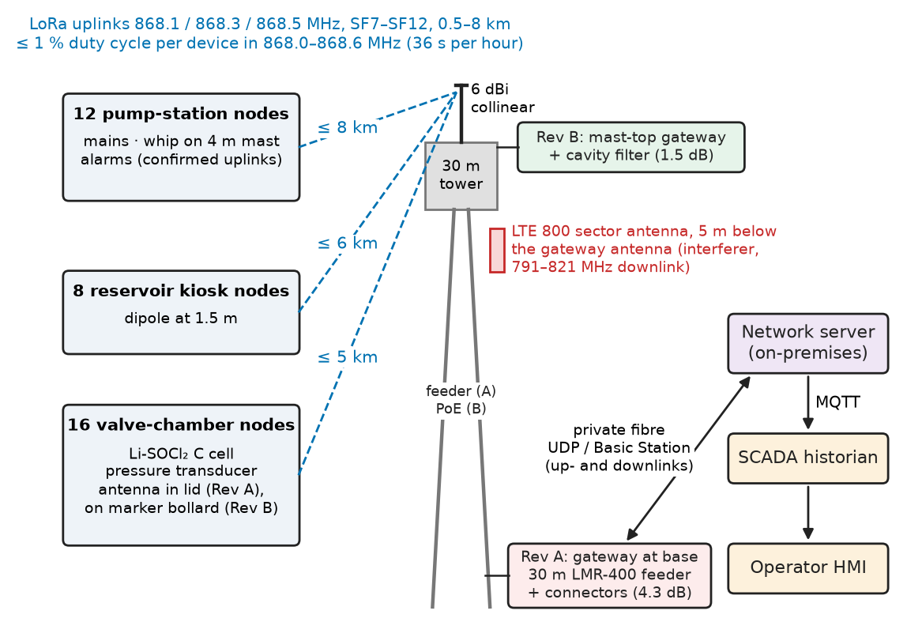
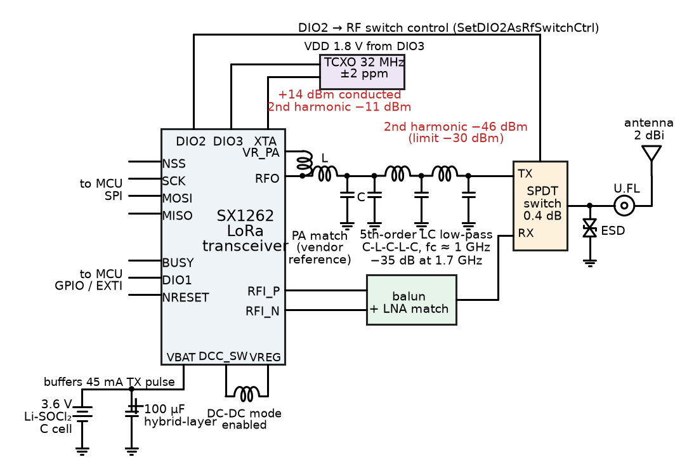
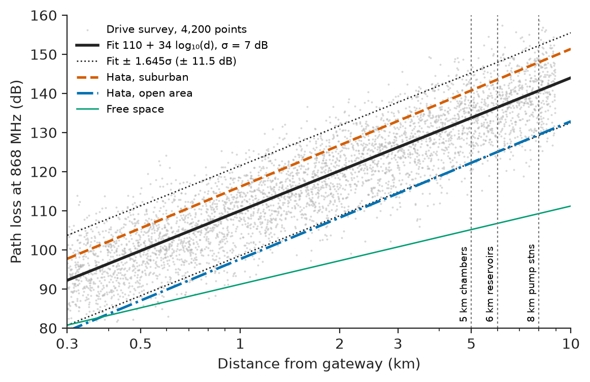
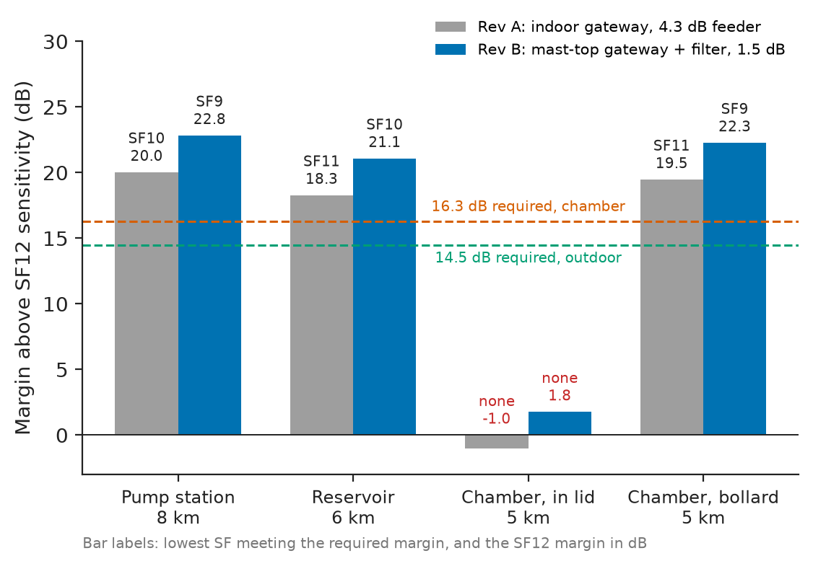
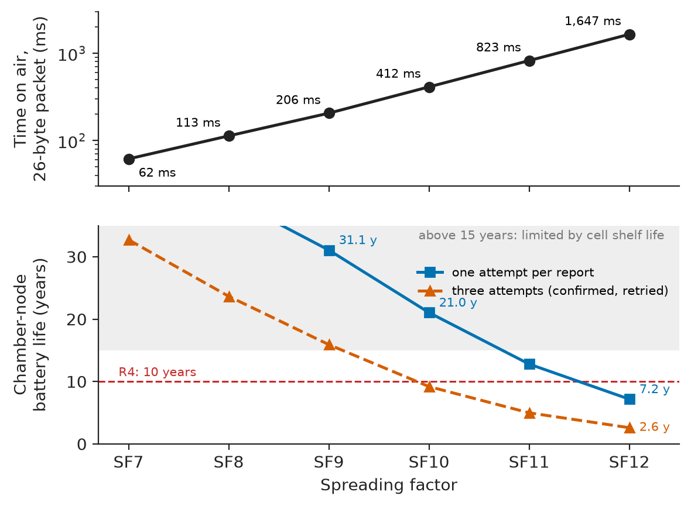
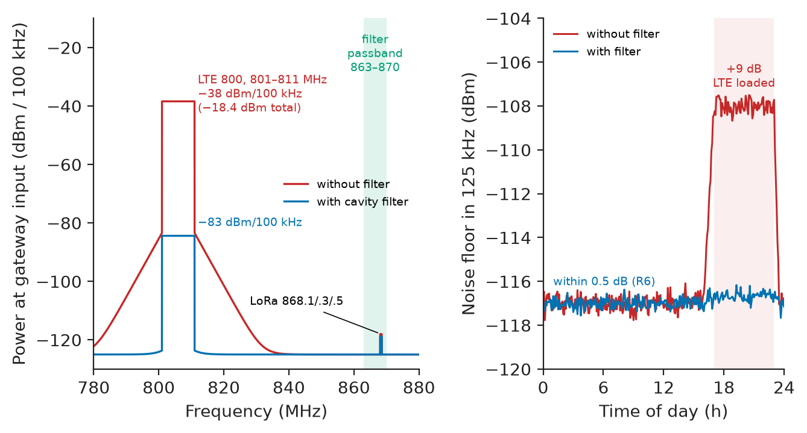

# Chapter 26 — Communication-System Integration

*Part VII · Communications, Signal Processing, and Biomedical Applications*

A rural water utility replaces the dial-up telemetry of its pumping stations, reservoirs and valve chambers with a private 868 MHz LoRaWAN network: 36 nodes within 8 km of one gateway on the 30 m water tower at the treatment works. Commissioning goes well: every node joins, every one reports, and the radio contractor records a received signal strength at each site. Six months later a third of the valve-chamber nodes drop out every wet week, the network server shows them stuck at spreading factor 12 and retransmitting, and the first battery, specified for ten years, is flat after two and a half. Then the mobile operator that leases space on the same tower turns up its 800 MHz LTE cell, and the gateway's noise floor rises 9 dB in the evenings. The radios were good parts. The commissioning measurements were taken with the chamber lids open, the gateway sat at the bottom of 30 m of coaxial cable, nobody had planned for a strong transmitter 50 MHz away, and the link budget had no line for any of them. This chapter designs that network as a radio system: front end, antenna, transceiver interface, link budget, channel rules, network, reliability, interference and test.

> **How is a wireless link designed so that its margin is known before installation, at every site, in the worst season and the worst location?**
> **Which choices in the front end, antenna, gateway placement and protocol settle the trade between range, battery life, latency and reliability, and how is each one tested?**

| Concept | Engineering destination |
|---|---|
| RF front-end architecture | PA, LNA, switch, filters and reference oscillator around a transceiver IC; harmonic compliance |
| Antenna selection | Node antennas near metal and underground; gateway gain versus beamwidth |
| Transceiver interfaces | SPI command sets, BUSY and IRQ lines, TCXO and RF-switch control, timeouts |
| Link budgets | Received power, sensitivity, fade margin; spreading factor per site |
| Channel constraints | Regulatory power and duty cycle; time on air; downlink budget |
| Wireless sensor networks | Star versus mesh; LoRaWAN, NB-IoT and 802.15.4 trade-offs |
| Communication reliability | Packet error, collisions, retries, confirmed messages, end-to-end monitoring |
| Interference mitigation | Blocking by co-sited transmitters; filters, isolation, channel plans |
| System testing | Conducted and over-the-air tests, site surveys, regression after changes |

**Roadmap.** Requirements, network and front end (26.1) → antennas (26.2) → the transceiver's interface to the MCU (26.3) → link budgets per site (26.4) → regulatory and airtime constraints (26.5) → the network as a whole (26.6) → reliability (26.7) → interference (26.8) → testing, failure analysis and Revision B (26.9).

---

## 26.1 RF front-end architecture

> **Boundary.** Noise figure and the Friis cascade are in *Circuits, Signals and Communications*, [Ch. 29 §29.5](https://github.com/The-Studio-of-Sadiq/Circuits-Signals-and-Communications/blob/main/part-6-communication-theory/29-random-signals-and-communication-noise.md); path loss, shadowing and link budgets in [Ch. 30 §30.2 and §30.10](https://github.com/The-Studio-of-Sadiq/Circuits-Signals-and-Communications/blob/main/part-6-communication-theory/30-wireless-and-mobile-communications.md); matching, S-parameters, antennas and RF measurement in [Ch. 32](https://github.com/The-Studio-of-Sadiq/Circuits-Signals-and-Communications/blob/main/part-6-communication-theory/32-rf-and-microwave-fundamentals.md); error-detecting and error-correcting codes in [Ch. 28](https://github.com/The-Studio-of-Sadiq/Circuits-Signals-and-Communications/blob/main/part-6-communication-theory/28-information-theory-and-coding.md). The IoT layer above the radio (MQTT, provisioning, security) is this book's Chapter 11, and the complete battery node is the project of Chapter 38. This chapter owns the radio link.

### Requirements

**Table 26.1 — Requirements for the water-utility telemetry network.**

| ID | Requirement | Target | Verification |
|---|---|---|---|
| R1 | Routine data delivery | ≥ 99 % of 15 min reports reach SCADA, per node per month | Frame-counter gap statistics on the network server |
| R2 | Alarm delivery | Pump-station alarm at SCADA within 30 s with ≥ 99.9 % probability | Injected alarms, 1,000 trials over a month |
| R3 | Coverage | Every site (≤ 8 km) with margin ≥ $1.645\sigma+3$ dB at its spreading factor | Link budget, then site measurement with lids closed |
| R4 | Battery life of chamber nodes | ≥ 10 years on one Li-SOCl₂ C cell (6.8 Ah usable) | Energy model, then current-profile measurement |
| R5 | Regulatory | EN 300 220 / RED: 868.0–868.6 MHz, ≤ 25 mW ERP, ≤ 1 % duty; spurious ≤ −36 dBm below 1 GHz, ≤ −30 dBm above | Conducted tests at an accredited lab; module certificate |
| R6 | Gateway robustness | Noise-floor rise ≤ 1 dB with co-sited LTE 800 at full load | Gateway noise-floor log, LTE load windows |
| R7 | Security | Per-device AES-128 keys; no shared keys | Provisioning audit (Chapter 11) |
| R8 | Environment | Chamber nodes IP68, −20 to +50 °C | Type test |

R3's margin is a 95 % location probability at the edge of each site's range against log-normal shadowing of standard deviation $\sigma$ (Section 26.4), plus 3 dB for seasonal foliage and wet ground.

### Network architecture

Figure 26.1 shows the system. Nodes transmit LoRa uplinks on three 125 kHz channels at 868.1, 868.3 and 868.5 MHz. The gateway, an eight-channel concentrator (SX1302 class) with GPS timing, forwards every packet over the utility's private fibre to an on-premises LoRaWAN network server (ChirpStack class), which de-duplicates, decrypts and publishes to the SCADA historian over MQTT. Downlinks (acknowledgements, configuration) return the same way.

<!-- FIGURE 26.1 | figures/ch26/fig-26-1-telemetry-network.png | block-diagram | Architecture of the 868 MHz LoRaWAN telemetry network of the water utility. | Content: left, three node classes with counts: 12 pump-station nodes (mains, antenna on 4 m roof mast, alarms), 8 reservoir kiosk nodes (antenna 1.5 m), 16 valve-chamber nodes (battery C cell, pressure transducer, antenna in lid in Revision A, on marker bollard in Revision B). Radio links (dashed, 868.1/868.3/868.5 MHz, SF7 to SF12) to the gateway on a 30 m water tower: in Revision A gateway at tower base with 30 m LMR-400 feeder (4.3 dB); in Revision B mast-top gateway with cavity filter (1.5 dB). LTE 800 sector antenna 5 m below the gateway antenna marked as interferer. Gateway to network server over private fibre (UDP/Basic Station), network server to SCADA historian via MQTT, operator HMI. Annotate distances 0.5 to 8 km and the 1 percent duty-cycle rule. -->



*Figure 26.1 — Architecture of the 868 MHz LoRaWAN telemetry network of the water utility.*

### The node front end

Every node is built around a sub-GHz LoRa transceiver (SX1262 class, either discrete or inside an STM32WLE5-class system-on-chip). The integration work around it is a short list of blocks, each with a number (Figure 26.2):

- **PA output network.** The SX1262's high-power PA can deliver +22 dBm; the regulatory limit in the 868.0–868.6 MHz sub-band is 25 mW ERP (+14 dBm ERP, +16.15 dBm EIRP), so it is run at +14 dBm conducted into a 2 dBi antenna. The PA is matched by the vendor's reference network, which is reproduced exactly, including the PCB stack-up, because its harmonic suppression depends on parasitics.
- **Harmonic low-pass filter.** At +14 dBm the raw second harmonic at 1,736 MHz is about −25 dBc, −11 dBm, against an EN 300 220 limit of −30 dBm above 1 GHz. A fifth-order LC low-pass with at least 35 dB rejection at 1.7 GHz brings it to −46 dBm, 16 dB under the limit.
- **RF switch and receive path.** An SPDT switch (or the vendor's direct-tie topology) connects the antenna to the PA or to the differential LNA input through a balun and matching. Its insertion loss (0.3–0.5 dB) adds directly to the node's noise figure.
- **Reference oscillator.** A 32 MHz TCXO (±2 ppm) rather than a crystal: at SF11 and SF12 a packet lasts more than a second, and a crystal's drift as a chamber node's PA heats it can exceed what the demodulator tolerates within one packet.
- **Antenna port.** U.FL or SMA to the antenna (Section 26.2), with an ESD diode rated for the RF frequency.

<!-- FIGURE 26.2 | figures/ch26/fig-26-2-node-rf-front-end.png | circuit | RF front end of the battery node around an SX1262-class transceiver. | Content: SX1262 block with pins RFO (PA out), RFI_P/RFI_N (LNA in), VR_PA, DIO2 (RF switch control), DIO3 (TCXO supply 1.8 V), BUSY, DIO1, NSS/SCK/MOSI/MISO, NRESET. TX path: PA matching network (series L, shunt C, values copied from the vendor reference design) then 5th-order low-pass filter (C-L-C-L-C, cutoff about 1 GHz, annotated -35 dB at 1.7 GHz). RX path: balun and match from switch to RFI_P/N. SPDT RF switch (0.4 dB loss) to ESD diode to U.FL connector to antenna. TCXO 32 MHz plus/minus 2 ppm powered from DIO3. Power: 3.6 V Li-SOCl2 C cell with 100 uF hybrid-layer capacitor buffering the 45 mA TX pulse, DC-DC mode enabled. Annotations: +14 dBm conducted, 2nd harmonic -11 dBm before filter, -46 dBm after (limit -30 dBm). -->



*Figure 26.2 — RF front end of the battery node around an SX1262-class transceiver.*

### The gateway front end

The gateway's sensitivity is set by its noise figure, and anything lossy in front of its LNA adds to it decibel for decibel (*Circuits, Signals and Communications*, Ch. 29 §29.5). In Revision A the gateway sat in the tower's equipment room at the base, at the bottom of 30 m of LMR-400 coaxial cable (3.8 dB at 868 MHz) plus 0.5 dB of connectors and lightning protector: 4.3 dB of loss before a receiver with a 6 dB noise figure gives a system noise figure of 10.3 dB. Revision B moves the gateway to the top of the tower in an IP67 enclosure with a 0.5 dB jumper and a 1.0 dB cavity filter (Section 26.8): 1.5 dB, a 2.8 dB gain in every uplink budget, bought with a PoE cable up the tower.

**Table 26.2 — Gateway placement options.**

| Option | Loss before LNA | System NF | Maintenance | Lightning exposure | Choice |
|---|---|---|---|---|---|
| Indoor gateway, 30 m LMR-400 feeder | 4.3 dB | 10.3 dB | Easy, at ground level | Low (arrester at entry) | Revision A |
| Indoor gateway, mast-head LNA | 0.5 dB + LNA | about 7 dB | LNA needs DC on the feeder | Medium | Considered |
| Outdoor mast-top gateway, cavity filter | 1.5 dB | 7.5 dB | Climb to service | High: PoE surge protection at both ends | **Revision B** |

---

## 26.2 Antenna selection

### Node antennas

A node antenna is chosen for the environment it will sit in, not for its data-sheet gain, which is measured on a large ground plane in free space. Near metal, inside an enclosure or below ground, its realised gain can fall by 5–25 dB (*Circuits, Signals and Communications*, Ch. 32 §32.7–32.9).

**Table 26.3 — Node antenna options.**

| Antenna | Data-sheet gain | Realised gain in use | Where it fits | Choice |
|---|---|---|---|---|
| Quarter-wave whip on enclosure ground plane | 2 dBi | 0–2 dBi on a mast | Pump-station roof mast at 4 m | Pump stations |
| Half-wave dipole, fibreglass radome | 2.15 dBi | 1–2 dBi clear of metal | Reservoir kiosks at 1.5 m | Reservoirs |
| Helical stub on the node | −1 to 0 dBi | −5 to −10 dBi under a steel lid | In-chamber, no installation work | Revision A (chamber) |
| Dipole in a composite lid or on a marker bollard, 2 m cable | 2.15 dBi | 0.5 dBi net of 1.5 dB cable | Chambers on footpaths and verges | **Revision B** (chamber) |

The valve-chamber problem dominates the design. A concrete chamber 1 m deep with a cast-iron or steel lid adds a median 20–25 dB of loss with the lid closed and only about 5 dB with it open, and the loss rises further when the chamber floods or the lid is wet. The in-lid helical stub of Revision A was chosen to avoid civil works; Section 26.4 shows that it could not meet R3 at any spreading factor beyond about 2 km.

### Gateway antenna

The gateway antenna is a vertical fibreglass collinear. Higher gain is obtained by narrowing the vertical beam, so the choice is between reach at the horizon and coverage of nodes close to the tower.

**Worked example — gain against elevation angle.** The antenna is 28.5 m above the nodes. A node at 500 m is $\arctan(28.5/500)=3.3°$ below the horizon, one at 200 m is 8.1° below. A 3 dBi collinear has a half-power vertical beamwidth of about 30°, a 6 dBi about 16° (±8°), a 9 dBi about 8° (±4°). With 9 dBi the close-in node at 200 m sits outside the half-power beam and sees less than the 6 dBi antenna would give it; it does not need the gain, but a node at 300 m in a chamber does. The 6 dBi antenna covers every node beyond about 205 m within its half-power beam (the 200 m node, at 8.1°, sits just outside it and needs no gain) and is chosen; the gain difference matters only at the edge, where Revision B's 2.8 dB feeder saving gives more than a 9 dBi antenna would, without the down-tilt problem.

> **Status of the principle: Realised antenna gain near obstacles**
> *Empirical.* Data-sheet gain is a free-space, large-ground-plane value; the gain realised next to metal, in an enclosure or underground depends on the installation and is measured on site (or in an anechoic chamber with the real enclosure), never assumed.

---

## 26.3 Transceiver interfaces

### Choosing the node's radio and MCU

**Table 26.4 — Node radio and MCU options.**

| Option | Sleep current | Interface work | Certification | Choice |
|---|---|---|---|---|
| STM32WLE5-class SoC (LoRa radio and Cortex-M4 on one die), as a pre-certified module | 1–2 µA with RTC | Radio behind an internal SPI with the same command set | Module RED certificate reusable | **Battery chamber nodes** |
| Discrete SX1262 plus STM32L4-class MCU | 1–2 µA | External SPI, BUSY, DIO1, NRESET, RF switch, TCXO | Full radio test of own design | Pump stations (mains, needs more I/O) |
| SX1262 plus ESP32-S3 | 8–20 µA | As discrete, plus Wi-Fi coexistence | Two radios to test | Rejected for battery nodes |
| NB-IoT module (nRF9160 class) | 3–5 µA in PSM | AT commands or vendor SDK | Operator certification | Considered for remote sites (Section 26.6) |

### The command interface

An SX126x-class transceiver is controlled by opcodes over SPI. Two extra lines matter more than the SPI itself: **BUSY**, which the radio holds high while it processes a command (from a few microseconds up to about 3.5 ms when waking from sleep), and **DIO1**, the interrupt line on which TxDone, RxDone and timeout events arrive. Two configuration commands at initialisation tie the radio to the board: DIO3 supplies the TCXO (SetDIO3AsTCXOCtrl, 1.8 V, with a start-up delay) and DIO2 drives the RF switch automatically (SetDIO2AsRfSwitchCtrl). Getting either wrong produces a radio that answers on SPI and never transmits.

The listing sends one LoRa packet (C11; the HAL functions `spi_xfer`, `gpio_read_busy`, `millis` and `dio1_wait` are the board's and are illustrative; opcodes and parameter layouts follow the SX126x data sheet). Its two design points are the bounded wait on BUSY, so that a hung radio returns an error instead of blocking the node forever (the failure of *Electronics and Computing*, [Ch. 28 §28.3](https://github.com/The-Studio-of-Sadiq/Electronics-and-Computing/blob/main/part-6-embedded-and-real-time-systems/28-embedded-system-design.md)), and a TxDone guard derived from the computed time on air.

```c
#include <stdbool.h>
#include <stddef.h>
#include <stdint.h>

extern void     spi_xfer(const uint8_t *tx, uint8_t *rx, size_t n);   /* NSS-framed */
extern bool     gpio_read_busy(void);
extern uint32_t millis(void);
extern bool     dio1_wait(uint32_t timeout_ms);                      /* sleeps until DIO1 */

static bool cmd(const uint8_t *c, size_t n)
{
    uint32_t t0 = millis();
    while (gpio_read_busy())
        if ((uint32_t)(millis() - t0) > 10u) return false;            /* radio hung */
    spi_xfer(c, NULL, n);
    return true;
}

bool lora_tx(const uint8_t *buf, uint8_t len, uint8_t sf, uint32_t toa_ms)
{
    const uint8_t stby[] = {0x80, 0x01};                     /* SetStandby(STDBY_XOSC) */
    const uint8_t type[] = {0x8A, 0x01};                     /* SetPacketType(LoRa) */
    const uint8_t freq[] = {0x86, 0x36, 0x41, 0x99, 0x9A};   /* 868.1 MHz = f*2^25/32 MHz */
    const uint8_t pa[]   = {0x95, 0x02, 0x02, 0x00, 0x01};   /* SetPaConfig for about +14 dBm */
    const uint8_t txp[]  = {0x8E, 0x16, 0x04};               /* SetTxParams 22, 200 us ramp */
    const uint8_t mod[]  = {0x8B, sf, 0x04, 0x01, (uint8_t)(sf >= 11u)}; /* BW125, CR4/5, LDRO */
    const uint8_t pkt[]  = {0x8C, 0x00, 0x08, 0x00, len, 0x01, 0x00};    /* pre 8, expl, CRC */
    const uint8_t irq[]  = {0x08, 0x02, 0x01, 0x02, 0x01, 0, 0, 0, 0};   /* TxDone|Timeout->DIO1 */
    const uint8_t clr[]  = {0x02, 0xFF, 0xFF};               /* ClearIrqStatus(all) */
    const uint8_t tx[]   = {0x83, 0x00, 0x00, 0x00};         /* SetTx, no radio timeout */
    const uint8_t *seq[] = {stby, type, freq, pa, txp, mod, pkt, irq, clr};
    const size_t   n[]   = {sizeof stby, sizeof type, sizeof freq, sizeof pa, sizeof txp,
                            sizeof mod, sizeof pkt, sizeof irq, sizeof clr};
    for (size_t i = 0; i < sizeof n / sizeof n[0]; ++i)
        if (!cmd(seq[i], n[i])) return false;

    uint8_t w[2 + 255] = {0x0E, 0x00};                       /* WriteBuffer at offset 0 */
    for (uint8_t i = 0; i < len; ++i) w[2 + i] = buf[i];
    if (!cmd(w, 2u + len) || !cmd(tx, sizeof tx)) return false;
    return dio1_wait(toa_ms + toa_ms / 2u + 50u);             /* guard: 1.5 x airtime + 50 ms */
}
```

The frequency word is $868.1\times10^{6}\times2^{25}/(32\times10^{6})=910{,}268{,}826$ = 0x3641999A. The PA configuration (duty-cycle and hpMax codes 0x02 with a +22 setting) is the data sheet's optimum-efficiency combination for about +14 dBm, which draws roughly 45 mA instead of the 118 mA of full power; the energy model of Section 26.5 uses that 45 mA.

---

## 26.4 Link budgets

### From desk model to site survey

The desk estimate used the Okumura–Hata model with its suburban correction (*Circuits, Signals and Communications*, Ch. 30 §30.2): for a 30 m gateway, 1.5 m nodes and 868 MHz it predicts 116 dB at 1 km and 148 dB at 8 km, against 97.6 and 129.5 dB with the open-area correction. A 19 dB spread between two published corrections is too wide to design to, so a drive survey was run before ordering: a test node at 1.5 m on a vehicle transmitted every 10 s along every road within 9 km while the gateway logged RSSI and SNR. A least-squares fit of 4,200 points gave

$$
PL(d)=110+34\log_{10}\!\left(\frac{d}{1\ \mathrm{km}}\right)\ \mathrm{dB},\qquad \sigma=7\ \mathrm{dB},
$$

between the two Hata variants and with a slope close to Hata's 35 dB/decade. Figure 26.3 compares them.

<!-- FIGURE 26.3 | figures/ch26/fig-26-3-path-loss-survey.png | plot | Path loss versus distance at 868 MHz: survey points, fitted model and Hata predictions. | Content: x-axis distance 0.3 to 10 km, log scale. y-axis path loss 80 to 160 dB. Grey scatter of about 4,200 survey points around the fit with spread sigma 7 dB. Solid line: fit 110 plus 34 log10(d). Dotted lines at plus and minus 1.645 sigma (11.5 dB). Dashed: Hata suburban (116.1 dB at 1 km, 148.0 at 8 km); dash-dot: Hata open area (97.6 at 1 km, 129.5 at 8 km); thin line: free space (91.2 at 1 km, 109.3 at 8 km). Vertical markers at 5, 6 and 8 km (site class ranges). -->



*Figure 26.3 — Path loss versus distance at 868 MHz: survey points, fitted model and Hata predictions.*

### The budget per site class

With the fitted model, each site class has a received power at its maximum range, and each LoRa spreading factor has a sensitivity: the 125 kHz noise floor $-174+10\log_{10}(125\times10^{3})+\mathrm{NF}$ is −117.0 dBm for a 6 dB noise figure, and LoRa demodulates down to an SNR of −7.5 dB at SF7, falling 2.5 dB per step to −20 dB at SF12, giving sensitivities of −124.5 to −137.0 dBm. The required margin is $1.645\sigma+3$ dB: 14.5 dB for outdoor nodes, and 16.3 dB for chamber nodes, whose chamber loss adds an independent 4 dB of variation ($\sqrt{7^2+4^2}=8.06$ dB). The listing picks, for each class, the lowest spreading factor that meets the margin, for both gateway placements.

```python
import numpy as np

SNR_REQ = {7: -7.5, 8: -10.0, 9: -12.5, 10: -15.0, 11: -17.5, 12: -20.0}   # dB, LoRa BW 125 kHz
NOISE = -174 + 10*np.log10(125e3) + 6.0          # dBm in 125 kHz, gateway NF 6 dB

def path_loss(d_km, pl1=110.0, n=3.4):           # site-survey fit, 868 MHz, 30 m gateway
    return pl1 + 10*n*np.log10(d_km)

def best_sf(d_km, extra_loss, sigma, gw_loss, eirp=16.0, g_gw=6.0, z=1.645, misc=3.0):
    """Lowest spreading factor with margin >= z*sigma + misc (95 % locations at range)."""
    pr = eirp - path_loss(d_km) - extra_loss + g_gw - gw_loss
    need = z*sigma + misc
    for sf, snr in SNR_REQ.items():
        margin = pr - (NOISE + snr)
        if margin >= need:
            return sf, pr, margin, need
    return None, pr, pr - (NOISE + SNR_REQ[12]), need

classes = [  # name, max range km, extra loss dB, total shadowing sigma dB
    ("pump station, roof mast", 8.0, -6.0, 7.0),          # 4 m antenna: -6 dB height gain
    ("reservoir kiosk, 1.5 m",  6.0,  0.0, 7.0),
    ("valve chamber, in lid",   5.0, 22.0, np.hypot(7.0, 4.0)),
    ("valve chamber, bollard",  5.0,  1.5, 7.0)]
for rev, gw_loss in (("A: indoor gateway, 30 m feeder", 4.3), ("B: mast-top gateway + filter", 1.5)):
    print(rev)
    for name, d, extra, sig in classes:
        sf, pr, m, need = best_sf(d, extra, sig, gw_loss)
        print(f"  {name:24s} {d:3.0f} km  Pr {pr:6.1f} dBm  need {need:4.1f} dB  "
              + (f"SF{sf} margin {m:4.1f} dB" if sf else f"NO LINK (SF12 margin {m:5.1f} dB)"))
```

```text
A: indoor gateway, 30 m feeder
  pump station, roof mast    8 km  Pr -117.0 dBm  need 14.5 dB  SF10 margin 15.0 dB
  reservoir kiosk, 1.5 m     6 km  Pr -118.8 dBm  need 14.5 dB  SF11 margin 15.8 dB
  valve chamber, in lid      5 km  Pr -138.1 dBm  need 16.3 dB  NO LINK (SF12 margin  -1.0 dB)
  valve chamber, bollard     5 km  Pr -117.6 dBm  need 14.5 dB  SF11 margin 17.0 dB
B: mast-top gateway + filter
  pump station, roof mast    8 km  Pr -114.2 dBm  need 14.5 dB  SF9 margin 15.3 dB
  reservoir kiosk, 1.5 m     6 km  Pr -116.0 dBm  need 14.5 dB  SF10 margin 16.1 dB
  valve chamber, in lid      5 km  Pr -135.3 dBm  need 16.3 dB  NO LINK (SF12 margin   1.8 dB)
  valve chamber, bollard     5 km  Pr -114.8 dBm  need 14.5 dB  SF9 margin 14.8 dB
```

**Worked example — the chamber node at 5 km.** Table 26.5 is the full budget behind the third line of Revision A. The median received power is −138.1 dBm, 1.0 dB *below* SF12 sensitivity: half of all chamber locations at that range cannot be heard at all, and the 95 % target needed 16.3 dB above sensitivity. At commissioning, with the lid open, the chamber loss was about 5 dB instead of 22 and the margin about 16 dB, so the node joined at SF12 and the contractor recorded a working link. Even at 2 km (path loss 120.2 dB) the in-lid node has only 12.5 dB of SF12 margin against 16.3 needed. No spreading factor can rescue a 22 dB installation loss; only moving the antenna can, which is what the bollard line shows: −117.6 dBm and SF11 even with the Revision A gateway, SF9 with Revision B; Figure 26.4 summarises every class.

**Table 26.5 — Uplink budget, valve-chamber node at 5 km, Revision A.**

| Item | Value |
|---|---|
| Node EIRP (+14 dBm conducted, 2 dBi) | +16.0 dBm |
| Path loss, survey fit at 5 km | −133.8 dB |
| Chamber loss, lid closed (median) | −22.0 dB |
| Gateway antenna gain | +6.0 dBi |
| Feeder, connectors, arrester | −4.3 dB |
| **Received power at gateway input** | **−138.1 dBm** |
| Noise floor, 125 kHz, NF 6 dB | −117.0 dBm |
| SF12 required SNR | −20.0 dB |
| SF12 sensitivity | −137.0 dBm |
| **Margin at SF12** | **−1.0 dB** |
| Required margin ($1.645\times8.06+3$) | 16.3 dB |
| **Shortfall** | **17.3 dB** |

<!-- FIGURE 26.4 | figures/ch26/fig-26-4-margin-by-class.png | plot | Link margin at maximum range for each node class and spreading factor, Revision A and Revision B gateways. | Content: grouped bar chart. x-axis categories: pump station 8 km, reservoir 6 km, chamber in-lid 5 km, chamber bollard 5 km. For each, bars for Revision A and Revision B showing margin above SF12 sensitivity (A: 20.0, 18.3, -1.0, 19.5 dB; B: 22.8, 21.1, 1.8, 22.3 dB). Horizontal reference lines at 14.5 dB (required, outdoor) and 16.3 dB (required, chamber). Labels above each bar: lowest SF meeting margin (A: SF10, SF11, none, SF11; B: SF9, SF10, none, SF9). -->



*Figure 26.4 — Link margin at maximum range for each node class and spreading factor, Revision A and Revision B gateways.*

> **Status of the principle: Link margin against log-normal shadowing**
> *Derived.* With Gaussian shadowing in decibels, a margin of $z\sigma$ above the median gives a location probability $\Phi(z)$ at that distance (95 % for $z=1.645$); the result is only as good as $\sigma$ and the median model, which is why the survey fit, not a textbook correction, sets the design.

---

## 26.5 Channel constraints

### Regulatory limits

In Europe the 863–870 MHz short-range-device band is governed by ETSI EN 300 220 and the national implementations of the ERC Recommendation 70-03; the conformity route is the Radio Equipment Directive. The sub-bands used here:

**Table 26.6 — EN 300 220 sub-bands used by the network.**

| Sub-band | Frequencies | Power limit | Duty-cycle limit | Use |
|---|---|---|---|---|
| g1 (h1.4) | 868.0–868.6 MHz | 25 mW ERP | 1 % (36 s per hour per device) | Uplinks on 868.1, 868.3, 868.5 MHz; RX1 downlinks |
| g3 (h1.6) | 869.4–869.65 MHz | 500 mW ERP | 10 % | RX2 downlinks from the gateway on 869.525 MHz |

The duty cycle applies to the gateway too: acknowledgements sent in the RX1 window on the uplink channel share the gateway's 1 % in that sub-band.

### Time on air

LoRa trades data rate for sensitivity: each step in spreading factor doubles the symbol time and gains 2.5 dB. The time on air of a packet follows the data-sheet formula, and with it the duty cycle and the energy per report. The chamber node sends a 26-byte payload (three 5 min pressure samples, battery voltage and status, plus LoRaWAN overhead) every 15 min.

```python
import math

def time_on_air(sf, payload=26, bw=125e3, cr=1, preamble=8, crc=True, header=True):
    """LoRa packet duration in s (Semtech SX126x data-sheet formula)."""
    de = 1 if sf >= 11 and bw <= 125e3 else 0          # low-data-rate optimisation
    ts = 2**sf / bw
    n = 8 + max(math.ceil((8*payload - 4*sf + 28 + 16*crc - 20*(not header))
                          / (4*(sf - 2*de))) * (cr + 4), 0)
    return (preamble + 4.25)*ts + n*ts

def battery_years(sf, tries, cap_mah=6800, period_s=900):
    toa = time_on_air(sf)
    q_tx = 45.0*toa                        # mA*s per attempt at +14 dBm
    q_rx = 2*5.0*time_on_air(sf, payload=12)   # two class-A receive windows (ACK-length)
    q_msg = tries*(q_tx + q_rx) + 3.0      # + MCU, sensor and settling per report
    n = 365*86400/period_s
    mah_year = n*q_msg/3600 + 0.002*8760 + 0.01*cap_mah   # + 2 uA sleep, 1 %/yr self-discharge
    duty = tries*toa/period_s
    return toa, duty, cap_mah/mah_year

for sf, tries in ((9, 1), (10, 1), (12, 1), (12, 3)):
    toa, duty, yrs = battery_years(sf, tries)
    print(f"SF{sf} x{tries}: airtime {1e3*toa:6.0f} ms, duty cycle {100*duty:.2f} %, battery {yrs:4.1f} years")
```

```text
SF9 x1: airtime    206 ms, duty cycle 0.02 %, battery 31.1 years
SF10 x1: airtime    412 ms, duty cycle 0.05 %, battery 21.0 years
SF12 x1: airtime   1647 ms, duty cycle 0.18 %, battery  7.2 years
SF12 x3: airtime   1647 ms, duty cycle 0.55 %, battery  2.6 years
```

**Worked example — why the first battery died.** At SF9 one report costs 206 ms of airtime and the battery would outlast the cell's own 10–15 year shelf life; the radio is not the limit. A Revision A chamber node with a marginal link was pushed by adaptive data rate to SF12, where one attempt takes 1,647 ms (eight times SF9), and because its packets were often lost it used confirmed uplinks with up to three attempts. That costs 0.55 % of airtime, still legal, but the life falls to 2.6 years: the node of the opening paragraph. The radio energy model is correct; the link it was fed was not.

Figure 26.5 plots airtime and battery life against spreading factor.

<!-- FIGURE 26.5 | figures/ch26/fig-26-5-airtime-battery.png | plot | Time on air of a 26-byte LoRa packet and chamber-node battery life versus spreading factor. | Content: x-axis spreading factor 7 to 12. Left y-axis (log) time on air 30 ms to 3 s: points SF7 62 ms, SF8 113 ms, SF9 206 ms, SF10 412 ms, SF11 823 ms, SF12 1,647 ms, connected. Right y-axis battery life 0 to 35 years: one-attempt curve (31.1 years at SF9, 21.0 at SF10, 7.2 at SF12) and three-attempt curve (2.6 years at SF12). Horizontal dashed line at 10 years labelled R4; shaded band above 15 years labelled limited by cell shelf life. -->



*Figure 26.5 — Time on air of a 26-byte LoRa packet and chamber-node battery life versus spreading factor.*

> **Status of the principle: Energy per report from time on air**
> *Derived.* Charge is current integrated over each radio state; the result is exact for its inputs, and the inputs (45 mA at +14 dBm, 5 mA in receive, 3 mA·s of overhead) are measured on the real board with a current-profile analyser, because data-sheet currents omit the MCU, regulators and sensor.

---

## 26.6 Wireless sensor networks

### Choosing the network type

**Table 26.7 — Network options for 36 telemetry sites over 8 km.**

| Option | Topology | Range per hop | Node energy | Recurring cost | Latency | Choice |
|---|---|---|---|---|---|---|
| Private LoRaWAN, one gateway, on-premises network server | Star | 2–15 km rural | Lowest | None (own spectrum use under licence exemption) | 1–5 s | **Chosen** |
| Public LoRaWAN operator | Star, shared gateways | As above | Lowest | \$1–3 per node per year | 1–5 s | Rejected: no coverage at the chambers; data leaves the OT network |
| NB-IoT / LTE-M | Star to operator cell | Cell coverage; +20 dB coverage class | 2–5× LoRa per report | \$1–2 per node per month | 2–10 s | Backup for two sites beyond 8 km |
| IEEE 802.15.4 mesh (Wi-SUN, 868 MHz) | Mesh | 0.5–2 km per hop | Routers must listen: mains only | None | 1–30 s, multi-hop | Rejected: chamber nodes cannot route on a battery |

A star network keeps the battery nodes simple — they transmit and sleep, and never relay anyone else's traffic — and puts all the complexity in one gateway and one server. That is also its weakness: a single gateway is a single point of failure, addressed in Section 26.7.

### Capacity

LoRa transmissions on different spreading factors are quasi-orthogonal, and nodes transmit without listening (pure ALOHA), so the collision probability on one channel and spreading factor is $1-e^{-2G}$ with offered load $G$ = packets per second × packet duration (*Circuits, Signals and Communications*, [Ch. 30 §30.7](https://github.com/The-Studio-of-Sadiq/Circuits-Signals-and-Communications/blob/main/part-6-communication-theory/30-wireless-and-mobile-communications.md)).

**Worked example — collisions in the two revisions.** In Revision A, 16 chamber nodes at SF12 averaged 2.5 attempts per 15 min report, spread over three channels: $G=16\times2.5\times1.647/(900\times3)=0.0244$ and a collision probability of 4.8 % per attempt, which fed the retries that caused it. In Revision B the 28 nodes at SF9 (16 chambers on bollards, 12 pump stations) send one attempt each: $G=28\times0.206/2{,}700=0.0021$ and 0.43 %. At SF9 the traffic could grow about tenfold before collisions reach the 4–5 % that Revision A already suffered.

---

## 26.7 Communication reliability

### What R1 and R2 require

R1 (99 % of routine reports) is met with **unconfirmed** uplinks if each packet's loss probability, from fading and collisions together, stays below about 1 %. Confirming every report would cost downlink airtime the gateway does not have: 36 nodes every 15 min are 144 acknowledgements an hour, which at SF9 (144 ms each for a 12-byte frame) take 20.8 s of the gateway's 36 s hourly allowance in g1, and at SF12 (1,155 ms each) would take 166 s, impossible in RX1. Routine data is therefore unconfirmed, and a missed report is recovered from the next one, which carries the previous samples too.

R2 (alarms at 99.9 % within 30 s) needs **confirmed** uplinks with retries. **Worked example — retries for an alarm.** If one attempt fails with probability $p$, independent attempts give a delivery probability $1-p^{k}$ after $k$ attempts. A pump station at SF9 with a 15 dB margin loses perhaps 5 % of packets in deep fades and collisions; three attempts give $1-0.05^3=99.99\,\%$. With a 20 % loss rate, three attempts give only 99.2 % and R2 fails: retries cannot replace margin. Each SF9 attempt with its two receive windows and a 1–3 s random back-off takes about 3 s, so three attempts finish well inside 30 s.

> **Status of the principle: Delivery probability with independent retries**
> *Approximate.* $1-p^k$ assumes independent losses; fading on a fixed link is correlated over seconds to minutes, so retries spaced by a few seconds are less independent than the formula assumes. Back-off that spreads retries over tens of seconds, and frequency hopping across the three channels, restore some independence.

### Layers of protection

- **Integrity.** LoRa's CRC-16 rejects corrupted frames at the PHY; LoRaWAN's 32-bit message integrity code rejects forged or replayed ones (Chapter 11 for the key handling).
- **Forward error correction.** Coding rate 4/5 corrects little; raising it to 4/8 costs 60 % more airtime for about 1 dB, so margin is bought with antenna placement instead.
- **End-to-end monitoring.** The network server tracks each node's frame counter; a gap, an RSSI trend falling by more than 6 dB, or a spreading factor rising above the node's planned value raises a maintenance ticket before data is lost. This is the check that would have caught the chamber nodes in their first wet week.
- **Gateway redundancy.** A second gateway on a reservoir site 4 km away hears 30 of the 36 nodes; the network server de-duplicates. It turns the single point of failure into a degraded mode instead of an outage.

---

## 26.8 Interference mitigation

### Blocking by a co-sited transmitter

The mobile operator's LTE 800 sector antenna is mounted 5 m below the gateway antenna on the same tower, transmitting in the 791–821 MHz downlink band, about 47 MHz below the gateway's channels. The gateway's own channel filtering rejects it, but its LNA and mixer see the full signal, compress, and their noise floor rises: **blocking**.

**Worked example — how strong is the blocker?** For vertically separated antennas an empirical isolation of $28+40\log_{10}(d/\lambda)$ dB is used for $d$ in metres; at 806 MHz ($\lambda=0.372$ m) and $d=5$ m it gives 73.1 dB. With an LTE EIRP of 59 dBm per sector, the gateway antenna port sees $59-73.1=-14.1$ dBm, and after the 4.3 dB Revision A feeder, −18.4 dBm at the gateway input — a signal 100 dB stronger than the weakest LoRa packets it must decode. The gateway's log showed the noise floor rising 9 dB whenever the LTE cell was loaded in the evening; every link lost 9 dB, more than half of the outdoor margin of Section 26.4. A cavity band-pass filter (863–870 MHz, 1.0 dB insertion loss, more than 45 dB rejection at 821 MHz) at the gateway input reduces the blocker to −63 dBm in Revision A and about −60 dBm in Revision B, where the filter sits at the mast-top gateway; the measured noise-floor rise fell below 0.5 dB (R6).

Figure 26.6 shows the spectrum at the gateway input before and after the filter.

<!-- FIGURE 26.6 | figures/ch26/fig-26-6-gateway-blocking.png | plot | Spectrum at the gateway input with the co-sited LTE 800 carrier, before and after the cavity filter, and the resulting noise-floor rise. | Content: left panel: x-axis frequency 780 to 880 MHz, y-axis power in 100 kHz -130 to -10 dBm. LTE 800 carrier block 801 to 811 MHz at about -38 dBm per 100 kHz (total -18.4 dBm) without filter; same block at about -83 dBm per 100 kHz with filter. LoRa channels at 868.1, 868.3, 868.5 MHz shown as small humps near -120 dBm. Filter passband shaded 863 to 870 MHz. Right panel: gateway noise floor in 125 kHz over 24 hours, -117 dBm baseline, rising to -108 dBm from 17:00 to 23:00 without filter, flat within 0.5 dB with filter. -->



*Figure 26.6 — Spectrum at the gateway input with the co-sited LTE 800 carrier, before and after the cavity filter, and the resulting noise-floor rise.*

> **Status of the principle: Vertical antenna isolation**
> *Empirical.* The $28+40\log_{10}(d/\lambda)$ rule is a fit to measurements for collinear antennas on a common mast; it varies by ±5–10 dB with antenna patterns, mast structure and cabling, so the filter is specified with margin and the result is verified by measuring the noise floor with the interferer at full load.

### Other interference and its remedies

**Table 26.8 — Interference sources and mitigations.**

| Source | Mechanism | Mitigation |
|---|---|---|
| LTE 800 on the same tower | Blocking, noise-floor rise | Cavity filter; vertical separation; mast-top gateway |
| Other 868 MHz users (alarm systems, smart meters, other LoRa networks) | Co-channel collisions | Three channels, random back-off, retries for alarms only; SF diversity |
| Gateway's own PoE switch and pump VFDs | Broadband conducted and radiated noise | Ferrites, shielded cable, separation from VFD cabling; noise-floor survey before mounting |
| Node's own switching regulator | Spurs near the RF channel | Regulator frequency plan; LDO for the TCXO; layout per reference design |
| Lightning-induced surges | Damage to front end | Quarter-wave stub or gas-discharge arrester; bonded mast |

---

## 26.9 System testing

### Test levels

Radio systems are tested at four levels, and the opening failures each escaped one of them:

1. **Conducted RF tests** on the node design: output power, harmonics and spurious (R5), sensitivity per spreading factor, frequency error over temperature. These run at an accredited laboratory or against the module certificate.
2. **Over-the-air tests** in an anechoic or semi-anechoic chamber with the real enclosure and antenna: total radiated power and realised gain.
3. **Site tests** under real conditions: every chamber node measured **with the lid closed and locked**, and a sample re-measured in the wet season. Revision A's commissioning, done with lids open, measured a system that would never operate that way.
4. **Network tests** over weeks: delivery statistics (R1), alarm injection (R2), noise-floor logs (R6), and current profiles of battery nodes (R4).

After any change to the gateway, its antenna, its filter or the tower (including other operators' equipment), a regression test repeats the noise-floor log and the RSSI of six reference nodes against their baseline.

### Verification

**Table 26.9 — Verification of the telemetry network, Revision B.**

| Req. | Test | Limit | Result | Pass/fail |
|---|---|---|---|---|
| R1 | Frame-counter statistics, all nodes, 3 months including wet season | ≥ 99 % per node per month | Worst node 99.6 % | Pass |
| R2 | 1,000 injected alarms over 30 days, 12 pump stations | ≥ 99.9 % within 30 s | 1,000 of 1,000; worst latency 9.8 s | Pass |
| R3 | RSSI and SNR per site, lid closed, 50 packets each, compared with budget | Margin ≥ 14.5 dB (outdoor) / 16.3 dB (chamber) at planned SF | All sites pass; minimum 15.1 dB (pump station at 7.6 km) | Pass |
| R4 | Current-profile analyser on a chamber node, 24 h | Projected life ≥ 10 years | 0.22 Ah/year projected including self-discharge; 31 years, so cell shelf life limits | Pass |
| R5 | Conducted harmonics, module certificate review | ≤ −30 dBm above 1 GHz | −47 dBm at 1,736 MHz | Pass |
| R6 | Gateway noise floor, 14 days with LTE at full load | Rise ≤ 1 dB | 0.4 dB | Pass |
| R7 | Key audit, 36 devices | Unique keys | 36 unique AppKeys | Pass |
| R8 | IP68 immersion 1 m, 24 h; thermal cycle −20 to +50 °C | No ingress; operation | Pass | Pass |

### Failure analysis

**Table 26.10 — FMEA extract for the telemetry network.**

| Failure mode | Effect | Cause | Detection | Mitigation |
|---|---|---|---|---|
| Chamber node drops out when wet | Lost reports; SF12 and retries | 22 dB chamber loss, measured with lid open | SF and RSSI trend on server | Bollard or in-lid composite antenna; commissioning with lid closed |
| Battery flat in 2.6 years | Site blind until visit | SF12 with three attempts | Battery-voltage telemetry trend; SF monitor | Revision B link at SF9; ADR capped at the planned SF plus one |
| Gateway desensitised in evenings | Margin loss of 9 dB network-wide | LTE 800 blocking | Noise-floor log | Cavity filter; mast-top gateway |
| Radio hangs (BUSY stuck) | Node silent until watchdog | Brown-out during TX pulse, radio state lost | BUSY timeout in driver | Timeout, radio reset, 100 µF buffer capacitor on the cell |
| Gateway or backhaul failure | Whole network down | Single gateway, single fibre | Server heartbeat | Second gateway at reservoir site |
| Lightning strike on tower | Gateway front end destroyed | Surge on coax or PoE | Gateway offline | Arresters, bonding, PoE surge protection |
| Frequency drift on long packets | SF12 packets lost at temperature extremes | Crystal instead of TCXO | Packet error versus temperature | TCXO (±2 ppm) on all nodes |

The worked fault story is the opening one, diagnosed from the network server's own data. The nodes that failed were all chambers; their RSSI was 15–20 dB below their commissioning values; and the drop correlated with rainfall. That combination points at the installation, not the radio, and a single measurement with the lid closed (−21 dB) confirmed it.

### Revision B

| Change | Reason | Effect |
|---|---|---|
| Chamber antennas moved to marker bollards (or composite lids) with 2 m cable | 22 dB lid loss, no link at any SF | Chamber nodes at SF9 with ≥ 14.8 dB margin at 5 km |
| Gateway moved to the mast top with a cavity filter | 4.3 dB feeder loss; LTE blocking | +2.8 dB on every link; noise-floor rise 0.4 dB |
| ADR capped at the planned SF plus one; SF rise raises a ticket | ADR hid a failing link by escalating to SF12 | Problems found in days, not when batteries die |
| Commissioning procedure: lid closed and locked, 50 packets, margin recorded against budget | Commissioning measured the wrong configuration | R3 verified as designed |
| Second gateway at a reservoir site | Single point of failure | 30 of 36 nodes dual-covered |
| Regression test after any tower change | Other operators' changes broke the link | Noise floor and reference RSSI checked |

---

## What remains open

| Open question | Where it is answered |
|---|---|
| How are the MQTT topics, device provisioning and security of the network server designed? | Chapter 11 |
| How is a complete battery sensor node designed, from sensor to enclosure, and its power budget closed? | Chapter 38 |
| How are the received samples filtered and checked for anomalies before they reach the operator? | Chapter 27 |
| How is the node firmware structured, and how does it recover from a hung peripheral? | Chapter 10; *Electronics and Computing*, Ch. 28 |
| How are wired industrial networks (Modbus, CAN, Ethernet) and their cybersecurity handled at the pump stations? | Chapter 21 |
| How do multipath, fading statistics and diversity behave on mobile links? | *Circuits, Signals and Communications*, [Ch. 30 §30.3–30.5](https://github.com/The-Studio-of-Sadiq/Circuits-Signals-and-Communications/blob/main/part-6-communication-theory/30-wireless-and-mobile-communications.md) |

**Next:** Chapter 27 follows the data off the radio and into the processor: filtering, spectral analysis, features and event detection on real, noisy sensor signals, and how to run them in real time on embedded hardware.
