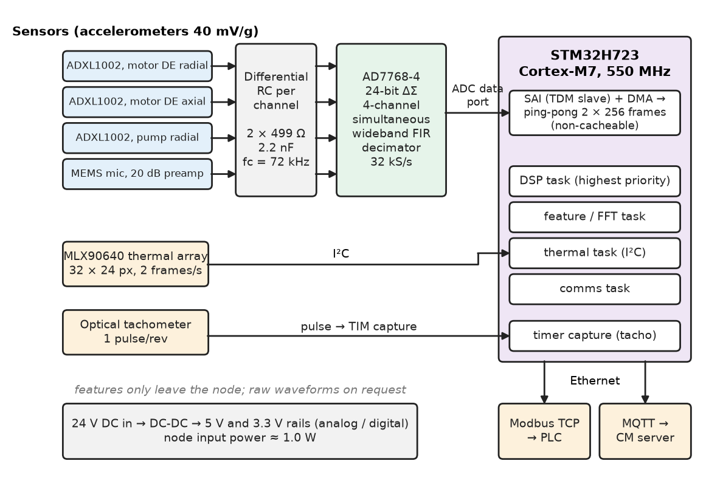
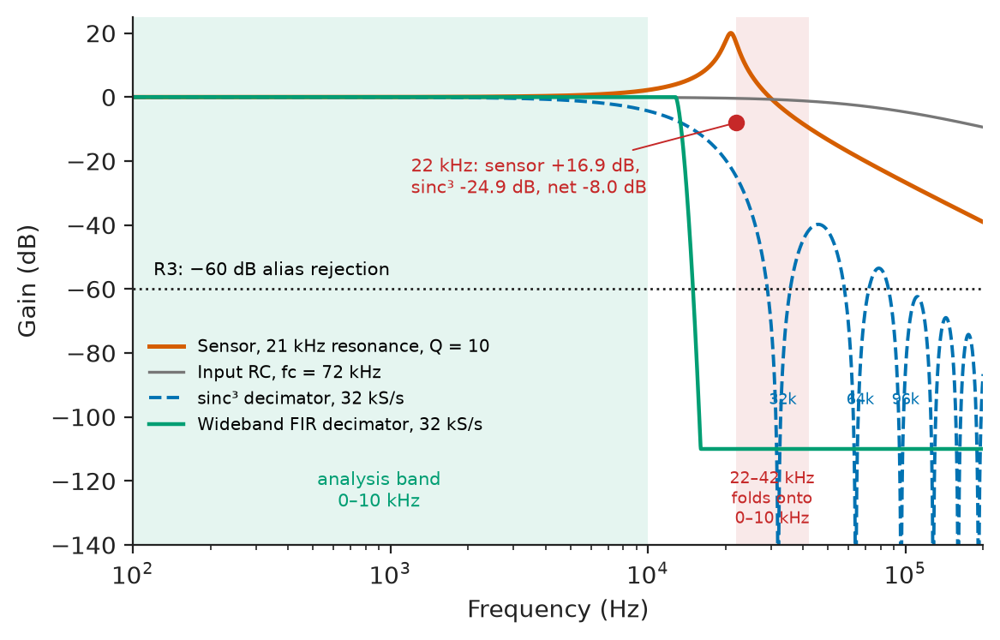
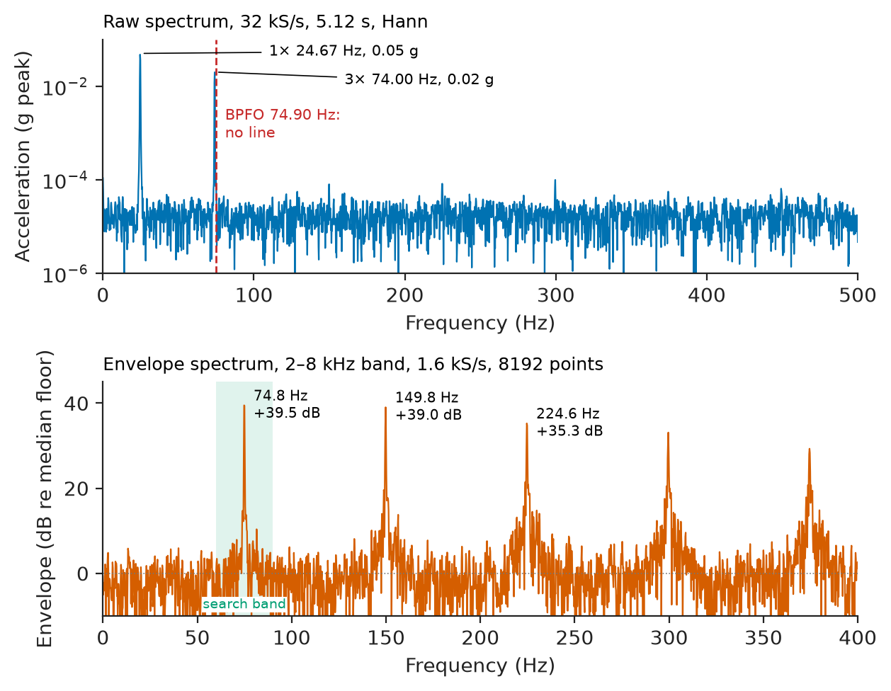
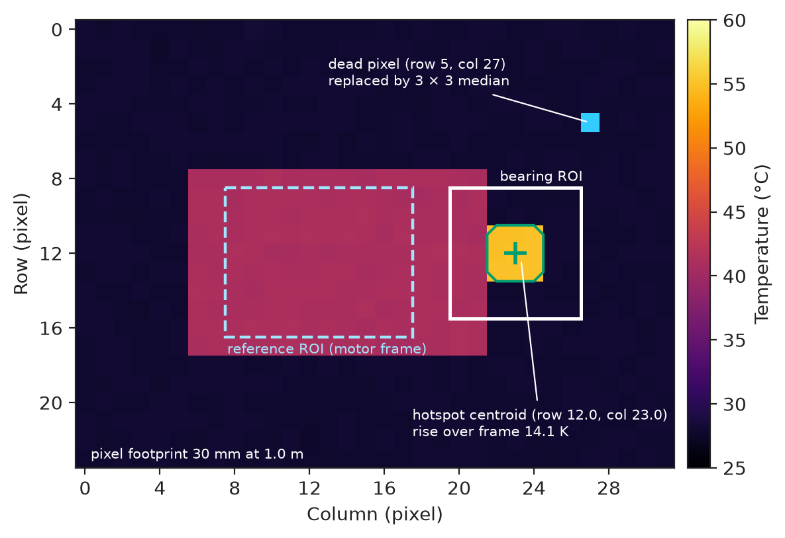
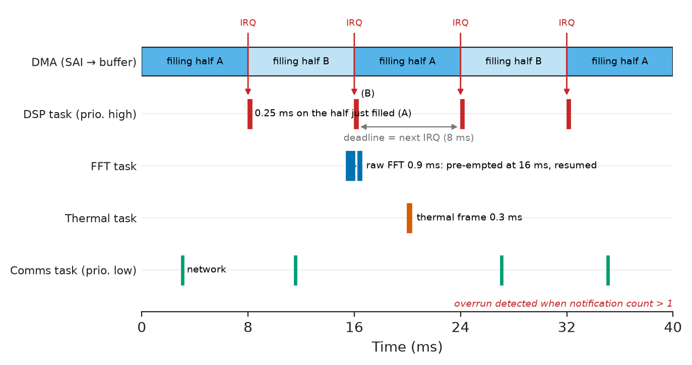
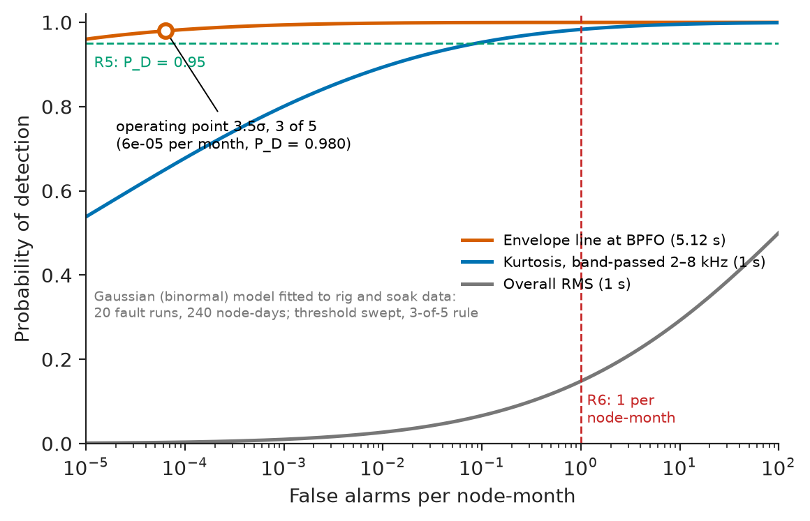

# Chapter 27 — Practical Signal Processing

*Part VII · Communications, Signal Processing, and Biomedical Applications*

A water utility fits vibration nodes to forty booster-pump sets, each a 37 kW induction motor at 1480 rpm driving a centrifugal pump. The first-generation node samples a MEMS accelerometer at 6.4 kS/s and reports overall RMS acceleration every minute. Within a month it alarms on every pump fed from a variable-frequency drive: vibration at the drive's 8 kHz switching frequency reaches the sensor and, with no anti-alias filter worth the name, folds to $\lvert 8-6.4\rvert=1.6$ kHz. Two months later the fleet misses a real fault. A drive-end bearing develops an outer-race spall whose impacts ring the housing at a few kilohertz, and the overall RMS hardly moves until the bearing is days from seizure. Nothing in the node was broken. The sampling plan ignored a known interferer, and the only feature computed could not see the fault mechanism. Practical signal processing is these decisions: which noise to remove and where, which filter, spectrum, feature and detector, and whether the chain fits the processor and the deadline.

> **How is a measurement chain designed so that what reaches the algorithms is the signal, not noise, aliases or artefacts of the processing itself?**
> **How are features and detectors chosen for a specific fault mechanism, implemented in real time on an embedded processor, and proved against numbers written down before the build?**

| Concept | Engineering destination |
|---|---|
| Sensor-noise reduction | Noise budgets for accelerometers, microphones and current probes; averaging gains |
| Filtering | Anti-alias chains, band selection for demodulation, decimation, velocity integration |
| Spectral analysis | Machine diagnostics, harmonic analysis, EMC pre-scans, resonance surveys |
| Feature extraction | Condition-monitoring indicators, inputs to ML classifiers (Chapter 32), data reduction for IoT links |
| Event detection | Alarms with a stated false-alarm rate; arc, knock, leak and impact detection |
| Audio processing | Acoustic leak and cavitation monitoring, voice interfaces, noise measurement |
| Image processing | Thermal inspection, machine vision, optical inspection on production lines |
| Real-time DSP | Block processing with DMA, latency budgets, overrun detection |
| Embedded implementation | CMSIS-DSP on Cortex-M, fixed versus floating point, memory placement |
| Performance evaluation | Detection probability, false-alarm rate, bit-exactness against a reference model |

**Roadmap.** The reference system and its noise budget (27.1) → the filter chain from sensor to decimated envelope (27.2) → spectra with the right resolution (27.3) → features that respond to the fault mechanism (27.4) → detectors with a stated false-alarm rate (27.5) → the acoustic channel (27.6) and the thermal-image channel (27.7) → fitting it all into a real-time schedule (27.8) and into firmware (27.9) → proving that it works and analysing how it fails (27.10).

---

## 27.1 Sensor-noise reduction

> **Boundary.** The sampling theorem and aliasing are owned by *Circuits, Signals and Communications*, [Ch. 19](https://github.com/The-Studio-of-Sadiq/Circuits-Signals-and-Communications/blob/main/part-4-signals-and-systems/19-sampling-and-reconstruction.md) (§19.4, §19.9); quantization noise and SQNR by [Ch. 21](https://github.com/The-Studio-of-Sadiq/Circuits-Signals-and-Communications/blob/main/part-5-digital-signal-processing/21-dsp-fundamentals.md) §21.2; noise models and noise bandwidth by [Ch. 29](https://github.com/The-Studio-of-Sadiq/Circuits-Signals-and-Communications/blob/main/part-6-communication-theory/29-random-signals-and-communication-noise.md) §29.3–29.4. Sensor principles and selection belong to Chapter 6, signal conditioning and uncertainty to Chapter 7, DAQ architecture to Chapter 8 of this book. This chapter uses those results to build one processing chain.

### The reference system

The running example is the second-generation node for the pump fleet, called here the **pump-condition node**. It watches one motor–pump set through four simultaneous analog channels and one image sensor:

- three accelerometers (motor drive-end radial, motor drive-end axial, pump bearing radial);
- one analog MEMS microphone aimed at the pump casing, for cavitation and leaks;
- a 32 × 24-pixel thermal array viewing the motor drive-end bearing housing;
- an optical once-per-revolution tachometer on a timer-capture input, for exact shaft speed.

It reports features every 10 s over Ethernet (Modbus TCP to the PLC, MQTT to the condition-monitoring server); raw waveforms leave only on request. Table 27.1 fixes the requirements before any part is chosen.

**Table 27.1 — Requirements of the pump-condition node.**

| ID | Requirement | Target | Verification |
|---|---|---|---|
| R1 | Vibration bandwidth | 10 Hz–10 kHz; ±1 dB to 5 kHz, ±3 dB to 10 kHz | Shaker sweep against a reference accelerometer (ISO 16063-21 back-to-back) |
| R2 | Range and noise floor | ±40 g; in-band noise ≤ 3 mg rms | Quiet-mount test and short-circuited input |
| R3 | Alias rejection | ≥ 60 dB for any input that folds into 10 Hz–10 kHz | Electrical sine sweep 10–200 kHz into the conditioning input |
| R4 | Velocity RMS, 10–1000 Hz (ISO 20816-3) | Error ≤ ±5 % | Shaker at 25 Hz and 80 Hz, 2–10 mm/s |
| R5 | Bearing-defect detection | Seeded 0.5 mm outer-race spall detected with $P_D\ge0.95$ | Bearing test rig, 20 runs |
| R6 | False-alarm rate | ≤ 1 per node per month | 30-day soak on a healthy pump, plus analysis |
| R7 | Alarm latency | ≤ 10 s for level alarms, ≤ 30 s for envelope alarms | Recorded-signal playback with GPIO timestamps |
| R8 | Acoustic octave levels 1–8 kHz | ±1.5 dB, 50–120 dB SPL | Class 1 acoustic calibrator, 94 dB at 1 kHz (IEC 60942) |
| R9 | Thermal hotspot | ΔT ≥ 10 K on a 120 mm housing detected at ≤ 1.0 m; ±2 K against contact PT100 | Heated target and contact reference |
| R10 | Processing headroom | CPU ≤ 50 %, RAM ≤ 75 % | DWT cycle counter, linker map |
| R11 | Power | ≤ 2 W from 24 V DC | Bench measurement at 18, 24 and 30 V |

The 50 % CPU limit in R10 reserves room for a later on-node anomaly model (Chapter 12).

### Architecture

Figure 27.1 shows the chain: a simultaneous-sampling delta-sigma converter streams 32 kS/s per channel into the microcontroller by DMA, a 32-bit timer stamps the tachometer edge, and the thermal array is read over I²C at 2 frames/s. Only features cross the network.

<!-- FIGURE 27.1 | figures/ch27/fig-27-1-pump-node-architecture.png | block-diagram | Architecture of the pump-condition node: four simultaneous analog channels, a thermal array and a tachometer feeding block-based DSP on an STM32H723, with features reported over Ethernet. | Content: left, sensors: three ADXL1002 accelerometers (motor DE radial, motor DE axial, pump radial; 40 mV/g), analog MEMS microphone with 20 dB preamp, MLX90640 32x24 thermal array, optical tacho 1 pulse/rev. Middle: differential RC (2 x 499 ohm, 2.2 nF, fc 72 kHz) into AD7768-4, 4-channel simultaneous, wideband FIR, 32 kS/s. Arrows: ADC data port into SAI TDM slave with DMA into non-cacheable ping-pong buffer 2 x 256 frames; thermal array on I2C; tacho into timer capture. Right: STM32H723 (Cortex-M7 550 MHz) with DSP, feature, thermal and comms tasks; Ethernet to Modbus TCP (PLC) and MQTT (CM server). Bottom: 24 V input, DC-DC to 5 V and 3.3 V, 1.0 W. -->



*Figure 27.1 — Architecture of the pump-condition node: four simultaneous analog channels, a thermal array and a tachometer feeding block-based DSP on an STM32H723, with features reported over Ethernet.*

### Noise budget

Noise reduction starts with a budget: every source referred to the sensor input, in g, over the analysis band, combined by root-sum-square.

> **Status of the principle: root-sum-square combination of noise**
> *Derived.* The variances of independent, zero-mean noise sources add; it fails for correlated sources (two channels sharing one reference, mains pickup common to all channels), which add linearly.

**Worked example — the accelerometer noise floor.** The ADXL1002 has a noise density of about 25 µg/√Hz (datasheet typical). Over the 10 kHz band of R1 its noise is $25\times10^{-6}\sqrt{10^4}=2.5$ mg rms. The ADC is an AD7768-4-class converter with ±4.096 V full scale and roughly 12 µV rms input-referred noise at 32 kS/s (dynamic range about 108 dB). At 40 mV/g that is $12/40\,000=0.30$ mg. The 24-bit quantization step is $8.192\ \mathrm{V}/2^{24}=0.49$ µV, negligible. The total is $\sqrt{2.5^2+0.30^2}=2.52$ mg rms, against the 3 mg limit of R2: a 16 % margin, and the sensor dominates. Range: ±2 V at ±50 g fits the ±4.096 V input with room for the sensor's 2.5 V bias to be removed differentially.

**Table 27.2 — Noise budget of one vibration channel, 10 Hz–10 kHz, referred to the input.**

| Source | Density or level | In-band rms | Share of variance |
|---|---|---|---|
| ADXL1002 sensor noise | 25 µg/√Hz | 2.50 mg | 98.6 % |
| ADC noise (12 µV rms at 40 mV/g) | — | 0.30 mg | 1.4 % |
| Quantization (24 bit, ±4.096 V) | 0.49 µV step | < 0.004 mg | ≈ 0 |
| Total (RSS) | — | 2.52 mg | — |
| Requirement R2 | — | 3.0 mg | margin 16 % |

The budget says what *not* to buy: a quieter ADC changes nothing; a piezoelectric IEPE sensor (5–10 µg/√Hz) would help, at five times the cost per point.

### Reducing what remains

Once the sensor sets the floor, processing reduces noise by predictable amounts:

- **Bandwidth.** The 6 kHz envelope band of Section 27.2 holds $25\sqrt{6000}=1.9$ mg of sensor noise; the 10–1000 Hz velocity band only 0.79 mg.
- **Spectral averaging.** Averaging $K$ Welch segments cuts the variance of the floor estimate by $K$, so smaller lines stand out (Book 3 §22.8).
- **Synchronous averaging.** Blocks aligned to the tachometer pulse keep shaft-locked components and cut the rest by $\sqrt{K}$: 100 revolutions give 20 dB. Bearing-defect frequencies are not shaft orders and are suppressed too, so this serves gears and couplings, not bearings.
- **Common-mode removal.** Differential drive over shielded twisted pairs cancels VFD and mains interference coupled equally into both conductors.

---

## 27.2 Filtering

> **Boundary.** FIR and IIR design methods, structures and quantization effects are in *Circuits, Signals and Communications*, [Ch. 23](https://github.com/The-Studio-of-Sadiq/Circuits-Signals-and-Communications/blob/main/part-5-digital-signal-processing/23-digital-filters.md) (§23.3, §23.5, §23.6, §23.9); decimation, polyphase filters and multistage rate change in [Ch. 24](https://github.com/The-Studio-of-Sadiq/Circuits-Signals-and-Communications/blob/main/part-5-digital-signal-processing/24-advanced-signal-processing.md) §24.1–24.2; delta-sigma converter architectures in *Electronics and Computing*, [Ch. 10](https://github.com/The-Studio-of-Sadiq/Electronics-and-Computing/blob/main/part-2-analog-electronics/10-analog-integrated-circuits.md) §10.10.

### The anti-alias chain and the converter choice

The opening failure was an aliasing failure, so the converter is chosen with the anti-alias chain in view (Table 27.3).

**Table 27.3 — Converter options for four simultaneous channels at 10 kHz bandwidth (2026 distributor prices, 100 pcs, indicative).**

| Option | Example part class | Alias protection | Fit to R1–R3 | Cost per node |
|---|---|---|---|---|
| MCU SAR ADC | STM32H7 internal 16-bit, 3.6 MS/s | 6th-order analog filter per channel | Possible; filters drift; channels skewed | ≈ \$8 in filters |
| Delta-sigma, sinc3 decimator | ADS131M04, 24 bit, ≤ 32 kS/s | ≈ 25 dB where inputs fold onto 10 kHz | Fails R3 (worked example) | ≈ \$6 |
| Delta-sigma, wideband FIR decimator | AD7768-4, 24 bit, simultaneous | ≥ 105 dB from 0.5·ODR; RC for modulator rate | Meets R1–R3; **chosen** | ≈ \$35 |
| Digital MEMS accelerometer | IIS3DWB, 26.7 kS/s | Internal; 6.3 kHz bandwidth | Fails R1; no microphone input | ≈ \$8 per axis |

**Worked example — why the sinc3 converter was rejected.** The ADXL1002 has its mechanical resonance near 21 kHz. Modelled as a second-order system with $Q=10$, it *amplifies* a 22 kHz excitation (cavitation and impacts produce plenty) by about 17 dB. At an output rate of 32 kS/s a 22 kHz component folds to $32-22=10$ kHz, inside the analysis band. A sinc3 decimation filter at that frequency attenuates by only $\lvert\mathrm{sinc}(22/32)\rvert^3$, about −25 dB. The net is about −8 dB: a resonance-excited component would appear in band only 8 dB below its true value, against the 60 dB of R3. The first listing reproduces the numbers.

```python
import numpy as np

fs = 32_000                                   # ADC output rate, S/s
db = lambda x: 20 * np.log10(np.abs(x))

# Why a plain sinc3 delta-sigma was rejected: sensor resonance 21 kHz, Q = 10
def sensor(f):
    r = f / 21e3
    return 1 / (1 - r**2 + 1j * r / 10)
f_alias = 22_000                               # folds to 32 - 22 = 10 kHz
print(f"sensor gain {db(sensor(f_alias)):+.1f} dB, sinc3 {db(np.sinc(f_alias/fs)**3):+.1f} dB,"
      f" net {db(sensor(f_alias) * np.sinc(f_alias/fs)**3):+.1f} dB at {f_alias/1e3:.0f} kHz")
```

```text
sensor gain +16.9 dB, sinc3 -24.9 dB, net -8.0 dB at 22 kHz
```

The wideband-FIR converter puts the steep filtering in its digital decimator, exact and drift-free: flat to about 0.4·ODR (12.8 kHz) and about 105 dB down from 0.5·ODR (datasheet typical). Aliasing around the multi-megahertz modulator rate remains, and a differential RC of 2 × 499 Ω and 2.2 nF ($f_c=1/(2\pi\cdot998\cdot2.2\ \mathrm{nF})=72$ kHz) removes while costing only 0.1 dB at 10 kHz. Figure 27.2 shows the chain.

> **Status of the principle: alias-free sampling**
> *Fundamental.* Any input component at $f$ appears at $\lvert f-kf_s\rvert$ after sampling; only attenuation *before* the sampler, analog or inside an oversampling converter's decimator, can separate it from the band, and no later digital filter can.

<!-- FIGURE 27.2 | figures/ch27/fig-27-2-anti-alias-chain.png | plot | Anti-alias chain of a vibration channel: sensor resonance, input RC, and two converter decimation filters, with the band that folds onto 0-10 kHz shaded. | Content: x-axis frequency 100 Hz to 200 kHz, log; y-axis gain -140 to +25 dB. Curves: sensor model second order 21 kHz Q 10 (peak +20 dB); RC first order fc 72 kHz; sinc3 at 32 kS/s (notches at 32, 64, 96 kHz; -24.9 dB at 22 kHz); wideband FIR at 32 kS/s (flat to 12.8 kHz, below -105 dB from 16 kHz). Shaded: 0-10 kHz analysis band; 22-42 kHz folds onto it. Marker at 22 kHz: sensor plus sinc3 net -8 dB. Dashed line at -60 dB labelled R3. -->



*Figure 27.2 — Anti-alias chain of a vibration channel: sensor resonance, input RC, and two converter decimation filters, with the band that folds onto 0-10 kHz shaded.*

### Band-pass for demodulation

A bearing defect is a train of impacts, each ringing housing resonances at several kilohertz, so the defect frequency appears as the *repetition rate* of bursts in a high band. The node selects that band with an eighth-order Butterworth band-pass, 2–8 kHz, as four biquads. The commissioning survey (Section 27.3) sets the edges: inside them the housing resonances, below them the shaft harmonics, above them the VFD carrier and its sidebands. Band edges are configuration, not code. Second-order sections are mandatory: the largest pole radius is 0.90, but as one eighth-order polynomial the filter would need more coefficient precision than single-precision float offers (Book 3 §23.9).

### Decimation and the velocity path

After rectification the envelope occupies 0–500 Hz, so it is decimated by 20 to 1.6 kS/s. The decimator is a 239-tap linear-phase FIR (Kaiser window, 71 dB stopband from 1.1 kHz), implemented as a polyphase filter so that it costs only 12 multiply–accumulates per input sample rather than 239. Its group delay is 119 samples, 3.7 ms at 32 kS/s.

The velocity path for R4 band-limits the acceleration to 10–1000 Hz with a fourth-order Butterworth band-pass and integrates it with a bilinear integrator whose pole is moved from $z=1$ to $z=0.9995$, so that offset cannot wind up the state. At the 24.67 Hz running speed the band-pass and integrator together are within 1.1 % of the ideal $1/(2\pi f)$, comfortably inside the ±5 % of R4.

---

## 27.3 Spectral analysis

> **Boundary.** The DFT, bin interpretation, leakage, windows, zero padding and Welch averaging are owned by *Circuits, Signals and Communications*, [Ch. 22](https://github.com/The-Studio-of-Sadiq/Circuits-Signals-and-Communications/blob/main/part-5-digital-signal-processing/22-discrete-fourier-transform.md) (§22.3, §22.5–22.8). Here they are used to fix record lengths, windows and memory.

### What the spectrum must resolve

Spectral analysis on the node has two jobs. The **raw spectrum** (0–10 kHz) identifies shaft-related faults: 1× for unbalance, 2× and 3× for misalignment and looseness, vane-pass (blade count × speed) for hydraulic problems. The **envelope spectrum** (0–500 Hz) identifies bearing defects from the repetition rate of impacts. The design numbers come from the machine.

For the drive-end bearing, a 6309 deep-groove ball bearing (8 balls of 17.46 mm diameter on a 72.5 mm pitch diameter, zero contact angle), and a shaft rate $f_r=1480/60=24.67$ Hz, the standard kinematic formulas give

$$
f_{\mathrm{BPFO}}=\frac{n}{2}f_r\left(1-\frac{d}{D}\cos\phi\right)=4\times24.67\times(1-0.2409)=74.90\ \mathrm{Hz},
$$

with the inner-race frequency at 122.43 Hz, ball spin at 48.24 Hz and cage at 9.36 Hz.

> **Status of the principle: bearing defect frequencies from kinematics**
> *Approximate.* They assume rolling without slip and rigid geometry; in service the rolling elements slip, and measured defect frequencies typically sit 1–2 % below the calculated ones, so detectors search a band around each frequency rather than a single bin.

**Worked example — record length for the envelope spectrum.** A misaligned coupling also produces a line at $3f_r=74.00$ Hz, only 0.90 Hz from BPFO. With a Hann window, two equal lines are separated cleanly when they are at least about two bins apart (the −6 dB main-lobe width is two bins), so the bin spacing must be at most 0.45 Hz and the record at least $1/0.45=2.2$ s. The node uses 8192 points of envelope at 1.6 kS/s: bins of $1600/8192=0.195$ Hz, a record of 5.12 s, and 4.6 bins between the two lines. A longer record would separate them further, but the shaft speed must stay constant over the record: at 5.12 s a load change that moves the slip by 0.1 % of speed moves BPFO by 0.075 Hz, under half a bin. The tachometer measures the speed of every record, and the detector recomputes the defect frequencies from it.

> **Status of the principle: frequency resolution of a finite record**
> *Derived.* The bin spacing of an $N$-point DFT at rate $f_s$ is $f_s/N=1/T$; the ability to separate two lines depends on $T$ and on the window's main-lobe width, and zero padding interpolates the spectrum without improving it.

### Raw spectrum settings

The raw spectrum uses 16384 points at 32 kS/s (1.95 Hz bins, 0.512 s), Hann window, 50 % overlap, eight averages. Line amplitudes are corrected for the window's coherent gain (0.5) and band energies for its noise bandwidth (1.5 bins); mixing the two corrections, a common error in hand-rolled code, puts band energies 1.76 dB wrong.

### Commissioning survey

Band edges, alarm frequencies and acceptance come from a **commissioning survey**: 60 s raw captures at three loads, a hammer tap test for housing resonances, and a capture at the VFD's operating point to locate the carrier. It is stored with the configuration, so alarms compare against the machine's own baseline.

<!-- FIGURE 27.3 | figures/ch27/fig-27-3-raw-vs-envelope-spectrum.png | plot | Raw acceleration spectrum and envelope spectrum of the same record with an early outer-race defect: invisible in the raw spectrum, about 40 dB above the floor in the envelope spectrum. | Content: two stacked panels from the simulation listing of Section 27.5. Top: raw spectrum in g, log y 1e-6 to 0.1, x 0 to 500 Hz; lines at 24.67 Hz (0.05 g) and 74.00 Hz (0.02 g); dashed marker at 74.90 Hz labelled BPFO with no line. Bottom: envelope spectrum in dB re median floor, -10 to +45 dB, x 0 to 400 Hz; peaks at 74.8 Hz (+39.5 dB), 149.8 Hz and 224.7 Hz decreasing; search band 60-90 Hz shaded. -->



*Figure 27.3 — Raw acceleration spectrum and envelope spectrum of the same record with an early outer-race defect: invisible in the raw spectrum, about 40 dB above the floor in the envelope spectrum.*

---

## 27.4 Feature extraction

### From waveform to numbers

The node reduces 128 000 samples per second to a few dozen numbers, each chosen for the fault mechanism it responds to (Table 27.4).

**Table 27.4 — Features computed by the pump-condition node.**

| Feature | Fault mechanism it responds to | Window | Healthy value (this fleet) | Cost per input sample |
|---|---|---|---|---|
| Velocity RMS, 10–1000 Hz | Unbalance, misalignment, looseness; severity per ISO 20816-3 | 1 s | 1.2–2.3 mm/s | 3 biquads + square |
| Acceleration RMS and peak | General level; impacts | 1 s | 30–45 mg rms | 2 operations |
| Crest factor (peak/RMS) | Impacting | 1 s | 3–4 | from above |
| Kurtosis, band-passed 2–8 kHz | Impulsiveness from early bearing damage | 1 s | ≈ 3 | 4 biquads + 3 operations |
| Envelope line at BPFO, BPFI, BSF, FTF | Specific bearing defects | 5.12 s | < 10 dB over floor | FFT (shared) |
| 1×, 2×, 3× amplitudes | Unbalance, misalignment | 2.3 s | from survey | FFT (shared) |
| Octave levels 1–8 kHz (microphone) | Cavitation, leaks | 1 s | from survey | 8 biquads |
| Bearing housing ΔT over motor frame | Lubrication failure, overload | 0.5 s | 3–8 K | per frame |

**Worked example — velocity severity from the spectrum.** On a healthy pump the 1× line is 0.05 g peak and the 3× line 0.02 g peak. Velocity amplitude is acceleration divided by $2\pi f$: $0.05\times9.807/(2\pi\times24.67)=3.16$ mm/s peak, or 2.24 mm/s rms at 1×, and $0.196/(2\pi\times74.0)=0.42$ mm/s peak (0.30 mm/s rms) at 3×. Together $\sqrt{2.24^2+0.30^2}=2.26$ mm/s rms. For a group-2 machine (15–300 kW) on a rigid foundation, ISO 20816-3 places zone boundaries at 1.4, 2.8 and 4.5 mm/s rms, so this pump is in zone B (acceptable for unrestricted long-term operation) with 0.54 mm/s before zone C.

> **Status of the principle: vibration-severity zones**
> *Empirical.* The ISO 20816-3 boundaries summarise fleet experience for classes of machine and foundation; they are a starting point that site baselines refine, not a physical limit.

### Why kurtosis, and why band-passed

Kurtosis is 3 for Gaussian noise, 1.5 for a sinusoid, and well above 3 for impulsive signals. On the raw waveform the shaft harmonics dominate and hide a weak impact train: in the Section 27.5 simulation raw kurtosis is 1.31, band-passed kurtosis 9.76. The envelope band-pass thus also yields the most sensitive single-number indicator. It is computed in one pass from running sums of $x$ to $x^4$, accumulated in double precision (in hardware on the Cortex-M7) after the band-pass has removed the mean.

---

## 27.5 Event detection

> **Boundary.** Detection in noise, thresholds and error probabilities are treated in *Circuits, Signals and Communications*, [Ch. 29](https://github.com/The-Studio-of-Sadiq/Circuits-Signals-and-Communications/blob/main/part-6-communication-theory/29-random-signals-and-communication-noise.md) §29.6; hypothesis testing in *The Mathematics Universe*, [Ch. 20](https://github.com/The-Studio-of-Sadiq/engineering-mathematics/blob/main/part-6-probability-statistics/20-statistical-analysis.md) §20.8. Learned anomaly detectors are in Chapter 32.

### Simulating the detector before the rig

Before any bearing is damaged, the chain runs on a synthetic signal: 1× and 3× lines, budgeted sensor noise, and an outer-race impact train at BPFO with 1 % jitter, each impact ringing a 4.5 kHz resonance. The band-pass is the firmware's; the decimator is comparable.

```python
import numpy as np
from scipy import signal, stats

rng = np.random.default_rng(7)
fs, T = 32_000, 5.12                           # S/s, record length s
t = np.arange(int(fs * T)) / fs
fr, bpfo = 1480 / 60, 74.902                   # shaft and outer-race frequencies, Hz

# Synthetic test signal in g: 1x unbalance, 3x misalignment, noise, and a weak
# outer-race defect: one impact per BPFO period ringing a 4.5 kHz resonance
x = 0.050 * np.sin(2*np.pi*fr*t) + 0.020 * np.sin(2*np.pi*3*fr*t)
x += 2.5e-3 * np.sqrt(fs / 2 / 10e3) * rng.standard_normal(t.size)  # 25 ug/rtHz
hits = np.cumsum(np.full(int(T * bpfo), 1 / bpfo) * (1 + 0.01 * rng.standard_normal(int(T * bpfo))))
ring = np.exp(-800 * t[:200]) * np.sin(2 * np.pi * 4_500 * t[:200])
for k in (hits * fs).astype(int):
    seg = slice(k, min(k + 200, t.size)); x[seg] += 0.02 * ring[:seg.stop - k]

# Envelope chain as on the node: band-pass, rectify, decimate by 20, Hann FFT
sos_bp = signal.butter(4, [2_000, 8_000], btype='bandpass', fs=fs, output='sos')
y = signal.sosfilt(sos_bp, x)
env = signal.decimate(np.abs(y), 20, ftype='fir', n=231)       # 1600 S/s
env -= env.mean()
E = np.abs(np.fft.rfft(env * np.hanning(env.size)))
fe = np.fft.rfftfreq(env.size, 20 / fs)
band = (fe > 60) & (fe < 90)
pk = fe[band][E[band].argmax()]
print(f"envelope bins {fe[1]:.4f} Hz, peak {pk:.2f} Hz, "
      f"{20*np.log10(E[band].max() / np.median(E[(fe > 20) & (fe < 400)])):.1f} dB above floor")
X = np.abs(np.fft.rfft(x * np.hanning(x.size))); fx = np.fft.rfftfreq(x.size, 1 / fs)
print(f"raw spectrum near 74-75 Hz: largest line {fx[(fx>70)&(fx<80)][X[(fx>70)&(fx<80)].argmax()]:.2f} Hz")
print(f"kurtosis raw {stats.kurtosis(x, fisher=False):.2f}, "
      f"band-passed {stats.kurtosis(y, fisher=False):.2f}")
print(f"rms raw {1e3*x.std():.1f} mg, band-passed {1e3*y.std():.2f} mg")
```

```text
envelope bins 0.1953 Hz, peak 74.80 Hz, 39.5 dB above floor
raw spectrum near 74-75 Hz: largest line 74.02 Hz
kurtosis raw 1.31, band-passed 9.76
rms raw 38.3 mg, band-passed 3.59 mg
```

The result is the opening story in four lines. The overall RMS, 38.3 mg, is within 0.2 mg of the healthy value $\sqrt{35.4^2+14.1^2+2.5^2}=38.2$ mg; the raw spectrum shows only the 3× misalignment line at 74.02 Hz; the envelope spectrum shows the defect at 74.80 Hz (0.1 Hz below the calculated 74.90 Hz, within one bin), 39.5 dB above its floor; and band-passed kurtosis has tripled. Figure 27.3 plots both spectra.

### Thresholds and the false-alarm rate

A detector is a threshold on a feature, and its false-alarm rate follows from the feature's distribution on a healthy machine. Each feature is normalised by the node's own baseline mean $\mu$ and standard deviation $\sigma$, learned over the first two weeks after commissioning, and an alarm is raised when $z=(x-\mu)/\sigma$ exceeds a threshold.

**Worked example — single threshold versus persistence.** Level features are evaluated once per second: $2.592\times10^6$ evaluations per month. With a Gaussian healthy distribution, a single-sample threshold at $4.5\sigma$ has a false-alarm probability of $3.4\times10^{-6}$ per evaluation, or $3.4\times10^{-6}\times2.592\times10^6=8.8$ false alarms per month per feature, which fails R6 on its own. A **3-of-5 persistence rule** at $3.5\sigma$ needs three exceedances among the last five evaluations. The single-evaluation probability is $p=2.33\times10^{-4}$, and the probability of three or more in five is $\sum_{j=3}^{5}\binom{5}{j}p^j(1-p)^{5-j}=1.26\times10^{-10}$, about $3.3\times10^{-4}$ per month per feature. A real fault that shifts the feature mean by $6\sigma$ exceeds $3.5\sigma$ with probability 0.994 per evaluation and fires the 3-of-5 rule with probability 0.999998, within 3–5 s. Persistence buys six orders of magnitude of false-alarm rate for 2–4 s of latency, well inside R7.

> **Status of the principle: false-alarm rate from a Gaussian feature model**
> *Approximate.* It assumes independent, Gaussian evaluations from a stationary healthy process. Consecutive windows of a slowly varying machine are correlated, and the true tails are heavier, so the calculation sets the order of magnitude and the 30-day soak test of R6 sets the number.

### What actually causes false alarms

On the pilot fleet the analytic rate was never the problem. False alarms came from *process* events: starts, valve changes, a second pump switching on. A state machine suppresses level alarms for 30 s after a start, after a speed change over 5 % and while the PLC reports a valve moving; envelope alarms, which respond to the defect signature, are never suppressed. The rules are versioned with the configuration and covered by tests, because undocumented suppression eventually hides a fault.

---

## 27.6 Audio processing

> **Boundary.** Audio sampling, coding and psychoacoustic fundamentals are in *Circuits, Signals and Communications*, [Ch. 24](https://github.com/The-Studio-of-Sadiq/Circuits-Signals-and-Communications/blob/main/part-5-digital-signal-processing/24-advanced-signal-processing.md) §24.9; adaptive noise cancellation (LMS) in §24.5; time–frequency analysis in §24.7.

### The acoustic channel

Cavitation, a gland leak and a rubbing seal produce broadband airborne noise above 1 kHz that the casing accelerometer sees poorly. The node's fourth channel is an analog MEMS microphone of the ICS-40720 class: sensitivity about −32 dBV/Pa, signal-to-noise ratio about 70 dB(A), acoustic overload near 124 dB SPL (datasheet typical). A preamplifier with 20 dB gain lifts it towards the converter's range; the converter samples it at the same 32 kS/s as the accelerometers, so acoustic and vibration features are time-aligned by construction.

The processing is a sound-level meter cut down to what the fault needs: four octave band-passes at 1, 2, 4 and 8 kHz (two biquads each, band edges per IEC 61260-1), 1 s mean-square integration and conversion to dB SPL. A-weighting models human hearing and is not applied.

**Worked example — from volts to sound pressure level.** At the microphone (before the preamplifier) a 1 s window measures 4.2 mV rms, or $20\log_{10}(4.2\times10^{-3})=-47.5$ dBV. A microphone of −32 dBV/Pa produces −32 dBV at 1 Pa, which is 94 dB SPL. The level is therefore $94+(-47.5)-(-32)=78.5$ dB SPL. Field calibration with a class 1 calibrator removes the ±1 dB unit-to-unit sensitivity tolerance, which would otherwise use two-thirds of R8's allowance.

### Removing the machine from the microphone

The microphone also hears the cooling fan and neighbouring pumps. The reported feature is therefore the *excess* over the commissioning baseline at the current load, in dB; a 6 dB excess at 4 and 8 kHz with no change at 1 kHz is this fleet's cavitation signature. Where another machine dominates, an LMS canceller with the casing accelerometer as reference separates this pump's structure-borne radiation from airborne noise; the pilot did not need it.

Other products use digital MEMS microphones: a PDM stream at 1–3.2 MHz is decimated by 64 with a CIC filter and a compensating FIR (in the STM32 DFSDM or the nRF52840 PDM block), or an I²S microphone does it internally. Leak detectors on water mains correlate two hydrophones to locate a leak from the arrival-time difference. The pattern is the pump node's: calibrate, band-limit to the mechanism, compare with a baseline.

---

## 27.7 Image processing

> **Boundary.** Two-dimensional sampling, transforms and image coding are in *Circuits, Signals and Communications*, [Ch. 24](https://github.com/The-Studio-of-Sadiq/Circuits-Signals-and-Communications/blob/main/part-5-digital-signal-processing/24-advanced-signal-processing.md) §24.9; thermal radiation and emissivity in *Engineering Physics*, [Ch. 10](https://github.com/The-Studio-of-Sadiq/Engineering-Physics/blob/main/CHAPTERS/CHAPTER%2010.md) §10.8.4.

### The thermal channel

A failing bearing often heats before it becomes noisy, and a lubrication failure always does. The node carries an MLX90640-class thermopile array: 32 × 24 pixels, 55° × 35° field of view, noise-equivalent temperature difference about 0.1 K at 1 Hz refresh, absolute accuracy about ±1 K in the central field (datasheet typical), read over I²C. At 2 frames/s it delivers 768 temperatures every 0.5 s, after the vendor's calibration routine has applied each pixel's stored offset, gain and thermal-gradient coefficients.

**Worked example — mounting distance from pixel footprint.** Each pixel subtends $55^\circ/32=1.72^\circ$. At distance $d$ its footprint is $2d\tan(0.86^\circ)=0.030\,d$: 30 mm at 1.0 m, 45 mm at 1.5 m. The 120 mm bearing housing covers 2.7 pixels at 1.5 m; nearly every pixel also sees cooler background, so the peak reads low. The rule of thumb asks for at least 3 × 3 pixels, preferably four across to allow for misregistration: a 30 mm footprint, so the camera is mounted at no more than 1.0 m. That is R9's distance limit.

> **Status of the principle: minimum target size in pixels**
> *Empirical.* The 3 × 3-pixel rule reflects the optical point-spread of low-cost thermal arrays, in which a pixel's reading is influenced by its neighbours; the exact requirement is measured with a slit or edge target for each lens.

### The processing chain

Every step of the image chain answers a specific defect of the sensor or the scene:

1. **Plausibility mask.** Pixels outside −20 to 300 °C, or flagged in the sensor's EEPROM, are marked bad.
2. **Bad-pixel replacement** by the 3 × 3 median of the neighbours, for flagged pixels only; a median over the whole frame would erode a 3 × 3 hotspot.
3. **Emissivity.** Bare machined steel (ε ≈ 0.1–0.3) reflects its surroundings, so high-emissivity tape (ε ≈ 0.95) is applied to the target at installation.
4. **Temporal averaging** over four frames (2 s) halves the pixel noise to about 0.05 K.
5. **Regions of interest** fixed at commissioning: the feature is the bearing's maximum minus the motor frame's median, which cancels ambient temperature and load.
6. **Hotspot segmentation.** Pixels 10 K above the frame reference are labelled as connected components; the largest one's area and centroid say *where*.

```python
import numpy as np
from scipy import ndimage

rng = np.random.default_rng(3)
# Synthetic 24 x 32 frame (deg C): 28 C background, motor frame 41 C,
# drive-end bearing housing 3 x 3 px at 55 C, NETD 0.1 K, one dead pixel
frame = 28.0 + 0.1 * rng.standard_normal((24, 32))
frame[8:18, 6:22] = 41.0 + 0.1 * rng.standard_normal((10, 16))
frame[11:14, 22:25] = 55.0 + 0.1 * rng.standard_normal((3, 3))
frame[5, 27] = -40.0                                   # dead pixel reads out of range

bad = (frame < -20) | (frame > 300)                    # plausibility mask
med = ndimage.median_filter(frame, size=3)
clean = np.where(bad, med, frame)                      # replace only flagged pixels

roi = (slice(9, 16), slice(20, 27))                    # bearing ROI from commissioning
ref = (slice(9, 17), slice(8, 18))                     # motor-frame reference ROI
dT = clean[roi].max() - np.median(clean[ref])          # bearing rise over frame
hot = clean > np.median(clean[ref]) + 10.0             # hotspot rule: +10 K over frame
lab, n = ndimage.label(hot)
sizes = ndimage.sum(hot, lab, range(1, n + 1))
cy, cx = ndimage.center_of_mass(hot, lab, int(np.argmax(sizes)) + 1)
print(f"bad pixels replaced: {bad.sum()}, bearing rise over frame: {dT:.1f} K")
print(f"hotspots: {n}, largest {int(sizes.max())} px at row {cy:.1f}, col {cx:.1f}")
```

```text
bad pixels replaced: 1, bearing rise over frame: 14.1 K
hotspots: 1, largest 9 px at row 12.0, col 23.0
```

The listing is the reference model; the firmware does the same in C on 768 floats per frame, about 0.15 Mcycle per frame. Figure 27.4 shows the frame and the regions.

<!-- FIGURE 27.4 | figures/ch27/fig-27-4-thermal-frame-roi.png | plot | Thermal frame of the motor drive end from the 32 x 24 array, with the bearing and reference regions and the segmented hotspot. | Content: heat map 32 x 24 pixels, colour scale 25 to 60 deg C. Background 28 C; motor frame rows 8-17, columns 6-21 at 41 C; hotspot 3x3 pixels rows 11-13, columns 22-24 at 55 C; dead pixel at row 5, column 27 marked. Overlays: solid bearing ROI rows 9-15, columns 20-26; dashed reference ROI rows 9-16, columns 8-17; centroid at row 12.0, column 23.0, label rise 14.1 K. Inset: footprint 30 mm per pixel at 1.0 m. -->



*Figure 27.4 — Thermal frame of the motor drive end from the 32 x 24 array, with the bearing and reference regions and the segmented hotspot.*

### Image processing in other systems

The same discipline (correct the sensor, measure in fixed regions, compare with a reference) carries over to label checks on bottling lines, electroluminescence crack detection in PV modules (Chapter 22) and PCB inspection. What changes is the data rate: a 5-megapixel camera at 20 frames/s produces 100 MB/s, a job for an FPGA or a vision accelerator, not a microcontroller (*Electronics and Computing*, [Ch. 35](https://github.com/The-Studio-of-Sadiq/Electronics-and-Computing/blob/main/part-8-integrated-circuits-and-vlsi/35-hardware-software-co-design.md) §35.1–35.3).

---

## 27.8 Real-time DSP

> **Boundary.** Interrupt latency, scheduling, response-time analysis and jitter are owned by *Electronics and Computing*, [Ch. 27](https://github.com/The-Studio-of-Sadiq/Electronics-and-Computing/blob/main/part-6-embedded-and-real-time-systems/27-real-time-computing.md) (§27.2, §27.3, §27.10); the real-time DSP workflow by *Circuits, Signals and Communications* Ch. 21 §21.3. MCU selection and firmware architecture at system level are in Chapter 10 of this book.

### Processor selection

The processor choice was settled by memory, not arithmetic (Table 27.5).

**Table 27.5 — Processor options for the pump-condition node.**

| Option | Core, clock | SRAM | Relevant peripherals | Verdict |
|---|---|---|---|---|
| STM32G474 | Cortex-M4F, 170 MHz | 128 KB | No Ethernet MAC | Arithmetic suffices; memory fails |
| STM32H723 | Cortex-M7, 550 MHz, double FPU | 564 KB | SAI (TDM slave), Ethernet MAC | **Chosen** |
| ESP32-S3 | 2 × Xtensa LX7, 240 MHz | 512 KB + PSRAM | Wi-Fi, I²S; no Ethernet MAC | Wireless unwanted in a steel pump room |
| STM32MP1-class MPU, Linux | Cortex-A7 650 MHz + M4 | external DDR | everything | Boot time, OS upkeep; power near R11 |

**Worked example — the memory budget that ruled out the smaller part.** The first plan kept a 16384-point capture and FFT output buffer for all three accelerometers: $3\times16384\times4\ \mathrm{B}\times2=384$ KB, three times the STM32G474's SRAM. Even on the STM32H723 the naïve layout totals 553 KB of 564 KB, failing R10. The revised layout captures the raw spectrum one channel at a time (round-robin), lets the FFT consume its input, and shares one 64 KB output buffer among all FFTs in one low-priority task (Table 27.6).

**Table 27.6 — Memory budget, STM32H723, revised layout.**

| Item | Size |
|---|---|
| DMA ping-pong, 2 × 256 frames × 4 channels × 4 B (non-cacheable) | 8 KB |
| Raw capture, one channel at a time, 16384 × 4 B | 64 KB |
| Envelope capture, 3 channels × 8192 × 4 B | 96 KB |
| FFT output buffer, shared, 16384 × 4 B | 64 KB |
| Thermal frames: raw, filtered, background (3 × 768 × 4 B) | 9 KB |
| Filter states, coefficients, feature records | 8 KB |
| RTOS stacks and heap | 48 KB |
| Network buffers (lwIP, MQTT, Modbus TCP) | 64 KB |
| **Total** | **361 KB** |
| Available / limit R10 (75 %) | 564 KB / 423 KB |
| Margin against R10 | 62 KB (11 % of SRAM); 36 % of SRAM free |

### The block schedule and CPU budget

Processing is block-based. The converter's data port fills a ping-pong buffer by DMA, and every half-buffer of 256 frames (8 ms at 32 kS/s) wakes the DSP task. The DSP task must finish each block in well under 8 ms, or the next block overwrites data still in use. Longer computations (FFTs, thermal frames, reports) run in lower-priority tasks that the DSP task pre-empts (Figure 27.5).

Table 27.7 is the CPU budget. The per-operation cycle counts are estimates for CMSIS-DSP single-precision routines on a Cortex-M7, to be replaced by DWT cycle-counter measurements on the first boards; the margin is so large that a factor-of-two error in any of them would not matter.

**Table 27.7 — CPU budget at 550 MHz (estimated, to be confirmed by measurement).**

| Task | Basis | Mcycle/s | Load |
|---|---|---|---|
| DMA interrupt and 24-bit unpacking, 4 channels | 8 cycles/sample | 1.02 | 0.19 % |
| Statistics: sums, peak, 4 channels | 6 cycles/sample | 0.77 | 0.14 % |
| Velocity chain, 3 biquads, 3 channels | 8 cycles/biquad/sample | 2.30 | 0.42 % |
| Envelope band-pass, 4 biquads, 3 channels | 8 cycles/biquad/sample | 3.07 | 0.56 % |
| Rectify and polyphase decimator, 3 channels | 239 taps at 1.6 kS/s | 1.15 | 0.21 % |
| Raw spectrum, 16384-point real FFT | 0.5 Mcycle, one channel per 0.512 s | 0.98 | 0.18 % |
| Envelope spectrum, 8192-point real FFT | 0.23 Mcycle, 3 per 5.12 s | 0.13 | 0.02 % |
| Audio octave bank, 8 biquads | 8 cycles/biquad/sample | 2.05 | 0.37 % |
| Thermal processing | 0.15 Mcycle per frame, 2 frames/s | 0.30 | 0.05 % |
| Network stack, Modbus, MQTT, housekeeping | allowance | 3.00 | 0.55 % |
| **Total** | | **14.8** | **2.7 %** |
| Requirement R10 | | | ≤ 50 % (margin 47 points) |

> **Status of the principle: CPU budget as a sum of per-sample and per-block costs**
> *Approximate.* It assumes that cycle counts measured in isolation add, which holds while code and data stay in tightly coupled memory; cache misses, flash wait states and DMA bus contention can add 20–50 % on a Cortex-M7, which is why the budget is confirmed on hardware.

### Latency

Alarm latency (R7) sums the stages: half-buffer (8 ms), group delay (the decimator's 3.7 ms), feature window, persistence (up to five evaluations) and the Modbus TCP path (under 50 ms). Level alarms: $0.008+0.004+5\times1+0.05\approx5.1$ s against 10 s. Envelope alarms: $5\times5.12+0.06\approx25.7$ s against 30 s, the tightest margin in the design; 50 % overlapped records would halve it if needed.

<!-- FIGURE 27.5 | figures/ch27/fig-27-5-dsp-block-timing.png | timing-diagram | Block schedule of the node: DMA ping-pong halves, DSP task per 8 ms block, and lower-priority FFT and thermal tasks pre-empted by the DSP task. | Content: time 0 to 40 ms. Row 1 DMA: halves A and B alternate, 8 ms each, interrupts at 8, 16, 24, 32 ms. Row 2 DSP task (highest priority): 0.25 ms bursts after each interrupt on the half just filled. Row 3 FFT task: 0.9 ms raw FFT from 15.4 ms, pre-empted at 16 ms, resumed. Row 4 thermal task: 0.3 ms at 20 ms. Row 5 comms: short bursts. Annotations: deadline of each burst is the next interrupt; overrun when notification count > 1. -->



*Figure 27.5 — Block schedule of the node: DMA ping-pong halves, DSP task per 8 ms block, and lower-priority FFT and thermal tasks pre-empted by the DSP task.*

---

## 27.9 Embedded implementation

> **Boundary.** C for embedded targets is in *Electronics and Computing*, [Ch. 21](https://github.com/The-Studio-of-Sadiq/Electronics-and-Computing/blob/main/part-5-programming-and-computational-systems/21-c-cpp-for-engineering.md); fixed- and floating-point formats in *Circuits, Signals and Communications* Ch. 21 §21.5; DMA, caches and driver design in *Electronics and Computing*, [Ch. 28](https://github.com/The-Studio-of-Sadiq/Electronics-and-Computing/blob/main/part-6-embedded-and-real-time-systems/28-embedded-system-design.md) §28.1–28.3.

### Floating point or fixed point

On a Cortex-M7 with an FPU, single-precision float is the default: a biquad costs about the same as in saturating Q31, coefficients flow straight from Python, and no scaling analysis is repeated when a band edge changes. Fixed point remains right on cores without an FPU and in FPGA paths, where the scaling and noise-gain analysis of Book 3 §21.6 and §23.9 is done for each filter.

### The DSP task

The listing shows the heart of the firmware: the DMA callbacks that hand blocks to the DSP task, the conversion of the converter's 32-bit words (an 8-bit status header above 24 bits of two's-complement data) to acceleration, and the per-block processing. Task and HAL names are FreeRTOS and CMSIS-DSP; the SAI callback names and the linker section are illustrative for an STM32H723 project.

```c
/* dsp_task.c -- block DSP on STM32H723 (C11, FreeRTOS, CMSIS-DSP; HAL names illustrative) */
#include <stdint.h>
#include "FreeRTOS.h"
#include "task.h"
#include "arm_math.h"
#include "node.h"   /* stats_update, envelope_decimate, audio_block, header_expected, fault_raise */

#define NCH     4u
#define BLK     256u                       /* frames per half-buffer: 8 ms at 32 kS/s */
#define NBQ_BP  4u
#define ADC_TO_G (4.096f / 8388608.0f / 0.040f)   /* LSB -> V -> g at 40 mV/g */

static uint32_t rx[2][BLK * NCH] __attribute__((section(".dma_nocache"), aligned(32)));
static float32_t xin[BLK], ybp[BLK];
static arm_biquad_cascade_df2T_instance_f32 bp[3];
static float32_t bp_state[3][2 * NBQ_BP];
extern const float32_t bp_coeffs[5 * NBQ_BP];      /* generated from the Python design */
TaskHandle_t dsp_task_handle;
static volatile uint32_t ready_half;

static void dma_block_ready(uint32_t half) {
    BaseType_t woken = pdFALSE;
    ready_half = half;
    vTaskNotifyGiveFromISR(dsp_task_handle, &woken);
    portYIELD_FROM_ISR(woken);
}
void sai_rx_half_cb(void) { dma_block_ready(0u); }
void sai_rx_full_cb(void) { dma_block_ready(1u); }

void dsp_task(void *arg) {
    (void)arg;
    for (unsigned c = 0; c < 3u; ++c)
        arm_biquad_cascade_df2T_init_f32(&bp[c], NBQ_BP, bp_coeffs, bp_state[c]);
    for (;;) {
        uint32_t n = ulTaskNotifyTake(pdTRUE, pdMS_TO_TICKS(20));
        if (n == 0u) { fault_raise(FAULT_ADC_STALLED); continue; }   /* no data in 20 ms */
        if (n > 1u)  { fault_raise(FAULT_DSP_OVERRUN); }             /* a block was lost */
        const uint32_t *blk = rx[ready_half];
        for (unsigned c = 0; c < 3u; ++c) {                          /* accelerometers */
            for (unsigned i = 0; i < BLK; ++i) {
                uint32_t w = blk[i * NCH + c];
                if ((w >> 24) != header_expected(c)) fault_raise(FAULT_FRAME);
                xin[i] = (float32_t)((int32_t)(w << 8) >> 8) * ADC_TO_G;
            }
            stats_update(c, xin, BLK);
            arm_biquad_cascade_df2T_f32(&bp[c], xin, ybp, BLK);
            arm_abs_f32(ybp, ybp, BLK);
            envelope_decimate(c, ybp, BLK);                          /* polyphase FIR, M = 20 */
        }
        audio_block(blk, 3u, NCH, BLK);                              /* channel 3: microphone */
    }
}
```

Four details carry the design. The notification count from `ulTaskNotifyTake` is an overrun detector: two pending notifications mean a block went by unprocessed. The 20 ms timeout catches a stopped converter instead of letting features freeze. The header byte of every word is checked, so a slipped frame alignment that would silently swap channels becomes a fault. And the DMA buffer sits in a region the MPU marks non-cacheable, because the Cortex-M7 data cache would otherwise serve stale data (Section 27.10). The sign extension `(int32_t)(w << 8) >> 8` relies on arithmetic right shift, implementation-defined in C11 but guaranteed by GCC and Arm Compiler; the coding standard records the dependence.

### Bit-exactness against the reference model

Every filter, FFT scaling and feature has a Python counterpart, and coefficients are *generated* into a C header by the design script, never typed. A host build of the processing modules (same sources, portable CMSIS-DSP) runs stored test vectors, and its features must match Python's to a relative error of $10^{-5}$. That check runs on every commit (Chapter 29) and catches the common bugs (SciPy's `[b0, b1, b2, a0, a1, a2]` against CMSIS's `{b0, b1, b2, -a1, -a2}`, a forgotten window correction, a decimator phase error) before a board is involved.

---

## 27.10 Performance evaluation

### Verification

Table 27.8 closes each requirement for the first article (two nodes) and the pilot (eight nodes); detection numbers come from a test rig with seeded defects, not field failures.

**Table 27.8 — Verification of the pump-condition node (first article and pilot).**

| Req. | Test | Limit | Result | Pass/fail |
|---|---|---|---|---|
| R1 | Shaker sweep 10 Hz–10 kHz vs reference accelerometer | ±1 dB to 5 kHz, ±3 dB to 10 kHz | +0.4/−0.3 dB to 5 kHz; +2.1 dB at 10 kHz (sensor resonance rising) | Pass |
| R2 | Quiet mount, 10 Hz–10 kHz | ≤ 3 mg rms | 2.6 mg rms | Pass |
| R3 | Electrical sweep 10–200 kHz, worst in-band alias | ≥ 60 dB | > 100 dB; noise-floor limited | Pass |
| R4 | Shaker 25 Hz and 80 Hz, 2–10 mm/s | ±5 % | −1.2 % at 25 Hz, +0.8 % at 80 Hz | Pass |
| R5 | Seeded 0.5 mm outer-race spall, 20 runs, 3 loads | $P_D\ge0.95$ | 20 of 20 detected; envelope BPFO 18–34 dB over floor | Pass |
| R6 | 30-day soak, 8 healthy pumps | ≤ 1 per node-month | 3 alarms in 240 node-days (0.38 per node-month), all at pump starts; start suppression then extended | Pass |
| R7 | Playback with GPIO timestamps | ≤ 10 s / ≤ 30 s | 4.1 s level; 21.0 s envelope (worst of 20) | Pass |
| R8 | Calibrator, 94 dB at 1 kHz; band levels vs class 1 meter | ±1.5 dB | 0.3 dB at 1 kHz; ≤ 0.9 dB in all bands | Pass |
| R9 | Heated target at 1.0 m, contact PT100 reference | ±2 K; ΔT ≥ 10 K detected | −1.4 K; 10 K step detected in 2 s | Pass |
| R10 | DWT cycle counter; linker map | ≤ 50 % CPU, ≤ 75 % RAM | 4.0 % CPU (estimate 2.7 %); 64 % RAM | Pass |
| R11 | Input power at 18/24/30 V | ≤ 2 W | 1.05 W at 24 V | Pass |

The measured CPU load was 50 % above the estimate, mostly cache misses in the network stack, as the status box of Section 27.8 warned, and still an order of magnitude inside the limit.

### Detection performance as a curve, not a number

Sweeping the threshold over the rig and soak data gives a receiver operating characteristic for each feature (Figure 27.6). The envelope feature dominates band-passed kurtosis at low false-alarm rates; overall RMS is nearly useless for early outer-race defects, the quantitative form of the opening story. The chosen operating point ($3.5\sigma$, 3-of-5) is recorded with the configuration, so a later threshold change is a documented move along a known curve.

<!-- FIGURE 27.6 | figures/ch27/fig-27-6-detection-roc.png | plot | Detection performance of three features for a seeded 0.5 mm outer-race defect: probability of detection versus false alarms per node-month as the threshold is swept. | Content: x false alarms per node-month, log 1e-5 to 100; y probability of detection 0 to 1. Curves: envelope BPFO line (0.99 by 1e-3 per month), band-passed kurtosis (0.95 at 0.1 per month), overall RMS (below 0.3 until 10 per month). Dashed vertical at 1 per node-month labelled R6; dashed horizontal at 0.95 labelled R5. Marker on envelope curve: operating point 3.5 sigma, 3 of 5. Note: rig and soak data, 20 fault runs, 240 node-days. -->



*Figure 27.6 — Detection performance of three features for a seeded 0.5 mm outer-race defect: probability of detection versus false alarms per node-month as the threshold is swept.*

### Failure analysis

Table 27.9 lists the failure modes found during development and the pilot, and the change each caused.

**Table 27.9 — FMEA of the pump-condition node.**

| Failure mode | Effect | Cause | Detection | Mitigation (implemented) |
|---|---|---|---|---|
| Stale DMA data in cache | Repeated 32-byte fragments; kurtosis spikes on all channels at once | DMA buffer in cacheable SRAM on the Cortex-M7 | Simultaneous spikes on all channels; raw dump shows fragments repeated from 16 ms earlier | DMA buffers in an MPU non-cacheable region |
| VFD carrier in envelope band | False BPFO-band energy on drive-fed pumps | One site's 7 kHz carrier and sidebands inside 2–8 kHz | Survey shows lines at carrier ± k × output frequency | Band edges per installation from the survey |
| Mounting resonance moved into band | Envelope floor rises; sensitivity falls | Temporary magnetic mount; resonance fell from 21 to about 3 kHz | Tap test; envelope-floor trend | Stud mount at specified torque only |
| Speed change smears defect lines | Missed envelope detection | Slip varies with load | Tachometer shows > 0.2 % change within a record | Defect frequencies from tachometer per record; unstable records discarded |
| Converter stall | Features freeze; no alarms | Lost MCLK after a supply dip | 20 ms notification timeout | Fault over Modbus; converter re-initialised; validity flags |
| DSP overrun | Lost blocks; spectral artefacts | Debug logging in the DSP task | Notification count > 1 | Logging moved to low priority; overrun counter reported |
| Clipping during cavitation | Kurtosis and peak invalid | Impacts above ±50 g at the casing | Count of samples above 95 % of full scale | Features flagged invalid; ±100 g variant for casing positions |
| Thermal lens fouled by oil mist | Bearing reads low; hotspots missed | Lens contamination | Frame reference drifts > 3 K from motor PT100 | Cleaning interval; fouling alarm on the drift |

**Worked example — diagnosing the simultaneous spikes.** In first-article testing, both nodes reported kurtosis spikes of 20–40 on all three accelerometers at the same instant, with nothing on the reference accelerometer. No mechanical event reaches three sensors in the same millisecond with identical shape, so the cause was common to the processing. A raw dump around a spike showed 32-byte fragments, exactly one Cortex-M7 cache line, identical to the data 16 ms earlier: the DMA had written new samples, but the core read stale cache lines from the previous pass through the same half-buffer, and each splice made a step that the band-pass turned into an impulse. A non-cacheable region removed the spikes in a 72-hour rerun. Invalidating the lines after each half-transfer would also work, at about 0.1 % CPU, but a region attribute cannot be forgotten in a later code change.

The pilot also made each report carry validity flags for every feature (clipped, speed-unstable, sensor fault), so that trend analysis and any later learned model (Chapter 32) never train on invalid data.

---

## What remains open

| Open question | Where it is answered |
|---|---|
| How are sensors selected and calibrated in general? | Chapter 6 (sensors), Chapter 7 (conditioning and uncertainty) |
| How are DAQ architecture, synchronisation and logging designed beyond one node? | Chapter 8 |
| How would an anomaly model run on the node within the remaining CPU headroom? | Chapter 12 (edge inference); Chapter 32 (training) |
| How does the node's MQTT and Modbus reporting fit a plant network securely? | Chapter 11 (IoT); Chapter 21 (industrial communication and OT security) |
| How are ECG and EMG signals filtered, and what changes when the signal source is a patient? | Chapter 28 |
| How are the firmware's processing modules tested on every commit against the Python reference? | Chapter 29 |
| How are learned classifiers and anomaly detectors built and evaluated on engineering data? | Chapter 32 |

**Next:** Chapter 28 applies the same chain (noise budget, filtering, detection and verification) to signals measured on people, where the source impedance is skin and the first requirement is patient safety.
