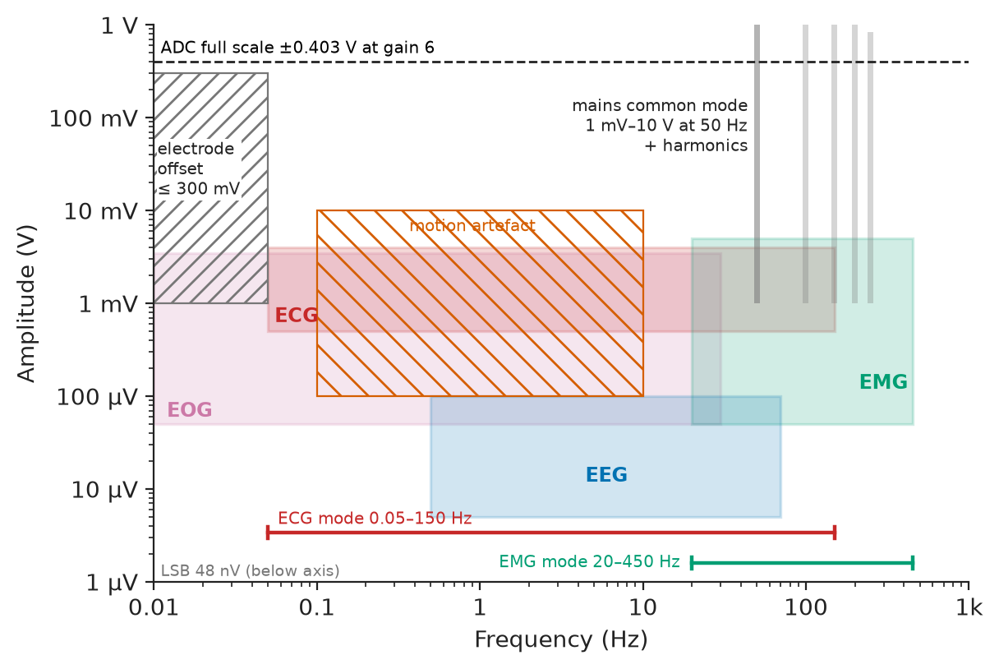
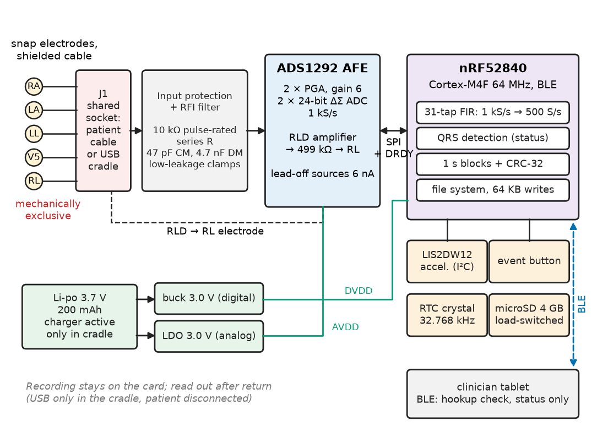
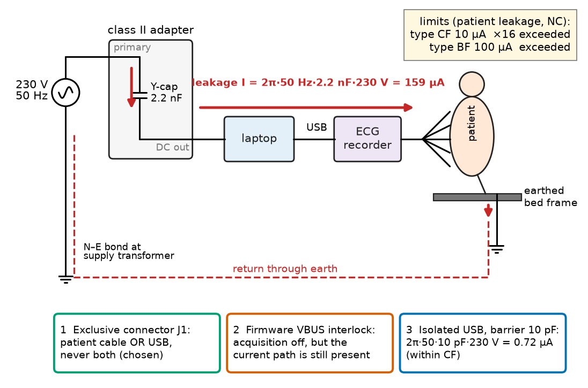
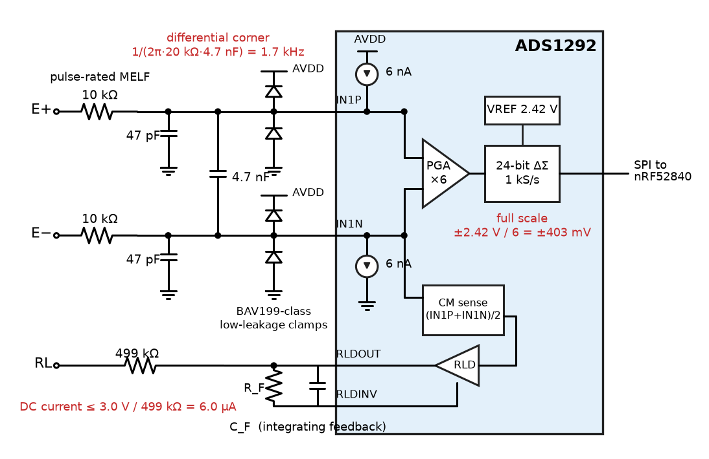
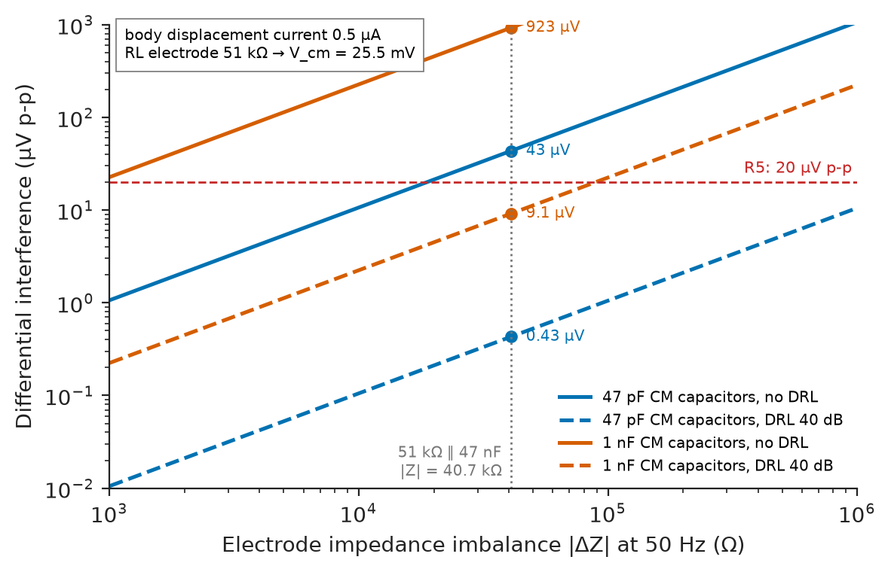
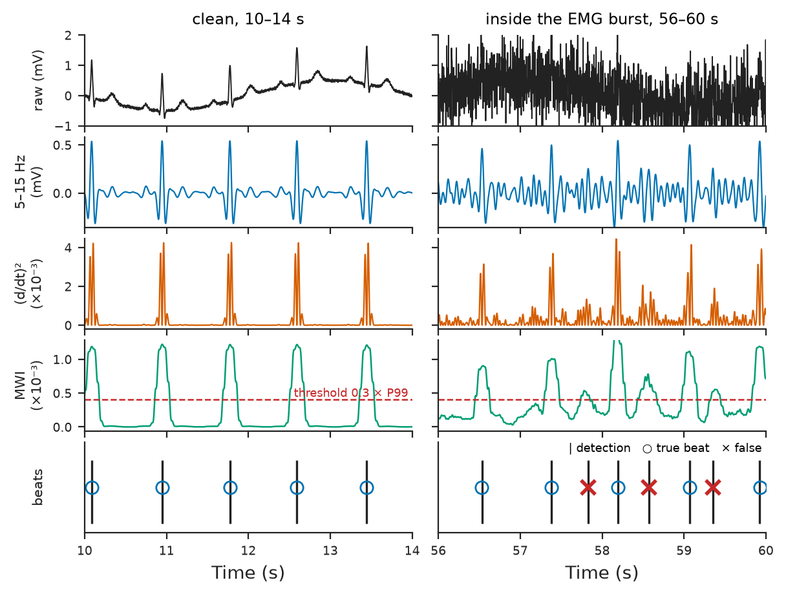

# Chapter 28 — Biomedical Instrumentation

*Part VII · Communications, Signal Processing, and Biomedical Applications*

A start-up brings its seven-day ambulatory ECG recorder to a hospital's clinical-engineering department for a pre-clinical evaluation. On the bench, driven by a patient simulator, its traces are textbook-clean. On the first volunteer they are not: a 50 Hz hum of 40 µV whenever the volunteer sits near the desk lamp, the baseline jumping off-screen each time she stands up, and spurious beats during a stair climb. Then the evaluation stops. To check electrode contact the engineers had connected the recorder by USB to a laptop running on its mains adapter, and the safety analyser reports 160 µA flowing through the patient electrodes to earth, sixteen times the limit for a cardiac applied part. None of these faults is exotic. The simulator presents a few hundred ohms of perfectly matched source impedance, a body presents tens of kilohms of mismatched, drifting skin; the hum was the mismatch converting common-mode voltage into a differential signal; the baseline jumps were electrode offsets the front end had not been sized for; the leakage came through the laptop adapter's Y-capacitor; and nobody had written down which equipment may touch the recorder while it touches a patient. Biomedical instrumentation is the discipline of designing for the body as the signal source and the patient as the first stakeholder.

> **How is a biopotential front end sized for skin, electrode offsets and mains interference, and how is it proved to reject them?**
> **What do patient safety, isolation and medical-device regulation demand of the architecture, the firmware and the test plan?**

| Concept | Engineering destination |
|---|---|
| Biopotential measurement | ECG, EMG, EEG and EOG front ends; electrode choice and skin preparation |
| ECG acquisition | Holter and patch recorders, bedside monitors, diagnostic 12-lead carts, wearables |
| EMG acquisition | Rehabilitation and gait labs, prosthesis control, ergonomics, sports science |
| Biomedical sensors | PPG and SpO₂, temperature, respiration, activity and motion reference |
| Isolation and safety | Applied-part classification, leakage-current limits, MOPP, defibrillation protection |
| Signal conditioning | Gain and range for electrode offset, RFI filtering, driven right leg, digital filters |
| Noise rejection | Mains interference, baseline wander, motion artefact, muscle noise |
| Medical data acquisition | Sampling, timing, storage formats, data integrity, energy budgets |
| Basic biomedical signal analysis | QRS detection, heart rate and HRV, EMG envelopes and fatigue indices |
| Regulatory and ethical considerations | IEC 60601 family, ISO 14971, IEC 62304, clinical evaluation, data protection |

**Roadmap.** The signals and the electrode interface (28.1) → the reference ECG recorder, its requirements and architecture (28.2) → the same front end as an EMG instrument (28.3) → companion sensors (28.4) → patient safety and isolation (28.5) → the front-end circuit (28.6) → interference and its budget (28.7) → acquisition, storage and energy (28.8) → analysis on the recorded data (28.9) → regulation, ethics, verification and failure analysis (28.10).

---

## 28.1 Biopotential measurement

> **Boundary.** Instrumentation-amplifier and difference-amplifier analysis, including CMRR, is owned by *Electronics and Computing*, [Ch. 8](https://github.com/The-Studio-of-Sadiq/Electronics-and-Computing/blob/main/part-2-analog-electronics/08-operational-amplifiers.md) §8.3 and §8.6; ADC architectures by [Ch. 10](https://github.com/The-Studio-of-Sadiq/Electronics-and-Computing/blob/main/part-2-analog-electronics/10-analog-integrated-circuits.md) §10.10. Magnetic pickup in lead loops is in *Circuits, Signals and Communications*, [Ch. 2](https://github.com/The-Studio-of-Sadiq/Circuits-Signals-and-Communications/blob/main/part-1-circuit-fundamentals/02-fundamental-circuit-laws.md) §2.4, and the AC-coupled ECG baseline-recovery transient in [Ch. 6](https://github.com/The-Studio-of-Sadiq/Circuits-Signals-and-Communications/blob/main/part-2-transient-and-ac-analysis/06-first-order-circuits.md) §6.9. Sensor selection in general is Chapter 6, signal conditioning and uncertainty Chapter 7, and practical filtering and detection Chapter 27 of this book.

### The signals

Biopotentials are small, slow and riding on much larger unwanted voltages. Table 28.1 lists the signals a front end meets and, just as important, what arrives with them.

**Table 28.1 — Biopotential signals and their companions at the electrodes (typical ranges).**

| Signal | Amplitude | Useful bandwidth | Typical source impedance |
|---|---|---|---|
| ECG, surface | 0.5–4 mV (R wave) | 0.05–150 Hz (diagnostic), 0.5–40 Hz (monitoring) | 10 kΩ–1 MΩ at 10 Hz, skin- and preparation-dependent |
| Surface EMG | 0.05–5 mV | 20–450 Hz | 10–500 kΩ |
| EEG, scalp | 5–100 µV | 0.5–70 Hz | 5–20 kΩ with gel |
| EOG | 50–3500 µV | DC–30 Hz | 10–100 kΩ |
| Electrode offset (DC) | up to ±300 mV between electrodes | DC, drifting over minutes | — |
| Mains interference (common mode) | 1 mV–10 V at the body | 50 or 60 Hz and harmonics | — |
| Motion artefact | 0.1–10 mV | 0.1–10 Hz | — |

<!-- FIGURE 28.1 | figures/ch28/fig-28-1-biopotential-map.png | plot | Amplitude-frequency map of biopotential signals and their interferers, with the ECG and EMG passbands of the reference recorder. | Content: log-log axes, x frequency 0.01 Hz to 1 kHz, y amplitude 1 uV to 1 V. Shaded rectangles: EEG 5-100 uV, 0.5-70 Hz; ECG 0.5-4 mV, 0.05-150 Hz; EMG 0.05-5 mV, 20-450 Hz; EOG 50 uV-3.5 mV, 0.01-30 Hz. Interferers as hatched regions: electrode offset up to 300 mV below 0.05 Hz; motion artefact 0.1-10 mV, 0.1-10 Hz; mains common mode 1 mV-10 V at 50 Hz with harmonics to 250 Hz as vertical bars. Horizontal dashed line at 0.4 V labelled ADC full scale at gain 6; dashed line at 48 nV labelled LSB. Bracket markers for recorder ECG mode 0.05-150 Hz and EMG mode 20-450 Hz. -->



*Figure 28.1 — Amplitude-frequency map of biopotential signals and their interferers, with the ECG and EMG passbands of the reference recorder.*

Figure 28.1 shows the problem at a glance: the wanted ECG sits two to three decades below the electrode offset and up to four decades below the mains common-mode voltage on the body.

### The electrode–skin interface

The electrode is a transducer from ionic current in tissue to electronic current in a wire. Wet silver/silver-chloride electrodes are the standard for ECG because their half-cell potential is stable and their polarisation low; dry and textile electrodes trade higher and more variable impedance for comfort. Three properties of the interface set the front-end requirements:

- **Offset.** Each electrode develops a half-cell potential of a few hundred millivolts against the skin; between two electrodes the difference can reach ±300 mV and drifts as gel dries and sweat changes. The ECG standards require the front end to work with ±300 mV of DC offset, which forbids high gain before the offset is handled.
- **Impedance and imbalance.** The skin's outer layer behaves as a resistance in parallel with a capacitance, typically 10 kΩ–1 MΩ at 10 Hz and very different between two electrodes. The standards model the imbalance as 51 kΩ in parallel with 47 nF in one lead, and that network appears in the common-mode test of Section 28.7.
- **Noise and artefact.** The interface generates a few microvolts of noise and, when the skin stretches under the electrode, millivolts of motion artefact as the charge layer is disturbed. Skin preparation (light abrasion, alcohol) lowers both; adhesive and lead strain relief keep the electrode still.

> **Status of the principle: electrode–skin interface model**
> *Empirical.* The parallel resistance–capacitance model and the 51 kΩ ∥ 47 nF imbalance are conventions fitted to measured skin; real impedance depends on site, preparation, humidity, time since application and frequency, and the model only bounds the design.

---

## 28.2 ECG acquisition

### The reference system

The running example is a **two-channel, seven-day ambulatory ECG recorder** (an extended Holter): a 60 × 40 × 12 mm sealed unit worn on a lanyard or belt clip, five snap electrodes on a short shielded patient cable, two bipolar leads (CM5 and a modified lead II), a three-axis accelerometer for activity, an event button for the patient diary, a sealed lithium-polymer cell charged by USB in a cradle, and a Bluetooth Low Energy link used only for the hookup check and for status. The recording stays on internal storage and is read out after the device is returned. Table 28.2 fixes the requirements.

**Table 28.2 — Requirements of the ambulatory ECG recorder.**

| ID | Requirement | Target | Verification |
|---|---|---|---|
| R1 | Channels | 2 ECG leads + 3-axis activity | Inspection |
| R2 | Input range | ±5 mV ECG on ±300 mV DC offset without clipping | Offset and amplitude test with calibrated source |
| R3 | Bandwidth | 0.05–150 Hz (−3 dB), linear phase in the high-pass | Sine sweep; triangle and impulse response |
| R4 | Noise | ≤ 30 µV peak-to-valley referred to input, 10 s, with 51 kΩ ∥ 47 nF in each lead | Shorted-input and imbalance tests |
| R5 | Mains interference | ≤ 20 µV peak-to-valley in the common-mode test with 51 kΩ ∥ 47 nF imbalance | Common-mode test rig |
| R6 | Sampling and resolution | 500 S/s per channel stored; LSB ≤ 1 µV | Inspection of data; ramp test |
| R7 | Recording time | ≥ 7 days with ≥ 20 % battery reserve, 25 °C | Energy budget and full-length run |
| R8 | Patient leakage | ≤ 10 µA normal condition, ≤ 50 µA single fault (type CF) | IEC 60601-1 leakage tests |
| R9 | Patient auxiliary current (DC) | ≤ 10 µA | IEC 60601-1 measuring device |
| R10 | QRS detection | Sensitivity ≥ 99 %, positive predictivity ≥ 99 % | ANSI/AAMI EC57 method on MIT-BIH Arrhythmia Database |
| R11 | Lead-off detection | Flagged within 2 s; status stored with the data | Electrode removal test |
| R12 | Data integrity and time | CRC on every block; clock error ≤ 30 s over 7 days | Corruption injection; 7-day clock test |

R3 follows the AHA/ACCF/HRS recommendations for ECG standardisation: 0.05 Hz at the low end preserves the ST segment, which a 0.5 Hz monitoring corner would distort (Book 3 §6.9 works the transient), and 150 Hz at the high end preserves QRS amplitude and notching in adults.

### Architecture

Figure 28.2 shows the architecture. The analog front end is a two-channel biopotential converter with integrated programmable-gain amplifiers, 24-bit delta-sigma ADCs, a driven-right-leg amplifier and lead-off detection. It talks SPI to a Bluetooth microcontroller, which filters and packs the data, detects QRS complexes for the status display, and writes 64 KB blocks to a power-gated microSD card. The USB connector and the patient cable share one socket, so the recorder cannot be connected to a computer and a patient at the same time (Section 28.5).

<!-- FIGURE 28.2 | figures/ch28/fig-28-2-ecg-recorder-architecture.png | block-diagram | Architecture of the seven-day ambulatory ECG recorder. | Content: left, five snap electrodes (RA, LA, LL, V5, RL) on a shielded cable to a shared connector J1 (patient cable or USB cradle, mechanically exclusive). Block input protection and RFI filter (10 kohm pulse-rated series resistors, 47 pF common-mode and 4.7 nF differential capacitors, low-leakage clamps). ADS1292 analog front end: two PGAs at gain 6, two 24-bit delta-sigma ADCs at 1 kS/s, RLD amplifier with 499 kohm output resistor to RL, lead-off current sources 6 nA. SPI plus DRDY to nRF52840 (Cortex-M4F 64 MHz, BLE). nRF52840 tasks: 31-tap FIR decimation to 500 S/s, QRS detection, block packing with CRC-32, file system. Side blocks: LIS2DW12 accelerometer on I2C, event button, 32.768 kHz RTC crystal, microSD 4 GB behind load switch, Li-po 3.7 V 200 mAh with charger active only in cradle, buck regulator 3.0 V and LDO 3.0 V analog. BLE link to clinician tablet labelled hookup check and status only. -->



*Figure 28.2 — Architecture of the seven-day ambulatory ECG recorder.*

### Component selection

The front end is chosen against R2–R7 (Table 28.3).

**Table 28.3 — Front-end options for a two-channel ambulatory ECG (2026 distributor prices, 100 pcs, indicative).**

| Option | Example part | Channels; resolution | Noise, power (datasheet typical) | Fit | Price |
|---|---|---|---|---|---|
| Integrated biopotential AFE | ADS1292 | 2; 24 bit, PGA 1–12, RLD, lead-off | 8 µV p-p (gain 6, 150 Hz); 0.335 mW/channel | Meets R2–R7; DC-coupled | ≈ \$9 |
| Ultra-low-power single-lead AFE | MAX30003 | 1; 18 bit, built-in R-R detector | about 85 µW | Fails R1 (one lead) | ≈ \$7 |
| Analog heart-rate front end + MCU ADC | AD8232 + 12-bit SAR | 1; AC-coupled, fixed filters | 170 µA; MCU ADC limits resolution | Fails R1, R3 (fixed corners) | ≈ \$4 |
| Eight-channel diagnostic AFE | ADS1298 | 8; 24 bit | 0.75 mW/channel | Meets all; three times the power and price | ≈ \$30 |

The ADS1292 is chosen: two channels, DC-coupled with enough range for the offset, and an integrated right-leg driver and lead-off detection, which together would otherwise take three op-amps and a dozen precision passives.

**Worked example — gain, range and resolution.** With the internal 2.42 V reference and a PGA gain of 6, the input full scale is $\pm2.42/6=\pm0.403$ V. The worst input is the ±300 mV offset plus a 5 mV ECG, 0.305 V, leaving 98 mV of headroom for offset drift. The LSB is $2\times0.403\ \mathrm{V}/2^{24}=48$ nV, twenty times finer than R6 asks. Because the front end is DC-coupled, the offset is removed digitally by the 0.05 Hz high-pass; there is no coupling capacitor to saturate on a step and no 18 s recovery after an electrode bump. A gain of 12 would halve the noise contribution of the converter but leave only $\pm0.202$ V, which the offset requirement forbids.

The converter's sinc3 decimation filter has its −3 dB point at $0.262f_{\mathrm{data}}$: 131 Hz at 500 S/s, which fails R3. The front end therefore runs at 1 kS/s, where 150 Hz is only 0.97 dB down, and the microcontroller decimates to 500 S/s with a 31-tap linear-phase least-squares FIR: together with the converter's filter the response is −1.0 dB at 150 Hz and more than 100 dB down above 350 Hz, the band that would fold onto 0–150 Hz. The filter costs 31 000 multiply–accumulates per second, a few microwatts of CPU time; the doubled interrupt rate costs more and is in the budget of Section 28.8.

---

## 28.3 EMG acquisition

### The same hardware, a different instrument

A rehabilitation lab wants two channels of surface EMG to study quadriceps activation during gait retraining. The reference recorder's front end serves, with a different configuration and electrode placement:

- **Electrodes** per the SENIAM recommendations: bipolar Ag/AgCl, 10 mm contact diameter, 20 mm inter-electrode distance, aligned with the muscle fibres over the muscle belly, reference electrode on a bony site (patella).
- **Bandwidth** 20–450 Hz. The 20 Hz high-pass removes most motion artefact and the ECG's low-frequency content, which contaminates trunk-muscle EMG.
- **Sampling** at 2 kS/s, where the converter's sinc3 response is −2.2 dB at 450 Hz (equalised digitally) and its data rate is $2\times2000\times3=12$ kB/s, or 43 MB per hour.
- **Gain** stays at 6: surface EMG reaches 5 mV and the offset requirement is unchanged.

Every hardware decision of Section 28.2 transfers; only the digital filters, rate and analysis change. That is the value of a DC-coupled, high-resolution front end: the instrument is defined in firmware.

### EMG processing

EMG is a stochastic interference pattern of motor-unit action potentials, so its useful features are statistical. Three are standard:

- **Linear envelope**: full-wave rectification and a 125 ms moving RMS (250 samples at 2 kS/s), normalised to a maximum voluntary contraction (MVC) recorded at the start of the session.
- **Onset detection**: the envelope exceeds the resting baseline mean plus three standard deviations for at least 25 ms, the same persistence logic as the detectors of Chapter 27, Section 27.5.
- **Fatigue index**: the median frequency of the power spectrum in 0.5 s windows (Welch, Hann). During a sustained contraction at 50 % MVC, median frequency typically falls by 20–30 % within a minute as conduction velocity drops.

**Worked example — what the sample rate costs.** EMG at 2 kS/s on two channels produces 12 kB/s, four times the ECG rate. A one-hour gait session fills 43 MB, trivial for the 4 GB card, but streaming it live over Bluetooth Low Energy needs a sustained 96 kbit/s of application throughput, which a 7.5 ms connection interval with data-length extension supports with a modest margin and roughly 3 mA of average radio current. The lab therefore records to the card and streams a 20 S/s envelope (two channels × 2 bytes × 20 = 80 B/s) for live display: three orders of magnitude less radio time for the feature the clinician actually watches.

---

## 28.4 Biomedical sensors

Biopotentials are rarely recorded alone. Table 28.4 lists the companion sensors a wearable or bedside instrument typically carries, and what each contributes to the reference recorder or to products built on the same platform.

**Table 28.4 — Companion biomedical sensors (typical part classes and performance).**

| Sensor | Part class | Measures | Performance (typical) | Role |
|---|---|---|---|---|
| Accelerometer | LIS2DW12, 3-axis | Activity, posture, motion | 1–2 µA at 12.5–25 S/s low-power mode | **In the reference recorder**: activity annotation and motion-artefact reference |
| Photoplethysmography (PPG) | MAX30101, red/IR/green LEDs | Pulse, SpO₂ | SpO₂ accuracy ±2–3 % with calibration (ISO 80601-2-61 method) | Wrist and finger devices; pulse-transit time with ECG |
| Body temperature | MAX30205 | Skin temperature | ±0.1 °C, 37–39 °C (ISO 80601-2-56 for clinical thermometers) | Fever monitoring patches |
| Respiration, impedance | ADS1292R channel 1 | Thoracic impedance change at 32–64 kHz | about 0.1 Ω resolution on 500 Ω–2 kΩ base | Respiration rate from ECG electrodes |
| Pressure | MPX-class piezoresistive | Cuff pressure (NIBP) | ±3 mmHg (ISO 81060-2 validation) | Blood-pressure monitors |

The accelerometer earns its place in the recorder. Motion artefact correlates with acceleration of the torso, so the activity channel lets the analysis software mark periods where morphology is unreliable, and lets a cardiologist correlate a rate change with stairs rather than arrhythmia. The PPG row carries a design caution: optical sensors are affected by skin pigmentation, and an SpO₂ algorithm calibrated on a narrow population overestimates saturation in others, an ethical as well as an engineering defect (Section 28.10).

---

## 28.5 Isolation and safety

> **Boundary.** Shock physiology, body impedance, touch-voltage limits and earthing are owned by *Electrical Energy and Machines*, [Ch. 29](https://github.com/The-Studio-of-Sadiq/Electrical-Energy-and-Machines/blob/main/part-8-electrical-safety-and-engineering-practice/29-electrical-safety.md) §29.1 and §29.3. A patient differs from the worker of that chapter in two ways that matter here: the skin's protective resistance is bypassed by gel electrodes, and a current path that reaches the heart directly (catheters, pacing leads) makes microamperes dangerous.

### Applied parts and leakage limits

IEC 60601-1 classifies the parts that touch the patient. Type B parts may be earthed; type BF parts are floating (isolated from earth and from other parts); type CF parts are floating with the strictest limits, required for direct cardiac application and usual for ECG equipment. Table 28.5 gives the AC limits the reference recorder is designed to.

**Table 28.5 — Selected leakage-current limits of IEC 60601-1 (AC, µA).**

| Current | Type B (NC / SFC) | Type BF (NC / SFC) | Type CF (NC / SFC) |
|---|---|---|---|
| Patient leakage | 100 / 500 | 100 / 500 | 10 / 50 |
| Patient auxiliary current | 100 / 500 | 100 / 500 | 10 / 50 |
| Touch current | 100 / 500 | 100 / 500 | 100 / 500 |

NC is normal condition, SFC single-fault condition. DC patient and auxiliary currents are limited to 10 µA in normal condition for all types, which matters for the right-leg driver (Section 28.6). The standard also asks for **means of protection**: two means of patient protection (2 MOPP) between mains and the applied part, each tested at 1500 V ac for a 250 V working voltage, 4000 V ac for both together, with 8 mm creepage and 5 mm clearance for 2 MOPP.

> **Status of the principle: leakage-current limits**
> *Empirical.* The limits come from the thresholds of perception and of ventricular fibrillation for currents applied to skin and directly to the heart, with safety factors set by committee; they are design limits written into the standard, not physical constants.

### The leakage that stopped the evaluation

**Worked example — a laptop adapter as a leakage source.** A class II laptop adapter has a Y-capacitor of about 2.2 nF from the primary to the DC output, to meet emission limits. At 230 V and 50 Hz it drives
$$
I=2\pi fCV=2\pi\times50\times2.2\times10^{-9}\times230=159\ \mathrm{\mu A}
$$
into anything that connects the DC output to earth. With the recorder on USB and the patient touching an earthed bed frame, the patient is that connection. The 159 µA exceeds the type CF limit of 10 µA sixteen times and the type BF limit of 100 µA as well (Figure 28.3). The recorder itself was innocent; the system of recorder plus laptop was not a medical electrical system.

Three architectures fix it, in increasing cost:

1. **Exclusive connector.** The patient cable and the USB cradle use the same socket, so the recorder can never be connected to both. Data is read out and the battery charged only with the patient disconnected. The hookup check uses Bluetooth, which needs no galvanic path. This is the reference design's choice.
2. **Firmware interlock** alone, which disables acquisition when VBUS is present. It does not remove the current path, so it is a convenience, not a safety measure.
3. **Isolated USB.** A reinforced USB isolator (ADuM4160 class, 5 kV rms) and an isolated DC–DC converter rated for 2 MOPP keep the path open. Leakage then flows only through the barrier capacitance: 10 pF gives $2\pi\times50\times10\times10^{-12}\times230=0.72$ µA, inside the CF limit. This is the architecture for bedside equipment that must stream while connected.

<!-- FIGURE 28.3 | figures/ch28/fig-28-3-usb-leakage-path.png | schematic | Leakage path from a laptop mains adapter through a USB-connected ECG recorder and the patient to earth, and the three ways of breaking it. | Content: left, 230 V 50 Hz mains to class II adapter; Y-capacitor 2.2 nF from primary to DC output; DC output to laptop; USB cable to recorder; recorder input network to five electrodes on patient symbol; patient touching earthed bed frame to earth symbol. Red current arrow along the loop labelled 159 uA. Annotations: CF limit 10 uA, BF limit 100 uA. Three inset fixes: (1) shared connector J1 patient cable or USB, mechanically exclusive; (2) firmware VBUS interlock, current path still present; (3) isolated USB with barrier capacitance 10 pF giving 0.72 uA. -->



*Figure 28.3 — Leakage path from a laptop mains adapter through a USB-connected ECG recorder and the patient to earth, and the three ways of breaking it.*

### Defibrillation and the right-leg driver

ECG equipment is expected to survive, and not divert the energy of, a defibrillation pulse of up to 5 kV applied across the chest while the electrodes are attached. The input network therefore has pulse-rated series resistors (10 kΩ per lead in MELF packages rated for the pulse energy) ahead of low-leakage clamps, and the recorder must show a trace again within seconds afterwards. The design targets a defibrillation-proof type CF applied part.

The right-leg driver returns current to the body, which makes it a source of patient auxiliary current. Its output can swing to the 3.0 V analog rail, so a series resistor of 499 kΩ limits the DC current to $3.0/0.499=6.0$ µA, inside the 10 µA DC limit, and to 6.6 µA even if the output faults to a 3.3 V rail.

---

## 28.6 Signal conditioning

### The input network

Figure 28.4 shows one lead pair of the front end, from snap electrode to converter. Each part has a single job:

- **10 kΩ pulse-rated series resistor** per lead: defibrillation and electrostatic-discharge current limiting.
- **RFI filter**: 47 pF from each input to analog ground and 4.7 nF across the pair. The differential corner is $1/(2\pi\times20\ \mathrm{k\Omega}\times4.7\ \mathrm{nF})=1.7$ kHz, far above the 450 Hz needed even in EMG mode; the common-mode capacitors are kept small for a reason worked out in Section 28.7.
- **Low-leakage clamps** to the rails, so that a defibrillation or ESD transient does not exceed the converter's absolute maximum input.
- **Lead-off detection**: the converter's 6 nA DC current sources pull a disconnected input towards a rail, and a comparator flags it within one data block (R11). Through a 1 MΩ electrode impedance, 6 nA adds only 6 mV of offset.
- **Right-leg drive**: the converter's RLD amplifier senses the average of the inputs and drives the right-leg electrode through 499 kΩ; an external feedback R–C, chosen with the datasheet's guidance, sets its loop gain and bandwidth.

<!-- FIGURE 28.4 | figures/ch28/fig-28-4-ecg-front-end-circuit.png | circuit | One lead pair of the ECG front end with protection, RFI filtering, lead-off detection and the right-leg driver. | Content: two electrodes E+ and E- each through 10 kohm pulse-rated MELF resistor; 47 pF from each node to AGND; 4.7 nF across the pair; BAV199-class low-leakage clamp diodes to AVDD 3.0 V and AGND on each line; lines enter ADS1292 IN1P and IN1N; inside the IC PGA gain 6 then 24-bit delta-sigma ADC at 1 kS/s, internal 2.42 V reference; lead-off 6 nA current sources on each input. RLD: internal summing of channel common-mode into RLD amplifier with external integrating feedback R-C, output through 499 kohm to RL electrode. Annotations: differential corner 1.7 kHz, input full scale plus or minus 403 mV, RLD DC current limit 6.0 uA. -->



*Figure 28.4 — One lead pair of the ECG front end with protection, RFI filtering, lead-off detection and the right-leg driver.*

### Driven right leg

The driven right leg (DRL) is negative feedback on the body's common-mode voltage: the amplifier measures it and drives the body through the right-leg electrode to cancel it. With a loop gain $A$ at 50 Hz the common-mode voltage falls by about $1+A$. The loop includes the electrode impedance and the body capacitance, so it is compensated like any feedback loop (Book 3 Ch. 34): the integrating feedback network is sized for about 40 dB of loop gain at 50 Hz, with crossover well below the frequency where electrode capacitance adds phase lag. Too much gain makes the loop oscillate at a few kilohertz when an electrode is poorly attached, visible as a burst of noise on every lead; the lead-off logic therefore also opens the RLD loop when the right-leg electrode comes off.

### Digital conditioning

Because the hardware is DC-coupled and wideband, all band-shaping is digital and versioned with the firmware:

1. **Decimation** from 1 kS/s to 500 S/s with the 31-tap FIR of Section 28.2.
2. **High-pass at 0.05 Hz**, implemented as a linear-phase operation in the analysis software (forward–backward filtering of the stored record) so that the ST segment is not distorted; the stored data keep the offset, scaled, so no information is lost on the device.
3. **No 50 Hz notch in the stored data.** A notch distorts QRS complexes, which have energy at 50 Hz; it is an optional display filter only.
4. **Optional 40 Hz low-pass** for the monitoring-style display during the hookup check.

> **Status of the principle: DC-coupled front end with digital filtering**
> *Derived.* With a converter whose range exceeds offset plus signal and whose resolution is below the noise floor, any analog high-pass can be replaced by a digital one without loss; it fails if the offset drifts beyond the input range, which the lead-off and range monitoring must flag.

---

## 28.7 Noise rejection

> **Boundary.** Common-mode rejection of difference and instrumentation amplifiers is in *Electronics and Computing* Ch. 8 §8.3 and §8.6; feedback-loop stability for the DRL in *Circuits, Signals and Communications*, [Ch. 34](https://github.com/The-Studio-of-Sadiq/Circuits-Signals-and-Communications/blob/main/part-7-control-system-fundamentals/34-feedback-and-stability.md); filter design in [Ch. 23](https://github.com/The-Studio-of-Sadiq/Circuits-Signals-and-Communications/blob/main/part-5-digital-signal-processing/23-digital-filters.md).

### Mains interference: why the IC's CMRR is not the limit

The converter's own CMRR is about 105 dB. Applied to a 25 mV body common-mode voltage it would leave about 0.1 µV, negligible. The hum in the opening story came from somewhere else: the electrodes' impedance imbalance forms, with each input's common-mode impedance, a potential divider, and two unequal dividers turn common-mode voltage into a differential one *before* the amplifier sees it:

$$
V_{\mathrm{dm}}\approx V_{\mathrm{cm}}\,\frac{\Delta Z_e}{Z_{\mathrm{cm}}}.
$$

> **Status of the principle: common-mode to differential conversion by source-impedance imbalance**
> *Approximate.* Valid when the electrode impedances are much smaller than the input common-mode impedance and the imbalance is in one lead; it shows that input common-mode impedance and right-leg drive, not amplifier CMRR, set mains rejection in biopotential front ends.

**Worked example — the mains budget.** Take a displacement current of 0.5 µA from mains wiring into the body (a body coupled by a few picofarads to 230 V lines, typical indoors) and a right-leg electrode impedance of 51 kΩ. Without DRL the body's common-mode voltage is $0.5\ \mathrm{\mu A}\times51\ \mathrm{k\Omega}=25.5$ mV. The standard imbalance, 51 kΩ ∥ 47 nF, has a magnitude of 40.7 kΩ at 50 Hz. The input common-mode impedance is set by the 47 pF RFI capacitors: $1/(2\pi\times50\times47\ \mathrm{pF})=67.7$ MΩ. Without DRL,
$$
V_{\mathrm{dm}}=25.5\ \mathrm{mV}\times\frac{40.7\ \mathrm{k\Omega}}{67.7\ \mathrm{M\Omega}}=15.3\ \mathrm{\mu V\ rms}=43\ \mathrm{\mu V\ p\text{-}p},
$$
which fails R5's 20 µV, and matches the 40 µV of the opening story. With 40 dB of DRL loop gain the common-mode voltage falls to 0.26 mV and the converted interference to 0.43 µV p-p: R5 is met with a factor of 46. Had the RFI filter used 1 nF common-mode capacitors, a common choice copied from non-medical designs, $Z_{\mathrm{cm}}$ would fall to 3.2 MΩ and the interference would rise 21 times, to 9 µV p-p even with DRL. Figure 28.5 plots the interference against imbalance.

<!-- FIGURE 28.5 | figures/ch28/fig-28-5-mains-vs-imbalance.png | plot | Mains interference converted to differential mode versus electrode impedance imbalance, for two common-mode capacitor values with and without right-leg drive. | Content: x-axis imbalance magnitude at 50 Hz, 1 kohm to 1 Mohm, log; y-axis interference uV peak-to-peak, 0.01 to 1000, log. Four straight lines: 47 pF without DRL (43 uV p-p at 40.7 kohm), 47 pF with 40 dB DRL (0.43 uV p-p at 40.7 kohm), 1 nF without DRL (about 920 uV p-p at 40.7 kohm), 1 nF with DRL (about 9.2 uV p-p). Vertical dashed line at 40.7 kohm labelled 51 kohm parallel 47 nF; horizontal dashed line at 20 uV labelled R5. Assumptions box: body displacement current 0.5 uA, RL electrode 51 kohm. -->



*Figure 28.5 — Mains interference converted to differential mode versus electrode impedance imbalance, for two common-mode capacitor values with and without right-leg drive.*

Beyond the front end, mains pickup is reduced by geometry: a shielded patient cable with the shield driven at the common-mode voltage, lead wires kept together (the loop area of Book 3 §2.4: 0.1 m² in a 1 µT field picks up 31 µV), and a short cable.

### Baseline wander, motion and muscle

- **Baseline wander** from respiration (0.15–0.5 Hz) and electrode drift is removed by the 0.05 Hz linear-phase high-pass; residual slow drift is handled in analysis by subtracting a cubic spline through the PR-segment points of successive beats.
- **Motion artefact** shares the ECG band and cannot be filtered out. It is reduced at the source (electrode placement on bone rather than muscle, skin preparation, cable strain relief) and flagged using the accelerometer: segments where torso acceleration exceeds a threshold carry a quality flag, and the analysis excludes them from morphology measurements.
- **Muscle (EMG) noise** overlaps the QRS spectrum above 20 Hz. It is reduced by placing electrodes away from the pectoral muscles and handled in analysis by signal-quality indices rather than by aggressive low-pass filtering, which would corrupt the QRS.

### Noise budget

**Table 28.6 — Noise and interference budget, referred to input, 0.05–150 Hz.**

| Source | rms (µV) | Peak-to-valley (µV, ≈ 6.6 × rms) | Note |
|---|---|---|---|
| Converter and PGA, gain 6 | 1.21 | 8.0 | Datasheet typical |
| Electrode–skin noise, Ag/AgCl with preparation | 2.0 | 13.2 | Typical; dominates |
| Thermal noise of 2 × 10 kΩ, 150 Hz | 0.23 | 1.5 | $\sqrt{4kTRB}$ at 310 K |
| Mains residual with DRL (worked example) | 0.15 | 0.43 (sinusoid) | Coherent; listed for completeness |
| **Total (RSS of random terms)** | **2.35** | **15.5** | |
| Requirement R4 / margin | | 30 | 48 % margin |

The budget repeats the lesson of Chapter 27's accelerometer: the sensor (here, the electrode on skin) dominates, and money spent on a quieter converter would buy nothing.

---

## 28.8 Medical data acquisition

### Sampling, timing and the record

The recorder stores two channels at 500 S/s in 24-bit two's complement, plus the accelerometer at 25 S/s, lead-off flags and the event button. Data are grouped in 1 s blocks: 3000 bytes of ECG plus a 72-byte header (block counter, RTC timestamp, lead-off and quality flags, accelerometer summary, CRC-32), 3072 bytes in all, exactly six 512-byte sectors. A block with a bad CRC is lost alone; the counter makes gaps explicit rather than silently closing them.

Timing matters to cardiologists: an event at "14:32" in the patient diary must match the trace. The 32.768 kHz crystal (±20 ppm) drifts by at most 1.7 s per day, 12 s in seven days, inside R12's 30 s; the clock is set from the clinician's tablet over Bluetooth at hookup and the offset is recorded at readout.

### Storage formats

On readout, records are exported in formats the analysis tools and archives accept:

- **EDF+ / BDF**: European Data Format, 16-bit (EDF+) or 24-bit (BDF), with annotations; widely used in research and sleep labs. Export to 16-bit EDF+ requires removing the offset first and scaling to, for example, 0.25 µV per count over ±8.2 mV.
- **ISHNE Holter format**: the de facto exchange format for Holter recordings.
- **HL7 aECG and DICOM waveform**: for hospital information systems and archives.

The export software records its own version, the filter settings and the scaling in the file header, so that a measurement made years later can be reproduced (Chapter 29).

### Energy budget

R7 is an energy budget, and the first version failed it.

**Worked example — seven days on 200 mAh.** The cell is 200 mAh at 3.7 V, 740 mWh; 80 % is counted as usable at end of life and at low temperature, 592 mWh. The first design kept the microSD card powered between writes: its idle current of about 0.25 mA cost 0.83 mW, plus 0.30 mW for the writes themselves. With the loads of Table 28.7 and an 85 % efficient buck converter, the battery supplied 3.06 mW, or 513 mWh in 168 h: a 13 % reserve, short of R7's 20 %. Power-gating the card with a load switch and writing 64 KB every 21.3 s costs a re-initialisation each time (about 0.1 s at 20 mA) but removes the idle current; the card's average falls to 0.62 mW and the reserve rises to 30 %.

**Table 28.7 — Energy budget of the recorder, second version (7 days, 25 °C).**

| Load | Average power (mW) | Basis |
|---|---|---|
| ADS1292, 2 channels, RLD, lead-off | 0.80 | Datasheet typical, 1 kS/s |
| nRF52840: filtering, QRS detection, DRDY wake-ups | 0.45 | 3 % CPU duty at 64 MHz plus 1000 wake-ups/s |
| BLE status link, 1 s connection interval | 0.06 | Measured on development kit |
| microSD, power-gated, 64 KB per 21.3 s | 0.62 | 0.1 s at 20 mA init + 50 ms at 40 mA write, 3.3 V |
| Accelerometer, 25 S/s low-power mode | 0.01 | Datasheet typical |
| RTC, LED blink, leakage | 0.15 | Estimate |
| **Total load / from battery (η = 0.85)** | **2.09 / 2.46** | |
| **Energy in 168 h / usable** | **413 / 592 mWh** | **Reserve 30 % (R7: ≥ 20 %)** |

> **Status of the principle: battery runtime from average power**
> *Approximate.* Runtime = usable energy / average power holds when the cell's capacity does not depend on the load profile; pulsed loads (card writes, radio events) raise losses in the cell's internal resistance at low temperature, which the 80 % usable-energy factor is meant to cover and the full-length test must confirm.

---

## 28.9 Basic biomedical signal analysis

> **Boundary.** Spectral estimation and filter design are in *Circuits, Signals and Communications* [Ch. 22](https://github.com/The-Studio-of-Sadiq/Circuits-Signals-and-Communications/blob/main/part-5-digital-signal-processing/22-discrete-fourier-transform.md)–23; statistical measures in *The Mathematics Universe*, [Ch. 20](https://github.com/The-Studio-of-Sadiq/engineering-mathematics/blob/main/part-6-probability-statistics/20-statistical-analysis.md). Learned arrhythmia classifiers belong to Chapter 32.

### QRS detection

Almost every ECG analysis starts by finding the QRS complexes. The Pan–Tompkins structure, published in 1985 and still the reference point for embedded detectors, has four stages: a 5–15 Hz band-pass that keeps the QRS and rejects P and T waves, baseline and much muscle noise; a derivative that emphasises steep slopes; squaring that makes all values positive and accentuates large slopes; and a 150 ms moving-window integration that merges each complex into one pulse. Adaptive thresholds and a 200–250 ms refractory period then pick the beats (Figure 28.6).

The listing runs a simplified version on two minutes of synthetic ECG at 500 S/s: beats at 72 bpm with RR jitter, half a millivolt of baseline wander, 30 µV of 50 Hz, 15 µV of wideband noise, and a 20 s burst of muscle noise at half the R-wave amplitude. It uses one threshold per record instead of the original's adaptive pair.

```python
import numpy as np
from scipy import signal

fs, T = 500, 120.0
rng = np.random.default_rng(11)
t = np.arange(int(fs * T)) / fs
# Synthetic ECG (mV): beats at 72 bpm with 40 ms RR jitter; P, QRS, T as Gaussians
rr = 60 / 72 + 0.04 * rng.standard_normal(int(T * 72 / 60))
beats = np.cumsum(rr); beats = beats[beats < T - 1]
ecg = np.zeros_like(t)
for b in beats:
    for dt, a, w in [(-0.20, 0.15, 0.025), (-0.03, -0.10, 0.008), (0.0, 1.2, 0.010),
                     (0.03, -0.25, 0.008), (0.25, 0.30, 0.040)]:
        ecg += a * np.exp(-0.5 * ((t - b - dt) / w) ** 2)
# Interference: baseline wander, 50 Hz, wideband noise, EMG burst 40-60 s
x = ecg + 0.5 * np.sin(2 * np.pi * 0.25 * t) + 0.03 * np.sin(2 * np.pi * 50 * t)
x += 0.015 * rng.standard_normal(t.size)
emg = signal.sosfilt(signal.butter(4, [10, 200], 'bandpass', fs=fs, output='sos'),
                     rng.standard_normal(t.size))
x += 0.60 * emg / emg.std() * ((t > 40) & (t < 60))

# Pan-Tompkins-style detector: band-pass 5-15 Hz, derivative, square, 150 ms integration
bp = signal.sosfiltfilt(signal.butter(2, [5, 15], 'bandpass', fs=fs, output='sos'), x)
mwi = np.convolve(np.gradient(bp) ** 2, np.ones(int(0.15 * fs)) / (0.15 * fs), 'same')
thr = 0.3 * np.percentile(mwi, 99)                        # one fixed threshold per record
pk, _ = signal.find_peaks(mwi, height=thr, distance=int(0.25 * fs))   # 250 ms refractory
r = np.array([p - 40 + np.argmax(bp[max(p - 40, 0):p + 40]) for p in pk]) / fs

truth = beats
tp = sum(np.min(np.abs(r - b)) <= 0.075 for b in truth)  # 75 ms match window
print(f"beats {len(truth)}, detected {len(r)}, Se {tp/len(truth):.4f}, +P {tp/len(r):.4f}")
rri = np.diff(r) * 1e3
print(f"mean HR {60e3/rri.mean():.1f} bpm, SDNN {rri.std(ddof=1):.1f} ms, "
      f"RMSSD {np.sqrt(np.mean(np.diff(rri)**2)):.1f} ms (truth "
      f"{np.diff(truth).std(ddof=1)*1e3:.1f}, {np.sqrt(np.mean(np.diff(np.diff(truth)*1e3)**2)):.1f})")
```

```text
beats 142, detected 148, Se 1.0000, +P 0.9595
mean HR 74.9 bpm, SDNN 123.0 ms, RMSSD 107.9 ms (truth 37.8, 53.3)
```

Every true beat is found, but the muscle burst adds six false beats. Positive predictivity falls to 96 %, below R10, and the heart-rate-variability measures are wrecked: SDNN reads 123.0 ms against a true 37.8 ms, because each false beat creates two short intervals. Without the burst, the same code finds all 142 beats with no false ones and returns SDNN and RMSSD within 0.2 ms of the truth. Two lessons follow. Detection statistics on a clean record say little; the test set must include noise, which is why ANSI/AAMI EC57 prescribes the MIT-BIH Arrhythmia Database and noise-stress tests. And interval statistics must be computed only over segments a signal-quality index accepts, with ectopic and artefactual intervals removed, or one noisy minute corrupts a day's HRV.

<!-- FIGURE 28.6 | figures/ch28/fig-28-6-pan-tompkins-stages.png | waveform | Stages of the QRS detector on 4 s of synthetic ECG, clean and during the muscle-noise burst. | Content: two columns (left: 10-14 s clean; right: 56-60 s inside the EMG burst), five stacked rows sharing time axes in seconds. Row 1 raw input in mV (-1 to 2) with baseline wander and 50 Hz; row 2 5-15 Hz band-passed; row 3 squared derivative; row 4 150 ms moving-window integral with dashed threshold line at 0.3 x 99th percentile; row 5 detections as vertical ticks, true beats as circles, false detections in the right column marked with crosses. -->



*Figure 28.6 — Stages of the QRS detector on 4 s of synthetic ECG, clean and during the muscle-noise burst.*

The firmware runs the same structure on the nRF52840 for the hookup display and the status heart rate, with the original adaptive thresholds; the diagnostic analysis runs on a workstation over the whole record, where it can look backwards, search back for missed beats and use both leads.

### Heart rate and variability

**Worked example — time-domain HRV from six beats.** Normal-to-normal intervals of 812, 845, 790, 828, 861 and 805 ms have a mean of 823.5 ms, a heart rate of $60000/823.5=72.9$ bpm and a standard deviation (SDNN) of 26.4 ms. The successive differences are 33, −55, 38, 33 and −56 ms, and their root mean square (RMSSD) is 44.2 ms. Clinical HRV uses 5 min (short-term) or 24 h (long-term) records under the 1996 Task Force conventions; six beats illustrate the arithmetic, not a measurement.

Other basic analyses follow the same pattern of detection, measurement and quality gating: ST-segment level at a fixed offset after the J point (which depends on the 0.05 Hz high-pass), QT interval with heart-rate correction, and for EMG the envelope and median-frequency features of Section 28.3.

---

## 28.10 Regulatory and ethical considerations

### The regulatory frame

A medical device is designed under a quality system and against harmonised standards, and the design file must show it. For the reference recorder the main documents are:

- **IEC 60601-1** (basic safety and essential performance), **IEC 60601-1-2** (electromagnetic compatibility, including immunity to radiated fields and ESD), **IEC 60601-1-11** (home-healthcare environment, since the recorder is worn at home), and the particular standard **IEC 60601-2-47** for ambulatory electrocardiographic systems.
- **ISO 14971** risk management, with the FMEA of Table 28.9 as one of its inputs.
- **IEC 62304** software life-cycle. The firmware is class B (injury possible but not serious, because a missed recording is detected at readout and repeated); the workstation analysis software that reports arrhythmias may be class B or C depending on its claims.
- **IEC 62366-1** usability engineering (electrode placement instructions, the event button).
- **ISO 10993-1** biocompatibility of the skin-contact materials (electrode adhesive, housing), with the material background in *Materials Science and Engineering*, [Ch. 39](https://github.com/The-Studio-of-Sadiq/Materials-Science-and-Engineering/blob/main/Chapters/CHAPTER%2039.md) §39.8.
- **ISO 13485** quality management, under which design controls, change control and traceability are audited.
- **ANSI/AAMI EC57** for testing and reporting the performance of rhythm and ST algorithms.

Market access then follows the jurisdiction: in the EU the Medical Device Regulation (an ambulatory ECG recorder is typically class IIa), in the US a 510(k) premarket notification for a class II device. This chapter describes engineering practice; a real product needs regulatory specialists from the concept phase.

### Ethics and data

Recording people's physiology raises obligations that are not satisfied by passing a test:

- **Clinical investigation.** Testing on volunteers or patients requires ethics-committee approval and informed consent, under ISO 14155 for device investigations. The volunteer test of the opening story should have been preceded by the leakage measurement, not followed by it.
- **Privacy.** An ECG is health data under GDPR and HIPAA. The recorder stores a pseudonymous recording ID, never a name; the card is encrypted (AES-128 with a per-device key); the readout software links ID to patient only inside the hospital system.
- **Bias.** Algorithms are validated on populations. A QRS detector tuned on adult databases misses beats in children (higher rates, narrower complexes), and optical sensors underperform on darker skin. The validation plan states the population and reports performance by subgroup.
- **Honest claims.** A heart-rate estimate on a wellness app and an arrhythmia report used for diagnosis are different devices under the law and in their duty to the user; the intended use statement is written first and limits every claim.

### Verification

**Table 28.8 — Verification of the ambulatory ECG recorder (design-verification build, 3 units).**

| Req. | Test | Limit | Result | Pass/fail |
|---|---|---|---|---|
| R2 | ±300 mV DC offset plus 5 mV, 10 Hz sine | No clipping; gain error ≤ 5 % | No clipping; gain error 0.6 % | Pass |
| R3 | Sine sweep 0.05–150 Hz; impulse test | −3 dB outside 0.05–150 Hz; impulse displacement ≤ 100 µV | −3 dB at 0.048 Hz and 156 Hz; displacement 20 µV | Pass |
| R4 | Inputs via 51 kΩ ∥ 47 nF, 10 s | ≤ 30 µV p-v | 11–14 µV p-v (shorted inputs: 7 µV) | Pass |
| R5 | Common-mode test with imbalance | ≤ 20 µV p-v | 4 µV p-v | Pass |
| R7 | Full-length run at 25 °C | ≥ 168 h + 20 % reserve | 236 h to cut-off (reserve 29 %) | Pass |
| R8 | Patient leakage, NC and SFC | ≤ 10 / 50 µA | < 0.1 µA (battery-only; USB physically excluded) | Pass |
| R9 | DC auxiliary current, RLD saturated | ≤ 10 µA | 5.9 µA | Pass |
| R10 | EC57 method, MIT-BIH Arrhythmia DB (workstation analysis) | Se ≥ 99 %, +P ≥ 99 % | Se 99.6 %, +P 99.5 % | Pass |
| R11 | Electrode removal | Flag ≤ 2 s | 0.9 s | Pass |
| R12 | 7-day clock; CRC fault injection | ≤ 30 s; bad blocks flagged | +8 s; 100 % of injected errors flagged | Pass |

The measured interference in R5 (4 µV) is higher than the 0.43 µV of the worked example because the test rig's common-mode source is larger than the assumed body coupling; the margin remains a factor of five.

### Failure analysis

**Table 28.9 — FMEA of the ambulatory ECG recorder (excerpt from the ISO 14971 file).**

| Failure mode | Effect | Cause | Detection | Mitigation |
|---|---|---|---|---|
| Leakage through mains-connected equipment | Patient shock risk | Simultaneous USB and patient connection | Leakage test during evaluation | Shared exclusive connector; Bluetooth hookup check |
| Mains hum on traces | Unreadable morphology; false ST changes | Imbalance with low input common-mode impedance; DRL off | Common-mode test; field review | 47 pF CM capacitors; DRL with 40 dB; shielded cable |
| DRL oscillation | Noise bursts on all leads | Excess loop gain with poor RL contact | Burst detector in firmware | Loop compensation; RLD opened on RL lead-off |
| Electrode offset beyond range | Channel saturates; data lost | Dry gel, mixed electrode types | Range monitor flags > 350 mV | Gain 6 headroom; electrode type in instructions |
| False beats in muscle noise | Wrong HR, HRV and arrhythmia counts | QRS-band overlap with EMG | EC57 noise-stress test | Signal-quality index; intervals gated by quality |
| microSD write failure | Gap in record | Card wear, contact vibration | Block counter and CRC; write verify | Industrial SLC card; retry and mark; status LED |
| Battery exhausted early | Recording shorter than prescribed | Cold, aged cell, card idle current | Fuel gauge; full-length test | Power-gated card; 20 % reserve; low-battery file close |
| Clock drift or wrong time zone | Diary events misaligned | Crystal tolerance; tablet setting | Offset recorded at readout | Time set in UTC with zone stored; drift corrected |

**Worked example — the false ST elevation.** In an early pilot, a cardiologist reported apparent ST elevation in one recording, but only during the night. Accelerometer data showed the patient lying on the left side; impedance-check data showed the V5 electrode's impedance rising from 20 kΩ to 300 kΩ as the gel dried against the mattress. The rising imbalance increased converted mains interference, and the workstation's display filter, an optional 50 Hz notch with a slow transient response, shaped the residual into a slow deflection after each QRS. The fix had three parts: the notch was removed from the default analysis path (Section 28.6), electrode impedance was logged every 10 minutes as a quality signal, and the instructions changed to a hydrogel electrode rated for seven-day wear.

---

## What remains open

| Open question | Where it is answered |
|---|---|
| How are sensors chosen and calibrated in general, and uncertainty budgets built? | Chapter 6; Chapter 7 |
| How are filtering, spectral analysis and detection implemented in real time on an MCU? | Chapter 27 |
| How is the Bluetooth link budgeted and tested? | Chapter 26 |
| How are firmware and analysis software versioned, tested and released reproducibly, as IEC 62304 expects? | Chapter 29 |
| How are learned arrhythmia classifiers trained, validated and their uncertainty reported? | Chapter 32 |
| How is the risk-management and requirements method applied from the start of a project? | Chapter 1; Chapter 40 |
| Where are shock physiology, earthing and protective devices developed? | *Electrical Energy and Machines*, [Ch. 29](https://github.com/The-Studio-of-Sadiq/Electrical-Energy-and-Machines/blob/main/part-8-electrical-safety-and-engineering-practice/29-electrical-safety.md) |

**Next:** Chapter 29 opens Part VIII by turning to the tools behind every design in this book: how models, simulations, tests and documents are organised so that any result can be regenerated from a tagged commit.
