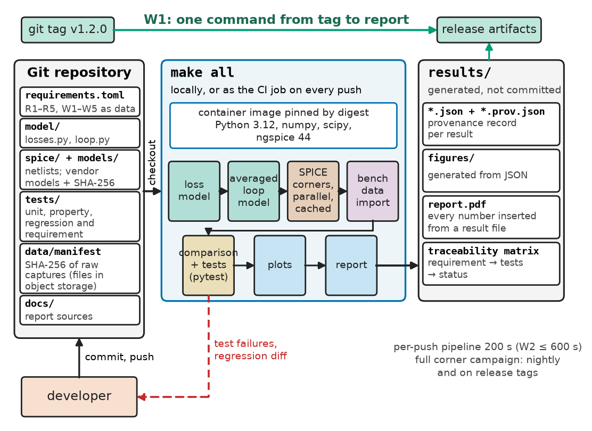
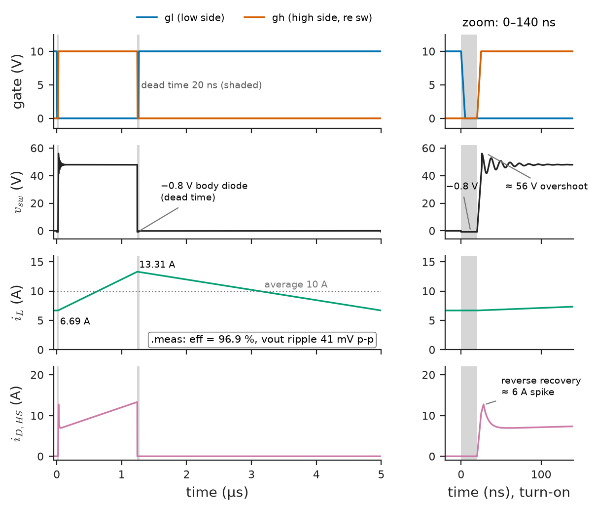
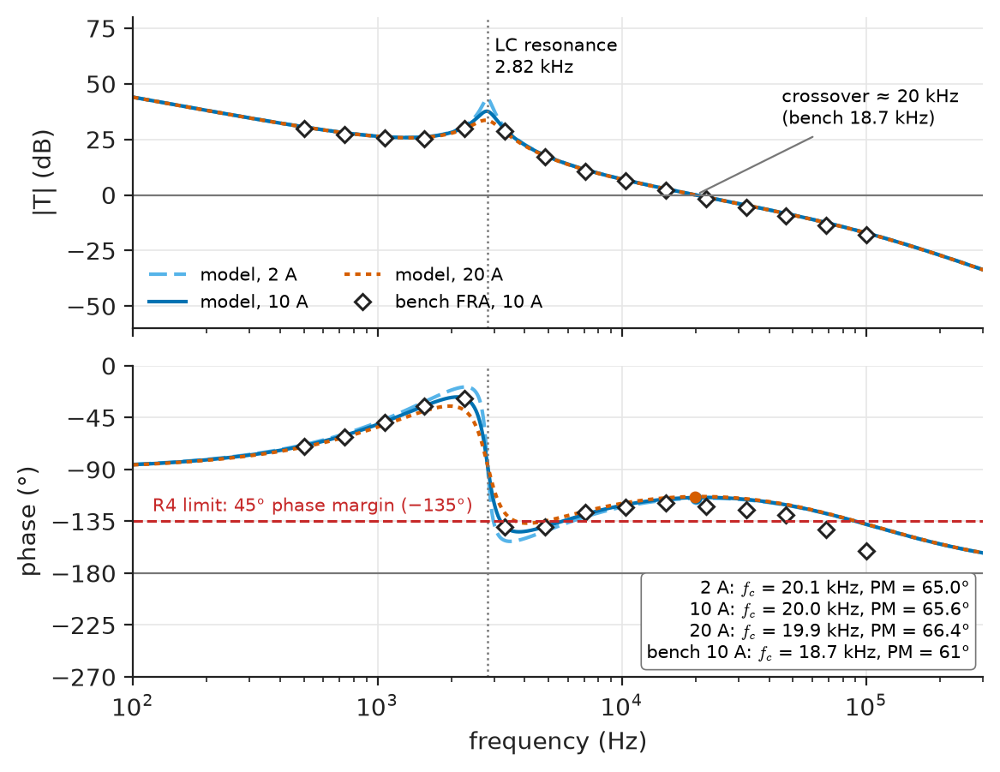
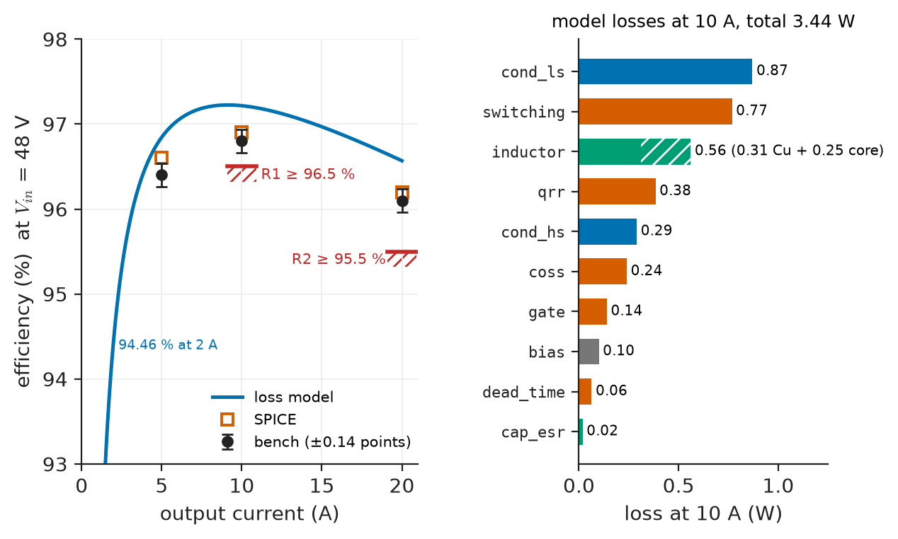
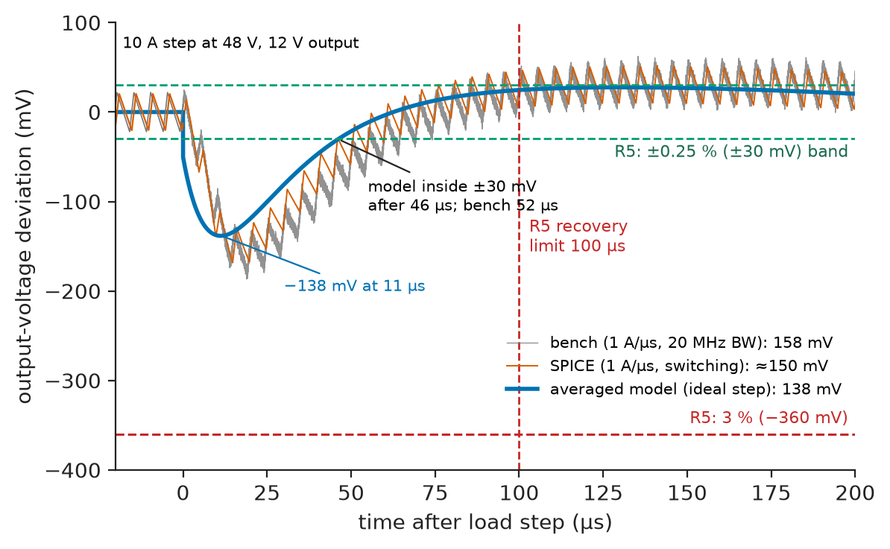

# Chapter 29 — Engineering Software Workflows

*Part VIII · Engineering Software and Computational Tools*

A power-electronics team presents a 48 V-to-12 V, 240 W converter for a telecom shelf at its design review: 97.6 % efficiency at half load, a phase margin of 58°, a load-step deviation of 120 mV. Six months later the certification lab measures 96.8 % efficiency, and the programme manager asks where 97.6 % came from. Nobody can say. The number was in a spreadsheet whose MOSFET resistance cell had been overwritten with the 25 °C datasheet value; the SPICE model of the MOSFET had since been replaced by the vendor's newer download, under the same file name; the loop-gain script ran only on one engineer's laptop, with a SciPy release that has since changed a default; and the plot in the review slides was a pasted screenshot with no source. Every tool worked. What failed was the workflow around them: numbers that could not be traced to inputs, inputs that were not under version control, environments nobody had recorded, and no automated check that would have shown the change. This chapter builds that workflow for the same converter, so that every number in its design report can be regenerated, from a tagged commit, by one command.

> **How is an engineering project organised so that requirements, models, simulations, measurements and reports stay linked and every result can be regenerated?**
> **Which tools are used for which question, and how are they automated, tested and versioned without slowing the design down?**

| Concept | Engineering destination |
|---|---|
| Requirements and modeling | Requirements as data; a model ladder from hand calculation to switching simulation |
| Numerical computation | Loss, stress, thermal and tolerance calculations in scripts, not spreadsheets |
| Circuit simulation | SPICE for switching waveforms, device stress and parasitic effects |
| System simulation | Averaged and closed-loop models for control design and transients |
| Version-controlled projects | One repository for requirements, models, netlists, tests and reports |
| Reproducible builds | Pinned environments, containers, provenance records, one-command builds |
| Automated testing | Unit, property, regression and requirement tests in continuous integration |
| Data import and export | Instrument captures, simulator outputs and exchange formats with metadata |
| Results visualization | Plots generated from data, with requirements drawn on them |
| Engineering documentation | Reports, traceability matrices and release notes generated from the repository |

**Roadmap.** Requirements as data and the model ladder (29.1) → scripted numerical design (29.2) → SPICE (29.3) → averaged system models and the control loop (29.4) → the repository (29.5) → environments and builds that reproduce (29.6) → tests that run on every change (29.7) → data in and out (29.8) → plots (29.9) → documents, verification and what goes wrong with workflows (29.10).

---

## 29.1 Requirements and modeling

> **Boundary.** Requirements engineering, traceability and acceptance criteria are owned by Chapter 1; modeling, simulation, sensitivity and validation method by Chapter 3; engineering documentation and revision control as practices by Chapter 5. This chapter is the *tooling* that carries those methods. Buck-converter analysis is owned by *Electronics and Computing*, [Ch. 30](https://github.com/The-Studio-of-Sadiq/Electronics-and-Computing/blob/main/part-7-power-electronics/30-dc-dc-converters.md) (§30.1, §30.6–30.9).

### The reference project

The running example is the project `buck48`: a synchronous buck converter, 36–60 V input (48 V nominal), 12 V output, 20 A maximum, switching at 200 kHz, with 100 V MOSFETs of about 7 mΩ, a 6.8 µH inductor and 470 µF of effective output capacitance. The product requirements sit beside workflow requirements, because the workflow is itself a deliverable (Table 29.1).

**Table 29.1 — Requirements of the `buck48` project.**

| ID | Requirement | Target | Verification |
|---|---|---|---|
| R1 | Efficiency, 48 V, 10 A | ≥ 96.5 % | Loss model; SPICE; bench with power analyser |
| R2 | Efficiency, 48 V, 20 A | ≥ 95.5 % | As R1 |
| R3 | Output ripple, 20 A | ≤ 50 mV p-p | Calculation; SPICE; bench, 20 MHz bandwidth |
| R4 | Loop stability, 36–60 V, 2–20 A | Phase margin ≥ 45°, crossover ≥ 15 kHz | Averaged model; bench frequency-response analyser |
| R5 | 10 A load step | Deviation ≤ 3 % (360 mV); within ±0.25 % in ≤ 100 µs | Averaged model; SPICE; bench electronic load |
| W1 | Reproducibility | Every reported number regenerated from a tagged commit by one command; Python results identical, SPICE within stated tolerance | Rebuild of a release on a clean machine |
| W2 | Feedback time | CI on every push ≤ 10 min | CI timing records |
| W3 | Traceability | Every requirement linked to ≥ 1 automated test or named bench test; matrix generated | Generated matrix has no empty rows |
| W4 | Tool control | Tool and model versions pinned; changes only by reviewed commit with a regression diff | Review records |
| W5 | Data integrity | Raw lab data immutable, hashed, with instrument metadata | Hash check in CI |

### Requirements as data

A requirement that lives only in a document cannot be checked by a program. In `buck48` the measurable part of each requirement is stored in a small TOML file next to the code, and tests and reports read it from there; the document generator renders the same file into the requirements chapter of the report.

```toml
# requirements.toml -- product requirements as data (buck48)
[R1]
text = "Efficiency at 48 V input, 10 A load"
io = 10.0
eta_min = 0.965
verified_by = ["tests/test_requirements.py::test_r1_r2_efficiency", "bench:EFF-01"]

[R2]
text = "Efficiency at 48 V input, 20 A load"
io = 20.0
eta_min = 0.955
verified_by = ["tests/test_requirements.py::test_r1_r2_efficiency", "bench:EFF-01"]

[R3]
text = "Output ripple at 20 A"
ripple_max_v = 0.050
verified_by = ["tests/test_requirements.py::test_r3_ripple_bound", "bench:RIP-01"]
```

Changing a limit is now a one-line diff that reviewers see, that reruns every test depending on it, and that appears in the release notes.

### The model ladder and the pipeline

Each question is answered by the cheapest model that can answer it, and each model is checked against the next one up (Figure 29.1):

1. **Hand calculation in a script**: duty cycle, ripple, RMS currents, losses, efficiency (Section 29.2). Milliseconds.
2. **Averaged small-signal model**: loop gain, phase margin, output impedance, load-step response (Section 29.4). Seconds.
3. **Switching circuit simulation (SPICE)**: waveforms, device stress, dead-time and reverse-recovery effects, efficiency with device models (Section 29.3). Tens of seconds per operating point.
4. **Hardware**: bench measurements, imported and compared automatically (Section 29.8).

<!-- FIGURE 29.1 | figures/ch29/fig-29-1-workflow-pipeline.png | block-diagram | The buck48 engineering workflow: requirements, models and data in one repository, run by one build command locally and in CI, producing results with provenance and a generated report. | Content: left column inside a box labelled Git repository: requirements.toml, model/ (losses.py, loop.py), spice/ (netlists, pinned vendor models with hashes), tests/, data/manifest (SHA-256 of raw captures held in object storage), docs/ (report sources). Middle: build command make all (or CI job) running in a pinned container image (Python 3.12, numpy, scipy, ngspice 44, pinned by digest). Stages left to right: loss model, averaged loop model, SPICE corners (parallel workers, cache keyed by input hash), bench-data import, comparison and tests (pytest), plots, report. Right: results/ with JSON plus .prov.json per result, figures, report PDF and traceability matrix. Arrows: tag v1.2.0 to release artifacts; dashed arrow from test failures back to developer. Label W1: one command from tag to report. -->



*Figure 29.1 — The buck48 engineering workflow: requirements, models and data in one repository, run by one build command locally and in CI, producing results with provenance and a generated report.*

> **Status of the principle: a computed result is reproducible only if its inputs, code and environment are all recorded**
> *Fundamental.* A deterministic computation is a function of exactly those three things; leaving any of them unrecorded makes the result unrepeatable by definition, whatever the care taken.

### Choosing the tools

**Table 29.2 — Tool options for `buck48` (2026).**

| Question | Options considered | Batch and CI use | Licence | Choice and reason |
|---|---|---|---|---|
| Numerical design | Spreadsheet; MATLAB; Python with NumPy/SciPy; Julia | Spreadsheet poor; others good | Free to commercial | **Python**: plain-text, diffable, testable, already used for test automation |
| Circuit simulation | LTspice; ngspice; PSpice/SIMetrix; PLECS (piecewise-linear) | LTspice batch possible but GUI-centred; ngspice designed for batch | Free to commercial | **ngspice** for CI; LTspice allowed for exploration, never for reported numbers |
| System simulation | Python `scipy.signal`/`solve_ivp`; OpenModelica; Simulink; PLECS | Python and OpenModelica scriptable in containers | Free to commercial | **Python** for the averaged model; Modelica if multi-domain (thermal) grows |
| Version control and CI | Git with GitHub Actions or GitLab CI | Native | Free tiers | **Git + CI** with a container runner |

The rule behind the choices is not "open source is better". It is that a tool producing a reported number must run unattended, from text inputs, in a pinned environment. A GUI tool can be used to explore, but its results enter the report only after the same case has been re-run by the pipeline.

---

## 29.2 Numerical computation

> **Boundary.** Python, NumPy and SciPy as languages and libraries are owned by *Electronics and Computing*, [Ch. 22](https://github.com/The-Studio-of-Sadiq/Electronics-and-Computing/blob/main/part-5-programming-and-computational-systems/22-python-for-engineering.md); floating-point error and numerical methods by *The Mathematics Universe*, [Ch. 22](https://github.com/The-Studio-of-Sadiq/engineering-mathematics/blob/main/part-7-numerical-computational/22-numerical-methods.md) §22.1–22.2. Solvers, sweeps and optimisation at scale are Chapter 30 of this book.

### From spreadsheet to module

The loss model is the calculation that went wrong in the opening story, rewritten as a module with one parameter dictionary, one function per question, and SI units throughout. The equations are the standard first-order ones (conduction with ripple-corrected RMS currents, linearised switching transitions, charge-based capacitive, reverse-recovery and gate losses); their derivations belong to Book 4 Ch. 30 §30.8.

```python
"""Loss model of the 48 V -> 12 V synchronous buck (buck48/model/losses.py)."""

P = dict(vin=48.0, vo=12.0, fsw=200e3, L=6.8e-6, dcr=3e-3, esr=5e-3, c_out=470e-6,
         rds25=7e-3, k_t=1.6, t_sw=8e-9, qoss=50e-9, qrr=40e-9, qg=35e-9,
         v_drv=10.0, t_dead=20e-9, vf=0.8, p_core=0.25, p_bias=0.10)

def losses(io, p=P):
    d = p["vo"] / p["vin"]
    di = (p["vin"] - p["vo"]) * d / (p["fsw"] * p["L"])      # ripple, A p-p
    r2 = (di / io) ** 2 / 12
    rds = p["rds25"] * p["k_t"]                               # hot R_DS(on)
    return {
        "cond_hs": io**2 * d * (1 + r2) * rds,
        "cond_ls": io**2 * (1 - d) * (1 + r2) * rds,
        "switching": 0.5 * p["vin"] * p["fsw"] * p["t_sw"] * (2 * io),
        "coss": 0.5 * p["qoss"] * p["vin"] * p["fsw"],
        "qrr": p["qrr"] * p["vin"] * p["fsw"],
        "dead_time": p["vf"] * io * 2 * p["t_dead"] * p["fsw"],
        "gate": 2 * p["qg"] * p["v_drv"] * p["fsw"],
        "inductor": (io**2 + di**2 / 12) * p["dcr"] + p["p_core"],
        "cap_esr": di**2 / 12 * p["esr"],
        "bias": p["p_bias"],
    }

def efficiency(io, p=P):
    po = p["vo"] * io
    return po / (po + sum(losses(io, p).values()))

if __name__ == "__main__":
    for io in (2, 5, 10, 15, 20):
        print(f"Io = {io:4.1f} A  loss = {sum(losses(io).values()):5.2f} W  "
              f"eta = {100 * efficiency(io):5.2f} %")
    l10 = losses(10.0)
    print("largest at 10 A:", ", ".join(f"{k} {v:.2f} W" for k, v in
          sorted(l10.items(), key=lambda kv: -kv[1])[:3]))
```

```text
Io =  2.0 A  loss =  1.41 W  eta = 94.46 %
Io =  5.0 A  loss =  1.96 W  eta = 96.84 %
Io = 10.0 A  loss =  3.44 W  eta = 97.22 %
Io = 15.0 A  loss =  5.63 W  eta = 96.97 %
Io = 20.0 A  loss =  8.53 W  eta = 96.57 %
largest at 10 A: cond_ls 0.87 W, switching 0.77 W, inductor 0.56 W
```

**Worked example — reading the loss model.** At 48 V and 10 A the duty cycle is 0.25 and the inductor ripple $(48-12)\times0.25/(200\ \mathrm{kHz}\times6.8\ \mathrm{\mu H})=6.62$ A peak-to-peak. The low-side RMS current is $10\sqrt{0.75(1+0.662^2/12)}=8.82$ A, and with the hot resistance $7\times1.6=11.2$ mΩ it dissipates 0.87 W, the largest single loss. Total loss is 3.44 W and efficiency 97.22 %, a margin of 0.72 points over R1. Had the 25 °C resistance been used, as in the opening spreadsheet, the two conduction losses (1.16 W hot) would shrink to 0.73 W and the efficiency would read 97.6 %: the irreproducible review number, reproduced, and explained by one parameter.

> **Status of the principle: first-order converter loss model**
> *Approximate.* It assumes linear switching transitions, a fixed hot resistance factor and loss terms that add independently; it typically lands within 0.2–0.5 points of measured efficiency at mid load and is least accurate at light load, where core and capacitive losses dominate, which is why SPICE and the bench check it.

### Habits that make numerical code engineering code

- **One source of each parameter.** Datasheet values live once, with the datasheet revision in a comment; scripts never copy them.
- **SI units internally**, converted only for printing. An optional units library (`pint`) catches dimension errors in larger models; the reference project uses naming discipline (`_v`, `_a`, `_w` suffixes in result files) instead.
- **Functions that return dictionaries of named terms**, so a report can show the loss breakdown and a test can check each term.
- **No hidden state.** Running the module twice gives the same output; random numbers come from a seeded generator passed in explicitly (Section 29.6).

---

## 29.3 Circuit simulation

> **Boundary.** Modified nodal analysis, the formulation inside SPICE, is in *Circuits, Signals and Communications*, [Ch. 3](https://github.com/The-Studio-of-Sadiq/Circuits-Signals-and-Communications/blob/main/part-1-circuit-fundamentals/03-network-analysis.md) §3.8; stiff integration and its stability in *The Mathematics Universe* Ch. 22 §22.9 and §22.11; MOSFET device models in *Electronics and Computing* Ch. 4.

### What SPICE is for in this project

The loss model cannot see dead-time body-diode conduction shape, the reverse-recovery current spike, ringing at the switch node, or how the vendor's nonlinear capacitances change switching loss. SPICE can, with the vendor's device model. The netlist is plain text, lives in the repository, and includes the vendor model through a path whose file hash is recorded (Section 29.6).

```text
* spice/buck48_stage.cir -- 48 V to 12 V, 200 kHz synchronous buck, open loop, 10 A
.include ../models/mosfet_100v_7m.lib    ; vendor model, SHA-256 recorded in models/MANIFEST
.param VIN=48 FSW=200k D=0.2525 TD=20n ILOAD=10
VIN   in  0   {VIN}
VGH   gh  sw  PULSE(0 10 {TD} 5n 5n {D/FSW-2*TD} {1/FSW})    ; high-side gate, floating
VGL   gl  0   PULSE(10 0 0 5n 5n {D/FSW} {1/FSW})            ; low-side gate, dead time TD
XHS   in  gh  sw  MOS100V7M                                   ; pins: drain gate source
XLS   sw  gl  0   MOS100V7M
L1    sw  n1  6.8u  ic=10
RDCR  n1  out 3m
COUT  out n2  470u  ic=12
RESR  n2  0   5m
ILD   out 0   DC {ILOAD}
.options method=gear reltol=1e-4 abstol=1e-9 vntol=1e-6
.tran 1n 2m 1.8m 5n uic
.meas tran pin  avg par('-v(in)*i(VIN)') from=1.8m to=2m
.meas tran vout avg v(out)                from=1.8m to=2m
.meas tran pout param='vout*ILOAD'
.meas tran eff  param='pout/pin'
.meas tran vpp  pp  v(out)                from=1.8m to=2m
.end
```

The duty cycle is trimmed from 0.25 to 0.2525 so that the open-loop output sits at 12.0 V despite the losses, and the inductor and capacitor start at their steady-state values (`ic=10`, `ic=12` with `uic`) so that the run does not spend milliseconds settling the 2.8 kHz LC resonance. The `.meas` lines make ngspice print efficiency and ripple as plain numbers, which a Python wrapper parses from the batch log (`ngspice -b`), so no one reads values off a waveform window. The waveforms are still plotted, for review of ringing and recovery (Figure 29.2).

### Simulation-time and campaign budget

**Worked example — what a corner campaign costs.** The 200 µs measurement window after 1.8 ms of run, with a 5 ns maximum step, needs at least $2\ \mathrm{ms}/5\ \mathrm{ns}=400\,000$ time points; around every switching edge the step shrinks further. On the reference workstation one operating point takes about 40 s. The release campaign is three input voltages × three loads × three temperatures (27 corners) plus 200 Monte Carlo runs over component tolerances: $227\times40\ \mathrm{s}=2.5$ h serial, or about 9.5 min on 16 workers. Results are cached under a hash of the netlist, model files and parameters, so a change to the report template reruns nothing, and a change to one inductor parameter reruns only the cases that use it.

### Convergence and trust

SPICE failures in switching converters are almost always one of four things: a floating node with no DC path (a gate driven only through a capacitor), an ideal switch or diode with discontinuous characteristics, a time step forced too small by unrealistically fast edges, or a vendor model with an internal discontinuity. The project's rules are to give every node a DC path (gigaohm resistors where needed), use the vendor's model rather than ideal switches for reported numbers, set edge times from the gate-driver datasheet, and treat any change of `reltol`, `gmin` or integration method as a model change that needs the regression diff of Section 29.7. On this netlist, tightening `reltol` from $10^{-4}$ to $10^{-5}$ moved the computed efficiency by 0.02 points and tripled the run time, which is the evidence for keeping $10^{-4}$.

<!-- FIGURE 29.2 | figures/ch29/fig-29-2-spice-switching-waveforms.png | waveform | SPICE switching waveforms of the buck at 48 V and 10 A over one 5 us period, with the dead-time intervals marked. | Content: shared time axis 0 to 5 us. Row 1 gate voltages: low-side gl falling at 0, high-side gh (referred to sw) rising at 20 ns, high side off at 1.24 us, low side on 20 ns later; dead-time intervals shaded. Row 2 switch-node voltage sw: -0.8 V body-diode step during dead time, rise to 48 V with ringing overshoot to about 56 V damping within 100 ns, fall back to -0.8 V then near 0 V. Row 3 inductor current: triangular 6.69 A to 13.31 A, average 10 A. Row 4 high-side drain current with reverse-recovery spike of about 6 A at turn-on. Annotations: eff 96.9 percent, vout ripple 41 mV p-p from .meas. -->



*Figure 29.2 — SPICE switching waveforms of the buck at 48 V and 10 A over one 5 us period, with the dead-time intervals marked.*

> **Status of the principle: a simulation is no better than its device models**
> *Approximate.* SPICE solves the circuit equations to the stated tolerances, but switching loss, ringing and recovery depend on vendor models whose accuracy is typically quoted only at a few conditions; reported SPICE numbers are therefore checked against the bench at least once per design and the model version is recorded with every result.

---

## 29.4 System simulation

> **Boundary.** Dynamic-system modeling and transfer functions are owned by *Circuits, Signals and Communications*, [Ch. 33](https://github.com/The-Studio-of-Sadiq/Circuits-Signals-and-Communications/blob/main/part-7-control-system-fundamentals/33-dynamic-system-modeling.md); stability margins and Bode methods by [Ch. 34](https://github.com/The-Studio-of-Sadiq/Circuits-Signals-and-Communications/blob/main/part-7-control-system-fundamentals/34-feedback-and-stability.md) §34.8–34.9; compensator design by Ch. 35; the converter's feedback-control interface by *Electronics and Computing* Ch. 30 §30.9. Co-simulation and digital twins are Chapter 33 of this book.

### Averaged model as executable specification

Control design does not need switching detail; it needs the averaged plant, the modulator and the compensator, evaluated over frequency and in time. The script below is the project's loop model. It builds the duty-to-output transfer function with the capacitor's ESR zero and the inductor's resistance, places a type-III compensator (two zeros near the LC resonance, poles at the ESR zero and at half the switching frequency), sets the integrator gain for a 20 kHz crossover, and reports phase margin and the response to a 10 A load step through the closed-loop output impedance.

```python
"""Averaged small-signal model of the buck with a type-III compensator (sim/loop.py)."""
import numpy as np
from scipy import signal

L, C, esr, dcr, R = 6.8e-6, 470e-6, 5e-3, 3e-3, 12.0 / 10.0   # 10 A operating point
vin, vramp, H = 48.0, 4.8, 0.1                    # input feed-forward ramp, divider
w0 = 1 / np.sqrt(L * C)
den_p = [L * C * (1 + esr / R), L / R + C * (esr + dcr) + C * esr * dcr / R, 1 + dcr / R]
gvd = (np.array([vin * C * esr, vin]), np.array(den_p))              # duty -> v_out
zol = (np.polymul([L, dcr], [C * esr, 1]), np.array([L * C, C * (esr + dcr), 1]))

def loop_gain(k):
    """Type III: integrator k/s, zeros at 0.8 f0 and f0, poles at ESR zero and fsw/2."""
    wz1, wz2, wp1, wp2 = 0.8 * w0, w0, 1 / (esr * C), 2 * np.pi * 100e3
    nc = k * np.polymul([1 / wz1, 1], [1 / wz2, 1])
    dc = np.polymul([1, 0], np.polymul([1 / wp1, 1], [1 / wp2, 1]))
    return np.polymul(nc, gvd[0]) * H / vramp, np.polymul(dc, gvd[1])

def T_at(f, k):
    n, d = loop_gain(k)
    return np.polyval(n, 2j * np.pi * f) / np.polyval(d, 2j * np.pi * f)

k = 1 / abs(T_at(20e3, 1.0))                      # place crossover at fsw/10 = 20 kHz
f = np.logspace(2, 5.5, 4000)
T = T_at(f, k)
i = np.argmin(abs(abs(T) - 1))
print(f"f0 = {w0/2/np.pi/1e3:.2f} kHz, crossover {f[i]/1e3:.1f} kHz, "
      f"phase margin {180 + np.degrees(np.angle(T[i])):.1f} deg")

# Closed-loop output impedance Zcl = Zol / (1 + T); response to a 10 A load step
nt, dt = loop_gain(k)
zcl = signal.lti(np.polymul(zol[0], dt), np.polymul(zol[1], np.polyadd(dt, nt)))
t, v = signal.step(zcl, T=np.linspace(0, 400e-6, 20001))
dv = -10.0 * v
print(f"10 A step: undershoot {1e3*dv.min():.0f} mV at {1e6*t[dv.argmin()]:.1f} us, "
      f"inside 0.25 % (30 mV) after {1e6*t[np.where(abs(dv) > 0.03)[0][-1]]:.0f} us")
```

```text
f0 = 2.82 kHz, crossover 20.0 kHz, phase margin 65.6 deg
10 A step: undershoot -138 mV at 11.2 us, inside 0.25 % (30 mV) after 46 us
```

**Worked example — closing R4 and R5 by model.** The LC resonance is at 2.82 kHz and the crossover is placed at 20 kHz, a tenth of the switching frequency, with 65.6° of phase margin, 20.6° above R4. Because the modulator uses input-voltage feed-forward (ramp amplitude proportional to $V_{\mathrm{in}}$), the loop gain does not change between 36 and 60 V; rerunning the script at 2 A and 20 A with the same compensator gives crossovers of 20.1 and 19.9 kHz and margins of 65.0° and 66.4°. A 10 A ideal step produces a 138 mV undershoot (1.15 %, inside the 3 % of R5) and settles inside ±30 mV in 46 µs (inside 100 µs). The ideal step is harsher than the 1 A/µs slew of the real test, yet the bench shows 158 mV (Table 29.5): the averaged model omits the board's distributed inductance and capacitor ESL, which add a fast initial dip, and the gap is recorded in the model register. Figure 29.3 shows the loop gain with the bench measurement overlaid.

> **Status of the principle: crossover at about a tenth of the switching frequency**
> *Empirical.* The averaged model loses validity as frequency approaches $f_{\mathrm{sw}}/2$, where sampling effects add phase lag; practice keeps crossover between $f_{\mathrm{sw}}/10$ and $f_{\mathrm{sw}}/5$, and the bench frequency-response measurement confirms the margin.

<!-- FIGURE 29.3 | figures/ch29/fig-29-3-loop-gain-bode.png | plot | Loop gain of the buck48 voltage-mode loop with type-III compensation at 2, 10 and 20 A, from the averaged model, with bench points at 10 A. | Content: two stacked panels sharing x-axis frequency 100 Hz to 300 kHz, log. Top: magnitude dB from -60 to +80, three nearly overlapping curves for 2, 10, 20 A, crossing 0 dB at 20.1, 20.0 and 19.9 kHz; LC resonance at 2.82 kHz marked. Bottom: phase in degrees from -270 to 0; phase margin 65.0, 65.6 and 66.4 degrees annotated at crossover; dashed line at -135 degrees labelled R4 limit 45 degrees margin. Bench frequency-response-analyser points at 10 A as markers from 500 Hz to 100 kHz, crossover 18.7 kHz, margin 61 degrees. -->



*Figure 29.3 — Loop gain of the buck48 voltage-mode loop with type-III compensation at 2, 10 and 20 A, from the averaged model, with bench points at 10 A.*

### When the averaged model is not enough

The averaged model is linear and continuous. It misses saturation of the compensator output during large steps, current limit, start-up sequencing, and the interaction of the converter with a downstream converter's negative input impedance. For those the project keeps a large-signal averaged model (state equations with duty-cycle limits, integrated by `solve_ivp` with a stiff method) and, for the bench-critical cases, SPICE. Which question goes to which model is written in the project's `docs/models.md`, together with each model's validity domain.

---

## 29.5 Version-controlled projects

> **Boundary.** Git's data model, branching and team workflows are owned by *Electronics and Computing*, [Ch. 24](https://github.com/The-Studio-of-Sadiq/Electronics-and-Computing/blob/main/part-5-programming-and-computational-systems/24-scientific-computing.md) §24.10; revision management of drawings and documents by Chapter 5 of this book.

### One repository, one truth

Everything a reported number depends on, except large raw data, lives in one repository:

```text
buck48/
  requirements.toml          product requirements as data (Section 29.1)
  model/losses.py            loss and efficiency model
  model/loop.py              averaged loop model
  spice/buck48_stage.cir     netlists; parameters in spice/corners.toml
  models/                    vendor device models + MANIFEST (SHA-256, source URL, date)
  io/scope_csv.py            instrument import (Section 29.8)
  data/manifest.csv          hashes and metadata of raw captures; files in object storage
  tests/                     unit, property, regression and requirement tests
  results/golden/            reviewed reference results for regression tests
  docs/                      report sources, models.md, decisions/ (one file per decision)
  tools/provenance.py        provenance record writer (Section 29.6)
  environment/               lock file, container definition
  Makefile                   'make all' builds every result, plot and the report
  .gitattributes             line endings; Git LFS for oscilloscope screenshots only
```

The rules that make this work are short:

- **Generated files are not committed** (`results/` other than `golden/`, `build/`). They are reproduced by the build and attached to releases.
- **Vendor models are committed with a manifest** recording their source and hash. A newer vendor download is a reviewed change, not a silent overwrite, which is the opening story's second failure.
- **Raw data are immutable.** Captures go to object storage under their SHA-256; the repository holds the manifest. A corrected capture is a new file with a new hash and a note.
- **Commits reference requirement IDs and decisions** ("R5: increase compensator zero spacing, see docs/decisions/007"), so `git log` answers why a parameter changed.
- **Releases are tags** (`v1.2.0` for the design review), and every number in the review report comes from the build of that tag.

Schematic and layout files from the PCB tool are binary or semi-structured; they are committed with exported netlists and BOMs in text form so that diffs show what changed (Chapter 5).

---

## 29.6 Reproducible builds

> **Boundary.** Reproducibility of computational experiments is owned by *Electronics and Computing* Ch. 22 §22.10 and Ch. 24 §24.8, and by *The Mathematics Universe*, [Ch. 24](https://github.com/The-Studio-of-Sadiq/engineering-mathematics/blob/main/part-7-numerical-computational/24-computational-mathematics.md) §24.9. This section applies them to a hardware-design project.

### Pinning the environment

Three layers are pinned, each by the strongest means available:

1. **Python packages** by a lock file with hashes (generated by a tool such as `uv` or `pip-tools`), so that `numpy` is not merely "2.x" but one exact build.
2. **System tools** (ngspice, a LaTeX or Pandoc toolchain for the report) by a container image, referenced in CI by its content digest rather than a tag that can move.
3. **The project's own inputs** by Git, plus the data manifest for large files.

A tool upgrade (a new ngspice, a new SciPy) is then an ordinary change: a commit that updates the lock file or image digest, a CI run that shows the regression diff, and a reviewer who accepts or rejects it.

### Provenance on every result

Each result file is written with a provenance record beside it: the commit, whether the working tree was clean, the interpreter and package versions, the platform, the hash of every input file and the random seed.

```python
"""Write a provenance record next to every result file (tools/provenance.py)."""
import hashlib, json, pathlib, platform, subprocess, sys
from datetime import datetime, timezone
from importlib import metadata

def sha256(path):
    return hashlib.sha256(pathlib.Path(path).read_bytes()).hexdigest()

def git_state():
    try:
        sha = subprocess.run(["git", "rev-parse", "HEAD"], capture_output=True,
                             text=True, check=True).stdout.strip()
        dirty = bool(subprocess.run(["git", "status", "--porcelain"], capture_output=True,
                                    text=True, check=True).stdout.strip())
        return {"commit": sha, "dirty": dirty}
    except (OSError, subprocess.CalledProcessError):
        return {"commit": None, "dirty": None}

def provenance(inputs, seed=None):
    return {
        "created_utc": datetime.now(timezone.utc).isoformat(timespec="seconds"),
        "git": git_state(),
        "python": sys.version.split()[0],
        "platform": platform.platform(terse=True),
        "packages": {p: metadata.version(p) for p in ("numpy", "scipy", "matplotlib")},
        "inputs": {str(p): sha256(p) for p in inputs},
        "seed": seed,
    }

if __name__ == "__main__":
    rec = provenance(["requirements.toml", "model/losses.py"], seed=20260412)
    pathlib.Path("results/losses_10A.prov.json").write_text(json.dumps(rec, indent=2))
    print(json.dumps({k: rec[k] for k in ("git", "python", "packages")}))
    print({k: v[:12] for k, v in rec["inputs"].items()})
```

Run in a scratch copy of the project that is not a Git checkout, it prints:

```text
{"git": {"commit": null, "dirty": null}, "python": "3.14.7", "packages": {"numpy": "2.5.4", "scipy": "1.18.1", "matplotlib": "3.11.2"}}
{'requirements.toml': '1f594c52af49', 'model/losses.py': '358d24906ac3'}
```

The null commit is the point: the report builder refuses any result whose provenance has no commit or a dirty tree, so a number computed from uncommitted edits cannot reach a review document. In CI the same script records the commit SHA and `"dirty": false`.

### Determinism, and where to stop demanding it

Pure-Python and NumPy results are bit-identical between runs on the same container image, provided random numbers come from a seeded `numpy.random.Generator` and multithreaded BLAS reductions are pinned to one thread (`OMP_NUM_THREADS=1`) for the golden runs. Across processors and BLAS builds, results differ in the last few bits, because floating-point addition is not associative (*The Mathematics Universe* Ch. 22 §22.1). SPICE results move by much more when the platform changes, because adaptive time stepping amplifies tiny differences into different step sequences. W1 therefore demands bit-identical Python results on the pinned image and SPICE results within a stated tolerance, not identity.

**Worked example — choosing regression tolerances.** For the analytic loss model, platform differences are of order $10^{-15}$ relative, and the golden test uses $10^{-3}$ only to absorb deliberate rounding in the stored value. For SPICE at `reltol` = $10^{-4}$, repeated runs on two platforms differed by up to 0.01 points of efficiency and 0.4 mV of ripple; the regression thresholds are set at 0.05 points and 2 mV, five times the observed scatter, and well below the 0.72-point margin of R1, so a real change of a tenth of a point is caught while numerical noise is not.

> **Status of the principle: regression tolerance from numerical scatter**
> *Derived.* A threshold several times the observed run-to-run scatter keeps the false-failure rate low, and one much smaller than the requirement margin keeps real changes visible; if the two conditions cannot both be met, the numerical method is not good enough for the requirement.

### The CI time budget

W2 asks for feedback within 10 minutes on every push; the full corner campaign (Section 29.3) runs nightly and on release tags. Table 29.3 is the budget for the per-push pipeline.

**Table 29.3 — Per-push CI time budget (measured median of 20 runs).**

| Stage | Duration |
|---|---|
| Container image pull (cached by digest) | 25 s |
| Checkout and environment check | 15 s |
| Lint and type check | 10 s |
| Unit, property, regression and requirement tests | 20 s |
| Averaged model and loop analysis | 15 s |
| SPICE smoke run: 3 corners, 4 parallel jobs | 45 s |
| Report build | 40 s |
| Artifact upload and runner overhead | 30 s |
| **Total** | **200 s** |
| Limit W2 / margin | 600 s / 400 s (67 %) |

```yaml
# .github/workflows/ci.yml -- per-push pipeline (image pinned by digest)
name: ci
on: [push, pull_request]
jobs:
  build:
    runs-on: ubuntu-24.04
    container: ghcr.io/example/buck48-tools@sha256:0f3c...e91a
    env:
      OMP_NUM_THREADS: "1"
    steps:
      - uses: actions/checkout@v4
      - run: make lint
      - run: python -m pytest -q --junitxml=build/junit.xml
      - run: make loop spice-smoke
      - run: make report
      - uses: actions/upload-artifact@v4
        with:
          name: report
          path: build/report/
```

The digest in the listing is abbreviated for print; the real file carries all 64 hexadecimal digits.

---

## 29.7 Automated testing

> **Boundary.** Test design and `pytest` practice for scientific code are in *Electronics and Computing* Ch. 24 §24.9; regression testing and test plans for hardware in Chapter 4 of this book.

### Four kinds of test

Engineering code needs tests that software projects rarely write, because its correctness is physical as well as logical:

- **Unit tests against hand calculations**: one term of the model against a number worked by hand.
- **Property tests**: relations that must hold for any input, such as losses rising with switching frequency, efficiency below 1, energy balance between input and output power in a simulation, or a filter with unity DC gain.
- **Regression tests** against reviewed golden results, with the tolerances of Section 29.6.
- **Requirement tests** that read their limit from `requirements.toml` and carry a marker naming the requirement, from which the traceability matrix is generated.

```python
import json, math, pathlib, tomllib
import pytest
from model.losses import P, losses, efficiency

ROOT = pathlib.Path(__file__).resolve().parents[1]
REQ = tomllib.loads((ROOT / "requirements.toml").read_text())

def test_unit_conduction_matches_hand_calc():
    # D = 0.25, ripple r = 0.662: I_rms,LS = 10 * sqrt(0.75 * (1 + r^2/12)) = 8.82 A
    i_rms = 10 * math.sqrt(0.75 * (1 + 0.662**2 / 12))
    assert losses(10.0)["cond_ls"] == pytest.approx(i_rms**2 * 7e-3 * 1.6, rel=1e-3)

def test_property_losses_rise_with_frequency():
    hi = dict(P, fsw=2 * P["fsw"])
    assert sum(losses(10.0, hi).values()) > sum(losses(10.0).values())

def test_regression_against_golden():
    g = json.loads((ROOT / "results" / "golden_losses_10A.json").read_text())
    assert sum(losses(g["io"]).values()) == pytest.approx(g["total_w"], rel=g["rtol"])

@pytest.mark.req("R1", "R2")
@pytest.mark.parametrize("rid", ["R1", "R2"])
def test_r1_r2_efficiency(rid):
    assert efficiency(REQ[rid]["io"]) >= REQ[rid]["eta_min"]

@pytest.mark.req("R3")
def test_r3_ripple_bound():
    d = P["vo"] / P["vin"]
    di = (P["vin"] - P["vo"]) * d / (P["fsw"] * P["L"])
    ripple = di * P["esr"] + di / (8 * P["fsw"] * P["c_out"])   # ESR term + capacitive term
    assert ripple <= REQ["R3"]["ripple_max_v"]
```

With the golden file holding 3.4361 W at 10 A and the `req` marker registered in `pytest.ini`, `python -m pytest -v` reports six passing tests (the efficiency test runs once per requirement) in well under a second. The ripple bound evaluates to $6.62\times0.005+6.62/(8\times200\ \mathrm{kHz}\times470\ \mathrm{\mu F})=33.1+8.8=41.9$ mV against 50 mV, a 16 % margin.

A requirement test on a *model* is not verification of the *product*; it is an early warning that a design change has eaten the margin. The traceability matrix therefore has one column for model tests and one for bench tests, and a requirement is closed only when its bench column is filled (Section 29.10).

> **Status of the principle: test the physics as well as the code**
> *Empirical.* Experience with engineering software shows that most damaging defects are wrong units, wrong parameters and violated physical relations rather than crashes; unit tests against hand calculations and property tests on conservation laws catch them at the lowest cost.

### Hardware in the loop of the workflow

The same test runner drives the bench. A bench test script (Chapter 4) sets the electronic load, triggers the power analyser and the oscilloscope over SCPI, stores the raw capture under its hash, imports it (Section 29.8) and asserts against the same TOML limits. The bench results enter the traceability matrix through the same marker mechanism, tagged with the unit's serial number and the instrument calibration dates.

---

## 29.8 Data import and export

> **Boundary.** File formats (CSV, JSON, HDF5, Parquet) and instrument control (VISA, SCPI) are owned by *Electronics and Computing* Ch. 22 §22.7 and §22.9, and scientific data formats by Ch. 24 §24.3; data management at scale is Chapter 30 of this book.

### What crosses the project boundary

**Table 29.4 — Data formats in `buck48`.**

| Data | Format | Metadata that must travel with it | Pitfall seen |
|---|---|---|---|
| Oscilloscope captures | Vendor CSV with header lines; binary for long records | Model, serial, date, probe ratios and units, sample rate | Probe ratio applied twice; locale decimal commas |
| Power-analyser readings | CSV via SCPI script | Range, integration time, calibration date | Range changes mid-sweep |
| SPICE output | `.meas` log lines; raw files for waveforms | Netlist hash, model manifest, options | Values read off a plot window |
| Inductor and capacitor impedance | Touchstone `.s1p`/`.s2p` | Frequency unit, reference impedance, bias condition | Small-signal data used at full DC bias |
| Results | JSON with SI units in key names, plus provenance | Commit, inputs, seed | Rounded values reused as inputs |
| Large time series | HDF5 or Parquet | Units, sample rate, channel map | Spreadsheet truncation at 1 048 576 rows |

### An import function that refuses bad data

The capture reader keeps metadata with the data, takes channel units from the header rather than assuming them, and rejects malformed time axes instead of passing them on.

```python
"""Import a four-channel scope capture with its metadata (io/scope_csv.py)."""
import csv, io
import numpy as np

SAMPLE = """Model,DSO-X 4034A
Serial,MY00000000
Date,2026-04-12T10:41:07Z
Probe CH1,10:1 V
Probe CH2,0.1 V/A
Probe CH3,10:1 V
Probe CH4,0.1 V/A
Time (s),CH1 (V),CH2 (A),CH3 (V),CH4 (A)
-1.0000E-05,48.03,2.590,11.981,10.02
-5.0000E-06,48.01,2.574,11.978,10.00
0.0000E+00,48.02,2.583,11.982,10.01
5.0000E-06,48.02,2.578,11.980,10.01
"""

def read_capture(text):
    lines = text.splitlines()
    head = next(i for i, l in enumerate(lines) if l.startswith("Time"))
    meta = dict(row[:2] for row in csv.reader(lines[:head]))
    names = [c.split(" (")[0] for c in lines[head].split(",")]
    units = [c.split("(")[1].rstrip(")") for c in lines[head].split(",")]
    data = np.loadtxt(io.StringIO("\n".join(lines[head + 1:])), delimiter=",")
    if np.any(np.diff(data[:, 0]) <= 0):
        raise ValueError("time axis not strictly increasing")
    return meta, dict(zip(names, data.T)), dict(zip(names, units))

meta, ch, units = read_capture(SAMPLE)
pin = np.mean(ch["CH1"] * ch["CH2"])
pout = np.mean(ch["CH3"] * ch["CH4"])
print(f"{meta['Model']} {meta['Date']}  units {units}")
print(f"Pin {pin:.2f} W, Pout {pout:.2f} W, efficiency {100 * pout / pin:.2f} %")
```

```text
DSO-X 4034A 2026-04-12T10:41:07Z  units {'Time': 's', 'CH1': 'V', 'CH2': 'A', 'CH3': 'V', 'CH4': 'A'}
Pin 123.95 W, Pout 119.92 W, efficiency 96.75 %
```

**Worked example — is a scope good enough to verify R1?** The import works, but the instrument does not. An oscilloscope with current probes measures each power to roughly ±1 % (gain accuracy of channel and probe combined); efficiency is a ratio, so its relative uncertainty is about $\sqrt{1^2+1^2}=1.4$ %, or ±1.4 points at 96.8 %. R1's margin on the bench is 0.3 points, so the scope cannot decide pass or fail. A power analyser with 0.1 % basic accuracy on each power gives $\sqrt{0.1^2+0.1^2}=0.14$ %, ±0.14 points, which can. The capture above is used for waveform checks; R1 is closed with the analyser (bench test EFF-01), and the uncertainty is recorded next to the result.

> **Status of the principle: uncertainty of a ratio of independent measurements**
> *Derived.* Relative standard uncertainties of independent factors combine by root-sum-square (GUM, JCGM 100); correlated errors, such as a shared voltage channel, partly cancel and must be treated explicitly.

### Export rules

Results are exported with units in field names (`eff_pct`, `ripple_mv`), full precision (Python's `repr` round-trips doubles exactly), timestamps in UTC ISO 8601, and a provenance file. Exchange copies for colleagues who use spreadsheets are generated from the JSON and marked read-only; numbers never flow back from a spreadsheet into the repository except through a reviewed edit of a source file.

---

## 29.9 Results visualization

> **Boundary.** Plotting libraries and plotting practice are covered in *Electronics and Computing* Ch. 22 §22.4; figure conventions for documentation in Chapter 5.

A plot in a design report is a measurement claim, and it obeys the same rules as a number: it is generated by a script from result files, never edited by hand, regenerated by the build, and carries its provenance. In `buck48` every figure has a function in `docs/figures.py` that reads JSON results and writes the image; the report includes the image file, and CI fails if any figure is older than its inputs.

The project's plotting conventions follow from what reviewers need to decide:

- **Requirements are drawn on the plot.** The efficiency curve carries R1 and R2 as markers with their limits, the Bode plot a line at the required margin, the load-step plot the −3 % deviation limit and the ±0.25 % recovery band (Figures 29.4 and 29.5). A reader sees the margin without looking up a table.
- **Model, simulation and measurement on the same axes**, with distinct markers and the measurement's uncertainty as error bars, so disagreement is visible rather than hidden in separate figures.
- **Units and conditions in the axis labels and caption**: input voltage, temperature, unit serial number.
- **Linear axes for quantities judged by difference** (efficiency in percent), logarithmic for quantities spanning decades (frequency, impedance).
- **Perceptually uniform colour maps** for heat maps, and line styles that survive greyscale printing.

<!-- FIGURE 29.4 | figures/ch29/fig-29-4-efficiency-model-spice-bench.png | plot | Efficiency of buck48 at 48 V versus load from the loss model, SPICE and the bench, with R1 and R2 drawn on the plot, and the loss breakdown at 10 A. | Content: left panel: x-axis output current 0 to 20 A, y-axis efficiency 93 to 98 percent. Solid line loss model: 94.46 at 2 A, 96.84 at 5 A, 97.22 at 10 A, 96.97 at 15 A, 96.57 at 20 A. SPICE points (open squares): 96.6 at 5 A, 96.9 at 10 A, 96.2 at 20 A. Bench points with error bars plus or minus 0.14 points (filled circles): 96.4 at 5 A, 96.8 at 10 A, 96.1 at 20 A. Requirement markers: R1 lower limit 96.5 at 10 A, R2 lower limit 95.5 at 20 A, drawn as downward-hatched limit ticks. Right panel: horizontal bar chart of losses at 10 A from the model: cond_ls 0.87 W, switching 0.77 W, inductor 0.56 W (0.31 copper plus 0.25 core), qrr 0.38 W, cond_hs 0.29 W, coss 0.24 W, gate 0.14 W, bias 0.10 W, dead_time 0.06 W, cap_esr 0.02 W; total 3.44 W. -->



*Figure 29.4 — Efficiency of buck48 at 48 V versus load from the loss model, SPICE and the bench, with R1 and R2 drawn on the plot, and the loss breakdown at 10 A.*

<!-- FIGURE 29.5 | figures/ch29/fig-29-5-load-step-comparison.png | plot | Output-voltage deviation for a 10 A load step at 48 V: averaged model, SPICE and bench, with the R5 limits. | Content: x-axis time -20 to 200 us, y-axis deviation -400 to +100 mV. Averaged model (ideal step): undershoot 138 mV at 11 us, inside plus or minus 30 mV after 46 us. SPICE (1 A/us slew, switching): undershoot about 150 mV with 200 kHz ripple superimposed. Bench (1 A/us, 20 MHz bandwidth): undershoot 158 mV, ripple visible. Horizontal dashed lines at -360 mV labelled R5 3 percent and plus or minus 30 mV band; vertical dashed line at 100 us labelled R5 recovery limit. -->



*Figure 29.5 — Output-voltage deviation for a 10 A load step at 48 V: averaged model, SPICE and bench, with the R5 limits.*

---

## 29.10 Engineering documentation

> **Boundary.** What a schematic, BOM, design calculation and test report must contain, and how revisions are managed, are owned by Chapter 5. This section shows how the workflow generates and checks them.

### Documents built from the repository

The design report for the review is built by `make report` from Markdown sources in `docs/`. Every number in it is inserted from a result file by a template variable (for example the efficiency at 10 A from `results/losses_10A.json`), every figure comes from Section 29.9, and the requirements chapter is rendered from `requirements.toml`. Typing a number into the report source is a review finding. Three generated artefacts accompany each release:

- **Traceability matrix**: requirement → model tests → simulation cases → bench tests → status, generated from the test markers and the bench records. An empty bench column for any requirement blocks the release tag (W3).
- **Release notes**: generated from commit messages since the previous tag, grouped by requirement ID, with the regression diff of every changed golden result.
- **Model register**: each model's version, validity domain and the date it was last checked against the bench.

The report states, for each result, whether it is calculated, simulated or measured, the principle of not overclaiming applied by the build rather than left to the author.

### Verification of the workflow and the design

**Table 29.5 — Verification of `buck48` at release v1.2.0.**

| Req. | Test | Limit | Result | Pass/fail |
|---|---|---|---|---|
| R1 | Model; SPICE; bench EFF-01 (power analyser, ±0.14 points) | ≥ 96.5 % | 97.22 %; 96.9 %; 96.8 % | Pass |
| R2 | As R1 at 20 A | ≥ 95.5 % | 96.57 %; 96.2 %; 96.1 % | Pass |
| R3 | Bound; SPICE; bench RIP-01 (20 MHz) | ≤ 50 mV p-p | 41.9 mV; 41 mV; 44 mV | Pass |
| R4 | Averaged model; bench frequency-response analyser | PM ≥ 45°, $f_c$ ≥ 15 kHz | 65.0–66.4°, 19.9–20.1 kHz; bench 61°, 18.7 kHz | Pass |
| R5 | Model; SPICE; bench electronic load, 1 A/µs | ≤ 360 mV; ±0.25 % in ≤ 100 µs | 138 mV, 46 µs; 150 mV; 158 mV, 52 µs | Pass |
| W1 | Rebuild of tag v1.2.0 on a clean machine | Python identical; SPICE within tolerance | Python identical; SPICE max difference 0.01 points | Pass |
| W2 | CI timing, median of 20 runs | ≤ 10 min | 200 s | Pass |
| W3 | Generated traceability matrix | No empty rows | 10 of 10 requirements linked | Pass |
| W4 | Review of tool and model changes since v1.1 | All by reviewed commit | 2 changes (SciPy minor, MOSFET model), both with diffs | Pass |
| W5 | Hash check of data manifest | All hashes match | 412 of 412 | Pass |

The bench efficiency sits 0.4 points below the model at 10 A, which is 0.53 W of unmodelled loss ($120/0.968-120=3.97$ W measured against 3.44 W modelled): PCB copper and connector losses, about 0.5 W at 10 A by a separate calculation. The model is now flagged in the model register as optimistic by that amount, and a copper-loss term is the next change to it.

### Failure analysis of the workflow

**Table 29.6 — FMEA of the engineering workflow.**

| Failure mode | Effect | Cause | Detection | Mitigation |
|---|---|---|---|---|
| Hand-edited parameter in a spreadsheet | Irreproducible, optimistic result | Calculation outside version control | Number cannot be regenerated at review | Calculations as code; parameters once in source |
| Vendor model silently replaced | SPICE results shift without a code change | File overwritten under the same name | Manifest hash mismatch in CI | Model manifest with hashes; updates by reviewed commit |
| Library upgrade changes a default | Different results on a new machine | Unpinned environment | Regression diff on rebuild | Lock file and container digest; upgrades as reviewed commits |
| Result from uncommitted code | Report number with no traceable source | Script run on a dirty tree | Provenance shows dirty or null commit | Report builder rejects such results |
| Golden file updated to make tests pass | Real regression hidden | Pressure to make CI green | Golden changes listed in release notes | Golden updates need a second reviewer and a reason |
| Flaky SPICE test | Ignored CI failures | Tolerance below numerical scatter | Failure rate tracked per test | Tolerances from measured scatter (Section 29.6) |
| Probe ratio applied twice | Measured power 10 times off | Scope already scaled, script scaled again | Energy-balance property test on imported data | Units read from capture header, never assumed |
| Raw data lost or edited | Verification cannot be re-checked | Files on a laptop | Manifest hash check | Object storage by hash; immutable bucket policy |

**Worked example — the regression that the pipeline caught.** Three weeks before v1.2.0, a commit updating the MOSFET model to the vendor's latest release turned the nightly campaign red: SPICE efficiency at 20 A fell from 96.5 % to 96.2 %, outside the 0.05-point tolerance. The diff showed only the model file. Inspection found that the new model included the package's source inductance, which the old one omitted, raising switching loss. The change was physical, not numerical, so the golden results were updated with a recorded reason, the bench measurement (96.1 %) agreed with the new model better than with the old, and the release notes listed the change. Under the old workflow the same update would have shifted a number in a slide, and no one would have known why.

---

## What remains open

| Open question | Where it is answered |
|---|---|
| How are the requirements and acceptance criteria themselves written and traced? | Chapter 1 |
| How are models validated, and their sensitivity and assumptions documented? | Chapter 3 |
| How are bench test plans, calibration and regression testing of hardware organised? | Chapter 4 |
| What must schematics, BOMs and test reports contain, and how are revisions managed? | Chapter 5 |
| How are solvers chosen, sweeps and optimisation run at scale, and numerical results verified? | Chapter 30 |
| How is an engineering tool itself architected (domain model, file formats, plugins, GUI)? | Chapter 31 |
| How are simulation models calibrated against plant data and run as digital twins? | Chapter 33 |
| How does a complete simulation tool apply this workflow end to end? | Chapter 39 |

**Next:** Chapter 30 takes the numerical core of this workflow further: solvers, parameter sweeps, optimisation, performance and the verification of numerical results.
