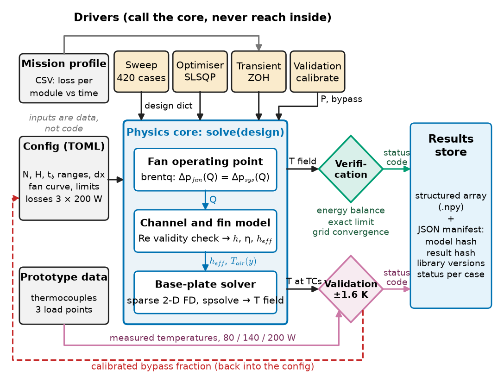
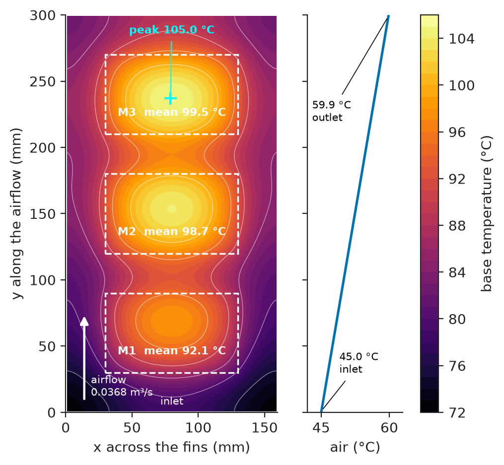
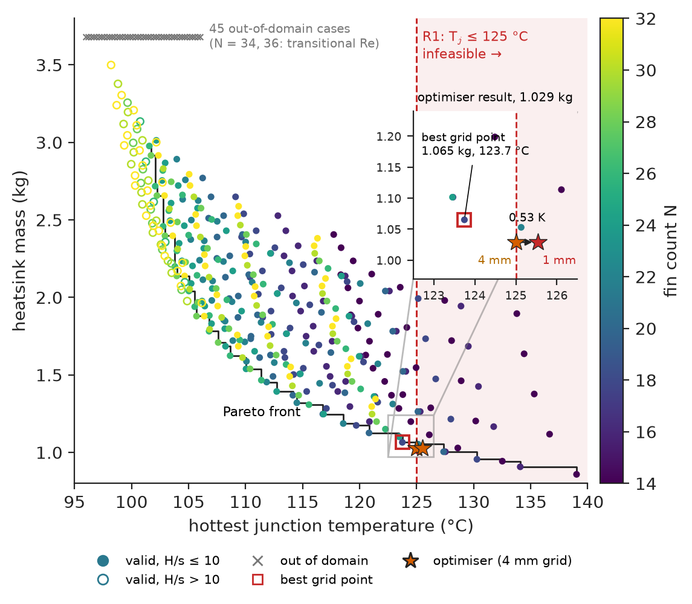
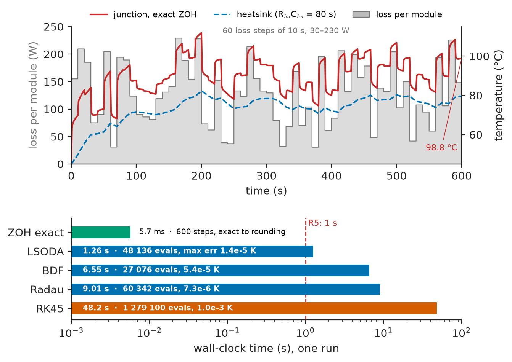
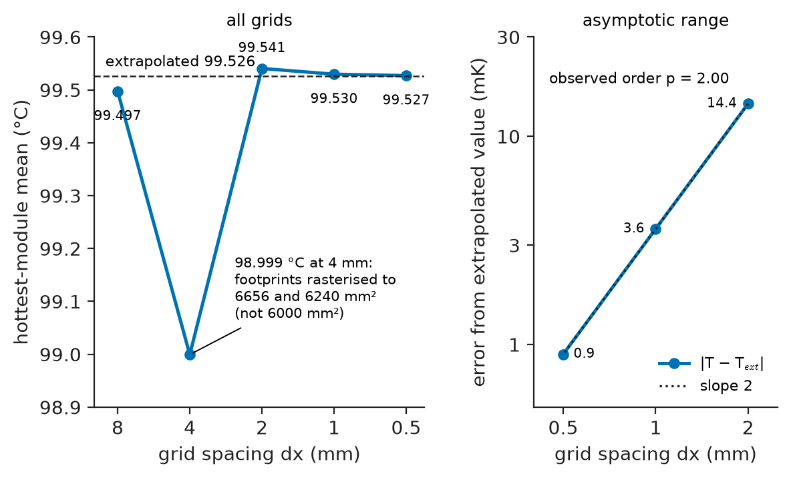
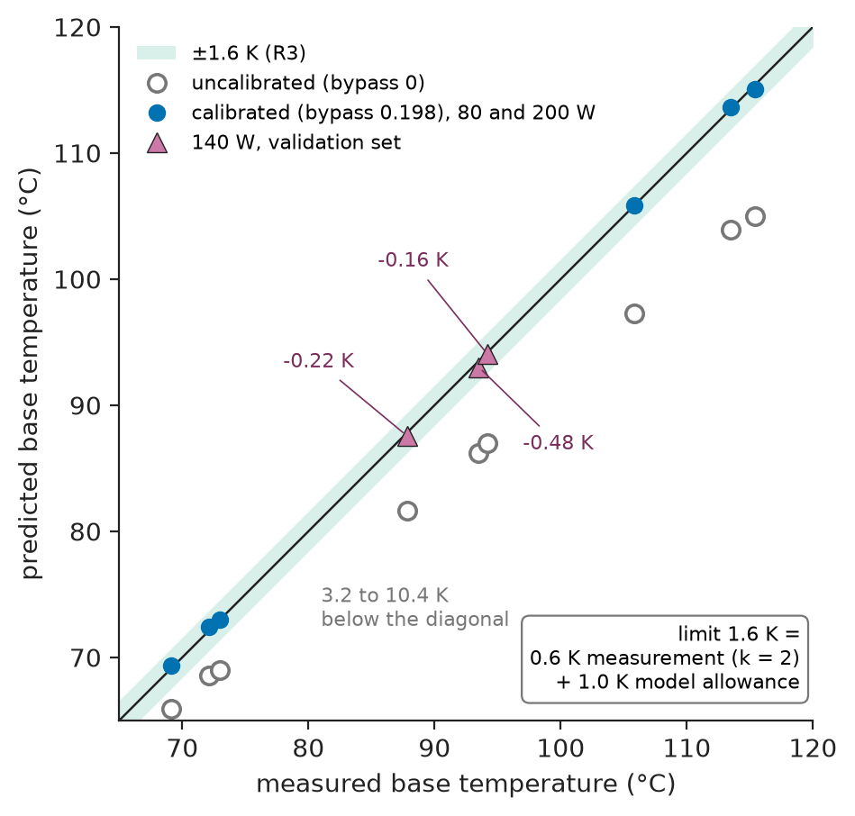

# Chapter 30 — Scientific and Engineering Computing

*Part VIII · Engineering Software and Computational Tools*

A drives team needs the lightest forced-air heatsink that keeps the three SiC half-bridge modules of a 30 kW industrial inverter below 125 °C junction temperature in 45 °C air. An optimiser wrapped around a finite-difference model of the heatsink base, run overnight on a 4 mm grid "for speed", reports a 1.03 kg extrusion with 18 fins 23.4 mm high on a 4 mm base, sitting exactly at 125.0 °C. The prototype, instrumented with thermocouples, runs its hottest module about 10 K above the prediction. The post-mortem finds three faults, none in the heat-transfer physics. On the 4 mm grid the 100 × 60 mm footprints had been rasterised to 6240 and 6656 mm² instead of 6000 mm², so the model read 0.5 K low exactly at the active constraint. A fifth of the fan's air leaked over the fin tips, which no comparison with a measurement had revealed. And a rerun gave different numbers, because the model file had been edited and nobody had recorded which version produced the report. This chapter is about the computing practice that would have caught all three before the prototype was cut.

> **How are numerical solvers, sweeps and optimisers chosen and combined so that a design computation is fast enough to explore the design space and accurate enough to decide on?**
> **How is a computed result verified, validated against a measurement, and stored so that it can be trusted and reproduced a year later?**

| Concept | Engineering destination |
|---|---|
| Numerical solvers | Sparse steady-state field solvers, operating-point root finding, stiff thermal and circuit transients |
| Parameter sweeps | Design-space maps of heatsinks, magnetics, filters and PV strings; feasibility boundaries |
| Optimization | Lightest heatsink, smallest inductor, lowest-loss switching frequency under constraints |
| Simulation automation | Overnight campaigns that run unattended, recover from failures and regenerate reports |
| Data processing | Mission profiles, thermocouple logs, steady-state detection, campaign post-processing |
| Computational performance | Choosing sparse over dense, factorising once, exploiting structure before buying hardware |
| Parallel processing | Process pools for independent cases; predicting and measuring speed-up |
| Verification of numerical results | Conservation checks, exact limits, grid-convergence studies with an error bar |
| Model validation | Comparing predictions with prototype measurements under a stated acceptance limit |
| Scientific data management | Manifests, hashes, formats and retention that make a result reproducible and auditable |

**Roadmap.** The reference computation, its requirements and architecture (30.1) → the solvers inside it (30.2) → sweeps (30.3) and optimisation (30.4) on top of the solvers → automation of the campaign (30.5) and processing of its data (30.6) → performance (30.7) and parallel execution (30.8) → verification (30.9) and validation (30.10) of what it computes → data management (30.11) → failure analysis of the whole computation (30.12).

---

## 30.1 The reference computation

> **Boundary.** Root finding, ODE and PDE discretisation and convergence are *The Mathematics Universe*, [Ch. 22](https://github.com/The-Studio-of-Sadiq/engineering-mathematics/blob/main/part-7-numerical-computational/22-numerical-methods.md); sparse and iterative solvers [Ch. 24](https://github.com/The-Studio-of-Sadiq/engineering-mathematics/blob/main/part-7-numerical-computational/24-computational-mathematics.md); optimisation in [Ch. 23](https://github.com/The-Studio-of-Sadiq/engineering-mathematics/blob/main/part-7-numerical-computational/23-optimization.md). Computing practice at scale (profiling, precision, parallel laws) is *Electronics and Computing*, [Ch. 24](https://github.com/The-Studio-of-Sadiq/Electronics-and-Computing/blob/main/part-5-programming-and-computational-systems/24-scientific-computing.md). The modelling workflow is [Chapter 3](../part-1-engineering-design-methodology/03-modeling-and-simulation-workflow.md) and the tooling around it [Chapter 29](29-engineering-software-workflows.md). This chapter assembles them into one design computation and checks it.

### The system being designed

The inverter carries three 1200 V SiC half-bridge modules (62 mm class baseplate, footprint 100 × 60 mm each) in a row along the airflow on a 160 × 300 mm extruded 6063-T5 aluminium heatsink. At rated output each module dissipates 200 W (600 W in total, 98 % efficiency at 30 kW), and its junction sits $R_{jh}=0.13$ K/W above the heatsink surface under it ($R_{th,jc}=0.09$ K/W from the datasheet plus 0.04 K/W of phase-change interface material). A 92 mm class server fan pushes air along the fins. The design variables are the number of fins $N$, their height $H$ and the base thickness $t_b$; the fin thickness is fixed at 1.5 mm by the extruder. The junction-to-heatsink resistance network is *Electronics and Computing*, [Ch. 29 §29.5](https://github.com/The-Studio-of-Sadiq/Electronics-and-Computing/blob/main/part-7-power-electronics/29-power-electronic-fundamentals.md); here the heatsink part becomes a field model because three modules share one plate and the air warms along it.

### Requirements on the computation

R1 is the product requirement; R2–R7 are requirements on the computation, and are what the overnight run lacked.

**Table 30.1 — Requirements for the heatsink design computation.**

| ID | Requirement | Target | Verification method |
|---|---|---|---|
| R1 | Hottest junction at 45 °C ambient, 200 W per module | ≤ 125 °C | Computation (R2–R3 must hold), then prototype test |
| R2 | Discretisation error of reported module temperatures | ≤ 0.1 K on the production grid | Grid-convergence study, §30.9 |
| R3 | Model against prototype, base temperature at a load point not used for calibration | within ±1.6 K | Validation test, §30.10 |
| R4 | Full design sweep (420 cases) and optimisation, wall-clock on the 8-core workstation | ≤ 5 min and ≤ 2 min | Timed run, §30.7–30.8 |
| R5 | 600 s mission-profile transient | ≤ 1 s, error ≤ 0.01 K | Comparison with exact solution, §30.7 |
| R6 | Every result traceable to model version, inputs and library versions | 100 % of stored results | Manifest audit, §30.11 |
| R7 | Cases outside a correlation's validity or failing to converge | recorded, never dropped; fraction reported | Sweep report, §30.3 |

### Architecture

Figure 30.1 shows the computation as blocks with explicit interfaces. Configuration is data, not code. The physics core maps a design and an operating point to a temperature field and scalar outputs; drivers (sweep, optimiser, transient, validation) call it and never reach inside. Every result is stored with a manifest, and verification and validation are gates in the chain, not activities after it.

<!-- FIGURE 30.1 | figures/ch30/fig-30-1-computation-architecture.png | block-diagram | Architecture of the heatsink design computation: configuration, physics core, drivers, results store and the verification and validation gates. | Content: left column inputs: Config file (TOML ranges, dx, fan curve, losses 3 x 200 W), Mission profile (CSV), Prototype data (thermocouples, 3 load points). Centre: Physics core with three sub-blocks in series: Fan operating point (brentq), Channel and fin model (Re check, h_eff), Base-plate solver (sparse 2-D FD). Above: Drivers Sweep, Optimiser (SLSQP), Transient (ZOH), Validation. Right: Results store (structured array + JSON manifest with model and result hashes). Two gate diamonds between core and store: Verification (energy balance, exact limit, grid convergence) and Validation (residuals within 1.6 K). Arrows labelled design dict, T field, status code. Dashed arrow from validation back to config labelled calibrated bypass fraction. -->



*Figure 30.1 — Architecture of the heatsink design computation: configuration, physics core, drivers, results store and the verification and validation gates.*

### Choosing the computational tool

**Table 30.2 — Tool classes for the heatsink computation, against the requirements.**

| Option | Fidelity | Cost per case | Licence (2026, indicative) | Fit to R2–R7 |
|---|---|---|---|---|
| Spreadsheet with one-node $R_{ha}$ from a catalogue curve | No air heating, no spreading | Seconds by hand | None | Cannot show module-to-module difference or verify; rejected |
| Vendor online heatsink calculator | Correlations, black box | Minutes, manual | Free | No automation, no version record; useful as a cross-check |
| Commercial electronics-cooling CFD (Icepak, FloTHERM, Simcenter class) | 3-D conjugate heat transfer, bypass resolved | 5–60 min | About \$20,000–40,000 per seat per year | Too slow for a 420-case sweep; used once to check the final design |
| Scripted 2-D plate model (Listing 30.1) | Correlations plus 2-D spreading | 70 ms | Open source | Meets R4–R7; needs validation for R3. **Chosen** |

### Budgets

Two budgets govern the computation: wall-clock time (R4, R5) and accuracy (R1–R3). Table 30.3 is the accuracy budget for the junction temperature: the computed value must sit below the limit by at least the combined uncertainty of the model, or the margin is fictitious.

**Table 30.3 — Accuracy budget for the predicted hottest-junction temperature (Revision A design, after validation).**

| Contribution | Value | How obtained |
|---|---|---|
| Discretisation error, 2 mm production grid | 0.01 K | Grid convergence, §30.9 |
| Discretisation error, 4 mm optimiser grid | 0.53 K | Comparison with 1 mm grid, §30.4 |
| Model-form error (correlation, bypass, uniform $h$) after calibration | 0.5 K (validation residual max 0.48 K) | Validation, §30.10 |
| Interface resistance spread ($R_{ch}$ 0.04 ± 0.01 K/W at 200 W) | ±2.0 K | Interface-material datasheet, lot spread |
| $R_{th,jc}$ spread (0.09 K/W, max 0.10 K/W) | +2.0 K | Module datasheet maximum |
| **Root-sum-square, production grid** | **≈ 2.9 K** | |
| **Required margin below 125 °C** | **≥ 3 K** | Design rule |
| **Margin of the overnight result** | **0.0 K** (−0.53 K on a fine grid) | Fails before the bypass is even counted |

---

## 30.2 Numerical solvers

### One computation, four kinds of solver

The heatsink computation contains four numerical problems, and each wants a different solver (Table 30.4).

**Table 30.4 — Sub-problems of the reference computation and the solver chosen for each.**

| Sub-problem | Mathematical form | Solver chosen | Why |
|---|---|---|---|
| Fan operating point | Scalar root: $\Delta p_{fan}(Q)=\Delta p_{sys}(Q)$ | Bracketing root finder (`brentq`) | Guaranteed convergence inside a bracket; the fan curve is monotonic |
| Fin and channel model | Closed-form correlations | Direct evaluation with a validity check | No iteration needed; validity range must be enforced |
| Base-plate temperature | Sparse linear system, $10^3$–$10^5$ unknowns | Sparse direct LU (SuperLU via `spsolve`) | Symmetric, well conditioned, solved once per design |
| Junction transient | 5 linear ODEs, time constants 1 ms to 80 s | Exact zero-order-hold discretisation | Linear and piecewise-constant input: no time-stepping error at all |

The rule: identify the structure first (linear or not, stiff or not, one solve or thousands) and pick the most specialised solver it allows. The mathematics of each method (bisection and Newton in *The Mathematics Universe*, [Ch. 22 §22.4](https://github.com/The-Studio-of-Sadiq/engineering-mathematics/blob/main/part-7-numerical-computational/22-numerical-methods.md); stiffness in §22.9; sparse direct factorisation in [Ch. 24 §24.5](https://github.com/The-Studio-of-Sadiq/engineering-mathematics/blob/main/part-7-numerical-computational/24-computational-mathematics.md)) is not repeated here.

> **Status of the principle: Structure before solver**
> *Empirical.* Exploiting linearity, sparsity or a closed form reliably buys orders of magnitude in run time and removes whole classes of solver error; a general method is the fallback.

### The physics core

The base is modelled as a 2-D conducting plate of thickness $t_b$ and conductivity $k$, heated by the module footprints on top and cooled through the fins underneath by an effective coefficient $h_{eff}$ referred to the base area:

$$
k\,t_b\,\nabla^2 T-h_{eff}\,\bigl(T-T_{air}(y)\bigr)+q''(x,y)=0 ,
$$

with adiabatic edges and air warming linearly along the flow by $P/(\rho c_p Q)$. The fin coefficient $h$ comes from a developing-laminar correlation below $Re=2300$ and from Gnielinski's correlation above $Re=3000$ (convection groups in *Engineering Physics*, [Ch. 19 §19.6](https://github.com/The-Studio-of-Sadiq/Engineering-Physics/blob/main/CHAPTERS/CHAPTER%2019.md)); the transitional band between them has no validated correlation, so the model refuses to answer there. Fin efficiency is the adiabatic-tip result $\eta=\tanh(mH)/(mH)$ with $m=\sqrt{2h/(k t)}$.

> **Status of the principle: Effective-coefficient plate model of a finned heatsink**
> *Approximate.* Assumes conduction in the base is two-dimensional (base thin compared with the spreading length $\sqrt{k t_b/h_{eff}}$, here 49 mm against 4 mm), a single $h$ for all fins, adiabatic fin tips, and air heated uniformly along the channel. It fails near the fan hub and for thick bases.

Listing 30.1 is the whole core, saved as `hs_model.py`; every later listing imports it.

```python
"""hs_model.py -- forced-air heatsink model of the three-module SiC inverter."""
import numpy as np
import scipy.sparse as sp
from scipy.optimize import brentq
from scipy.sparse.linalg import spsolve

RHO, CP, MU, K_AIR = 1.09, 1007.0, 1.96e-5, 0.028               # air at about 45 C
W, L, K_AL, T_AMB = 0.16, 0.30, 200.0, 45.0                     # base 160 x 300 mm, 6063-T5
CENTRES, FX, FY = [(0.08, 0.06), (0.08, 0.15), (0.08, 0.24)], 0.10, 0.06

def fan_dp(Q):                                                  # fan curve, Pa (Q in m3/s)
    return 250.0 * (1.0 - (Q / 0.070) ** 2)

def channel(N, H, t, Q):                                        # dp, h, gap, Reynolds number
    s = (W - N * t) / (N - 1)
    v, Dh = Q / ((N - 1) * s * H), 2 * s * H / (s + H)
    Re = RHO * v * Dh / MU
    f_t = (0.79 * np.log(Re) - 1.64) ** -2                      # Petukhov friction factor
    if Re < 2300:                                               # developing laminar flow
        Gz = Dh / L * Re * 0.71
        Nu = 7.54 + 0.03 * Gz / (1 + 0.016 * Gz ** (2 / 3))
    else:                                                       # Gnielinski, Pr = 0.71
        Nu = f_t / 8 * (Re - 1000) * 0.71 / (1 + 12.7 * np.sqrt(f_t / 8) * (0.71 ** (2 / 3) - 1))
    dp = max(96 / Re, f_t) * L / Dh * 0.5 * RHO * v**2 + 0.75 * RHO * v**2
    return dp, Nu * K_AIR / Dh, s, Re

def lap1d(n, dx):                                               # adiabatic (Neumann) edges
    d = -2.0 * np.ones(n); d[[0, -1]] = -1.0
    return sp.diags([np.ones(n - 1), d, np.ones(n - 1)], [-1, 0, 1]) / dx**2

def solve(N=20, H=0.040, t=0.0015, tb=0.010, P=(200.0,) * 3, dx=0.002, bypass=0.0):
    Q = brentq(lambda q: fan_dp(q) - channel(N, H, t, q)[0], 1e-4, 0.0699)
    _, h, s, Re = channel(N, H, t, (1 - bypass) * Q)            # bypass: flow over fin tips
    if 2300 <= Re <= 3000:
        raise ValueError(f"Re = {Re:.0f}: transitional flow, no validated correlation")
    m = np.sqrt(2 * h / (K_AL * t))
    eta = np.tanh(m * H) / (m * H)                              # adiabatic-tip fin efficiency
    h_eff = h * ((N - 1) * s + 2 * N * H * eta) / W             # per unit base area
    nx, ny = round(W / dx), round(L / dx)
    X, Y = np.meshgrid((np.arange(nx) + 0.5) * dx, (np.arange(ny) + 0.5) * dx, indexing="ij")
    masks = [(abs(X - cx) <= FX / 2) & (abs(Y - cy) <= FY / 2) for cx, cy in CENTRES]
    q = sum(Pk * mk / (mk.sum() * dx * dx) for Pk, mk in zip(P, masks))   # exact power
    T_air = T_AMB + sum(P) / (RHO * CP * (1 - bypass) * Q) * Y / L
    A = K_AL * tb * sp.kronsum(lap1d(ny, dx), lap1d(nx, dx)) - h_eff * sp.eye(nx * ny)
    T = spsolve(A.tocsc(), -(q + h_eff * T_air).ravel()).reshape(nx, ny)
    return dict(Q=Q, h=h, eta=eta, h_eff=h_eff, T=T, Tmax=T.max(),
                T_mod=[T[mk].mean() for mk in masks],
                T_ctr=[T[np.argmin(abs(X[:, 0] - cx)), np.argmin(abs(Y[0] - cy))] for cx, cy in CENTRES],
                mass=2700 * (W * L * tb + N * t * H * L),
                heat_out=(h_eff * (T - T_air)).sum() * dx * dx)
```

*Listing 30.1 — The physics core: fan operating point, channel and fin model with a validity check, and a sparse 2-D finite-difference solve of the base plate.*

Three decisions in the listing matter more than any line of physics. The flux is normalised by the cells actually inside each footprint, so the injected power is exact on any grid even when the area is not. The transitional-flow check raises instead of returning a number, so no driver can mistake an unsupported case for a result. And the function returns the heat leaving through the fins, so every caller can check conservation for free.

**Worked example — the fan operating point by hand.** For the Revision A design ($N=18$, $H=23.4$ mm, $t=1.5$ mm) the fin gap is $s=(160-18\times1.5)/17=7.82$ mm. `brentq` balances fan and channels at $Q=0.0368\ \mathrm{m^3/s}$ (78 CFM) and 181 Pa; check: $250\,[1-(0.0368/0.070)^2]=181$ Pa. The channel velocity is $0.0368/(17\times0.00782\times0.0234)=11.8$ m/s, the hydraulic diameter 11.7 mm and $Re=7720$, comfortably turbulent, so Gnielinski applies and gives $h=58.1\ \mathrm{W/(m^2\,K)}$. With $mH=0.46$ the fins are 93.5 % efficient, and the finned surface multiplies the base area by 5.75, giving $h_{eff}=334\ \mathrm{W/(m^2\,K)}$. The air warms by $600/(1.09\times1007\times0.0368)=14.9$ K from inlet to outlet. A hand check of each number is the cheapest verification there is.

<!-- FIGURE 30.2 | figures/ch30/fig-30-2-base-temperature-field.png | plot | Computed base-plate temperature field of the Revision A heatsink at 200 W per module, 45 C inlet air, 2 mm grid. | Content: filled contour map, x-axis across the fins 0 to 160 mm, y-axis along the airflow 0 to 300 mm (inlet at y = 0, arrow labelled airflow 0.0368 m3/s). Colour scale 72 to 106 C. Dashed 100 x 60 mm rectangles at y = 60, 150, 240 mm labelled M1, M2, M3 with means 92.1, 98.7, 99.5 C; peak 105.0 C in M3. Side strip: air 45.0 C at inlet to 59.9 C at outlet. -->



*Figure 30.2 — Computed base-plate temperature field of the Revision A heatsink at 200 W per module, 45 C inlet air, 2 mm grid.*

In Figure 30.2 module M1 at the inlet runs 7 K cooler than M3 because the air warms along the plate, which a one-node heatsink model would miss.

---

## 30.3 Parameter sweeps

### Designing the sweep

A sweep is an experiment on a model and needs the same planning as one in a laboratory: variables, ranges, levels, outputs, and what counts as a failed run. The reference sweep is a full factorial over 12 fin counts (14 to 36), 7 fin heights (20 to 50 mm) and 5 base thicknesses (4 to 12 mm): $12\times7\times5=420$ cases. Factorial grids are right for three variables and for drawing feasibility maps; for six or more variables a space-filling design (Latin hypercube or Sobol' points, `scipy.stats.qmc`) gives far better coverage per case, and a full grid at 7 levels would need $7^6\approx118\,000$ cases.

Listing 30.2 runs the sweep, keeps failures as data and writes the manifest that R6 requires. It doubles as the parallel benchmark of §30.8.

```python
import hashlib, itertools, json, platform, time
from concurrent.futures import ProcessPoolExecutor
import numpy as np, scipy
import hs_model as hs

CONFIG = dict(N=list(range(14, 37, 2)), H=[0.020, 0.025, 0.030, 0.035, 0.040, 0.045, 0.050],
              tb=[0.004, 0.006, 0.008, 0.010, 0.012], dx=0.002, R_jh=0.13, P=200.0)

def run_case(case):
    N, H, tb = case
    try:
        r = hs.solve(N=N, H=H, tb=tb, dx=CONFIG["dx"])
        Tj = max(r["T_mod"]) + CONFIG["P"] * CONFIG["R_jh"]
        return (N, H, tb, r["mass"], Tj, r["Q"], 0)            # status 0 = converged
    except (ValueError, RuntimeError):
        return (N, H, tb, np.nan, np.nan, np.nan, 1)           # failure is kept as data

if __name__ == "__main__":
    cases = list(itertools.product(CONFIG["N"], CONFIG["H"], CONFIG["tb"]))
    for workers in (1, 8):
        t0 = time.perf_counter()
        with ProcessPoolExecutor(max_workers=workers) as pool:
            rows = list(pool.map(run_case, cases, chunksize=8))
        print(f"{len(cases)} cases, {workers} worker(s): {time.perf_counter() - t0:.1f} s")
    res = np.array(rows, dtype=[("N", "i4"), ("H", "f8"), ("tb", "f8"), ("mass", "f8"),
                                ("Tj", "f8"), ("Q", "f8"), ("status", "i4")])
    np.save("sweep_v1.npy", res)
    manifest = dict(config=CONFIG, n_failed=int(res["status"].sum()),
                    model_sha256=hashlib.sha256(open(hs.__file__, "rb").read()).hexdigest()[:16],
                    python=platform.python_version(), numpy=np.__version__, scipy=scipy.__version__,
                    result_sha256=hashlib.sha256(res.tobytes()).hexdigest()[:16])
    json.dump(manifest, open("sweep_v1.json", "w"), indent=1)
    print({k: manifest[k] for k in ("n_failed", "model_sha256", "result_sha256")})
```

```text
420 cases, 1 worker(s): 72.9 s
420 cases, 8 worker(s): 16.0 s
{'n_failed': 45, 'model_sha256': '4792b5780f66883d', 'result_sha256': 'e73d62e3cda02e32'}
```

*Listing 30.2 — A process-parallel factorial sweep that records failures and writes a manifest (timings from one run on a shared 8-core workstation).*

### Reading the sweep

Of the 420 cases, 45 (10.7 %) fall in the transitional flow band, all at 34 or 36 fins. Of the 375 valid cases, 292 meet both the 125 °C limit and the extrusion aspect-ratio limit $H/s\le10$. The lightest of those on the grid is 18 fins, 25 mm, 4 mm base, at 1.065 kg and 123.7 °C. Figure 30.3 shows the map. Silently skipped, the 45 failures would leave an empty corner nobody asks about; recorded, they say "the model cannot speak for very dense fins", which sends someone to CFD or a wind tunnel if the optimum ever moves there (R7).

> **Status of the principle: Failures are results**
> *Empirical.* Dropping failed or out-of-domain cases biases every statistic of a campaign, because failures cluster.

<!-- FIGURE 30.3 | figures/ch30/fig-30-3-sweep-map.png | plot | Design-space map from the 420-case sweep: heatsink mass against hottest-junction temperature. | Content: scatter, x-axis hottest junction temperature 95 to 140 C, y-axis mass 0.8 to 3.8 kg. 375 valid cases coloured by fin count N. Vertical dashed line at 125 C (R1), infeasible side shaded. Cases violating H/s > 10 hollow; 45 out-of-domain cases (N = 34 to 36) as grey crosses along the top edge. Square at best grid point (1.065 kg, 123.7 C); stars at the optimiser result 1.029 kg, 125.0 C (4 mm grid) and 125.5 C (1 mm grid) joined by an arrow labelled 0.53 K. Pareto front as a step line. -->



*Figure 30.3 — Design-space map from the 420-case sweep: heatsink mass against hottest-junction temperature.*

---

## 30.4 Optimization

### From map to optimum

A sweep finds the neighbourhood; an optimiser finds the point. For each fin count, the continuous variables $H$ and $t_b$ are optimised to minimise mass subject to the junction limit and the aspect-ratio limit. The integer $N$ is enumerated, which is cheap with ten values. The method is SLSQP (sequential quadratic programming); its theory (KKT conditions, quasi-Newton updates) is in *The Mathematics Universe*, [Ch. 23 §23.4 and §23.6](https://github.com/The-Studio-of-Sadiq/engineering-mathematics/blob/main/part-7-numerical-computational/23-optimization.md). Variables are scaled to millimetres, because finite-difference gradients behave badly when variables differ by orders of magnitude.

```python
from scipy.optimize import minimize
import hs_model as hs

T_LIMIT, R_JH, P, T_FIN = 125.0, 0.13, 200.0, 0.0015

def design(N, dx):
    """Lightest (H, tb) for N fins; variables in mm so both are of order 10."""
    Tj = lambda z: max(hs.solve(N=N, H=z[0] / 1e3, tb=z[1] / 1e3, dx=dx)["T_mod"]) + P * R_JH
    gap = (hs.W - N * T_FIN) / (N - 1) * 1e3                   # fin gap, mm
    cons = [{"type": "ineq", "fun": lambda z: T_LIMIT - Tj(z)},
            {"type": "ineq", "fun": lambda z: 10 * gap - z[0]}]  # extrusion aspect ratio <= 10
    mass = lambda z: 2700 * (hs.W * hs.L * z[1] + N * T_FIN * z[0] * hs.L) / 1e3
    res = minimize(mass, x0=[40.0, 8.0], method="SLSQP", constraints=cons,
                   bounds=[(15, 60), (4, 15)], options={"ftol": 1e-6})
    return res.x, res.fun, Tj(res.x), res.nfev, res.success

runs = [design(N, 0.004) + (N,) for N in range(14, 33, 2)]
for x, m, Tj, nfev, ok, N in runs[::2]:                  # every second N shown
    print(f"N = {N:2d}: H = {x[0]:5.2f} mm, tb = {x[1]:.2f} mm, {m:.3f} kg, Tj = {Tj:.2f} C")
best = min(runs, key=lambda d: d[1])
(H, tb), mass, Tj4, nfev, ok, N = best
Tj1 = max(hs.solve(N=N, H=H / 1e3, tb=tb / 1e3, dx=0.001)["T_mod"]) + P * R_JH
print(f"optimum: N = {N}, H = {H:.1f} mm, tb = {tb:.2f} mm, mass = {mass:.3f} kg ({ok})")
print(f"Tj on 4 mm grid = {Tj4:.2f} C, re-checked on 1 mm grid = {Tj1:.2f} C")
```

```text
N = 14: H = 37.61 mm, tb = 4.00 mm, 1.158 kg, Tj = 125.00 C
N = 18: H = 23.36 mm, tb = 4.00 mm, 1.029 kg, Tj = 125.00 C
N = 22: H = 19.76 mm, tb = 4.00 mm, 1.046 kg, Tj = 125.00 C
N = 26: H = 18.27 mm, tb = 4.00 mm, 1.095 kg, Tj = 125.00 C
N = 30: H = 17.80 mm, tb = 4.00 mm, 1.167 kg, Tj = 125.00 C
optimum: N = 18, H = 23.4 mm, tb = 4.00 mm, mass = 1.029 kg (True)
Tj on 4 mm grid = 125.00 C, re-checked on 1 mm grid = 125.53 C
```

*Listing 30.3 — Constrained optimisation with enumeration over the integer variable, and a re-check of the optimum on a finer grid (10 s on the workstation).*

### What the optimiser did

The output reproduces the opening story. The optimiser beat the best grid point by 3.4 % (1.029 kg against 1.065 kg), put the base at its 4 mm bound for every $N$, and left every optimum exactly on the temperature constraint. That is the danger: any model error at the constraint boundary becomes a violation in the product. On the 4 mm grid the footprints were rasterised to 6656 and 6240 mm² instead of 6000 mm² (§30.9), and the re-check on a 1 mm grid puts the "optimal" design 0.53 K over the limit.

> **Status of the principle: Optimisers exploit model error**
> *Empirical.* An optimum lies on active constraints, and an optimiser preferentially finds regions where the model is optimistic; the remedy is to optimise against a limit tightened by the model's verified error and to re-verify the optimum with the production model.

**Worked example — the tightened constraint.** The accuracy budget of Table 30.3 gives a combined uncertainty of about 2.9 K on the production grid, so the optimiser's limit becomes $125-3=122$ °C, plus the 4 mm grid's own 0.53 K if the optimiser keeps the coarse grid: $122-0.53\approx121.5$ °C. The heavier heatsink that results is the real cost of the requirement, and is what Revision B (§30.12) uses.

Trading mass against fan power or noise makes the problem multi-objective (Pareto fronts, *The Mathematics Universe*, [Ch. 23 §23.9](https://github.com/The-Studio-of-Sadiq/engineering-mathematics/blob/main/part-7-numerical-computational/23-optimization.md)). Gradient-free global methods (`differential_evolution`, CMA-ES) earn their 10–100 times higher evaluation count only on multimodal or noisy responses.

---

## 30.5 Simulation automation

### From scripts to a campaign

The overnight run was a script edited between runs. A trustworthy campaign has five properties:

1. **Configuration as data.** Ranges, grid spacing, losses, fan curve and limits live in one versioned file, not in the script.
2. **One entry point.** One command (`python -m heatsink run campaign.toml`) runs everything.
3. **Idempotent, cached cases.** Each case is keyed by a hash of its inputs and the model version; rerunning skips what is already done and a changed model invalidates exactly what it should (content-addressed caching as in *Electronics and Computing*, [Ch. 24 §24.4](https://github.com/The-Studio-of-Sadiq/Electronics-and-Computing/blob/main/part-5-programming-and-computational-systems/24-scientific-computing.md)).
4. **Timeouts and status.** Every external solver call has a timeout; every case ends in a recorded state: converged, out of domain, not converged, timed out, crashed.
5. **Report from data.** Figures and tables in the design report are regenerated from the stored results by the same command, never pasted.

### When the solver is someone else's program

When the core is an external tool (ngspice, OpenFOAM, Elmer, a PLECS or Simulink model in batch mode), add three things: one directory per case named by its hash; `subprocess.run(..., timeout=...)` with stdout and stderr kept; and a parser that sets the status from the tool's own convergence report. A solver that writes a plausible result file after failing to converge is the commonest silent error in automated campaigns.

Snakemake, Slurm or a cloud batch queue change where cases run, not these rules; version control and CI around the campaign are [Chapter 29](29-engineering-software-workflows.md).

---

## 30.6 Data processing

### Input data: the mission profile

The transient study of §30.7 needs module loss against time. The drive logs phase current, DC-link voltage and heatsink temperature at 1 kHz; the chain is: resample to the analysis step (1 s; the junction's millisecond constants are handled analytically); convert current and temperature to conduction and switching loss with the device's tabulated $R_{DS(on)}(T_j)$ and $E_{sw}(I,V)$ (the loss models are *Electronics and Computing*, [Ch. 29 §29.3–29.4](https://github.com/The-Studio-of-Sadiq/Electronics-and-Computing/blob/main/part-7-power-electronics/29-power-electronic-fundamentals.md)); and check the energy of the resampled profile against the energy of the raw one. Point sampling instead of interval means can change the energy of a pulsed profile by tens of per cent.

### Output data: thermocouple logs and steady state

**Worked example — when is the prototype steady?** The heatsink time constant is $R_{ha}C_{hs}=0.086\times926=80$ s. At 200 W the base under M3 rises about 70 K, so settling to within 0.1 K takes $80\times\ln(700)=524$ s, about 9 min. Rather than a fixed wait, the logging script declares steady state when a least-squares line through the last 120 s has a slope below 0.5 K per 10 min, which for a first-order response leaves $0.5/600\times80=0.067$ K to go, and reports the mean of the last 60 s. The rule lives in code, so two technicians get the same number from the same log.

---

## 30.7 Computational performance

### Measure, then exploit structure

A profile of 10 calls of `solve` on the 2 mm grid (Python's `cProfile`; profiling practice in *Electronics and Computing*, [Ch. 24 §24.6](https://github.com/The-Studio-of-Sadiq/Electronics-and-Computing/blob/main/part-5-programming-and-computational-systems/24-scientific-computing.md)) attributes 79 % of the 72 ms per call to the sparse LU factorisation and solve, 12 % to assembling the sparse matrix, and the rest to the fan root, masks and bookkeeping. Performance is therefore a linear-algebra question (Table 30.5).

**Table 30.5 — Measured cost of solving the base-plate system (one right-hand side unless stated; workstation, SciPy 1.18).**

| Grid | Unknowns | Non-zeros | Dense LU | Sparse LU (`spsolve`) | Factor once, then per solve | Conjugate gradient ($10^{-10}$) |
|---|---|---|---|---|---|---|
| 4 mm | 3 000 | 14 770 | 1 027 ms, 72 MB | 13 ms | 0.6 ms | 29 ms |
| 2 mm | 12 000 | 59 540 | ≈ 66 s, 1.15 GB (estimated) | 58 ms | 2.1 ms | 366 ms |
| 1 mm | 48 000 | 239 080 | 18.4 GB: does not fit | 300 ms | 11 ms | 1 362 ms |

Three lessons follow. Dense storage is never an option for field problems. Unpreconditioned conjugate gradients lose to sparse LU at these sizes because a 2-D five-point system factorises with little fill-in; iterative solvers win in 3-D and at millions of unknowns, with a good preconditioner (*The Mathematics Universe*, [Ch. 24 §24.4](https://github.com/The-Studio-of-Sadiq/engineering-mathematics/blob/main/part-7-numerical-computational/24-computational-mathematics.md)). And when the matrix is fixed and only the load changes, factorising once with `splu` costs 2.1 ms instead of 58 ms per load point, a factor of 27.

### Structure in the transient

Solver choice matters most in the junction transient. Each module is a four-element Foster network from its datasheet (0.010, 0.030, 0.050, 0.040 K/W; 1 ms, 10 ms, 100 ms, 1 s) on a heatsink of 0.086 K/W (from the steady model) and 926 J/K (1.029 kg of aluminium): time constants from 1 ms to 80 s, a stiffness ratio of $8\times10^4$. Listing 30.4 solves a 600 s profile of 10 s loss steps four ways and compares them with the exact solution, which exists because the system is linear and the loss is piecewise constant: over each step, $x_{k+1}=e^{-\Delta t/\tau}x_k+(1-e^{-\Delta t/\tau})R\,P_k$ per state.

```python
import time
import numpy as np
from scipy.integrate import solve_ivp

R = np.array([0.010, 0.030, 0.050, 0.040])          # Foster network, junction to heatsink, K/W
TAU = np.array([0.001, 0.01, 0.1, 1.0])             # s
R_HA, C_HS, T_AMB = 0.086, 926.0, 45.0              # heatsink to air (K/W), heat capacity (J/K)
rng = np.random.default_rng(7)
P = np.repeat(rng.uniform(30, 230, 60), 10)        # 600 s profile, W per module, 10 s steps
A = np.diag(np.append(-1 / TAU, -1 / (R_HA * C_HS)))
Bv = np.append(R / TAU, 3.0 / C_HS)                  # three modules heat the shared heatsink

def f(t, x):                                         # x = [Foster states..., heatsink rise]
    return A @ x + Bv * P[min(int(t), P.size - 1)]

# Exact solution for piecewise-constant losses: zero-order-hold discretisation per 1 s step.
Ad = np.exp(np.diag(A)); Bd = (Ad - 1) / np.diag(A) * Bv
t0 = time.perf_counter(); x = np.zeros(5); Tj_ref = []
for Pk in P:
    x = Ad * x + Bd * Pk; Tj_ref.append(T_AMB + x.sum())
print(f"ZOH exact   : {1e3 * (time.perf_counter() - t0):7.1f} ms, Tj(600 s) = {Tj_ref[-1]:.3f} C")

for method in ("RK45", "LSODA", "BDF", "Radau"):
    t0 = time.perf_counter()
    sol = solve_ivp(f, (0, P.size), np.zeros(5), method=method, rtol=1e-6, atol=1e-6,
                    t_eval=np.arange(1, P.size + 1), max_step=1.0)
    err = np.max(np.abs(T_AMB + sol.y.sum(axis=0) - Tj_ref))
    print(f"{method:12s}: {1e3 * (time.perf_counter() - t0):7.1f} ms, {sol.nfev:6d} evaluations,"
          f" max error {err:.1e} K")
```

```text
ZOH exact   :     5.7 ms, Tj(600 s) = 98.784 C
RK45        : 48163.4 ms, 1279100 evaluations, max error 1.0e-03 K
LSODA       :  1255.8 ms,  48136 evaluations, max error 1.4e-05 K
BDF         :  6552.1 ms,  27076 evaluations, max error 5.4e-05 K
Radau       :  9006.8 ms,  60342 evaluations, max error 7.3e-06 K
```

*Listing 30.4 — Five ways to solve the same stiff linear transient (timings from one run).*

<!-- FIGURE 30.4 | figures/ch30/fig-30-4-transient-solvers.png | plot | Junction temperature of the hottest module over the 600 s loss profile, and the cost of computing it with five methods. | Content: top panel, x-axis time 0 to 600 s; left y-axis loss per module 0 to 250 W (grey steps, 60 levels of 10 s between 30 and 230 W); right y-axis junction temperature 45 to 110 C (exact ZOH solution, 98.8 C at 600 s; heatsink rise dashed). Bottom panel, log-scale bars 1 ms to 100 s: ZOH 5.7 ms, LSODA 1.26 s, BDF 6.6 s, Radau 9.0 s, RK45 48.2 s, annotated with evaluations (48 136, 27 076, 60 342, 1 279 100) and max error; dashed line at 1 s labelled R5. -->



*Figure 30.4 — Junction temperature of the hottest module over the 600 s loss profile, and the cost of computing it with five methods.*

The explicit RK45 takes 1.28 million evaluations and 48 s, because its step is held to about 2.8 ms by stability against the 1 ms time constant, not by accuracy; this is stiffness in its purest form (*The Mathematics Universe*, [Ch. 22 §22.9](https://github.com/The-Studio-of-Sadiq/engineering-mathematics/blob/main/part-7-numerical-computational/22-numerical-methods.md)). The implicit methods take 1–9 s, mostly Python call overhead. The exact discretisation takes 5.7 ms, is exact to rounding and meets R5 with a margin of 175 (Figure 30.4); a 30-minute cycle at 1 ms resolution for rainflow lifetime analysis takes under 20 s this way.

> **Status of the principle: Exact discretisation of linear systems with piecewise-constant input**
> *Derived.* For $\dot x=Ax+Bu$ with $u$ constant over a step, $x_{k+1}=e^{A\Delta t}x_k+A^{-1}(e^{A\Delta t}-I)Bu_k$ holds exactly for any step length; it applies to Foster networks, RC thermal ladders and linear circuit models, and fails as soon as a parameter depends on the state (temperature-dependent loss), where an implicit solver or an iteration per step is needed.

**Table 30.6 — Wall-clock budget of the Revision A campaign (measured, shared 8-core workstation).**

| Step | Budget | Measured | Margin |
|---|---|---|---|
| Sweep, 420 cases, 2 mm, 8 workers (Listing 30.2) | 300 s | 16.0 s | 94.7 % |
| Optimisation, 10 SLSQP runs, 4 mm (Listing 30.3) | 120 s | 10.2 s | 91.5 % |
| Verification, 3 grids to 0.5 mm (Listing 30.5) | 30 s | 4.0 s | 86.7 % |
| Validation and calibration (Listing 30.6) | 30 s | 3.1 s | 89.7 % |
| 600 s transient (Listing 30.4) | 1 s | 0.006 s | 99.4 % |

The margin is what pays for the 1 mm grid, the tightened constraint and a second fan speed in Revision B without a cluster.

---

## 30.8 Parallel processing

Cases in a sweep are independent, so the sweep is embarrassingly parallel and a process pool is the right tool (Python threads would serialise on the interpreter lock; levels of parallelism and the two scaling laws are *Electronics and Computing*, [Ch. 24 §24.5](https://github.com/The-Studio-of-Sadiq/Electronics-and-Computing/blob/main/part-5-programming-and-computational-systems/24-scientific-computing.md)). Listing 30.2 measured 72.9 s on one worker and 16.0 s on eight, a speed-up of 4.56.

**Worked example — what limits the speed-up.** With Amdahl's law, $1/S=s+(1-s)/N$, the measured $S=4.56$ on $N=8$ gives an effective serial fraction $s=(1/4.56-1/8)/(1-1/8)=0.108$. Nothing in the sweep is really 10.8 % serial; the figure lumps together what did not scale: worker start-up and SciPy import (about 1 s), the turbo clock dropping under full load, memory bandwidth shared by eight factorisations, and other jobs on the shared machine (the one-worker run took 174 ms per case against 72 ms in the quiet profile). On that basis a 32-core machine would give $1/(0.108+0.892/32)=7.4$, not 32.

Four rules keep parallel campaigns efficient and correct:

- **Parallelise at one level.** Single-threaded BLAS in each worker (`OMP_NUM_THREADS=1`), or eight workers start 64 threads.
- **Chunk small cases.** At 70 ms per case, `chunksize=8` amortises inter-process overhead.
- **Make results independent of the worker count.** Results in case order, one seeded random stream per case; the result hash proves 1 and 8 workers agree bit for bit.
- **Do not parallelise what should be restructured.** Factorising once (27 times) and the exact transient (about 8000 times) beat anything eight cores can give.

> **Status of the principle: Speed-up of an embarrassingly parallel sweep**
> *Approximate.* Independent cases scale almost linearly only while per-case work dominates start-up and contention; the measured speed-up, read as an effective serial fraction, is the number to plan with.

---

## 30.9 Verification of numerical results

Verification asks whether the equations were solved correctly; validation (§30.10) asks whether they were the right equations. The distinction and the overall workflow are [Chapter 3](../part-1-engineering-design-methodology/03-modeling-and-simulation-workflow.md); the theory of convergence and of verifying it in practice is *The Mathematics Universe*, [Ch. 22 §22.11](https://github.com/The-Studio-of-Sadiq/engineering-mathematics/blob/main/part-7-numerical-computational/22-numerical-methods.md). Listing 30.5 applies three checks to the Revision A design.

```python
import numpy as np
import hs_model as hs

design = dict(N=18, H=0.02336, tb=0.004)        # optimiser result, Listing 30.3

# 1. Conservation: heat leaving through the fins must equal the 600 W injected.
r = hs.solve(**design)
print(f"energy balance error  : {r['heat_out'] - 600.0:+.1e} W")

# 2. Exact limit: one source covering the whole base, no air temperature rise.
saved = hs.CENTRES, hs.FX, hs.FY, hs.CP
hs.CENTRES, hs.FX, hs.FY, hs.CP = [(hs.W / 2, hs.L / 2)], hs.W, hs.L, 1e12
r = hs.solve(P=(600.0,), **design)
exact = hs.T_AMB + 600.0 / (r["h_eff"] * hs.W * hs.L)
print(f"uniform-flux limit    : {r['Tmax'] - exact:+.1e} K from exact")
hs.CENTRES, hs.FX, hs.FY, hs.CP = saved

# 3. Grid convergence of the hottest module (refinement ratio 2).
f = [max(hs.solve(dx=dx, **design)["T_mod"]) for dx in (0.002, 0.001, 0.0005)]
p = np.log((f[0] - f[1]) / (f[1] - f[2])) / np.log(2)
gci = 1.25 * abs(f[2] - f[1]) / (2**p - 1)
print("hottest module, C     :", np.round(f, 4))
print(f"observed order p = {p:.2f}, GCI(fine) = {gci * 1000:.1f} mK")
```

```text
energy balance error  : +1.6e-10 W
uniform-flux limit    : +1.3e-08 K from exact
hottest module, C     : [99.5405 99.5298 99.5271]
observed order p = 2.00, GCI(fine) = 1.1 mK
```

*Listing 30.5 — Three verification checks: global conservation, an exact limiting case and a grid-convergence study with a grid convergence index.*

The conservation check catches sign errors and missing boundary terms. The exact limit (a source covering the whole base with no air heating gives $T=T_{amb}+P/(h_{eff}WL)$ everywhere) checks the plate-to-fin coupling. The grid study measures discretisation error directly: the observed order is 2.00, as a second-order five-point scheme should give, and the grid convergence index (Roache: 1.25 times the Richardson error estimate) is 1.1 mK on the finest grid. On the 2 mm production grid the difference from the extrapolated value is about 14 mK, well inside R2.

> **Status of the principle: Grid-convergence index**
> *Derived.* Richardson extrapolation from three refined grids estimates the discretisation error when all three are in the asymptotic range, which the observed order confirms; otherwise the estimate is meaningless.

### Why the 4 mm grid misled the optimiser

The same study extended to coarser grids is not monotonic: the hottest module reads 99.50 °C at 8 mm, 99.00 °C at 4 mm, 99.54 °C at 2 mm and 99.53 °C at 1 mm. The 4 mm grid is outside the asymptotic range, and the reason is geometric, not numerical. The footprint edges fall exactly on cell centres at 4 mm, and floating-point comparison decides whether a row of cells is in or out: the footprint of M1 becomes 416 cells (6656 mm²) and those of M2 and M3 390 cells (6240 mm²) instead of 6000 mm². The power is right, but spread over 4–11 % more area, so temperatures read low. Conservation cannot see this; only a grid study that includes the grid actually used can (Figure 30.5).

<!-- FIGURE 30.5 | figures/ch30/fig-30-5-grid-convergence.png | plot | Grid convergence of the hottest-module temperature: asymptotic second-order convergence on fine grids and footprint rasterisation error on coarse ones. | Content: left panel, x-axis grid spacing 0.5 to 8 mm (log scale), y-axis hottest-module mean temperature 98.9 to 99.6 C; points 99.497 (8 mm), 98.999 (4 mm), 99.541 (2 mm), 99.530 (1 mm), 99.527 (0.5 mm) joined by a line; horizontal dashed line at extrapolated value 99.526 C. 4 mm point annotated footprints 6656 and 6240 mm2. Right panel, log-log error from extrapolated value against spacing 0.5 to 2 mm with a slope-2 reference line, p = 2.00. -->



*Figure 30.5 — Grid convergence of the hottest-module temperature: asymptotic second-order convergence on fine grids and footprint rasterisation error on coarse ones.*

A fourth check was added after the post-mortem: **regression tests** that rerun these cases and a few reference designs on every change to `hs_model.py` and fail if a reference temperature moves by more than 0.01 K without a recorded reason (test machinery in [Chapter 29](29-engineering-software-workflows.md)).

---

## 30.10 Model validation

### Plan before data

The metric and acceptance limit are written down before the comparison (R3). Three type-T thermocouples are epoxied into 1 mm holes in the base under the centre of each footprint. The expanded uncertainty of each reading ($k=2$) is 0.6 K: 0.5 K for the thermocouple class and cold junction, 0.2 K for the DAQ, and 0.3 K for the position of the junction in the hole, combined in quadrature (uncertainty combination as in [Chapter 7](../part-2-instrumentation-and-measurement-systems/07-measurement-and-signal-conditioning.md)). The acceptance limit is that uncertainty plus a 1.0 K allowance for model-form error: ±1.6 K. Three load points (80, 140, 200 W per module) are measured in a 45 °C chamber; two calibrate, one is held back for validation.

```python
import numpy as np
from scipy.optimize import minimize_scalar
import hs_model as hs

D = dict(N=18, H=0.02336, tb=0.004, dx=0.002)          # Revision A prototype
MEAS = {80: [69.1, 72.1, 73.0], 140: [87.8, 93.5, 94.2], 200: [105.8, 113.5, 115.4]}
U_MEAS = 0.6                                            # K, expanded (k = 2): TC + DAQ + placement

def predict(P, bypass):
    return np.array(hs.solve(P=(P,) * 3, bypass=bypass, **D)["T_ctr"])

def rise_error(P, bypass):                              # error relative to the measured rise
    m = np.array(MEAS[P])
    return (predict(P, bypass) - m) / (m - hs.T_AMB)

for P in MEAS:
    print(f"{P:3d} W, bypass 0  : error in rise {np.round(100 * rise_error(P, 0.0), 1)} %")

# Calibrate one parameter on 80 W and 200 W; keep 140 W for validation only.
sse = lambda b: sum(np.sum((predict(P, b) - MEAS[P]) ** 2) for P in (80, 200))
b = minimize_scalar(sse, bounds=(0.0, 0.6), method="bounded").x
print(f"calibrated bypass fraction = {b:.3f}")
res = predict(140, b) - MEAS[140]
print(f"140 W validation residuals {np.round(res, 2)} K, limit +/-{U_MEAS + 1.0:.1f} K")
```

```text
 80 W, bypass 0  : error in rise [-13.2 -13.  -14.3] %
140 W, bypass 0  : error in rise [-14.5 -15.  -14.7] %
200 W, bypass 0  : error in rise [-14.  -14.  -14.8] %
calibrated bypass fraction = 0.198
140 W validation residuals [-0.22 -0.48 -0.16] K, limit +/-1.6 K
```

*Listing 30.6 — Validation of the heatsink model against prototype thermocouples, with one-parameter calibration on two load points and validation on the third.*

### Reading the residuals

The uncalibrated model under-predicts every temperature rise by 13–15 %. The pattern is diagnostic: a constant *fractional* error at all loads and all modules points to a wrong heat-transfer coefficient or flow, not to a contact fault (one location) or a missing radiation term (temperature-dependent). Smoke on the unshrouded prototype showed air spilling over the fin tips. A single bypass fraction calibrated on the 80 W and 200 W points comes out at 19.8 %, and on the held-back 140 W point the residuals are −0.22, −0.48 and −0.16 K, inside ±1.6 K. With the bypass included, the predicted hottest junction of Revision A at 200 W is 135.5 °C, not 125.0 °C: the prototype's 10 K is explained. Systematic calibration with uncertainty is [Chapter 33](33-engineering-simulation-and-digital-twins.md).

> **Status of the principle: Calibrate on one set, validate on another**
> *Empirical.* A fitted parameter reproduces the data it was fitted to; only data not used in the fit, under the conditions of use, give evidence of predictive validity.

<!-- FIGURE 30.6 | figures/ch30/fig-30-6-validation-parity.png | plot | Validation of the heatsink model: predicted against measured base temperatures under the three modules at 80, 140 and 200 W per module. | Content: parity plot, x-axis measured temperature 65 to 120 C, y-axis predicted temperature 65 to 120 C. Diagonal line y = x with a band of plus or minus 1.6 K. Nine hollow circles for the uncalibrated model (bypass 0) lying 3.2 to 10.4 K below the diagonal, from (69.1, 65.9) to (115.4, 105.0). Nine filled circles for the calibrated model (bypass 0.198) on the diagonal. The three 140 W points (validation set) drawn as filled triangles, labelled residuals -0.22, -0.48, -0.16 K. Inset: limit 1.6 K = 0.6 K measurement + 1.0 K model allowance. -->



*Figure 30.6 — Validation of the heatsink model: predicted against measured base temperatures under the three modules at 80, 140 and 200 W per module.*

Figure 30.6 is the validation record; Table 30.7 closes the requirements of Table 30.1.

**Table 30.7 — Verification of the computation against its requirements (Revision A).**

| Req. | Test | Limit | Result | Pass/fail |
|---|---|---|---|---|
| R1 | Hottest junction, calibrated model, 2 mm grid | ≤ 125 °C with ≥ 3 K margin | 135.5 °C | **Fail**: design changed (§30.12) |
| R2 | Grid convergence, production 2 mm grid | ≤ 0.1 K | 0.014 K (GCI 1.1 mK on 0.5 mm) | Pass |
| R2 | Same, optimiser 4 mm grid | ≤ 0.1 K | 0.53 K | **Fail**: grid no longer used for decisions |
| R3 | Validation residuals, 140 W | within ±1.6 K | −0.48 to −0.16 K | Pass (after calibration) |
| R4 | Sweep / optimisation wall-clock | ≤ 300 s / ≤ 120 s | 16.0 s / 10.2 s | Pass |
| R5 | 600 s transient time and error | ≤ 1 s, ≤ 0.01 K | 5.7 ms, exact | Pass |
| R6 | Manifest present and result hash reproduced on rerun | 100 % | 100 % (same platform) | Pass |
| R7 | Out-of-domain cases recorded | reported | 45 of 420 (10.7 %) | Pass |

---

## 30.11 Scientific data management

### What has to be kept

The third fault in the opening is a data-management failure. A result is reproducible when five things are kept with it: the **inputs** (or their hashes and archive location), the **code** (a commit hash, or at least a hash of the model file), the **environment** (library versions; a lock file or container digest), the **outputs** with a content hash, and the **status** of each case. The manifest of Listing 30.2 is the smallest useful version: model hash `4792b5780f66883d` and result hash `e73d62e3cda02e32`, both recomputable by anyone; a one-character model edit changes the first and flags every older result.

### Formats

**Table 30.8 — Storage formats for engineering computation results.**

| Format | Strengths | Weaknesses | Use in the reference project |
|---|---|---|---|
| CSV | Universal, readable, diffable | No types or units, no metadata, slow and large for fields | Summary tables for the report |
| NumPy `.npy`/`.npz` | Exact binary, typed, fast, structured arrays | Python-centric, little metadata | Sweep table, temperature fields |
| HDF5 (h5py) or netCDF | Hierarchical, chunked, compressed, attributes for units and provenance | Library dependency, corruption risk on interrupted writes | Large field archives, transient campaigns |
| Parquet (pyarrow) | Columnar, compressed, fast queries, typed | Not for N-D fields | Fleets of cases, cross-campaign queries |

Formats and their engineering use are compared in *Electronics and Computing*, [Ch. 22 §22.9](https://github.com/The-Studio-of-Sadiq/Electronics-and-Computing/blob/main/part-5-programming-and-computational-systems/22-python-for-engineering.md) and [Ch. 24 §24.3](https://github.com/The-Studio-of-Sadiq/Electronics-and-Computing/blob/main/part-5-programming-and-computational-systems/24-scientific-computing.md). Units go into field names or attributes (`Tj_C`, `mass_kg`).

### Retention and size

**Worked example — storage budget.** The 420-case sweep table is 420 rows × 48 bytes = 20 kB. Keeping every 2 mm temperature field as float64 is $420\times12\,000\times8=40$ MB per sweep; at 1 mm, 161 MB. Thirty sweeps a year would store 1.2–4.8 GB of fields that can each be regenerated in 72 ms. Policy: keep inputs, manifests and scalars forever (kilobytes); keep fields only for designs that reached a review or prototype; regenerate the rest, which works only if code and environment are archived. A production design keeps its whole computation for the product's 10–15 year support life, the long-term question of [Chapter 31](31-engineering-software-architecture.md).

> **Status of the principle: Results without provenance are not results**
> *Empirical.* A number that cannot be traced to its inputs, code and environment cannot be reproduced, audited or corrected; the FAIR data principles and ISO 9001 design records encode the same practice.

---

## 30.12 Failure analysis of the computation

Table 30.9 collects the failure modes of the computation.

**Table 30.9 — FMEA of the heatsink design computation.**

| Failure mode | Effect | Cause | Detection | Mitigation |
|---|---|---|---|---|
| Coarse-grid footprint rasterisation | Temperatures 0.5–1.0 K low at the constraint | 4 mm grid used for decisions; footprint edges on cell centres | Grid study including the decision grid (§30.9) | Decide on the 2 mm grid; align footprints to grid lines; margin for remaining error |
| Optimiser at an optimistic boundary | Delivered design violates the limit | Optimum lies on the active constraint by construction | Re-check of optimum on production grid with calibrated model | Tightened limit (budget margin); re-verification step in the pipeline |
| Model-form error (bypass flow) | 10 K under-prediction on the prototype | Fan curve assumed all flow passes the fins | Validation against prototype (§30.10) | Calibrated bypass; shroud in Revision B |
| Correlation used outside its range | Silent wrong $h$ | Transitional Reynolds numbers | Validity check raises; status recorded | Report out-of-domain fraction; CFD for that region if needed |
| Silent non-convergence of an external solver | Plausible but wrong result file | Output written regardless of convergence | Parse solver's convergence report | Status per case; timeouts |
| Unrecorded model edit | Results not reproducible | Script edited between runs; no manifest | Model hash in manifest differs | Manifest, version control, regression tests |

### Revision B

Revision A fails R1, and the redesign follows from the numbers. A sheet-metal shroud removes most of the bypass (residual to be measured and recalibrated); the optimiser runs on the 2 mm grid against 122 °C, the limit tightened by the accuracy budget; footprints are aligned to grid lines so the 4 mm grid can still be used for exploration; a second fan speed is added to the validation to test the bypass for flow dependence; and Listings 30.5 and 30.6 become regression tests.

---

## What remains open

| Open question | Where it is answered |
|---|---|
| How are the engineering tools around this computation (repository layout, builds, CI, automated tests) organised? | [Chapter 29](29-engineering-software-workflows.md) |
| How should a computation like this be structured as a maintainable tool with a domain model, file format and API? | [Chapter 31](31-engineering-software-architecture.md) |
| Can a fast surrogate replace the field model inside the optimiser, and with what error? | [Chapter 32](32-ai-and-machine-learning-for-eee.md) |
| How are model parameters such as the bypass fraction calibrated with uncertainty, and the model kept in step with the running product? | [Chapter 33](33-engineering-simulation-and-digital-twins.md) |
| What does a complete simulation tool with benchmarks, verification suite and documentation look like? | [Chapter 39](../part-9-interdisciplinary-engineering-projects/39-project-engineering-simulation-tool.md) |
| The mathematics of the solvers, convergence and optimisation methods used here | *The Mathematics Universe*, [Ch. 22–24](https://github.com/The-Studio-of-Sadiq/engineering-mathematics/blob/main/part-7-numerical-computational/22-numerical-methods.md) |

**Next:** Chapter 31 turns computations like this one into engineering software that other people can use, extend and trust for years: domain models, project files, plug-ins, APIs and GUIs.
