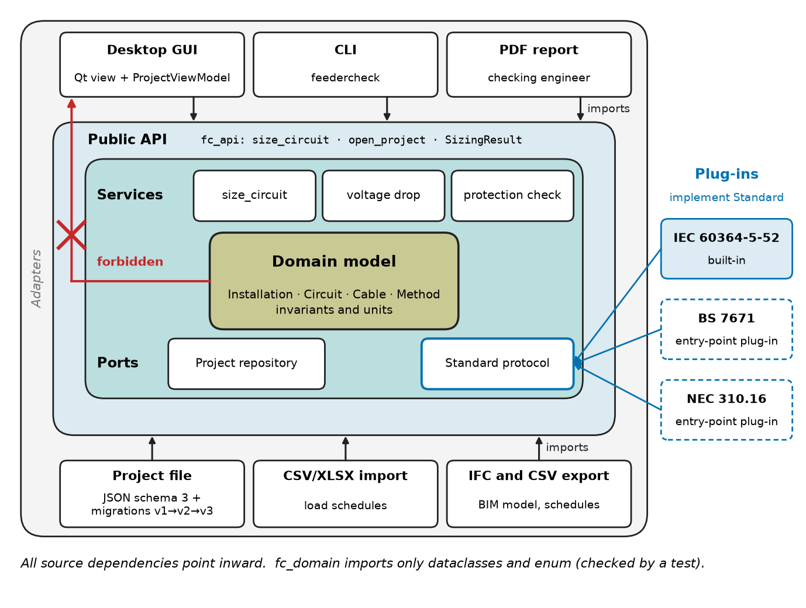
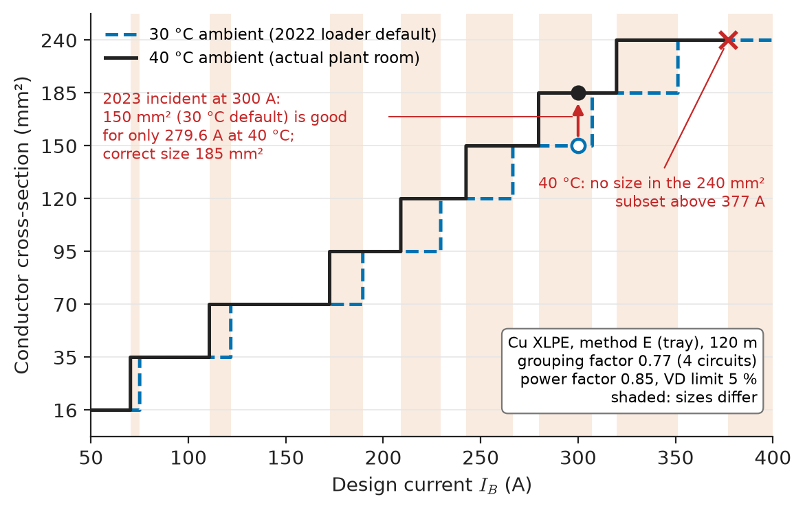
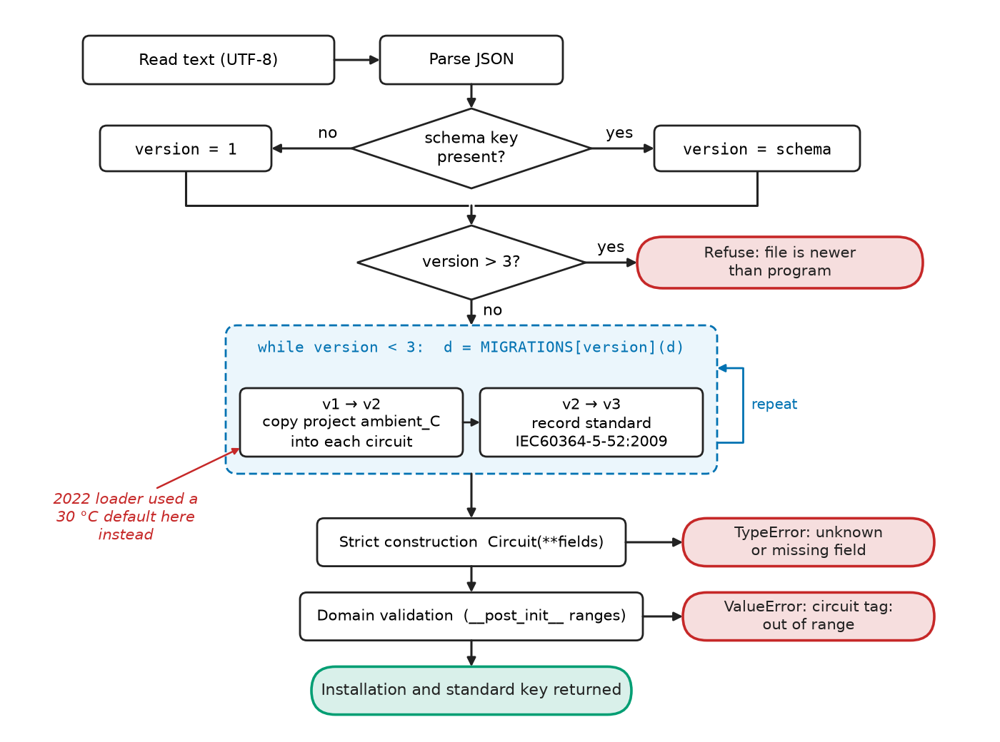
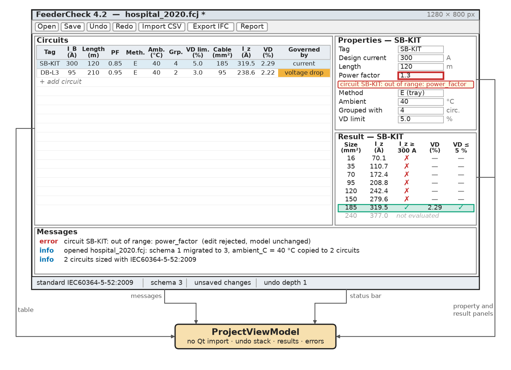
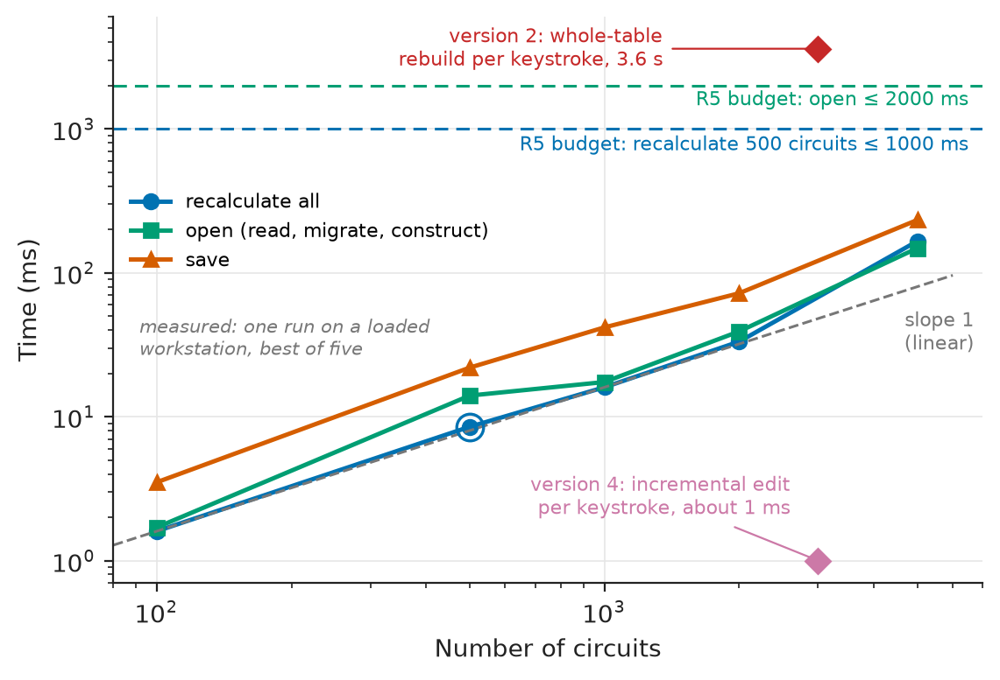

# Chapter 31 — Engineering Software Architecture

*Part VIII · Engineering Software and Computational Tools*

A building-services consultancy sizes the low-voltage cables of hospitals, schools and data centres with an in-house tool, FeederCheck. It began in 2019 as a 400-line script by one engineer; by 2023 it is 38 000 lines of Python with a desktop GUI, used by 60 engineers on about 2000 project files. That year an engineer reopens a 2020 hospital project in the current release to add one circuit. The tool re-sizes everything and the revised cable schedule goes out with the kitchen sub-board feeder reduced from 185 mm² to 150 mm². Nothing in the electrical design had changed. In 2020 the file format stored one ambient temperature for the whole project (40 °C, a plant room); the 2022 format moved it to each circuit, and the new loader filled the missing per-circuit value with a default of 30 °C. At its real 40 °C the 150 mm² cable is good for 280 A against a design current of 300 A. A checking engineer's hand calculation caught it; a search of the archive then found eleven more projects whose results had silently changed on reopening. Every line of the sizing arithmetic was correct. What failed was architecture: a domain model that allowed a hidden default, a file format without explicit migrations, calculation code tangled into GUI event handlers so that nobody could test it without clicking, and no test that opened an old file.

> **How is an engineering tool divided into a domain model, calculation services, persistence, plug-ins and user interfaces so that each can change without breaking the others?**
> **How are project files, interfaces and tests designed so that a result computed today is reproduced, exchanged and still trusted ten years from now?**

| Concept | Engineering destination |
|---|---|
| Modular software design | Calculation tools, test executives, simulation front ends and lab software that teams can extend in parallel |
| Domain models | Cables, circuits, devices, loads, components and test points represented with units and invariants |
| File-based project formats | Design projects that open identically in every later release, diff in version control and migrate explicitly |
| Plugin versus built-in architecture | National standards, manufacturer libraries, instrument drivers and solvers added without touching the core |
| APIs and interfaces | Scripting, batch runs, CI checks and integration with BIM, PLM and test systems |
| GUI design | Responsive editors that validate input, show what governs a result and can undo every change |
| Data interoperability | Load schedules from spreadsheets, results to BIM models, device data from manufacturers |
| Version control | Traceable releases of the tool and diffable histories of each project |
| Automated testing | Golden cases from standards and textbooks, property tests, archived-file tests, architecture rules |
| Long-term maintainability | Ten-year support of tools whose results end up in buildings, vehicles and certified products |

**Roadmap.** The tool and its requirements (31.1) → modules and the dependency rule (31.2) → the domain model at the centre (31.3) → project files and migrations (31.4) → plug-ins for standards (31.5) → the API every front end uses (31.6) → the GUI on top of it (31.7) → data exchange with other tools (31.8) → version control of code and projects (31.9) → automated tests (31.10) → keeping it alive for a decade, and what fails (31.11).

---

## 31.1 The reference tool and its requirements

> **Boundary.** The engineering content of FeederCheck (current-carrying capacity and its correction factors, voltage drop, protection and earthing) is *Electrical Energy and Machines*, [Ch. 30 §30.5–30.8](https://github.com/The-Studio-of-Sadiq/Electrical-Energy-and-Machines/blob/main/part-8-electrical-safety-and-engineering-practice/30-electrical-system-design.md); this chapter uses its Table 30.3 and worked examples as test data. Modules, interfaces, coupling and cohesion as programming ideas are *Electronics and Computing*, [Ch. 20 §20.7](https://github.com/The-Studio-of-Sadiq/Electronics-and-Computing/blob/main/part-5-programming-and-computational-systems/20-programming-fundamentals.md); Python itself is [Ch. 22](https://github.com/The-Studio-of-Sadiq/Electronics-and-Computing/blob/main/part-5-programming-and-computational-systems/22-python-for-engineering.md); Git and testing practice are [Ch. 24 §24.9–24.10](https://github.com/The-Studio-of-Sadiq/Electronics-and-Computing/blob/main/part-5-programming-and-computational-systems/24-scientific-computing.md). System architecture in general is [Chapter 2](../part-1-engineering-design-methodology/02-system-architecture.md), and the workflow tooling (repositories, builds, CI) is [Chapter 29](29-engineering-software-workflows.md). This chapter is the internal architecture of one engineering tool.

FeederCheck takes an installation (boards, circuits, loads, installation methods, ambient and grouping conditions), applies a cable standard, and returns for each circuit the smallest cable that meets current-carrying capacity and voltage drop, with what governed the choice. Its users are design engineers (GUI), a checking engineer (reports), the BIM team (data exchange) and the automation group (scripts that size 3000 circuits of a data centre overnight). Table 31.1 is the requirements set written after the 2023 incident.

**Table 31.1 — Requirements for FeederCheck version 4.**

| ID | Requirement | Target | Verification method |
|---|---|---|---|
| R1 | Calculation correctness | Golden set of 120 hand-checked cases: same cable size, $I_z$ and voltage drop within 0.5 % | Golden tests, §31.10 |
| R2 | Backward compatibility | Every file saved by any release since 1.0 opens with all values explicit and gives the result it gave when saved, or a reported difference | Archive-corpus test, §31.10 |
| R3 | Extensibility | A new standard (BS 7671, NEC) added as a plug-in, no change to core code | Architecture test; plug-in build |
| R4 | API parity | Every GUI action available from the Python API and CLI; no calculation code in the GUI layer | Code review rule and architecture test |
| R5 | Responsiveness | One edit to visible result ≤ 100 ms; full recalculation of a 500-circuit project ≤ 1 s; open ≤ 2 s | Timed benchmark in CI, §31.7 |
| R6 | Interoperability | Load schedules imported from CSV/XLSX; results exported to CSV, JSON and the BIM model; units explicit in every exchanged field | Round-trip tests, §31.8 |
| R7 | Test depth | ≥ 90 % branch coverage of domain and calculation code; suite ≤ 2 min on three operating systems | CI report |
| R8 | Maintainability | Supported for 10 years; direct dependencies ≤ 8; deprecations announced two minor releases ahead | Release checklist, §31.11 |

---

## 31.2 Modular software design

### The dependency rule

FeederCheck version 4 is arranged as concentric layers (Figure 31.1), often called *ports and adapters* or *clean architecture*. At the centre is the **domain model**: what an installation, a circuit and a cable are, with their invariants. Around it sit the **calculation services** (sizing, voltage drop, protection checks) and the **ports**, the interfaces the core needs from the outside world (a standard's tables, a repository that loads and saves projects). Outermost are the **adapters**: the GUI, the CLI, the JSON file format, the CSV importer, the IFC exporter, and the plug-ins that implement the standards. The rule is that source-code dependencies point only inward. The domain model imports nothing from the project; the sizing service imports the domain and the standard *interface*, never a particular standard; the GUI imports the API, never the sizing internals.

<!-- FIGURE 31.1 | figures/ch31/fig-31-1-feedercheck-architecture.png | block-diagram | Layered architecture of FeederCheck version 4: domain model at the centre, services and ports around it, adapters and plug-ins outside, with all source dependencies pointing inward. | Content: four concentric rounded rectangles. Innermost: Domain model (Installation, Circuit, Cable, Method; invariants and units). Second: Services (size_circuit, voltage drop, protection check) and Ports (Standard protocol, Project repository). Third: Public API (fc_api: size_circuit, open_project, SizingResult). Outer ring split into adapters: Desktop GUI (Qt view + ProjectViewModel), CLI (feedercheck), Project file (JSON schema 3 + migrations v1 to v2 to v3), CSV/XLSX import, IFC and CSV export, PDF report. Plug-ins drawn outside the outer ring and docked to the Standard port: IEC 60364-5-52 (built-in), BS 7671, NEC 310.16 (entry-point plug-ins). Solid arrows from every outer block toward the centre labelled imports; a crossed-out red arrow from Domain to GUI labelled forbidden. Side note: fc_domain imports only dataclasses and enum (checked by a test). -->



*Figure 31.1 — Layered architecture of FeederCheck version 4: domain model at the centre, services and ports around it, adapters and plug-ins outside, with all source dependencies pointing inward.*

Table 31.2 lists the modules of the reference implementation in this chapter, with what each may import. The listings are short versions of the real modules, small enough to read, and they run as shown.

**Table 31.2 — Modules of FeederCheck and their allowed dependencies.**

| Module | Responsibility | May import | Listing |
|---|---|---|---|
| `fc_domain` | Entities, value objects, invariants | Standard library only | 31.1 |
| `fc_project` | Project file: schema, migrations, strict loading | `fc_domain` | 31.2 |
| `fc_standards` | Standard protocol, registry, built-in IEC plug-in | `fc_domain` | 31.3 |
| `fc_api` | Sizing service, public API, CLI | `fc_domain`, `fc_project`, `fc_standards` | 31.4 |
| `fc_viewmodel` | State the GUI binds to: edits, undo, results, errors | `fc_api`, `fc_project` | 31.5 |
| GUI views (Qt) | Widgets only | `fc_viewmodel` | — |
| `test_fc` | Golden, property, file and architecture tests | everything | 31.6 |

> **Status of the principle: Dependencies point toward stability**
> *Empirical.* Code that many modules depend on should change least, so the most stable knowledge (what a circuit is) sits at the centre and the most volatile (widgets, file layouts, a standard's next edition) at the edge; decades of software practice support it, but it is a heuristic whose payoff depends on predicting correctly what will change.

### Where the old tool broke the rule

In version 2 the GUI's "Recalculate" handler read values straight from table cells, converted them with `float()`, looked up the IEC tables in a module-level dictionary and wrote results back into the cells. Calculation, persistence and presentation were one function. Consequences: the calculation could be tested only by driving the GUI; the automation group copied the arithmetic into their batch script, where it drifted; and the loader, written to feed the table cells, supplied defaults for anything missing because a blank cell crashed the handler. Each of these is a coupling that the layered design makes impossible by construction.

---

## 31.3 Domain models

### What the domain model must say

A domain model is the code's statement of what the engineering objects are. It must carry four things that a spreadsheet leaves implicit: **identity** (circuit "SB-KIT" is the same circuit after its current changes), **units** (in names, `design_current_A`, or in types), **invariants** (a power factor is between 0.1 and 1; a length is positive), and **ownership** (an installation owns its circuits; a cable is chosen by the sizing service, not typed by the user). Listing 31.1 is the FeederCheck domain in 42 lines.

```python
"""fc_domain.py -- domain model of FeederCheck: no GUI, no file format, no standard."""
from dataclasses import dataclass, field
from enum import Enum

class Method(Enum):                       # installation reference methods (IEC 60364-5-52)
    TRAY = "E"
    CONDUIT = "B1"
    BURIED = "D1"

@dataclass(frozen=True)
class Cable:                              # value object: equal if all fields are equal
    material: str                         # "Cu" or "Al"
    insulation: str                       # "XLPE" or "PVC"
    csa_mm2: float

@dataclass
class Circuit:                            # entity: identified by its tag
    tag: str
    design_current_A: float
    length_m: float
    power_factor: float
    method: Method
    ambient_C: float                      # always explicit: no hidden project default
    grouped_with: int = 1                 # number of loaded circuits in the group
    vd_limit_pct: float = 5.0
    cable: Cable | None = None            # chosen by the sizing service, not by the GUI

    def __post_init__(self):
        checks = {"design_current_A": 0 < self.design_current_A <= 4000,
                  "length_m": 0 < self.length_m <= 2000,
                  "power_factor": 0.1 <= self.power_factor <= 1.0,
                  "ambient_C": -20 <= self.ambient_C <= 70,
                  "grouped_with": 1 <= self.grouped_with <= 20}
        bad = [name for name, ok in checks.items() if not ok]
        if bad:
            raise ValueError(f"circuit {self.tag}: out of range: {', '.join(bad)}")

@dataclass
class Installation:                       # aggregate root: owns its circuits
    name: str
    nominal_V: float = 400.0
    circuits: list[Circuit] = field(default_factory=list)
```

*Listing 31.1 — The domain model: an entity with invariants, a value object, an aggregate root, and no knowledge of files, GUIs or standards.*

### Design decisions in the listing

The single most important line is the one with no default: `ambient_C: float` must be supplied every time a `Circuit` is created, by a user, an importer or a migration. Python dataclasses require non-default fields before defaulted ones, so the language itself enforces that it is listed among the mandatory inputs. Defaults are kept only where a wrong default is harmless and visible (one circuit in a group, a 5 % voltage-drop limit that appears in every report). `Cable` is frozen because a cable of 185 mm² copper XLPE is a value, not a thing with a history. The validation ranges are wide plausibility limits, not engineering limits: 4000 A and 2 km catch typing errors (a current entered in mA, a length in mm), while the standard decides what is acceptable.

> **Status of the principle: Make illegal states unrepresentable**
> *Empirical.* Encoding required fields, units and invariants in the types and constructors of the domain model moves a class of errors from run time in the field to construction time in the developer's test; it cannot catch values that are legal but wrong, which remain the job of tests and review.

**Worked example — what the hidden default cost.** The kitchen sub-board feeder carries $I_B=300$ A at a power factor of 0.85 over 120 m on a tray shared with three other loaded circuits. With the real 40 °C ambient, the correction is $0.91\times0.77=0.7007$; the required tabulated capacity is $300/0.7007=428$ A, so the first size that qualifies is 185 mm² (456 A tabulated, 319.5 A corrected), the result of *Electrical Energy and Machines*, Ch. 30 §30.5. With the loader's 30 °C default the correction is 0.77, the requirement 390 A, and 150 mm² (399 A tabulated) is chosen. At the actual 40 °C that cable's capacity is $399\times0.7007=279.6$ A, 6.8 % below the design current: the conductor would run above 90 °C at full load. Figure 31.2 shows the whole size-against-current staircase at both ambients; the incident sits in one of the current bands where the two staircases differ.

<!-- FIGURE 31.2 | figures/ch31/fig-31-2-size-staircase.png | plot | Cable size chosen by FeederCheck against design current for a 120 m feeder on a shared tray, at 30 C and 40 C ambient. | Content: x-axis design current 50 to 400 A; y-axis conductor cross-section on categorical scale 16, 35, 70, 95, 120, 150, 185, 240 mm2. Two step lines from the IEC subset: 30 C (dashed): 16 mm2 at 50 A, 35 at 75 to 100, 70 at 125 to 175, 95 at 200 to 225, 120 at 250, 150 at 275 to 300, 185 at 325 to 350, 240 at 375 to 400 A. 40 C (solid): 16 at 50, 35 at 75 to 100, 70 at 125 to 150, 95 at 175 to 200, 120 at 225, 150 at 250 to 275, 185 at 300, 240 at 325 to 375, no size above about 377 A (marked with an x and label exceeds 240 mm2 subset). Shaded vertical bands where the two lines differ. Marker at 300 A with arrow from 150 (30 C default) to 185 mm2 (correct 40 C), labelled 2023 incident: 150 mm2 good for 279.6 A at 40 C. Grouping factor 0.77, power factor 0.85 noted in a corner box. -->



*Figure 31.2 — Cable size chosen by FeederCheck against design current for a 120 m feeder on a shared tray, at 30 C and 40 C ambient.*

---

## 31.4 File-based project formats

### Requirements on a project file

A project file outlives the program that wrote it. For FeederCheck it must be: **self-describing** (it says which schema version it is and which standard and edition it was designed to); **complete** (every input explicit, nothing supplied by the program at load time); **inputs only** (results are derived and recomputed, so they can never disagree with inputs, and they never cause merge conflicts); **text and canonical** (sorted keys, fixed indentation, so that version control shows meaningful differences, §31.9); and **migratable** (every older schema has a tested, explicit conversion to the next).

**Table 31.3 — Candidate project-file formats.**

| Format | Diffable | Partial reads, large projects | Schema evolution | Tooling outside the program | Choice |
|---|---|---|---|---|---|
| JSON, canonical (sorted keys, indent) | Yes | Whole-file read; fine to about 10 MB | Explicit migrations | Every language; JSON Schema validators | **Chosen** |
| SQLite database file | No (binary) | Yes, indexed | SQL migrations | Good | For tools with $10^5$ objects or more |
| XML with XSD | Yes, noisy | Whole-file or streaming | XSLT or code | Good, verbose | Where an industry schema demands it |
| Zip container (JSON plus attachments) | Partly | Per entry | As JSON | Good | When drawings or PDFs must travel with the project |
| Python pickle | No | No | Breaks on any class change | None, and unsafe to load from others | Never for project files |

### Migrations as code

Listing 31.2 is the project-file module. Each schema change is a small function that turns a version-$n$ dictionary into a version-$n+1$ dictionary, and loading applies the chain until the current version is reached (Figure 31.3). The 2020 file goes through two migrations; the one that matters, `_v1_to_v2`, copies the project's ambient temperature into every circuit, which is what the 2022 loader should have done instead of supplying a default.

```python
"""fc_project.py -- the project file: versioned JSON, explicit migrations, strict loading."""
import json
from dataclasses import asdict
from fc_domain import Circuit, Installation, Method

SCHEMA = 3

def _v1_to_v2(d):                         # v1 (2019-2021): one ambient for the whole project
    ambient = d.pop("ambient_C")
    for c in d["circuits"]:
        c["ambient_C"] = ambient          # make the old implicit value explicit per circuit
    d["schema"] = 2
    return d

def _v2_to_v3(d):                         # v3 (2024): the standard and its edition are recorded
    d["standard"] = "IEC60364-5-52:2009"  # the only standard versions 1 and 2 knew
    d["schema"] = 3
    return d

MIGRATIONS = {1: _v1_to_v2, 2: _v2_to_v3}

def loads(text):
    d = json.loads(text)
    version = d.get("schema", 1)
    if version > SCHEMA:
        raise ValueError(f"file schema {version} is newer than this program ({SCHEMA})")
    while version < SCHEMA:
        migrate = MIGRATIONS[version]
        d = migrate(d)
        version = d["schema"]
    circuits = [Circuit(**{**c, "method": Method(c["method"])}) for c in d["circuits"]]
    return Installation(d["name"], d["nominal_V"], circuits), d["standard"]

def dumps(inst, standard):
    circuits = [{k: v for k, v in asdict(c).items() if k != "cable"} for c in inst.circuits]
    for c, src in zip(circuits, inst.circuits):
        c["method"] = src.method.value    # results (the cable) are derived, never stored
    return json.dumps({"schema": SCHEMA, "name": inst.name, "nominal_V": inst.nominal_V,
                       "standard": standard, "circuits": circuits}, indent=1, sort_keys=True)
```

*Listing 31.2 — Versioned project file with an explicit migration chain, strict construction and canonical output.*

Three details carry the design. Files without a `schema` key are treated as version 1, because version 1 predates the key. Construction goes through `Circuit(**c)`, which raises `TypeError` on an unknown field and on a missing one (a missing `method` key fails one step earlier, as a `KeyError` from the lookup that selects the installation method), so a misspelt key in a hand-edited file fails loudly instead of being ignored. And a file from a *newer* release is refused with a clear message rather than half-read; the alternative, ignoring unknown fields, is how a newer file loses data when saved by an older program.

<!-- FIGURE 31.3 | figures/ch31/fig-31-3-file-load-pipeline.png | flowchart | Loading a FeederCheck project file: schema detection, migration chain, strict construction and validation. | Content: top-to-bottom flowchart. Read text (UTF-8) -> Parse JSON -> Decision: schema key present? no -> version = 1; yes -> version = schema. Decision: version > 3? yes -> Refuse: file is newer than program (red terminal). Loop box: while version < 3 apply MIGRATIONS[version]: v1 to v2 (copy project ambient_C into each circuit), v2 to v3 (record standard IEC60364-5-52:2009). -> Strict construction Circuit(**fields): unknown or missing field -> TypeError (red terminal). -> Domain validation (__post_init__ ranges) -> Installation and standard key returned (green terminal). Side annotation on the v1 to v2 box: the 2022 loader used a 30 C default here instead. -->



*Figure 31.3 — Loading a FeederCheck project file: schema detection, migration chain, strict construction and validation.*

> **Status of the principle: Explicit, tested migrations**
> *Empirical.* Converting old data through a chain of small, version-to-version functions, each with a test on a real archived file, is how databases, CAD and EDA tools keep decades of files readable; implicit defaults and "best effort" loading are the common cause of silent result changes.

---

## 31.5 Plugin versus built-in architecture

### What should be a plug-in

A plug-in is code that the core discovers and calls through a published interface, but does not import by name. In FeederCheck the obvious candidates are cable standards: IEC 60364-5-52 for most of the consultancy's work, BS 7671 for UK projects, NEC Table 310.16 for a US data-centre client, and each standard's next edition. The criterion for making something a plug-in is not "might be extended some day" but four questions: Does it vary by project, market or customer? Is it maintained by people other than the core team, or released on a different schedule? Will several versions have to coexist (a 2009 and a 2023 edition in one office)? Must it be licensed or validated separately? Standards answer yes to all four. The voltage-drop formula answers no to all four, so it is built in.

**Table 31.4 — Built-in or plug-in, decided feature by feature.**

| Feature | Varies by project or market | Separate maintainers or schedule | Versions coexist | Separate validation or licence | Decision |
|---|---|---|---|---|---|
| Cable standards and editions | Yes | Yes (standards group) | Yes | Yes | Plug-in |
| Manufacturer breaker libraries | Yes | Yes (vendor data) | Yes | Yes | Plug-in (data package) |
| Voltage-drop calculation | No | No | No | No | Built-in |
| Project file format | No | No | Through migrations | No | Built-in |
| Report templates | Per client | Sometimes | Yes | No | Plug-in (template files) |
| Short-circuit solver | Rarely | No | No | Yes, once | Built-in, behind a port |

### The plug-in interface

Listing 31.3 defines the `Standard` port as a `typing.Protocol`, a registry keyed by standard and edition, discovery through Python package *entry points*, and the built-in IEC plug-in with the Book 5 Table 30.3 subset (copper XLPE multicore cables on a perforated tray, method E).

```python
"""fc_standards.py -- the standards plug-in interface, a registry and one built-in plug-in."""
from importlib.metadata import entry_points
from typing import Protocol
from fc_domain import Method

class Standard(Protocol):
    id: str
    edition: str
    def capacity_A(self, csa: float, method: Method) -> float: ...
    def correction(self, ambient_C: float, grouped_with: int) -> float: ...
    def r_ohm_per_km(self, csa: float, temp_C: float) -> float: ...
    sizes: tuple[float, ...]

REGISTRY: dict[str, Standard] = {}

def register(std: Standard) -> None:
    REGISTRY[f"{std.id}:{std.edition}"] = std

def discover() -> None:                   # third-party plug-ins announce themselves here
    for ep in entry_points(group="feedercheck.standards"):
        register(ep.load()())

class IEC60364_5_52:                      # Cu XLPE multicore, method E subset (Table 30.3, Book 5)
    id, edition = "IEC60364-5-52", "2009"
    sizes = (16, 35, 70, 95, 120, 150, 185, 240)
    _cap = dict(zip(sizes, (100, 158, 246, 298, 346, 399, 456, 538)))
    _r20 = dict(zip(sizes, (1.15, 0.524, 0.268, 0.193, 0.153, 0.124, 0.0991, 0.0754)))
    _amb = {30: 1.00, 35: 0.96, 40: 0.91, 45: 0.87}
    _grp = {1: 1.00, 2: 0.88, 3: 0.82, 4: 0.77, 6: 0.73, 9: 0.72}

    def capacity_A(self, csa, method):
        if method is not Method.TRAY:
            raise NotImplementedError(f"{self.id} subset: method {method.value}")
        return self._cap[csa]

    def correction(self, ambient_C, grouped_with):
        return _row(self._amb, ambient_C, "ambient") * _row(self._grp, grouped_with, "group")

    def r_ohm_per_km(self, csa, temp_C):
        return self._r20[csa] * (1 + 0.00393 * (temp_C - 20))

def _row(table, x, what):                 # next tabulated row up (conservative)
    keys = [k for k in table if k >= x]
    if not keys:
        raise ValueError(f"{what} {x} is outside the tabulated range")
    return table[min(keys)]

register(IEC60364_5_52())
```

*Listing 31.3 — The standard port, registry, entry-point discovery and the built-in IEC 60364-5-52 plug-in (table subset).*

A third-party plug-in is an ordinary Python package that declares itself in its `pyproject.toml`; installing it makes `discover()` find it, with no change to FeederCheck:

```toml
[project]
name = "feedercheck-bs7671"
version = "2.1.0"
dependencies = ["feedercheck >= 4.0, < 5"]

[project.entry-points."feedercheck.standards"]
bs7671_2022 = "feedercheck_bs7671:BS7671_2022"
```

The registry is keyed by `id:edition` because the edition is part of the result's meaning: the same circuit sized to the 2009 and 2023 editions of a standard may get different cables, and a project file records which one it was designed to (schema 3). Table look-ups round *up* to the next tabulated ambient and group size, the conservative direction, and refuse values beyond the table instead of extrapolating. Plug-ins pay for their flexibility: the interface becomes a public contract that cannot change without breaking other people's code, every plug-in must be tested against every supported core version, and a malicious or buggy plug-in runs with the program's full rights. For FeederCheck that cost is worth paying for standards; it would not be for the voltage-drop formula.

---

## 31.6 APIs and interfaces

### One API, three front ends

The automation group's drifting copy of the sizing arithmetic is the reason for R4: every front end goes through one public API. Listing 31.4 is that API, its result type and the CLI built on it. The GUI view model (Listing 31.5), the CLI and user scripts all call `size_circuit`; none of them computes anything.

```python
"""fc_api.py -- the public API. The GUI, the CLI and user scripts call only this module."""
import argparse, math, sys
from dataclasses import dataclass
from pathlib import Path
from fc_domain import Cable, Circuit
from fc_project import loads
from fc_standards import REGISTRY

@dataclass(frozen=True)
class SizingResult:
    tag: str
    csa_mm2: float
    Iz_A: float
    vd_pct: float
    governed_by: str
    standard: str

def size_circuit(c: Circuit, std_key: str, nominal_V=400.0, x_ohm_km=0.075) -> SizingResult:
    std, governed = REGISTRY[std_key], "current"
    k = std.correction(c.ambient_C, c.grouped_with)
    sin_phi = math.sqrt(1 - c.power_factor ** 2)
    for csa in std.sizes:
        Iz = std.capacity_A(csa, c.method) * k
        if Iz < c.design_current_A:
            continue
        r = std.r_ohm_per_km(csa, 90.0)               # conservative: conductor at 90 C
        vd = 100 * math.sqrt(3) * c.design_current_A * c.length_m / 1000 \
            * (r * c.power_factor + x_ohm_km * sin_phi) / nominal_V
        if vd <= c.vd_limit_pct:
            c.cable = Cable("Cu", "XLPE", csa)
            return SizingResult(c.tag, csa, round(Iz, 1), round(vd, 2), governed, std_key)
        governed = "voltage drop"
    raise ValueError(f"circuit {c.tag}: no size in {std_key} meets both criteria")

def main(argv=None):                                  # feedercheck project.fcj [--csv]
    p = argparse.ArgumentParser(prog="feedercheck")
    p.add_argument("project")
    p.add_argument("--csv", action="store_true")
    a = p.parse_args(argv)
    inst, std_key = loads(Path(a.project).read_text(encoding="utf-8"))
    sep = "," if a.csv else "  "
    for c in inst.circuits:
        r = size_circuit(c, std_key, inst.nominal_V)
        print(sep.join(map(str, (r.tag, r.csa_mm2, r.Iz_A, r.vd_pct, r.governed_by))))

if __name__ == "__main__":
    sys.exit(main())
```

*Listing 31.4 — The sizing service as the public API, with a frozen result type and a command-line front end.*

Run on the 2020 hospital file, the CLI migrates it and sizes both circuits:

```text
$ python fc_api.py hospital_2020.fcj --csv
SB-KIT,185,319.5,2.29,current
DB-L3,95,238.6,2.22,voltage drop
```

The kitchen feeder is back at 185 mm² (the Book 5 result), and the 210 m lighting distribution board feeder DB-L3 shows why `governed_by` is part of the result: current alone would allow 35 mm², but the 3 % voltage-drop limit on that long run needs 95 mm². Reporting what governed is the single most useful thing a checking engineer can be told.

### What makes an engineering API good

- **Typed, frozen results with units in the names** (`Iz_A`, `vd_pct`), so that a script cannot mutate a result or confuse amperes with per cent.
- **Errors that name the object** (`circuit DB-L3: ...`), because a batch of 3000 circuits that fails with "value out of range" is useless.
- **Results that record their provenance**: the standard and edition travel inside every `SizingResult`.
- **A small surface.** The public API is what is listed in the documentation and covered by the deprecation policy (§31.11); everything else is private, named with a leading underscore, and may change.

A REST service for the BIM team's cloud workflow is one more adapter over the same API: it adds authentication, not calculation.

---

## 31.7 GUI design

### The view model is the GUI's API

The desktop GUI is where most engineers meet the tool, and it is where calculation code most likes to hide. FeederCheck's GUI is split into a **view** (Qt widgets: a circuit table, a property panel, a results panel, a message list) and a **view model**, a plain Python object that holds what the view shows and turns user gestures into domain operations (Figure 31.4). The view model has no Qt import, so it is tested like any other module; the view is thin enough that its tests are a handful of smoke tests. Listing 31.5 is the view model's core: every edit is a command that can be undone, validation is done by the domain model, and only the edited circuit is recalculated.

```python
"""fc_viewmodel.py -- the state a GUI view binds to; tested without any GUI toolkit."""
from pathlib import Path
from fc_api import size_circuit
from fc_project import loads

class ProjectViewModel:
    def __init__(self, inst, std_key):
        self.inst, self.std, self.undo_stack = inst, std_key, []
        self.results, self.errors = {}, {}
        for i in range(len(inst.circuits)):
            self._recalc(i)

    def edit(self, i, field, value):              # one undoable command per user edit
        c = self.inst.circuits[i]
        old = getattr(c, field)
        setattr(c, field, value)
        try:
            c.__post_init__()                     # the domain model validates, not the view
        except ValueError as e:
            setattr(c, field, old)
            self.errors[c.tag] = str(e)
            return False
        self.undo_stack.append((i, field, old))
        self._recalc(i)
        return True

    def undo(self):
        i, field, old = self.undo_stack.pop()
        setattr(self.inst.circuits[i], field, old)
        self._recalc(i)

    def _recalc(self, i):                         # only the edited circuit is recomputed
        c = self.inst.circuits[i]
        try:
            self.results[c.tag] = size_circuit(c, self.std, self.inst.nominal_V)
            self.errors.pop(c.tag, None)
        except ValueError as e:
            self.results[c.tag], self.errors[c.tag] = None, str(e)

vm = ProjectViewModel(*loads(Path("hospital_2020.fcj").read_text()))
print(vm.results["SB-KIT"].csa_mm2, vm.edit(0, "design_current_A", 330.0), vm.results["SB-KIT"].csa_mm2)
print(vm.edit(0, "power_factor", 1.3), vm.errors["SB-KIT"])
vm.undo()
print(vm.results["SB-KIT"].csa_mm2, vm.inst.circuits[0].design_current_A, len(vm.undo_stack))
```

```text
185 True 240
False circuit SB-KIT: out of range: power_factor
185 300.0 0
```

*Listing 31.5 — A toolkit-free view model: undoable edits, validation by the domain model and incremental recalculation.*

Raising the kitchen feeder to 330 A moves it to 240 mm²; an impossible power factor of 1.3 is rejected with a message naming the circuit and field, and leaves the model unchanged; undo restores 300 A and 185 mm².

<!-- FIGURE 31.4 | figures/ch31/fig-31-4-gui-layout.png | layout | FeederCheck main window: circuit table, property panel, result panel with governing criterion, and message list, all bound to one view model. | Content: window 1280 x 800 px. Left 60 percent: circuit table with columns Tag, I_B (A), Length (m), PF, Method, Ambient (C), Grouped, VD limit (%), Cable (mm2), I_z (A), VD (%), Governed by; rows SB-KIT 300 / 120 / 0.85 / E / 40 / 4 / 5.0 / 185 / 319.5 / 2.29 / current and DB-L3 95 / 210 / 0.95 / E / 40 / 2 / 3.0 / 95 / 238.6 / 2.22 / voltage drop (governed-by cell highlighted amber). Right top: property panel for the selected circuit with fields and units, invalid field outlined red with tooltip circuit SB-KIT: out of range: power_factor. Right bottom: result panel showing the staircase of candidate sizes with pass/fail ticks for current and voltage drop. Bottom strip: message list and status bar (standard IEC60364-5-52:2009, schema 3, unsaved changes, undo depth). Toolbar: Open, Save, Undo, Redo, Import CSV, Export IFC, Report. Thin arrows from each panel to a box labelled ProjectViewModel. -->



*Figure 31.4 — FeederCheck main window: circuit table, property panel, result panel with governing criterion, and message list, all bound to one view model.*

### GUI rules that come from engineering use

- **Never compute in an event handler.** Handlers call the view model; long operations (a 3000-circuit project, a PDF report) run in a worker thread with a progress bar and a cancel button, because a GUI frozen for 5 s is reported as a crash.
- **Show what governs.** Every result shows its criterion and margin; a cable chosen by voltage drop looks different from one chosen by current.
- **Validate at entry, explain in words.** The domain model's message is shown at the field; units are visible in every column header and input.
- **Make every change undoable and every unsaved state visible.** Engineers explore; the cost of an exploration must be zero.

### Responsiveness budget

**Table 31.5 — Responsiveness budget against R5 (measured on the reference implementation, one run on a loaded workstation; Qt figures estimated).**

| Operation | Budget | Measured or estimated | Margin |
|---|---|---|---|
| Validate one edit (domain `__post_init__`) | — | 0.01 ms | — |
| Recalculate one circuit | — | 0.02 ms | — |
| Repaint one table row (Qt) | — | about 1 ms (estimated) | — |
| **One edit to visible result** | **100 ms** | **about 1 ms** | **99 %** |
| Recalculate 500-circuit project | 1000 ms | 8.5 ms | 99.2 % |
| Open 500-circuit project (113 kB JSON, migrate, construct) | 2000 ms | 14 ms | 99.3 % |
| Open 5000-circuit project (1.1 MB) | 2000 ms | 148 ms | 92.6 % |
| PDF report, 500 circuits | 5000 ms, in worker thread | about 1500 ms (estimated) | 70 % |

**Worked example — where the old GUI lost its time.** Version 2 recalculated the whole project on every cell edit and rebuilt the whole table widget afterwards. For the 3000-circuit data-centre project, the arithmetic alone was about 50 ms (Figure 31.5 extrapolates the measured 33 ms for 2000 circuits), but rebuilding 3000 rows × 12 cells of widgets at roughly 0.1 ms per cell cost 3.6 s per keystroke. The incremental design recalculates one circuit (0.02 ms) and repaints one row (about 1 ms), a factor of over 3000 for the same arithmetic. The lesson is general: in engineering GUIs, the calculation is rarely the bottleneck; the presentation of results is.

<!-- FIGURE 31.5 | figures/ch31/fig-31-5-latency-scaling.png | plot | Measured time to recalculate, open and save a FeederCheck project against the number of circuits, with the R5 budgets. | Content: log-log axes, x-axis number of circuits 100 to 5000, y-axis time 1 to 3000 ms. Three measured series with markers: recalculate all (1.6, 8.5, 16.0, 33.2, 165.7 ms at 100, 500, 1000, 2000, 5000), open (1.7, 14.0, 17.4, 39.1, 148.2 ms), save (3.5, 21.9, 41.7, 72.0, 232.5 ms). Dashed reference line of slope 1 (linear scaling). Horizontal budget lines at 1000 ms (recalculate, 500 circuits) and 2000 ms (open). Extra point for version 2 whole-table rebuild at 3000 circuits, 3600 ms, labelled old GUI per keystroke, and incremental edit about 1 ms labelled version 4 per keystroke. Note: one run on a loaded workstation, best of five. -->



*Figure 31.5 — Measured time to recalculate, open and save a FeederCheck project against the number of circuits, with the R5 budgets.*

> **Status of the principle: Separate presentation from state**
> *Empirical.* Model-view-viewmodel and its relatives (MVC, MVP) are established GUI patterns because they let the state and behaviour be tested without the toolkit and let views be replaced; they add a layer of indirection that small one-screen tools may not need.

### Choosing the GUI technology

**Table 31.6 — GUI technology options for FeederCheck (2026, indicative).**

| Option | Strengths | Weaknesses | Fit |
|---|---|---|---|
| Qt for Python (PySide6, LGPL) | Native desktop, large tables, offline, mature | Desktop deployment per OS; LGPL compliance | **Chosen** for the design office |
| Web front end (React or similar) over a local or hosted API | Zero install, collaboration, BIM cloud integration | Two languages, security and hosting to manage | Added later for the BIM team, over the same API |
| Excel add-in (xlwings, Office JS) | Engineers already live in spreadsheets | Calculation and data drift into cells; weak undo and validation | Rejected: it recreates version 2 |
| Notebook widgets (Jupyter, ipywidgets) | Fast to build, good for exploration | Not a product UI; state hidden in kernel order | Used for internal studies only |

---

## 31.8 Data interoperability

### Exchanges and their contracts

FeederCheck imports load schedules from the mechanical and electrical spreadsheets, exports cable schedules to the contractor and writes cable sizes into the BIM model. Each exchange is an adapter with a written contract: field names, units, encodings, required and optional fields, and what happens to a row that fails validation. The units rule is absolute: every exchanged numeric field carries its unit in its name or in a header row (`design_current_A`, `length_m`), and the importer refuses a file whose header does not match.

**Table 31.7 — Data exchanges of FeederCheck.**

| Exchange | Direction | Format | Contract highlights |
|---|---|---|---|
| Load schedule | In | CSV (UTF-8, comma, point decimal) or XLSX | Header row with units; rows failing domain validation reported by line, never skipped silently |
| Cable schedule | Out | CSV and PDF | Includes standard and edition, governing criterion, tool version |
| BIM model | Out | IFC 4 cable-segment objects with a FeederCheck property set | Keyed by circuit tag; sizes written only after a checking engineer's approval |
| Protection study | Out/in | JSON | Circuit tags, cable impedances at 20 °C and 90 °C, device ratings |
| Archive | Out | Project file plus result CSV plus tool version | For the 10-year record of R8 |

**Worked example — a decimal comma.** A load schedule arrives from a partner office whose spreadsheet locale uses a comma as decimal separator and a semicolon as field separator. A tolerant importer that splits on commas reads the row `DB-L4;95,5;210;0,95` as fields `DB-L4;95`, `5;210;0` and `95`. The strict importer refuses the file because the header does not match. A "smart" importer that guesses the locale would read it correctly here and wrongly on the day a value like `1,250` (one thousand two hundred and fifty, or one point two five?) appears. FeederCheck's contract therefore names the dialect: comma-separated UTF-8 with point decimals, or XLSX, whose cells are typed. Ambiguity is resolved at the boundary by refusing it, not inside the program by guessing.

> **Status of the principle: Be strict at the boundary**
> *Empirical.* Accepting malformed or ambiguous input "liberally" spreads its interpretation through every consumer; for engineering data, where a misread unit or separator changes a design, explicit contracts and rejection with a precise message are the safer practice.

The underlying data formats (CSV, JSON, HDF5, Parquet) and their precision traps are *Electronics and Computing*, [Ch. 22 §22.9](https://github.com/The-Studio-of-Sadiq/Electronics-and-Computing/blob/main/part-5-programming-and-computational-systems/22-python-for-engineering.md).

---

## 31.9 Version control

### Two histories

FeederCheck has two histories to keep. The **tool's** history is a Git repository with trunk-based development, reviewed pull requests and tagged releases (the workflow is *Electronics and Computing*, [Ch. 24 §24.10](https://github.com/The-Studio-of-Sadiq/Electronics-and-Computing/blob/main/part-5-programming-and-computational-systems/24-scientific-computing.md) and [Chapter 29](29-engineering-software-workflows.md)). Releases follow **semantic versioning**: MAJOR.MINOR.PATCH, where a major release may break the public API or drop support for something, a minor release adds features compatibly, and a patch only fixes. The **projects'** history is kept by the design teams, many of whom now commit project files to Git alongside drawings. Canonical JSON (sorted keys, one field per line, results not stored) makes those diffs meaningful: raising the kitchen feeder's current produces a one-line change, `"design_current_A": 330.0`, not a rewritten file.

The two histories meet in the schema version. A project file records its schema, the standard and edition, and (in the result CSV archived with it) the tool version that produced the results. Every result can therefore be traced to the exact code that computed it: the same provenance principle as the manifests of [Chapter 30](30-scientific-and-engineering-computing.md).

**Worked example — which version number changes.** Three changes are queued for release after 4.2.1. (a) A corrected conductor resistance in a plug-in table (a transcription error found by a golden test): a fix, but it changes results, so it ships as plug-in 4.2.2 *with a release note listing the change in results* and a regression test pinned to the new value. (b) A new `governed_by` value "short circuit" when the short-circuit check is added: a compatible addition, minor release 4.3.0, provided scripts that compare `governed_by` with known strings are documented to expect new values. (c) Renaming `vd_pct` to `voltage_drop_pct` in `SizingResult`: breaks every user script, so it waits for 5.0.0, and 4.3 adds the new name as an alias with a deprecation warning. Semantic versioning turns "will this break my script?" into a rule, but only if results-changing fixes are treated as visible events, not hidden in a patch.

> **Status of the principle: A version number is a promise about compatibility**
> *Empirical.* Semantic versioning works only if the public API and the meaning of results are defined and the promise is checked by tests; for engineering tools, a change in computed results is as significant as a change in the API and must be announced as such.

---

## 31.10 Automated testing

### What to test in an engineering tool

Listing 31.6 shows the five kinds of test that would each have caught part of the 2023 incident: a **golden test** against an independently worked example (Book 5's feeder: 185 mm², 320 A), an **archived-file test** that opens a real old project and checks its result, a **round-trip test** of the file format, a **property test** that checks an engineering law over thousands of random cases (a harder duty never yields a smaller cable), and an **architecture test** that enforces the dependency rule of §31.2 by reading the domain module's imports.

```python
"""test_fc.py -- run with pytest, or directly with python."""
import ast, json, random
from pathlib import Path
from fc_api import size_circuit
from fc_domain import Circuit, Method
from fc_project import SCHEMA, dumps, loads

IEC = "IEC60364-5-52:2009"
feeder = lambda **kw: Circuit(**{"tag": "T", "design_current_A": 300.0, "length_m": 120.0,
                                 "power_factor": 0.85, "method": Method.TRAY,
                                 "ambient_C": 40.0, "grouped_with": 4, **kw})

def test_golden_book5_feeder():           # Book 5, Ch. 30 worked example: 185 mm2, 320 A
    r = size_circuit(feeder(), IEC)
    assert r.csa_mm2 == 185 and abs(r.Iz_A - 320) < 1

def test_v1_file_keeps_its_ambient():     # the 2023 incident, as a regression test
    inst, std = loads(Path("hospital_2020.fcj").read_text())
    assert all(c.ambient_C == 40.0 for c in inst.circuits) and std == IEC
    assert size_circuit(inst.circuits[0], std).csa_mm2 == 185      # not 150

def test_round_trip_is_lossless():
    inst, std = loads(Path("hospital_2020.fcj").read_text())
    text = dumps(inst, std)
    assert dumps(*loads(text)) == text and json.loads(text)["schema"] == SCHEMA

def test_size_never_falls_when_duty_rises():   # property test, 2000 seeded random cases
    rng = random.Random(31)
    for _ in range(2000):
        I, amb, n = rng.uniform(20, 300), rng.choice([30, 35, 40]), rng.choice([1, 2, 4])
        base = size_circuit(feeder(design_current_A=I, ambient_C=amb, grouped_with=n), IEC)
        for harder in (dict(design_current_A=I * 1.05, ambient_C=amb, grouped_with=n),
                       dict(design_current_A=I, ambient_C=amb + 5, grouped_with=n),
                       dict(design_current_A=I, ambient_C=amb, grouped_with=n + 1)):
            assert size_circuit(feeder(**harder), IEC).csa_mm2 >= base.csa_mm2

def test_domain_imports_only_the_standard_library():   # architecture rule as a test
    tree = ast.parse(Path("fc_domain.py").read_text())
    used = {n.module for n in ast.walk(tree) if isinstance(n, ast.ImportFrom)}
    used |= {a.name for n in ast.walk(tree) if isinstance(n, ast.Import) for a in n.names}
    assert used <= {"dataclasses", "enum"}, used

if __name__ == "__main__":
    tests = [f for name, f in dict(globals()).items() if name.startswith("test_")]
    for t in tests:
        t()
    print(f"{len(tests)} tests passed")
```

```text
$ python -m pytest -q test_fc.py
.....                                                                    [100%]
5 passed in 0.13s
```

*Listing 31.6 — Golden, archived-file, round-trip, property and architecture tests (pytest is optional; the file also runs under plain Python).*

The archived file used by the test is the 2020 project itself, stored in the repository's `tests/archive/` folder:

```json
{"name": "Ward block LV", "nominal_V": 400.0, "ambient_C": 40.0,
 "circuits": [
  {"tag": "SB-KIT", "design_current_A": 300.0, "length_m": 120.0, "power_factor": 0.85,
   "method": "E", "grouped_with": 4, "vd_limit_pct": 5.0},
  {"tag": "DB-L3", "design_current_A": 95.0, "length_m": 210.0, "power_factor": 0.95,
   "method": "E", "grouped_with": 2, "vd_limit_pct": 3.0}]}
```

The property test is worth a comment. Golden tests check points; a property states a law that must hold everywhere, here monotonicity of the chosen size in current, ambient temperature and grouping, and checks it on 6000 random comparisons in a fraction of a second. If someone mistypes a correction factor so that 35 °C derates less than 30 °C, a golden test at 40 °C will not notice and the property test will. The optional `hypothesis` package automates this style and shrinks failures to minimal counterexamples.

### The archive corpus

Beyond the single archived file, R2 is verified against a corpus: one file from each released minor version, plus 200 anonymised real projects, each stored with the cable schedule produced when it was saved. CI opens every one with the current code and compares results. A difference is not automatically a failure (a corrected table value in a plug-in legitimately changes results), but every difference must be listed in the release notes. At about 14 ms per 500-circuit file, the 230-file corpus adds a few seconds to the suite.

**Table 31.8 — Verification of FeederCheck version 4 against its requirements.**

| Req. | Test | Limit | Result | Pass/fail |
|---|---|---|---|---|
| R1 | Golden set, including Book 5 feeder (Listing 31.6) | Exact size; $I_z$, VD within 0.5 % | 120 of 120; Book 5 feeder 185 mm², 319.5 A | Pass |
| R2 | Archive corpus, 230 files | Opens; results equal or listed | 230 open; 0 unlisted differences | Pass |
| R3 | BS 7671 plug-in built in its own repository | No core change | Installed by entry point; core unchanged | Pass |
| R4 | Architecture tests (domain, API, GUI imports) | No forbidden import | 0 violations | Pass |
| R5 | Benchmark, 500 and 5000 circuits (Table 31.5) | ≤ 100 ms edit, ≤ 1 s recalc, ≤ 2 s open | about 1 ms, 8.5 ms, 14 ms (148 ms at 5000) | Pass |
| R6 | Import, export round trips; decimal-comma file | Refused with line-level message | Refused, header mismatch reported | Pass |
| R7 | Coverage and duration in CI | ≥ 90 % branches, ≤ 2 min | 93 % branches, 71 s | Pass |
| R8 | Direct dependencies counted at release | ≤ 8 | 6 (PySide6, openpyxl, ifcopenshell, reportlab, numpy, platformdirs) | Pass |

> **Status of the principle: Test the law, not only the example**
> *Empirical.* Property-based tests that check invariants (monotonicity, conservation, symmetry, round trips) over many generated inputs find classes of error that example-based tests miss; they complement but do not replace independently derived golden cases, which check that the law is applied with the right numbers.

---

## 31.11 Long-term maintainability

### Ten years is longer than the dependencies

A cable schedule produced by FeederCheck ends up in a building that stands for 50 years, and an insurer, a court or the next designer may ask in 2035 how a 2026 result was obtained. R8 asks for ten years of support. Over that span, Python itself goes through about ten feature releases (each supported for five years), the GUI toolkit through a major version, and the standards through at least one new edition each. Maintainability is planned, not hoped for:

- **Few, well-chosen dependencies.** Each direct dependency is a commitment to follow its upgrades for a decade. FeederCheck has six; the rejected candidates were convenience libraries whose functions are a few lines of standard-library code.
- **Pinned environments and reproducible builds**, so that the 2026 release can be rebuilt in 2035 (lock files and container images; [Chapter 29](29-engineering-software-workflows.md)).
- **A published deprecation policy**: a public API element is deprecated with a warning for at least two minor releases before removal, and file formats are never deprecated, only migrated.
- **Documentation of decisions**, not only of functions: short architecture decision records (why JSON, why plug-ins for standards, why no defaults in the domain) so that the next maintainer does not undo them.
- **Size limits as smells**: modules above about 800 lines or functions with more than about 10 branches are reviewed for splitting; the old GUI handler that did everything had 46.

**Worked example — the cost of keeping old files alive.** Each schema change adds one migration function of 5–20 lines and one archived test file. Over FeederCheck's six years there were three schema versions; at that rate ten years adds about five more migrations, perhaps 100 lines and five test files. The alternative, a "conversion utility" users must remember to run, failed at the consultancy in 2021 for a different tool: about 30 % of projects were never converted and were reopened years later by people who did not know the utility existed. A hundred lines of tested migration code is the cheapest insurance in the system.

### Failure analysis

**Table 31.9 — FMEA of FeederCheck's architecture (version 2 failures and version 4 mitigations).**

| Failure mode | Effect | Cause | Detection | Mitigation |
|---|---|---|---|---|
| Hidden default on load | Undersized cable issued (150 mm² for a 300 A, 40 °C feeder) | Missing field filled by loader | Archived-file test; checker hand calc | No defaults for engineering inputs; explicit migrations |
| Calculation in GUI handlers | Untestable arithmetic; copies drift in scripts | No API layer | Code review; architecture test | Single public API used by GUI, CLI and scripts |
| Newer file opened by older release | Fields silently dropped on save | Lenient loader ignores unknown keys | Strict construction raises | Refuse newer schema with a clear message |
| Standard edition not recorded | Same file gives different sizes after a table update | Results depend on unrecorded data | Archive corpus differences | Standard and edition stored per project; plug-ins keyed by edition |
| Locale-dependent import | Values misread (decimal comma) | Tolerant CSV parsing | Header contract check | Named dialect; typed XLSX; refuse ambiguity |
| Plug-in incompatible with core | Crash or wrong tables after upgrade | Interface changed without notice | Plug-in CI against supported core versions | Versioned protocol; semantic versioning; dependency bounds in plug-in metadata |
| Full-table rebuild per keystroke | 3.6 s freeze on large projects | Presentation coupled to recalculation | Benchmark in CI | Incremental recalculation; worker threads for long jobs |
| Results-changing fix in a patch | Users surprised by changed schedules | Fix treated as invisible | Archive corpus | Release notes list every result change |

### What version 4 changed, and what it did not

Version 4 did not change one line of the engineering arithmetic that was wrong, because none was. It changed where that arithmetic lives, what it is allowed to depend on, how its inputs are stored and migrated, and which tests run before every release. That is the subject of this chapter in one sentence: the correctness of an engineering tool is a property of its architecture and tests as much as of its formulas. The same architecture, applied to a simulation tool with a numerical solver at its core, is the project of [Chapter 39](../part-9-interdisciplinary-engineering-projects/39-project-engineering-simulation-tool.md).

---

## What remains open

| Open question | Where it is answered |
|---|---|
| How are the repository, builds, CI and automated test runs of a tool like this organised day to day? | [Chapter 29](29-engineering-software-workflows.md) |
| How is a numerical solver inside such a tool verified, benchmarked and made fast? | [Chapter 30](30-scientific-and-engineering-computing.md) |
| What does a complete simulation tool built on this architecture look like, from requirements to documentation? | [Chapter 39](../part-9-interdisciplinary-engineering-projects/39-project-engineering-simulation-tool.md) |
| How are schematics, BOMs and design records versioned and reviewed alongside the code? | [Chapter 5](../part-1-engineering-design-methodology/05-engineering-documentation.md) |
| How are learned models packaged, versioned and monitored inside engineering tools? | [Chapter 32](32-ai-and-machine-learning-for-eee.md) |
| The engineering rules (capacity, correction factors, voltage drop, protection) the tool implements | *Electrical Energy and Machines*, [Ch. 30](https://github.com/The-Studio-of-Sadiq/Electrical-Energy-and-Machines/blob/main/part-8-electrical-safety-and-engineering-practice/30-electrical-system-design.md) |

**Next:** Chapter 32 turns from tools that apply known rules to models learned from engineering data: datasets, features, regression, classification, forecasting, anomaly detection, surrogates and their limits.
