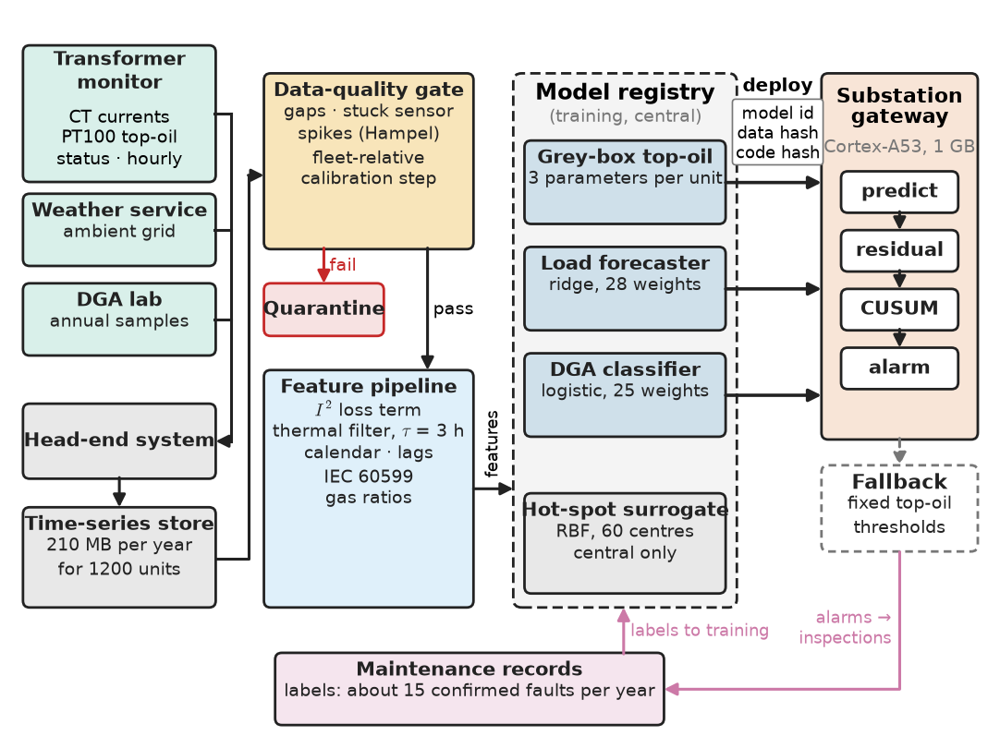
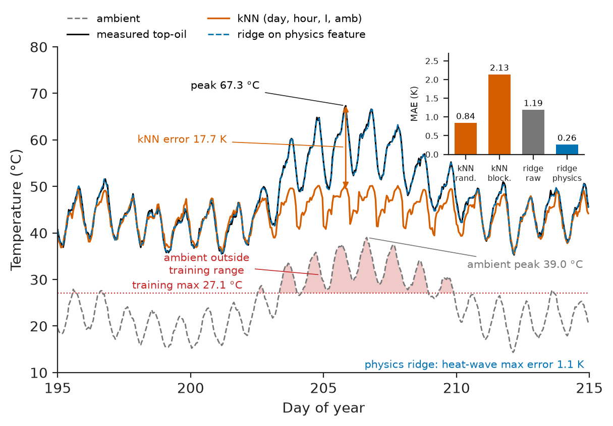
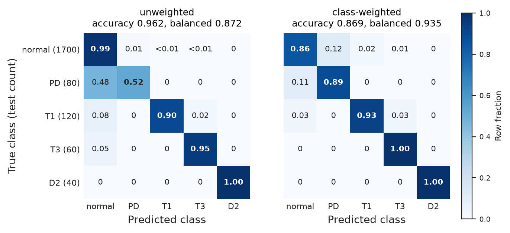
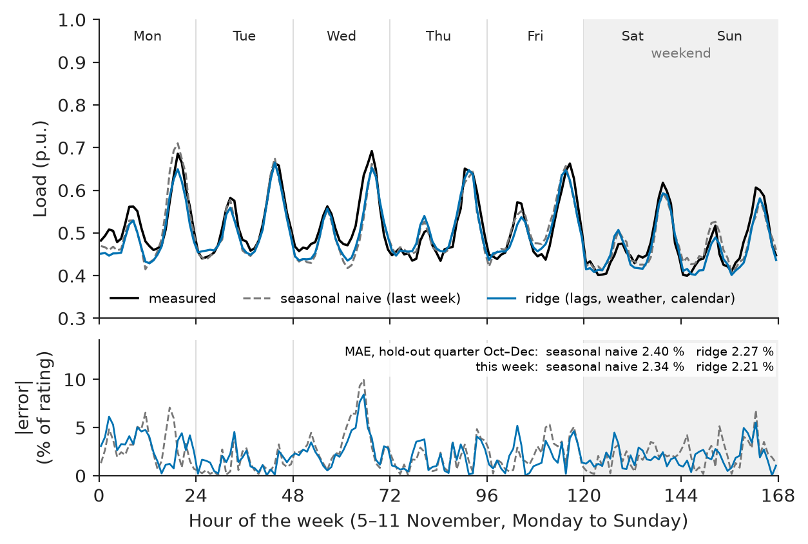
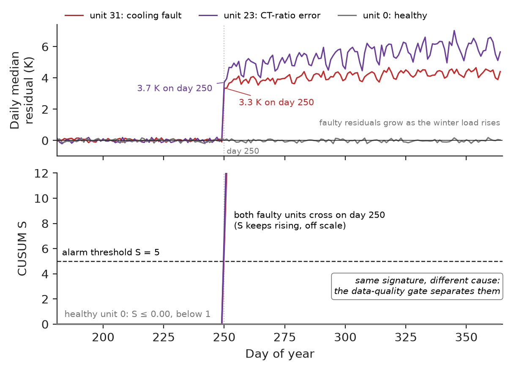
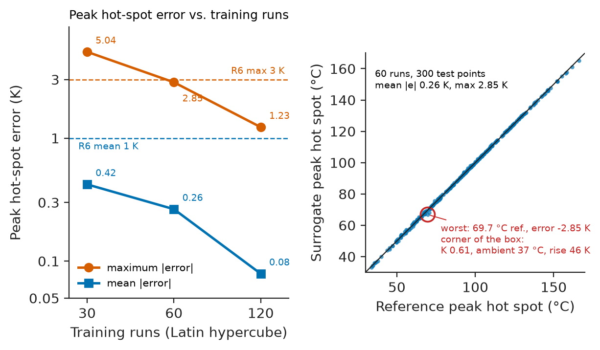

# Chapter 32 — AI and Machine Learning for EEE

*Part VIII · Engineering Software and Computational Tools*

A distribution utility retrofits monitors to 1200 pole- and pad-mounted 11/0.415 kV transformers and asks its data team for a model that predicts each unit's top-oil temperature from its load and the weather, so that units running hotter than predicted can be inspected before they fail. The model, a nearest-neighbour regressor on day, hour, current and ambient temperature, scores a mean absolute error of 0.84 K on a random 20 % of the year's data. In the July heat wave, with ambient temperatures 12 K above anything in the training months, its errors reach 18 K: real overloads go unflagged and healthy units are flagged. In September six transformers raise "cooling degradation" alarms on the same day; crews find six healthy transformers and a monitor firmware update that had changed their current-transformer ratio setting. The algorithm was never the problem. The random split let the model look up neighbouring hours of the very days it was tested on; the heat wave took the inputs outside the training domain, where a model with no physics has nothing to say; and no data-quality check stood between a changed sensor and the model's input.

> **How is machine learning applied to engineering data so that the model's error is known before deployment, including outside the conditions it was trained on?**
> **Where do physics, data cleaning and honest evaluation matter more than the choice of algorithm, and what does a model need to run on a substation gateway?**

| Concept | Engineering destination |
|---|---|
| Engineering datasets | SCADA, metering and condition-monitoring records of transformers, machines, PV plants and batteries |
| Data cleaning | Gaps, stuck sensors, spikes and calibration steps removed before any model sees them |
| Feature engineering | Inputs shaped by physics: $I^2$ losses, thermal time constants, gas ratios, calendar effects |
| Regression | Temperatures, efficiencies, losses and capacities predicted from operating conditions |
| Classification | Fault types from dissolved gases, vibration or current signatures; pass/fail in production test |
| Time-series forecasting | Load, PV output and price forecasts for operation and dispatch |
| Anomaly detection | Early warning of cooling, insulation, bearing and sensor faults |
| Surrogate models | Fast replacements for slow simulations inside sweeps, optimisers and fleet screening |
| Physics-informed modeling | Grey-box models with fitted physical parameters that extrapolate safely |
| Model evaluation | Blocked splits, baselines and per-class metrics that predict field performance |
| Uncertainty | Prediction intervals with verified coverage |
| Deployment constraints | Memory, latency, drift monitoring and fallbacks on gateways and embedded targets |

**Roadmap.** The fleet, its data and requirements (32.1) → cleaning (32.2) and physics-shaped features (32.3) → regression (32.4), classification (32.5), forecasting (32.6) and anomaly detection (32.7) on that data → surrogates for slow models (32.8) and grey-box models that extrapolate (32.9) → evaluation (32.10) and uncertainty (32.11) → deployment and failure analysis (32.12).

---

## 32.1 Engineering datasets

> **Boundary.** Regression, estimation and hypothesis testing are *The Mathematics Universe*, [Ch. 20](https://github.com/The-Studio-of-Sadiq/engineering-mathematics/blob/main/part-6-probability-statistics/20-statistical-analysis.md); autocorrelation and stationarity [Ch. 21](https://github.com/The-Studio-of-Sadiq/engineering-mathematics/blob/main/part-6-probability-statistics/21-random-processes.md); least squares, ridge regularisation and gradient methods [Ch. 23 §23.5 and §23.8](https://github.com/The-Studio-of-Sadiq/engineering-mathematics/blob/main/part-7-numerical-computational/23-optimization.md); nonlinear parameter estimation and Monte Carlo [Ch. 24 §24.6–24.7](https://github.com/The-Studio-of-Sadiq/engineering-mathematics/blob/main/part-7-numerical-computational/24-computational-mathematics.md); overfitting and independent validation data [Ch. 25 §25.7](https://github.com/The-Studio-of-Sadiq/engineering-mathematics/blob/main/part-7-numerical-computational/25-mathematical-modeling.md). Transformer losses are *Electrical Energy and Machines*, [Ch. 4 §4.7](https://github.com/The-Studio-of-Sadiq/Electrical-Energy-and-Machines/blob/main/part-2-transformers-and-electrical-machines/04-transformers.md), and insulation ageing [Ch. 3 §3.9](https://github.com/The-Studio-of-Sadiq/Electrical-Energy-and-Machines/blob/main/part-1-magnetic-circuits-and-energy-conversion/03-energy-conversion-principles.md). In this book, signal features are [Chapter 27](../part-7-communications-signal-processing-and-biomedical/27-practical-signal-processing.md), on-device inference and quantisation [Chapter 12](../part-3-embedded-and-connected-systems/12-edge-computing-and-embedded-ai.md), and calibration with full uncertainty quantification [Chapter 33](33-engineering-simulation-and-digital-twins.md). This chapter is the training side: data, models and evaluation for engineering systems.

### The fleet and its data

Each monitored transformer (250–1000 kVA, ONAN, mineral oil) reports hourly: the three LV phase currents from split-core CTs, the top-oil temperature from a PT100 in the thermometer pocket, and the monitor's own status. Ambient temperature comes from the weather service's grid for the substation location. About 400 units of 500 kVA and above are sampled annually for dissolved-gas analysis (DGA). Maintenance records (inspections, failures, cooling repairs) provide the only labels, and they are few: about 15 confirmed thermal or insulation faults a year across the fleet. Raw volume is modest: $1200\times8760$ hours × 5 channels × 4 bytes is 210 MB a year. Engineering datasets are rarely big. They are **small in labels, correlated in time, shifted by seasons and by sensor changes, and governed by physics that is partly known**; every section below follows from those four facts.

The listings use a synthetic fleet of 40 representative units over one year, generated by Listing 32.1 from the IEC 60076-7 top-oil structure with randomised parameters, realistic load shapes, a heat wave in July, and five injected data and equipment faults. Synthetic data are used because a real fleet's data are confidential and, more usefully, because the true answer is known; the price is that a grey-box model built on the same structure fits it better than it would fit a real transformer, where solar gain, wind and sensor position add 1–2 K of unexplained error.

```python
"""fleet.py -- synthetic hourly data for a fleet of ONAN distribution transformers (one year)."""
import numpy as np

H = 24 * 365                                          # hours in the year
t = np.arange(H)
hour, day = t % 24, t // 24

def top_oil_rise(K, d_or, R, tau_h, n=0.8):           # IEC 60076-7 style first-order model
    ult = d_or * ((1 + R * K**2) / (1 + R)) ** n      # ultimate top-oil rise at load K (p.u.)
    a, x, out = np.exp(-1.0 / tau_h), ult[0], np.empty_like(K)
    for i, u in enumerate(ult):
        x = a * x + (1 - a) * u
        out[i] = x
    return out

def make_fleet(n_units=40, seed=2026):
    rng = np.random.default_rng(seed)
    amb = 12 - 9 * np.cos(2 * np.pi * (day - 20) / 365) + 4 * np.sin(2 * np.pi * (hour - 9) / 24)
    amb += np.convolve(rng.normal(0, 0.6, H), np.ones(72), "same") / np.sqrt(72) * 4
    amb[200 * 24:212 * 24] += 11 * np.hanning(288)    # heat wave, 20-31 July
    units = []
    for u in range(n_units):
        p = dict(d_or=rng.uniform(45, 60), R=rng.uniform(5, 8), tau_h=rng.uniform(2.5, 3.5))
        shape = 0.55 + 0.25 * np.exp(-((hour - 19) / 3) ** 2) + 0.12 * np.exp(-((hour - 8) / 2) ** 2)
        K = rng.uniform(0.65, 1.0) * shape * np.where(day % 7 >= 5, 0.9, 1.0)
        K *= 1 + 0.12 * np.cos(2 * np.pi * day / 365) + 0.012 * np.clip(amb - 24, 0, None)
        K *= 1 + 0.04 * np.convolve(rng.normal(0, 1, H), np.ones(6) / 6 ** 0.5, "same")
        d_or = np.where((u == 31) & (day >= 250), 1.18 * p["d_or"], p["d_or"])  # cooling fault
        theta = amb + top_oil_rise(K, d_or, p["R"], p["tau_h"]) + rng.normal(0, 0.3, H)
        I_meas = K * np.where((20 <= u <= 25) & (t >= 6000), 0.8, 1.0)        # CT ratio error
        I_meas = I_meas * (1 + rng.normal(0, 0.01, H))
        theta[rng.random(H) < 0.01] = np.nan                                  # 1 % gaps
        units.append(dict(id=u, params=p, K_true=K, I=I_meas, theta=theta))
    units[12]["theta"][3000:3120] = units[12]["theta"][2999]                 # stuck sensor, 5 days
    units[3]["theta"][rng.choice(H, 20, replace=False)] += 40                # 20 spikes
    return amb, units
```

*Listing 32.1 — Synthetic fleet: per-unit thermal parameters, load and weather, a heat wave, and injected faults (gaps, a stuck sensor, spikes, a CT-ratio error on six units, a cooling fault on one).*

### Requirements and architecture

**Table 32.1 — Requirements for the transformer analytics.**

| ID | Requirement | Target | Verification method |
|---|---|---|---|
| R1 | Top-oil prediction on a later, unseen period | MAE ≤ 1.0 K; max ≤ 3 K, including ambient above the training range | Blocked hold-out, §32.4 |
| R2 | 90 % prediction interval | Coverage 0.85–0.95 on hold-out | Conformal check, §32.11 |
| R3 | Cooling degradation (+3 K at equal load) | Detected within 7 days; ≤ 1 false alarm per 100 unit-months | Fleet replay, §32.7 |
| R4 | Day-ahead load forecast | MAE at least 5 % below seasonal-naive baseline | Hold-out quarter, §32.6 |
| R5 | DGA fault classifier | Recall ≥ 0.85 for every fault class; ≤ 15 % false alarms on normal units | Independent test set, §32.5 |
| R6 | Hot-spot surrogate for fleet screening | Mean error ≤ 1 K, max ≤ 3 K in the design box; ≥ 1000 times faster | Space-filling test set, §32.8 |
| R7 | Runs on the substation gateway | ≤ 64 kB model per unit; daily refit ≤ 10 min per gateway | Deployment budget, §32.12 |
| R8 | Traceability | Every model version linked to data snapshot, code version and metrics | Model registry audit |

Figure 32.1 shows the architecture. Data flow from monitors through the head-end system into a time-series store; a **data-quality gate** (§32.2) runs before anything else and can quarantine a unit's data; models are trained centrally and deployed with a version to the gateways, which compute predictions, residuals and alarms locally and fall back to fixed thresholds when a model or its input is unavailable.

<!-- FIGURE 32.1 | figures/ch32/fig-32-1-analytics-architecture.png | block-diagram | Architecture of the transformer-fleet analytics: sensors, data-quality gate, feature pipeline, models, gateway deployment and feedback from maintenance. | Content: left: Transformer monitor (CT currents, PT100 top-oil, status, hourly) and Weather service (ambient grid) and DGA lab (annual samples) feeding Head-end system then Time-series store (210 MB per year for 1200 units). Centre: Data-quality gate (gaps, stuck, spikes, fleet-relative calibration step) with a quarantine output; Feature pipeline (I squared loss term, thermal filter tau 3 h, calendar, lags, IEC 60599 gas ratios). Right-centre: Model registry holding Grey-box top-oil model (3 parameters per unit), Load forecaster (ridge, 28 weights), DGA classifier (logistic, 25 weights), Hot-spot surrogate (RBF, 60 centres, central only). Right: Substation gateway (Cortex-A53, 1 GB) running predict, residual, CUSUM, alarm, with fallback fixed thresholds. Bottom feedback arrow from Maintenance records (labels, about 15 confirmed faults per year) to training. Version tags on deployment arrow: model id, data hash, code hash. -->



*Figure 32.1 — Architecture of the transformer-fleet analytics: sensors, data-quality gate, feature pipeline, models, gateway deployment and feedback from maintenance.*

### Choosing the model class

**Table 32.2 — Model classes for top-oil prediction, against the requirements.**

| Model class | In-range accuracy | Beyond the training range | Data needed | Interpretable | Size per unit | Choice |
|---|---|---|---|---|---|---|
| Nearest neighbours | Good with dense data | Returns the nearest seen value; fails | Large | No | Whole training set, about 140 kB | Rejected (R1, R7) |
| Gradient-boosted trees | Very good | Flat beyond the last split; fails | Medium–large | Partly | 50–500 kB | Rejected for R1; useful for non-thermal tasks |
| Small neural network (MLP, LSTM) | Very good with enough data | Unpredictable | Large | No | 10–200 kB | Rejected: labels and range too limited |
| Grey-box IEC 60076-7 structure, fitted parameters | Good | Follows physics | Small (weeks) | Yes: rated rise, loss ratio, time constant | 3 numbers | **Chosen** |

---

## 32.2 Data cleaning

Cleaning is engineering, not housekeeping: every defect in Listing 32.1 has a physical cause and a signature. **Gaps** come from communication outages and are left as gaps; interpolating a top-oil temperature across six hours of a load peak invents data. A **stuck sensor** (frozen firmware, a disconnected PT100 reading a constant fallback) shows zero spread where a real sensor always shows noise. **Spikes** (EMI on a long sensor cable, a transmission bit error) are isolated outliers that a Hampel filter (median plus a multiple of the median absolute deviation) removes without blurring real transients. A **calibration step** (a changed CT ratio, a replaced sensor) is the dangerous one because each value is plausible; it is found only by comparison with something independent, here the unit's load relative to the rest of the fleet, which shares weather and calendar.

```python
import numpy as np
from numpy.lib.stride_tricks import sliding_window_view as win
import fleet

amb, units = fleet.make_fleet()
I_all = np.array([u["I"] for u in units])
fleet_daily = np.median(I_all.reshape(len(units), 365, 24).mean(2), axis=0)
report = {"gaps": 0, "stuck": [], "spikes": [], "scale step": []}
for u in units:
    th = u["theta"]
    report["gaps"] += int(np.isnan(th).sum())
    # Stuck sensor: a 12 h window with zero spread (real sensors always show noise).
    span = np.ptp(win(np.nan_to_num(th, nan=-99), 12), axis=1)
    if np.any(span == 0):
        report["stuck"].append((u["id"], int(np.argmax(span == 0))))
    # Spikes: Hampel filter, 7 h window, 5 scaled MADs (at least 5 K) from the local median.
    w = win(np.pad(th, 3, mode="edge"), 7)
    med = np.nanmedian(w, axis=1)
    mad = 1.4826 * np.nanmedian(np.abs(w - med[:, None]), axis=1)
    n_spk = int(np.sum(np.abs(th - med) > 5 * np.maximum(mad, 1.0)))
    if n_spk:
        report["spikes"].append((u["id"], n_spk))
    # Calibration step: this unit's load relative to the fleet, 14-day medians before and after.
    ratio = u["I"].reshape(365, 24).mean(1) / fleet_daily
    before, after = np.median(win(ratio, 14)[:-14], 1), np.median(win(ratio, 14)[14:], 1)
    jump = after / before - 1
    k = int(np.argmax(np.abs(jump)))
    if abs(jump[k]) > 0.10:
        report["scale step"].append((u["id"], k + 14, round(float(jump[k]), 2)))
for k, v in report.items():
    print(f"{k:10s}: {v}")
```

```text
gaps      : 3492
stuck     : [(12, 2999)]
spikes    : [(3, 20)]
scale step: [(20, 250, -0.19), (21, 250, -0.19), (22, 250, -0.18), (23, 248, -0.19), (24, 251, -0.19), (25, 255, -0.19)]
```

*Listing 32.2 — Data-quality gate: gaps, stuck sensor, spikes and fleet-relative calibration steps.*

All injected defects are found and nothing else is: the stuck sensor of unit 12 from hour 2999, all 20 spikes on unit 3, and the 20 % CT-ratio error on units 20–25 from day 250 (detected within five days, estimated as −18 to −19 %). The 5 K floor on the spike threshold matters: with the bare MAD rule, normal top-oil ramps at load peaks were flagged on 16 healthy units in a first version of this listing.

> **Status of the principle: Check against an independent reference**
> *Empirical.* A sensor fault that produces plausible values can only be found by comparison with an independent quantity (a neighbouring sensor, the fleet, a physical balance); single-channel statistics catch gaps, stuck values and spikes but not calibration errors.

---

## 32.3 Feature engineering

Features are where engineering knowledge enters a data-driven model most cheaply. Table 32.3 lists the features used in this chapter, each with the physics or practice it encodes. The thermal feature is the important one: copper loss scales with $K^2$, the oil responds with a time constant of about 3 h, and the ultimate rise follows $\left[(1+RK^2)/(1+R)\right]^n$. Passing the load through that nonlinearity and a first-order filter (the `top_oil_rise` function with nominal $R=6$ and $\tau=3$ h, IEC 60076-7) turns the problem from "learn a nonlinear dynamic system" into "fit a straight line".

**Table 32.3 — Features and the knowledge they encode.**

| Feature | Encodes | Used in |
|---|---|---|
| $K^2$ | Load loss proportional to current squared ([Book 5, Ch. 4 §4.7](https://github.com/The-Studio-of-Sadiq/Electrical-Energy-and-Machines/blob/main/part-2-transformers-and-electrical-machines/04-transformers.md)) | Regression |
| Filtered loss term, $\tau=3$ h | Thermal memory of the oil (IEC 60076-7 structure) | Regression, anomaly detection |
| Ambient temperature | Boundary condition of the cooling | Regression, forecasting |
| Hour of day (sine, cosine or one-hot), weekend flag | Daily and weekly behaviour of customers | Forecasting |
| Load at the same hour 1 and 7 days earlier | Persistence and weekly seasonality | Forecasting |
| $\log(\mathrm{CH_4/H_2})$, $\log(\mathrm{C_2H_2/C_2H_4})$, $\log(\mathrm{C_2H_4/C_2H_6})$, log total gas | IEC 60599 gas ratios and severity | Classification |
| Spectral and envelope features of vibration or current | Bearing and winding signatures ([Chapter 27](../part-7-communications-signal-processing-and-biomedical/27-practical-signal-processing.md)) | Machine monitoring (not used here) |

Two rules keep features honest. A feature must be **available at prediction time** (a forecast for tomorrow may use today's load and tomorrow's *forecast* temperature, never tomorrow's measured temperature). And a feature must not **encode the answer through the back door**: the day-of-year in the opening's nearest-neighbour model let it find the test hour's neighbours in the training set, which is leakage, not learning.

---

## 32.4 Regression

Listing 32.3 predicts unit 0's top-oil temperature with three models and two ways of splitting the data: a random 80/20 split of the year, and a blocked split that trains on January–June and tests on July–September, which contains the heat wave.

```python
import numpy as np
from scipy.spatial import cKDTree
import fleet

amb, units = fleet.make_fleet()
u = units[0]
ok = ~np.isnan(u["theta"])
phys = fleet.top_oil_rise(u["I"], 1.0, 6.0, 3.0)            # physics feature: R = 6, tau = 3 h
raw = np.column_stack([np.ones(fleet.H), u["I"], u["I"]**2, amb,
                       np.sin(2 * np.pi * fleet.hour / 24), np.cos(2 * np.pi * fleet.hour / 24)])
X = {"kNN on (day, hour, I, amb)": np.column_stack([fleet.day, fleet.hour, u["I"], amb]),
     "ridge on raw features": raw,
     "ridge on physics feature": np.column_stack([np.ones(fleet.H), amb, phys])}

def fit_predict(name, Xtr, ytr, Xte):
    if name.startswith("kNN"):
        mu, sd = Xtr.mean(0), Xtr.std(0)
        _, idx = cKDTree((Xtr - mu) / sd).query((Xte - mu) / sd, k=5)
        return ytr[idx].mean(1)
    w = np.linalg.solve(Xtr.T @ Xtr + 1e-3 * np.eye(Xtr.shape[1]), Xtr.T @ ytr)
    return Xte @ w

rng = np.random.default_rng(0)
random_test = ok & (rng.random(fleet.H) < 0.2)
splits = {"random 80/20": (ok & ~random_test, random_test),
          "train Jan-Jun, test Jul-Sep": (ok & (fleet.day < 181), ok & (fleet.day >= 181) & (fleet.day < 273))}
heat = (fleet.day >= 200) & (fleet.day < 212)
for split, (tr, te) in splits.items():
    for name, Xn in X.items():
        if split.startswith("random") and not name.startswith("kNN"):
            continue
        err = fit_predict(name, Xn[tr], u["theta"][tr], Xn[te]) - u["theta"][te]
        hw = np.abs(err[heat[te]]).max()
        print(f"{split:28s} {name:27s} MAE {np.abs(err).mean():5.2f} K, heat-wave max {hw:5.1f} K")
```

```text
random 80/20                 kNN on (day, hour, I, amb)  MAE  0.84 K, heat-wave max   4.7 K
train Jan-Jun, test Jul-Sep  kNN on (day, hour, I, amb)  MAE  2.13 K, heat-wave max  17.7 K
train Jan-Jun, test Jul-Sep  ridge on raw features       MAE  1.19 K, heat-wave max   6.6 K
train Jan-Jun, test Jul-Sep  ridge on physics feature    MAE  0.26 K, heat-wave max   1.1 K
```

*Listing 32.3 — Top-oil regression: leakage under a random split, and extrapolation under a blocked split, for three model classes.*

The first two lines are the opening story. The same nearest-neighbour model scores 0.84 K on a random split and fails by 17.7 K in the heat wave once the test period is genuinely later than the training period. The random split was not testing prediction; it was testing interpolation between hours one hour apart. The linear model on raw features does better because a straight line in ambient temperature extrapolates, but it misses the nonlinearity of loss and the oil's lag, and errs by 6.6 K. The linear model on the physics feature reaches 0.26 K MAE, essentially the 0.3 K sensor noise, and 1.1 K maximum in the heat wave, meeting R1, with three coefficients. Figure 32.2 shows the heat-wave fortnight.

<!-- FIGURE 32.2 | figures/ch32/fig-32-2-heatwave-predictions.png | plot | Measured and predicted top-oil temperature of unit 0 through the July heat wave, for a nearest-neighbour model and a physics-feature model trained on January to June. | Content: x-axis day of year 195 to 215, y-axis temperature 10 to 75 C. Measured top-oil (black, 0.3 K noise, peaks rising to 67.3 C at the height of the heat wave). Ambient (grey dashed, peaking at 39.0 C; shaded band above 27.1 C labelled outside training range). kNN prediction (orange) saturating near the highest training values around 51 C during the heat wave, error up to 17.7 K annotated. Physics-feature ridge prediction (blue) overlaying the measurement within 1.1 K. Inset bar chart: MAE random split kNN 0.84 K versus blocked kNN 2.13 K, raw ridge 1.19 K, physics ridge 0.26 K. -->



*Figure 32.2 — Measured and predicted top-oil temperature of unit 0 through the July heat wave, for a nearest-neighbour model and a physics-feature model trained on January to June.*

> **Status of the principle: Data-driven models interpolate**
> *Empirical.* A model fitted to data is reliable only within the region of input space the data cover; outside it, purely data-driven models return values governed by their structure (constant for neighbours and trees, arbitrary for neural networks), while models whose structure follows the physics degrade gracefully.

---

## 32.5 Classification

Dissolved-gas analysis is the classic classification problem of transformer engineering: thermal and electrical faults decompose oil and paper into characteristic gas mixtures, and IEC 60599 interprets them through ratios such as $\mathrm{CH_4/H_2}$, $\mathrm{C_2H_2/C_2H_4}$ and $\mathrm{C_2H_4/C_2H_6}$ (gas formation and its chemistry are high-voltage engineering, *Electrical Energy and Machines*, [Ch. 24 §24.8](https://github.com/The-Studio-of-Sadiq/Electrical-Energy-and-Machines/blob/main/part-6-transmission-distribution-and-protection/24-high-voltage-engineering.md)). Listing 32.4 trains a multinomial logistic regression on those log-ratios and the log total gas for five classes, with the imbalance of a real database: 85 % normal, and 2–6 % for each fault class. The gas means are illustrative, not diagnostic limits.

```python
import numpy as np
from scipy.optimize import minimize
from scipy.special import logsumexp

CLASSES = ["normal", "PD", "T1 <300C", "T3 >700C", "D2 arcing"]
#              H2   CH4  C2H6  C2H4  C2H2   typical ppm per class (illustrative)
MEAN = np.array([[30, 10, 15, 5, 0.5], [300, 30, 10, 2, 0.5], [40, 120, 150, 30, 0.5],
                 [80, 200, 60, 400, 5], [400, 80, 10, 150, 200]])
COUNT = [1700, 80, 120, 60, 40]                      # imbalanced, as in a real DGA database

def samples(seed):
    rng = np.random.default_rng(seed)
    y = np.repeat(np.arange(5), COUNT)
    gas = MEAN[y] * rng.lognormal(0, 0.6, (y.size, 5)) * rng.lognormal(0, 0.8, (y.size, 1))
    H2, CH4, C2H6, C2H4, C2H2 = gas.T
    X = np.column_stack([np.log(CH4 / H2), np.log(C2H2 / C2H4), np.log(C2H4 / C2H6),
                         np.log(gas.sum(1)), np.ones(y.size)])     # IEC 60599 ratios + total
    return X, y

def train(X, y, balanced):
    w_s = (y.size / (5 * np.bincount(y)))[y] if balanced else np.ones(y.size)
    def loss(W):
        Z = X @ W.reshape(5, 5).T
        return -np.sum(w_s * (Z[np.arange(y.size), y] - logsumexp(Z, axis=1))) + 0.1 * np.sum(W**2)
    return minimize(loss, np.zeros(25), method="L-BFGS-B").x.reshape(5, 5)

(Xtr, ytr), (Xte, yte) = samples(1), samples(2)
print("always 'normal' : accuracy", round(np.mean(yte == 0), 3))
for balanced in (False, True):
    pred = np.argmax(Xte @ train(Xtr, ytr, balanced).T, axis=1)
    recall = [np.mean(pred[yte == k] == k) for k in range(5)]
    print(f"logistic, {'class-weighted' if balanced else 'unweighted   '}: accuracy {np.mean(pred == yte):.3f},"
          f" recall per class {np.round(recall, 2)}, balanced accuracy {np.mean(recall):.3f}")
```

```text
always 'normal' : accuracy 0.85
logistic, unweighted   : accuracy 0.962, recall per class [0.99 0.52 0.9  0.95 1.  ], balanced accuracy 0.872
logistic, class-weighted: accuracy 0.869, recall per class [0.86 0.89 0.93 1.   1.  ], balanced accuracy 0.935
```

*Listing 32.4 — DGA fault classification with imbalanced classes: accuracy against per-class recall, unweighted and class-weighted.*

A classifier that always answers "normal" is 85 % accurate and useless. The unweighted model is 96.2 % accurate and still misses half the partial-discharge cases, because partial discharge is rare and its gas pattern overlaps the normal one at low total gas. Weighting the classes inversely to their frequency raises partial-discharge recall from 0.52 to 0.89 and costs normal-class recall, 0.99 to 0.86: 14 % of healthy units would be flagged for a resample. 

**Worked example — choosing the operating point by cost.** Take 1000 units with the test-set mix (850 normal, 40 PD, 60 T1, 30 T3, 20 D2), \$150 for an unnecessary resample and \$40,000 for a missed incipient fault, and count every fault-class error as a miss (pessimistic). Unweighted: $0.01\times850=8.5$ false alarms (\$1,275) and $0.48\times40+0.10\times60+0.05\times30=26.7$ misses (\$1.07 M). Weighted: 119 false alarms (\$17,850) and $0.11\times40+0.07\times60=8.6$ misses (\$0.34 M). About \$16,600 more in oil samples saves about \$0.72 M. The operating point is a cost decision, not a property of the algorithm; and since the weighted model meets R5 with little margin, its output is a recommendation to resample, not an automatic action.

<!-- FIGURE 32.3 | figures/ch32/fig-32-3-dga-confusion.png | table-graphic | Row-normalised confusion matrices of the DGA classifier on the independent test set, unweighted and class-weighted. | Content: two 5 x 5 heat maps side by side, rows true class (normal 1700, PD 80, T1 120, T3 60, D2 40), columns predicted class, cells show row fraction. Left unweighted: diagonal 0.99, 0.52, 0.90, 0.95, 1.00; most PD errors in the normal column. Right class-weighted: diagonal 0.86, 0.89, 0.93, 1.00, 1.00; normal errors spread to PD and T1 columns. Titles with accuracy 0.962 versus 0.869 and balanced accuracy 0.872 versus 0.935. Colour scale 0 to 1. -->



*Figure 32.3 — Row-normalised confusion matrices of the DGA classifier on the independent test set, unweighted and class-weighted.*

> **Status of the principle: Accuracy is not a metric for rare faults**
> *Derived.* With a class prior of 85 %, the trivial classifier scores 85 %, so accuracy is dominated by the majority class; per-class recall and precision, or balanced accuracy, measure what the classifier adds, and the decision threshold must come from the costs of each error type.

Real DGA databases contain hundreds, not thousands, of confirmed fault cases, and their labels come from teardown reports of variable quality. With so few labels, interpretable models on established ratios (or the Duval triangle and pentagon methods) remain the industrial standard, and machine learning is used to rank units for attention rather than to diagnose.

---

## 32.6 Time-series forecasting

Day-ahead load forecasts let the utility schedule switching, decide whether a transformer can carry a planned transfer, and anticipate thermal stress. Listing 32.5 forecasts tomorrow's 24 hourly loads of unit 5 at midnight, using only information available then: today's load, last week's load, tomorrow's weather forecast (simulated with 1.5 K error) and the calendar.

```python
import numpy as np
import fleet

amb, units = fleet.make_fleet()
I = units[5]["I"].reshape(365, 24)                    # hourly load, p.u., one row per day
A = amb.reshape(365, 24)
rng = np.random.default_rng(1)
A_fc = A + rng.normal(0, 1.5, A.shape)                # day-ahead weather forecast, 1.5 K error

def features(d):                                      # forecast made at midnight for day d
    hour_onehot = np.eye(24)
    weekend = np.full((24, 1), float(d % 7 >= 5))
    return np.column_stack([hour_onehot, I[d - 1], I[d - 7], A_fc[d], weekend])

days = np.arange(7, 365)
train, test = days[days < 273], days[days >= 273]     # fit Jan-Sep, test Oct-Dec
X = np.vstack([features(d) for d in train]); y = I[train].ravel()
w = np.linalg.solve(X.T @ X + 0.1 * np.eye(X.shape[1]), X.T @ y)

forecasts = {"persistence (yesterday)": lambda d: I[d - 1],
             "seasonal naive (last week)": lambda d: I[d - 7],
             "ridge (lags, weather, calendar)": lambda d: features(d) @ w}
for name, f in forecasts.items():
    err = np.array([f(d) - I[d] for d in test])
    peak_err = np.array([f(d).max() - I[d].max() for d in test])
    print(f"{name:32s} MAE {100 * np.abs(err).mean():.2f} % of rating, "
          f"MAPE {100 * np.mean(np.abs(err) / I[test]):.1f} %, daily-peak MAE {100 * np.abs(peak_err).mean():.2f} %")
```

```text
persistence (yesterday)          MAE 3.27 % of rating, MAPE 6.5 %, daily-peak MAE 3.53 %
seasonal naive (last week)       MAE 2.40 % of rating, MAPE 4.7 %, daily-peak MAE 2.57 %
ridge (lags, weather, calendar)  MAE 2.27 % of rating, MAPE 4.4 %, daily-peak MAE 2.56 %
```

*Listing 32.5 — Day-ahead load forecasting against two naive baselines, on a hold-out quarter.*

The ridge forecaster beats the seasonal-naive baseline by $(2.40-2.27)/2.40=5.4\ \%$, just meeting R4, and does not improve the daily peak at all. That modest gain is typical for a single distribution transformer, whose load is dominated by the random behaviour of a few dozen customers; forecasts improve sharply with aggregation (a feeder or a substation), and a model that does not beat the seasonal-naive baseline on a hold-out period is not worth deploying, however sophisticated. Persistence is worse than the weekly baseline because Mondays follow Sundays. Forecast errors of this size, and their propagation to a predicted hot spot, are what [Chapter 25](../part-6-renewable-energy-and-electric-mobility/25-microgrids-and-hybrid-energy-systems.md) budgets for in energy management; the role of forecasts in grid operation is *Electrical Energy and Machines*, [Ch. 26 §26.8](https://github.com/The-Studio-of-Sadiq/Electrical-Energy-and-Machines/blob/main/part-7-power-quality-and-grid-modernization/26-smart-grids.md).

<!-- FIGURE 32.4 | figures/ch32/fig-32-4-load-forecast.png | plot | One test week of day-ahead load forecasts for unit 5: measured load, seasonal-naive forecast and ridge forecast. | Content: x-axis hours 0 to 168 of a week in November (Monday to Sunday), y-axis load 0.3 to 1.0 p.u. Measured load (black) with evening peaks near 19 h and a lower weekend. Seasonal naive (grey dashed) and ridge (blue) forecasts. Lower panel: absolute error of each, with weekly MAE values 2.40 and 2.27 percent of rating annotated (hold-out quarter). -->



*Figure 32.4 — One test week of day-ahead load forecasts for unit 5: measured load, seasonal-naive forecast and ridge forecast.*

---

## 32.7 Anomaly detection

A transformer whose cooling degrades (blocked radiators, a failed fan on ONAF units, low oil) runs hotter at the same load and ambient. With a model of what the oil temperature *should* be, the residual (measured minus predicted) becomes a fault signal. Listing 32.6 fits each unit's grey-box model (§32.9) on January to May, sets the residual scale on June, and runs a one-sided CUSUM on the daily median residual from July onwards. A CUSUM accumulates small persistent deviations and ignores isolated ones, which is exactly the signature of slow cooling degradation.

```python
import numpy as np
from scipy.optimize import least_squares
import fleet

amb, units = fleet.make_fleet()
fit_days, cal_days = fleet.day < 151, (fleet.day >= 151) & (fleet.day < 181)
alarms = []
for u in units:
    ok = ~np.isnan(u["theta"])
    model = lambda p: amb + fleet.top_oil_rise(u["I"], *p)
    p = least_squares(lambda p: (model(p) - u["theta"])[ok & fit_days], x0=[50, 6, 3],
                      bounds=([20, 1, 0.5], [90, 15, 10]), loss="soft_l1").x   # robust to spikes
    r = np.where(ok, u["theta"] - model(p), np.nan).reshape(365, 24)
    daily = np.nanmedian(r, axis=1)                    # one residual per day, robust
    sigma = max(np.std(daily[151:181]), 0.5)           # calibration spread, 0.5 K floor
    S = 0.0
    for d in range(181, 365):                          # one-sided CUSUM: oil hotter than model
        S = max(0.0, S + daily[d] / sigma - 0.5)
        if S > 5.0:
            alarms.append((u["id"], d, round(float(daily[d]), 2)))
            break
print("alarms (unit, day, residual K):", alarms)
print("units with injected faults: 20-25 (current sensor -20 % from day 250), 31 (cooling, day 250)")
```

```text
alarms (unit, day, residual K): [(20, 251, 2.14), (21, 250, 3.04), (22, 250, 2.93), (23, 250, 3.72), (24, 251, 2.07), (25, 250, 2.99), (31, 250, 3.34)]
units with injected faults: 20-25 (current sensor -20 % from day 250), 31 (cooling, day 250)
```

*Listing 32.6 — Residual-based anomaly detection across the fleet with a robust grey-box fit and a one-sided CUSUM.*

The cooling fault on unit 31 (an 18 % higher rated top-oil rise, about +3.3 K at its load) is detected on the day it starts, and the 33 healthy units, including the stuck-sensor and spiky units, raise no alarm over six months: zero false alarms in 198 unit-months, inside R3. But units 20–25 alarm too, with residuals of 2–4 K, and they are perfectly healthy. Their CT ratio error makes the measured current 20 % low, so the model predicts a cooler transformer than the real one, and the residual looks exactly like failing cooling. An anomaly detector reports that something has changed, not what. That is why the data-quality gate of Listing 32.2, which identifies those six units as calibration steps from the fleet comparison, must run first and suppress or relabel the alarm. In the opening story the gate did not exist, and six crews went to six healthy transformers.

The 0.5 K floor on the residual scale is a design decision of the same kind as the 5 K spike floor: without it, the very small spread of residuals in June (a few hundredths of a kelvin on synthetic data) made the CUSUM alarm on 0.1–0.25 K drifts on eight units in a first version.

<!-- FIGURE 32.5 | figures/ch32/fig-32-5-cusum.png | plot | CUSUM statistic of the daily top-oil residual for a cooling fault, a CT-ratio error and a healthy unit. | Content: upper panel daily median residual (K) against day 181 to 365 for unit 31 (cooling fault, red), unit 23 (CT ratio error, purple) and unit 0 (healthy, grey); both faulty units step from about 0 to 3.3 K and 3.7 K at day 250. Lower panel CUSUM S against day, threshold line at 5, both faulty units crossing at day 250, healthy unit staying below 1. Annotation: same signature, different cause; the data-quality gate separates them. -->



*Figure 32.5 — CUSUM statistic of the daily top-oil residual for a cooling fault, a CT-ratio error and a healthy unit.*

> **Status of the principle: Residuals need a reference you trust**
> *Derived.* A residual detector inherits every error of its reference model and of its inputs, so input faults and plant faults produce the same signature; isolation requires a second, independent check on the inputs.

---

## 32.8 Surrogate models

Planning engineers need to screen every transformer in the fleet against every day of a hot-summer scenario for peak hot-spot temperature and insulation ageing: $1200\times365=438\,000$ evaluations. The reference model, the IEC 60076-7 top-oil and winding ODEs integrated over three days of a daily load cycle to reach a periodic state, takes 36 ms per case, so 4.4 hours for one scenario. A **surrogate** is a cheap function fitted to a modest number of reference runs. Listing 32.7 fits a radial-basis-function interpolant to 60 runs placed by a Latin hypercube over peak load (0.6–1.6 p.u.), mean ambient (0–40 °C) and rated top-oil rise (45–60 K), and tests it on 300 independent random points. The same technique replaces the heatsink field model of [Chapter 30](30-scientific-and-engineering-computing.md) inside its optimiser.

```python
import time
import numpy as np
from scipy.integrate import solve_ivp
from scipy.interpolate import RBFInterpolator
from scipy.stats import qmc

def hot_spot_day(K_peak, amb_mean, d_or, R=6.0, n=0.8, Hgr=23.0, y=1.6, tau_o=3.0, tau_w=0.12):
    """Reference model: IEC 60076-7 style top-oil and winding ODEs over 3 days of a daily cycle.
    Returns the peak hot-spot temperature (C) and log10 of the relative ageing on day 3."""
    K = lambda h: K_peak * (0.5 + 0.5 * np.exp(-(((h % 24) - 19) / 2.5) ** 2))
    amb = lambda h: amb_mean + 5 * np.sin(2 * np.pi * ((h % 24) - 9) / 24)
    def f(h, x):
        k = K(h)
        return [(d_or * ((1 + R * k**2) / (1 + R)) ** n - x[0]) / tau_o, (Hgr * k**y - x[1]) / tau_w]
    sol = solve_ivp(f, (0, 72), [0.0, 0.0], method="LSODA", max_step=0.05, dense_output=True)
    h = np.linspace(48, 72, 1441)
    theta_h = amb(h) + sol.sol(h).sum(axis=0)
    ageing = np.trapezoid(2 ** ((theta_h - 98) / 6), h) / 24     # non-upgraded paper, IEC 60076-7
    return theta_h.max(), np.log10(ageing)

lo, hi = [0.6, 0.0, 45.0], [1.6, 40.0, 60.0]              # K_peak, ambient mean (C), rated rise
X_train = qmc.scale(qmc.LatinHypercube(d=3, seed=4).random(60), lo, hi)
X_test = qmc.scale(np.random.default_rng(5).random((300, 3)), lo, hi)
t0 = time.perf_counter(); Y_train = np.array([hot_spot_day(*x) for x in X_train])
t_ref = (time.perf_counter() - t0) / len(X_train)
Y_test = np.array([hot_spot_day(*x) for x in X_test])
scale = np.array(hi) - np.array(lo)
sur = RBFInterpolator(X_train / scale, Y_train, kernel="thin_plate_spline", degree=1)
t0 = time.perf_counter(); Y_hat = sur(X_test / scale); t_sur = (time.perf_counter() - t0) / len(X_test)
err = Y_hat - Y_test
print(f"reference {1e3 * t_ref:.0f} ms per case, surrogate {1e6 * t_sur:.0f} us per case")
print(f"peak hot-spot error: mean abs {np.abs(err[:, 0]).mean():.2f} K, max {np.abs(err[:, 0]).max():.2f} K")
print(f"daily ageing error : median {100 * np.median(np.abs(10 ** err[:, 1] - 1)):.1f} %, "
      f"max {100 * np.abs(10 ** err[:, 1] - 1).max():.0f} %")
```

```text
reference 36 ms per case, surrogate 5 us per case
peak hot-spot error: mean abs 0.26 K, max 2.85 K
daily ageing error : median 1.9 %, max 32 %
```

*Listing 32.7 — A radial-basis-function surrogate of a transformer hot-spot and ageing model, trained on 60 Latin-hypercube runs and tested on 300 independent points.*

**Worked example — what the surrogate buys and what it costs.** At 5 µs per case the 438 000-case scenario takes 2.2 s instead of 4.4 h, a factor of about 7000, meeting R6. Training cost 60 reference runs (2.2 s) plus 300 test runs (11 s), which are not optional: without them there is no error statement. Over the test set the peak hot-spot error is 0.26 K on average and 2.85 K at worst, inside R6's 3 K. The worst case sits at a corner of the box (peak load 0.61 p.u., ambient 37 °C, rated rise 46 K), where the interpolant has fewest neighbours. Ageing, which is exponential in temperature (it doubles every 6 K), is predicted in logarithm, and a 2.85 K error becomes a 32 % ageing error at that corner, against a median of 1.9 %. Doubling the training runs to 120 cuts the mean hot-spot error to 0.08 K and the maximum to 1.23 K; halving to 30 raises them to 0.42 K and 5.0 K. The surrogate is used only inside its box; a query outside it is sent to the reference model.

<!-- FIGURE 32.6 | figures/ch32/fig-32-6-surrogate-error.png | plot | Surrogate accuracy against the number of reference runs, and parity of the 60-run surrogate. | Content: left panel log-log, x-axis training runs 30, 60, 120; y-axis peak hot-spot error 0.05 to 6 K; mean absolute error 0.42, 0.26, 0.08 K and maximum 5.0, 2.85, 1.23 K as two lines with markers; horizontal dashed lines at R6 limits 1 K (mean) and 3 K (max). Right panel parity plot of surrogate against reference peak hot-spot temperature, 34 to 166 C, 300 test points on the diagonal, worst point (69.7 C reference, error -2.85 K) circled and labelled corner of the box: K 0.61, ambient 37 C. -->



*Figure 32.6 — Surrogate accuracy against the number of reference runs, and parity of the 60-run surrogate.*

> **Status of the principle: Surrogate error must be measured, not assumed**
> *Empirical.* Interpolating surrogates (radial basis functions, Gaussian processes, polynomial chaos, neural networks) converge as training runs fill the input space, roughly as a power of their spacing, but their error is largest at boundaries and in regions of high curvature; only an independent test set inside the stated box bounds it.

---

## 32.9 Physics-informed modeling

The physics feature of §32.4 fixed $R$ and $\tau$ at nominal values and let regression fit the scale. A **grey-box model** goes one step further: it keeps the IEC 60076-7 structure and fits its physical parameters (rated top-oil rise $\Delta\theta_{or}$, loss ratio $R$, oil time constant $\tau_o$) for each transformer by nonlinear least squares. The parameters are interpretable (a rated rise of 51 K for a unit whose nameplate says 50 K is plausible; 80 K is a fault or a bad sensor), few (three per unit), and the model extrapolates as far as the physics holds. Listing 32.8 fits unit 0 on January to May.

```python
import numpy as np
from scipy.optimize import least_squares
import fleet

amb, units = fleet.make_fleet()
u = units[0]
ok = ~np.isnan(u["theta"])
fit_set = ok & (fleet.day < 151)                       # fit the physics parameters
cal_set = ok & (fleet.day >= 151) & (fleet.day < 181)  # calibrate the interval width
test = ok & (fleet.day >= 181) & (fleet.day < 273)     # Jul-Sep, includes the heat wave

def predict(p):                                        # grey box: IEC structure, fitted numbers
    return amb + fleet.top_oil_rise(u["I"], *p)

res = least_squares(lambda p: (predict(p) - u["theta"])[fit_set],
                    x0=[50.0, 6.0, 3.0], bounds=([20, 1, 0.5], [90, 15, 10]))
J = res.jac
cov = np.linalg.inv(J.T @ J) * np.mean(res.fun ** 2)   # linearised parameter covariance
print("fitted d_or, R, tau_h :", np.round(res.x, 2), "+/-", np.round(np.sqrt(np.diag(cov)), 2))
print("true   d_or, R, tau_h :", np.round(list(u["params"].values()), 2))

# Split-conformal 90 % interval: quantile of absolute residuals on unseen calibration data.
r_cal = np.sort(np.abs(predict(res.x) - u["theta"])[cal_set])
q = r_cal[int(np.ceil(0.9 * (r_cal.size + 1))) - 1]
err = (predict(res.x) - u["theta"])[test]
heat = ((fleet.day >= 200) & (fleet.day < 212))[test]
print(f"interval +/-{q:.2f} K; coverage on Jul-Sep {np.mean(np.abs(err) <= q):.3f}, "
      f"in heat wave {np.mean(np.abs(err[heat]) <= q):.3f}; MAE {np.abs(err).mean():.2f} K")
```

```text
fitted d_or, R, tau_h : [50.72  7.03  3.24] +/- [0.04 0.04 0.01]
true   d_or, R, tau_h : [50.69  7.02  3.22]
interval +/-0.52 K; coverage on Jul-Sep 0.906, in heat wave 0.913; MAE 0.25 K
```

*Listing 32.8 — Grey-box model with fitted physical parameters, their linearised standard errors, and a split-conformal prediction interval.*

The fitted parameters agree with the true ones to within their standard errors, and the model trained on spring data predicts the heat wave as well as the spring. On a real transformer the agreement would be looser (solar gain, wind, oil-pocket position and an imperfect model structure add unexplained error, and the standard errors computed from the Jacobian assume independent residuals, which hourly thermal data are not), but the extrapolation behaviour carries over, because it comes from the structure.

Physics-informed approaches range from **physics features** (§32.4) through **grey-box fitting** (this section) and **residual learning** (a data-driven model of what the grey box misses, such as solar gain) to **physics-informed neural networks**, which add the governing equation's residual to the training loss. For lumped systems with known structure (transformer and motor thermal models, battery equivalent circuits) the grey box is smaller, faster, easier to audit and at least as accurate; physics-informed networks earn their cost for distributed problems with sparse sensors. Parameter identifiability and calibration with full uncertainty are the subject of [Chapter 33](33-engineering-simulation-and-digital-twins.md).

> **Status of the principle: IEC 60076-7 exponential thermal model**
> *Approximate.* Treats the oil as one well-mixed thermal mass with a single time constant and the winding gradient as a power of load; valid for ONAN and ONAF distribution transformers under slow load changes, and less accurate for fast overloads, OD cooling and units with significant solar gain.

---

## 32.10 Model evaluation

Table 32.4 collects the evaluation of every model in the chapter against its requirement. Four practices made those numbers trustworthy:

- **Split by time (and by unit) as the model will be used.** A model that will predict next summer is tested on a later period it never saw; a model that will be applied to new transformers is tested on held-out units. Autocorrelated data under a random split leak information between neighbouring samples ([The Mathematics Universe, Ch. 21 §21.3](https://github.com/The-Studio-of-Sadiq/engineering-mathematics/blob/main/part-6-probability-statistics/21-random-processes.md)).
- **Always report a naive baseline.** Seasonal naive for forecasts, "always normal" for classifiers, a nominal-parameter physics model for regression. A model is judged by its improvement over the baseline.
- **Use metrics with engineering meaning.** Errors in kelvin and per cent of rating; maximum error in the conditions that matter (the heat wave); per-class recall for rare faults; daily-peak error for planning.
- **Freeze the test set.** It is used once per model version; tuning on it turns it into training data.

**Table 32.4 — Verification of the analytics against Table 32.1.**

| Req. | Test | Limit | Result | Pass/fail |
|---|---|---|---|---|
| R1 | Blocked hold-out Jul–Sep, unit 0 (Listing 32.3, physics feature; Listing 32.8, grey box) | MAE ≤ 1.0 K; max ≤ 3 K | 0.26 K, 1.1 K (heat wave); grey box 0.25 K | Pass |
| R1 | Same test, nearest-neighbour model of the opening | MAE ≤ 1.0 K; max ≤ 3 K | 2.13 K; 17.7 K | Fail (rejected) |
| R2 | Split-conformal 90 % interval (Listing 32.8) | Coverage 0.85–0.95 | 0.906 overall, 0.913 in heat wave | Pass |
| R3 | Fleet replay Jul–Dec (Listing 32.6) | Detect in ≤ 7 days; ≤ 1 false alarm per 100 unit-months | Day 0; 0 false alarms in 198 unit-months (after data-quality gate) | Pass |
| R4 | Hold-out Oct–Dec (Listing 32.5) | ≥ 5 % better than seasonal naive | 5.4 % better | Pass (marginal) |
| R5 | Independent test set (Listing 32.4, weighted) | Recall ≥ 0.85 per fault class; ≤ 15 % false alarms | Min fault recall 0.89; 14 % false alarms | Pass (marginal) |
| R6 | 300 random points in the box (Listing 32.7) | Mean ≤ 1 K, max ≤ 3 K; ≥ 1000× faster | 0.26 K, 2.85 K; about 7000× | Pass |
| R7 | Deployment budget (Table 32.5) | ≤ 64 kB per unit; refit ≤ 10 min | 32 bytes per unit; about 20 s per gateway | Pass |

> **Status of the principle: The test must resemble the use**
> *Empirical.* A model's measured error predicts its field error only when the test data are drawn the way field data will arrive (later in time, from new units, under new conditions); random splits of autocorrelated or grouped data systematically underestimate field error, often by a factor of two or more.

---

## 32.11 Uncertainty

A prediction without an uncertainty cannot be compared with a limit. Two kinds matter in engineering ML. **Aleatoric** uncertainty is the irreducible scatter of the data (sensor noise, unmodelled weather), and it sets the width of a prediction interval. **Epistemic** uncertainty is the model's ignorance (too few data, inputs outside the training domain, wrong structure), and it is the kind that the nearest-neighbour model of the opening had in the heat wave and did not report.

**Worked example — the conformal half-width.** Listing 32.8 builds a **split-conformal** interval: it sorts the 715 absolute residuals of June, data not used for fitting, and takes the $\lceil0.9\times716\rceil=645$th smallest, ±0.52 K, as the half-width. Under the assumption that future residuals are exchangeable with the calibration residuals, the interval covers at least 90 % of future values, whatever the model. The check on July–September gives 0.906 overall and 0.913 in the heat wave, meeting R2. The assumption is the catch: conformal intervals are honest for the grey-box model because its residuals in the heat wave look like its residuals in June; for the nearest-neighbour model, the June residuals are small and the heat-wave residuals are 17 K, so a conformal interval would have claimed ±1 K and covered almost nothing. Conformal prediction calibrates aleatoric scatter; it does not detect extrapolation.

For epistemic uncertainty, the practical tools are a **domain check** (is this input inside the convex hull, or the per-feature range, of the training data? the July ambient of 39 °C was 12 K outside), the **parameter covariance** of a grey-box fit (±0.04 K on the rated rise in Listing 32.8, propagated to predictions), **ensembles** (models trained on resampled data disagree where data are thin), and Bayesian calibration ([Chapter 33](33-engineering-simulation-and-digital-twins.md)). A deployed model reports both an interval and an in-domain flag, and the alarm logic treats an out-of-domain prediction as "unknown", not as "normal".

> **Status of the principle: Split-conformal coverage**
> *Derived.* If calibration and future residuals are exchangeable, the $\lceil 0.9(n+1)\rceil$-th smallest of $n$ calibration residuals bounds a new residual with probability at least 0.9; the guarantee is marginal (on average over conditions) and fails under distribution shift.

---

## 32.12 Deployment constraints

### The gateway budget

The models run on a substation gateway: a quad-core Cortex-A53 industrial computer with 1 GB of RAM, serving about 20 transformers, with intermittent backhaul to the data centre. Inference engineering on such targets (quantisation, runtimes, accelerators) is [Chapter 12](../part-3-embedded-and-connected-systems/12-edge-computing-and-embedded-ai.md); here the budget is set by the choice of model class.

**Table 32.5 — Deployment budget per gateway (20 transformers; desktop times measured, Cortex-A53 times estimated at 10 times slower).**

| Item | Budget | Grey-box choice | Nearest-neighbour alternative | Margin (grey box) |
|---|---|---|---|---|
| Model memory per unit | 64 kB | 3 parameters + 1 state: 32 bytes | About 140 kB (4400 training rows × 4 features × 8 bytes) | > 99 % |
| Hourly prediction, 20 units | 1 s | 20 filter updates, under 1 ms | 20 tree queries, about 2 ms | > 99 % |
| Daily refit, 20 units | 10 min | 0.1 s desktop, about 1 s on A53, per unit: about 20 s | Not needed (stores data), but cannot extrapolate | 97 % |
| Daily load forecast, 20 units | 1 min | 28 weights per unit, under 1 ms | — | > 99 % |
| Model and data transfer per month | 10 MB | 20 × 32 bytes + residual summaries | 2.8 MB of training data per update | > 99 % |

The grey-box choice made in Table 32.2 for extrapolation also wins every deployment line by orders of magnitude. That is common for physics-structured models and is a reason to prefer them on embedded targets even when a data-driven model is slightly more accurate in range.

### Operating the model

Deployment adds obligations that training does not have: **versioning** (each deployed model carries the hash of its training-data snapshot and code, R8, in the registry pattern of [Chapter 31](31-engineering-software-architecture.md)); **monitoring of inputs** (the data-quality gate of §32.2 on every batch, and a distribution check of each feature against its training range); **monitoring of outputs** (residual statistics per unit, alarm rates per week across the fleet); **retraining policy** (grey-box parameters refitted monthly on a rolling window, with a parameter jump larger than three standard errors treated as an event to investigate, not silently absorbed); and **fallback** (fixed top-oil thresholds from the loading guide when the model or its inputs are unavailable).

### Failure analysis

**Table 32.6 — FMEA of the transformer analytics.**

| Failure mode | Effect | Cause | Detection | Mitigation |
|---|---|---|---|---|
| Optimistic validation | 0.84 K claimed, 17.7 K in the field | Random split of autocorrelated data; day-of-year feature | Blocked hold-out | Time- and unit-blocked evaluation; feature review for leakage |
| Extrapolation beyond training range | Missed overloads, spurious alarms in heat wave | Data-driven model without physics; training data from one season | Domain check on inputs | Grey-box structure; out-of-domain flag treated as unknown |
| Sensor calibration step | Six false cooling alarms | CT ratio changed by firmware update | Fleet-relative step detection | Data-quality gate before inference; firmware change log linked to data |
| Stuck or spiking sensor | Biased fit or false alarms | Sensor or transmission fault | Zero-spread and Hampel checks | Quarantine; robust loss in fitting |
| Class imbalance | Half of partial-discharge cases missed | 85 % normal class dominates training | Per-class recall | Class weighting; threshold set by error costs |
| Over-tight residual scale | Alarms on 0.1 K drifts | Calibration spread smaller than model resolution | Alarm rate on healthy units | Engineering floor on residual scale |
| Surrogate used outside its box | Unbounded error | Scenario beyond trained ranges | Input-range check | Route out-of-box queries to the reference model |
| Silent parameter drift absorbed by retraining | Real degradation learnt as normal | Rolling refit adapts to the fault | Parameter-jump monitor | Treat jumps as events; keep a frozen baseline model |

### Revision of the analytics

After the opening's failures the analytics were rebuilt, and almost none of the changes concerned algorithms: a data-quality gate linked to the firmware change log; blocked evaluation with frozen test periods and baselines; conformal intervals plus an in-domain flag; cost-based class weighting; a model registry. The one algorithmic change, from nearest neighbours to a three-parameter physical model, made the system smaller, faster and more accurate where it mattered.

---

## What remains open

| Open question | Where it is answered |
|---|---|
| How are trained models quantised, compiled and run on microcontrollers and edge accelerators? | [Chapter 12](../part-3-embedded-and-connected-systems/12-edge-computing-and-embedded-ai.md) |
| How are spectral, envelope and event features extracted from vibration, current and audio signals? | [Chapter 27](../part-7-communications-signal-processing-and-biomedical/27-practical-signal-processing.md) |
| How is a grey-box model calibrated with full uncertainty and kept synchronised with the asset as a digital twin? | [Chapter 33](33-engineering-simulation-and-digital-twins.md) |
| How do load and generation forecasts feed energy management and dispatch? | [Chapter 25](../part-6-renewable-energy-and-electric-mobility/25-microgrids-and-hybrid-energy-systems.md) |
| How are models, data snapshots and code versioned together in an engineering tool? | [Chapter 31](31-engineering-software-architecture.md) and [Chapter 29](29-engineering-software-workflows.md) |
| The statistics, optimisation and random-process theory beneath these methods | *The Mathematics Universe*, [Ch. 20–21](https://github.com/The-Studio-of-Sadiq/engineering-mathematics/blob/main/part-6-probability-statistics/20-statistical-analysis.md) and [Ch. 23–24](https://github.com/The-Studio-of-Sadiq/engineering-mathematics/blob/main/part-7-numerical-computational/23-optimization.md) |

**Next:** Chapter 33 joins simulation, measurement and models into digital twins: calibrated, validated models that run alongside the physical system and carry their uncertainty with them.
