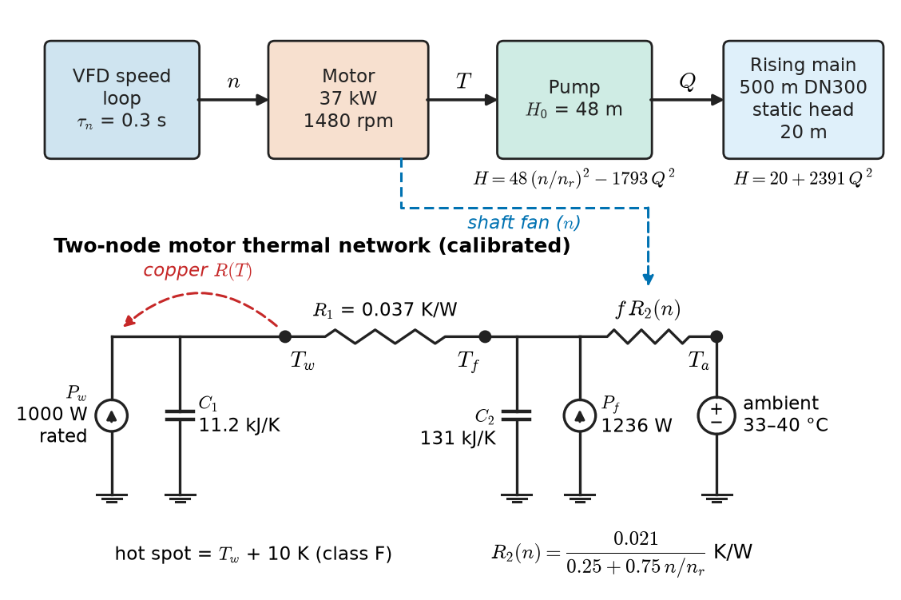
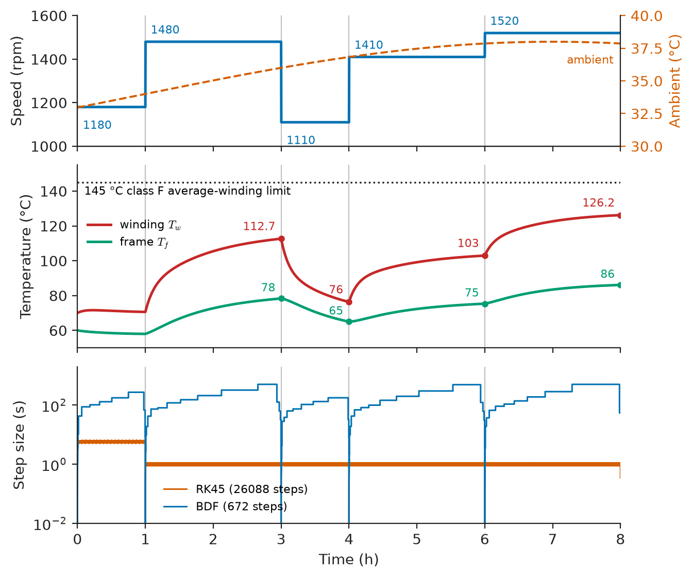
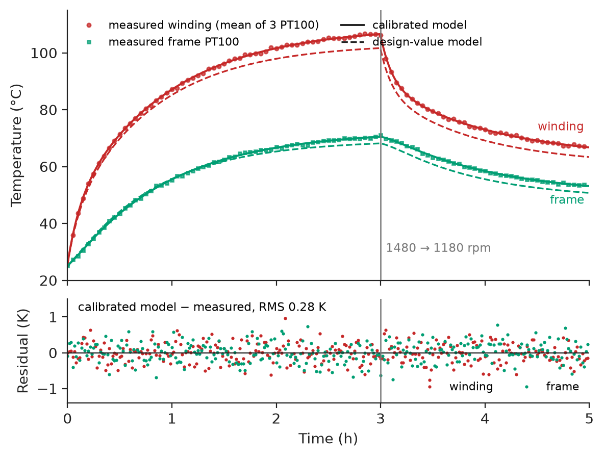
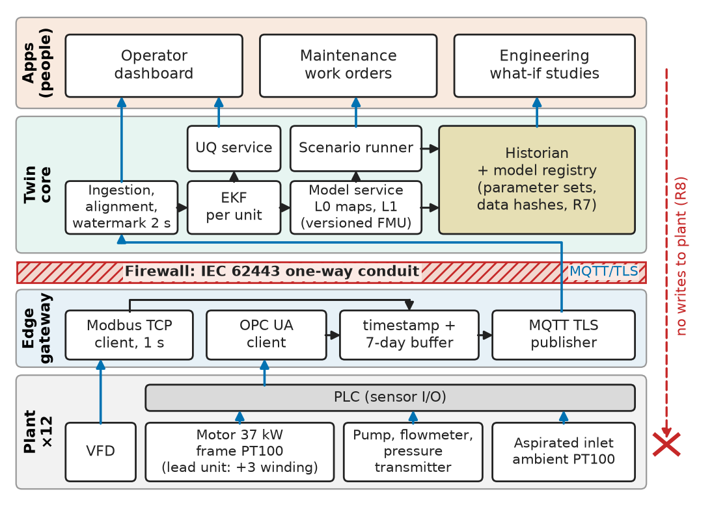
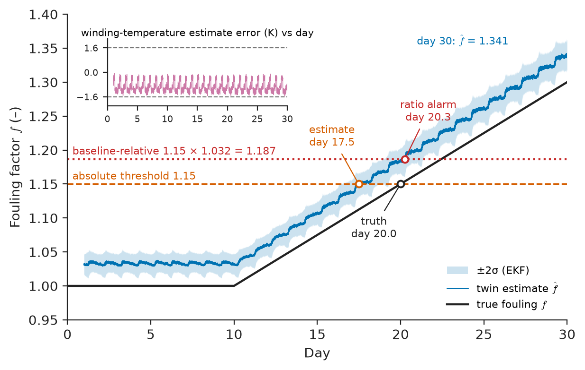
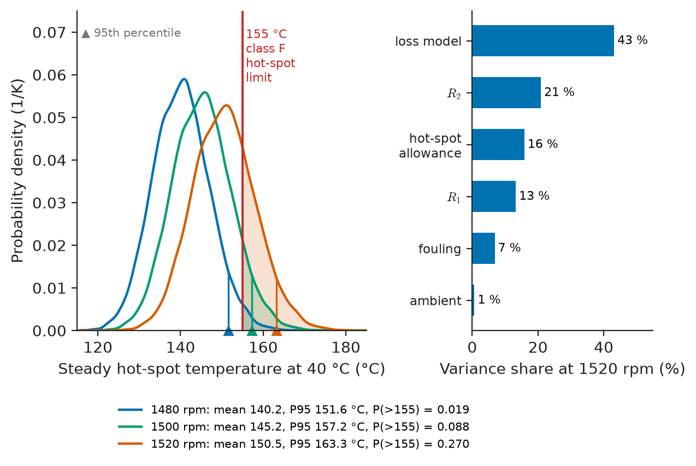

# Chapter 33 — Engineering Simulation and Digital Twins

*Part VIII · Engineering Software and Computational Tools*

A regional water utility runs twelve identical raw-water pump sets: a 37 kW, 4-pole, 400 V TEFC induction motor on a variable-frequency drive (VFD), driving a centrifugal pump into a 500 m rising main. On a 38 °C July afternoon one of them tripped on its winding thermistor relay and a reservoir ran low for four hours. The utility's dashboard "digital twin", a nameplate thermal model fed with drive current, showed 118 °C at the moment of the trip; the embedded winding RTD of a sister motor in a similar state read 131 °C. Its parameters were catalogue values never calibrated against these motors; it knew nothing about the fan cowl, clogged with cottonwood fluff over three weeks, which had raised the frame-to-air thermal resistance by about a third; and its ambient input came from a shaded louvre, 4 K cooler than the air the motor breathed. A twin that is not calibrated, does not track the parameters that drift, and does not say how uncertain it is will be confidently wrong on the one afternoon it matters.

> **How is a physics model turned into a twin that tracks one particular machine: calibrated, fed with live data, estimating its own drifting parameters and validated against limits written down in advance?**
> **How uncertain is a twin's prediction, and how is that uncertainty used to make a design or operating decision that will not be regretted?**

| Concept | Engineering destination |
|---|---|
| Physical-system models | Electro-thermal-hydraulic model of the pump set |
| Numerical simulation | Stiff solvers; fast what-if runs |
| Model calibration | Thermal parameters fitted to a heat run |
| Co-simulation | Drive, thermal, hydraulic and PLC models exchanged as FMUs |
| Digital-twin architectures | Gateway, estimator, model service, historian, apps |
| Real-time data integration | Timestamps, alignment, latency budget, stale-data handling |
| Parameter estimation | Online tracking of cooling degradation |
| Validation | Hold-out test against winding RTDs |
| Uncertainty quantification | Monte Carlo prediction intervals for hot-spot temperature |
| Simulation-based design | Overspeed, cleaning interval, motor upgrade |

**Roadmap.** What the model contains (33.1) → how it is solved (33.2) → calibrated to one machine (33.3) → split across tools and recombined (33.4) → embedded in a twin architecture (33.5) → fed with live data (33.6) → kept current by online estimation (33.7) → validated (33.8) → given error bars (33.9) → used to decide (33.10) → failure analysis.

---

## 33.1 Physical-system models

> **Boundary.** Chapter 3 owns the modelling workflow (assumptions, equivalent circuits, sensitivity, validation as a method) and Chapter 30 owns solvers, sweeps and numerical verification as tools. Chapter 17 owns system identification of robots. This chapter applies those to one twin. Lumped effort–flow modelling is in *Engineering Physics*, [Ch. 17](https://github.com/The-Studio-of-Sadiq/Engineering-Physics/blob/main/CHAPTERS/CHAPTER%2017.md); the motor's thermal network and insulation limits are in *Electrical Energy and Machines*, [Ch. 9 §9.3](https://github.com/The-Studio-of-Sadiq/Electrical-Energy-and-Machines/blob/main/part-2-transformers-and-electrical-machines/09-electrical-machine-design-and-performance.md); pump-type load characteristics are in *Electrical Energy and Machines*, [Ch. 10 §10.3](https://github.com/The-Studio-of-Sadiq/Electrical-Energy-and-Machines/blob/main/part-3-motor-drives/10-drive-system-fundamentals.md).

### What the twin must answer

A model is sized by the questions it must answer, not by the physics available. The utility's operations and maintenance staff wrote down five, and they became the twin's requirements.

| ID | Requirement | Target | Verification |
|---|---|---|---|
| R1 | Estimate winding hot-spot temperature of every unit | Average winding ≤ 3 K RMS, ≤ 6 K max | Hold-out against lead-unit RTDs (§33.8) |
| R2 | Predict hot-spot 30 min ahead with an honest interval | 95 % interval covers ≥ 90 % of observations; width ≤ 12 K | Coverage test on hold-out data |
| R3 | Detect cooling degradation | +15 % frame-to-air thermal resistance flagged within 72 h; ≤ 1 false alarm per unit-year | Seeded-fault replay; false-alarm count |
| R4 | Stay current | Data age at state estimate ≤ 5 s; dashboard ≤ 10 s | Latency budget (§33.6) and timestamp audit |
| R5 | Answer what-if questions fast | 24 h scenario ≤ 2 s on the edge server | Benchmark on target hardware |
| R6 | Fail visibly | Missing data > 60 s marks outputs STALE and widens intervals | Fault injection |
| R7 | Be reproducible | Every output traceable to model version, parameter set and input-data hash | Audit of ten random outputs |
| R8 | Be harmless to the plant | Read-only access to the OT network; no writes to drives or PLC | IEC 62443 zone/conduit review, firewall test |

R1–R3 fix the physics: hot-spot temperature needs losses and the thermal network; losses need torque, hence the pump's duty point on the system curve; cooling degradation needs the shaft fan's dependence on speed.

### The model chain

The pump-set model is four coupled sub-models (Figure 33.1):

1. **Drive and shaft.** The VFD's speed loop is represented by a first-order lag, $\tau_n=0.3$ s, from speed reference to shaft speed. Electrical dynamics (currents, PWM) are far faster than anything R1–R3 need and are left out of the thermal twin; they live in a separate electrical model used for co-simulation (§33.4).
2. **Pump and pipe.** The pump curve $H=H_0(n/n_r)^2-k_pQ^2$ with $H_0=48$ m and $k_p=1793\ \mathrm{s^2/m^5}$; the system curve $H=20+2391\,Q^2$ m; a water column whose inertia gives $\mathrm{d}Q/\mathrm{d}t=(gA/L)(H_{pump}-H_{sys})$. Pump efficiency is a parabola in flow relative to the best-efficiency point, 0.78 at the peak. At rated speed (1480 rpm) the duty point is 294 m³/h at 36.0 m and 37.0 kW shaft power.
3. **Motor losses.** Rated losses of 2236 W (IE3, 94.3 %) are split into stator copper loss (1000 W, scaling with torque squared plus a 10 % magnetising share, and with copper resistance through $(234.5+T_w)/(234.5+115)$), and iron, mechanical and rotor losses (1236 W) assigned to the frame.
4. **Thermal network.** Two nodes, as in the two-body motor model of *Electrical Energy and Machines* [Ch. 9 §9.3](https://github.com/The-Studio-of-Sadiq/Electrical-Energy-and-Machines/blob/main/part-2-transformers-and-electrical-machines/09-electrical-machine-design-and-performance.md): winding ($C_1$) coupled through $R_1$ to frame ($C_2$), frame to ambient through $R_2$. The shaft fan makes $R_2$ speed-dependent, $R_2(n)=R_2/(0.25+0.75\,n/n_r)$, and fouling multiplies it by a factor $f\ge 1$.

$$
C_1\dot T_w=P_w-\frac{T_w-T_f}{R_1},\qquad C_2\dot T_f=P_f+\frac{T_w-T_f}{R_1}-\frac{T_f-T_a}{f\,R_2(n)}
$$

> **Status of the principle: Two-node motor thermal network**
> *Approximate.* Valid for average winding and frame temperature over minutes to hours with the motor running at steady or slowly varying load; it does not resolve the slot-versus-end-winding gradient, stall heating in seconds, or the standstill cooling with the fan stopped. The hot spot is taken as the average winding plus an allowance (10 K for class F, IEC 60034-1).

<!-- FIGURE 33.1 | figures/ch33/fig-33-1-pump-set-model.png | schematic | Physics model of the 37 kW pump set: energy chain from drive to water and the two-node thermal network. | Content: top row blocks VFD speed loop (tau 0.3 s) then Motor 37 kW 1480 rpm then Pump (H0 48 m) then Rising main 500 m DN300 (static head 20 m), arrows labelled n, T, Q. Below the motor a thermal network: current source P_w (1000 W rated) into node T_w with C1 11.2 kJ/K; R1 0.037 K/W to node T_f with C2 131 kJ/K and source P_f (1236 W); resistor f R2(n) = 0.021/(0.25 + 0.75 n/nr) K/W to ambient T_a. Dashed arrows: n to R2(n) labelled shaft fan; T_w to P_w labelled copper R(T). -->



*Figure 33.1 — Physics model of the 37 kW pump set: energy chain from drive to water and the two-node thermal network.*

### Choosing the fidelity

The pump set can be modelled at four levels; the twin estimates with L1, sweeps with L0 and borrows numbers from L2 and L3 once, at design time.

| Level | Content | States | Run time for 24 h (edge PC) | Used for |
|---|---|---|---|---|
| L0 steady-state maps | Duty point, losses, steady temperatures as algebraic functions | 0 | ~ 50 µs per point (vectorised) | Monte Carlo what-if (§33.9) |
| L1 lumped dynamic | 4 ODEs above | 4 | ~ 0.7 s (stiff solver) | State estimation, 30-min prediction |
| L2 detailed thermal | 8–12 node network (slot, end winding, teeth, yoke, rotor, air, frame) | 10 | ~ 2 s | Hot-spot allowance, standstill cooling |
| L3 field models | FE electromagnetic and CFD of the fan cowl | 10⁵–10⁷ | hours | Loss split, fouled-cowl airflow, once |

Each level is calibrated against the one above it or against measurement, never left to float: the 10 K hot-spot allowance comes from L2 and the maker's heat-run report, the speed dependence of $R_2$ from a cowl CFD run (L3).

---

## 33.2 Numerical simulation

> **Boundary.** Explicit and implicit ODE methods, their stability regions and convergence are in *The Mathematics Universe*, [Ch. 22 §22.9 and §22.11](https://github.com/The-Studio-of-Sadiq/engineering-mathematics/blob/main/part-7-numerical-computational/22-numerical-methods.md); simulation workflows in Python are in *Electronics and Computing*, [Ch. 24 §24.4](https://github.com/The-Studio-of-Sadiq/Electronics-and-Computing/blob/main/part-5-programming-and-computational-systems/24-scientific-computing.md). Chapter 30 owns solver selection and performance as a general practice.

### Stiffness decides the solver

The model mixes time constants of 0.3 s (speed loop), about 1 s (water column), about 6 min (winding) and about 50 min (frame). It is saved as a module so that every later listing uses the same physics.

```python
# pumpset.py -- physics model of the 37 kW pump set (states: speed, flow, winding, frame)
import numpy as np

NR, TR = 1480.0, 238.7                 # rated speed (rpm), rated torque (N m)
H0, HS, KP, KS = 48.0, 20.0, 1793.0, 2391.0   # pump shut-off head, static head (m), curve coeffs
QR, ETA_BEP, AH = 0.0818, 0.78, 1.387e-3      # rated flow (m3/s), BEP efficiency, g*A/L
P_CU_R, P_FE_R, P_RT_R = 1000.0, 600.0, 636.0 # stator copper, core+mech, rotor loss at rating (W)
PAR = dict(R1=0.035, C1=12e3, R2=0.0201, C2=120e3, tau_n=0.3)   # design-value parameters

def shaft_power(n, q):
    """Pump head (m) and shaft power (W) at n (rpm), q (m3/s)."""
    s = n / NR
    h = H0 * s**2 - KP * q**2
    qb = q / (QR * max(s, 1e-3))                   # flow relative to BEP
    eta = max(ETA_BEP * (1.0 - (qb - 1.0)**2), 0.30)
    return h, 1000 * 9.81 * q * h / eta

def losses(n, p_shaft, tw):
    """Winding-node and frame-node losses (W)."""
    n = max(n, 1.0)
    t = p_shaft / (n * 2 * np.pi / 60)             # shaft torque (N m)
    kt = (234.5 + tw) / (234.5 + 115.0)            # copper resistance relative to 115 C
    p_w = P_CU_R * (0.1 + 0.9 * (t / TR)**2) * kt
    p_f = P_FE_R * (n / NR)**1.6 + P_RT_R * (t / TR)**2
    return p_w, p_f

def rhs(t, x, n_ref, t_amb, p=PAR, foul=1.0):
    n, q, tw, tf = x
    h, ps = shaft_power(n, max(q, 0.0))
    dq = AH * (h - (HS + KS * q * abs(q)))         # water-column inertia
    pw, pf = losses(n, ps, tw)
    r2 = foul * p["R2"] / (0.25 + 0.75 * n / NR)   # shaft fan
    dtw = (pw - (tw - tf) / p["R1"]) / p["C1"]
    dtf = (pf + (tw - tf) / p["R1"] - (tf - t_amb(t)) / r2) / p["C2"]
    return [(n_ref(t) - n) / p["tau_n"], dq, dtw, dtf]
```

The `losses` and `shaft_power` functions are pure and vectorise over NumPy arrays, which §33.9 relies on. The next listing runs an 8-hour afternoon: speed steps between 1110 and 1520 rpm as the reservoir controller asks for flow, and the ambient rises from 33 to 38 °C.

```python
import time
import numpy as np
from scipy.integrate import solve_ivp
from pumpset import rhs

steps = [(0, 1180), (3600, 1480), (10800, 1110), (14400, 1410), (21600, 1520)]  # (s, rpm)
n_ref = lambda t: [n for (ts, n) in steps if t >= ts][-1]
t_amb = lambda t: 34.0 + 4.0 * np.sin(2 * np.pi * (t - 3600) / 86400)   # afternoon ambient (C)
x0 = [1180.0, 0.05, 70.0, 60.0]

for method in ["RK45", "BDF", "LSODA"]:
    t0 = time.perf_counter()
    sol = solve_ivp(rhs, (0, 8 * 3600), x0, method=method, args=(n_ref, t_amb),
                    rtol=1e-6, atol=[1e-3, 1e-7, 1e-4, 1e-4], dense_output=True)
    dt = time.perf_counter() - t0
    tw = sol.sol(np.arange(0, 8 * 3600, 10.0))[2]
    print(f"{method:5s}: nfev={sol.nfev:7d} steps={sol.t.size:6d} wall={dt:6.2f} s "
          f"max T_w={tw.max():6.2f} C  T_w(8 h)={tw[-1]:6.2f} C")
```

```text
RK45 : nfev= 182660 steps= 26088 wall= 21.01 s max T_w=126.22 C  T_w(8 h)=126.22 C
BDF  : nfev=   1730 steps=   672 wall=  0.77 s max T_w=126.23 C  T_w(8 h)=126.23 C
LSODA: nfev=   2126 steps=   748 wall=  0.23 s max T_w=126.22 C  T_w(8 h)=126.22 C
```

All three agree on the answer to 0.01 K; they differ by a factor of about 100 in function evaluations (wall times vary from run to run). Figure 33.2 shows the trajectory: the winding climbs to 112.7 °C after two hours at rated speed, falls to 76 °C during the 1110 rpm interval, and reaches 126.2 °C after two hours at 1520 rpm with 38 °C air.

**Worked example — why RK45 takes 26 000 steps.** The fastest eigenvalue is the speed loop, $\lambda=-1/0.3=-3.33\ \mathrm{s^{-1}}$. The Dormand–Prince pair inside RK45 is stable on the negative real axis only for $h\lvert\lambda\rvert\lesssim 3.3$, so $h\lesssim 1.0$ s. The solver took 26 088 steps: 5.6 s steps for the first hour, while the speed state sits at equilibrium, then about 25 400 near the 1 s limit after the first speed step. The water column, linearised at rated flow, has $\lvert\lambda\rvert=AH\cdot 2(k_p+k_s)Q=1.387\times10^{-3}\times2\times4184\times0.0818=0.95\ \mathrm{s^{-1}}$, and the thermal modes are 380 s and 3070 s (§33.4): a stiffness ratio of $3070/0.3\approx 10^4$. BDF takes small steps only around the five speed steps and strides across the thermal transients in minutes.

> **Status of the principle: Explicit step limit in stiff models**
> *Derived.* From the stability region of the explicit method and the largest eigenvalue magnitude of the linearised model; it holds whatever the accuracy tolerance, which is why tightening `rtol` does not make RK45 slower here and loosening it does not make it faster.

<!-- FIGURE 33.2 | figures/ch33/fig-33-2-eight-hour-simulation.png | plot | Eight-hour afternoon simulation of the pump set and the step sizes chosen by an explicit and an implicit solver. | Content: three panels, time 0 to 8 h. Top: speed steps 1180, 1480 (1 h), 1110 (3 h), 1410 (4 h), 1520 rpm (6 h); ambient 33 to 38 C dashed on right axis. Middle: T_w from 70 C to 112.7 C at 3 h, 76 C at 4 h, 103 C at 6 h, 126.2 C at 8 h; T_f from 60 C to 78, 65, 75, 86 C at the same times; dotted line 145 C labelled class F average limit. Bottom: log step size 0.01 to 1000 s; RK45 about 5.6 s for the first hour, then flat near 1 s; BDF dipping at each speed step and rising to hundreds of seconds between. -->



*Figure 33.2 — Eight-hour afternoon simulation of the pump set and the step sizes chosen by an explicit and an implicit solver.*

### Events, speed and code verification

Discontinuities (speed steps, trips, pump starts) are handled as known switching times or as root-found *events* (`events=` in `solve_ivp`), never by testing a condition at output points. For speed, LSODA does 24 h of the L1 model in about 0.7 s, a 2.9× margin on R5 for one scenario but not for 500 Monte Carlo samples; those run on the L0 maps (§33.9). Before calibration the code is verified: the energy balance closes over a run, the thermal sub-model matches its analytic step response, and the solution converges as `rtol` is tightened (Chapter 30 owns these checks; the twin runs them in CI).

---

## 33.3 Model calibration

> **Boundary.** Nonlinear least squares and its covariance are in *The Mathematics Universe*, [Ch. 23 §23.8](https://github.com/The-Studio-of-Sadiq/engineering-mathematics/blob/main/part-7-numerical-computational/23-optimization.md); parameter identification and identifiability in [Ch. 25 §25.8](https://github.com/The-Studio-of-Sadiq/engineering-mathematics/blob/main/part-7-numerical-computational/25-mathematical-modeling.md). Chapter 4 owns calibration of instruments; here "calibration" means fitting model parameters to a machine.

### The commissioning heat run

The design values of §33.1 came from the catalogue. To calibrate the twin to *this* machine, the lead unit, which has three PT100s embedded in its end windings (a \$310 factory option) and one on the frame, ran a commissioning heat run: 3 h at rated speed and load from cold at 25 °C, then 2 h at 1180 rpm, logged at 1 min with VFD speed and shaft power.

Four parameters are fitted: $R_1$, $C_1$, $R_2$, $C_2$. The loss model is *not* fitted, for a reason worth stating before any code is written.

**Worked example — what cannot be calibrated from temperatures alone.** Multiply all losses by $a$, divide both resistances by $a$ and multiply both capacitances by $a$: every term of the two thermal equations scales by $a$ on both sides, so the temperature trajectories are unchanged. With $a=1.10$, a motor with 10 % more loss, 10 % lower thermal resistances and 10 % higher heat capacities is indistinguishable from the original by temperature data. Losses must therefore come from elsewhere: the motor's IEC 60034-2-1 efficiency test, or a power analyser on the drive output during the heat run. The twin fixes the loss model from the test report and fits only the thermal network, and §33.9 carries the loss model's uncertainty forward explicitly.

> **Status of the principle: Loss–resistance identifiability**
> *Derived.* A direct consequence of the scaling symmetry of the thermal equations; it holds for any lumped thermal network driven by heat sources whose magnitude is not measured independently.

The fit drives the thermal sub-model with the logged speed and shaft power (forward Euler at 10 s, 2.6 % of the fastest thermal time constant) and minimises squared temperature residuals over log-parameters. The data here are synthetic, from a known "true" parameter set with 0.3 K noise, so the answer can be checked.

```python
import numpy as np
from scipy.optimize import least_squares
from pumpset import NR, losses

DT = 10.0
t = np.arange(0, 5 * 3600, DT)                        # 5 h heat run, 10 s steps
n = np.where(t < 3 * 3600, 1480.0, 1180.0)            # rated speed, then 80 % speed
ps = np.where(t < 3 * 3600, 37.04e3, 17.32e3)         # logged shaft power (W)
t_amb = 25.0 + 0.0 * t

def thermal(theta):
    r1, c1, r2, c2 = theta
    tw, tf, out = t_amb[0], t_amb[0], np.empty((t.size, 2))
    for k in range(t.size):                           # forward Euler
        pw, pf = losses(n[k], ps[k], tw)
        r2n = r2 / (0.25 + 0.75 * n[k] / NR)
        q12 = (tw - tf) / r1
        tw += DT * (pw - q12) / c1
        tf += DT * (pf + q12 - (tf - t_amb[k]) / r2n) / c2
        out[k] = tw, tf
    return out

rng = np.random.default_rng(7)
true = np.array([0.0372, 11.1e3, 0.0214, 131e3])
meas = thermal(true)[::6] + rng.normal(0, 0.3, (t.size // 6, 2))   # 60 s logging, 0.3 K noise

res = lambda lg: (thermal(np.exp(lg))[::6] - meas).ravel()
fit = least_squares(res, np.log([0.035, 12e3, 0.0201, 120e3]), x_scale=1.0)
J, s2 = fit.jac, np.sum(fit.fun**2) / (fit.fun.size - 4)
sd = np.sqrt(np.diag(np.linalg.inv(J.T @ J) * s2))   # std dev of log-parameters
for name, v, u, tr in zip(["R1 K/W", "C1 J/K", "R2 K/W", "C2 J/K"], np.exp(fit.x), sd, true):
    print(f"{name}: {v:10.4g}  +/- {200 * u:4.1f} % (95 %)   true {tr:.4g}")
print(f"residual RMS = {np.sqrt(np.mean(fit.fun**2)):.3f} K, evaluations = {fit.nfev}")
corr = np.linalg.inv(J.T @ J); d = np.sqrt(np.diag(corr))
print("corr(R1,C1) = %.2f, corr(R2,C2) = %.2f" % (corr[0, 1] / d[0] / d[1], corr[2, 3] / d[2] / d[3]))
```

```text
R1 K/W:    0.03725  +/-  0.2 % (95 %)   true 0.0372
C1 J/K:  1.123e+04  +/-  0.8 % (95 %)   true 1.11e+04
R2 K/W:    0.02136  +/-  0.1 % (95 %)   true 0.0214
C2 J/K:  1.307e+05  +/-  0.4 % (95 %)   true 1.31e+05
residual RMS = 0.275 K, evaluations = 5
corr(R1,C1) = 0.22, corr(R2,C2) = 0.18
```

Figure 33.3 shows the fit. It moves the design values by +6 % ($R_1$), −6 % ($C_1$), +6 % ($R_2$) and +9 % ($C_2$), and the residual RMS of 0.275 K matches the 0.3 K sensor noise, as it should when the model structure is right. Two lessons sit in the output:

- **The heat run was designed for identifiability.** The step to 1180 rpm at 3 h excites the fan dependence and separates $R_2$ from $C_2$; a constant-load run pins only their product. The correlations of 0.22 and 0.18 show each parameter determined on its own.
- **The intervals are optimistic.** Even with the exact model structure, the true $C_1$ lies 1.2 % from the estimate, outside its ±0.8 % interval. With real data the residuals are correlated and include model-form error, and covariance-based intervals are typically too narrow by a factor of 2–5, so the twin uses the fleet's unit-to-unit spread (§33.9) as its parameter uncertainty.

<!-- FIGURE 33.3 | figures/ch33/fig-33-3-heat-run-calibration.png | plot | Commissioning heat run on the lead unit: measured temperatures with the design-value and calibrated models. | Content: upper panel 20 to 115 C against 0 to 5 h; measured winding dots 25 C rising to 87 C at 1 h, 101.6 C at 2 h, 106.6 C at 3 h, falling to 79 C at 3.5 h and 67 C at 5 h; measured frame dots rising to 70.5 C at 3 h and falling to 53 C at 5 h; design-value model dashed 3 to 5 K low at 3 h; calibrated model solid through the dots; vertical line at 3 h labelled 1480 to 1180 rpm. Lower panel residuals within plus or minus 1 K, RMS 0.28 K. -->



*Figure 33.3 — Commissioning heat run on the lead unit: measured temperatures with the design-value and calibrated models.*

### Calibration as a controlled document

A calibration is a version: the parameter set is stored with the heat-run data hash, model version and residual statistics (R7), and retired when the unit is rewound or its fan changed. The eleven units without winding RTDs start from the lead unit's parameters and adapt only $R_2$ online (§33.7).

---

## 33.4 Co-simulation

### Why the model is split

The utility's engineering studies need more than the thermal twin: a detailed electrical drive model, a hydraulic model of the distribution zone and the PLC's pump-sequencing logic, each from a different tool. Co-simulation runs them together without merging them: each is packaged as a **Functional Mock-up Unit** (FMU, FMI 2.0 or 3.0 standard) carrying its own solver, and a **master algorithm** advances all of them in **communication steps** of length $H$, exchanging inputs and outputs at the step boundaries.

| FMU | Source | Internal step | Exchanges | Communication step |
|---|---|---|---|---|
| Drive and motor electrical | Modelica or PLECS-class | 10 µs | Speed ref., torque → speed, losses | 10 ms to 1 s |
| Motor thermal (L2) | Modelica thermal network | implicit, variable | Losses, speed → temperatures | 1–60 s |
| Hydraulic network | EPANET-based wrapper | 1 s | Pump speeds → flows, levels | 1–60 s |
| Pump-sequencing logic | Virtual PLC | 50 ms scan | Levels → speed refs, starts | 0.1–1 s |

### Coupling error and the size of the communication step

Between exchanges each FMU holds its inputs constant (zero-order hold). That is an error the monolithic model does not have, and it grows with $H$. The master can update FMUs in parallel from old values (Jacobi) or one after another, each using the newest outputs (Gauss–Seidel).

**Worked example — splitting the thermal network across two FMUs.** Split the two-node network into a winding FMU and a frame FMU, each holding the other's temperature constant over a step and integrating exactly inside it. With rated losses, 40 °C ambient and a cold start, the errors after 1 h against the exact monolithic solution ($T_w=106.97$ °C, $T_f=72.19$ °C; coupled time constants 380 s and 3069 s) are:

| Communication step $H$ | Jacobi $\Delta T_w$ (K) | Jacobi $\Delta T_f$ (K) | Gauss–Seidel $\Delta T_w$ (K) | Gauss–Seidel $\Delta T_f$ (K) |
|---|---|---|---|---|
| 1 s | −0.008 | −0.004 | −0.002 | +0.001 |
| 10 s | −0.075 | −0.045 | −0.015 | +0.012 |
| 60 s | −0.46 | −0.27 | −0.10 | +0.07 |
| 300 s | −2.47 | −1.43 | −0.70 | +0.24 |
| 1200 s | −11.6 | −6.3 | −5.6 | −0.34 |

The Jacobi error is first order in $H$ and Gauss–Seidel is 4–5× smaller. To keep the coupling error below about 0.3 K of R1's 3 K, $H\le 60$ s with Gauss–Seidel or about 40 s with Jacobi: roughly $H\lesssim 0.1$–$0.15\,\tau$ of the fastest *coupled* mode (380 s). The electrical FMU coupled to the hydraulics needs $H\approx 10$ ms, because their coupled mode is about 0.3 s.

> **Status of the principle: Zero-order-hold coupling error**
> *Approximate.* First-order in the communication step for explicit (non-iterative) master algorithms, valid while $H$ is well below the fastest coupled time constant; with strong algebraic coupling (direct feedthrough on both sides) explicit coupling can go unstable, and an iterative or implicit master, or a model-exchange FMU solved by one solver, is required.

### Practical rules for co-simulation

Cut where coupling is weak and slow, never through a fast loop; check that energy leaving one FMU equals energy entering the other; fix order and step in an SSP experiment file (R7); and validate against the monolithic L1 model on a shared scenario first.

---

## 33.5 Digital-twin architectures

### From model to twin

The terms are used loosely; the design document fixes them by the direction of data flow. A *digital model* is fed manually and offline (the design studies of §33.10); a *digital shadow* is fed live from the plant but reports only to people; a *digital twin* in the strict sense also writes back (setpoints, limits). R8 makes the utility's system a shadow with decision support. Most industrial "twins" are shadows; closing the loop moves the twin into the control system's safety case (Chapter 21), which needs a reason worth that cost.

### The architecture

Figure 33.4 shows the architecture, layered after the ISO 23247 digital-twin framework (observable element, data collection, twin core, user entities). The **plant** has a frame PT100 on every motor and an aspirated ambient sensor at the fan inlet (the July lesson). An **edge gateway** per station reads the VFD over Modbus TCP and the PLC over OPC UA, timestamps at source, buffers 7 days and publishes over MQTT with TLS through a one-way IEC 62443 conduit. The **twin core** runs ingestion and alignment, a state estimator per unit (§33.7), the versioned model service, the UQ service and a scenario runner, beside a **historian and model registry**. **Applications** are the operator dashboard, maintenance work orders and engineering what-if studies.

<!-- FIGURE 33.4 | figures/ch33/fig-33-4-twin-architecture.png | block-diagram | Architecture of the pump-set digital shadow from plant sensors to applications. | Content: layers bottom to top. Plant x12: Motor with frame PT100 (lead unit 3 winding PT100), VFD, Pump with flowmeter and pressure transmitter, aspirated inlet sensor. Edge gateway: Modbus TCP client 1 s, OPC UA client, timestamp and 7-day buffer, MQTT TLS publisher. Firewall bar labelled IEC 62443 one-way conduit. Twin core: Ingestion (watermark 2 s), EKF per unit, Model service L0 and L1 (versioned FMU), UQ service, Scenario runner; Historian and model registry beside it. Applications: dashboard, maintenance work orders, what-if. Upward data arrows; dashed arrow to people only labelled no writes to plant (R8). -->



*Figure 33.4 — Architecture of the pump-set digital shadow from plant sensors to applications.*

### Selecting the twin's building blocks

The first selection is where the winding temperature comes from.

| Winding-temperature source | Accuracy | Cost per unit | Availability | Decision |
|---|---|---|---|---|
| PTC thermistors in winding (standard) | Binary trip at 145 or 155 °C only | Included | All units | Protection only; no estimate |
| Embedded PT100 (3 per motor) | ±1 K at the sensor, ±3–5 K to the hot spot | \$310 factory option; retrofit needs rewind | Lead unit only | Ground truth for calibration and validation |
| Stator-resistance estimate by VFD (DC injection at stop) | ±5 K, only at stops | Firmware feature | Units with that VFD model | Cross-check, not continuous |
| Model-based estimate (this twin) | ≤ 3 K RMS after calibration (R1) | Software | All units | Continuous estimate and prediction |

For the runtime, a hand-coded Python model was kept for prototyping only; a commercial twin platform was rejected on per-asset licence cost and opaque estimators for 12 assets. The chosen runtime is a Modelica model exported as an FMU and executed by an FMI library (FMPy-class) in a Python service, so that the same versioned FMU serves engineering studies and the live twin; the L0 maps are plain NumPy.

---

## 33.6 Real-time data integration

> **Boundary.** Chapter 8 owns DAQ synchronisation and logging; Chapter 11 owns MQTT, gateways, provisioning and device security; Chapter 21 owns Modbus, OPC UA transport and OT security. This section is what a twin needs from them.

### What arrives, how often, and how late

| Signal | Source and interface | Rate | Accuracy |
|---|---|---|---|
| Speed, output power, current, DC bus | VFD, Modbus TCP | 1 s | ±3 % power |
| Frame temperature (all units); winding (lead unit) | PT100s via PLC | 1 s | ±0.3 K; ±1 K |
| Ambient at fan inlet | Aspirated PT100 via PLC | 10 s | ±0.3 K |
| Flow, discharge pressure | Magnetic flowmeter, transmitter | 1 s | ±0.5 %, ±0.1 % |
| Run state, trips | PLC events | event | — |

The twin works on a uniform 1 s grid. Every sample carries a source timestamp (NTP-disciplined to ±10 ms, negligible against thermal time constants); the ingestion service waits 2 s (a **watermark**) for late samples before closing a grid point, then forward-fills each signal with an age counter.

### The latency budget

| Stage | Typical (s) | Worst case (s) | R4 limit (s) | Margin, worst case (s) |
|---|---|---|---|---|
| VFD value age at poll (1 s Modbus TCP poll) | 0.50 | 1.00 | | |
| Modbus response | 0.01 | 0.02 | | |
| OPC UA publish interval (1 s) | 0.50 | 1.00 | | |
| Gateway to broker to twin (LTE, MQTT QoS 1) | 0.08 | 0.50 | | |
| Ingestion watermark | 2.00 | 2.00 | | |
| Estimator update and 30-min prediction | 0.02 | 0.05 | | |
| **Data age at state estimate** | **3.11** | **4.57** | 5.0 | 0.43 |
| Publish to dashboard and refresh | 0.60 | 1.30 | | |
| **Data age on dashboard** | **3.71** | **5.87** | 10.0 | 4.13 |

**Worked example — where the latency margin goes.** The worst case at the estimator is $1.00+0.02+1.00+0.50+2.00+0.05=4.57$ s against 5 s, a margin of 0.43 s, and the 2 s watermark is the largest item. Halving it would drop more late LTE samples (99.9th-percentile backhaul delay 1.6 s). Instead the gateway reads the VFD directly rather than through the PLC's 1 s OPC UA publish, removing one 1 s stage: worst case 3.57 s, margin 1.43 s.

### Data quality before data use

A twin that ingests bad data produces confident nonsense. The ingestion service applies range and rate checks per tag (frame temperature −20…150 °C, ≤ 2 K/min); a **frozen-value** check (frame temperature unchanged for 15 min while running is the signature of a failed transmitter holding its last value); cross-checks (VFD power against hydraulic power over pump efficiency, 8 % for 10 min); and quality propagation, so every output carries the worst input quality and becomes STALE when a required input is older than 60 s (R6). The gateway's MQTT payload therefore carries, per value, its source timestamp and a quality flag, not just the number.

---

## 33.7 Parameter estimation

> **Boundary.** Observers, observability and the Kalman filter as the optimal observer are introduced in *Circuits, Signals and Communications*, [Ch. 35 §35.7](https://github.com/The-Studio-of-Sadiq/Circuits-Signals-and-Communications/blob/main/part-7-control-system-fundamentals/35-control-design-fundamentals.md); the Gauss–Markov noise models behind its tuning in *The Mathematics Universe*, [Ch. 21](https://github.com/The-Studio-of-Sadiq/engineering-mathematics/blob/main/part-6-probability-statistics/21-random-processes.md). Chapter 23 applies the same estimator to battery state of charge.

### Which parameters drift

Calibration fixes parameters at commissioning. Some do not stay fixed:

| Parameter | Drift mechanism | Rate | Twin treatment |
|---|---|---|---|
| $R_2$ (frame to air) | Cowl and fins clog | +1 to +3 %/day in pollen season | **Estimated online** |
| $R_1$ (winding to frame) | Insulation ageing | Years | Re-calibrated at overhaul |
| Loss model | Bearing wear, rotor damage, unbalance | Weeks to months | Not separable from $R_2$ (§33.3); left to vibration and current-signature monitoring |

Fouling is the drift that caused the July trip. The twin estimates it by appending a cooling factor $g=1/f$ to the state, modelled as a slow random walk, and running an extended Kalman filter (EKF) on the frame PT100.

**Worked example — is $g$ observable?** In steady state $T_f-T_a=f\,R_2(n)\,(P_w+P_f)$, so with modelled losses and measured temperatures $f$ follows directly. At rated load the clean-fan rise is $2236\times0.02136=47.8$ K and +15 % fouling adds 7.2 K, 24 times the 0.3 K sensor noise. At 1110 rpm the losses fall to 822 W, the rise to about 22 K and the same fouling moves the frame by only 3.2 K: observability is strong by day and weak at night, as the filter's covariance shows.

### The estimator

The listing simulates 30 days of the fleet duty cycle (1180 rpm at night, 1480 rpm by day, 1410 rpm in the evening, ambient 19–31 °C) on a "plant" whose true parameters differ from the twin's calibrated set and whose losses are 3 % higher than the twin's loss model, which is the model-form error a real twin lives with. The fan cowl starts clogging on day 10 and reaches +30 % on day 30. The twin sees only the frame temperature.

```python
import numpy as np
from pumpset import NR, losses

R1, C1, R2, C2, DT = 0.03725, 11.23e3, 0.02136, 130.7e3, 60.0   # calibrated twin, 60 s step
day = np.arange(30 * 1440) * DT / 86400                          # 30 days of 1-min samples
hod = (day % 1) * 24
n = np.select([hod < 6, hod < 18], [1180.0, 1480.0], 1410.0)
ps = np.select([hod < 6, hod < 18], [17.32e3, 37.04e3], 31.63e3)
ta = 25 + 6 * np.sin(2 * np.pi * (hod - 9) / 24)
foul = 1 + 0.30 * np.clip((day - 10) / 20, 0, 1)                 # fan cowl clogs from day 10

def step(tw, tf, g, k, p=(R1, C1, R2, C2, 1.0)):
    r1, c1, r2, c2, kl = p                                       # kl: loss-model scale
    pw, pf = (kl * v for v in losses(n[k], ps[k], tw))
    a = 0.25 + 0.75 * n[k] / NR
    q12 = (tw - tf) / r1
    return tw + DT * (pw - q12) / c1, tf + DT * (pf + q12 - (tf - ta[k]) * g * a / r2) / c2, a

rng = np.random.default_rng(3)
PLANT = (0.0372, 11.1e3, 0.0214, 131e3, 1.03)                  # true values, losses +3 %
xt, x = np.array([60.0, 50.0]), np.array([60.0, 50.0, 1.0])     # truth [Tw,Tf]; twin [Tw,Tf,g]
P, Q = np.diag([25.0, 1.0, 0.01]), np.diag([0.05, 0.01, 2e-7])
Rm, est, err = 0.3**2, np.empty(day.size), np.empty(day.size)
for k in range(day.size):
    xt = np.array(step(*xt, 1 / foul[k], k, PLANT)[:2])           # plant
    tw, tf, a = step(*x, k)
    F = np.eye(3) + DT * np.array([[-1 / (R1 * C1), 1 / (R1 * C1), 0],
        [1 / (R1 * C2), -1 / (R1 * C2) - x[2] * a / (R2 * C2), -(x[1] - ta[k]) * a / (R2 * C2)],
        [0, 0, 0]])
    x, P = np.array([tw, tf, x[2]]), F @ P @ F.T + Q                # predict
    y = xt[1] + rng.normal(0, 0.3) - x[1]                           # frame PT100 innovation
    K = P[:, 1] / (P[1, 1] + Rm)
    x, P = x + K * y, P - np.outer(K, P[1, :])                      # update
    est[k], err[k] = 1 / x[2], x[0] - xt[0]
hit = lambda f: day[np.argmax(f >= 1.15)]
print(f"true fouling reaches +15 % on day {hit(foul):.1f}; twin flags it on day {hit(est):.1f}")
print(f"estimate on day 9: {est[9 * 1440]:.3f} (true 1.000); day 30: {est[-1]:.3f} (true {foul[-1]:.3f})")
print(f"unmeasured winding temperature error after day 1: RMS {np.sqrt(np.mean(err[1440:]**2)):.2f} K, "
      f"max {np.abs(err[1440:]).max():.2f} K")
```

```text
true fouling reaches +15 % on day 20.0; twin flags it on day 17.5
estimate on day 9: 1.032 (true 1.000); day 30: 1.341 (true 1.300)
unmeasured winding temperature error after day 1: RMS 1.00 K, max 1.55 K
```

The filter tracks the fouling ramp (Figure 33.5) and keeps the unmeasured winding temperature within 1.0 K RMS, inside R1. But the 3 % loss-model error does not vanish: the filter cannot tell 3 % more heat from 3 % worse cooling (the identifiability result of §33.3), so it reports $f=1.032$ on a clean fan and crosses +15 % on day 17.5, 2.5 days early. The deployed detector therefore compares $f$ with its own **baseline**, the median over the 7 days after each fan cleaning, and alarms when $f/f_{base}\ge 1.15$ for 6 consecutive daytime hours. The bias is multiplicative ($1.341/1.300=1.032$, the ratio already seen on day 9), so the ratio crosses 1.15 on day 20.3, about 7 h after the true crossing, meeting R3; excluding the weakly observable night hours keeps false alarms down.

> **Status of the principle: Augmented-state estimation of a drifting parameter**
> *Approximate.* Valid when the parameter drifts slowly relative to the observation window (days against hours here) and is observable from the measured outputs; it absorbs any unmodelled effect with the same signature, so the estimated parameter is "cooling as the model sees it", not a physical measurement of the cowl.

<!-- FIGURE 33.5 | figures/ch33/fig-33-5-fouling-estimate.png | plot | Online estimate of the fan-cowl fouling factor over 30 days against the true value, with absolute and baseline-relative alarm thresholds. | Content: x day 0 to 30; y 0.95 to 1.40. True fouling 1.00 to day 10 then linear to 1.30 at day 30. Estimate about 1.03 from day 2 to 10 with daily ripple, rising to 1.34 at day 30, with a plus or minus 2 sigma band wider at night. Dashed line 1.15 (absolute threshold) crossed by estimate at day 17.5 and truth at day 20.0; dotted line 1.187 (1.15 times baseline 1.032) crossed at day 20.3. Inset: winding-temperature estimation error within plus or minus 1.6 K. -->



*Figure 33.5 — Online estimate of the fan-cowl fouling factor over 30 days against the true value, with absolute and baseline-relative alarm thresholds.*

---

## 33.8 Validation

> **Boundary.** The validation workflow (verification versus validation, hold-out data, acceptance criteria written in advance) is owned by Chapter 3 and Chapter 4; model-validation statistics are in *The Mathematics Universe*, [Ch. 25 §25.7](https://github.com/The-Studio-of-Sadiq/engineering-mathematics/blob/main/part-7-numerical-computational/25-mathematical-modeling.md). ASME V&V 20 gives a standard framework for comparing simulation with experiment that this plan follows in spirit.

### The plan, written before the data

The validation data are 30 days of lead-unit operation in August, not used for calibration, covering the year's hottest ambient, a fouling episode and a cleaning. Metrics and limits were fixed in advance; the results are representative of the campaign:

| Req. | Test | Limit | Result | Pass/fail |
|---|---|---|---|---|
| R1 | Estimate against mean of 3 winding PT100s, 30-day hold-out | ≤ 3 K RMS, ≤ 6 K max | 1.4 K RMS, 4.1 K max | Pass |
| R2 | 30-min prediction, 95 % interval coverage | ≥ 90 % covered, width ≤ 12 K | 93.1 % covered, mean width 9.8 K | Pass |
| R3 | Seeded +15 % $R_2$ step at 20 random times | Flag ≤ 72 h, all 20 | Median 19 h, max 41 h, 20/20 | Pass |
| R3 | False alarms, 12 unit-years of history | ≤ 12 | 7 (5 traced to real light fouling) | Pass |
| R4 | Data age audit, 10⁶ grid points | ≤ 5 s at estimator | 99.99th percentile 3.4 s (after gateway change) | Pass |
| R5 | 24 h scenario on edge server | ≤ 2 s | 0.71 s | Pass |
| R6 | Gateway unplugged for 5 min; frame tag frozen | STALE within 60 s; FROZEN within 15 min | STALE at 61 s; FROZEN at 15 min | **Fail**, then pass after fix |
| R7 | Trace 10 random outputs | 10/10 | 10/10 | Pass |
| R8 | Firewall review, write-attempt test | No write path | No write path | Pass |

The R6 failure was a timer in the ingestion service that started counting after the watermark rather than at the last sample's timestamp: data age was measured from the wrong event. The fix, and a regression test that injects a gap and checks the STALE flag at 60.0 ± 1 s, went in before release.

### What the residuals say

Aggregate metrics hide structure, so the residual is also plotted against the conditions most likely to break the model. Against speed: −0.4 K bias at 1480 rpm, +1.8 K at 1110 rpm (the fan law under-cools slightly at low speed; accepted). After cold starts: 2.6 K RMS against 1.4 K overall, the known limit of lumping slot and end winding, which is why the hot-spot allowance carries its own uncertainty in §33.9. Against ambient: no trend after the inlet sensor was moved; a +3.8 K bias above 30 °C before it, the July failure visible in the data.

> **Status of the principle: Validation domain**
> *Empirical.* A twin is validated only over the conditions in its validation data (here 1110–1520 rpm, 18–39 °C ambient, fouling up to +25 %); outside that envelope its outputs are extrapolation and the dashboard says so.

---

## 33.9 Uncertainty quantification

> **Boundary.** Monte Carlo methods and sensitivity and uncertainty propagation are in *The Mathematics Universe*, [Ch. 24 §24.6 and §24.8](https://github.com/The-Studio-of-Sadiq/engineering-mathematics/blob/main/part-7-numerical-computational/24-computational-mathematics.md); the GUM and its Monte Carlo supplement (JCGM 100 and JCGM 101) are the metrological standards for propagating distributions. Chapter 7 owns measurement uncertainty budgets.

### Sources of uncertainty in a twin's prediction

The inputs to the propagation are the unit-to-unit spread of $R_1$ and $R_2$ across the fleet's heat-run reports (±5 %, 1σ), the loss-model error (±4 %, from the heat run and the 3 % bias of §33.7), the current fouling estimate (1.05 ± 0.03), the ambient forecast (±0.5 K) and the hot-spot allowance (10 ± 3 K); numerical and coupling errors (< 0.1 K, §33.2 and §33.4) are negligible.

The quantity of interest for an operating decision is the steady hot-spot temperature at a proposed speed on a hot day. A 6 h hot afternoon is more than seven frame time constants, so the L0 steady-state map is accurate and fast enough to sample 20 000 times.

```python
import numpy as np
from pumpset import NR, losses, shaft_power, H0, HS, KP, KS

rng, N = np.random.default_rng(11), 20000
X = {"R1": rng.normal(0.03725, 0.05 * 0.03725, N),    # fleet unit-to-unit spread
     "R2": rng.normal(0.02136, 0.05 * 0.02136, N),
     "kloss": rng.normal(1.0, 0.04, N),               # loss-model error
     "foul": rng.normal(1.05, 0.03, N),               # twin's current fouling estimate
     "ta": rng.normal(40.0, 0.5, N),                  # ambient forecast
     "dhs": rng.normal(10.0, 3.0, N)}                 # hot-spot allowance over average

def hot_spot(n):
    s = n / NR
    q = np.sqrt((H0 * s**2 - HS) / (KP + KS))         # duty point on the system curve
    ps = shaft_power(n, q)[1]
    tw = np.full(N, 120.0)
    for _ in range(30):                               # fixed point for copper R(T)
        pw, pf = losses(n, ps, tw)
        pw, pf = X["kloss"] * pw, X["kloss"] * pf
        tf = X["ta"] + (pw + pf) * X["foul"] * X["R2"] / (0.25 + 0.75 * s)
        tw = tf + pw * X["R1"]
    return tw + X["dhs"]

for n in (1480.0, 1500.0, 1520.0):
    hs = hot_spot(n)
    print(f"{n:.0f} rpm: hot spot mean {hs.mean():6.1f} C, 95th pct {np.percentile(hs, 95):6.1f} C, "
          f"P(>155 C) = {np.mean(hs > 155):.3f}")
hs = hot_spot(1520.0)
A = np.column_stack([(v - v.mean()) / v.std() for v in X.values()])
src = np.linalg.lstsq(A, (hs - hs.mean()) / hs.std(), rcond=None)[0]
print("variance share:", ", ".join(f"{k} {100 * b**2:.0f} %" for k, b in zip(X, src)))
```

```text
1480 rpm: hot spot mean  140.2 C, 95th pct  151.6 C, P(>155 C) = 0.019
1500 rpm: hot spot mean  145.2 C, 95th pct  157.2 C, P(>155 C) = 0.088
1520 rpm: hot spot mean  150.5 C, 95th pct  163.3 C, P(>155 C) = 0.270
variance share: R1 13 %, R2 21 %, kloss 43 %, foul 7 %, ta 1 %, dhs 16 %
```

The last line is a standardised-regression sensitivity analysis (squared standardised coefficients of a linear fit, valid here because the fit explains over 99 % of the variance). It says where effort pays: the loss model carries 43 % of the variance, ambient 1 %.

> **Status of the principle: Monte Carlo propagation of input distributions**
> *Derived.* From the definition of the output distribution as the push-forward of the input distribution through the model (JCGM 101); its sampling error falls as $1/\sqrt{N}$ (here about ±0.3 percentage points on a 5 % tail probability with $N=20\,000$), and it is only as good as the input distributions, which are themselves judgements.

<!-- FIGURE 33.6 | figures/ch33/fig-33-6-hot-spot-uq.png | plot | Monte Carlo distribution of steady hot-spot temperature at 40 C ambient for three pump speeds, and the variance contributions. | Content: left panel densities of hot-spot 115 to 185 C for 1480 rpm (mean 140.2, 95th percentile 151.6), 1500 rpm (145.2, 157.2), 1520 rpm (150.5, 163.3) with 95th percentiles ticked; red line at 155 C labelled class F hot-spot limit; P(>155 C) = 0.019, 0.088, 0.270. Right panel bars of variance share at 1520 rpm: loss model 43, R2 21, hot-spot allowance 16, R1 13, fouling 7, ambient 1 percent. -->



*Figure 33.6 — Monte Carlo distribution of steady hot-spot temperature at 40 C ambient for three pump speeds, and the variance contributions.*

---

## 33.10 Simulation-based design

The twin earns its keep when a decision is made with it that would otherwise be made by rule of thumb or not at all. Three decisions from the utility's first summer show the pattern: define the decision rule, run the twin with its uncertainty, act, and check.

**Worked example — may the pumps overspeed in a heat wave?** During a demand peak the reservoir controller wants 1520 rpm (about 51.3 Hz, 4.6 % more flow and 9 % more shaft power than rated, 40.4 kW). The rule agreed with the motor maker: overspeed is allowed when the predicted 95th-percentile hot spot is ≤ 155 °C (class F). At a 40 °C forecast the twin gives 163.3 °C at 1520 rpm and 157.2 °C at 1500 rpm: no overspeed. Repeating the Monte Carlo over ambient, the 95th percentile at 1520 rpm is 150.7, 152.0, 153.2 and 154.5 °C at 30, 31, 32 and 33 °C, so the dashboard shows "overspeed permitted" while the 6 h forecast stays at or below 33 °C. The old rule ("never above 50 Hz") wasted that capacity on cool days; the July nameplate twin would have permitted overspeed at 38 °C on a fouled motor.

Figure 33.6 shows the distributions.

**Worked example — the value of better information.** The loss model is the largest uncertainty. Halving it to ±2 % (a power analyser on the lead unit's drive output for one afternoon) would move the 95th percentile at 40 °C and 1500 rpm from 157.2 °C to 155.1 °C, 2.1 K of margin; better ambient sensing would buy almost nothing (1 % of variance). UQ turns "the model could be better" into a ranked list of measurements.

**Worked example — fan-cleaning interval.** Fleet estimates show fouling of 0.2 %/day outside pollen season and up to 1.5 %/day in June and July, so the +15 % alarm fires about 10 days after a cleaning in season. Each +10 % of fouling raises the rated-load hot spot by about $0.10\times47.8=4.8$ K, against a 95th-percentile margin of only $155-151.6=3.4$ K at rated speed and 40 °C. The decision: clean on the twin's alarm, plus every 7 days in season at the four stations next to cottonwood stands. A cleaning costs 20 minutes; the July trip cost four hours of supply.

### Design alternatives evaluated on the twin

The same model compares hardware changes for the two stations that run hottest:

| Option | Model change | Hot spot at 1500 rpm, 40 °C (95th pct) | Indicative cost | Decision |
|---|---|---|---|---|
| Forced ventilation (separately driven fan) | $R_2$ independent of speed | ≈ 157 °C | \$900 per unit | Rejected: helps only at low speed |
| 45 kW motor (next frame) | Losses and network rescaled from maker's data | ≈ 132 °C | \$4,800 installed | Adopted at the two hottest stations |

The forced-ventilation result is the instructive one: at 1500 rpm the shaft fan already gives 0.25 + 0.75 × 1.01 ≈ 1.01 of its rated airflow, so a constant-speed fan of the same size changes nothing at high speed.

---

## Failure analysis

The July incident, re-told with the twin's vocabulary, is a chain of three failures, each of which now has a detection and a mitigation:

| Failure mode | Effect on twin output | Cause | Detection | Mitigation |
|---|---|---|---|---|
| Uncalibrated parameters | Winding estimate 6–13 K low at full load | Catalogue $R$, $C$ | Residual bias against lead-unit RTD | Heat-run calibration (§33.3) |
| Unmodelled drift (fan fouling) | Hot spot under-predicted by up to 15 K after 3 weeks | $R_2$ treated as constant | Rising frame-temperature innovation; fouling estimate | Augmented-state EKF with baseline-relative alarm (§33.7) |
| Biased input (ambient sensor in shade) | −3.8 K bias above 30 °C | Sensor placed for convenience | Residual trend against ambient | Aspirated sensor at fan inlet |
| Model-form error absorbed by estimator | Fouling reads 1.03 on a clean fan; early alarm | 3 % loss-model error indistinguishable from $R_2$ | Non-unity estimate right after cleaning | Baseline after each cleaning; better loss model |
| Extrapolation outside validation domain | Confident output where model unvalidated | New duty (e.g. 1560 rpm) or rewound motor | Envelope check on inputs | Dashboard flag; new calibration after rewind |
| Stale data shown as fresh | Operators trust old values | Age measured from wrong event (R6 test failure) | Fault-injection test | Fixed timer; regression test at 60.0 ± 1 s |

Every failure in the table is a *data* or *assumption* failure, not a numerical one: the engineering of a twin is mostly the engineering of its inputs, its calibration and its claims.

---

## What remains open

| Open question | Where it is answered |
|---|---|
| How the modelling workflow, sensitivity analysis and validation method are set up in general | Chapter 3 |
| Solver performance, parameter sweeps and numerical verification as reusable tools | Chapter 30 |
| Replacing the L1 model with a trained surrogate or a physics-informed network for faster UQ | Chapter 32 |
| How a twin's state estimator is deployed on an edge device with limited compute | Chapter 12 |
| Building and testing an engineering simulation tool as a software product | Chapter 39 |
| Using a twin and its V&V evidence inside a complete project report | Chapter 40 |
| Motor thermal classes, two-body protection models and insulation life | *Electrical Energy and Machines*, [Ch. 9](https://github.com/The-Studio-of-Sadiq/Electrical-Energy-and-Machines/blob/main/part-2-transformers-and-electrical-machines/09-electrical-machine-design-and-performance.md) |
| Kalman filtering and observer theory | *Circuits, Signals and Communications*, [Ch. 35](https://github.com/The-Studio-of-Sadiq/Circuits-Signals-and-Communications/blob/main/part-7-control-system-fundamentals/35-control-design-fundamentals.md) |

**Next:** Part IX begins with a complete project, the autonomous line-following robot of Chapter 34, where requirements, sensors, motors, firmware and control are carried through to a robot that laps a track.
