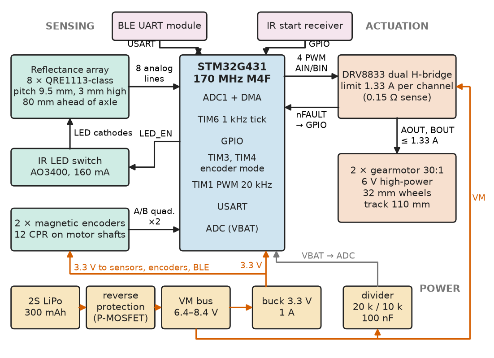
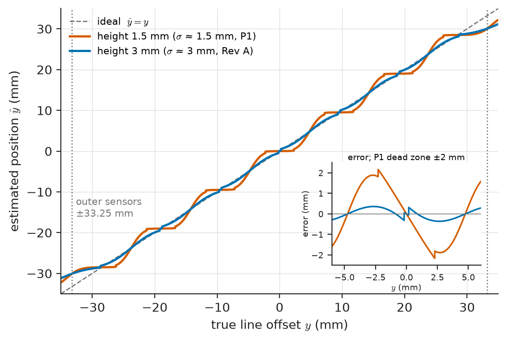
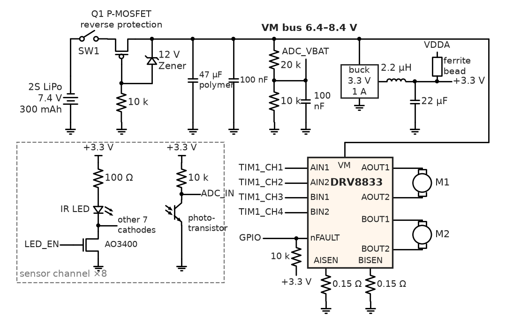
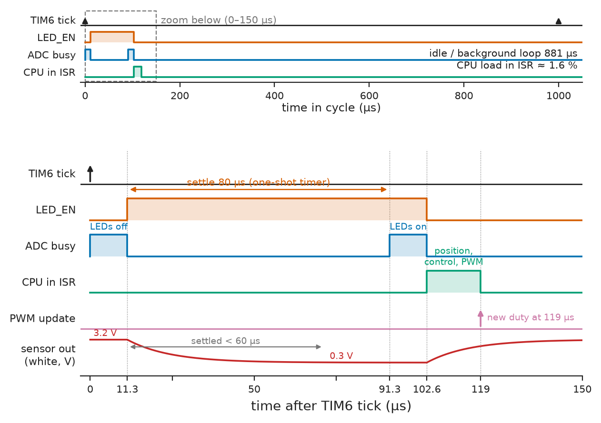
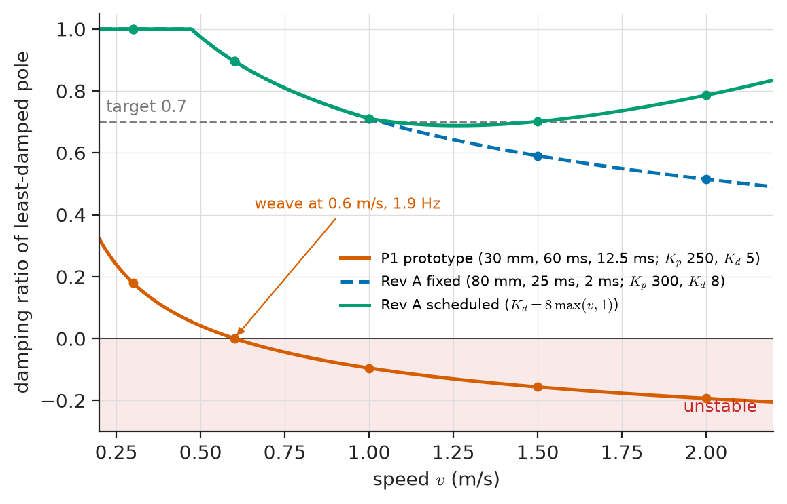
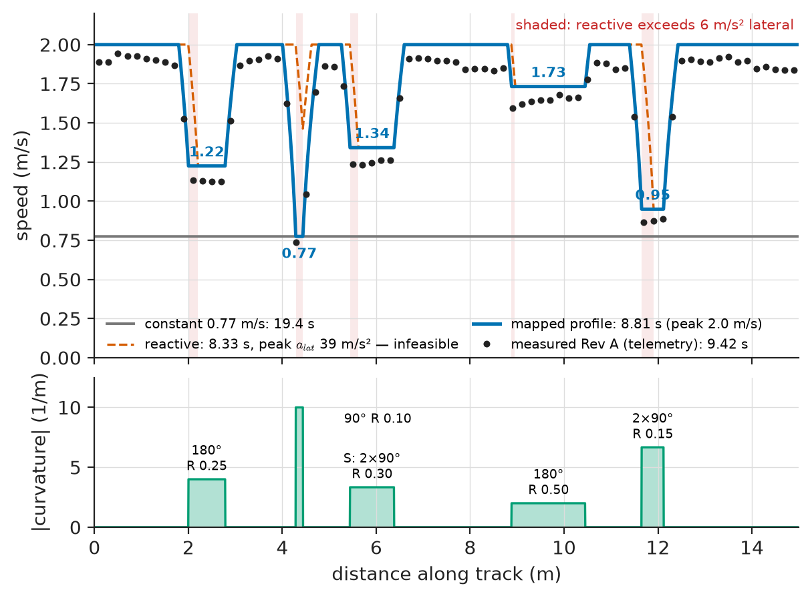

# Chapter 34 — Project: Autonomous Line-Following Robot

*Part IX · Interdisciplinary Engineering Projects*

A university team built a line follower for a regional competition: 19 mm black tape on white melamine, 15 m laps, curves down to 100 mm radius. The breadboard prototype, P1, followed the line well at 0.3 m/s. At 0.6 m/s it began to weave at about 2 Hz; at 0.8 m/s it left the track on the first curve. An evening of raising and lowering gains moved the weave but never removed it. Nothing was broken. The sensor bar sat 30 mm ahead of the axle, the motors were driven open loop by PWM, and the sensors were scanned at 200 Hz through a four-sample average. Each choice added lag to a loop whose plant, a vehicle steering itself onto a line, is a double integrator whose gain rises with speed. On paper the loop was unstable above 0.6 m/s, and no gain could fix it. This chapter rebuilds the robot as a project, each decision closed by a number.

> **Which sensor geometry, motor, gear ratio and control structure let a 170 g robot lap a 15 m track in under 10 s without leaving the line?**
> **How are the timing, power and mass budgets written so that the robot that is built is the robot that was analysed?**

| Concept | Engineering destination |
|---|---|
| Requirements with IDs | Lap time, tracking, runtime, mass, robustness limits |
| Sensor selection | Pitch and height for a linear, dead-zone-free position |
| Motor selection | Speed, acceleration, reflected inertia, encoder resolution |
| Circuit design | Power tree, H-bridge current limit, sensor channel |
| Embedded firmware | 1 kHz cycle, ambient-cancelling scan, state machine |
| Control algorithm | Cascaded steering PD and wheel PI, gain-scheduled |
| Power budgeting | Average and peak current, runtime, regulator choice |
| Testing | Bench, track and robustness tests; FMEA |
| Performance optimisation | Lookahead, track map, feed-forward, speed profile |

**Roadmap.** Requirements and architecture (34.1) → sensors (34.2) → motors (34.3) → circuit and BOM (34.4) → firmware (34.5) → control (34.6) → power and mass (34.7) → tests and failure analysis (34.8) → optimisation (34.9) → Revision B (34.10).

---

## 34.1 Requirements

> **Boundary.** Chapter 1 owns requirements and traceability; Chapter 14 owns differential-drive kinematics, odometry and line following as a technique; Chapter 15 owns motor drivers, encoder interfaces and PID implementation in general. This chapter applies them to one robot end to end and points back rather than repeating them.

### The problem and its numbers

The event rules fix the environment: 19 mm matt black line on white, minimum curve radius 100 mm, one 90° crossing, a 20 mm gap, a remote start signal, footprint at most 200 × 150 mm and mass at most 250 g. A top-three time on the 15.0 m reference track (Figure 34.6) meant a lap under 10 s, 1.5 m/s on average. From those, the requirements:

| ID | Requirement | Target | Verification |
|---|---|---|---|
| R1 | Follow the line through 100 mm curves, the crossing and the gap | 50 consecutive laps, no departure | T7 |
| R2 | Lap time, 15.0 m reference track | ≤ 10.0 s (mean of 5) | T6 |
| R3 | Tracking error at 1.0 m/s, straights and curves ≥ 250 mm radius | ≤ 6 mm RMS at sensor bar | T5 |
| R4 | Footprint and mass | ≤ 200 × 150 mm; ≤ 250 g | Measurement |
| R5 | Running time, racing duty | ≥ 20 min | T8 |
| R6 | Ambient light immunity | 50–2000 lux, 100 Hz flicker, low sun | T9 |
| R7 | Safe stop: line lost > 150 mm, remote stop, driver fault | ≤ 0.5 s | T10 |
| R8 | Battery protection | No reset at full power; stop at 3.3 V/cell | T8 |
| R9 | Tuning telemetry | ≥ 50 Hz over BLE | Bench |
| R10 | Cost | BOM ≤ \$150 (2026, one-off) | BOM (§34.4) |

R2 and R3 drive the control design, R1 and R6 the sensor design, R2, R4 and R5 the motor, battery and mass, R7 and R8 the firmware's safety logic. Every row ends in a test with a limit, so the project's verification table (§34.8) is this table with two more columns.

### The architecture

Figure 34.1 shows the blocks and their interfaces. The decisions behind each block are made in the following sections; the figure is drawn first so that every later budget has a place to land.

<!-- FIGURE 34.1 | figures/ch34/fig-34-1-robot-architecture.png | block-diagram | Architecture of the line-following robot: sensing, computing, actuation and power with their interfaces. | Content: left: Reflectance array 8 x QRE1113-class (pitch 9.5 mm, 3 mm high, 80 mm ahead of axle), 8 analog lines to ADC1 + DMA; IR LED switch driven by GPIO; 2 magnetic encoders 12 CPR to TIM3 and TIM4 encoder mode. Centre: STM32G431 170 MHz (ADC1, TIM1 PWM 20 kHz, TIM6 1 kHz tick, USART, GPIO). Right: TIM1 four PWM lines to DRV8833 (limit 1.33 A per channel) driving two 30:1 gearmotors, 32 mm wheels, track 110 mm. Bottom: 2S LiPo 300 mAh, reverse protection, VM bus 6.4 to 8.4 V, buck 3.3 V 1 A, divider to ADC. Side: BLE UART module, IR start receiver. Interface labels on every arrow. -->



*Figure 34.1 — Architecture of the line-following robot: sensing, computing, actuation and power with their interfaces.*

---

## 34.2 Sensor selection

### Candidate sensors

A line follower needs the lateral position of the line relative to the robot, fast and with as little lag as possible. Four sensor classes were compared against R1, R3, R6 and the 1 kHz loop rate chosen in §34.6:

| Option | Position output | Rate | Ambient immunity | Verdict |
|---|---|---|---|---|
| 5 discrete TCRT5000-class, 15 mm pitch, comparators | 5 on/off states | > 10 kHz | Poor | Rejected: quantised error causes a limit cycle |
| 8-channel analog array (QRE1113-class, 9.5 mm pitch), MCU ADC | Continuous (centroid) | 1–5 kHz | Good with LED on/off differencing | **Chosen** (8 g, \$5) |
| 8-channel "RC" timing array | Continuous | Read time up to 2.5 ms on black | Moderate | Rejected: read time eats the 1 ms cycle |
| 128-pixel linear image sensor with lens | Sub-mm, long lookahead | 0.2–1 kHz | Needs controlled lighting | Kept for Revision B |

The analog array wins because it gives a continuous position at the loop rate with no read-time penalty, and because its LEDs can be switched: reading every channel with the LEDs off and again with them on, then subtracting, cancels ambient light, including the 100 Hz flicker of venue lighting, which the DC-threshold sensors cannot (R6).

> **Boundary.** Reflective optical sensors and their selection are owned by Chapter 6; the ADC interface and sensor-interface practice by *Electronics and Computing*, [Ch. 26 §26.8–§26.9](https://github.com/The-Studio-of-Sadiq/Electronics-and-Computing/blob/main/part-6-embedded-and-real-time-systems/26-embedded-interfaces.md).

### From eight readings to one position

Each channel is normalised with the values recorded during a calibration sweep (white and black levels per channel), so that 0 means white and 1000 means black. The line position is the weighted centroid of the normalised readings over the sensor positions $x_i$:

$$
\hat y=\frac{\sum_i n_i\,x_i}{\sum_i n_i},\qquad x_i=(i-3.5)\times 9.5\ \mathrm{mm},\quad i=0\ldots7
$$

The centroid interpolates between sensors, but only if each sensor's optical footprint is wide enough to overlap its neighbours. Footprint width grows with height above the track: roughly, the illuminated and viewed spot of a QRE1113-class part has a Gaussian-like profile whose width $\sigma$ is about equal to the height for heights of 1–5 mm.

**Worked example — sensor height, pitch and the dead zone.** A 19 mm line on a 9.5 mm pitch covers two sensors when centred. Modelling each sensor's response as the overlap of a Gaussian footprint of width $\sigma$ with the line (readings below 5 % ignored): at 1.5 mm height ($\sigma\approx1.5$ mm) true offsets of 1 and 2 mm give estimates of 0.01 and 0.08 mm, because the two covered sensors stay saturated and the outer ones see nothing; that is a **dead zone of about ±2 mm** with no error signal. At 3 mm ($\sigma\approx3$ mm) the slope near centre is 0.95 and the worst error over ±30 mm is 1.2 mm. P1's sensors sat at 1.5 mm "for contrast"; the dead zone caused a ±2 mm hunt on straights that no gain removed, and raising the bar to 3 mm cured it (Figure 34.2).

> **Status of the principle: Centroid interpolation of an array**
> *Approximate.* Linear to within about 1 mm when the footprint width is at least a third of the pitch and the line covers at least two sensors; it saturates beyond the outermost sensor (here ±33 mm) and degrades when the line width approaches the pitch.

<!-- FIGURE 34.2 | figures/ch34/fig-34-2-centroid-transfer.png | plot | Estimated against true line position for the 8-sensor array at two sensor heights, showing the dead zone at low height. | Content: x true offset -35 to +35 mm; y estimate -35 to +35 mm; dashed ideal y = x. Curve for 1.5 mm height flat between about -2 and +2 mm (0.01 at 1 mm, 0.08 at 2 mm, 1.16 at 3 mm, 2.93 at 4 mm). Curve for 3 mm height close to ideal (0.95 at 1 mm, 5.07 at 5 mm, max error 1.2 mm). Both saturate beyond the outer sensors, dotted verticals at plus or minus 33.25 mm. Inset: error curves on a plus or minus 2.5 mm axis. -->



*Figure 34.2 — Estimated against true line position for the 8-sensor array at two sensor heights, showing the dead zone at low height.*

### Lookahead and line loss

The bar's distance ahead of the axle, the **lookahead** $L$, sets how early the robot sees a curve and, as §34.6 shows, how much phase lead the geometry gives the steering loop. P1 used 30 mm; the design uses 80 mm. On a 100 mm arc with the bar centred on the line, the axle runs inside on a radius $\sqrt{0.100^2-0.080^2}=60$ mm, a 40 mm cut that the rules allow because the footprint still covers the line; a longer arm would also lengthen the body beyond 150 mm.

Line loss is detected when the summed normalised signal falls below 300 (less than about a third of one sensor sees black). The firmware then steers hard towards the side where the line was last seen, at reduced speed, for up to 150 mm of travel (enough to bridge the 20 mm gap and recover from a curve overshoot) before stopping (R7).

---

## 34.3 Motor selection

> **Boundary.** The brushed DC motor's linear torque–speed characteristic and the motor–load matching procedure are owned by *Electrical Energy and Machines*, [Ch. 5 §5.8](https://github.com/The-Studio-of-Sadiq/Electrical-Energy-and-Machines/blob/main/part-2-transformers-and-electrical-machines/05-dc-machines.md) and [Ch. 10 §10.1](https://github.com/The-Studio-of-Sadiq/Electrical-Energy-and-Machines/blob/main/part-3-motor-drives/10-drive-system-fundamentals.md); Chapter 14 owns battery and motor sizing for mobile robots in general.

### What the motors must do

The motors must give at least 2.0 m/s on the straights, 0 to 1.5 m/s within about 200 mm of a curve exit, and controllable speed down to 0.3 m/s. Grip limits acceleration anyway: silicone tyres on melamine ($\mu\approx0.8$) allow at most $\mu g\approx 7.8\ \mathrm{m/s^2}$.

The candidates are micro metal gearmotors sharing one 6 V high-power armature with three ratios. At the output shaft and 6 V: 3200 rpm and 19.6 mN·m (10:1), 1050 rpm and 58.8 mN·m (30:1), 640 rpm and 98.1 mN·m (50:1); stall current 1.6 A, free current 0.10 A. The 2S pack at 7.4 V scales speed and stall torque by 7.4/6, acceptable for short racing duty that averages far below stall. The listing sweeps the ratios with the 170 g robot, 32 mm wheels, rolling resistance 0.02, the grip limit and the rotor inertia reflected through the gearbox.

```python
import numpy as np

M, R_W, CRR, MU, VB = 0.170, 0.016, 0.02, 0.8, 7.4      # robot kg, wheel radius m, rolling, grip, battery V
J_ROT = 0.08e-7                                           # rotor inertia, kg m^2 (0.08 g cm^2, typical)
motors = {"10:1": (10, 3200, 0.0196), "30:1": (30, 1050, 0.0588), "50:1": (50, 640, 0.0981)}
I_STALL6, I_FREE6 = 1.6, 0.10                             # A at 6 V (same armature for all ratios)

for name, (N, n0_6, ts_6) in motors.items():
    k = VB / 6.0                                          # full-duty voltage scaling of free speed and stall
    w0 = n0_6 * k * 2 * np.pi / 60                        # free speed at wheel, rad/s
    ts = ts_6 * k                                         # stall torque at wheel, N m
    m_eff = M + 2 * J_ROT * N**2 / R_W**2                 # rotor inertia reflected through gearbox
    v, x, t, dt = 0.0, 0.0, 0.0, 1e-4
    while v < 1.5 and t < 3.0:
        tq = ts * (1 - v / R_W / w0)                      # linear torque-speed line per motor
        f = min(2 * tq / R_W, MU * M * 9.81) - CRR * M * 9.81
        v, x, t = v + f / m_eff * dt, x + v * dt, t + dt
    vmax = w0 * R_W * (1 - CRR * M * 9.81 * R_W / 2 / ts)
    cnt_mm = 12 * N / (2 * np.pi * R_W * 1000)
    print(f"{name}: v_top {vmax:4.2f} m/s, m_eff {1000 * m_eff:5.0f} g, "
          f"0-1.5 m/s {'%.0f ms' % (1000 * t) if v >= 1.5 else 'never':>7s} in {1000 * x:4.0f} mm, "
          f"stall {I_STALL6 * k:4.2f} A, {cnt_mm:4.2f} counts/mm")
```

```text
10:1: v_top 6.54 m/s, m_eff   176 g, 0-1.5 m/s  203 ms in  152 mm, stall 1.97 A, 1.19 counts/mm
30:1: v_top 2.16 m/s, m_eff   226 g, 0-1.5 m/s  261 ms in  196 mm, stall 1.97 A, 3.58 counts/mm
50:1: v_top 1.32 m/s, m_eff   326 g, 0-1.5 m/s   never in 3739 mm, stall 1.97 A, 5.97 counts/mm
```

The 50:1 motor cannot reach 2.0 m/s. The 10:1 motor reaches 1.5 m/s sooner only because it is grip-limited, and would race at 15–30 % PWM duty (23 % at 1.5 m/s) with 1.19 counts/mm, where small duty errors are large speed errors. The **30:1 motor** is chosen: 69 % duty at 1.5 m/s, 2.16 m/s top speed, 3.58 counts/mm.

**Worked example — the inertia that is not on the scale.** A rotor of 0.08 g·cm² ($8\times10^{-9}\ \mathrm{kg\,m^2}$) seems negligible. Seen at the wheel through a 30:1 gearbox it is $J N^2=8\times10^{-9}\times900=7.2\times10^{-6}\ \mathrm{kg\,m^2}$, equivalent to a mass of $J N^2/r^2=7.2\times10^{-6}/0.016^2=28$ g per motor, 56 g for two: a third of the robot's 170 g. At 50:1 it would be 78 g per motor. Acceleration, braking and the yaw response all see this mass; an analysis that uses only the scale reading over-predicts acceleration by 33 %.

> **Status of the principle: Reflected inertia through a gearbox**
> *Derived.* From energy conservation across an ideal gear stage, $J_{wheel}=N^2 J_{rotor}$; gear friction adds losses but not inertia, and the result holds for any ratio.

### Encoders and speed resolution

A 12-count magnetic encoder on the motor shaft (both edges of both channels) gives 360 counts per wheel revolution, 0.279 mm per count. At 1.5 m/s that is 5.4 counts per millisecond, so a 1 ms difference quantises speed in 19 % steps. The firmware measures over a sliding 5 ms window instead: 3.7 % resolution at 1.5 m/s, 19 % at 0.3 m/s (acceptable only because low speed occurs in short curve segments). The window adds about 2.5 ms of delay inside the wheel loop, part of the 25 ms closed-loop wheel lag used in §34.6.

---

## 34.4 Circuit design

> **Boundary.** H-bridge operation and decay modes are in *Electronics and Computing*, [Ch. 32 §32.2](https://github.com/The-Studio-of-Sadiq/Electronics-and-Computing/blob/main/part-7-power-electronics/32-motor-drives-and-power-conversion.md); buck converter operation and efficiency in [Ch. 30 §30.1 and §30.8](https://github.com/The-Studio-of-Sadiq/Electronics-and-Computing/blob/main/part-7-power-electronics/30-dc-dc-converters.md). Motor-driver selection practice for robots is owned by Chapter 15.

### Component selection

| Function | Options considered | Choice and reason |
|---|---|---|
| MCU | ATmega328P (no encoder timers); RP2040 (4 ADC inputs); ESP32-S3 (noisy ADC, more power); STM32G431KB (170 MHz M4F, 12-bit ADC with DMA, hardware quadrature on TIM3/TIM4, TIM1 PWM) | **STM32G431KB**: reads 8 sensors, 2 encoders and drives 4 PWM channels in hardware |
| Motor driver | L298N (≈ 2 V bipolar drop); TB6612FNG (1.2 A continuous); DRV8833 (2.7–10.8 V, 1.5 A RMS, 2 A peak, current chopping) | **DRV8833**: low on-resistance, adjustable current limit |
| 3.3 V supply | LDO (AP2112-class); buck (TPS62162-class, 3–17 V, 1 A) | **Buck** (worked example below) |
| Battery | 1S LiPo with boost; 2S LiPo 300 mAh 30C; 6 × NiMH AAA | **2S LiPo**: direct motor drive, light |
| Telemetry | Wired UART; BLE UART module; Wi-Fi | **BLE module**: wireless logging, 8 mA |

**Worked example — LDO or buck for the 3.3 V rail.** The 3.3 V loads average 78.6 mA (§34.7). An LDO from a full pack dissipates $(8.4-3.3)\times0.0786=0.40$ W, a 100 K rise in SOT-23-5 ($\theta_{JA}\approx 250$ K/W), and draws all 78.6 mA from the battery. A buck at 88 % draws $78.6\times3.3/(0.88\times7.4)=39.8$ mA, half as much, and dissipates about 35 mW; its ripple is filtered by 22 µF and a ferrite bead into the analog supply.

### The power and drive section

The pack connects through a switch and a P-channel MOSFET for reverse-polarity protection to the VM bus (6.4–8.4 V; stop at 6.6 V), which feeds the DRV8833 (47 µF polymer plus 100 nF at its VM pin) and the buck.

The DRV8833's current regulation trips at $I_{trip}=0.2\ \mathrm{V}/R_{ISEN}$. With $R_{ISEN}=0.15$ Ω each channel is limited to 1.33 A, below the driver's 1.5 A RMS rating and below the motor's 1.97 A stall current at 7.4 V. The firmware's acceleration limit keeps racing currents far below that (0.36 A per motor at 5 m/s²; §34.7); the hardware limit exists for stalls and mistakes.

**Worked example — why the robot never reverses the motors to brake.** P1 braked by reversing PWM. At 2.0 m/s the back-EMF is about $7.4\times2.0/2.16=6.85$ V, so reversal drives $(7.4+6.85)/3.75=3.8$ A through the 3.75 Ω armature, beyond the DRV8833's overcurrent trip; the bridge shut down and retried repeatedly and the robot coasted into the curve. The design brakes in **slow decay** (both low-side switches on): current is set by back-EMF alone, at most $6.85/3.75=1.8$ A, chopped to 1.33 A, and the 6 m/s² deceleration limit keeps it far lower in normal running.

### The sensor channel

Each IR LED has a 100 Ω resistor from 3.3 V; the eight cathodes return through one logic-level N-MOSFET (AO3400-class) switched by a GPIO, 160 mA when on. Each phototransistor has a 10 kΩ load to 3.3 V: about 0.3 V over white and 3.2 V over black at 3 mm height, settling within about 60 µs after the LEDs switch. No filter capacitor is fitted, because it would slow the settling that the differencing relies on.

The battery divider (20 kΩ over 10 kΩ, 100 nF) maps 8.4 V to 2.80 V at the ADC, draws 0.28 mA and is read once per cycle.

<!-- FIGURE 34.3 | figures/ch34/fig-34-3-power-drive-sensor-schematic.png | circuit | Power entry, motor drive and one sensor channel with component values. | Content: 2S LiPo, switch, P-MOSFET reverse protection (10 k gate resistor, 12 V Zener), VM bus with 47 uF polymer and 100 nF. DRV8833: AIN1/AIN2/BIN1/BIN2 from TIM1, AISEN and BISEN to ground through 0.15 ohm, outputs to motors M1 and M2, nFAULT to GPIO with 10 k pull-up. Buck 3.3 V with 2.2 uH and 22 uF, ferrite bead to VDDA. Sensor channel x8: IR LED with 100 ohm from 3.3 V, cathodes to AO3400 switched by GPIO LED_EN; phototransistor with 10 k load to 3.3 V, collector to ADC input. Battery divider 20 k over 10 k with 100 nF. -->



*Figure 34.3 — Power entry, motor drive and one sensor channel with component values.*

### Bill of materials

| Item | Qty | Unit price | Line total |
|---|---|---|---|
| MCU STM32G431KB (LQFP32) | 1 | \$4.10 | \$4.10 |
| Dual H-bridge DRV8833 | 1 | \$1.60 | \$1.60 |
| 3.3 V 1 A buck regulator with inductor | 1 | \$1.90 | \$1.90 |
| Reflective sensor, QRE1113 class | 8 | \$0.62 | \$4.96 |
| MOSFETs (LED switch, reverse protection) | 1 set | \$0.60 | \$0.60 |
| Micro metal gearmotor 30:1, 6 V high-power, extended shaft | 2 | \$21.95 | \$43.90 |
| Magnetic encoder kit (pair) | 1 | \$8.95 | \$8.95 |
| Silicone wheels 32 mm (pair) | 1 | \$6.95 | \$6.95 |
| 2S LiPo 300 mAh 30C | 1 | \$8.50 | \$8.50 |
| BLE UART module | 1 | \$6.00 | \$6.00 |
| 2-layer 1.6 mm PCB used as chassis (share of 5) | 1 | \$4.80 | \$4.80 |
| Passives, connectors, switch, LEDs | 1 set | \$6.50 | \$6.50 |
| Motor brackets (pair) and ball caster | 1 set | \$7.50 | \$7.50 |
| IR start-module receiver | 1 | \$4.00 | \$4.00 |
| **Total** | | | **\$110.26** |

Indicative 2026 distributor and robot-shop prices, one-off quantities; R10's \$150 limit leaves \$39.74 for spares and the Revision B changes. The motors are 40 % of the cost, which is typical: the electronics of a small robot are cheap, the electromechanics are not.

---

## 34.5 Embedded firmware

> **Boundary.** Timers, interrupts, latency and watchdogs are owned by *Electronics and Computing*, [Ch. 27 §27.2, §27.4, §27.10 and §27.11](https://github.com/The-Studio-of-Sadiq/Electronics-and-Computing/blob/main/part-6-embedded-and-real-time-systems/27-real-time-computing.md); firmware architecture and fault handling as a design practice by Chapter 10.

### One deterministic 1 ms cycle

The firmware is a timer-driven super-loop with one interrupt doing all control work. TIM6 fires at 1 kHz and starts a fixed sequence (Figure 34.4): scan the eight sensors with the LEDs off (DMA), switch the LEDs on, wait 80 µs on a one-shot timer, scan again, switch the LEDs off, then compute position, steering, wheel speeds and PWM. The background loop handles telemetry, the BLE UART and the button.

| Stage in the 1 ms cycle | Time |
|---|---|
| ADC scan, LEDs off (8 × 60 cycles at 42.5 MHz, DMA) | 11.3 µs |
| LED settle (one-shot timer; LED duty about 10 %) | 80 µs |
| ADC scan, LEDs on | 11.3 µs |
| Position (normalise, centroid) | 6 µs |
| Steering PD, wheel PI × 2, PWM update | 5 µs |
| State machine, safety, telemetry packing | 5 µs |
| **Sample to PWM update** (budget 500 µs; margin 381 µs) | **≈ 119 µs** |

The latency from the LED-on sample to the new PWM duty is about 30 µs; the loop's effective delay is dominated by the 1 ms sample period (half a period of zero-order hold) and the derivative filter, about 2 ms in total, the figure used in §34.6.

<!-- FIGURE 34.4 | figures/ch34/fig-34-4-control-cycle-timing.png | timing-diagram | One 1 ms control cycle: sensor scans with LEDs off and on, computation and PWM update. | Content: axis 0 to 1000 us with zoom 0 to 150 us. Traces: TIM6 tick at 0 and 1000 us; LED_EN high from 11.3 to 102.6 us; ADC busy 0 to 11.3 us (LEDs off) and 91.3 to 102.6 us (LEDs on); CPU in ISR 102.6 to 119 us (position, control, PWM); PWM update at 119 us; example white-surface sensor output falling from 3.2 V to 0.3 V within 60 us of LED on. Labels: settle 80 us, CPU load 1.6 percent. -->



*Figure 34.4 — One 1 ms control cycle: sensor scans with LEDs off and on, computation and PWM update.*

### Line position in fixed point

The position routine takes the two scans, cancels ambient light by subtraction and normalises against the calibration. A reflective (white) surface pulls the phototransistor output *down* when the LEDs are on, so the reflected signal is `off - on`.

```c
/* line_pos.c -- line position from an 8-channel reflectance array (C11) */
#include <stdbool.h>
#include <stdint.h>

#define NS        8
#define PITCH_UM  9500        /* sensor pitch, micrometres */
#define N_MIN     50          /* ignore normalised readings below 5 % black */
#define SUM_MIN   300         /* below this the line is considered lost */

typedef struct { int16_t white[NS], black[NS]; } cal_t;   /* reflected signal, from sweep */

/* raw_on/raw_off: ADC counts with IR LEDs on and off; sensor 0 is the rightmost.
 * Writes the line position in micrometres (+ = line left of centre); false if lost. */
bool line_position(const uint16_t raw_on[NS], const uint16_t raw_off[NS],
                   const cal_t *cal, int32_t *pos_um)
{
    int32_t sum_n = 0, sum_nx = 0;
    for (int i = 0; i < NS; ++i) {
        int32_t refl = (int32_t)raw_off[i] - (int32_t)raw_on[i];  /* ambient cancelled */
        int32_t span = (int32_t)cal->white[i] - (int32_t)cal->black[i];
        if (span < 200) continue;                     /* dead or uncalibrated channel */
        int32_t n = ((int32_t)cal->white[i] - refl) * 1000 / span;   /* 0 white, 1000 black */
        if (n < N_MIN) continue;
        if (n > 1000) n = 1000;
        int32_t x = (2 * i - (NS - 1)) * PITCH_UM / 2;              /* -33250 ... +33250 um */
        sum_n += n;
        sum_nx += n * x;                              /* at most 8 * 1000 * 33250: fits int32 */
    }
    if (sum_n < SUM_MIN) return false;
    *pos_um = sum_nx / sum_n;
    return true;
}
```

A channel whose calibrated white-to-black span is below 200 counts is skipped rather than trusted: a sensor fouled by dust or a cracked LED solder joint then degrades resolution instead of injecting a false position. The host build compiles this file unchanged and runs it against recorded scans and the synthetic transfer curve of Figure 34.2 as a unit test.

### States and transitions

| State | Behaviour | Exit |
|---|---|---|
| IDLE | Motors off, telemetry on | Button: CAL |
| CAL | Pivot ±40° over the line twice, record white and black per channel | Spans valid: ARMED; else FAULT |
| ARMED | Wait for start signal | Start: RUN_MAP, or RUN_FAST if map valid |
| RUN_MAP | 0.7 m/s (below the tightest curve's limit), record curvature every 10 mm | Marker seen twice: RUN_FAST |
| RUN_FAST | Speed profile and curvature feed-forward from map (§34.9) | Line lost: LOST; stop: STOP |
| LOST | Steer to last side seen at 0.5 m/s for up to 150 mm | Found: previous state; 150 mm: STOP |
| STOP | Slow-decay brake, then motors off (also on VBAT < 6.6 V or nFAULT) | Button: IDLE |

An independent watchdog (IWDG, 20 ms timeout) is refreshed only at the end of a complete control cycle; a hung ISR or a stuck DMA leaves the motors' last PWM for at most 20 ms before the reset, and the reset state of every PWM pin is low (both bridge inputs low: coast).

---

## 34.6 Control algorithm

> **Boundary.** PID structure, tuning and digital implementation are owned by *Circuits, Signals and Communications*, [Ch. 35 §35.2, §35.3 and §35.8](https://github.com/The-Studio-of-Sadiq/Circuits-Signals-and-Communications/blob/main/part-7-control-system-fundamentals/35-control-design-fundamentals.md); steady-state error by system type in [Ch. 34 §34.7](https://github.com/The-Studio-of-Sadiq/Circuits-Signals-and-Communications/blob/main/part-7-control-system-fundamentals/34-feedback-and-stability.md). The kinematic model of a differential-drive robot is owned by Chapter 14.

### Structure: a cascade

The controller is a cascade. Inner loops, one per wheel at 1 kHz, make each wheel follow a speed command with a PI controller around a feed-forward of the free-wheel duty for that speed, corrected for battery voltage. The outer loop turns line error into a yaw-rate command $\omega$ with a PD controller and splits it into $v_{L,R}=v\mp\omega b/2$ (track $b=110$ mm). The inner loops turn the outer loop's actuator into a fast yaw-rate source, closed-loop time constant 25 ms, independent of battery voltage and motor mismatch; P1 had none, and its yaw rate lagged by the motor and chassis time constant, about 60 ms.

### The steering plant and why speed destabilises it

For small angles the lateral error measured at the sensor bar responds to yaw rate as $E(s)/\Omega(s)=(Ls+v)/s^2$ (Chapter 14's kinematics, linearised): a double integrator with a zero at $s=-v/L$. The zero is the geometric phase lead that the lookahead gives; the gain rises with speed $v$. The listing evaluates the least-damped closed-loop pole for three designs, with the wheel loop as a first-order lag and the loop delay as a first-order Padé approximation.

```python
import numpy as np
P = np.poly1d

def worst_pole(v, L, kp, kd, tw, T, tf=0.002):
    """Least-damped closed-loop pole of the steering loop at speed v (m/s)."""
    plant_n, plant_d = P([L, v]), P([1, 0, 0])            # e_s/omega = (L s + v)/s^2
    lag, dly_n, dly_d = P([tw, 1]), P([-T / 2, 1]), P([T / 2, 1])   # wheel loop, Pade delay
    c_n, c_d = P([kp * tf + kd, kp]), P([tf, 1])         # PD with filtered derivative
    r = (plant_d * lag * dly_d * c_d + plant_n * dly_n * c_n).r
    z = -r.real / np.abs(r)
    i = np.argmin(z)
    return z[i], abs(r[i].imag) / (2 * np.pi)

designs = {   # name: (lookahead m, wheel lag s, delay s, gain schedule)
    "P1 prototype": (0.030, 0.060, 0.0125, lambda v: (250, 5)),
    "Rev A fixed":  (0.080, 0.025, 0.002, lambda v: (300, 8)),
    "Rev A sched.": (0.080, 0.025, 0.002, lambda v: (300, 8 * max(v, 1.0))),
}
print("v (m/s)      " + "".join(f"{v:>12.1f}" for v in (0.3, 0.6, 1.0, 1.5, 2.0)))
for name, (L, tw, T, gains) in designs.items():
    cells = []
    for v in (0.3, 0.6, 1.0, 1.5, 2.0):
        z, f = worst_pole(v, L, *gains(v), tw, T)
        cells.append(f"{z:5.2f}/{f:3.1f}Hz")
    print(f"{name:13s}" + "".join(f"{c:>12s}" for c in cells))
```

```text
v (m/s)               0.3         0.6         1.0         1.5         2.0
P1 prototype   0.18/1.5Hz  0.00/1.9Hz -0.10/2.3Hz -0.16/2.7Hz -0.19/3.0Hz
Rev A fixed    1.00/0.0Hz  0.90/0.9Hz  0.71/1.9Hz  0.59/2.8Hz  0.51/3.4Hz
Rev A sched.   1.00/0.0Hz  0.90/0.9Hz  0.71/1.9Hz  0.70/2.1Hz  0.79/2.0Hz
```

Each cell is the damping ratio and frequency of the least-damped pole. The P1 row is the opening story in numbers: damping 0.18 at 0.3 m/s (it "looked fine"), zero at 0.6 m/s with a 1.9 Hz oscillation (the observed weave), negative above, and no gain pair stabilises it at 1 m/s. Three changes fix it: an 80 mm lookahead moves the plant zero nearer the origin, where its phase lead helps at crossover; the inner wheel loops cut the lag from 60 to 25 ms; and the 1 kHz cycle without averaging cuts the delay from 12.5 to 2 ms. With fixed gains the damping still falls to 0.51 at 2 m/s, because the plant gain rises with $v$; scheduling $K_d=8\max(v,1)$ holds it at about 0.7 (minimum 0.69, near 1.3 m/s; Figure 34.5).

> **Status of the principle: Lookahead steering model**
> *Approximate.* Linearised kinematics for small heading errors (below about 15°), no tyre slip, constant speed during the transient; at high lateral acceleration the tyres slip and the real loop is less damped than predicted, which §34.8's track tests check.

<!-- FIGURE 34.5 | figures/ch34/fig-34-5-steering-damping.png | plot | Damping ratio of the least-damped steering pole against speed for the prototype and the final design with fixed and scheduled gains. | Content: x speed 0.2 to 2.2 m/s; y damping -0.3 to 1.0. P1 (30 mm, 60 ms, 12.5 ms, Kp 250, Kd 5): 0.18 at 0.3, 0 at 0.6, -0.10 at 1.0, -0.19 at 2.0, red region below zero labelled unstable. Rev A fixed (80 mm, 25 ms, 2 ms, Kp 300, Kd 8): 1.0 at 0.3, 0.90 at 0.6, 0.71 at 1.0, 0.59 at 1.5, 0.51 at 2.0. Rev A scheduled: 0.71 at 1.0, 0.70 at 1.5, 0.79 at 2.0. Dashed line at 0.7 labelled target. -->



*Figure 34.5 — Damping ratio of the least-damped steering pole against speed for the prototype and the final design with fixed and scheduled gains.*

### The control code

```c
/* control.c -- 1 kHz steering PD and wheel-speed PI loops (C11; HAL names illustrative) */
#include <stdint.h>

#define DT        0.001f
#define TRACK_M   0.110f              /* wheel track b */
#define M_PER_CNT 0.000279f           /* 32 mm wheel, 360 counts per wheel revolution */
#define WIN       5                   /* speed window, ms */
#define V_FREE    2.16f               /* free speed at 7.4 V, full duty */

typedef struct { float kp, ki, integ, lo, hi; } pi_t;

extern volatile uint16_t enc_cnt[2];  /* TIM3/TIM4 encoder counters, left and right */
extern volatile float vbat;           /* filtered battery voltage, V */
extern void pwm_set(int side, float duty);   /* -1..+1, slow-decay drive of DRV8833 */

static pi_t wheel[2] = { {1.2f, 30.0f, 0.0f, -0.6f, 0.6f}, {1.2f, 30.0f, 0.0f, -0.6f, 0.6f} };
static uint16_t hist[2][WIN];
static uint32_t k;
static float e_prev, d_filt;

static float pi_step(pi_t *c, float err)
{
    float u = c->kp * err + c->integ;
    if (u > c->hi)      u = c->hi;                 /* clamp; integrate only when unsaturated */
    else if (u < c->lo) u = c->lo;
    else                c->integ += c->ki * err * DT;
    return u;
}

void control_step(float v_ref, float e_m, float omega_ff)   /* e_m: line error (m), + = left */
{
    float kd = 8.0f * (v_ref > 1.0f ? v_ref : 1.0f);         /* derivative gain scheduled */
    d_filt += ((e_m - e_prev) / DT - d_filt) * 0.333f;       /* tf = 2 ms, about 80 Hz */
    e_prev = e_m;
    float omega = omega_ff + 300.0f * e_m + kd * d_filt;     /* yaw-rate command, rad/s */
    float v_w[2] = { v_ref - omega * TRACK_M / 2, v_ref + omega * TRACK_M / 2 };

    uint32_t slot = k % WIN;                                 /* written WIN cycles ago */
    for (int s = 0; s < 2; ++s) {
        uint16_t c = enc_cnt[s];
        float v_meas = (float)(int16_t)(uint16_t)(c - hist[s][slot]) * M_PER_CNT / (WIN * DT);
        hist[s][slot] = c;
        float ff = v_w[s] / (V_FREE * vbat / 7.4f);          /* duty for this speed, no load */
        pwm_set(s, ff + pi_step(&wheel[s], v_w[s] - v_meas));
    }
    ++k;
}
```

Three details carry the design. The derivative acts on the filtered measurement, so state changes do not kick. The PI output is a correction around the feed-forward, clamped to ±0.6 duty with conditional integration, so a lifted wheel or stall does not wind up the integrator. The 16-bit encoder difference is formed unsigned and reinterpreted as signed, correct across counter wrap-around on a two's-complement target.

**Worked example — the steady error on a curve, and why feed-forward.** The loop is type 2 with respect to the line, so on a constant-curvature arc it settles with $e_{ss}=\omega_{req}/K_p=(v/R)/K_p$. On the 100 mm curve at 0.775 m/s, $e_{ss}=7.75/300=25.8$ mm, three quarters of the way to the array's edge; on the 250 mm curve at 1.22 m/s, 16.3 mm. Raising $K_p$ costs damping. Instead, in RUN_FAST the firmware supplies $\omega_{ff}=v\,\kappa_{map}$ from the track map (§34.9) and the PD loop corrects only the residual: the measured error on the 100 mm curve fell from 24 mm to 4 mm.

---

## 34.7 Power budgeting

> **Boundary.** Battery capacity, C-rate and runtime fundamentals for robots are owned by Chapter 14; cell chemistry and BMS by Chapter 23.

### Average current and running time

Motor current was estimated from the lap energy and checked on the bench. On the mapped profile (§34.9) the robot gains 1.38 J of kinetic energy per lap (effective mass 226 g) and loses 0.50 J to rolling: 1.88 J per 8.8 s lap, 4.7 J electrical at about 40 % efficiency, 72 mA at 7.4 V. No-load friction and iron losses at racing speed add about 0.2 A, for 0.28 A.

| Load | Rail | Rail current (mA) | Battery current (mA) | Allowance | Budgeted (mA) |
|---|---|---|---|---|---|
| Motors, racing duty | VM | — | 280 | +25 % | 350 |
| DRV8833 quiescent | VM | — | 1.7 | — | 1.7 |
| Battery divider | VM | — | 0.25 | — | 0.25 |
| STM32G431 at 170 MHz with ADC, timers | 3.3 V | 40 | | | |
| IR LEDs, 160 mA at 10 % duty | 3.3 V | 16 | | | |
| Phototransistor loads | 3.3 V | 2.6 | | | |
| BLE module (connected, 50 Hz telemetry) | 3.3 V | 8 | | | |
| Encoders (2 × Hall sensors) | 3.3 V | 8 | | | |
| Status LEDs | 3.3 V | 4 | | | |
| 3.3 V rail total through 88 % buck | 3.3 V | 78.6 | 39.8 | +10 % | 43.8 |
| **Total** | | | **321.8** | | **395.8** |

**Worked example — running time with margin.** A 300 mAh 2S LiPo used down to the 3.3 V/cell stop under load delivers about 80 % of its capacity, 240 mAh. At the estimated 321.8 mA that is $240/321.8=0.746$ h = 44.8 min; at the budgeted 395.8 mA, 36.4 min, an 82 % margin on R5's 20 min. A 150 mAh pack would give 18.2 min and fail.

> **Status of the principle: Runtime from capacity and average current**
> *Derived.* Runtime equals usable charge divided by average current; it assumes capacity independent of discharge rate, which holds for LiPo cells at the 1–2C average of this robot but not at the 10–20C peaks, which are too short to matter here.

### Peak current and brown-out

Hard acceleration at the firmware's 5 m/s² limit needs $F=0.226\times5+0.03=1.16$ N, 9.3 mN·m and about 0.36 A per motor. With the LED pulse (about 81 mA from the battery) and the electronics the peak is under 0.9 A, 3C for the pack, and its internal resistance (about 2 × 60 mΩ) drops 0.1 V. The worst case the hardware allows, both bridges at the 1.33 A limit, sags the pack by 0.32 V: the buck input stays above 6 V, far from the MCU's brown-out level, as the R8 scope test on the 3.3 V rail confirmed.

### The mass budget

| Item | Mass (g) |
|---|---|
| PCB chassis 150 × 120 mm with cut-outs | 48 |
| Motors (2), brackets | 25 |
| Encoders (2) | 3 |
| Wheels and hubs (2) | 14 |
| 2S LiPo 300 mAh with lead | 21 |
| Sensor bar with 8 sensors on a carbon arm | 19 |
| Electronics (MCU, driver, buck, passives), BLE, start receiver | 19 |
| Ball caster, wiring, connectors, fasteners | 21 |
| **Total** (R4 limit 250 g) | **170** (margin 80 g) |

The 80 g margin is deliberate: Revision B's downforce fan (§34.10) needs about 25 g.

---

## 34.8 Testing

> **Boundary.** Test planning, regression and fault diagnosis as a method are owned by Chapter 4; robot field testing and hardware-in-the-loop by Chapter 17.

### Test plan and results

Each test has its limit written before the build. Results are representative of the Revision A robot:

| Req. | Test | Limit | Result | Pass/fail |
|---|---|---|---|---|
| — | T1 line-position unit test (host build) | ≤ 1.5 mm over ±30 mm | 1.2 mm max, 0.3 mm RMS | Pass |
| — | T2 sensor transfer on a linear stage, 3 mm height | slope 0.9–1.1; ≤ 1.5 mm | slope 0.96; 1.4 mm | Pass |
| — | T3 wheel speed step 0.5 → 1.5 m/s on a stand | 63 % rise ≤ 30 ms; overshoot ≤ 10 % | 24 ms; 6 % | Pass |
| — | T4 steering: 15 mm start offset, 1.0 m/s | ±3 mm in 0.4 s; overshoot ≤ 30 % | 0.31 s; 9 % | Pass |
| R3 | T5 tracking at 1.0 m/s (telemetry) | ≤ 6 mm RMS | 3.1 mm (straights 1.8, curves 4.2) | Pass |
| R2 | T6 lap time, 5 laps, light gate | ≤ 10.0 s | 9.42 s (σ 0.06 s) | Pass |
| R1 | T7 50 consecutive laps | 0 departures | 1 departure at lap 37 (first build) | **Fail**, then pass |
| R5, R8 | T8 endurance from full charge | ≥ 20 min, no reset | 39 min, no reset | Pass |
| R6 | T9 2000 lux and 100 Hz floodlight | T5 limit | 3.3 mm RMS | Pass |
| R6 | T9 low sun across the track | T5 limit | Line lost twice (first build) | **Fail**, then pass |
| R7 | T10 line lifted; remote stop; motor lead shorted | ≤ 0.5 s | 0.21 s; 0.05 s; 0.02 s | Pass |
| R4 | Mass and footprint | ≤ 250 g; ≤ 200 × 150 mm | 172 g; 150 × 120 mm | Pass |

The T7 departure was at the crossing: approaching with a few degrees of yaw, the crossing line lay diagonally across the array, the centroid jumped, and the robot followed the crossing line for 20 mm. The firmware now ignores scans in which more than five sensors see black and holds the previous position for up to 30 mm. The T9 failure was sunlight saturating the phototransistors: the LED-off reading fell to near 0 V, leaving no headroom for the LED-on signal. The fix is a 2 g black shroud and a check that flags a channel whose LED-off reading falls below 0.4 V.

<!-- FIGURE 34.6 | figures/ch34/fig-34-6-lap-speed-profile.png | plot | Speed along the 15 m reference track for three strategies, with track curvature and the measured lap. | Content: lower panel curvature against distance 0 to 15 m: 180 deg arc R 0.25 m from 2.0 m, 90 deg arc R 0.10 m at 4.3 m, S of two 90 deg arcs R 0.30 m, 180 deg arc R 0.50 m, two 90 deg arcs R 0.15 m, straights between. Upper panel speed 0 to 2.2 m/s: constant 0.77 m/s (19.4 s); reactive reaching 2.0 m/s and entering curves too fast (39 m/s2, marked infeasible); mapped profile with curve speeds 1.22, 0.77, 1.34, 1.73, 0.95 m/s, peak 2.0 m/s, 8.81 s; measured Rev A telemetry dots 5 to 10 percent below the profile, 9.42 s. -->



*Figure 34.6 — Speed along the 15 m reference track for three strategies, with track curvature and the measured lap.*

### Failure analysis

| Failure mode | Effect | Cause | Detection | Mitigation |
|---|---|---|---|---|
| Oscillation above 0.6 m/s (P1) | Weave, departure | Short lookahead, open-loop wheels, 12.5 ms delay | Track test | 80 mm lookahead, inner PI, 1 kHz, gain schedule |
| ±2 mm hunt on straights (P1) | Wasted speed | Centroid dead zone, sensors at 1.5 mm | T2 | Sensor height 3 mm |
| Bridge trips when braking (P1) | Coasts into curve | Reverse braking, 3.8 A | nFAULT log | Slow-decay brake, 1.33 A limit |
| Centroid jump at crossing | Follows crossing line | > 5 sensors black, yawed approach | T7 | Ignore wide-black scans for 30 mm |
| Sun saturates sensors | Line lost | LED-off level near 0 V | T9 | Shroud; LED-off level check |
| Dust on a sensor window | Position bias | Low calibrated span | Span check at CAL | Skip channel; clean before runs |
| Encoder magnet slips | Wheel loop runs away | Press-fit magnet loosens | Speed-versus-duty check | STOP on > 30 % mismatch for 50 ms |
| Battery under-voltage | Cell damage | Long practice | VBAT every cycle | STOP at 6.6 V |
| Firmware hang | Uncontrolled run | ISR or DMA stall | IWDG 20 ms | Reset to coast |
| Map mismatch | Brakes in wrong place | Track piece moved | Lap length differs > 2 % | Discard map, RUN_MAP |

---

## 34.9 Performance optimisation

With the loop stable and the robot reliable, lap time is set by how fast it can go *where it is allowed to*. The physics limit in a curve is lateral grip: $v_{max}=\sqrt{a_{lat}R}$, with $a_{lat}=6.0\ \mathrm{m/s^2}$ used as the design value (about 75 % of the grip limit, leaving room for control error). That gives 0.77 m/s on the 100 mm curve and 1.73 m/s on the 500 mm curve.

> **Status of the principle: Grip-limited cornering speed**
> *Approximate.* From the centripetal acceleration $v^2/R$ bounded by the tyre friction coefficient; the coefficient itself is empirical, varies with surface dust and tyre temperature by ±15 %, and is shared with longitudinal acceleration on combined braking and turning.

### Three speed strategies

The listing computes lap times on the reference track for a constant speed, a reactive strategy that slows only when it senses a curve, and a mapped profile that knows where the curves are and brakes before them, with acceleration and braking limits of 5 and 6 m/s². The track is entered as an unrolled list of segments; turn direction does not change the speed limit, so it is not recorded.

```python
import numpy as np

# reference track unrolled in driving order: (length m, radius m; 0 = straight), 15.0 m lap
track = [(2.0, 0), (np.pi * 0.25, 0.25), (1.5, 0), (np.pi / 2 * 0.10, 0.10), (1.0, 0),
         (np.pi / 2 * 0.30, 0.30), (np.pi / 2 * 0.30, 0.30), (2.5, 0), (np.pi * 0.50, 0.50),
         (1.2, 0), (np.pi / 2 * 0.15, 0.15), (np.pi / 2 * 0.15, 0.15), (0.0, 0)]
track[-1] = (15.0 - sum(s for s, _ in track), 0)            # closing straight
V_TOP, A_LAT, A_ACC, A_DEC, DS = 2.0, 6.0, 5.0, 6.0, 0.005  # m/s, m/s^2, m/s^2, m/s^2, m

r = np.concatenate([np.full(int(round(s / DS)), rad) for s, rad in track])
vlim = np.where(r > 0, np.sqrt(A_LAT * np.where(r > 0, r, 1)), V_TOP).clip(max=V_TOP)

def profile(vlim, laps=2):
    v = np.tile(vlim, laps)                                  # two laps: the second is periodic
    for i in range(1, v.size):                               # forward pass: acceleration limit
        v[i] = min(v[i], np.sqrt(v[i - 1]**2 + 2 * A_ACC * DS))
    for i in range(v.size - 2, -1, -1):                      # backward pass: braking limit
        v[i] = min(v[i], np.sqrt(v[i + 1]**2 + 2 * A_DEC * DS))
    return v[vlim.size:]

lap_time = lambda v: np.sum(DS / v)
v_const = np.full_like(vlim, vlim.min())
def reactive(vlim, laps=2):                                  # slows only after curve is sensed
    v = np.tile(vlim, laps)
    for i in range(1, v.size):
        up, dn = np.sqrt(v[i - 1]**2 + 2 * A_ACC * DS), np.sqrt(max(v[i - 1]**2 - 2 * A_DEC * DS, 0))
        v[i] = min(v[i], up) if v[i] >= dn else dn
    return v[vlim.size:]
v_map = profile(vlim)
print(f"track {r.size * DS:.1f} m, tightest radius {r[r > 0].min():.2f} m -> {vlim.min():.2f} m/s")
print(f"constant speed      : {lap_time(v_const):5.2f} s")
v_r = reactive(vlim)
a_lat = np.max(v_r**2 * np.where(r > 0, 1 / np.where(r > 0, r, 1), 0))
print(f"reactive            : {lap_time(v_r):5.2f} s, peak lateral accel {a_lat:4.1f} m/s^2 (limit {A_LAT})")
print(f"mapped profile      : {lap_time(v_map):5.2f} s, mean {r.size * DS / lap_time(v_map):.2f} m/s, "
      f"peak {v_map.max():.2f} m/s")
```

```text
track 15.0 m, tightest radius 0.10 m -> 0.77 m/s
constant speed      : 19.36 s
reactive            :  8.33 s, peak lateral accel 39.4 m/s^2 (limit 6.0)
mapped profile      :  8.81 s, mean 1.70 m/s, peak 2.00 m/s
```

Held to the tightest curve's speed everywhere, the robot needs 19.4 s and fails R2 by a factor of two. The reactive robot looks fastest, 8.33 s, but it enters curves at straight-line speed and needs 39 m/s² of lateral acceleration, five times the grip limit: in reality it leaves the track. Speed must be reduced *before* a curve, which needs to know where the curve is; the mapped profile does, laps in 8.81 s at a mean 1.70 m/s, and is what the robot runs.

**Worked example — what the map is and how it is built.** In RUN_MAP the robot laps at 0.7 m/s and records curvature from the encoders every 10 mm, $\kappa=(v_R-v_L)/(b\,v)$, as a signed byte in units of 0.1 m⁻¹: 1500 bytes per 15 m lap. Two detections of the start/finish side mark close the lap and fix the distance origin. In ARMED the firmware computes the profile with the listing's forward–backward passes (about 3 ms), then in RUN_FAST indexes it by odometric distance, re-zeroed at each marker. Encoder slip drifts about 0.5 % (75 mm) per lap, so braking points are placed 100 mm early. The map also supplies the curvature feed-forward of §34.6.

### What each optimisation bought

| Step | Change | Lap time (s) | Tracking RMS at 1.0 m/s (mm) |
|---|---|---|---|
| P1 | Prototype, 0.5 m/s maximum stable | 30+ (unstable above 0.6 m/s) | 7.5 at 0.5 m/s |
| A1 | Lookahead 80 mm, sensor height 3 mm, inner PI loops, 1 kHz | 15.1 (constant 1.0 m/s, slowed in curves by error threshold) | 4.0 |
| A2 | Gain scheduling | 14.2 | 3.6 |
| A3 | Track map and speed profile | 10.3 | 3.6 |
| A4 | Curvature feed-forward from map | 9.42 | 3.1 |
| — | Ideal profile (listing) | 8.81 | — |

The remaining 0.6 s between measured and ideal comes from the 100 mm early braking points, tyre slip in the tightest curve (the measured speed there is 0.71 m/s, not 0.77) and acceleration below 5 m/s² at low battery.

---

## 34.10 Revision B

Revision A meets every requirement. Revision B is what the team would build next, each change traced to a measured limitation:

| Change | Why (evidence) | Expected effect | Cost and risk |
|---|---|---|---|
| Ducted downforce fan (20 mm impeller, 25 g) under a skirt | Cornering grip-limited; slip in the tightest curve | Twice the normal force: 0.77 → 1.10 m/s on 100 mm curves; ideal lap 7.88 s against 8.81 s | +\$15; +0.6 A average, so a 2S 450 mAh pack (+9 g) to keep 21.7 min against R5 |
| Second sensor row 40 mm further ahead, or a linear image sensor | Braking relies on the map; a moved track piece forces a mapping lap | Curve detection without a map | +\$10 to \$20; more ADC channels |
| Lower-inertia coreless motors | 56 g of 226 g effective mass is rotor inertia | 20–25 % faster acceleration | +\$40 per pair; brush wear |
| IMU gyro (ICM-42688-class) | Map curvature from wheel speeds is corrupted by slip | Slip-free curvature; yaw-rate inner loop | +\$4; fusion work (Chapter 15) |
| 4-layer PCB, ground plane under sensors | 20-count ADC spikes at PWM edges | Lower noise | +\$15 per board |

The downforce fan is the largest lever: once the loop is stable, this robot is limited by its tyres, not by its electronics or control.

---

## What remains open

| Open question | Where it is answered |
|---|---|
| Differential-drive kinematics, odometry and general line-following technique | Chapter 14 |
| Motor drivers, encoder interfaces and PID implementation on embedded targets in general | Chapter 15 |
| Integrating an IMU and sensor fusion for slip-free yaw rate | Chapter 15; Chapter 17 |
| Hardware-in-the-loop testing of the control loop against a simulated track | Chapter 17 |
| A closed-loop motor drive designed from the motor up, with current control and protection | Chapter 37 |
| How to plan, document and report a project like this one as a capstone | Chapter 40 |
| DC-motor characteristics and motor–load matching theory | *Electrical Energy and Machines*, [Ch. 5](https://github.com/The-Studio-of-Sadiq/Electrical-Energy-and-Machines/blob/main/part-2-transformers-and-electrical-machines/05-dc-machines.md) and [Ch. 10](https://github.com/The-Studio-of-Sadiq/Electrical-Energy-and-Machines/blob/main/part-3-motor-drives/10-drive-system-fundamentals.md) |
| Controller design and digital control theory | *Circuits, Signals and Communications*, [Ch. 35](https://github.com/The-Studio-of-Sadiq/Circuits-Signals-and-Communications/blob/main/part-7-control-system-fundamentals/35-control-design-fundamentals.md) |

**Next:** Chapter 35 builds a smart energy monitor: from mains voltage and current through signal conditioning, power calculation and calibration to a safe, validated, connected meter.
