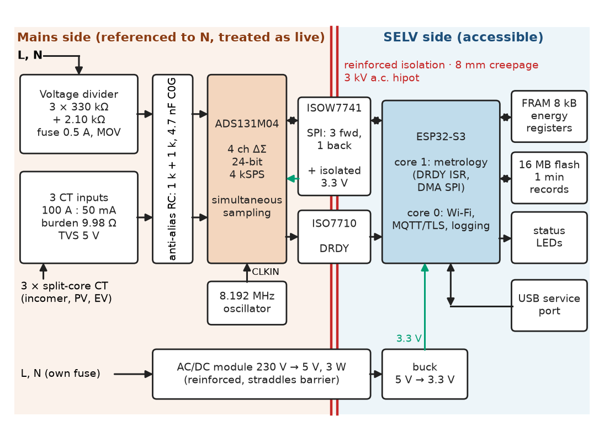
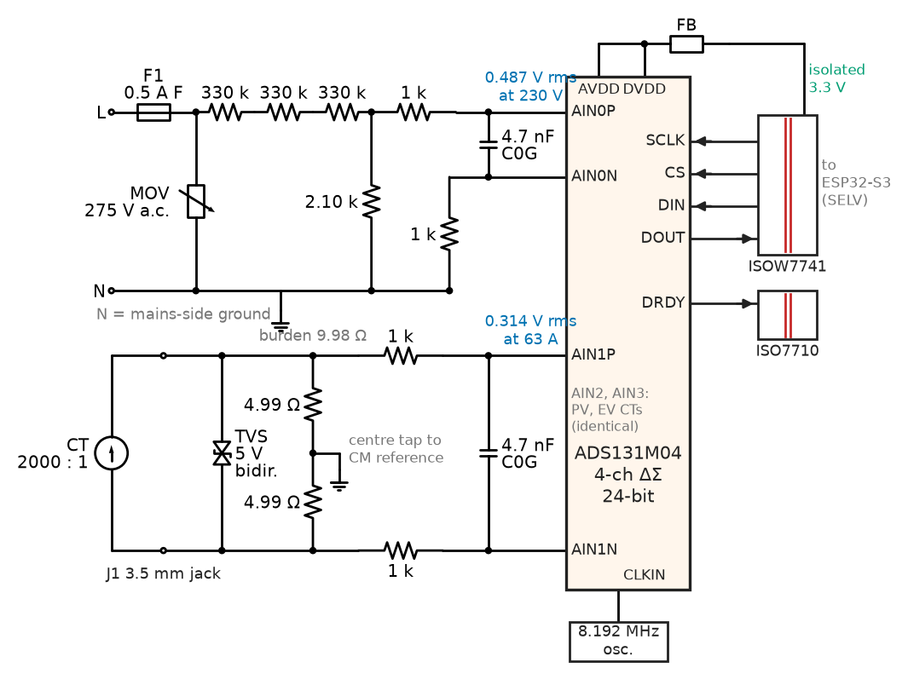
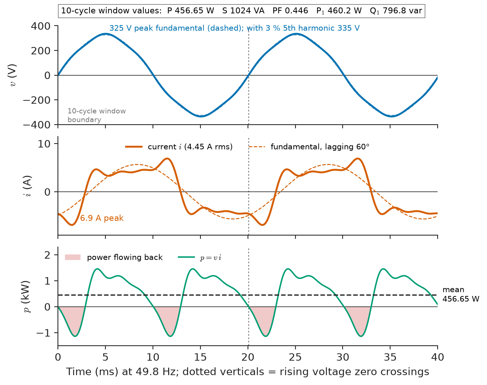
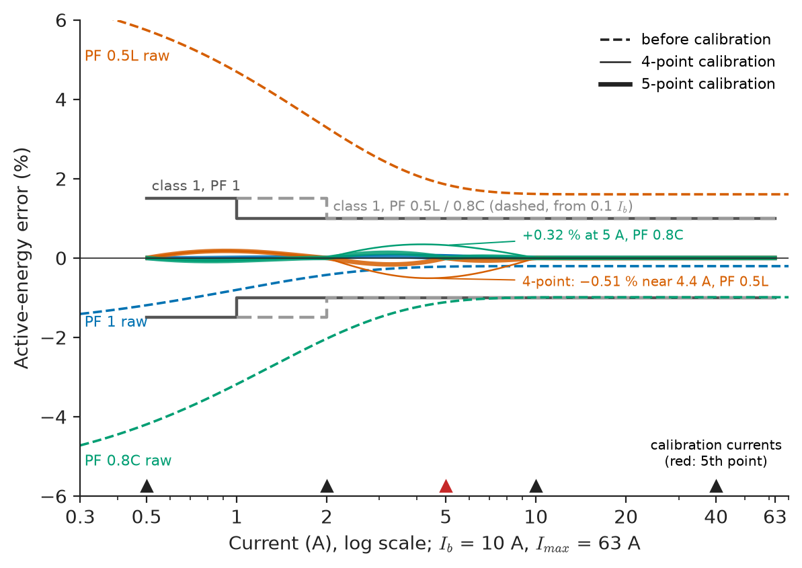
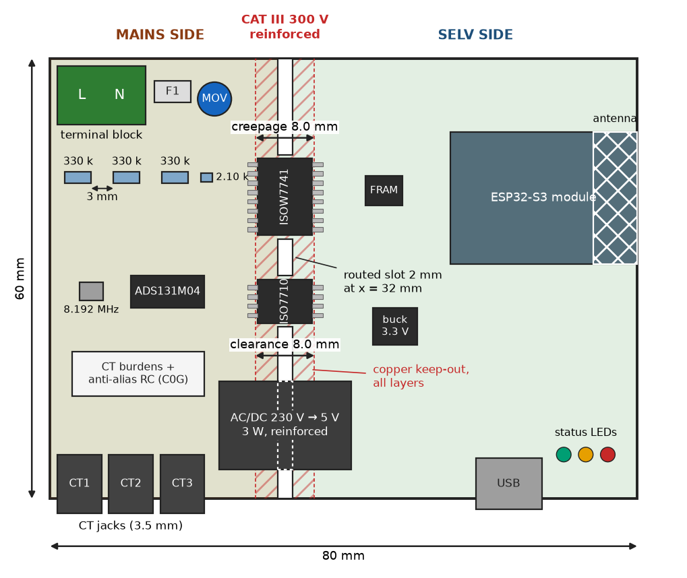
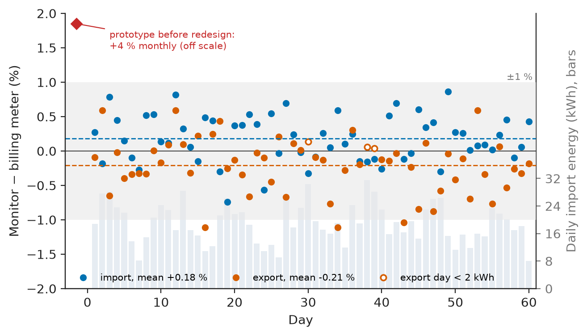

# Chapter 35 — Project: Smart Energy Monitor

*Part IX · Interdisciplinary Engineering Projects*

A household installed a home-built Wi-Fi energy monitor in its consumer unit: one voltage tap, three split-core current transformers on the incomer, the PV inverter and the EV charger. On the electric kettle it agreed with the utility's billing meter to 0.4 %. Over a month it read 4 % more than the billing meter, and at night, with the house "off", it showed about 20 W more than the billing meter's display. Both errors had causes that a kettle test cannot reveal. The night load was a fridge compressor, routers and standby supplies at a power factor near 0.5, and the clamp-on CTs lead their primary current by about 2° at a few amperes: an error of $\delta\tan\varphi\approx0.035\times1.73=6\ \%$ at PF 0.5, none at PF 1. And the voltage divider's trace ran beside the current-channel input, coupling a voltage-shaped signal into the current channel, worth a few watts of phantom power at zero current. This chapter designs that monitor properly: measurement, conditioning, power calculation, processing, logging, communication, calibration, safety and validation, each with a requirement and a test.

> **How do a CT, a resistive divider and a 24-bit ADC become an energy measurement good to 1 % at power factor 0.5 and at 0.5 A?**
> **How is a device that touches 230 V mains and talks to a home Wi-Fi network made safe, robust against outages and verifiable against a meter standard?**

| Concept | Engineering destination |
|---|---|
| Voltage and current measurement | Divider and split-core CTs on a 63 A single-phase supply |
| Signal conditioning | Burden, divider ratio, anti-alias filter, phase matching |
| Power calculations | P, Q, S, PF, harmonics over cycle-synchronous windows |
| Embedded processing | 4 kSPS accumulation on a dedicated core; energy registers |
| Data logging | Power-fail-safe registers in FRAM; 130 days of records in flash |
| Communications | MQTT over TLS, offline buffer and backfill |
| Calibration | Gain and current-dependent phase tables from a reference meter |
| Safety | Reinforced isolation, CAT III clearances, fusing, CT open-circuit protection |
| Validation | IEC 62053-21 class 1 test points, influence and field tests |

**Roadmap.** Measurement chain and architecture (35.1) → conditioning and error budget (35.2) → power definitions and windows (35.3) → firmware on the target (35.4) → logging (35.5) → MQTT (35.6) → calibration (35.7) → safety (35.8) → validation (35.9) → BOM, FMEA and Revision B (35.10).

---

## 35.1 Voltage and current measurement

> **Boundary.** Chapter 9 (energy monitoring) gives a compact version of this project and points here; Chapter 6 owns current and voltage sensor principles, Chapter 7 signal conditioning, uncertainty and ADC selection, Chapter 11 MQTT, provisioning and IoT security. AC power definitions are in *Circuits, Signals and Communications*, [Ch. 9](https://github.com/The-Studio-of-Sadiq/Circuits-Signals-and-Communications/blob/main/part-2-transient-and-ac-analysis/09-ac-power.md); harmonics and power-quality measurement in *Electrical Energy and Machines*, [Ch. 25 §25.3 and §25.9](https://github.com/The-Studio-of-Sadiq/Electrical-Energy-and-Machines/blob/main/part-7-power-quality-and-grid-modernization/25-power-quality.md).

### Requirements

The monitor is a DIN-rail device for a 230 V, 50 Hz single-phase installation with a 63 A main fuse: one voltage input and three current channels (incomer, PV inverter, EV charger), each bidirectional. It is a monitor, not a billing meter, but it is designed and tested against the class 1 accuracy points of IEC 62053-21 so that its numbers can be trusted next to the utility's.

| ID | Requirement | Target | Verification |
|---|---|---|---|
| R1 | Active energy accuracy per channel | Class 1 limits of IEC 62053-21 (Ib = 10 A, Imax = 63 A), PF 1, 0.5L, 0.8C | Reference-meter test (§35.9) |
| R2 | Instantaneous quantities | Vrms ±0.5 %, Irms ±1 %, PF ±0.02, f ±0.01 Hz, current THD to 25th harmonic | Reference source |
| R3 | Bidirectional registers | Import and export energy per channel | PV export test |
| R4 | Update rates | 10-cycle values; 10 s telemetry; 1 min records | Log inspection |
| R5 | No energy lost at power failure | ≤ 1 Wh per outage | 100 power cuts at 14 kW |
| R6 | Offline operation | ≥ 30 days of 1 min records; backfill on reconnect | Broker outage test |
| R7 | Electrical safety | IEC 61010-1, CAT III 300 V; reinforced isolation to all accessible parts | Design review, hipot 3 kV a.c. |
| R8 | Secure communications | MQTT over TLS 1.2+, signed OTA updates | Penetration checklist (Chapter 11) |
| R9 | Self-consumption | ≤ 1.5 W | Power analyser |
| R10 | Cost | BOM ≤ \$65 (2026, 100 pcs) | BOM (§35.10) |

### Sensor and converter choices

| Current sensor | Pros | Cons | Verdict |
|---|---|---|---|
| Shunt (250 µΩ manganin) | Excellent linearity, no phase error | One per line conductor, at mains potential; needs cutting into the circuit | Rejected: retrofit must be non-invasive |
| Split-core CT, 100 A : 50 mA (2000:1) | Clamps on, isolates, cheap | Ratio and phase errors grow at low current; opens hazardously if unburdened | **Chosen** |
| Rogowski coil with integrator | Wide range, no saturation | Integrator drift; weak signal at 0.5 A | Rejected |
| Open-loop Hall clamp | DC capable | Offset drift ±50 mA, temperature-dependent | Rejected (no DC needed) |

Voltage is measured through a resistive divider referenced to neutral; a small voltage transformer would isolate but adds a few degrees of phase error that varies with voltage.

| ADC option | Channels | Resolution, rate | Notes | Verdict |
|---|---|---|---|---|
| MCU's internal SAR ADC (ESP32-S3) | multiplexed | 12-bit, nonlinear | Not simultaneous; INL several LSB | Rejected |
| Metering AFE (ADE7953, ATM90E26 class) | 1 V + 2 I | Energy computed in silicon | Fixed algorithms; two current channels | Rejected: three channels and raw waveforms needed |
| ADS131M04 simultaneous ΔΣ ADC | 4 | 24-bit, 4 kSPS, per-channel phase trim | All waveform maths in firmware | **Chosen** |
| Isolated modulator ADC (AMC131M03 class) | 3 | 24-bit, isolation built in | One channel short | Considered for Revision B |

The ADS131M04 samples all four channels simultaneously, so voltage–current timing errors come only from the analog front end and the CTs. Its per-channel phase register shifts each channel's sampling instant in steps of one modulator clock, $1/4.096\ \mathrm{MHz}=244$ ns, which is $0.0044°$ at 50 Hz.

### Architecture

Figure 35.1 shows the architecture. The ADC, the divider and the CT burdens sit on a **mains-referenced side** tied to neutral. Everything a person can touch (USB, enclosure, the ESP32-S3 module, its antenna) is on the **SELV side**. A reinforced digital isolator with integrated isolated power (ISOW7741 class: SCLK, CS and DIN forward, DOUT back) and a single-channel reinforced isolator (ISO7710 class, for DRDY) are the only crossings. An 8.192 MHz oscillator on the mains side clocks the ADC, so sampling is set by the ADC's crystal, not by firmware timing. One core of the ESP32-S3 runs metrology, the other Wi-Fi, MQTT and logging.

<!-- FIGURE 35.1 | figures/ch35/fig-35-1-energy-monitor-architecture.png | block-diagram | Architecture of the smart energy monitor with the isolation barrier between the mains-referenced measurement side and the SELV side. | Content: left (mains side, tied to neutral): voltage divider 3 x 330 k plus 2.10 k with fuse and MOV; three CT inputs (100 A to 50 mA, 9.98 ohm burden, TVS); anti-alias RC 1 k and 4.7 nF; ADS131M04 4 ch 24-bit 4 kSPS; 8.192 MHz oscillator. Vertical double line labelled reinforced isolation, 8 mm creepage, 3 kV hipot, crossed by ISOW7741 (SPI 3 forward 1 back plus isolated 3.3 V power) and ISO7710 (DRDY). Right (SELV): ESP32-S3 core 1 metrology, core 0 Wi-Fi MQTT TLS and logging; FRAM 8 kB energy registers; 16 MB flash records; AC/DC module 230 V to 5 V 3 W reinforced; buck 3.3 V; USB service port; status LEDs. -->



*Figure 35.1 — Architecture of the smart energy monitor with the isolation barrier between the mains-referenced measurement side and the SELV side.*

---

## 35.2 Signal conditioning

> **Boundary.** Op-amp-free passive conditioning, ADC interfaces and references are covered in *Electronics and Computing*, [Ch. 10 §10.7 and §10.10](https://github.com/The-Studio-of-Sadiq/Electronics-and-Computing/blob/main/part-2-analog-electronics/10-analog-integrated-circuits.md); aliasing and anti-alias filters in *Circuits, Signals and Communications*, [Ch. 19 §19.4 and §19.9](https://github.com/The-Studio-of-Sadiq/Circuits-Signals-and-Communications/blob/main/part-4-signals-and-systems/19-sampling-and-reconstruction.md).

### Current channels

The CT is a current source of $I/2000$; its burden turns it into the ADC's differential voltage. The ADS131M04's input range at gain 1 is ±1.2 V.

**Worked example — choosing the burden.** With a burden of 2 × 4.99 Ω = 9.98 Ω (0.1 %, 25 ppm/K, centre tap to the ADC's common mode), 63 A gives $31.5\ \mathrm{mA}\times9.98\ \Omega=0.314$ V rms, 0.445 V peak. The ±1.2 V range then allows a crest factor of $1.2/0.314=3.8$ at 63 A, or a sinusoid up to $63\times1.2/0.445=170$ A before clipping, enough for inrush and for the peaky currents of rectifier loads. At 0.5 A the signal is 2.50 mV rms and at the 40 mA starting current 200 µV rms, against an input noise of a few microvolts rms per sample that averages down over the 800 samples of a window. The burden dissipates 9.9 mW at 63 A, and the low burden keeps the CT's core flux, and so its ratio and phase errors, small. A larger burden (say 20 Ω) would double the low-current signal but drive the CT towards the knee of its magnetisation curve and increase its phase error.

> **Status of the principle: CT error versus burden**
> *Empirical.* A CT's ratio and phase errors grow with burden impedance and at low primary current, where the magnetising current is a larger fraction of the total; split-core CTs, with an air gap at the joint, have larger magnetising current and phase lead than solid-core ones, and the values must be measured per CT type.

### Voltage channel

The divider is three 330 kΩ high-voltage thin-film MELF resistors in series (each about 77 V rms in service, rated for the 4 kV surge of CAT III when shared across three) over 2.10 kΩ: ratio $992.1/2.1=472.4$. At 230 V the ADC sees 0.487 V rms; at 300 V, 0.898 V peak, inside the range. The divider draws $230^2/992\ \mathrm{k\Omega}=53$ mW. Its ratio drifts with the temperature-coefficient mismatch of top and bottom resistors, so all four are 25 ppm/K parts from one family.

### Anti-alias filter and phase matching

Each input has 1 kΩ in each leg and 4.7 nF C0G across the pair: a corner of $1/(2\pi\times2\ \mathrm{k\Omega}\times4.7\ \mathrm{nF})=16.9$ kHz, attenuating by 47.7 dB at the 4.096 MHz modulator rate, with the ΔΣ decimation filter removing the rest. At 50 Hz the filter shifts phase by 0.17°, identically on all channels if the parts match; a 5 % capacitor tolerance gives a 0.0085° mismatch, about 0.03 % error at PF 0.5. A 10× larger capacitor would have given a 1.7° shift and a 0.085° mismatch from the same tolerance, a 0.25 % error at PF 0.5 that drifts with temperature. The common-mode filter is identical on the voltage channel, so the CT's own phase lead is the only significant phase error left.

<!-- FIGURE 35.2 | figures/ch35/fig-35-2-front-end-schematic.png | circuit | Mains-side analog front end: voltage divider and one CT channel into the ADS131M04 with protection and anti-alias filters. | Content: L terminal through 0.5 A fast fuse to MOV 275 V a.c. to N; from fused L three 330 k resistors in series to node AIN0P with 2.10 k to N (N is mains-side ground); AIN0N to N through 1 k; 1 k series and 4.7 nF C0G differential at each ADC input pair. CT channel: 3.5 mm jack, TVS bidirectional 5 V across CT, burden 2 x 4.99 ohm with centre tap to common-mode reference, 1 k plus 1 k and 4.7 nF C0G into AIN1P/AIN1N. ADS131M04 with 8.192 MHz oscillator on CLKIN, AVDD and DVDD from isolated 3.3 V via ferrite bead, SPI and DRDY pins to isolator symbols at the right edge. Annotations: 0.487 V rms at 230 V; 0.314 V rms at 63 A. -->



*Figure 35.2 — Mains-side analog front end: voltage divider and one CT channel into the ADS131M04 with protection and anti-alias filters.*

### Uncertainty budget

After calibration, the error at 10 A and PF 0.5L over 5–35 °C, combined as root-sum-square of independent standard contributions (*The Mathematics Universe*, [Ch. 20 §20.10](https://github.com/The-Studio-of-Sadiq/engineering-mathematics/blob/main/part-6-probability-statistics/20-statistical-analysis.md)):

| Contribution | Value (%) |
|---|---|
| Reference meter used for calibration | 0.05 |
| Calibration-table interpolation between points | 0.10 |
| Burden temperature coefficient (25 ppm/K, 30 K) | 0.075 |
| Divider ratio drift (25 ppm/K mismatch, 30 K) | 0.075 |
| ADC reference drift | 0.045 |
| CT ratio drift with temperature | 0.20 |
| Anti-alias phase mismatch (0.01° at PF 0.5) | 0.03 |
| CT phase drift with temperature (0.1° at PF 0.5) | 0.30 |
| **Combined (RSS)** | **0.40** |
| R1 limit at 10 A, PF 0.5L / margin | 1.0 / 0.60 |

> **Status of the principle: Root-sum-square combination**
> *Derived.* From the variance of a sum of independent random contributions (GUM, JCGM 100); correlated contributions, such as burden and divider drifting together with board temperature, add linearly (0.15 %), which raises the combination only to 0.41 %, and even the arithmetic sum of every line, 0.88 %, stays inside the limit.

The CT's thermal phase drift dominates. That is why the calibration of §35.7 corrects phase as a function of current, and why the validation of §35.9 includes a temperature test.

---

## 35.3 Power calculations

> **Boundary.** Definitions of active, reactive and apparent power, and their non-sinusoidal generalisation, are owned by *Circuits, Signals and Communications*, [Ch. 9 §9.4–§9.9](https://github.com/The-Studio-of-Sadiq/Circuits-Signals-and-Communications/blob/main/part-2-transient-and-ac-analysis/09-ac-power.md); IEEE 1459 is the standard that fixes the definitions used here. Spectral analysis in practice is owned by Chapter 27.

### What is computed, and over what

From simultaneous samples $v[n]$ and $i[n]$ the monitor computes, over each window of $N$ samples:

$$
P=\frac1N\sum_n v[n]\,i[n],\qquad V_{rms}=\sqrt{\frac1N\sum_n v[n]^2},\qquad S=V_{rms}I_{rms},\qquad PF=\frac{P}{S}
$$

and the fundamental active and reactive powers $P_1$, $Q_1$ from the fundamental components. With distorted currents, $S^2>P^2+Q_1^2$; the remainder is distortion power, and PF is lower than the displacement factor $\cos\varphi_1$. The monitor reports both.

The window is **10 whole cycles**, delimited by rising zero crossings of the voltage, as in the 10-cycle aggregation of IEC 61000-4-30 for 50 Hz systems. Energy is not computed from windows but integrated sample by sample: every product $v[n]\,i[n]$ is accumulated, so no sample is ever outside a window.

The listing tests these choices on a realistic distorted load: 4 A fundamental lagging 60° with third, fifth and seventh harmonics of 40, 25 and 12 % (a mix of motor and electronic loads), a voltage with 3 % fifth harmonic and a grid at 49.8 Hz.

```python
import numpy as np

FS, F0 = 4000.0, 49.8                        # ADC rate (Hz), grid frequency off-nominal (Hz)
t = np.arange(0, 4.0, 1 / FS)
w = 2 * np.pi * F0
v = 230 * np.sqrt(2) * (np.sin(w * t) + 0.03 * np.sin(5 * w * t))          # 3 % 5th harmonic
harm = {1: (4.0, -60), 3: (1.6, -150), 5: (1.0, 120), 7: (0.48, 20)}       # A rms, degrees
def current(lead_deg=0.0, gain=1.0):                                      # CT error model
    return gain * sum(a * np.sqrt(2) * np.sin(h * w * t + np.radians(ph + h * lead_deg))
                      for h, (a, ph) in harm.items())

def metrics(v, i, n):
    p = np.mean(v[:n] * i[:n])
    vr, ir = np.sqrt(np.mean(v[:n]**2)), np.sqrt(np.mean(i[:n]**2))
    k = np.arange(n)
    e = np.exp(-2j * np.pi * F0 * k / FS)                                 # fundamental DFT bin
    v1, i1 = 2 * np.mean(v[:n] * e) / np.sqrt(2), 2 * np.mean(i[:n] * e) / np.sqrt(2)
    s1 = v1 * np.conj(i1)
    return p, vr, ir, p / (vr * ir), s1.real, s1.imag

zc = np.flatnonzero((v[:-1] < 0) & (v[1:] >= 0))                         # rising zero crossings
n_sync = zc[10] - zc[0]                                                   # 10 whole cycles
ref = metrics(v, current(), n_sync)
print(f"true:  P={ref[0]:7.2f} W  Vrms={ref[1]:6.2f}  Irms={ref[2]:5.3f}  PF={ref[3]:.3f}  "
      f"P1={ref[4]:7.2f} W  Q1={ref[5]:7.2f} var")
m = metrics(v, current(1.8, 0.992), n_sync)
print(f"CT 1.8 deg lead, -0.8 % ratio: P={m[0]:7.2f} W, error {100 * (m[0] / ref[0] - 1):+5.2f} %")
i, p_true = current(), ref[0]
err = lambda ps: 100 * np.max(np.abs(np.array(ps) / p_true - 1))
fixed = [np.mean(v[k:k + 800] * i[k:k + 800]) for k in range(0, 12000, 800)]  # 10 x 80 samples
synced = [np.mean(v[a:b] * i[a:b]) for a, b in zip(zc[:-10:10], zc[10::10])]  # 10 whole cycles
print(f"10-cycle P, worst error: fixed 800-sample window {err(fixed):.2f} %, "
      f"zero-cross synced {err(synced):.2f} %")
print(f"energy integrated sample by sample over 3 s: error {100 * (np.mean(v[:12000] * i[:12000]) / p_true - 1):+.3f} %")
```

```text
true:  P= 456.65 W  Vrms=230.13  Irms=4.449  PF=0.446  P1= 460.20 W  Q1= 796.79 var
CT 1.8 deg lead, -0.8 % ratio: P= 476.72 W, error +4.39 %
10-cycle P, worst error: fixed 800-sample window 1.28 %, zero-cross synced 0.09 %
energy integrated sample by sample over 3 s: error -0.030 %
```

Three results carry the design. First, the PF is 0.446 although the displacement angle is 60° ($\cos60°=0.5$): harmonics add apparent power, not active power, and here even subtract a little ($P=456.65$ W against $P_1=460.20$ W, the fifth-harmonic voltage and current being nearly in anti-phase). Second, a CT that leads by 1.8° with a −0.8 % ratio error reads this load 4.4 % high, the opening's failure. Third, a fixed 800-sample window at 49.8 Hz misses or repeats part of a cycle and its displayed power wanders by up to 1.28 %, while zero-crossing windows stay within 0.09 % (the residual is the up-to-one-sample quantisation of the window length); the energy register, integrating every sample, is within 0.03 % after only 3 s. Figure 35.3 shows the waveforms.

**Worked example — the phase error rule.** For a sinusoidal load at angle $\varphi$ and a CT phase lead $\delta$ (radians), the relative error in active power is $\cos(\varphi-\delta)/\cos\varphi-1\approx\delta\tan\varphi$. At 1.8° (0.0314 rad): PF 1 gives 0 %, PF 0.8 gives 2.4 %, PF 0.5 gives 5.4 %. At PF 0.8 *capacitive* the sign reverses (−2.4 %). The rule explains why every accuracy standard tests at PF 0.5L and 0.8C, and why the kettle test of the opening was blind to it.

> **Status of the principle: Phase-error sensitivity of active power**
> *Derived.* A first-order expansion of $\cos(\varphi-\delta)$; accurate to better than 2 % of the error itself for $\delta<3°$ and $\varphi\le60°$, and it grows without bound as PF approaches zero, where active-power measurement is inherently fragile.

<!-- FIGURE 35.3 | figures/ch35/fig-35-3-distorted-load-waveforms.png | waveform | Voltage, distorted current and instantaneous power of the test load over two cycles, with the 10-cycle window boundaries. | Content: x time 0 to 40 ms at 49.8 Hz. Top: voltage 325 V peak fundamental (dashed), peaked to 335 V by the 3 % 5th harmonic. Middle: current 4.45 A rms, 6.9 A peak, with visible 3rd, 5th and 7th harmonics, fundamental lagging 60 deg (dashed). Bottom: instantaneous power v times i swinging between about -1.14 kW and +1.46 kW with mean 456.65 W (horizontal line), negative intervals shaded. Vertical markers at rising voltage zero crossings. Text box: P 456.65 W, S 1024 VA, PF 0.446, P1 460.2 W, Q1 796.8 var. -->



*Figure 35.3 — Voltage, distorted current and instantaneous power of the test load over two cycles, with the 10-cycle window boundaries.*

### Reactive power and harmonics on the target

The firmware obtains the fundamental reactive power cheaply by multiplying the current by the voltage delayed a quarter cycle (20 samples at 50 Hz): $Q\approx\frac1N\sum v[n-20]\,i[n]$. For the fundamental this equals $Q_1$; at 49.8 Hz the delay is 0.4 % short of a quarter cycle, a 0.36° error that leaks $0.0063P$ into $Q$ (0.36 % of $Q$ at PF 0.5), acceptable for reactive power and negligible in the small phase correction of $P$ that uses it; harmonic products also leak in, so $Q$ is reported as a fundamental-dominated estimate. Current THD and the harmonic magnitudes up to the 25th, which R2 asks for, are computed once a second on the SELV core with a Goertzel filter per harmonic over 10 cycles, corrected for the ADC's sinc-filter droop.

---

## 35.4 Embedded processing

> **Boundary.** SPI and its DMA practice are in *Electronics and Computing*, [Ch. 26 §26.3](https://github.com/The-Studio-of-Sadiq/Electronics-and-Computing/blob/main/part-6-embedded-and-real-time-systems/26-embedded-interfaces.md); interrupts, latency and task priorities in [Ch. 27](https://github.com/The-Studio-of-Sadiq/Electronics-and-Computing/blob/main/part-6-embedded-and-real-time-systems/27-real-time-computing.md). MCU selection and firmware architecture are owned by Chapter 10.

### The data path and its timing

The ADC asserts DRDY 4000 times a second. A GPIO interrupt on core 1 starts a DMA SPI read of one frame (status word, four 24-bit channels, CRC: 18 bytes at 8 MHz, 18 µs); the DMA-complete handler checks the CRC, removes each channel's DC offset with a first-order high-pass (0.5 Hz corner), and calls the accumulation routine. Core 0 runs Wi-Fi, MQTT and logging under FreeRTOS and never touches the metrology data except through a queue of finished windows.

| Task on core 1, per ADC frame | Time at 240 MHz | Deadline | Margin |
|---|---|---|---|
| DRDY interrupt entry, start DMA | 2 µs | | |
| SPI transfer, 18 bytes at 8 MHz (DMA) | 18 µs | | |
| CRC check, offset removal, accumulation | 4 µs | | |
| Window finish (every 10 cycles, amortised) | 0.3 µs | | |
| **Total per frame** | **≈ 24 µs** | 250 µs (next DRDY) | 226 µs (core 1 load 10 %) |

The timing that matters is not the CPU load but the deadline: each frame must be read before the next DRDY, 250 µs later, or the ADC overwrites it. Because the samples are clocked by the ADC's crystal, interrupt jitter of tens of microseconds on the ESP32 changes nothing in the measurement; a missed frame does, and the status word's frame counter detects it. In 30 days of soak testing with heavy Wi-Fi traffic, no frame was missed with the metrology interrupt pinned to core 1 at the highest priority; with it on core 0, 41 frames were missed per day.

### Accumulation in fixed point

The routine below runs once per frame. Samples are reduced to 20 bits so that products accumulated over a window fit in 64-bit integers; window results are converted to floating point once per 200 ms.

```c
/* metro.c -- metrology on core 1 (C11); metro_sample() runs for every ADC frame at 4 kSPS */
#include <math.h>
#include <stdbool.h>
#include <stdint.h>

#define NCH  3                        /* current channels: mains, PV, EV charger */
#define QD   20                       /* quarter cycle at 50 Hz, 4 kSPS */
#define HYST 2000                     /* zero-crossing hysteresis, 20-bit codes */

extern const float KV, KI[NCH];       /* calibrated volts and amps per code */
extern void cal_lookup(int ch, float irms, float *gain, float *delta);   /* log-I tables */
extern void publish(const float p[NCH], const float q[NCH], const float irms[NCH], float vrms);

int64_t e_imp_mj[NCH], e_exp_mj[NCH];           /* energy registers, millijoules */
static int64_t s_vv, s_vi[NCH], s_vq[NCH], s_ii[NCH];
static int32_t vbuf[QD];
static uint32_t n, idx, cycles;
static bool armed;

static void finish(void)
{
    float p[NCH], q[NCH], ir[NCH], vr = sqrtf((float)s_vv / n) * KV;
    for (int c = 0; c < NCH; ++c) {
        float g, d, pm = (float)s_vi[c] / n * KV * KI[c], qm = (float)s_vq[c] / n * KV * KI[c];
        ir[c] = sqrtf((float)s_ii[c] / n) * KI[c];
        cal_lookup(c, ir[c], &g, &d);
        ir[c] *= g;
        p[c] = g * (pm - d * qm);                     /* undo CT phase lead (small angle) */
        q[c] = g * (qm + d * pm);
        int64_t de = llrintf(p[c] * (float)n / 4.0f); /* W x n/4000 s, in mJ */
        if (de >= 0) e_imp_mj[c] += de; else e_exp_mj[c] -= de;
        s_vi[c] = s_vq[c] = s_ii[c] = 0;
    }
    publish(p, q, ir, vr);
    s_vv = 0; n = 0; cycles = 0;
}

void metro_sample(const int32_t x[NCH + 1])     /* x[0] voltage, x[1..3] currents, offset removed */
{
    int32_t v = x[0] >> 4, vq = vbuf[idx];      /* 20-bit samples: window sums fit int64 */
    if (v < -HYST) armed = true;
    if (armed && v >= 0) { armed = false; if (++cycles == 10) finish(); }   /* 10 whole cycles */
    vbuf[idx] = v; idx = (idx + 1) % QD;
    s_vv += (int64_t)v * v;
    for (int c = 0; c < NCH; ++c) {
        int32_t i = x[c + 1] >> 4;
        s_ii[c] += (int64_t)i * i; s_vi[c] += (int64_t)v * i; s_vq[c] += (int64_t)vq * i;
    }
    ++n;
}
```

The window closes at the crossing sample, before that sample is accumulated, so consecutive windows tile the sample stream exactly and the energy registers see every product once (the first window after power-up starts mid-cycle and is discarded by the caller). The zero-crossing detector needs the voltage to have gone below −2000 codes (about 1.4 V at the mains) since the last crossing, so noise near zero cannot produce extra crossings. The calibration lookup returns a gain and a phase correction for the measured current (§35.7), applied to the window's $P$ and $Q$ as a small rotation. Energy is held in integer millijoules: a float register would stop resolving a 200 ms increment of a few joules after about $2^{24}$ of them. The arithmetic right shift of a negative `int32_t` is implementation-defined in C11 but arithmetic on GCC for Xtensa, the stated target. `e_imp_mj` and `e_exp_mj` are written on core 1 and read on core 0, so `publish()` copies them under a spinlock.

---

## 35.5 Data logging

> **Boundary.** DAQ logging architecture, file formats and storage validation are owned by Chapter 8; flash wear and power-loss-safe logging as firmware practice by *Electronics and Computing*, [Ch. 27 §27.11](https://github.com/The-Studio-of-Sadiq/Electronics-and-Computing/blob/main/part-6-embedded-and-real-time-systems/27-real-time-computing.md) and Chapter 10.

The monitor keeps three tiers of data, each in the memory whose endurance suits its write rate:

| Data | Rate | Size | Memory | Endurance check |
|---|---|---|---|---|
| Energy registers (6 × int64 plus CRC and sequence) | Every 1 s and on power fail | 64 B, two alternating copies | FRAM, 8 kB, 10¹³ writes | $3.15\times10^7$ writes/year: 300 000 years |
| Last 16 one-minute records | Every minute | 1 kB ring | FRAM | Same |
| One-minute records | Batches of 16 | 64 B each, 92 kB/day | 12 MB flash partition, wear-levelled file system | Each sector erased every 130 days: 100 000 cycles last far beyond product life |

A one-minute record holds the timestamp, voltage (mean, min, max), frequency, and for each channel mean active and reactive power, maximum power, RMS current and the import and export energy increments, with a CRC. Twelve megabytes hold $12\times10^6/92\,160=130$ days of records, more than four times R6's 30 days.

**Worked example — losing no more than 1 Wh at a power cut.** At 63 A and 230 V the incomer delivers 14.5 kW, 4.0 Wh per second. Saving the registers once a second could therefore lose up to 4 Wh when the device's own supply dies, four times R5's limit. The monitor detects the outage directly: a voltage window whose half-cycle RMS falls below 150 V raises a power-fail event within 10 ms, core 1 freezes the registers, and core 0 switches off the radio and writes both FRAM copies, which takes under 100 µs at 20 MHz SPI. With the radio off the SELV side draws about 0.1 W; a 220 µF capacitor on the 5 V rail, falling from 5.0 V to the 3.6 V minimum input of the 3.3 V buck, stores $\frac12\times220\ \mu\mathrm{F}\times(5.0^2-3.6^2)=1.32$ mJ, 13 ms at 0.1 W, more than a hundred times the time the write needs. Energy lost per outage is then the energy of the last 10 ms, at most 0.04 Wh. The two alternating copies with sequence numbers and CRCs protect against a write interrupted mid-way.

> **Status of the principle: Hold-up energy**
> *Derived.* From the energy stored in a capacitor between two voltages and a constant-power load; it ignores the AC/DC module's own bulk capacitance, which adds margin, and assumes the radio has been switched off first.

---

## 35.6 Communications

> **Boundary.** MQTT, TLS, provisioning, device identity and IoT security architecture are owned by Chapter 11; this section applies them.

The monitor publishes to an MQTT broker over TLS 1.2 or later, with a per-device client certificate provisioned at manufacture and a QoS chosen per message type:

| Topic | Content | Rate | QoS, retain |
|---|---|---|---|
| `em/<id>/state` | V, f, per channel P, Q, I, PF | 10 s | 0, no |
| `em/<id>/energy` | Register totals and the 1 min record | 1 min | 1, no |
| `em/<id>/status` | online/offline (last will), firmware version, RSSI | on change | 1, yes |
| `em/<id>/cmd` | Time sync, backfill request, OTA notice | on demand | 1, no |

A state message carries only numbers the consumer needs, with the source timestamp:

```json
{
  "ts": "2026-07-14T19:32:10.000Z",
  "v": 231.4, "f": 49.98,
  "ch": {
    "grid": {"p": 1834.2, "q": 412.7, "i": 8.12, "pf": 0.957},
    "pv":   {"p": -2210.5, "q": 35.0, "i": 9.56, "pf": -0.999},
    "ev":   {"p": 0.0, "q": 0.0, "i": 0.00, "pf": 0.0}
  }
}
```

Sign conventions are fixed in the device's documentation: positive power flows from grid to house on the incomer, and the PV channel is negative when the inverter exports.

**Worked example — the data volume and the outage buffer.** A state message is about 260 bytes; with MQTT and TLS record overhead about 330 bytes, 8640 a day: 2.9 MB/day. The 1 min energy messages add about 0.5 MB/day. When the broker is unreachable, state messages are dropped (they are superseded within 10 s), but the 1 min records are already in flash; on reconnect the monitor publishes its outage window's records at up to 20 records per second, so a 30-day backlog of 43 200 records is backfilled in 36 min without starving live traffic. The time base is SNTP; records made before the first successful sync after a cold start carry a flag and an uptime counter, and are re-stamped when time becomes available.

Security choices follow Chapter 11: no open ports on the device (it only connects outward), TLS with server certificate validation, a unique client certificate per device, OTA images signed with the vendor key and verified by the bootloader before activation, flash encryption on the ESP32-S3 so credentials cannot be read from a stolen board, and rate-limited commands. The `cmd` topic cannot change calibration: calibration tables are written only over the USB service port with a physical jumper fitted.

---

## 35.7 Calibration

> **Boundary.** Calibration procedure, reference traceability (ISO/IEC 17025) and calibration intervals are owned by Chapter 4; uncertainty by Chapter 7.

### The procedure

Each monitor is calibrated with its own CTs, because CT errors dominate and vary between units. The station is a single-phase calibrator with a reference meter of class 0.05, which generates any voltage, current and phase; the CTs are clamped on its current loop, all three channels in series. At four currents (0.5, 2, 10 and 40 A) the station applies 230 V at PF 1 and at PF 0.5L:

1. At PF 1, the **gain** is the ratio of reference to measured apparent power. Using $\lvert S\rvert$ rather than $P$ keeps the gain independent of the phase error, which would otherwise leak into it as $\cos\delta$.
2. At PF 0.5L, with the gain applied, the residual active-power error $e$ gives the **phase lead** of the CT at that current: $\cos(\varphi-\delta)=(1+e)\cos\varphi$, so $\delta=\varphi-\arccos\left((1+e)\cos\varphi\right)$.
3. The static, current-independent part of the phase (anti-alias filter, average CT lead) can be loaded into the ADC's PHASE register; the current-dependent remainder lives in a table interpolated linearly in $\log I$ by the firmware.
4. The voltage channel's gain is set at 230 V against the reference; its offset and the current channels' offsets are measured at zero input and stored.

The listing models a split-core CT whose ratio error grows from −0.5 % to −2.0 % and whose phase lead grows from 0.6° to 3.0° as current falls (typical of this class), adds a +0.3 % burden and ADC gain error, runs the procedure and checks the result at IEC 62053-21 test points.

```python
import numpy as np

def ct(i):                                   # split-core CT: ratio error (fraction), phase lead (rad)
    return -0.005 - 0.015 * np.exp(-i / 1.0), np.radians(0.6 + 2.4 * np.exp(-i / 1.5))

def meter_s(i, phi, k_gain=1.0, delta=0.0, v=230.0):
    """Complex power the meter reports for current i (A) lagging by phi (rad), after correction."""
    eps, lead = ct(i)
    s_m = v * i * (1.003 + eps) * np.exp(1j * (phi - lead))   # +0.3 % burden/ADC gain error
    s_c = k_gain * s_m * np.exp(1j * delta)                    # gain and phase correction
    return s_c

CAL_I = np.array([0.5, 2.0, 10.0, 40.0])                      # calibration currents (A)
PHI_05 = np.arccos(0.5)
k_tab = np.array([230 * i / abs(meter_s(i, 0.0)) for i in CAL_I])   # PF 1: gain from |S|
d_tab = np.empty(CAL_I.size)
for n, i in enumerate(CAL_I):                                 # PF 0.5 lag: phase from residual
    e = meter_s(i, PHI_05, k_tab[n]).real / (230 * i * 0.5) - 1
    d_tab[n] = PHI_05 - np.arccos((1 + e) * 0.5)              # CT lead to be undone
for i, k, d in zip(CAL_I, k_tab, d_tab):
    print(f"cal {i:5.1f} A: gain {k:.5f}, phase {np.degrees(d):5.2f} deg")

def corrected(i, phi):                                        # interpolate in log(current)
    x = np.log(np.clip(i, CAL_I[0], CAL_I[-1]))
    return meter_s(i, phi, np.interp(x, np.log(CAL_I), k_tab), np.interp(x, np.log(CAL_I), d_tab)).real

pts = {"PF 1": 0.0, "PF 0.5L": PHI_05, "PF 0.8C": -np.arccos(0.8)}
print("   I (A)" + "".join(f"{k:>18s}" for k in pts) + "   (raw -> corrected, % error)")
for i in (0.5, 1.0, 2.0, 5.0, 10.0, 63.0):
    cells = []
    for phi in pts.values():
        ref = 230 * i * np.cos(phi)
        cells.append(f"{100 * (meter_s(i, phi).real / ref - 1):+6.2f} -> {100 * (corrected(i, phi) / ref - 1):+5.2f}")
    print(f"{i:8.1f}" + "".join(f"{c:>18s}" for c in cells))
```

```text
cal   0.5 A: gain 1.01122, phase  2.32 deg
cal   2.0 A: gain 1.00405, phase  1.23 deg
cal  10.0 A: gain 1.00200, phase  0.60 deg
cal  40.0 A: gain 1.00200, phase  0.60 deg
   I (A)              PF 1           PF 0.5L           PF 0.8C   (raw -> corrected, % error)
     0.5    -1.19 -> +0.00    +5.74 -> +0.00    -4.19 -> +0.00
     1.0    -0.80 -> +0.01    +4.69 -> +0.18    -3.18 -> -0.07
     2.0    -0.43 -> +0.00    +3.28 -> +0.00    -2.03 -> +0.00
     5.0    -0.22 -> +0.08    +1.85 -> -0.49    -1.11 -> +0.32
    10.0    -0.21 -> +0.00    +1.61 -> +0.00    -0.99 -> -0.00
    63.0    -0.21 -> +0.00    +1.60 -> -0.00    -0.99 -> +0.00
```

Before calibration the monitor fails class 1 at every low-PF point below 10 A (+4.69 % at 1 A and PF 0.5L, the lowest current at which the standard tests low PF, against a 1.5 % limit), and even at 63 A its +1.60 % at PF 0.5L exceeds the 1.0 % limit. After calibration the errors are zero at the calibration currents, as they must be in a model, and the worst interpolation residual is −0.51 % near 4.4 A, PF 0.5L (−0.49 % at the tabulated 5 A), between the 2 A and 10 A points where the CT's phase curve bends most (Figure 35.4). A fifth point at 5 A cuts the worst residual to 0.18 %; the uncertainty budget's 0.10 % allowance for interpolation assumes it, and the production procedure therefore uses five currents (0.5, 2, 5, 10, 40 A), 30 s each, about 6 minutes per unit including settling.

> **Status of the principle: Interpolated calibration tables**
> *Empirical.* The CT's errors are smooth, monotonic functions of current that piecewise-linear interpolation in $\log I$ follows well; this holds for the CT type that was characterised, and a different CT model needs its own characterisation before the point spacing is trusted.

<!-- FIGURE 35.4 | figures/ch35/fig-35-4-calibration-error-vs-current.png | plot | Active-energy error against current before and after calibration at three power factors, with the IEC 62053-21 class 1 limits. | Content: x current 0.3 to 70 A on a log axis; y error -6 to +6 percent. Before calibration (dashed): PF 0.5L from +5.74 at 0.5 A to +1.60 at 63 A; PF 1 from -1.19 to -0.21; PF 0.8C from -4.19 to -0.99. After calibration with 4 points (solid thin): within plus or minus 0.5 percent, largest -0.51 near 4.4 A PF 0.5L and +0.32 at 5 A PF 0.8C. After 5-point calibration (solid thick): within plus or minus 0.2 percent. Class 1 limit envelopes as stepped grey lines: plus or minus 1.5 percent below 1 A at PF 1 and below 2 A at PF 0.5L and 0.8C, plus or minus 1.0 percent above. Calibration currents marked by small triangles. -->



*Figure 35.4 — Active-energy error against current before and after calibration at three power factors, with the IEC 62053-21 class 1 limits.*

---

## 35.8 Safety

> **Boundary.** Shock hazards, isolation, earthing and safe testing are owned by *Electrical Energy and Machines*, [Ch. 29 §29.1, §29.3, §29.6 and §29.7](https://github.com/The-Studio-of-Sadiq/Electrical-Energy-and-Machines/blob/main/part-8-electrical-safety-and-engineering-practice/29-electrical-safety.md); isolation in instrumentation front ends by Chapter 7. Only a competent person installs a device in a consumer unit, and the design assumes that.

### The hazard and the barrier

Because the divider ties the ADC to neutral, the whole mains-side circuit must be treated as live: neutral can rise to line potential if it is lost upstream or if the device is wired with line and neutral swapped. The standard for the product is IEC 61010-1 (measuring equipment) with measurement category CAT III, 300 V to earth, since the monitor is permanently connected inside the distribution board. That requires **reinforced** insulation between the mains side and anything accessible: the USB port, the enclosure surface and the antenna region.

| Element | Requirement | Design value |
|---|---|---|
| Clearance across the barrier (CAT III, 300 V, reinforced) | 5.9 mm (IEC 61010-1 table for mains circuits) | 8.0 mm, routed slot under isolators |
| Creepage across the barrier (300 V working, pollution degree 2, material group III) | About 6 mm reinforced (check the edition in force) | 8.0 mm; isolators in wide-body SOIC with 8 mm pin-to-pin |
| Isolators | Reinforced, certified to IEC 60747-17 / VDE 0884-17 | ISOW7741 and ISO7710 class, 5 kV rms |
| AC/DC supply | Reinforced insulation, certified to IEC 62368-1 or IEC 61010-1 | 3 W, 5 V encapsulated module |
| Dielectric test | Routine 100 % production test | 3 kV a.c. for 1 s, mains terminals to SELV |

### Protection of the mains side

- **Fusing.** The voltage tap passes a 0.5 A fast fuse rated for the prospective fault current of the board (or a fusible resistor of the same rating) before anything else; the device's supply has its own fuse.
- **Surges.** A 275 V a.c. MOV after the fuse clamps CAT III surges; the three-resistor divider shares the remaining surge voltage, and each 330 kΩ part is rated for at least 1.5 kV pulses.
- **CT open circuit.** A CT whose secondary opens while its primary carries current can develop hundreds of volts across the open terminals. The burden is soldered on the board, not in the plug, and a bidirectional 5 V TVS across each CT input clamps the voltage if a plug is pulled under load; the CTs used have internal protection as well, but the board does not rely on it.
- **CT insulation.** The clamps go around insulated conductors only; their own insulation is rated 600 V CAT III, so the conductor's insulation plus the clamp's form double insulation.

<!-- FIGURE 35.5 | figures/ch35/fig-35-5-isolation-layout.png | layout | PCB layout of the energy monitor showing the isolation barrier, clearances and the placement of mains-side and SELV components. | Content: board outline 80 x 60 mm. Left 30 mm: mains side with terminal block (L, N), fuse, MOV, three 330 k resistors in a line with 3 mm spacing, ADS131M04, oscillator, CT jacks on the lower edge. Routed slot 2 mm wide running top to bottom at x = 32 mm, interrupted only under the ISOW7741 and ISO7710 packages that straddle it. Dimension arrows: clearance 8.0 mm and creepage 8.0 mm across the slot. Right side: AC/DC module straddling its own barrier, ESP32-S3 module with antenna at the far right edge, FRAM, USB connector. Keep-out hatching for copper within 8 mm of the barrier on all layers. Labels: CAT III 300 V, reinforced. -->



*Figure 35.5 — PCB layout of the energy monitor showing the isolation barrier, clearances and the placement of mains-side and SELV components.*

**Worked example — the coupling that produced phantom watts.** The opening's prototype showed 9.6 W at zero current on the incomer channel. Its voltage-divider output trace ran 0.3 mm from the incomer's ADC input trace for 25 mm. A coupling of only $-77$ dB (a ratio of $1.4\times10^{-4}$) puts a voltage-shaped $0.487\ \mathrm{V}\times1.4\times10^{-4}=68\ \mu$V on the 9.98 Ω burden, which the firmware reads as $68\ \mu\mathrm{V}/9.98\ \Omega\times2000=13.6$ mA in phase with the voltage: $230\times0.0136=3.1$ W, and the three channels' traces summed with two other couplings to the reported 9.6 W. Because the error is *in phase with the voltage*, no offset removal can see it. The layout fix routes the divider on an inner layer between ground pours and places the voltage channel on the opposite side of the ADC; the measured zero-current reading fell to 0.05 W. The firmware also applies a no-load threshold (|P| < 3 W and Irms < 20 mA reads as zero), below the 9.2 W of the 40 mA starting current at PF 1.

---

## 35.9 Validation

> **Boundary.** Verification versus validation and test-report practice are owned by Chapters 4 and 5. IEC 62053-21 defines the accuracy tests of class 1 static meters; this monitor is tested against its points, not certified to it.

### Accuracy and influence tests

The validation used three production units with their own CTs, a reference meter of class 0.05, and the five-point calibration. Results are representative; each value is the worst of the three units and three channels.

| Req. | Test (IEC 62053-21, Ib = 10 A, Imax = 63 A) | Limit | Result | Pass/fail |
|---|---|---|---|---|
| R1 | 0.5 A (0.05 Ib), PF 1 | ±1.5 % | +0.21 % | Pass |
| R1 | 1 A (0.1 Ib), PF 1 / PF 0.5L / PF 0.8C | ±1.0 / ±1.5 / ±1.5 % | +0.12 / +0.41 / −0.33 % | Pass |
| R1 | 2 A (0.2 Ib), PF 0.5L / PF 0.8C | ±1.0 % | +0.28 / −0.19 % | Pass |
| R1 | 10 A, PF 1 / 0.5L / 0.8C | ±1.0 % | +0.05 / +0.17 / −0.11 % | Pass |
| R1 | 63 A, PF 1 / 0.5L | ±1.0 % | −0.08 / +0.22 % | Pass |
| R1 | Starting: 40 mA, PF 1 | Registers | Registers (9.2 W) | Pass |
| R1 | No-load: 264.5 V (115 % Un), no current | No registration | None in 24 h | Pass |
| R1 | Harmonics: 10 % 5th in voltage, 40 % 5th in current, 10 A | Added error ≤ 0.8 % | +0.15 % | Pass |
| R1 | Temperature −10 to +45 °C, 10 A, PF 0.5L | ≤ 0.07 %/K | 0.012 %/K | Pass |
| R2 | Vrms 100–300 V; f 47–53 Hz; PF at 10 A | ±0.5 %; ±0.01 Hz; ±0.02 | ±0.08 %; ±0.003 Hz; ±0.004 | Pass |
| R5 | 100 power cuts at 14 kW | ≤ 1 Wh lost each | Max 0.03 Wh | Pass |
| R6 | Broker unreachable for 7 days | All records backfilled | 10 080/10 080 | Pass |
| R7 | Dielectric 3 kV a.c., 60 s type test; 1 s routine | No breakdown | No breakdown | Pass |
| R9 | Self-consumption, Wi-Fi connected | ≤ 1.5 W | 0.52 W | Pass |
| — | Missed ADC frames, 30-day soak with Wi-Fi load | 0 | 0 (metrology on core 1) | Pass |

The temperature test shows why the uncertainty budget was conservative: the measured coefficient of 0.012 %/K over 55 K is a 0.66 % change at PF 0.5L, larger than the 0.30 % allowed for CT phase drift over 30 K but still well inside the class limit. Revision B addresses it.

### Field validation

The first five units ran for 60 days beside utility billing meters (class 1, MID-approved) in five houses with PV and EV chargers. Monthly import energy agreed within −0.31 % to +0.46 %, monthly export within −0.52 % to +0.18 %, inside the combined class 1 tolerance of the two meters; the opening's +4 % disagreement does not recur. Figure 35.6 shows one house's daily differences.

<!-- FIGURE 35.6 | figures/ch35/fig-35-6-field-comparison.png | plot | Daily energy difference between the monitor and the utility billing meter over 60 days in one house, for import and export. | Content: x day 1 to 60; y difference -2 to +2 percent. Import (blue dots) scattered between about -0.8 and +0.9 percent daily with 60-day mean +0.18 percent; export (orange dots) between about -1.1 and +0.7 percent with mean -0.21 percent; days with less than 2 kWh of export shown hollow (larger scatter from register resolution). Grey band plus or minus 1 percent. Second y axis bar chart behind: daily import energy 8 to 32 kWh. Annotation: prototype before redesign +4 percent monthly (single red marker at left). -->



*Figure 35.6 — Daily energy difference between the monitor and the utility billing meter over 60 days in one house, for import and export.*

---

## 35.10 Bill of materials, failure analysis and Revision B

### Bill of materials

| Item | Qty | Unit price | Line total |
|---|---|---|---|
| ESP32-S3 module, 16 MB flash | 1 | \$3.80 | \$3.80 |
| ADS131M04 4-channel ΔΣ ADC | 1 | \$4.20 | \$4.20 |
| ISOW7741-class isolator with isolated power | 1 | \$5.90 | \$5.90 |
| ISO7710-class single-channel isolator | 1 | \$1.10 | \$1.10 |
| 8.192 MHz oscillator | 1 | \$0.90 | \$0.90 |
| FRAM 8 kB, SPI | 1 | \$1.60 | \$1.60 |
| AC/DC module 3 W, 5 V, reinforced | 1 | \$4.50 | \$4.50 |
| Buck regulator 3.3 V | 1 | \$0.80 | \$0.80 |
| Split-core CT 100 A : 50 mA | 3 | \$6.50 | \$19.50 |
| Divider resistors (3 × HV MELF, 1 precision) | 1 set | \$1.20 | \$1.20 |
| Burden resistors 0.1 %, anti-alias RC (C0G) | 1 set | \$1.60 | \$1.60 |
| Fuse, MOV, TVS diodes | 1 set | \$1.30 | \$1.30 |
| 2-layer PCB 80 × 60 mm with routed slot | 1 | \$1.80 | \$1.80 |
| DIN-rail enclosure, V-0 | 1 | \$4.50 | \$4.50 |
| Terminal block, 3 CT jacks | 1 set | \$2.40 | \$2.40 |
| Passives and miscellaneous | 1 set | \$1.50 | \$1.50 |
| **Total** | | | **\$56.60** |

Indicative 2026 prices at 100 pieces; R10's \$65 leaves \$8.40. The three CTs are a third of the cost, which is why Revision B's CT change is evaluated on cost as well as accuracy.

### Failure analysis

| Failure mode | Effect | Cause | Detection | Mitigation |
|---|---|---|---|---|
| CT phase lead at low current | +6 % at PF 0.5 (prototype) | Split-core magnetising current | PF 0.5L test points | Current-dependent phase table (§35.7) |
| Voltage crosstalk into current channel | Phantom watts at zero current | Parallel traces | No-load test | Layout on inner layer; no-load threshold |
| Fixed-length windows at off-nominal frequency | ±1.3 % ripple in displayed P | Window not whole cycles | 49.8 Hz test | Zero-crossing windows; sample-by-sample energy |
| Missed ADC frames | Energy under-read | Wi-Fi interrupts on same core | Frame counter in status word | Metrology pinned to core 1, top priority |
| Power cut during register write | Corrupt or lost energy | Write interrupted | CRC and sequence check at boot | Two alternating copies; power-fail write with hold-up |
| CT plug pulled under load | High voltage at jack, damage | Open secondary | — | Burden and TVS on board |
| CT clamped in reverse | Import read as export | Installation error | Negative incomer power with no PV | Commissioning check in app; per-channel sign flag |
| Lost neutral upstream | Mains side at line potential | Installation fault | — | Reinforced barrier makes it harmless to users |
| Broker or Wi-Fi outage | Gaps in cloud data | Network | Last-will status | 130 days in flash; backfill |
| Compromised OTA server | Malicious firmware | Supply-chain attack | Signature check fails | Signed images, secure boot, flash encryption |

### Revision B

| Change | Why (evidence) | Expected effect | Cost and risk |
|---|---|---|---|
| Solid-core or higher-grade split-core CTs (class 0.5 type) | CT phase drift dominates the budget; 0.012 %/K measured | Temperature coefficient halved; 3-point calibration suffices | +\$4 per CT; solid-core needs conductor disconnection |
| Temperature sensor at the CT jacks and a phase-versus-temperature term | Same | Corrects the 0.66 % swing over −10 to +45 °C | +\$0.30; one more calibration temperature |
| Isolated ΔΣ modulators (AMC131M03 class) for voltage plus two currents, or shunt on the incomer | Removes the separate isolator and DRDY isolator | Fewer parts across the barrier; simpler layout | Three channels per part; needs a fourth channel solution |
| Rogowski option for 100–200 A three-phase boards | Customers asked for commercial three-phase | Larger installations | Integrator drift at low current |
| Event capture (sags, swells, waveform snapshots to IEC 61000-4-30 class S) | Raw waveforms are already available | Power-quality monitoring for the same hardware | Flash and firmware effort; Chapter 9 owns the measurement method |

The CT is the measurement: every significant error of Revision A traces to it, and Revision B spends its money there first.

---

## What remains open

| Open question | Where it is answered |
|---|---|
| The compact instrumentation version of this project and its power-quality sibling | Chapter 9 |
| Sensor principles for CTs, Rogowski coils and Hall clamps | Chapter 6 |
| Uncertainty budgets and ADC selection in general | Chapter 7 |
| Device provisioning, MQTT architecture and IoT security in depth | Chapter 11 |
| Harmonic analysis and embedded DSP for power-quality features | Chapter 27 |
| Using the monitor's data in a solar battery system's energy management | Chapter 36 |
| Power-quality definitions and limits (harmonics, flicker, sags) | *Electrical Energy and Machines*, [Ch. 25](https://github.com/The-Studio-of-Sadiq/Electrical-Energy-and-Machines/blob/main/part-7-power-quality-and-grid-modernization/25-power-quality.md) |
| Electrical safety, earthing and isolation | *Electrical Energy and Machines*, [Ch. 29](https://github.com/The-Studio-of-Sadiq/Electrical-Energy-and-Machines/blob/main/part-8-electrical-safety-and-engineering-practice/29-electrical-safety.md) |

**Next:** Chapter 36 sizes and builds a solar battery system, from load estimation and PV and battery sizing to charge control, protection, monitoring and its economics.
