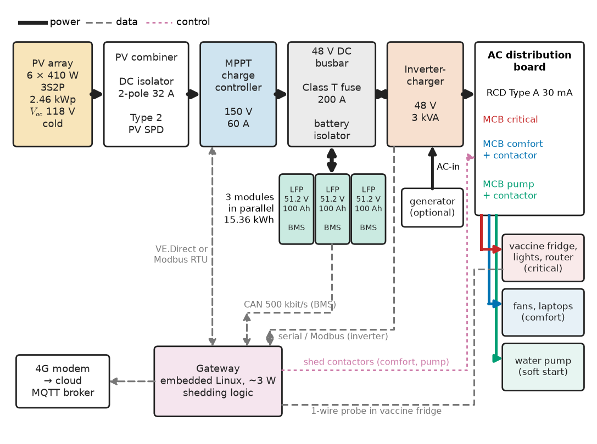
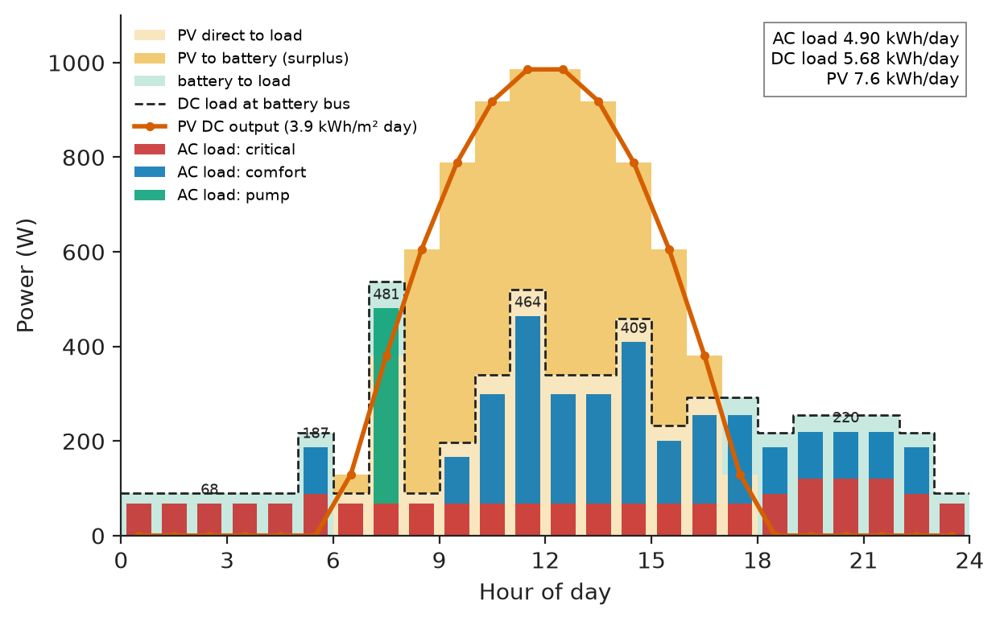
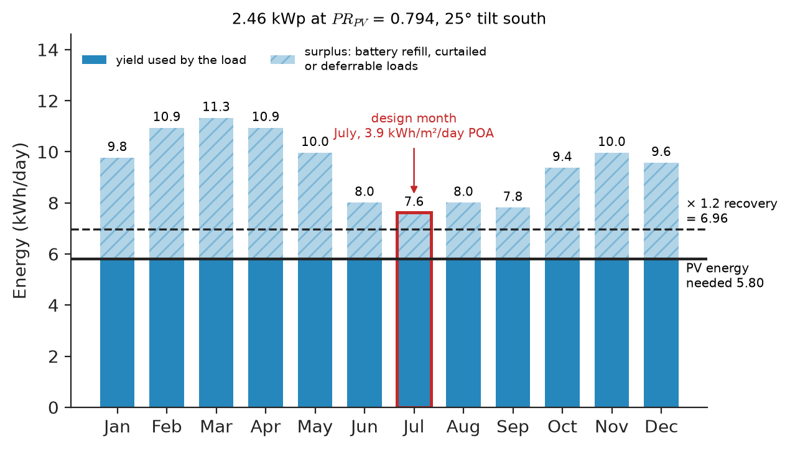
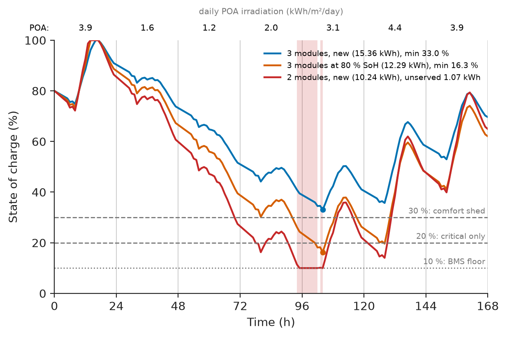
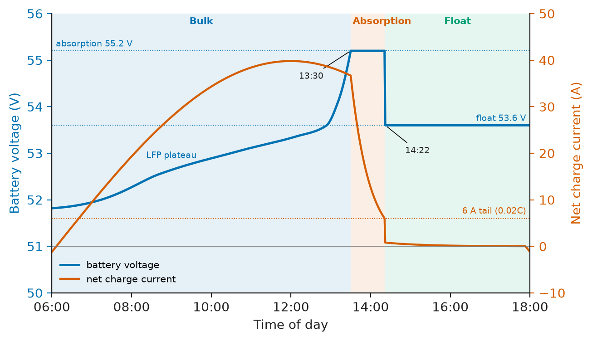

# Chapter 36 — Project: Solar Battery System

*Part IX · Interdisciplinary Engineering Projects*

A rural health post in northern Bangladesh had a solar system installed in 2021: eight 160 W modules, a PWM charge controller and a 24 V flooded lead-acid bank feeding a 1.5 kVA inverter. Fourteen months later the vaccine refrigerator was running from a borrowed petrol generator. No single part had broken. The load estimate had missed the inverter's own 28 W no-load draw, 670 Wh a day; the PWM controller held the array 25 % below its maximum-power point; nobody had checked the monsoon month, so the bank sat partly charged for weeks and sulphated; and whenever the water pump and the refrigerator compressor started together, the inverter tripped and the refrigerator stayed off until someone noticed. This chapter rebuilds that system as a project: a 2.46 kWp PV array, a 15.4 kWh lithium-iron-phosphate (LFP) battery at 48 V, a maximum-power-point-tracking (MPPT) charge controller and a 3 kVA inverter-charger, sized from a written load estimate, protected, monitored, measured and costed.

> **How is a stand-alone solar battery system sized so that it carries a critical load through the worst month and a run of cloudy days, and what does the sizing leave out?**
> **Which converters, charge settings, protective devices and monitoring make that sizing true on site, and how is the finished system verified and costed?**

| Concept | Engineering destination |
|---|---|
| Load estimation | Daily energy and peak power that every later choice is sized against |
| PV sizing | Array power and strings for the worst month and coldest morning |
| Battery sizing | Autonomy, depth of discharge and end-of-life capacity of an LFP bank |
| Converter selection | MPPT controller and inverter-charger matched to array, battery and surge loads |
| Charge control | LFP charge setpoints, BMS-to-charger coordination, load shedding |
| Protection | Fuses, isolators, surge protection and earthing on the PV, battery and AC sides |
| Monitoring | Remote telemetry of energy, state of charge and the vaccine-refrigerator temperature |
| Efficiency | Loss chain from array to socket; inverter no-load loss |
| Economic assessment | Bill of materials, life-cycle cost and comparison with a diesel generator |

**Roadmap.** Brief, requirements and load (36.1) → array (36.2) → battery (36.3) → converters (36.4) → charge control and shedding (36.5) → protection (36.6) → monitoring (36.7) → efficiency (36.8) → cost (36.9) → verification, failure analysis and Revision B (36.10).

---

## 36.1 Load estimation

> **Boundary.** The method of turning a requirement into a measurable target is [Chapter 1](../part-1-engineering-design-methodology/01-from-requirement-to-working-system.md); PV design in general is [Chapter 22](../part-6-renewable-energy-and-electric-mobility/22-solar-pv-system-design.md), battery packs and BMS [Chapter 23](../part-6-renewable-energy-and-electric-mobility/23-battery-energy-systems.md), and energy management of hybrid systems [Chapter 25](../part-6-renewable-energy-and-electric-mobility/25-microgrids-and-hybrid-energy-systems.md). Load estimation for building installations (demand and diversity factors) is in *Electrical Energy and Machines*, [Ch. 30 §30.1](https://github.com/The-Studio-of-Sadiq/Electrical-Energy-and-Machines/blob/main/part-8-electrical-safety-and-engineering-practice/30-electrical-system-design.md).

### The brief and its requirements

The health post has a consulting room, a delivery room, a laboratory, a vaccine store and an office, far from the grid. The stakeholders are the district health office (client), the nurse in charge (light at night, a refrigerator that never warms), the vaccine programme (which audits the refrigerator's temperature record) and a technician who visits quarterly. Table 36.1 turns the brief into requirements, each with a number and a test.

**Table 36.1 — Requirements of the health-post solar battery system.**

| ID | Requirement | Target | Verification |
|---|---|---|---|
| R1 | Daily energy delivered at the AC sockets | ≥ 4.9 kWh/day, every month of a typical year | Simulation (36.3), metered first month |
| R2 | Continuous and surge power | 2.4 kW continuous at 40 °C; start of the largest motor with the base load running | Load-bank and motor-start test |
| R3 | Autonomy without sun | ≥ 1.5 days full load and ≥ 4 days critical load, at battery end of life (80 % SoH) | Calculation; 24 h PV-disconnect test |
| R4 | Vaccine refrigerator supply | Never interrupted by load shedding; cabinet 2–8 °C | Shedding test; 30-day temperature log |
| R5 | Battery life | ≥ 10 years to 80 % SoH at the battery-room temperature | Cycle-depth and temperature log review |
| R6 | Safety | IEC 62548 array, IEC 60364-7-712 installation, IEC 62109 converters, IEC 62619 battery | Inspection and test to IEC 62446-1 |
| R7 | Remote monitoring | SoC, energy, alarms and refrigerator temperature every 5 min; alarm within 10 min | Injected alarm, end-to-end timing |
| R8 | Cost | CAPEX ≤ \$7,500; 20-year cost below a diesel generator supplying the same energy | Life-cycle cost model (36.9) |

R3 has two parts on purpose: carrying the whole load for four sunless days would double the battery, while shedding the fans and pump and keeping the refrigerator, router and two lights alive for four days meets the clinic's real need.

### Architecture

The system is DC-coupled (Figure 36.1): the array charges the 48 V battery through an MPPT controller, and a battery-fed inverter-charger makes 230 V, 50 Hz; its AC input accepts a generator during a long monsoon spell. A gateway reads the battery management system (BMS), the controller and the inverter, runs the shedding logic and reports over 4G. AC coupling (a grid-tie PV inverter on the output of a battery inverter) suits retrofits and larger arrays; at 2.5 kWp it only adds a converter and a conversion loss, so it was rejected (Chapter 25 compares the two).

<!-- FIGURE 36.1 | figures/ch36/fig-36-1-system-architecture.png | block-diagram | Architecture of the DC-coupled health-post solar battery system with its interfaces. | Content: left to right. PV array 6 x 410 W (3S2P, 2.46 kWp, Voc 118 V cold) -> PV combiner box (DC isolator 2-pole 32 A, Type 2 PV SPD) -> MPPT charge controller 150 V 60 A -> 48 V DC busbar with Class T fuse 200 A and battery isolator -> three LFP rack modules 51.2 V 100 Ah in parallel (each with BMS) -> inverter-charger 48 V 3 kVA -> AC distribution board (RCD Type A 30 mA, MCBs: critical circuit, comfort circuit with contactor, pump circuit with contactor) -> loads (vaccine refrigerator, lights, router on critical; fans, laptops on comfort; pump). Optional generator input into inverter-charger AC-in. Gateway box at bottom connected by CAN (BMS, 500 kbit/s), VE.Direct or Modbus RTU (MPPT), and serial/Modbus (inverter); a 1-wire temperature probe to the vaccine refrigerator; 4G modem to cloud MQTT broker. Power arrows thick, data arrows dashed. -->



*Figure 36.1 — Architecture of the DC-coupled health-post solar battery system with its interfaces.*

### The load table

Load estimation starts with an inventory taken on site (Table 36.2). The refrigerator's energy comes from its type test, not its power rating: an ice-lined vaccine refrigerator prequalified under WHO PQS E003 is tested at 43 °C ambient, and 1.2 kWh/day is representative. The pump runs half an hour a day but sets the surge requirement.

**Table 36.2 — Daily AC load inventory of the health post (surveyed powers; 10 % growth added at the bottom).**

| Load | Power each (W) | Qty | Hours/day | Energy (Wh/day) | Circuit |
|---|---|---|---|---|---|
| LED lighting | 9 | 12 | 6.0 | 648 | Critical (2), comfort (10) |
| Delivery-room examination lamp | 30 | 1 | 3.0 | 90 | Critical |
| Vaccine refrigerator, ice-lined | 150 running | 1 | cycling | 1,200 | Critical |
| BLDC ceiling fans | 30 | 4 | 8.0 | 960 | Comfort |
| Laptops | 45 | 2 | 6.0 | 540 | Comfort |
| Phone and radio charging | 10 | 5 | 2.0 | 100 | Comfort |
| Router and 4G modem | 12 | 1 | 24.0 | 288 | Critical |
| Water pump, 0.75 kW | 750 | 1 | 0.5 | 375 | Pump |
| Microscope and centrifuge | 150 | 1 | 1.0 | 150 | Comfort |
| Suction unit or nebuliser | 200 | 1 | 0.5 | 100 | Comfort |
| **Total** | | | | **4,451** | |
| **With 10 % growth** | | | | **4,896** | |

The day is not flat (Figure 36.2): a 68 W base runs all night, lighting adds 119 W in the evening, and the load peaks at about 480 W in the morning. About 34 % of the energy is used between 18:00 and 06:00; with weak monsoon mornings and evenings, about 40 % passes through the battery.

<!-- FIGURE 36.2 | figures/ch36/fig-36-2-daily-load-and-pv.png | plot | Hourly AC load of the health post and PV output on an average design-month day. | Content: x axis hour of day 0 to 24; left y axis power 0 to 1000 W. Bars: hourly AC load (68 W at night, 187 W at 05:00, 481 W at 07:00 for the pump, 464 W at 11:00, 409 W at 14:00, 220 W at 19:00 to 22:00, 68 W after 23:00), stacked colours for critical, comfort and pump circuits. Line: PV DC output on a 3.9 kWh/m2/day July day (sine shape 06:00 to 18:00, peak about 1000 W at noon). Shaded areas: energy from PV direct to load, PV to battery (surplus around noon), battery to load (evening and night). Annotate daily totals: AC load 4.90 kWh, DC load 5.68 kWh, PV 7.6 kWh. -->



*Figure 36.2 — Hourly AC load of the health post and PV output on an average design-month day.*

### From AC energy to DC energy

The battery does not see the AC load; it sees the load divided by the inverter efficiency plus the inverter's no-load draw, which runs 24 hours whether anything is switched on or not.

**Worked example — DC energy at the battery bus.** The AC load is $E_{AC}=4.90$ kWh/day. A 48 V, 3 kVA inverter-charger of the class chosen in 36.4 converts at about 92 % over the 100–1000 W band and draws 15 W at no load.

$$
E_{DC}=\frac{E_{AC}}{\eta_{inv}}+P_0\,t=\frac{4.90}{0.92}+0.015\times24=5.33+0.36=5.68\ \mathrm{kWh/day}
$$

The no-load term is 6.3 % of the battery-side energy; a 5 kVA "hybrid" inverter drawing 40–60 W would add 0.6–1.1 kWh/day more. Inverter no-load power is a sizing input, not a footnote.

> **Status of the principle: Daily energy balance at the battery bus**
> *Fundamental.* Over a day in which the battery returns to the same state of charge, the energy delivered by the array must equal the load energy plus every conversion loss on the way, including fixed no-load consumption; the only freedom is in which losses are counted.

The coincident peak is about 1.4 kW; R2's 2.4 kW leaves room for growth, and motor starts are checked in 36.4.

---

## 36.2 PV sizing

> **Boundary.** The PV module's I–V behaviour, temperature coefficients and solar-resource assessment are in *Electrical Energy and Machines*, [Ch. 15 §15.1 and §15.6](https://github.com/The-Studio-of-Sadiq/Electrical-Energy-and-Machines/blob/main/part-4-power-generation/15-renewable-energy-systems.md); string sizing, losses and performance ratio as a design method are in [Chapter 22](../part-6-renewable-energy-and-electric-mobility/22-solar-pv-system-design.md). Here they are applied to one off-grid array.

### Design month and resource

An off-grid array is sized for the worst month. Table 36.3 gives representative plane-of-array (POA) irradiation from satellite-derived data of the PVGIS or NASA POWER class, south-facing at 25° tilt. Here the monsoon, not winter, is the design month: July has 3.9 kWh/m²/day against 5.8 in March.

**Table 36.3 — Representative monthly POA irradiation (25° tilt, south) and expected daily array yield at $PR_{PV}=0.794$.**

| Month | Jan | Feb | Mar | Apr | May | Jun | Jul | Aug | Sep | Oct | Nov | Dec |
|---|---|---|---|---|---|---|---|---|---|---|---|---|
| POA (kWh/m²/day) | 5.0 | 5.6 | 5.8 | 5.6 | 5.1 | 4.1 | 3.9 | 4.1 | 4.0 | 4.8 | 5.1 | 4.9 |
| Yield, 2.46 kWp (kWh/day) | 9.8 | 10.9 | 11.3 | 10.9 | 10.0 | 8.0 | 7.6 | 8.0 | 7.8 | 9.4 | 10.0 | 9.6 |

### Array power

The array must deliver the DC energy of 36.1, plus the loss on the 40 % cycled through the battery (round trip about 95 % for LFP), after the array-side losses collected in $PR_{PV}$ (Table 36.4).

**Table 36.4 — Array-side loss budget for the design month.**

| Loss | Factor | Basis |
|---|---|---|
| Cell temperature (mean daytime cell 57 °C, $\gamma=-0.35$ %/K) | 0.888 | $1-0.0035\times(57-25)$ |
| MPPT conversion and tracking | 0.97 | Controller data at 30–80 % load |
| DC cabling (PV 1.5 %, battery 0.5 %) | 0.98 | Section 36.6 |
| Soiling (monthly cleaning) | 0.97 | Practice for dusty sites |
| Mismatch and first-year degradation | 0.97 | Module tolerance 0/+5 W, LID |
| **$PR_{PV}$** | **0.794** | Product |

**Worked example — array power.** The PV must supply

$$
E_{PV}=E_{DC}\left[(1-f_b)+\frac{f_b}{\eta_{rt}}\right]=5.68\times\left[0.60+\frac{0.40}{0.95}\right]=5.80\ \mathrm{kWh/day}
$$

with $f_b=0.40$ the fraction through the battery. With $H_{POA}=3.9$ kWh/m²/day (equivalently 3.9 peak-sun hours),

$$
P_{PV}=\frac{E_{PV}}{H_{POA}\,PR_{PV}}=\frac{5.80}{3.9\times0.794}=1.87\ \mathrm{kWp}
$$

That array would only break even in July and never refill the battery after a cloudy spell; a recovery factor of 1.2 gives 2.25 kWp. Six 410 W modules give 2.46 kWp, 31 % above the bare need and 9 % above the recovery target; on an average July day they yield $2.46\times3.9\times0.794=7.6$ kWh, a surplus of 1.8 kWh/day to refill the battery.

> **Status of the principle: Worst-month array sizing with a performance ratio**
> *Approximate.* Treats a month as identical average days and lumps temperature, soiling and conversion losses into one empirical factor; it says nothing about runs of cloudy days, which the battery and the hourly simulation of 36.3 must cover.

Figure 36.3 compares monthly yield with need. In March the array can produce almost twice what the clinic uses and the controller curtails; that surplus is the price of meeting July, and the reason off-grid systems add deferrable loads such as pumping into a tank.

<!-- FIGURE 36.3 | figures/ch36/fig-36-3-monthly-yield-vs-demand.png | plot | Monthly expected array yield compared with the daily energy the array must deliver. | Content: x axis months Jan to Dec; y axis energy 0 to 12 kWh/day. Bars: expected yield of 2.46 kWp at PR 0.794 (9.8, 10.9, 11.3, 10.9, 10.0, 8.0, 7.6, 8.0, 7.8, 9.4, 10.0, 9.6). Horizontal solid line at 5.80 kWh/day (PV energy needed); dashed line at 6.96 kWh/day (need times recovery factor 1.2). Shade the area between bars and solid line as available surplus (curtailed or used by deferrable loads). Annotate July as design month (3.9 kWh/m2/day POA). -->



*Figure 36.3 — Monthly expected array yield compared with the daily energy the array must deliver.*

### Module and string configuration

The module is a 410 W, 108-half-cell mono PERC panel: $V_{oc}=37.3$ V, $V_{mp}=31.0$ V, $I_{mp}=13.2$ A, $I_{sc}=13.9$ A at STC, $V_{oc}$ coefficient $-0.27$ %/K, $V_{mp}$ about $-0.35$ %/K. The controller of 36.4 accepts 150 V absolute maximum.

**Worked example — the string voltage window.** The coldest dawn at the site is about 5 °C, and a module at dawn sits at ambient.

- Cold open-circuit voltage per module: $37.3\times[1-0.0027\times(5-25)]=39.3$ V. Three in series: 117.9 V, inside 150 V with 21 % margin. Four in series: 157.3 V, which exceeds the controller's absolute rating on the first clear winter morning. Three it is.
- Hot maximum-power voltage (cell 65 °C on a still April noon): $3\times31.0\times[1-0.0035\times40]=80.0$ V. The LFP battery tops out at 55.2 V in absorption, so the controller keeps about 25 V of buck headroom.

Six modules therefore form two strings of three (3S2P). With two strings in parallel, a fault in one string can be back-fed only by the other, at most $1\times I_{sc}\times1.25=17.4$ A, below the modules' 25 A maximum series-fuse rating, so IEC 62548 requires no string fuses.

---

## 36.3 Battery sizing

> **Boundary.** Capacity, C-rate, usable-energy layers, BMS functions and state-of-charge estimation are in *Electrical Energy and Machines*, [Ch. 16 §16.2–16.4](https://github.com/The-Studio-of-Sadiq/Electrical-Energy-and-Machines/blob/main/part-4-power-generation/16-energy-storage.md); LFP electrode chemistry is in *Materials Science and Engineering*, [Ch. 40](https://github.com/The-Studio-of-Sadiq/Materials-Science-and-Engineering/blob/main/Chapters/CHAPTER%2040.md). Pack architecture and BMS design are owned by [Chapter 23](../part-6-renewable-energy-and-electric-mobility/23-battery-energy-systems.md).

### Chemistry and module

LFP replaced lead-acid for three reasons traced to the requirements: 90 % usable depth instead of 50 %; 4,000–6,000 cycles at 80 % depth against 1,200–1,500 for tubular lead-acid (R5); and no damage from sitting partly charged through the monsoon, which killed the first bank. The cost is a BMS that must be obeyed, a charge-temperature window and dangerous-goods transport (UN 38.3).

The module is a 19-inch rack unit: 16 LFP cells in series (51.2 V, 100 Ah, 5.12 kWh), an internal BMS with a 100 A MOSFET disconnect and a CAN port publishing charge and discharge limits, certified to IEC 62619.

### Sizing for autonomy at end of life

**Worked example — how many modules.** Usable energy is nameplate times the 90 % SoC window (10–100 %) times state of health. Sizing at end of life (SoH 80 %) and the DC load of 5.68 kWh/day:

| Modules | Nameplate (kWh) | Full load, BOL (days) | Full load, EOL (days) | Critical load, EOL (days) | Margin over R3 (full / critical) |
|---|---|---|---|---|---|
| 2 | 10.24 | 1.62 | 1.30 | 3.10 | −13 % / −22 % |
| 3 | 15.36 | 2.43 | 1.95 | 4.65 | +30 % / +16 % |

The critical load (refrigerator, router, two lights, examination lamp) is 1.69 kWh/day AC (1.86 with growth), 2.38 kWh/day at the battery with the no-load draw. For three modules at end of life: $15.36\times0.9\times0.8/5.68=1.95$ days and $15.36\times0.9\times0.8/2.38=4.65$ days. Two modules fail both parts of R3; three meet both. The current is modest: 2.4 kW draws $2400/(0.92\times48)=54$ A (0.18C on 300 Ah), and a 5.5 kW surge 133 A (90 %, 46 V), 44 A per module if they share reasonably (36.5).

> **Status of the principle: Autonomy from usable energy and daily load**
> *Derived.* Autonomy is usable energy divided by daily energy drawn; it assumes zero PV input, a constant daily load and a fixed usable window, and it ignores the slight capacity loss at high discharge rates (small for LFP at 0.2C) and the efficiency of discharge already included in the DC load.

### Checking a monsoon week hour by hour

Average-day sizing cannot show three dull days in a row; an hourly energy balance can. The listing builds the hourly load from Table 36.2, spreads each day's PV energy on a half-sine from 06:00 to 18:00, and steps the battery through a representative bad monsoon week from 80 % SoC.

```python
import numpy as np

# Hourly AC load (W): (power, first hour, last hour + 1), growth factor 1.10
blocks = [(50, 0, 24), (12, 0, 24),              # fridge average, router
          (108, 18, 23), (108, 5, 6),            # lighting 6 h
          (30, 19, 22), (120, 10, 18),           # exam lamp, fans
          (90, 9, 15), (50, 16, 18),             # laptops, phone charging
          (375, 7, 8), (150, 11, 12), (100, 14, 15)]  # pump, lab, suction
p_ac = np.zeros(24)
for w, a, b in blocks:
    p_ac[a:b] += w
p_ac *= 1.10
p_dc = p_ac / 0.92 + 15.0                        # inverter efficiency, idle

def pv_day(h_poa, kwp=2.46, pr=0.794):           # sine-shaped day, 06-18 h
    s = np.clip(np.sin(np.pi * (np.arange(24) + 0.5 - 6) / 12), 0, None)
    return kwp * 1e3 * pr * h_poa * s / s.sum()  # W per hour slot

week = [3.9, 1.6, 1.2, 2.0, 3.1, 4.4, 3.9]       # monsoon week, kWh/m2/day
e_nom, soc, soc_min = 15.36e3, 0.80, 0.10        # Wh, start SoC, floor
log, spill, unserved = [], 0.0, 0.0
for h_poa in week:
    for pv, ld in zip(pv_day(h_poa), p_dc):
        net = pv - ld                            # Wh in this hour
        de = net * 0.97 if net > 0 else net / 0.98   # charge / discharge eff.
        new = soc + de / e_nom
        if new > 1.0:
            spill += (new - 1.0) * e_nom; new = 1.0
        if new < soc_min:
            unserved += (soc_min - new) * e_nom; new = soc_min
        soc = new; log.append(soc)
print(f"DC load {p_dc.sum()/1e3:.2f} kWh/day, AC load {p_ac.sum()/1e3:.2f} kWh/day")
print(f"min SoC {min(log)*100:.1f} % at hour {int(np.argmin(log))}")
print(f"end SoC {soc*100:.1f} %, curtailed {spill/1e3:.2f} kWh, unserved {unserved/1e3:.2f} kWh")
```

```text
DC load 5.68 kWh/day, AC load 4.90 kWh/day
min SoC 33.0 % at hour 103
end SoC 69.6 %, curtailed 0.17 kWh, unserved 0.00 kWh
```

New modules bottom out at 33 % at 07:00 on the fifth day. At end-of-life capacity ($0.8\times15.36$ kWh) the minimum is 16.3 % with no unserved energy; two modules leave 1.07 kWh unserved when new and 2.91 kWh at end of life (Figure 36.4). At end of life the comfort shedding of 36.5 (below 30 % SoC) acts on the fourth and fifth days of such a week, as R3 intends.

<!-- FIGURE 36.4 | figures/ch36/fig-36-4-monsoon-week-soc.png | plot | Simulated battery state of charge through a representative monsoon week for three battery options. | Content: x axis time 0 to 168 h with day boundaries and daily POA irradiation labelled above (3.9, 1.6, 1.2, 2.0, 3.1, 4.4, 3.9 kWh/m2/day); y axis SoC 0 to 100 percent. Curves: 3 modules new (15.36 kWh, minimum 33 percent at hour 103), 3 modules at 80 percent SoH (minimum 16.3 percent), 2 modules new (hits 10 percent floor around hour 94, 1.07 kWh unserved). Horizontal dashed lines at 30 percent (comfort shed) and 20 percent (critical only) and dotted line at 10 percent (BMS floor). Shade the hours where the 2-module system is at the floor. -->



*Figure 36.4 — Simulated battery state of charge through a representative monsoon week for three battery options.*

### Temperature and life

At this depth LFP ages more with time at high temperature and high SoC than with cycles. The battery room, the coolest interior room, was logged at 29–36 °C through a pre-installation summer; at about 32 °C manufacturers' data put 80 % SoH at 12–15 years, and 12 years of 40 % daily cycles is about 4,400 cycles, inside the rated life. A low absorption voltage (36.5) keeps the bank off 100 % SoC.

---

## 36.4 Converter selection

> **Boundary.** Buck-converter operation, efficiency and the MPPT stage are in *Electronics and Computing*, [Ch. 30 §30.1 and §30.8](https://github.com/The-Studio-of-Sadiq/Electronics-and-Computing/blob/main/part-7-power-electronics/30-dc-dc-converters.md) and [Ch. 32 §32.8](https://github.com/The-Studio-of-Sadiq/Electronics-and-Computing/blob/main/part-7-power-electronics/32-motor-drives-and-power-conversion.md); the single-phase inverter and its twice-line-frequency power are in [Ch. 31 §31.4](https://github.com/The-Studio-of-Sadiq/Electronics-and-Computing/blob/main/part-7-power-electronics/31-ac-dc-and-dc-ac-conversion.md). This section chooses products, not topologies.

### Charge controller

**Table 36.5 — Charge-controller options for a 2.46 kWp array on a 48 V LFP battery.**

| Option | Array match | Energy in July | Other points | Verdict |
|---|---|---|---|---|
| PWM controller, 60 A | Pins array at battery voltage, far below MPP | About 25 % less | Cheapest (\$90); no CAN | Rejected: fails R1 |
| MPPT controller, 150 V / 60 A | 3S strings, 80–118 V window fits | Reference | 98 % peak; LFP profile; accepts BMS limits | **Chosen** |
| All-in-one "hybrid" inverter, 5 kW, 120–450 V tracker | Needs 6–10 modules per string | Comparable once started | 40–60 W no-load; single point of failure | Rejected |

The 60 A rating is checked against the array: at STC it could push $2460/51.2=48$ A, at a hot-module peak $2460\times0.888/52=42$ A. A 45 A model would clip on cool, bright winter middays; 60 A never does and leaves room for a third string (Revision B).

### Inverter-charger

**Table 36.6 — Inverter options against R2 and the efficiency budget.**

| Option | Continuous at 40 °C | Surge | No-load draw | Notes |
|---|---|---|---|---|
| 1.6 kVA high-frequency | 1.2 kW | 3.0 kVA, 1 s | 10 W | Fails R2 |
| 3 kVA low-frequency inverter-charger | 2.4 kW | 5.5 kW for about 5 s | 15 W | **Chosen** |
| 5 kVA inverter-charger | 4.0 kW | 9 kW | 30 W | 0.36 kWh/day more idle loss |

The low-frequency unit was chosen for the surge capacity of its transformer and its 35 A charger for a generator. Its "search mode" is useless here: the refrigerator and router never let it sleep.

**Worked example — the motor-start check that the old system failed.** The 0.75 kW pump motor runs at about 4.1 A, 230 V (power factor 0.8); its locked-rotor current is about 5.5 times running, 22.4 A, or 5.2 kVA for about 0.3 s. The refrigerator compressor draws about 0.9 kVA for 0.2 s at start. With 0.6 kW of base load running:

- pump start alone: $0.6+5.2=5.8$ kVA, just above the 5.5 kW surge rating but within its 100 ms overload capability only if the pump starts quickly;
- pump and compressor together: $0.6+5.2+0.9=6.7$ kVA, 22 % over the surge rating.

The chosen inverter would trip exactly as the old one did. Rather than buy a 5 kVA inverter that wastes 0.36 kWh a day to cover a 0.3 s event, the pump was replaced by a soft-start pump with an integrated variable-speed drive, starting at no more than 1.5 times running current (about 1.4 kVA). The worst coincidence is then $0.6+1.4+0.9=2.9$ kVA, 53 % of the surge rating.

> **Status of the principle: Inverter surge sizing from motor locked-rotor current**
> *Empirical.* Locked-rotor currents of 4–7 times running current and surge-time ratings are datasheet figures; coincidence of starts is a probability judgement, so the test of 36.10 starts both loads together deliberately.

---

## 36.5 Charge control

> **Boundary.** CC–CV charging and its supervisory state machine are in *Electronics and Computing*, [Ch. 32 §32.7](https://github.com/The-Studio-of-Sadiq/Electronics-and-Computing/blob/main/part-7-power-electronics/32-motor-drives-and-power-conversion.md); cell balancing and BMS architecture are in *Electrical Energy and Machines*, [Ch. 16 §16.3](https://github.com/The-Studio-of-Sadiq/Electrical-Energy-and-Machines/blob/main/part-4-power-generation/16-energy-storage.md) and [Chapter 23](../part-6-renewable-energy-and-electric-mobility/23-battery-energy-systems.md). Energy management in hybrid systems is [Chapter 25](../part-6-renewable-energy-and-electric-mobility/25-microgrids-and-hybrid-energy-systems.md).

### Setpoints for LFP

Lead-acid profiles, with hours of absorption and monthly equalisation, are wrong for LFP: equalisation would push the 16S bank to 60 V and trip every BMS. Table 36.7 lists the settings programmed, identically, into the MPPT controller and the inverter-charger.

**Table 36.7 — LFP charge and discharge settings for the 16S bank (300 Ah).**

| Parameter | Setting | Per cell | Reason |
|---|---|---|---|
| Absorption voltage | 55.2 V | 3.45 V | Reaches about 98 % SoC without the top-of-curve stress of 3.65 V |
| Absorption end | Tail current 6 A (0.02C) or 1 h | — | Lets the passive balancers act at the top |
| Float | 53.6 V | 3.35 V | Below the knee: holds the bank near 95 % without forcing it full |
| Charge temperature window | 5–45 °C cell (BMS), derate above 40 °C | — | Lithium plating below 0 °C, ageing above 45 °C |
| Inverter low-voltage cut-off | 46.4 V (dynamic, load-corrected) | 2.90 V | Behind the BMS undervoltage cut at 2.80 V per cell |
| Comfort shed / restore | SoC 30 % / 40 % | — | R3 critical autonomy |
| Critical-only / restore | SoC 20 % / 30 % | — | R3, R4 |

Figure 36.5 shows a clear-day charge under these settings: the controller delivers whatever the array gives until the bank reaches 55.2 V at about 13:30, holds it until the current falls to 6 A, then drops to float.

<!-- FIGURE 36.5 | figures/ch36/fig-36-5-lfp-charge-profile.png | plot | Battery voltage and charge current over a clear day with the LFP charge settings. | Content: x axis time of day 06:00 to 18:00; left y axis battery voltage 50 to 56 V; right y axis net charge current -10 to 50 A. Voltage: 51.8 V at 06:00, slow rise along the LFP plateau (52.5 to 53.3 V), steep rise to 55.2 V at 13:30, flat at 55.2 V until 14:22, then 53.6 V float. Current: half-sine peaking near 40 A at noon, then decaying from about 35 A to the 6 A tail by 14:22, then near 0 A. Shaded bands Bulk, Absorption, Float. -->



*Figure 36.5 — Battery voltage and charge current over a clear day with the LFP charge settings.*

### Coordinating the BMS with the chargers

Each BMS knows what the chargers cannot: the highest cell voltage, the coldest cell, a drifting cell. It publishes a charge-voltage limit (CVL), charge-current limit (CCL) and discharge-current limit (DCL) on CAN every second, in the de facto frame set of many LFP rack modules (0x351 limits, 0x355 SoC and SoH; illustrative). The gateway combines the three modules and writes the result to both chargers. The *weakest* module sets the limits, the sum is derated by 20 % because parallel modules share current unequally, and a silent module is treated as disconnected.

```c
#include <stdbool.h>
#include <stdint.h>

#define N_MOD 3
typedef struct {                      /* decoded from each module's CAN frames */
    float cvl_v, ccl_a, dcl_a;        /* charge-voltage, charge/discharge limits */
    float soc_pct;
    uint32_t age_ms;                  /* time since the last valid frame */
} bms_t;

typedef enum { SHED_NONE, SHED_COMFORT, SHED_CRITICAL } shed_t;
typedef struct { float v_set, i_chg_max, i_dis_max; shed_t shed; bool fault; } cmd_t;

/* Called once per second by the gateway; cmd_t is written to MPPT and inverter. */
void coord_step(const bms_t m[N_MOD], cmd_t *c)
{
    float cvl = 55.2f, ccl = 1.0e9f, dcl = 1.0e9f, soc = 100.0f;
    int alive = 0;
    for (int k = 0; k < N_MOD; ++k) {
        if (m[k].age_ms > 5000u) continue;          /* silent module: assume open */
        ++alive;
        if (m[k].cvl_v < cvl) cvl = m[k].cvl_v;
        if (m[k].ccl_a < ccl) ccl = m[k].ccl_a;     /* weakest module sets limit */
        if (m[k].dcl_a < dcl) dcl = m[k].dcl_a;
        if (m[k].soc_pct < soc) soc = m[k].soc_pct;
    }
    c->fault = (alive < N_MOD);
    if (alive == 0) {                               /* no battery data: stop */
        c->v_set = 53.6f; c->i_chg_max = 0.0f; c->i_dis_max = 0.0f;
        c->shed = SHED_CRITICAL;
        return;
    }
    c->v_set = cvl;
    c->i_chg_max = 0.8f * (float)alive * ccl;       /* 20 % for unequal sharing */
    c->i_dis_max = 0.8f * (float)alive * dcl;
    switch (c->shed) {                              /* hysteresis on lowest SoC */
    case SHED_NONE:     if (soc < 30.0f) c->shed = SHED_COMFORT; break;
    case SHED_COMFORT:  if (soc < 20.0f) c->shed = SHED_CRITICAL;
                        else if (soc > 40.0f) c->shed = SHED_NONE; break;
    case SHED_CRITICAL: if (soc > 30.0f) c->shed = SHED_COMFORT; break;
    }
}
```

`SHED_COMFORT` opens the comfort and pump contactors (Figure 36.1); `SHED_CRITICAL` also lowers the inverter's discharge limit. The critical circuit, with the vaccine refrigerator, is never switched by software (R4). The 10 % hysteresis and a 10-minute minimum dwell enforced by the caller stop a passing cloud from cycling the fans.

> **Status of the principle: Weakest-module limit for parallel battery modules**
> *Approximate.* Assumes module resistances differ by less than about 20 %; a degraded cell or a loose busbar breaks the assumption, which is why 36.7 watches per-module current.

---

## 36.6 Protection

> **Boundary.** Shock protection, protective devices, RCD types and overcurrent coordination are in *Electrical Energy and Machines*, [Ch. 29 §29.3–29.5](https://github.com/The-Studio-of-Sadiq/Electrical-Energy-and-Machines/blob/main/part-8-electrical-safety-and-engineering-practice/29-electrical-safety.md); cable sizing and voltage drop in [Ch. 30 §30.5–30.6](https://github.com/The-Studio-of-Sadiq/Electrical-Energy-and-Machines/blob/main/part-8-electrical-safety-and-engineering-practice/30-electrical-system-design.md). Converter-level protection is in *Electronics and Computing*, [Ch. 31 §31.9](https://github.com/The-Studio-of-Sadiq/Electronics-and-Computing/blob/main/part-7-power-electronics/31-ac-dc-and-dc-ac-conversion.md).

Three zones carry different hazards: the PV side (up to 118 V DC, current-limited, exposed to lightning), the battery side (kilo-ampere fault currents) and the AC side (230 V, people). Table 36.8 is the protection schedule.

**Table 36.8 — Protection schedule.**

| Zone | Device | Rating | Purpose |
|---|---|---|---|
| PV | Two-pole DC load-break isolator at combiner | 32 A, 600 V DC | Isolation for maintenance under load |
| PV | Type 2 PV surge-protective device, both poles to earth | $U_{cpv}$ 150 V, 20 kA (8/20 µs) | Induced surges; high keraunic level |
| PV | String fuses | None (two strings) | IEC 62548 reverse-current rule |
| Battery | Class T fuse at the busbar, one per bank | 200 A, 20 kA breaking at 125 V DC | Short-circuit of the battery cable or inverter |
| Battery | MPPT output breaker | 80 A DC | Controller fault, isolation |
| Battery | BMS MOSFET disconnect in each module | 100 A, short-circuit trip in < 1 ms | Cell-level over/undervoltage, temperature |
| AC | RCD Type A, 30 mA, on all final circuits | 40 A | Additional protection against shock |
| AC | MCBs per circuit | B10 lighting, B16 sockets, C16 pump | Overload and fault |
| AC | Neutral–earth bond at inverter output, earth electrode | TN-S, electrode ≤ 100 Ω | Automatic disconnection, RCD operation |
| AC | Type 2 AC SPD | 275 V | Surges arriving on generator lead |

**Worked example — the battery fuse and cable.** Each module's cells and BMS together are about 8 mΩ; three in parallel give about 2.7 mΩ, and the prospective short-circuit current at the busbar is $51.2/0.0027\approx19$ kA before cable resistance. The BMS MOSFETs usually clear it, but protection must not rely on a semiconductor that may have failed short, so a Class T fuse with 20 kA breaking capacity sits at the busbar. The inverter surge, $5500/(0.90\times46)=133$ A for 5 s, is well inside a 200 A Class T curve. The cable is 50 mm² flexible copper, 90 °C insulation (about 230 A in free air). For a 2.5 m run, the 5 m loop resistance at 70 °C is $0.0175\times1.2\times5/50=2.1$ mΩ, so the surge drop is $133\times0.0021=0.28$ V, 0.6 % of 46 V, and the continuous drop at 54 A is 0.11 V. The PV cable is 6 mm² PV1-F with a 15 m route: loop resistance $0.0175\times1.2\times30/6=0.105$ Ω, drop $13.2\times0.105=1.39$ V per string at $V_{mp}=93$ V, 1.5 %, as budgeted in Table 36.4.

Off-grid earthing is often wrong. Running from the battery, the inverter is the source and needs a neutral–earth bond at its output, or a first insulation fault leaves the RCD without a return path and 230 V on every metal case; passing generator power through, the bond must move to the generator side. The chosen unit switches its bond with the transfer relay, and commissioning tests RCD tripping in both modes.

> **Status of the principle: Fuse breaking capacity from prospective battery fault current**
> *Derived.* Prospective current is battery voltage over the sum of cell, BMS, busbar and cable resistances, taken at the lowest (warm, full) resistance; a device rated below it may fail to interrupt.

---

## 36.7 Monitoring

> **Boundary.** The monitoring of a battery as an instrumentation project is in [Chapter 9](../part-2-instrumentation-and-measurement-systems/09-instrumentation-projects.md); MQTT, provisioning and device security are owned by [Chapter 11](../part-3-embedded-and-connected-systems/11-iot-systems.md).

### What is measured and where

The first system had a voltmeter and nothing else. The gateway here (a 4G-connected embedded Linux board of the industrial Raspberry-Pi or Cerbo-GX class, about 3 W) gathers four sources, each over the interface its device already offers (its own 72 Wh/day comes out of the 10 % growth allowance of Table 36.2):

- **BMS** (CAN, 500 kbit/s): per-module voltage, current, SoC, SoH, highest and lowest cell voltage, cell temperature, alarms.
- **MPPT controller** (serial, Modbus RTU or vendor text protocol): array voltage and current, daily yield, charge state, errors.
- **Inverter-charger** (serial): AC output power, battery current, overload and temperature alarms, generator input status.
- **Refrigerator probe** (1-wire digital sensor of the DS18B20 class in a glycol-filled vial on the vaccine shelf, ±0.5 °C): the quantity the vaccine programme audits.

Battery current is not clean DC: a single-phase inverter draws power pulsating at 100 Hz, and at 2.4 kW the battery carries about $2400/(\sqrt2\times0.92\times48)=38$ A RMS of 100 Hz ripple on top of 54 A average. Current must be averaged over whole 20 ms periods, as the BMS coulomb counter does; a gateway sampling once a second would report noise.

### Telemetry payload and alarms

Every 5 minutes the gateway publishes one state message; alarms are published immediately on change. A representative state payload on topic `hp-kurigram-07/power/state`:

```json
{
  "ts": "2026-07-14T19:05:00Z",
  "soc_pct": 71.4, "soh_pct": 98.6,
  "batt_v": 52.61, "batt_a": -6.8, "cell_v_max": 3.296, "cell_v_min": 3.281,
  "batt_t_c": 33.5, "mod_a": [-2.3, -2.2, -2.3],
  "pv_w": 0, "pv_kwh_day": 7.42,
  "ac_w": 236, "ac_kwh_day": 3.95,
  "shed": "none", "fridge_c": 4.6,
  "alarms": []
}
```

At about 330 bytes, 288 messages a day and MQTT/TLS overhead roughly doubling it, the gateway uses about 6 MB a month. The alarm set (Table 36.9) is short on purpose: alarms that fire every afternoon get ignored.

**Table 36.9 — Alarms and their thresholds.**

| Alarm | Threshold | Action |
|---|---|---|
| Refrigerator out of range | < 2 °C or > 8 °C for 10 min | SMS to nurse and district cold-chain officer |
| Comfort shedding active | `shed` ≠ none | Daily summary; immediate if lasting > 24 h |
| Module current imbalance | Any module deviating > 25 % from mean at > 20 A total | Maintenance ticket (loose busbar, weak cell) |
| PV yield low | Daily yield < 60 % of expected from satellite irradiance for 3 days | Cleaning or array fault |

The yield alarm compares measured yield with a satellite irradiance feed: without a pyranometer it is the only way to tell a dirty or faulted array from a cloudy week.

---

## 36.8 Efficiency

> **Boundary.** Converter loss mechanisms and efficiency across load are in *Electronics and Computing*, [Ch. 30 §30.8](https://github.com/The-Studio-of-Sadiq/Electronics-and-Computing/blob/main/part-7-power-electronics/30-dc-dc-converters.md); battery round-trip efficiency is in *Electrical Energy and Machines*, [Ch. 16 §16.2](https://github.com/The-Studio-of-Sadiq/Electrical-Energy-and-Machines/blob/main/part-4-power-generation/16-energy-storage.md).

### The loss chain on a design-month day

Table 36.10 follows an average July day from the array's STC-rated energy to the sockets.

**Table 36.10 — Energy chain on an average design-month day.**

| Stage | Factor | Energy after stage (kWh/day) | Loss (kWh/day) |
|---|---|---|---|
| Array at STC rating, $2.46\times3.9$ | — | 9.59 | — |
| Cell temperature | 0.888 | 8.52 | 1.07 |
| Soiling, mismatch, degradation | $0.97\times0.97$ | 8.02 | 0.50 |
| DC cabling | 0.98 | 7.86 | 0.16 |
| MPPT controller | 0.97 | 7.62 | 0.24 |
| Not needed: surplus curtailed or stored | — | 5.80 used | 1.82 margin |
| Battery round trip on 40 % | — | 5.68 | 0.12 |
| Inverter no-load draw | — | 5.32 | 0.36 |
| Inverter conversion (92 %) | — | 4.90 at sockets | 0.43 |

On a design-month day 51 % of the STC-rated array energy reaches the sockets; 19 % is the margin that refills the battery after cloudy days and is curtailed when the battery is full. Of the losses actually incurred, the two inverter terms (0.79 kWh/day together) are second only to the array's temperature loss, and they are the only large loss the designer can still change by a choice of product.

### Why the inverter dominates

The datasheet quotes 94 % peak efficiency at 30–50 % of rating; the clinic's load sits at 2–16 % of it (Figure 36.2).

**Worked example — the daily-average inverter efficiency.** Over the day the inverter delivers 4.90 kWh and takes $4.90/0.92+0.36=5.68$ kWh, so its daily-average efficiency is $4.90/5.68=86.3$ %, eight points below the datasheet peak. At night, carrying 68 W, it takes $68/0.92+15=89$ W: 76 % efficient. The same calculation for the 5 kVA alternative (30 W no-load) gives $4.90/(5.33+0.72)=81.0$ % daily, a loss of 0.36 kWh/day more, which over 20 years at the system's levelised cost (36.9) is about \$1,500 of energy, more than the inverter itself.

> **Status of the principle: Converter efficiency weighted by the load-duration profile**
> *Derived.* The energy-weighted efficiency is total output over total input across the actual load profile, so a fixed no-load loss weighs most when the converter spends its hours far below rating; the peak or "European" efficiency on a datasheet describes a different profile.

Average and marginal efficiency differ. Moving the 12 W router to a 48 V-to-12 V DC–DC converter because the inverter is 76 % efficient at night saves nothing: the refrigerator keeps the inverter awake anyway, so the router's *marginal* efficiency through it is 92 %, no worse than a 90 % converter.

---

## 36.9 Economic assessment

> **Boundary.** Economic evaluation of hybrid systems (levelised cost, net present cost, sensitivity) as a method is in [Chapter 25](../part-6-renewable-energy-and-electric-mobility/25-microgrids-and-hybrid-energy-systems.md); levelised cost of storage in *Electrical Energy and Machines*, [Ch. 16 §16.11](https://github.com/The-Studio-of-Sadiq/Electrical-Energy-and-Machines/blob/main/part-4-power-generation/16-energy-storage.md).

### Bill of materials

**Table 36.11 — Bill of materials with indicative cost (2026 distributor and installer prices, single system, USD).**

| Item | Specification | Qty | Unit (\$) | Total (\$) |
|---|---|---|---|---|
| PV module | 410 W mono PERC, 108 half-cell, IEC 61215/61730 | 6 | 95 | 570 |
| Mounting structure | Galvanised steel, 25° tilt, roof anchors | 1 set | 300 | 300 |
| MPPT charge controller | 150 V, 60 A, CAN/serial, IEC 62109-1 | 1 | 520 | 520 |
| Inverter-charger | 48 V, 3 kVA, low-frequency, 35 A charger, IEC 62109 | 1 | 1,150 | 1,150 |
| LFP battery module | 51.2 V, 100 Ah, 16S, BMS with CAN, IEC 62619, UN 38.3 | 3 | 950 | 2,850 |
| Battery rack and busbars, Class T fuse 200 A, isolator | — | 1 set | 180 | 180 |
| PV and AC protection | DC isolator, PV and AC SPDs, RCD, MCBs, contactors, enclosures | 1 set | 260 | 260 |
| Cables | 6 mm² PV1-F, 50 mm² battery, AC wiring, glands, lugs | 1 lot | 220 | 220 |
| Monitoring gateway | Embedded Linux with CAN and 4G, refrigerator probe | 1 | 250 | 250 |
| Earthing | Rod electrode, conductors, test link | 1 set | 80 | 80 |
| Transport and installation | Two technicians, four days | 1 | 600 | 600 |
| Commissioning, documentation, training | IEC 62446-1 tests, as-built pack | 1 | 200 | 200 |
| **Total CAPEX** | | | | **7,180** |

The battery is 40 % of the capital cost and the array with its structure only 12 %: in a stand-alone system storage is what costs money, and every kilowatt-hour removed from the load saves more in battery than in PV.

### Life-cycle cost

The client's alternative is a diesel generator supplying the same energy. Both are costed over 20 years at an 8 % real discount rate. Solar: \$150 a year of O&M and data; inverter replaced at year 10; battery (at 60 % of today's price) and MPPT at year 12. Diesel: a 3 kVA set at \$1,400, replaced every 5 years, 0.60 L/kWh at part load, \$1.00/L, \$350 a year of maintenance.

```python
import numpy as np

r, years = 0.08, 20                       # real discount rate, study period
e_year = 4.90 * 365                       # kWh AC delivered per year
t = np.arange(1, years + 1)
df = (1 + r) ** -t                        # discount factor per year

def lcoe(capex, om, repl):
    """repl: {year: cost}. Returns NPV of cost (USD) and LCOE (USD/kWh)."""
    cost = capex + np.sum(om * df) + sum(c * (1 + r) ** -y for y, c in repl.items())
    return cost, cost / np.sum(e_year * df)

solar = lcoe(capex=7180, om=150,
             repl={10: 1150, 12: 0.6 * 2850 + 520})   # inverter; LFP + MPPT
fuel_l = 0.60 * e_year                    # litres/yr at 0.6 L/kWh (part load)
diesel = lcoe(capex=1400, om=fuel_l * 1.00 + 350,
              repl={5: 900, 10: 900, 15: 900})        # genset every 15 000 h
for name, (npv, c) in (("solar-LFP", solar), ("diesel", diesel)):
    print(f"{name:9s} NPV cost {npv:8.0f} USD   LCOE {c:.3f} USD/kWh")
cum_s = 7180 + np.cumsum(np.full(years, 150.0)); cum_s[9:] += 1150; cum_s[11:] += 0.6*2850 + 520
cum_d = 1400 + np.cumsum(np.full(years, fuel_l + 350)); cum_d[4:] += 900; cum_d[9:] += 900; cum_d[14:] += 900
print("undiscounted break-even year:", int(np.argmax(cum_d > cum_s)) + 1)
```

```text
solar-LFP NPV cost    10071 USD   LCOE 0.574 USD/kWh
diesel    NPV cost    16685 USD   LCOE 0.950 USD/kWh
undiscounted break-even year: 5
```

**Worked example — reading the result.** Solar costs \$10,071 in present value against \$16,685 for diesel (\$0.57 against \$0.95 per kWh) and pays back in the fifth year, counting only the 4.90 kWh/day used, not the curtailed surplus. The comparison is most sensitive to the diesel price and to the battery's life: with diesel at \$0.70/L the diesel LCOE falls to \$0.77/kWh, still above solar; a battery that lasted only 8 years instead of 12, needing a second replacement at year 16, would raise the solar LCOE by 8 %, to \$0.62/kWh. It is least sensitive to the module price. It leaves out what the client values most: no fuel to carry, no noise in the delivery room, and a refrigerator independent of fuel deliveries in the rainy season.

> **Status of the principle: Levelised cost of energy by discounted cash flow**
> *Approximate.* Divides the present value of all costs by the present value of energy delivered; the answer depends on the discount rate, the assumed replacement years and future prices, none of which is known, so it is reported with its sensitivities rather than as a single number.

---

## 36.10 Verification, failure analysis and Revision B

> **Boundary.** Test planning, verification versus validation and regression are in [Chapter 4](../part-1-engineering-design-methodology/04-prototyping-and-verification.md); test reports and revision records in [Chapter 5](../part-1-engineering-design-methodology/05-engineering-documentation.md). Safe testing and measurement categories are in *Electrical Energy and Machines*, [Ch. 29 §29.7](https://github.com/The-Studio-of-Sadiq/Electrical-Energy-and-Machines/blob/main/part-8-electrical-safety-and-engineering-practice/29-electrical-safety.md).

### Verification and test results

Each requirement has a test with a limit, written before installation; the IEC 62446-1 PV tests come first, with the array disconnected. Table 36.12 gives the plan with commissioning and first-month results (representative pilot-installation values).

**Table 36.12 — Verification plan and test results.**

| Req. | Test | Limit | Predicted | Measured | Result |
|---|---|---|---|---|---|
| R6 | String 1 / string 2 $V_{oc}$ at 34 °C module temperature | ±5 % | 109.2 V | 108.4 V / 102.6 V (−6.0 %) | Pass / **Fail**, 108.6 V after repair |
| R6 | PV insulation, 500 V DC, worst pole | ≥ 1 MΩ | — | 38 MΩ | Pass |
| R6 | RCD trip at 30 mA, inverter / generator mode | ≤ 300 ms | — | 22 / 24 ms | Pass |
| R2 | 2.4 kW load bank, 1 h, room at 35 °C | No derating | — | Heatsink 71 °C, no alarm | Pass |
| R2 | Pump and refrigerator started together, 0.6 kW base, 10 repeats | No trip; dip ≤ 20 % | 2.9 kVA peak | 12 % worst dip, no trip | Pass |
| R3 | PV disconnected 24 h from full, normal load | ≥ 1.95 d at EOL | 5.68 kWh/day | 5.64 kWh (DC meter ±1 %); SoC drop 37.5 ±1.5 % | Pass on metered energy (1.96 d) |
| R4 | Forced `SHED_CRITICAL`, refrigerator logged 4 h | 2–8 °C, circuit closed | — | 3.9–5.8 °C | Pass |
| R1 | Metered energy, first 30 days (June–July) | No unserved load | — | 4.31 kWh/day used, 0 unserved | Pass |
| R7 | Probe warmed past 8 °C in water bath | SMS ≤ 10 min | — | 6 min 40 s | Pass |
| R5 | 30-day log review | Cell ≤ 3.50 V, battery ≤ 40 °C | — | 3.47 V, 36 °C | Pass |

The string-2 failure was a cross-mated connector: a plug of another brand crimped onto the extension cable had partly cracked, and its contact resistance showed in $V_{oc}$. It was replaced with a matched pair. Autonomy is judged on metered DC energy because the SoC of an LFP bank on its flat plateau is uncertain by a few per cent until the next full charge (*Electrical Energy and Machines*, Ch. 16 §16.4); the SoC-based range, 1.85–2.00 days, straddles the limit. The margin over R3 is real but small, which is why the sizing used 80 % and not 85 % end-of-life SoH.

### Failure analysis

**Table 36.13 — FMEA of the solar battery system (S, O, D on 1–10 scales; RPN = S×O×D).**

| Failure mode | Effect | Cause | Detection | Mitigation | S | O | D | RPN |
|---|---|---|---|---|---|---|---|---|
| Inverter trips on motor start | Refrigerator off until reset | Coincident locked-rotor currents | Overload alarm | Soft-start pump; auto-restart; coincident-start test | 8 | 2 | 3 | 48 |
| PV connector overheats | String loss, roof fire risk | Cross-mated connector brands | $V_{oc}$ test; yield alarm; annual thermal image | Matched pairs only; crimp-tool control | 9 | 3 | 4 | 108 |
| One battery module opens | Others carry its current; cascade trip at surge | Weak cell, over-temperature | Module silent on CAN; imbalance alarm | Limits shrink with alive count (36.5) | 7 | 3 | 2 | 42 |
| Chronic monsoon undercharge | Daily shedding; less refrigerator autonomy | Load growth, soiling, tree shade | Shed-duration and yield alarms | Clean, prune, add a string | 6 | 4 | 3 | 72 |
| Lightning surge | Controller or gateway damage | Strike near array or generator lead | SPD window; device offline | Type 2 SPDs both sides; bonding | 7 | 3 | 5 | 105 |
| Refrigerator probe displaced | Missed excursion or false alarm | Stock handling | Plausibility against compressor cycling | Probe fixed in glycol vial; quarterly reference check | 8 | 3 | 4 | 96 |
| Neutral–earth bond lost in generator mode | RCD cannot trip; touch voltage on fault | Generator wiring, transfer-relay fault | RCD test in both modes | Test at commissioning and every visit | 10 | 2 | 6 | 120 |

The two highest RPNs are not electronic: the lost bond (rare, severe, invisible in operation) and the mismatched connector (common, found on this very system). Both call for procedure and inspection, not more hardware.

### Revision B

| Change | Reason | Effect |
|---|---|---|
| Router, modem and gateway on a 48 V-to-12 V DC–DC converter | An inverter trip must not also silence the alarm path | Alarms survive an inverter fault; energy neutral (36.8) |
| Rails for 9 modules; third string added when load grows | Monsoon shedding risk with load growth | 3.69 kWp; the 60 A controller clips only on bright dry-season middays, when surplus is curtailed anyway |
| Pump as deferrable load: runs on SoC > 90 % and PV > 1 kW into a 2 m³ tank | 1.8 kWh/day curtailed in July, more in dry months | Uses surplus; pump energy bypasses the battery |
| Gateway monitors the inverter's earth-relay state in both modes | Highest-severity FMEA item relied on a manual test | Alarm instead of a quarterly check |
| Full absorption forced at least every 14 days | LFP SoC drift on the flat plateau | Shedding decisions on a trustworthy SoC |

---

## What remains open

| Open question | Where it is answered |
|---|---|
| How is a PV plant designed in general, including grid-connected inverters, shading and performance ratio monitoring? | [Chapter 22](../part-6-renewable-energy-and-electric-mobility/22-solar-pv-system-design.md) |
| How is the BMS inside each module designed: cell measurement, balancing, SoC and SoH estimation? | [Chapter 23](../part-6-renewable-energy-and-electric-mobility/23-battery-energy-systems.md) |
| How would the system grow into a village mini-grid with several sources, inverter coordination and tariffs? | [Chapter 25](../part-6-renewable-energy-and-electric-mobility/25-microgrids-and-hybrid-energy-systems.md) |
| How is the energy metering of the clinic's circuits built and calibrated? | [Chapter 35](35-project-smart-energy-monitor.md) |
| How are the gateway's MQTT connection, credentials and firmware updates secured? | [Chapter 11](../part-3-embedded-and-connected-systems/11-iot-systems.md) |

**Next:** Chapter 37 builds a closed-loop motor drive, from characterising the motor on the bench to a tuned, protected and tested servo.
