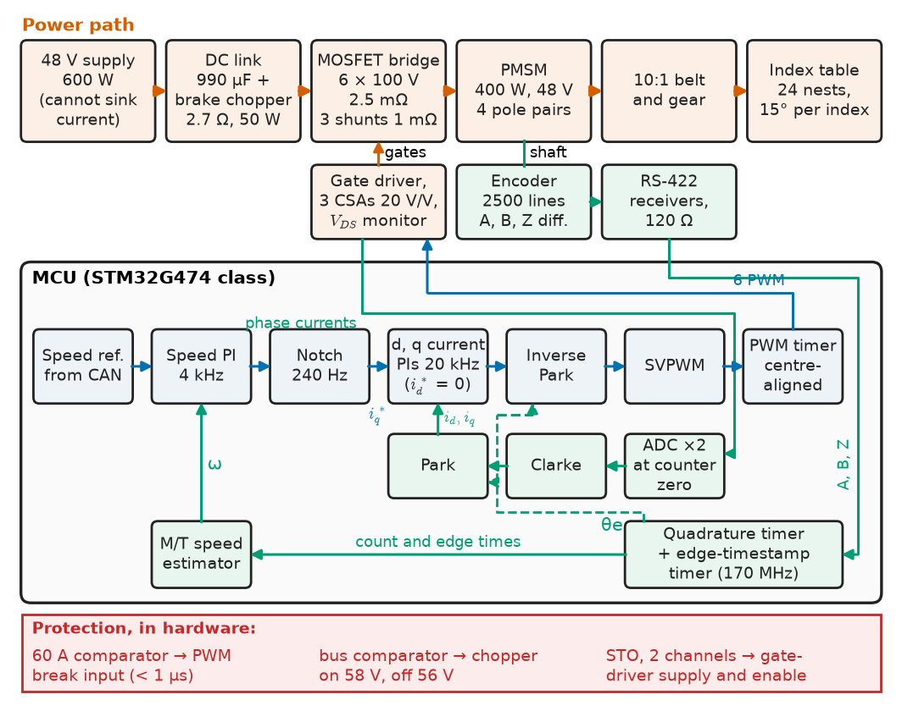
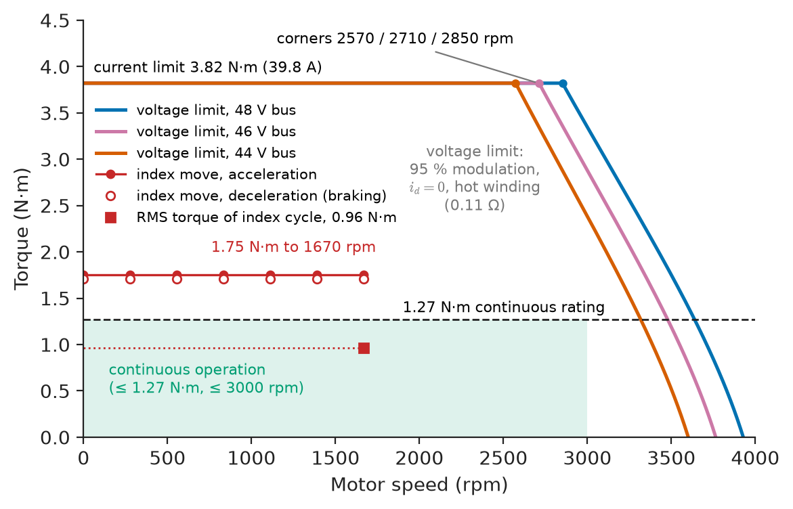
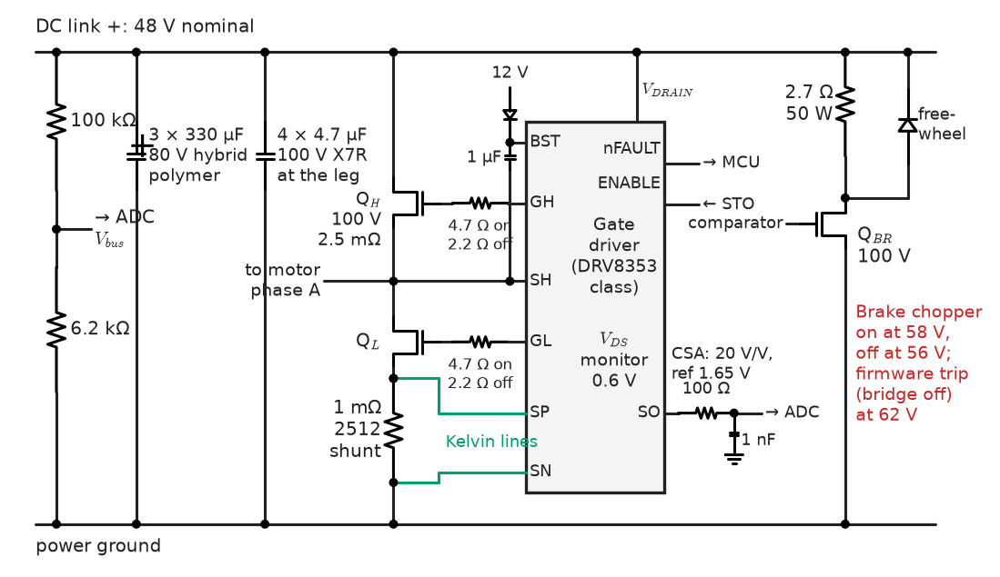
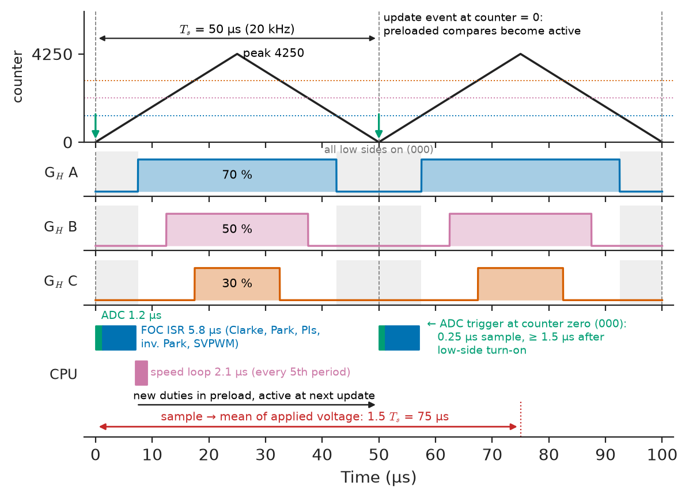
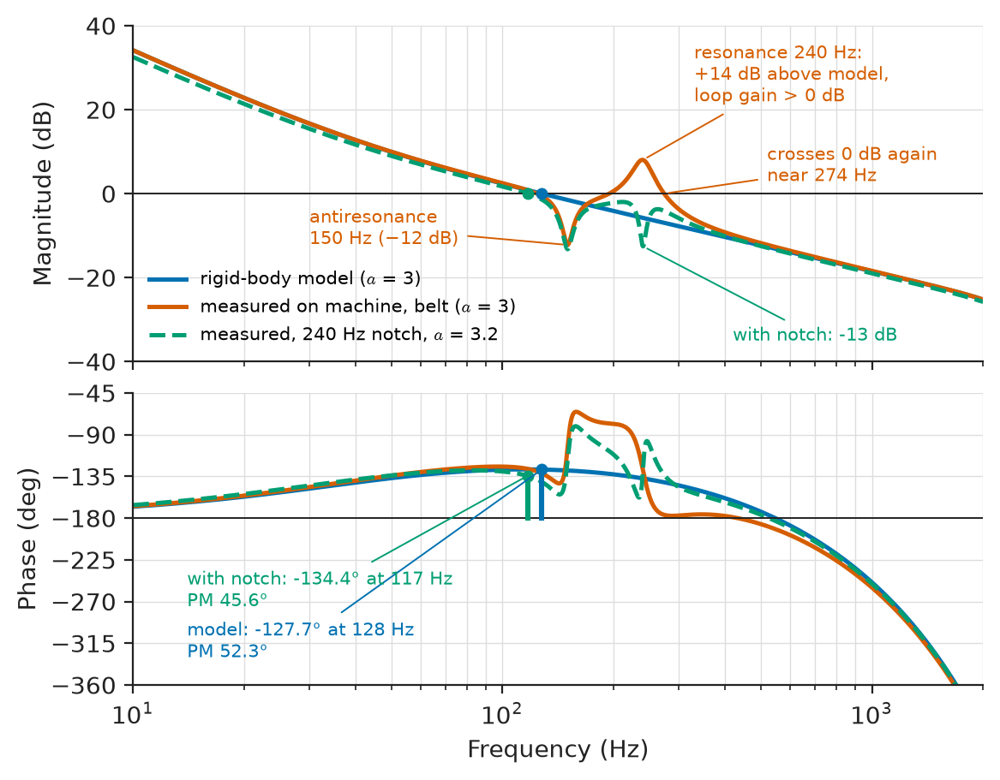
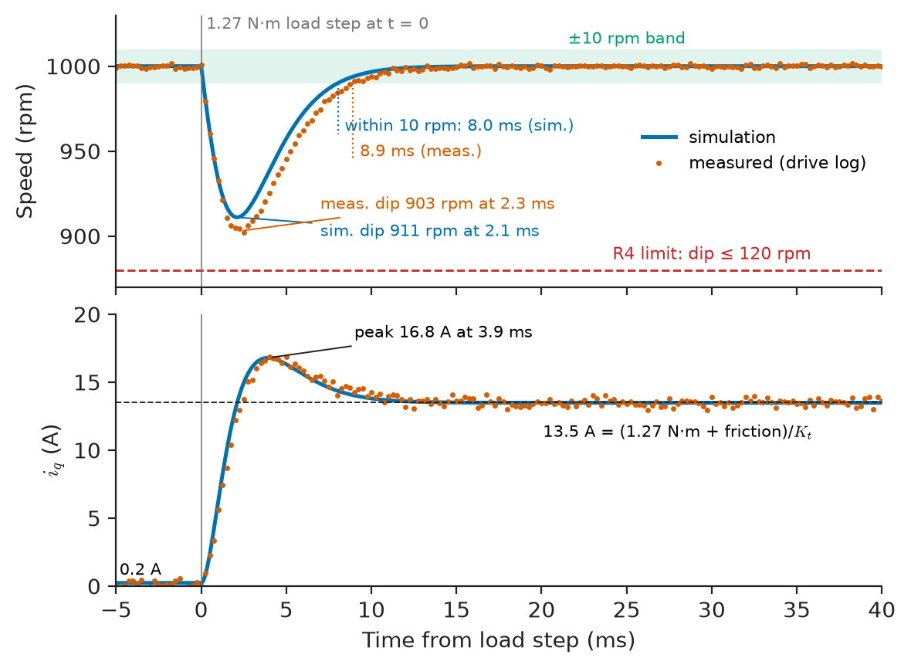

# Chapter 37 — Project: Closed-Loop Motor Drive

*Part IX · Interdisciplinary Engineering Projects*

The first prototype of a servo drive for the index table of a blister-packing machine passed every bench test, its speed loop tuned crisp and well damped on the bare motor. Bolted to the machine, with the table driven through a toothed belt, the loop rang at 240 Hz whenever the table moved; lowering the gain stopped the ringing and made the table overshoot its stop by two degrees. A week later an operator pressed the emergency stop at 3000 rpm: the motor and table returned 7 J to a DC bus with less than 1 J of headroom, the bus rose past 100 V, and two MOSFETs and the gate driver failed short. The resonance was in mechanics the loop had never seen, and the energy had nowhere to go because a 48 V power supply cannot absorb current. This chapter builds the drive again as a project: a 48 V, 400 W permanent-magnet synchronous motor (PMSM) with a 2500-line incremental encoder, a three-phase MOSFET inverter switching at 20 kHz, field-oriented control (FOC) on an STM32G474-class microcontroller, and a brake chopper, characterised, designed, coded, protected and tested against written limits.

> **How is a closed-loop motor drive designed from measured motor parameters to loop gains, so that its bandwidth, accuracy and torque envelope are known before it is built?**
> **Which sensing, firmware structure and protection make that design work on a real machine, and how is it tested, including when it is driven into faults?**

| Concept | Engineering destination |
|---|---|
| Motor characterization | Measured parameters every gain is computed from |
| Encoder integration | Rotor angle and speed; wiring, alignment, fault detection |
| Power stage | Inverter, gate driver, DC link, brake chopper, thermal design |
| Current and speed measurement | Shunt sampling synchronised to PWM; M/T speed estimation; error budgets |
| Controller design | Cascaded PI current and speed loops with known margins and bandwidths |
| Firmware | Interrupt structure, timing budget, state machine and the FOC routine |
| Protection | Hardware overcurrent, bus overvoltage, encoder loss, thermal limits, safe torque off |
| Performance testing | Dynamometer tests of bandwidth, load rejection, ripple, efficiency and fault response |

**Roadmap.** Requirements and architecture, then the motor measured on the bench (37.1) → angle and speed from the encoder (37.2) → inverter and brake chopper (37.3) → current and speed sensing (37.4) → loop design (37.5) → firmware (37.6) → protection (37.7) → tests, failure analysis, cost and Revision B (37.8).

---

## 37.1 Motor characterization

> **Boundary.** The PMSM's d–q model and torque equation are in *Electrical Energy and Machines*, [Ch. 8 §8.1](https://github.com/The-Studio-of-Sadiq/Electrical-Energy-and-Machines/blob/main/part-2-transformers-and-electrical-machines/08-special-electrical-machines.md), and PMSM field-oriented control in [Ch. 12 §12.5–12.8](https://github.com/The-Studio-of-Sadiq/Electrical-Energy-and-Machines/blob/main/part-3-motor-drives/12-ac-motor-drives.md); motor–load matching in [Ch. 10 §10.1](https://github.com/The-Studio-of-Sadiq/Electrical-Energy-and-Machines/blob/main/part-3-motor-drives/10-drive-system-fundamentals.md). Motor drivers, encoders and PID implementation at the level of a robot joint are owned by [Chapter 15](../part-4-robotics-and-mechatronics/15-robot-electronics-and-control.md), and system identification by [Chapter 17](../part-4-robotics-and-mechatronics/17-robotic-system-integration.md). This chapter applies them to one drive.

### Requirements

The index table carries 24 blister nests and is driven through a 10:1 toothed-belt and gear reduction. Each index moves the table one 15° pitch (150° at the motor) in 30 ms, followed by a 70 ms dwell, ten indexes a second; a triangular speed profile peaks at 1670 rpm and needs 1.75 N·m. For run-out and cleaning the machine also turns the table continuously with the motor at up to 3000 rpm. Table 37.1 is the drive's requirement set.

**Table 37.1 — Requirements of the index-table servo drive.**

| ID | Requirement | Target | Verification |
|---|---|---|---|
| R1 | Speed and torque envelope | 0–3000 rpm; 1.27 N·m continuous to 3000 rpm and 3.8 N·m peak to 2500 rpm, at bus ≥ 44 V | Dynamometer envelope test |
| R2 | Current loop | Crossover ≥ 1.5 kHz, phase margin ≥ 45° | Injected-sine loop measurement |
| R3 | Speed loop | Crossover ≥ 100 Hz, phase margin ≥ 45°, on the machine with its belt | Loop measurement on machine |
| R4 | Load rejection | Rated-torque step at 1000 rpm: dip ≤ 120 rpm, back within ±10 rpm in ≤ 15 ms | Dynamometer torque step |
| R5 | Low-speed smoothness | Speed ripple ≤ ±1.5 rpm at 30 rpm | Encoder log, 10 s |
| R6 | Protection | Overcurrent off in ≤ 2 µs; bus ≤ 62 V on any stop; encoder loss detected in ≤ 1 ms; safe torque off (STO) input | Fault-injection tests |
| R7 | Drive efficiency | ≥ 97 % at rated output | Power analyser |
| R8 | Cost | Drive BOM ≤ \$100 at 100 pieces | Costed BOM |

### Architecture

Figure 37.1 shows the drive. A 48 V, 600 W supply feeds the DC link; a MOSFET bridge, driven by a three-phase gate-driver IC with current-sense amplifiers, supplies the motor, and three low-side shunts measure the phase currents. The encoder reaches the microcontroller's quadrature timer through RS-422 receivers, and a brake chopper dumps regenerated energy into a resistor. A 4 kHz speed loop produces the torque-current reference for a 20 kHz current loop in the rotor's d–q frame. CAN carries commands from the machine's PLC, and an STO input removes the gate-driver supply independently of firmware.

<!-- FIGURE 37.1 | figures/ch37/fig-37-1-drive-architecture.png | block-diagram | Architecture of the 48 V, 400 W PMSM servo drive with its cascaded control loops. | Content: top row power path: 48 V 600 W supply -> DC link 990 uF with brake chopper (2.7 ohm 50 W) -> MOSFET bridge (6 x 100 V 2.5 mOhm) with three 1 mOhm low-side shunts -> PMSM 400 W, 4 pole pairs -> 10:1 belt and gear -> index table. Encoder 2500 lines, differential A B Z -> RS-422 receivers -> MCU quadrature timer and edge-timestamp timer. Bottom row inside MCU box (STM32G474 class): speed reference from CAN -> speed PI 4 kHz -> notch -> iq reference (id reference 0) -> d and q current PIs 20 kHz -> inverse Park -> SVPWM -> PWM timer -> gate driver with current-sense amplifiers -> bridge. Feedback: shunts -> ADC -> Clarke -> Park (encoder angle) -> current PIs; encoder -> M/T speed estimator -> speed PI. Protection bar: comparator -> PWM break input; bus overvoltage -> chopper; STO -> gate-driver supply. -->



*Figure 37.1 — Architecture of the 48 V, 400 W PMSM servo drive with its cascaded control loops.*

### Parameters from the bench

Datasheets of low-cost servomotors give little beyond a nameplate, so the parameters the loop design needs are measured (Table 37.2).

**Table 37.2 — Measured motor and load parameters (25 °C unless stated).**

| Parameter | Test | Result |
|---|---|---|
| Phase resistance $R_s$ | 4-wire DC, 2 A, line to line, halved | 0.085 Ω (0.170 Ω line to line); 0.11 Ω at 100 °C |
| Phase inductance $L_s$ | LCR meter at 1 kHz, line to line, halved, at 12 rotor angles | 0.25 mH, variation < 4 % (surface magnets, $L_d\approx L_q$) |
| Pole pairs $p$ | Back-EMF frequency at 1000 rpm: 66.7 Hz | 4 |
| Back-EMF constant | Motor driven by dynamometer at 1000 rpm, line-to-line RMS | 8.21 V per 1000 rpm |
| Flux linkage $\psi_m$ | Phase EMF peak over $\omega_e$: $6.70/418.9$ | 0.0160 Wb |
| Torque constant $K_t=\tfrac32 p\psi_m$ | From $\psi_m$; checked by locked-rotor torque at 10 A | 0.096 N·m per A peak (0.136 N·m per A RMS) |
| Friction | Constant-speed runs, $K_t i_q$ against speed | 20 mN·m Coulomb + 18 µN·m·s viscous |
| Total inertia $J$ (motor + reflected table) | Coast-down, listing below | 1.49 kg·cm² (motor 0.45) |
| Winding thermal time constant | 1.5× rated current, NTC on end winding | about 22 min |

The torque constant follows from the back-EMF test because both are the flux linkage scaled by $\tfrac32 p$ (*Electrical Energy and Machines*, Ch. 8 §8.1); the locked-rotor check agrees within 2 %. Inertia and friction include the table and belt, so they are measured in place: constant-speed runs give friction torque from $K_ti_q$, and a coast-down with the drive disabled gives $J$. In the listing the logged data are replaced by synthetic data with the same parameters and noise so that it runs on its own.

```python
import numpy as np

rng = np.random.default_rng(7)
Kt = 0.096                        # N*m/A (peak-amplitude convention), from the EMF test

# 1) Constant-speed runs: friction torque = Kt * iq.  The logged data are replaced
#    here by synthetic values with Tc = 0.020 N*m, B = 2.0e-5 N*m*s plus noise.
w_ss = np.array([50, 100, 150, 200, 250, 300.0])                 # rad/s
iq_ss = (0.020 + 2.0e-5*w_ss)/Kt + rng.normal(0, 0.004, w_ss.size)  # A
B, Tc = np.polyfit(w_ss, Kt*iq_ss, 1)

# 2) Coast-down from 300 rad/s with the drive disabled, speed logged every 1 ms
#    (synthetic: J = 1.5e-4 kg*m^2, same friction, 0.05 rad/s encoder noise).
dt = 1e-3
t = np.arange(0, 3.0, dt)
w = (300 + 0.020/2.0e-5)*np.exp(-t*2.0e-5/1.5e-4) - 0.020/2.0e-5
w = w[w > 20] + rng.normal(0, 0.05, np.count_nonzero(w > 20))
c = np.polyfit(t[:w.size], w, 3)               # smooth before differentiating
wf, dwf = np.polyval(c, t[:w.size]), np.polyval(np.polyder(c), t[:w.size])
J = -np.sum(dwf*(Tc + B*wf))/np.sum(dwf*dwf)   # least squares on J*dw/dt = -(Tc + B*w)

print(f"Coulomb friction Tc = {Tc*1e3:.1f} mN*m, viscous B = {B*1e6:.1f} uN*m*s")
print(f"coast-down lasts {t[w.size-1]:.2f} s, total inertia J = {J*1e4:.3f} kg*cm^2")
print(f"mechanical time constant J/B = {J/B:.1f} s")
```

```text
Coulomb friction Tc = 20.2 mN*m, viscous B = 18.3 uN*m*s
coast-down lasts 1.82 s, total inertia J = 1.492 kg*cm^2
mechanical time constant J/B = 8.2 s
```

The fit recovers inertia within 0.6 % but viscous friction only within 9 %, which is acceptable: friction is a disturbance the integrator removes, while inertia sets the speed-loop gain. The load-to-motor inertia ratio is 2.3, comfortable for a belt drive.

> **Status of the principle: Inertia from coast-down and friction torque**
> *Derived.* Newton's law for the shaft, $J\,d\omega/dt=-T_f(\omega)$, with friction measured at steady speed; it assumes friction depends only on speed and that the open-circuited motor produces no torque apart from small drag the friction fit absorbs.

### The torque–speed envelope

The inverter can apply at most $0.95\,V_{dc}/\sqrt3$ (space-vector modulation less the sampling margin of 37.4). Steady-state voltages with $i_d=0$ are $v_q=R_si_q+\omega_e\psi_m$ and $v_d=-\omega_eL_si_q$ (*Electrical Energy and Machines*, Ch. 12 §12.8).

**Worked example — is 48 V enough?** At 3000 rpm, $\omega_e=4\times314.16=1256.6$ rad/s. Rated torque needs $i_q=1.273/0.096=13.3$ A.

- $v_q=0.11\times13.3+1256.6\times0.0160=1.46+20.11=21.6$ V (hot winding); $v_d=-1256.6\times0.25\times10^{-3}\times13.3=-4.2$ V; amplitude $\sqrt{21.6^2+4.2^2}=22.0$ V.
- Available at 44 V (R1's minimum bus): $0.95\times44/\sqrt3=24.1$ V. Margin 9 %.
- Peak torque, $i_q=39.8$ A: the same calculation reaches the 48 V limit (26.3 V) at about 2850 rpm, so R1's peak-torque corner of 2500 rpm holds with a little margin even at 44 V, where it falls to about 2570 rpm.

Figure 37.2 plots the envelope. Field weakening (negative $i_d$) could extend the speed range, but it is not needed for R1 and is left to Revision B.

<!-- FIGURE 37.2 | figures/ch37/fig-37-2-torque-speed-envelope.png | plot | Torque-speed envelope of the drive at three bus voltages with the index-table duty points. | Content: x axis speed 0 to 4000 rpm; y axis torque 0 to 4.5 N m. Curves: voltage-limited maximum torque (hot winding, 95 percent modulation, id = 0) at 48 V, 46 V and 44 V, each flat at the 3.82 N m current limit up to about 2850, 2710 and 2570 rpm then falling steeply to zero torque near 3930, 3760 and 3600 rpm. Horizontal dashed line at 1.27 N m continuous rating. Shaded region of continuous operation below 1.27 N m and 3000 rpm. Markers: index-move acceleration segment (1.75 N m from 0 to 1670 rpm), deceleration segment (hollow markers), RMS torque of the index duty cycle (0.96 N m). -->



*Figure 37.2 — Torque-speed envelope of the drive at three bus voltages with the index-table duty points.*

---

## 37.2 Encoder integration

> **Boundary.** Quadrature decoding, encoder types and their interfaces as robot components are in [Chapter 15](../part-4-robotics-and-mechatronics/15-robot-electronics-and-control.md); sensor principles in [Chapter 6](../part-2-instrumentation-and-measurement-systems/06-sensors-and-transducers.md). Line drivers and receivers are in *Electronics and Computing*, [Ch. 26 §26.2](https://github.com/The-Studio-of-Sadiq/Electronics-and-Computing/blob/main/part-6-embedded-and-real-time-systems/26-embedded-interfaces.md).

### Choosing the position sensor

**Table 37.3 — Rotor position sensors for a 400 W servo.**

| Sensor | Resolution | Absolute? | Interface and noise immunity | Cost (motor-mounted) | Verdict |
|---|---|---|---|---|---|
| Optical incremental, 2500 lines, A/B/Z + U/V/W, RS-422 | 10,000 counts/rev | No (U/V/W give 60° e at start) | Differential, robust in a motor cable bundle | \$25–40 | **Chosen** |
| Magnetic on-axis IC (AS5047P class), 14-bit, ABI + SPI | 4,000 counts/rev on ABI | Yes, over SPI | Single-ended ABI needs short leads or a local line driver | \$8–15 | Revision B candidate |
| Resolver with resolver-to-digital converter | 12–16 bit | Yes | Very robust to temperature and shock | \$60–150 | Over-specified here |
| Sensorless (back-EMF observer) | — | No | No cable | \$0 | Fails R5 and start under load |

### Wiring and decoding

At 3000 rpm the A channel runs at $2500\times50=125$ kHz and quadrature edges arrive at 500 kHz. Each channel is a twisted pair in a shielded cable of up to 3 m, terminated with 120 Ω at an RS-422 receiver of the AM26C32 class feeding the timer in encoder mode (×4 counting, auto-reload 9999, so the count is the mechanical angle). The timer's input filter rejects pulses shorter than about 190 ns, which removes ringing coupled from the switching phases while legitimate edges are 2 µs apart. The shield is bonded to the chassis with a 360° clamp: the prototype's pigtail let 3 V/ns phase edges into the encoder pairs and caused count errors.

### Electrical-angle alignment

The offset between encoder count and electrical zero is found once and stored: drive $i_d=8$ A at $\theta_e=0$, let the rotor settle on the d-axis for 500 ms, record the count, repeat at 120° and 240°, and require agreement within 3 counts. Because belt preload can hold the rotor off the d-axis, the result is checked against the back-EMF zero crossing of phase A with the motor spun by the dynamometer.

**Worked example — how much angle error matters.** One count is $360°\times4/10\,000=0.144°$ electrical. An alignment error $\Delta\theta$ reduces torque per ampere by $\cos\Delta\theta$ and turns a fraction $\sin\Delta\theta$ of the current into a d-axis component. For 3 counts (0.43°) the torque loss is 0.003 % and negligible. For a 10° error (the size of mistake made by aligning with the belt under tension), torque falls 1.5 % and 17 % of the current magnitude becomes d-axis current, which at high speed weakens or strengthens the field and shifts the voltage limit of 37.1 by about 1 V.

Before the first index pulse, the U/V/W tracks give the angle within ±30° electrical, still at least $\cos30°=87$ % of torque per ampere.

---

## 37.3 Power stage

> **Boundary.** The inverter leg, dead time and PWM are in *Electronics and Computing*, [Ch. 31 §31.2–31.3](https://github.com/The-Studio-of-Sadiq/Electronics-and-Computing/blob/main/part-7-power-electronics/31-ac-dc-and-dc-ac-conversion.md), semiconductor selection and thermal design in [§31.8–31.9](https://github.com/The-Studio-of-Sadiq/Electronics-and-Computing/blob/main/part-7-power-electronics/31-ac-dc-and-dc-ac-conversion.md), and the brake chopper in [Ch. 32 §32.6](https://github.com/The-Studio-of-Sadiq/Electronics-and-Computing/blob/main/part-7-power-electronics/32-motor-drives-and-power-conversion.md). Here the parts are chosen and the budgets written.

### MOSFETs and gate driver

The link reaches 58 V when the chopper engages and 62 V at the hard trip, and switching overshoot adds 10–15 V. A 100 V MOSFET leaves about 25 % margin over 77 V; an 80 V part leaves 4 % (Table 37.4).

**Table 37.4 — Inverter switch options (per switch; 2026 prices at 100 pieces).**

| Option | $R_{DS(on)}$ at 25 °C | $Q_g$ | Package | Price | Verdict |
|---|---|---|---|---|---|
| 80 V trench MOSFET, 5×6 mm | 1.8 mΩ | 70 nC | PowerPAK/SuperSO8 class | \$1.10 | Voltage margin too small |
| 100 V trench MOSFET, 5×6 mm | 2.5 mΩ | 80 nC | SuperSO8 class | \$1.40 | **Chosen** |
| 100 V MOSFET, TOLL | 1.5 mΩ | 150 nC | TOLL | \$2.60 | Larger, more gate charge; for 1 kW variant |
| 100 V GaN HEMT | 3.2 mΩ | 15 nC | 4×6 mm QFN | \$4.50 | Switching loss is not the problem at 20 kHz |

The gate driver is a 100 V three-phase IC of the DRV8353 class: bootstrap high-side supplies, programmable gate current, $V_{DS}$ monitoring of each MOSFET and three current-sense amplifiers. Dead time is 200 ns, covering the MOSFET's turn-off delay at the slowest gate-current setting; gate current is set for edges of about 15 ns, a compromise between switching loss and the dv/dt that couples into the encoder and bearings.

<!-- FIGURE 37.3 | figures/ch37/fig-37-3-power-stage.png | circuit | One inverter leg with shunt, gate driver, DC link and brake chopper. | Content: DC link: three 330 uF 80 V hybrid polymer capacitors plus 4 x 4.7 uF 100 V X7R at the leg; bus divider 100 kOhm / 6.2 kOhm to ADC. One half-bridge of 100 V 2.5 mOhm MOSFETs with gate resistors 4.7 ohm on and 2.2 ohm off, bootstrap diode and 1 uF capacitor from the 12 V gate supply; switch node to motor phase A. Low-side source through 1 mOhm 2512 shunt with Kelvin lines to amplifier gain 20 V/V, reference 1.65 V, RC 100 ohm / 1 nF to ADC. Brake chopper MOSFET from bus to 2.7 ohm 50 W resistor with freewheel diode. Gate-driver IC with VDS monitoring, nFAULT to MCU, enable from STO. Annotate 48 V, 58 V chopper on, 62 V trip. -->



*Figure 37.3 — One inverter leg with shunt, gate driver, DC link and brake chopper.*

### DC-link capacitors

The link capacitors carry the inverter's ripple current, about 0.57 times the RMS phase current at modulation index 0.90 and power factor 0.95: 5.3 A at rated current. Three 330 µF, 80 V hybrid polymer capacitors rated 3.0 A each carry 9 A between them (70 % margin), with four 4.7 µF ceramics at the leg. The 990 µF total also sets how much braking energy the link can absorb.

### Where the braking energy goes

**Worked example — the stop that destroyed the first prototype.** The kinetic energy at 3000 rpm is $\tfrac12J\omega^2=\tfrac12\times1.49\times10^{-4}\times314.2^2=7.4$ J. Braking at peak torque returns up to $3.82\times314.2=1.2$ kW to the link at the start of the stop, less about 0.2 kW of copper loss. The link capacitors can absorb only $\tfrac12\times990\times10^{-6}\times(60^2-48^2)=0.64$ J between 48 V and 60 V. With 80 % of the kinetic energy returned and no other path, the bus would rise to

$$
V=\sqrt{48^2+\frac{2\times0.8\times7.4}{990\times10^{-6}}}=119\ \mathrm{V}
$$

which is what happened. The supply cannot absorb reverse current, so a brake chopper switches a resistor across the link above 58 V and releases it below 56 V. To absorb the full 1.2 kW at 58 V, the resistor must be at most $58^2/1200=2.8$ Ω; a 2.7 Ω resistor draws 21.5 A when switched on. Its average power is set by the duty: at ten indexes a second from a 1670 rpm peak, each stop returns at most $\tfrac12\times1.49\times10^{-4}\times174.5^2=2.3$ J, so even if every stop were dumped the resistor would average 23 W. A 50 W aluminium-housed resistor on the heatsink was chosen.

> **Status of the principle: Regenerated energy must have a sink**
> *Fundamental.* Energy conservation: kinetic energy removed by electrical braking appears on the DC link unless dissipated in the windings or inverter; with a unidirectional supply, the link voltage rises until capacitance, a resistor or a storage element absorbs it.

### Loss and thermal budget

**Table 37.5 — Drive loss budget at rated output (9.38 A RMS, 48 V, 20 kHz) and at peak current for 2 s.**

| Loss | Basis | Rated (W) | Peak, 39.8 A (W) | Budget (W) | Margin at rated |
|---|---|---|---|---|---|
| MOSFET conduction, 3 legs | $I_{rms}^2R_{DS(on)}$ per leg, 4.0 mΩ hot | 1.06 | 9.5 | 2.0 | 47 % |
| MOSFET switching, 3 legs | $\tfrac12V\bar{I}(t_r+t_f)f_{sw}$, 15 ns edges | 0.36 | 1.1 | 0.8 | 55 % |
| Reverse recovery and $C_{oss}$, 3 legs | Datasheet $Q_{rr}$, $Q_{oss}$ | 0.30 | 0.5 | 0.5 | 40 % |
| Body-diode conduction in dead time | 0.8 V, 2 × 200 ns per period | 0.16 | 0.5 | 0.3 | 47 % |
| Shunts, 3 × 1 mΩ | Upper bound $I_{rms}^2R$ | 0.26 | 2.4 | 0.5 | 48 % |
| Gate drive, MCU, auxiliaries | 80 nC × 10 V × 20 kHz × 6, plus 0.6 W | 0.70 | 0.7 | 1.0 | 30 % |
| **Total** | | **2.84** | **14.7** | **5.1** | **44 %** |

At rated output the motor draws about 445 W, so the drive's efficiency is $445/(445+2.8)=99.4$ % (R7). On a 2-oz, four-layer board bolted to an aluminium spreader each MOSFET sees about 25 K/W to ambient; at peak current it dissipates 1.7 W, a steady-state rise of 42 K that a 2 s peak does not reach.

---

## 37.4 Current and speed measurement

> **Boundary.** ADC front ends, references and sampling are in *Electronics and Computing*, [Ch. 26 §26.8](https://github.com/The-Studio-of-Sadiq/Electronics-and-Computing/blob/main/part-6-embedded-and-real-time-systems/26-embedded-interfaces.md) and [Chapter 7](../part-2-instrumentation-and-measurement-systems/07-measurement-and-signal-conditioning.md) of this book.

### Current sensing

**Table 37.6 — Phase-current sensing options.**

| Method | Bandwidth and timing | Accuracy issues | Cost | Verdict |
|---|---|---|---|---|
| Low-side shunts, driver-integrated amplifiers | Only while low-side switch is on | Modulation limited to about 95 % | Lowest | **Chosen** |
| In-line shunts, PWM-rejecting amplifier (INA240 class) | Sample any time | 30 V/ns common mode | +\$6 | Revision B |
| Hall-effect sensor (TMCS1100 class) | 80 kHz, any time | Offset drift, noise | +\$5 | Rejected: torque ripple |

Each shunt (1 mΩ, 1 %, 50 ppm/K) feeds an amplifier of gain 20 V/V around 1.65 V: ±82.5 A full scale, 40 mA per LSB of a 12-bit ADC, leaving room above the ±39.8 A peak for the 60 A overcurrent comparator. The currents are sampled by two ADCs triggered at the centre of the PWM period, when all low-side switches are on (zero vector 000). The amplifiers need about 1.5 µs to settle after the low-side switch turns on and the ADC samples for 0.25 µs; the sample sits at the centre of the low-side on-time, so the on-time must be at least $2\times(1.5+0.25)=3.5$ µs: duty at most $1-3.5/50=93$ %. When one phase exceeds that duty, its current is reconstructed from the other two ($i_a+i_b+i_c=0$), which is why the drive measures all three.

<!-- FIGURE 37.4 | figures/ch37/fig-37-4-pwm-adc-timing.png | timing-diagram | Centre-aligned PWM, current sampling instant and control-loop timing over two 50 us periods. | Content: top trace timer counter triangle 0 to 4250 counts, period 50 us (20 kHz), update events at counter zero. Three PWM traces for high-side gates of phases A, B, C with different duties (70, 50, 30 percent) centred on the counter peak, so all low-side switches are on around counter zero. Marker: ADC trigger at counter zero (centre of zero vector 000), sampling window 0.25 us after 1.5 us amplifier settling. Bar: ADC conversion 1.2 us, then FOC ISR 5.8 us (Clarke, Park, PI, inverse Park, SVPWM). Arrow: new compare values written to preload registers, take effect at next update event. Annotate total delay from sampling to applied average voltage: 1 period plus half period, 75 us. Second, lower-rate bar every fifth period: speed loop 2.1 us. -->



*Figure 37.4 — Centre-aligned PWM, current sampling instant and control-loop timing over two 50 us periods.*

**Table 37.7 — Current-measurement error budget (at 40 °C rise of the shunts).**

| Source | Gain error | Offset (mA) | Basis |
|---|---|---|---|
| Shunt tolerance | 1.0 % | — | Datasheet |
| Shunt temperature coefficient, 40 K | 0.2 % | — | 50 ppm/K |
| Amplifier gain error | 1.0 % | — | Driver datasheet, typical-to-max |
| ADC and reference gain | 0.5 % | — | Internal reference after factory trim |
| Amplifier and ADC offset after start-up calibration | — | 25 | 128-sample average at zero current; residual drift |
| ADC noise (single sample) | — | 40 RMS | 1 LSB RMS; averaged by the current loop |
| **Root-sum-square** | **1.5 %** | **25 offset, 40 noise** | Budget: 2 %, 50 mA offset — margin 25 % and 50 % |

Gain error scales torque and is absorbed by the speed loop. Offset is worse: in the rotor frame a phase-current offset becomes a ripple at the electrical frequency, which the current loop faithfully turns into torque ripple, and at 30 rpm (2 Hz electrical) it appears directly in R5. The start-up offset calibration is therefore not optional.

### Speed from the encoder

**Worked example — speed resolution.** Counting edges per 250 µs period (the M method) has a quantum of $1/(250\ \mathrm{\mu s})/10\,000\times60=24$ rpm: 2.4 % noise at 1000 rpm and useless at 30 rpm. The M/T method divides the count difference by the time between the *edges* that bound it, timestamped by a 170 MHz timer whose XOR input sees every quadrature edge. Its resolution is $5.9\ \mathrm{ns}/250\ \mathrm{\mu s}=2.4\times10^{-5}$, 0.024 rpm at 1000 rpm. When edges arrive less than once per period, the estimate is bounded by "one count since the last edge" and falls smoothly to zero at standstill.

```c
#include <stdbool.h>
#include <stdint.h>

#define F_TS   170.0e6f                  /* timestamp timer clock, Hz */
#define CPR    10000                     /* counts per revolution, TIM2 ARR = CPR-1 */
#define RAD_PER_COUNT (6.2831853f / CPR)

typedef struct { uint32_t cnt_prev, ts_prev; float w; uint8_t bad; } spd_t;

/* Called at 4 kHz. TIM2: quadrature counter. TIM5: free-running, captures
   every encoder edge through its A XOR B input. Register names illustrative. */
bool speed_update(spd_t *s, uint32_t now)
{
    uint32_t ts  = TIM5->CCR1;
    uint32_t cnt = TIM2->CNT;
    if (TIM5->CCR1 != ts) { ts = TIM5->CCR1; cnt = TIM2->CNT; }  /* edge in between */

    int32_t dn = (int32_t)cnt - (int32_t)s->cnt_prev;           /* unwrap modulo CPR */
    if (dn >  CPR / 2) dn -= CPR;
    if (dn < -CPR / 2) dn += CPR;
    if (dn > 200 || dn < -200)           /* > 4800 rpm: physically impossible */
        return ++s->bad < 3;             /* encoder fault after 3 in a row */
    s->bad = 0;

    if (dn != 0) {                       /* M/T: counts over edge-to-edge time */
        s->w = (float)dn * RAD_PER_COUNT * F_TS / (float)(ts - s->ts_prev);
        s->cnt_prev = cnt;
        s->ts_prev  = ts;
    } else {                             /* no edge: |w| below one count since last edge */
        float w_max = RAD_PER_COUNT * F_TS / (float)(now - s->ts_prev);
        if (s->w >  w_max) s->w =  w_max;
        if (s->w < -w_max) s->w = -w_max;
    }
    return true;
}
```

The plausibility test rejects jumps the drive could not physically produce; three in a row (0.75 ms) declare a fault (R6). An index-pulse check requires the count at the index to match the stored value within ±2 counts, so gained or lost counts fault the drive instead of commutating on a wrong angle.

---

## 37.5 Controller design

> **Boundary.** Cascade control, the technical (modulus) optimum for the current loop and the symmetrical optimum for the speed loop are in *Electrical Energy and Machines*, [Ch. 11 §11.5](https://github.com/The-Studio-of-Sadiq/Electrical-Energy-and-Machines/blob/main/part-3-motor-drives/11-dc-motor-drives.md); margins, loop shaping and digital control, including the delay of sampling and hold, are in *Circuits, Signals and Communications*, [Ch. 35 §35.4 and §35.8](https://github.com/The-Studio-of-Sadiq/Circuits-Signals-and-Communications/blob/main/part-7-control-system-fundamentals/35-control-design-fundamentals.md). PID implementation details (discretisation, derivative filtering) are in [Chapter 15](../part-4-robotics-and-mechatronics/15-robot-electronics-and-control.md).

### Current loops

In the rotor frame each axis is a series $R_s$–$L_s$ circuit; cross-coupling $\omega_eL_si$ and the back-EMF are slow disturbances for the integrator. The PI zero cancels the electrical pole $R_s/L_s$ (2.9 ms), leaving an integrator with the loop's own delay: one period from sampling to the next duty update plus half a period of PWM averaging, $T_d=1.5T_s=75$ µs at 20 kHz. The crossover $\omega_c$ then fixes gains and margin:

$$
K_p=L_s\,\omega_c,\qquad K_i=R_s\,\omega_c,\qquad \mathrm{PM}=90°-\omega_cT_d\cdot\frac{180°}{\pi}
$$

For $\omega_c=2\pi\times1500$ rad/s: $K_p=2.36$ V/A, $K_i=801$ V/(A·s), PM $=90°-40.5°=49.5°$ (R2). A higher crossover needs a shorter delay, which means a faster PWM and more switching loss.

### Speed loop

The speed-loop plant is $K_t/(Js)$ behind small lags: the closed current loop (about 106 µs), M/T averaging (125 µs), the 4 kHz controller's hold (125 µs) and a 2 kHz speed filter (80 µs), $T_{eq}=436$ µs in total. The symmetrical optimum with spacing $a$ puts the crossover at $1/(aT_{eq})$ and the PI zero at $1/(a^2T_{eq})$; $a=3$ (about 53° margin, against 37° for the classical $a=2$) was chosen because the inertia changes with product load.

$$
K_{p\omega}=\frac{J}{K_t\,a\,T_{eq}},\qquad T_{i\omega}=a^2T_{eq}
$$

The listing computes both loops with the delays as $e^{-sT}$, checks margins and bandwidths, and simulates a rated-torque load step for R4.

```python
import numpy as np

R, L, Kt, J = 0.085, 0.25e-3, 0.096, 1.5e-4   # ohm, H, N*m/A, kg*m^2
Ts_i, Ts_w = 1/20e3, 1/4e3                    # current and speed loop periods
f = np.logspace(0, 4.5, 20000); s = 2j*np.pi*f

def margins(Lf):
    i = np.argmin(abs(abs(Lf) - 1))           # gain crossover
    T = Lf / (1 + Lf)                          # closed loop
    bw = f[np.argmax(abs(T) < 1/np.sqrt(2))]
    return f[i], 180 + np.degrees(np.angle(Lf[i])), bw, abs(T).max()

# Current loop: PI zero cancels R/L, crossover 1.5 kHz, delay 1.5 Ts_i
wc_i = 2*np.pi*1500
Kp_i, Ki_i = L*wc_i, R*wc_i                  # V/A, V/(A*s)
Gi = (Kp_i + Ki_i/s) / (R + L*s) * np.exp(-1.5*Ts_i*s)
fc, pm, bw, pk = margins(Gi)
print(f"current: Kp={Kp_i:.2f} V/A Ki={Ki_i:.0f} V/As  fc={fc:.0f} Hz PM={pm:.1f} deg BW={bw:.0f} Hz")
Ti_cl = Gi / (1 + Gi)                         # closed current loop

# Speed loop: symmetrical optimum with spacing a = 3
Teq = 1/wc_i + Ts_w/2 + Ts_w/2 + 1/(2*np.pi*2000)  # current lag, averaging, hold, filter
a = 3.0
wc_w = 1/(a*Teq); Kp_w = J*wc_w/Kt; Ti_w = a**2*Teq
H = 1/(1 + s/(2*np.pi*2000)) * np.exp(-Ts_w*s)     # speed filter, measurement + hold
Gw = Kp_w*(1 + 1/(Ti_w*s)) * Ti_cl * Kt/(J*s) * H
fc, pm, bw, pk = margins(Gw)
print(f"speed: Teq={Teq*1e6:.0f} us Kp={Kp_w:.3f} A/(rad/s) Ti={Ti_w*1e3:.2f} ms")
print(f"speed: fc={fc:.0f} Hz PM={pm:.1f} deg BW={bw:.0f} Hz peak={20*np.log10(pk):.1f} dB")

# Rated-torque load step (1.27 N*m): Euler simulation of the speed deviation
dt = 1e-6; w = xi = iq = 0.0; hist = []
for k in range(60000):                       # 60 ms
    xi += Kp_w/Ti_w*(-w)*dt                   # PI on speed error (reference 0)
    iq += (np.clip(Kp_w*(-w) + xi, -40, 40) - iq)*dt/Teq   # lumped lag Teq
    w += (Kt*iq - 1.273)/J*dt
    hist.append(w)
hist = np.array(hist)*60/(2*np.pi)            # rpm
t_rec = (np.nonzero(abs(hist) > 10)[0][-1] + 1)*dt
print(f"load step: dip {hist.min():.1f} rpm at {hist.argmin()*dt*1e3:.2f} ms, within 10 rpm after {t_rec*1e3:.1f} ms")
```

```text
current: Kp=2.36 V/A Ki=801 V/As  fc=1500 Hz PM=49.5 deg BW=3602 Hz
speed: Teq=436 us Kp=1.195 A/(rad/s) Ti=3.92 ms
speed: fc=128 Hz PM=52.3 deg BW=245 Hz peak=2.3 dB
load step: dip -88.9 rpm at 2.11 ms, within 10 rpm after 8.0 ms
```

**Worked example — what the numbers say.** The current loop's closed-loop bandwidth (3.6 kHz) exceeds its crossover because the delay causes slight peaking. The speed loop crosses at 128 Hz with 52° margin (R3), near the lumped estimate $1/(3\times436\ \mathrm{\mu s})=765$ rad/s (122 Hz). A rated-torque step gives an 89 rpm dip and recovery within 10 rpm after 8 ms (R4). The dip is mostly physics: before the loop responds, the shaft decelerates at $1.273/1.49\times10^{-4}=8500$ rad/s². Only less delay or more inertia reduces it; more gain without less delay buys only less margin.

> **Status of the principle: Symmetrical-optimum tuning of the speed loop**
> *Approximate.* Valid when the small lags lump into one $T_{eq}$ and the mechanics are a rigid inertia; it fails near a belt or coupling resonance, when the current reference saturates, and when inertia changes by more than about a factor of two.

### The belt resonance

The rigid-inertia assumption is what the first prototype violated. The belt separates the motor and its pulley (0.58 kg·cm²) from the 0.91 kg·cm² beyond it: a two-mass system with, seen from the motor, an antiresonance and a resonance $\sqrt{1+0.91/0.58}=1.6$ times higher. A sine sweep injected into the current reference found them at 150 Hz and 240 Hz, the peak 14 dB above the rigid-body line. The loop gain at 240 Hz was about $-6$ dB on the model and $+8$ dB in reality, and it crossed 0 dB again near 274 Hz with under 4° of margin: a sustained ring. Lowering the gain to stop it pushed the crossover down to about 40 Hz and produced the overshooting index.

The fix is a biquad notch on the current reference at 240 Hz, −20 dB deep and about 0.4 octave wide (207–278 Hz at −3 dB). It costs about 10° at crossover, leaving 41° at 122 Hz; raising the spacing to $a=3.2$ (crossover 117 Hz) restores 46°. Because the resonance moves with belt tension, commissioning repeats the sweep and re-centres the notch.

<!-- FIGURE 37.5 | figures/ch37/fig-37-5-speed-loop-bode.png | plot | Open-loop frequency response of the speed loop on the machine, rigid model against measured, with and without the notch filter. | Content: two stacked panels, x axis frequency 10 Hz to 2 kHz log. Top panel magnitude in dB from -40 to +40: rigid-body model (slope -40 dB/decade at low frequency from the PI zero, then -20 dB/decade, crossing 0 dB at 128 Hz); measured with belt (antiresonance dip of -12 dB at 150 Hz, resonance peak +14 dB above model at 240 Hz, crossing 0 dB again near 274 Hz with 3.5 degree margin); measured with 240 Hz notch and a = 3.2 (peak about -13 dB). Bottom panel phase from -360 to -45 degrees: model phase -127.7 degrees at crossover (52.3 degree margin); measured with notch and a = 3.2: -134.4 degrees at 117 Hz (45.6 degree margin). Mark crossover frequencies and margins. -->



*Figure 37.5 — Open-loop frequency response of the speed loop on the machine, rigid model against measured, with and without the notch filter.*

---

## 37.6 Firmware

> **Boundary.** Firmware architecture, timing constraints and fault handling as a method are owned by [Chapter 10](../part-3-embedded-and-connected-systems/10-embedded-system-integration.md); interrupt latency, scheduling and jitter by *Electronics and Computing*, [Ch. 27 §27.2 and §27.10](https://github.com/The-Studio-of-Sadiq/Electronics-and-Computing/blob/main/part-6-embedded-and-real-time-systems/27-real-time-computing.md); space-vector PWM by [Ch. 31 §31.3](https://github.com/The-Studio-of-Sadiq/Electronics-and-Computing/blob/main/part-7-power-electronics/31-ac-dc-and-dc-ac-conversion.md).

### Structure and timing budget

The firmware is bare-metal and interrupt-driven. The ADC end-of-conversion interrupt runs the current loop at 20 kHz at top priority and, every fifth period, pends a lower-priority software interrupt for the speed loop, so speed computation can never delay the current loop. A 1 kHz interrupt runs supervision; the main loop handles CAN and parameters.

**Table 37.8 — CPU timing budget, STM32G474 class at 170 MHz (worst case measured by GPIO toggle on an oscilloscope).**

| Task | Period | WCET | CPU load | Deadline | Margin |
|---|---|---|---|---|---|
| Current loop (ADC interrupt) | 50 µs | 5.8 µs | 11.6 % | 50 µs | 88 % |
| Speed loop with notch | 250 µs | 2.1 µs | 0.8 % | 250 µs | 99 % |
| Supervision | 1 ms | 4.0 µs | 0.4 % | 1 ms | 99 % |
| CAN, parameters (main loop) | 1 ms average | 12 µs | 1.2 % | 10 ms response | — |
| **Total** | | | **14.0 %** | Budget ≤ 50 % | **72 %** |

The 5.8 µs relies on the single-precision FPU; on the target the `sinf`/`cosf` calls map to the CORDIC coprocessor (about 0.2 µs). The listing shows the current loop: a PI with clamping anti-windup, then the interrupt, which transforms the three shunt currents with the encoder angle, runs both PIs inside the voltage circle (d-axis first), and writes duties with min–max zero-sequence injection, equivalent in range to space-vector modulation.

```c
#include <math.h>
#include <stdint.h>

#define PWM_ARR    4250.0f          /* 170 MHz, centre-aligned: 20 kHz */
#define CPR        10000u
#define POLE_PAIRS 4u
#define A_PER_LSB  0.0403f          /* 1 mOhm x 20 V/V, 3.3 V / 4096 */
#define TS         50e-6f

typedef struct { float kp, ki, integ, lim; } pi_t;

static float pi_run(pi_t *c, float err)
{
    float u = c->kp * err + c->integ;
    if (u > c->lim)       u = c->lim;          /* clamp; integrate only */
    else if (u < -c->lim) u = -c->lim;         /* when not saturated    */
    else                  c->integ += c->ki * err * TS;
    return u;
}

volatile float id_ref, iq_ref, vbus = 48.0f;
uint16_t off_a, off_b, off_c, enc_zero;        /* from calibration and alignment */
static pi_t pid_d = {2.36f, 801.0f, 0.0f, 0.0f}, pid_q = {2.36f, 801.0f, 0.0f, 0.0f};
```

```c
void ADC1_2_IRQHandler(void)                       /* injected conversions done */
{
    ADC1->ISR = ADC_ISR_JEOS;                       /* illustrative register names */
    float ia = -A_PER_LSB * (float)((int32_t)ADC1->JDR1 - off_a);  /* low-side: */
    float ib = -A_PER_LSB * (float)((int32_t)ADC2->JDR1 - off_b);  /* sign flip */
    float ic = -A_PER_LSB * (float)((int32_t)ADC1->JDR2 - off_c);
    float ial = (2.0f * ia - ib - ic) * (1.0f / 3.0f);             /* Clarke */
    float ibe = (ib - ic) * 0.57735027f;

    uint32_t e = ((TIM2->CNT + CPR - enc_zero) % CPR) * POLE_PAIRS % CPR;
    float th = (float)e * (6.2831853f / CPR), c = cosf(th), s = sinf(th);
    float id = ial * c + ibe * s, iq = -ial * s + ibe * c;          /* Park */

    float vmax = 0.95f * vbus * 0.57735027f;                        /* Vdc/sqrt3 */
    pid_d.lim = vmax;
    float vd = pi_run(&pid_d, id_ref - id);
    pid_q.lim = sqrtf(vmax * vmax - vd * vd);
    float vq = pi_run(&pid_q, iq_ref - iq);

    float val = vd * c - vq * s, vbe = vd * s + vq * c;             /* inv. Park */
    float va = val, vb = -0.5f * val + 0.8660254f * vbe, vc = -va - vb;
    float vo = -0.5f * (fmaxf(va, fmaxf(vb, vc)) + fminf(va, fminf(vb, vc)));
    TIM1->CCR1 = (uint32_t)(PWM_ARR * (0.5f + (va + vo) / vbus));
    TIM1->CCR2 = (uint32_t)(PWM_ARR * (0.5f + (vb + vo) / vbus));
    TIM1->CCR3 = (uint32_t)(PWM_ARR * (0.5f + (vc + vo) / vbus));
}
```

Two details are easy to miss: the low-side shunt sees the phase current with inverted sign, and the q-axis limit must be what the d-axis leaves. The listing omits one branch for brevity: when a phase's duty exceeds 93 %, its sample is replaced by minus the sum of the other two. The speed PI uses the same anti-windup function with its output limited to ±39.8 A.

### State machine

The states are `INIT`, `OFFSET_CAL` (low-side switches on, 128 samples per phase, offsets within ±50 LSB of mid-scale), `ALIGN` (only without a stored alignment), `READY`, `RUN` and a latched `FAULT` reachable from every state and left only by a CAN reset once the cause is cleared. Entry to `RUN` checks bus voltage, offsets, encoder and STO. Faults leave the motor to coast; the brake chopper stays active in hardware in every state.

---

## 37.7 Protection

> **Boundary.** Drive protection functions and safety functions (STO, SS1) at system level are in *Electrical Energy and Machines*, [Ch. 10 §10.7](https://github.com/The-Studio-of-Sadiq/Electrical-Energy-and-Machines/blob/main/part-3-motor-drives/10-drive-system-fundamentals.md); functional safety as a method (IEC 61800-5-2, ISO 13849) is owned by [Chapter 21](../part-5-industrial-automation/21-industrial-communication-and-safety.md), and industrial drive panels by [Chapter 20](../part-5-industrial-automation/20-industrial-motor-control.md).

Protection is layered by speed: microseconds in hardware, milliseconds in firmware, and a safety function independent of both (Table 37.9).

**Table 37.9 — Protection layers.**

| Hazard | Detection | Response | Time | Layer |
|---|---|---|---|---|
| Phase-to-phase or phase-to-ground short | Current-amplifier output into on-chip comparator (threshold 60 A) | Timer break input forces all PWM outputs off | < 1 µs | Hardware |
| Shoot-through or MOSFET short | Gate driver $V_{DS}$ monitor (0.6 V on a 2.5 mΩ device: 240 A) | Driver turns off all gates, nFAULT to MCU | < 5 µs | Hardware (driver) |
| Bus overvoltage, regeneration | Comparator on bus divider | Brake chopper on at 58 V, off at 56 V | < 2 µs | Hardware |
| Bus overvoltage, chopper failed | ADC, 20 kHz | Bridge off at 62 V; motor coasts | 50 µs | Firmware |
| Bus undervoltage | ADC | Torque limited below 44 V, bridge off at 38 V | 50 µs | Firmware |
| Encoder fault | Plausibility (37.4), index check, receiver open-wire detection | Bridge off, coast | ≤ 0.75 ms | Firmware |
| Motor overheating | I²t model on $i_q$ with 22 min time constant; NTC in Revision B | Torque limit reduced to continuous; fault at 110 % of model limit | Seconds | Firmware |
| Unexpected start during intervention | STO input: two channels remove the gate-driver supply and enable | No torque possible regardless of firmware | < 10 ms | Safety function |

**Worked example — will the comparator trip before the MOSFETs are damaged?** A phase-to-phase short at the motor terminals is limited by the cable and MOSFETs only: about 30 mΩ for a 2 m cable plus 10 mΩ of switches, so the current rises at roughly $V/L$ of the cable, about $48\ \mathrm{V}/1\ \mathrm{\mu H}=48$ A/µs. It reaches 60 A in about 1.25 µs after the fault appears, and the comparator plus break input remove the gates within 0.4 µs of that, so the peak is about 80 A, well inside the chosen MOSFET's 400 A pulsed rating. A firmware check could see it 50 µs later, at well over 1 kA. A short through a high-side switch to the motor frame bypasses the low-side shunts, which is why the driver's $V_{DS}$ monitoring is the second layer. STO follows IEC 61800-5-2 with two channels (gate-supply switch and driver enable), each read back for diagnostics; its required integrity comes from the machine's ISO 13849 risk assessment (Chapter 21).

---

## 37.8 Performance testing

> **Boundary.** Test plans, instrument selection and regression testing are in [Chapter 4](../part-1-engineering-design-methodology/04-prototyping-and-verification.md); hardware-in-the-loop testing and field tests in [Chapter 17](../part-4-robotics-and-mechatronics/17-robotic-system-integration.md). Drive commissioning practice is in *Electrical Energy and Machines*, [Ch. 12 §12.9](https://github.com/The-Studio-of-Sadiq/Electrical-Energy-and-Machines/blob/main/part-3-motor-drives/12-ac-motor-drives.md).

### Test bench

On the dynamometer bench the motor drives, through a 5 N·m in-line torque transducer (0.1 %), a load motor run by an identical drive in torque mode; a power analyser measures DC input and motor-terminal power. On the machine the drive's own 20 kHz log, read over CAN, is the instrument. Loop measurements inject a 10 Hz–5 kHz sine sweep and compute loop gain from signals either side of the injection point.

### Verification and test results

**Table 37.10 — Verification and test results (Revision A hardware with the Revision A.1 firmware fixes).**

| Req. | Test | Limit | Predicted | Measured | Result |
|---|---|---|---|---|---|
| R1 | Envelope at 44 V: rated torque at 3000 rpm; peak torque at 2500 rpm | Met for 10 s | 91 % / 98 % of available voltage | Met; 93 % / 99 % | Pass |
| R2 | Current-loop crossover and PM, q-axis, 1000 rpm | ≥ 1.5 kHz, ≥ 45° | 1.50 kHz, 49.5° | 1.42 kHz, 50° | **Fail** on crossover by 5 %; 1.50 kHz, 49° after bus-measurement fix |
| R3 | Speed-loop crossover and PM, on machine | ≥ 100 Hz, ≥ 45° | 117 Hz, 46° (with notch) | 116 Hz, 46° | Pass |
| R4 | 1.27 N·m step at 1000 rpm | Dip ≤ 120 rpm, ±10 rpm in ≤ 15 ms | 89 rpm, 8.0 ms | 97 rpm, 8.9 ms | Pass |
| R5 | Speed ripple at 30 rpm, 10 s | ≤ ±1.5 rpm | — | ±0.9 rpm (±2.6 rpm before offset recalibration) | Pass |
| R6 | Phase-to-phase short at terminals | Off ≤ 2 µs | 1.25 µs to 60 A + 0.4 µs | 1.5 µs, peak 76 A | Pass |
| R6 | Emergency stop at 3000 rpm, peak torque | Bus ≤ 62 V | 58 V regulation | 59.6 V peak | Pass |
| R6 | Encoder A pair cut at 1000 rpm | Fault ≤ 1 ms | 0.75 ms | 0.5 ms (receiver open-wire), 0.75 ms (plausibility) | Pass |
| R7 | Drive efficiency at 400 W shaft output | ≥ 97 % | 99.4 % | 98.9 % ±0.3 % | Pass |
| — | Thermal: 30 min rated at 40 °C ambient | MOSFET case ≤ 100 °C | — | 66 °C | Pass |

The current-loop shortfall was not in the motor model. The duty computation divides the demanded voltage by the measured bus voltage, and the first build's bus divider read 5 % high (a 5 % resistor had been fitted where a 1 % part was specified), so every applied voltage, and with it the loop gain, was 5 % low: $1.5\times0.95=1.42$ kHz. With the correct resistor and an end-of-line bus-voltage calibration, the crossover was 1.50 kHz. The low-speed ripple of ±2.6 rpm before recalibration was the offset mechanism of 37.4: the shunt amplifiers' offsets had drifted with board temperature after the start-up calibration, so offsets are now recalibrated whenever the drive is in `READY` for more than 10 s.

<!-- FIGURE 37.6 | figures/ch37/fig-37-6-load-step-response.png | plot | Speed and torque-current response to a rated-torque load step at 1000 rpm, simulation against measurement. | Content: two stacked panels sharing x axis time -5 to 40 ms, load step of 1.27 N m applied at t = 0. Top panel speed 880 to 1030 rpm: simulated (dip to 911 rpm at 2.1 ms, back within 10 rpm at 8.0 ms, no overshoot) and measured (dip to 903 rpm at 2.3 ms, within 10 rpm at 8.9 ms, no overshoot). Shaded band 990 to 1010 rpm and horizontal dashed limit line at 880 rpm (R4). Bottom panel iq from 0 to 20 A: rising from 0.2 A to a peak of 16.8 A at 3.9 ms, settling at 13.5 A (1.27 N m plus friction over Kt). -->



*Figure 37.6 — Speed and torque-current response to a rated-torque load step at 1000 rpm, simulation against measurement.*

### Failure analysis

**Table 37.11 — FMEA of the servo drive (S, O, D on 1–10 scales; RPN = S×O×D).**

| Failure mode | Effect | Cause | Detection | Mitigation | S | O | D | RPN |
|---|---|---|---|---|---|---|---|---|
| Bus overvoltage on regeneration | MOSFET and driver destruction | No energy sink with a unidirectional supply | Bus ADC; test of emergency stop at full speed | Hardware brake chopper; 100 V devices | 9 | 2 | 2 | 36 |
| Speed loop excites belt resonance | Oscillation, index overshoot, belt wear | Rigid-inertia tuning; resonance inside loop gain | Sweep on machine; oscillation monitor (energy at 150–400 Hz) | Notch filter; re-sweep at commissioning | 6 | 4 | 3 | 72 |
| Encoder counts gained or lost | Wrong commutation angle; torque loss or runaway | Noise via pigtail shield; damaged cable | Index check; plausibility | 360° shield clamp; differential signalling | 8 | 3 | 2 | 48 |
| Current offset drift | Torque ripple at electrical frequency | Amplifier offset versus board temperature | Ripple at low-speed test | Recalibration in `READY` | 4 | 5 | 4 | 80 |
| Wrong alignment stored | Torque per amp reduced; field weakening or strengthening | Alignment done with belt under tension | Back-EMF zero-crossing check | Align with belt off; verify with dynamometer | 6 | 3 | 4 | 72 |
| Bootstrap undervoltage at high duty | High-side gate under-driven, MOSFET heats | Low-side off-time too short to recharge | Driver UVLO fault | 93 % duty limit; 1 µF bootstrap capacitor | 7 | 2 | 3 | 42 |
| Motor overheated at duty above rating | Insulation ageing, demagnetisation risk | No winding sensor; RMS torque above rated | I²t model only | Motor NTC in Revision B | 8 | 3 | 5 | 120 |

The highest RPN is a detection gap: an I²t model cannot see a blocked cooling path or a hot machine frame, so a motor NTC heads Revision B.

### Bill of materials

**Table 37.12 — Drive bill of materials with indicative cost (2026 distributor prices, 100 pieces, USD; motor and encoder excluded).**

| Item | Specification | Qty | Unit (\$) | Total (\$) |
|---|---|---|---|---|
| Microcontroller | Cortex-M4F, 170 MHz, FPU, CORDIC, 5 ADCs, comparators (STM32G474 class) | 1 | 6.80 | 6.80 |
| Gate driver | 100 V three-phase, 3 current-sense amplifiers, $V_{DS}$ monitoring (DRV8353 class) | 1 | 5.50 | 5.50 |
| MOSFETs | 100 V, 2.5 mΩ, SuperSO8 class (6 bridge + 1 chopper) | 7 | 1.40 | 9.80 |
| Shunts | 1 mΩ, 1 %, 3 W, 2512 | 3 | 0.40 | 1.20 |
| DC-link capacitors | 3 × 330 µF 80 V hybrid polymer, 4 × 4.7 µF 100 V X7R | 1 set | 3.40 | 3.40 |
| Brake resistor | 2.7 Ω, 50 W aluminium housed | 1 | 6.50 | 6.50 |
| Encoder receiver | Quad RS-422, open-wire detection | 1 | 0.90 | 0.90 |
| CAN transceiver, auxiliary supplies, connectors | 5 Mbit/s; 48→12 V buck, 3.3 V LDO; 5 connectors | 1 set | 10.30 | 10.30 |
| PCB, heat spreader, passives | 4-layer 2 oz, 100 × 80 mm; aluminium spreader; TVS, ferrites | 1 set | 18.00 | 18.00 |
| Enclosure | Aluminium extrusion with end caps | 1 | 12.00 | 12.00 |
| Assembly and end-of-line test | SMT, functional test with motor | 1 | 15.00 | 15.00 |
| **Total** | | | | **89.40** |

The bill meets R8 with 11 % margin; enclosure and assembly cost more than the power stage (\$15.30).

### Revision B

| Change | Reason | Effect |
|---|---|---|
| NTC in the motor end winding, read through the encoder cable | Highest-RPN FMEA item | Thermal protection by measurement, not model |
| In-line phase shunts with PWM-rejecting amplifiers | Low-side sampling limits duty to 93 % and modulation to 95 % | About 5 % more voltage; rated torque at 3000 rpm down to about 38 V |
| Field weakening ($i_d<0$) above the voltage limit | Line speed increase requested by the customer | Speed to about 3600 rpm at reduced torque |
| Automatic notch tuning from a short sweep at enable | Belt resonance moves with tension and wear | Margin kept without manual re-commissioning |
| Dead-time compensation from measured current sign | Residual low-speed torque ripple | Ripple at 30 rpm expected below ±0.5 rpm |
| Magnetic absolute encoder option with local line driver | Cost and power-up angle uncertainty | \$15–20 cheaper motor; no U/V/W start-up |
| Bus-voltage measurement calibrated at end-of-line test; inductance re-measured at rated current during commissioning | R2 shortfall; possible saturation at peak current | Loop gain as designed on every unit |

---

## What remains open

| Open question | Where it is answered |
|---|---|
| How are motor drivers, encoders and PID loops integrated into a robot joint, with buses and power distribution? | [Chapter 15](../part-4-robotics-and-mechatronics/15-robot-electronics-and-control.md) |
| How is a drive like this identified and tested in hardware-in-the-loop before it meets the machine? | [Chapter 17](../part-4-robotics-and-mechatronics/17-robotic-system-integration.md) |
| How are industrial VFDs, interlocks and emergency stops integrated into a control panel? | [Chapter 20](../part-5-industrial-automation/20-industrial-motor-control.md) |
| How is the STO function validated to a performance level, and how does the drive talk to the PLC safely? | [Chapter 21](../part-5-industrial-automation/21-industrial-communication-and-safety.md) |
| How would a simpler brushed-motor drive with an H-bridge be designed for a small robot? | [Chapter 34](34-project-autonomous-line-following-robot.md) |

**Next:** Chapter 38 leaves the motor and builds a battery-powered wireless sensor network, where the budgets that matter are microamps, decibels and packets.
