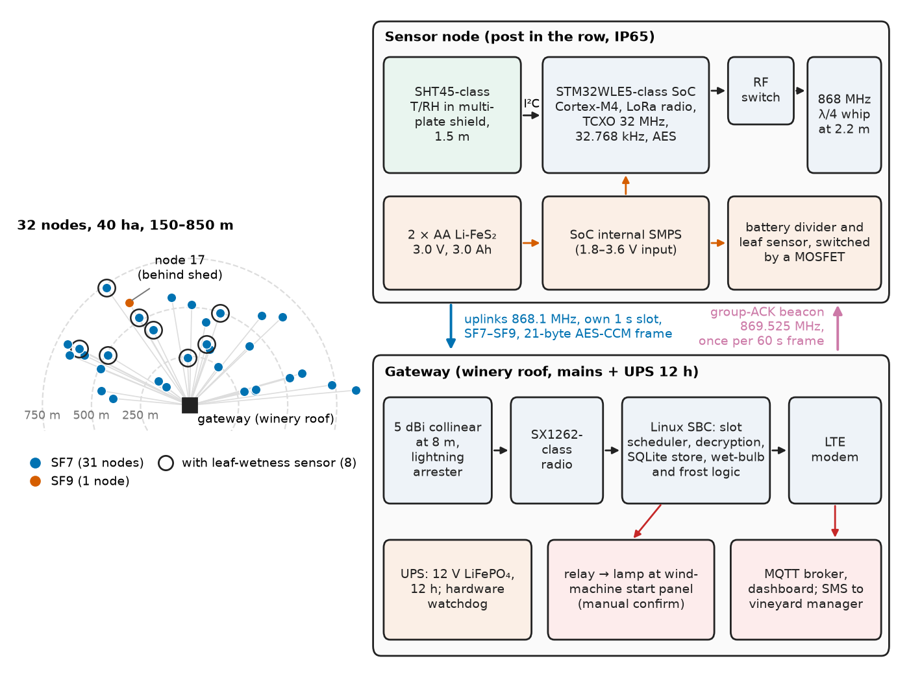
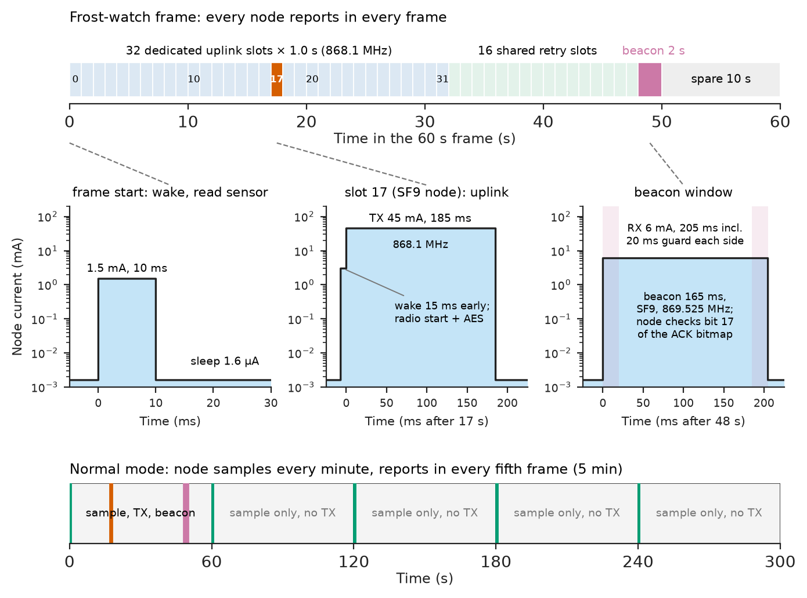
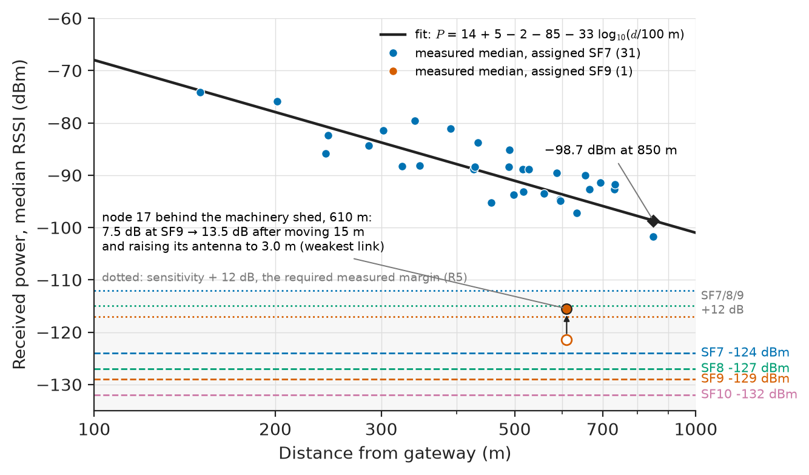
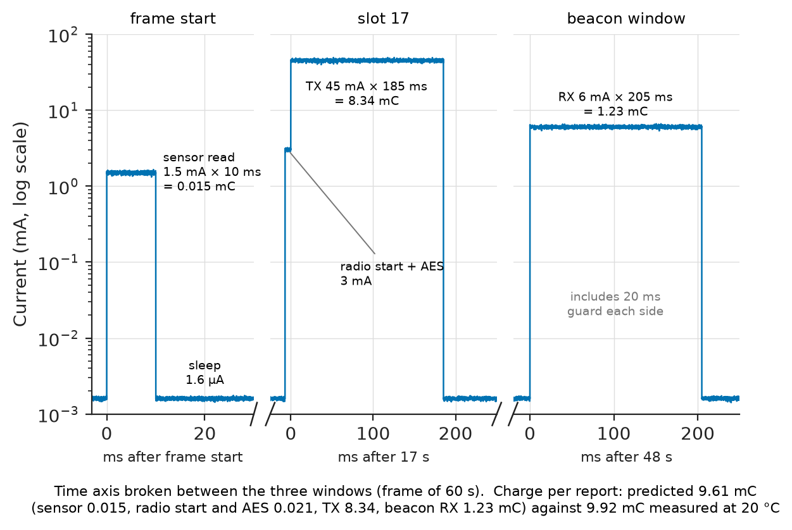
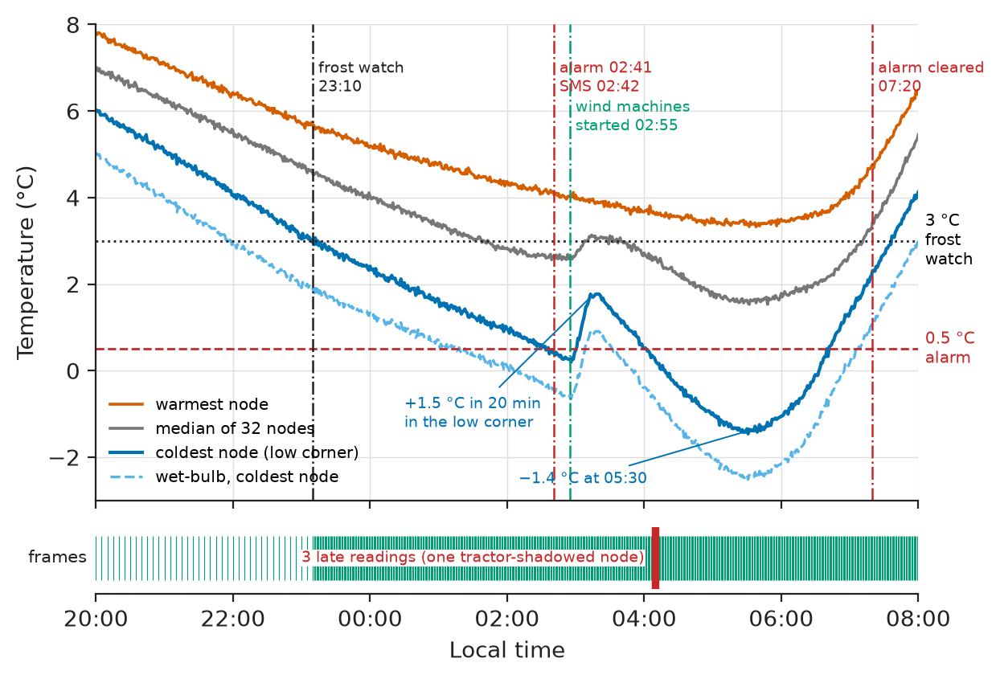

# Chapter 38 — Project: Wireless Sensor Network

*Part IX · Interdisciplinary Engineering Projects*

A vineyard tried twelve off-the-shelf LoRaWAN temperature nodes for frost warning in its first season. On the one night that mattered, with the air in the lowest corner of the vineyard at −1 °C, five of them went silent at 02:40. Three separate causes had lined up. When the vines leafed out in spring, the network server's adaptive data rate had moved the far nodes from spreading factor 9 to 12, multiplying their time on air by eight; at SF12 the 1 % duty-cycle limit of the 868 MHz band allows one 21-byte message every 148 s, so the stack silently dropped the one-minute "frost watch" reports. The lithium–thionyl-chloride cells, passivated after months of microamp sleep and now cold, sagged below brown-out under the transmit pulse, so the nodes reset and began rejoining at SF12. And nobody had written down what a node needed to deliver, how often, with what margin, on a cold night in full leaf. This chapter designs that network as a project: 32 battery-powered nodes measuring air temperature and humidity (eight also leaf wetness) across 40 ha, a time-slotted LoRa star with authenticated frames, a mains-powered gateway at the winery with LTE backhaul, and a frost alarm that reaches the vineyard manager within two minutes.

> **How are the sensors, radio, protocol and battery of a sensor node chosen together so that it delivers its data for five years on a cold night in full leaf?**
> **How is a network of such nodes made reliable and secure, and how is it deployed and proven in the field?**

| Concept | Engineering destination |
|---|---|
| Sensor selection | Accuracy at 0 °C, humidity for wet-bulb temperature, radiation shielding, energy per reading |
| Node architecture | Radio SoC, clocks, power path and battery chemistry for cold pulses |
| Communication protocol | Slotted star on LoRa, spreading-factor assignment, group acknowledgement, duty-cycle compliance |
| Power budgeting | Charge per report and battery life as a function of spreading factor |
| Data acquisition | Synchronised sampling, timestamps, calibration offsets, buffering, frost logic |
| Network reliability | Link margin, retries, store-and-forward, gateway redundancy |
| Security | Authenticated encryption, nonce and counter management, replay protection, key provisioning |
| Deployment and testing | Site survey, Fresnel clearance, sensor calibration, field verification |

**Roadmap.** Requirements, architecture and sensors (38.1) → node hardware (38.2) → protocol (38.3) → energy (38.4) → acquisition and frost logic (38.5) → reliability (38.6) → security (38.7) → deployment, verification, failure analysis, cost and Revision B (38.8).

---

## 38.1 Sensor selection

> **Boundary.** Sensor principles and selection are owned by [Chapter 6](../part-2-instrumentation-and-measurement-systems/06-sensors-and-transducers.md), uncertainty and calibration by [Chapter 7](../part-2-instrumentation-and-measurement-systems/07-measurement-and-signal-conditioning.md), IoT devices and backhaul by [Chapter 11](../part-3-embedded-and-connected-systems/11-iot-systems.md), and RF front ends, antennas, link budgets and WSN radios by [Chapter 26](../part-7-communications-signal-processing-and-biomedical/26-communication-system-integration.md). This chapter applies them to one network.

### Requirements

Spring frost damages buds when their temperature falls below about −1 to −2 °C. The vineyard protects itself with four wind machines that mix warmer air from a temperature inversion down into the rows; they must be started before the coldest rows reach the threshold, and starting them costs fuel and noise, so false alarms matter too. Table 38.1 is the network's requirement set.

**Table 38.1 — Requirements of the vineyard frost-monitoring network.**

| ID | Requirement | Target | Verification |
|---|---|---|---|
| R1 | Measurement | Air temperature ±0.2 °C from −10 to +10 °C; RH ±2 %RH; leaf wetness on 8 nodes; at 1.5 m in the rows | Chamber comparison against reference |
| R2 | Reporting | Every 5 min; every 1 min in frost watch (any node < 3 °C) | Gateway log |
| R3 | Alarm latency | SMS within 2 min of any node crossing the alarm threshold | Injected cold event |
| R4 | Delivery | ≥ 99.9 % of readings within 2 min during frost watch; ≥ 99.5 % within 24 h overall | 30-day field log, frost nights |
| R5 | Coverage | All nodes up to 850 m from the gateway, measured margin ≥ 12 dB at SF ≤ 9 in full leaf | Site survey |
| R6 | Battery life | ≥ 5 years on the fitted cells, including 40 frost-watch nights a year | Measured charge per report; budget |
| R7 | Security | Frames authenticated and encrypted; no replay; per-node keys | Injected replay and forged frames |
| R8 | Cost and environment | Node BOM ≤ \$45, gateway ≤ \$250 (100 nodes); IP65; −20 to +50 °C | Costed BOM; chamber test |

### Architecture

Each node (Figure 38.1) sits on a post at 1.5 m in a vine row: a multi-plate radiation shield housing the temperature–humidity sensor, an IP65 box with the radio SoC and batteries, and a quarter-wave whip antenna 2.2 m above ground, just clear of the canopy. Nodes transmit in assigned slots to a gateway on the winery roof (antenna 8 m above ground), which acknowledges them in a group beacon, computes wet-bulb temperature, runs the frost logic, stores the data, sends SMS alarms and publishes to the vineyard's cloud dashboard over LTE. The gateway runs from mains with a 12-hour battery backup.

<!-- FIGURE 38.1 | figures/ch38/fig-38-1-network-architecture.png | block-diagram | Architecture of the 32-node vineyard frost-monitoring network. | Content: left: field with 32 nodes in a star around the gateway, distances 150 to 850 m, eight nodes marked with leaf-wetness sensors. Node detail box: SHT45-class sensor in multi-plate radiation shield at 1.5 m (I2C) -> STM32WLE5-class radio SoC (Cortex-M4, sub-GHz LoRa radio, TCXO 32 MHz, 32.768 kHz crystal, AES) -> RF switch -> 868 MHz quarter-wave whip at 2.2 m; power: 2 x AA Li-FeS2 cells 3.0 V -> SoC internal SMPS; battery-voltage divider switched by MOSFET. Radio links: uplinks on 868.1 MHz in assigned slots (SF7 to SF9), group-ACK beacon on 869.525 MHz once per 60 s frame. Gateway box on winery roof: 5 dBi collinear antenna at 8 m with lightning arrester -> SX1262-class radio -> Linux SBC (slot scheduler, decryption, SQLite store, wet-bulb and frost logic) -> LTE modem -> MQTT broker / dashboard; SMS to vineyard manager; relay outputs to wind-machine start panel (manual confirm). UPS battery 12 h. -->



*Figure 38.1 — Architecture of the 32-node vineyard frost-monitoring network.*

### Choosing the sensor

The quantity that decides frost damage is bud temperature, which on a clear, still night runs 1–2 °C below air temperature because the buds radiate to the sky; the network measures air temperature and humidity in a shield, and the grower's threshold is set with that offset in mind. Humidity matters because wet-bulb temperature, not dry-bulb, decides whether sprinkler protection would help, and because in dry air wet buds and leaves cool by evaporation towards the wet-bulb temperature, below the dry-bulb reading. Table 38.2 compares the candidates.

**Table 38.2 — Temperature and humidity sensor options (typical datasheet values; 2026 prices at 100 pieces).**

| Sensor | Temperature accuracy | Humidity | Energy per reading | Interface | Price | Verdict |
|---|---|---|---|---|---|---|
| Digital T/RH (SHT45 class) | ±0.1 °C typ, ±0.2 °C max (0–60 °C) | ±1.0 %RH | about 8 ms at 0.5 mA (high repeatability) | I²C | \$2.80 | **Chosen** |
| Digital T (TMP117 class) | ±0.1 °C (−20 to 50 °C) | None | 15.5 ms at 135 µA | I²C | \$2.20 | No humidity |
| PT1000 class A + 24-bit ADC | ±0.15 °C + 0.002·T, with calibration ±0.05 °C | None | 50–100 ms at 0.5–1 mA (excitation, settling) | SPI | \$6–9 | Overkill and more energy |
| Combined environmental sensor (BME280 class) | ±0.5 to ±1 °C | ±3 %RH | 10 ms at 0.7 mA | I²C | \$3.50 | Fails R1 |

The SHT45-class sensor meets R1 with a calibration check (38.8), gives humidity in the same package, and costs about 4 µC per reading, negligible against the radio. Its weakness is condensation: at 100 %RH on a frost night the sensing surface can wet, reading 100 %RH for hours after the air has dried. The chosen part has an on-chip heater, and the firmware runs it for 1 s at 20 mW once an hour when RH has stayed above 95 % for that hour, discarding the next two readings while the sensor cools.

The radiation shield matters as much as the sensor. Unshielded, a sensor in sunlight reads several degrees high and at night a few tenths low; a naturally ventilated multi-plate shield keeps the night-time error to about 0.1–0.2 °C in light wind, which is what R1's budget allows. Heat transfer in the shield (radiation exchange with a clear sky, convection in still air) is in *Engineering Physics*, [Ch. 14](https://github.com/The-Studio-of-Sadiq/Engineering-Physics/blob/main/CHAPTERS/CHAPTER%2014.md).

The leaf-wetness sensor on eight nodes is a dielectric leaf-shaped probe, powered at 3 V for 10 ms at 2 mA and read by the SoC's ADC. It costs about 20 µC per reading and is the only analogue input.

---

## 38.2 Node architecture

> **Boundary.** MCU selection, power modes and the average-current budget are in *Electronics and Computing*, [Ch. 25 §25.3 and §25.5](https://github.com/The-Studio-of-Sadiq/Electronics-and-Computing/blob/main/part-6-embedded-and-real-time-systems/25-embedded-system-architecture.md); low-power firmware practice and logging in [Ch. 28 §28.5–28.6](https://github.com/The-Studio-of-Sadiq/Electronics-and-Computing/blob/main/part-6-embedded-and-real-time-systems/28-embedded-system-design.md); clock accuracy and drift in [Ch. 27 §27.4](https://github.com/The-Studio-of-Sadiq/Electronics-and-Computing/blob/main/part-6-embedded-and-real-time-systems/27-real-time-computing.md). Embedded integration as a method is [Chapter 10](../part-3-embedded-and-connected-systems/10-embedded-system-integration.md); battery chemistry is in *Materials Science and Engineering*, [Ch. 40](https://github.com/The-Studio-of-Sadiq/Materials-Science-and-Engineering/blob/main/Chapters/CHAPTER%2040.md).

### Radio SoC

**Table 38.3 — Node processor and radio options.**

| Option | Sleep with RTC | TX +14 dBm | RX | Notes | Verdict |
|---|---|---|---|---|---|
| Sub-GHz LoRa SoC (STM32WLE5 class) in a certified module with TCXO | about 1.5 µA (with RAM retention) | about 45 mA incl. MCU | about 6 mA incl. MCU | One chip; hardware AES; module carries radio certification | **Chosen** |
| Separate MCU (STM32L0 class) + SX1262 transceiver | 1.0 µA + 0.2 µA | 45 mA | 5.5 mA | Two chips and an SPI link; more layout and certification work | Equivalent energy, more cost |
| 2.4 GHz SoC (nRF52840 class), 802.15.4 mesh | 2–3 µA | 15 mA at +8 dBm | 6 mA | 2.4 GHz suffers 10–20 dB more foliage loss; routers must stay awake | Rejected: coverage and energy |
| Cellular LPWA module (LTE-M/NB-IoT) | 3–10 µA (PSM) | 100–250 mA pulses | — | No gateway, but subscription per node and patchy rural coverage | Rejected: cost and coverage |

The module's 32 MHz TCXO keeps the radio carrier within ±2 ppm (±1.7 kHz at 868 MHz) at −20 °C, far inside LoRa's frequency-offset tolerance, which a plain crystal at −10 °C would approach. The 32.768 kHz crystal for the real-time clock is a tuning-fork type, whose frequency falls parabolically with temperature away from 25 °C, at about $-0.034$ ppm/°C²; that sets the timing budget of 38.3.

### Power path and battery

The node has no regulator of its own: the SoC's internal step-down converter runs the core and radio from 1.8–3.6 V directly. A MOSFET switches the battery-voltage divider and the leaf-wetness sensor, so neither draws current in sleep; all unused pins are analogue inputs. Measured sleep current of the assembled node is 1.6 µA at 20 °C, rising to about 2.2 µA at 45 °C.

The battery choice was where the pilot failed, so Table 38.4 compares chemistries for this duty: microamp sleep for years, 45 mA pulses of up to 0.2 s, at −10 °C.

**Table 38.4 — Battery options for the node.**

| Option | Capacity (low drain) | Voltage | 45 mA pulse at −10 °C | Self-discharge | Price | Verdict |
|---|---|---|---|---|---|---|
| 1 × AA Li-SOCl₂, bobbin | 2.6 Ah | 3.6 V | Voltage delay after passivation; can sag below 2.5 V | < 1 %/yr | \$3.50 | Failed in pilot |
| 1 × AA Li-SOCl₂ + hybrid layer capacitor | 2.6 Ah | 3.6 V | Good (capacitor supplies pulse) | < 1 %/yr | \$9.50 | Good, costly |
| 2 × AA Li-FeS₂ in series | 3.0 Ah | 3.0–3.6 V | Good (spiral construction, low resistance) | About 0.5 %/yr | \$3.20 | **Chosen** |
| 2 × AA alkaline | 2.5 Ah at 20 °C, much less cold | 3.0 V | Poor below 0 °C | 2–3 %/yr | \$1.00 | Rejected |

The lithium–iron-disulphide pair delivers the transmit pulse at −20 °C with a drop of under 0.2 V, has no passivation layer to break, and its end-of-life voltage (about 2.0 V for the pair) is still above the SoC's 1.8 V minimum. It holds slightly less energy than the thionyl-chloride cell at the same capacity because its voltage is lower, which the budget of 38.4 accounts for by derating capacity to 85 %.

> **Status of the principle: Primary-cell capacity derating for cold, pulsed loads**
> *Empirical.* Usable capacity at low temperature and with pulse loads is taken from manufacturers' discharge curves and test data, not from the nameplate; the 85 % factor used here applies to Li-FeS₂ at −10 to +40 °C with 45 mA pulses and must be re-derived for another chemistry or duty.

---

## 38.3 Communication protocol

> **Boundary.** Path loss, shadowing, fading and fade margin are in *Circuits, Signals and Communications*, [Ch. 30 §30.2, §30.4 and §30.10](https://github.com/The-Studio-of-Sadiq/Circuits-Signals-and-Communications/blob/main/part-6-communication-theory/30-wireless-and-mobile-communications.md); antennas and Friis transmission in [Ch. 32 §32.7 and §32.9](https://github.com/The-Studio-of-Sadiq/Circuits-Signals-and-Communications/blob/main/part-6-communication-theory/32-rf-and-microwave-fundamentals.md); error detection and ARQ in [Ch. 28 §28.6](https://github.com/The-Studio-of-Sadiq/Circuits-Signals-and-Communications/blob/main/part-6-communication-theory/28-information-theory-and-coding.md). MQTT and HTTP are owned by [Chapter 11](../part-3-embedded-and-connected-systems/11-iot-systems.md), link budgets and WSN radios by [Chapter 26](../part-7-communications-signal-processing-and-biomedical/26-communication-system-integration.md).

### Choice of protocol

**Table 38.5 — Protocol options on the chosen radio.**

| Option | Medium access | Acknowledgement | Infrastructure | Strength | Weakness |
|---|---|---|---|---|---|
| LoRaWAN Class A, ADR on | Unslotted ALOHA | Optional confirmed uplinks, one downlink per uplink | Gateway + network server | Standard, interoperable, security specified | ADR drove the pilot to SF12; per-node ACKs cost gateway duty cycle |
| LoRaWAN Class A, fixed SF per node | Unslotted ALOHA | Unconfirmed + application-level gap detection | Gateway + network server | Standard | No delivery guarantee during frost watch |
| Time-slotted star on LoRa PHY (custom MAC) | Assigned slots + shared retry slots | One group-ACK beacon per frame | Gateway only | Collision-free, bounded latency, one downlink per minute for all nodes | Own MAC and security to verify |
| 802.15.4 mesh at 868 MHz (Wi-SUN class) | CSMA, routed | Per hop | Border router; mains-powered routers | Range by hopping | Routers in a vineyard need power |

A fixed-SF LoRaWAN deployment would meet most of the requirements and is the right choice when the network must coexist with other LoRaWAN devices or a public network. This vineyard has one gateway, one application and a hard latency requirement on cold nights, and a slotted star with a group acknowledgement meets R3 and R4 with the least energy and the least downlink airtime. The MAC is small (about 2 kB of code at the node), it uses the standard LoRa physical layer, and its security (38.7) uses a standard primitive, AES-128-CCM, rather than anything invented.

### Frame structure

Time is divided into 60 s frames (Figure 38.2). Each of the 32 nodes owns a 1.0 s uplink slot; 16 shared slots follow for retransmissions; a 2 s window carries the gateway's group-acknowledgement beacon; the remaining 10 s is spare for growth to 42 nodes. In normal mode a node transmits in its slot in every fifth frame (5 min); in frost watch, in every frame. The beacon carries the frame number, gateway time, the network mode (normal or frost watch), a 32-bit bitmap of the slots received correctly in this frame and a message authentication code. Uplinks use 868.1 MHz; the beacon uses 869.525 MHz.

<!-- FIGURE 38.2 | figures/ch38/fig-38-2-tdma-frame.png | timing-diagram | Structure of the 60 s frame and the timing of one node's report. | Content: top bar: 60 s frame divided into 32 dedicated uplink slots of 1.0 s (labelled 0 to 31), 16 shared retry slots of 1.0 s, a 2.0 s beacon window, 10 s spare. Expanded view of slot 17 (a SF9 node): node wakes 15 ms before slot start (sensor already read at frame start), TX 185 ms uplink at 868.1 MHz, then sleeps. Expanded view of beacon window: node wakes 20 ms before predicted beacon (guard), RX beacon 165 ms at 869.525 MHz SF9, checks bit 17 of the ACK bitmap, sleeps. Lower line shows node current: 1.6 uA sleep, 1.5 mA sensor read at frame start (10 ms), 45 mA during TX, 6 mA during beacon RX. A second row shows normal mode: node active only in every fifth frame. -->



*Figure 38.2 — Structure of the 60 s frame and the timing of one node's report.*

### Spreading factor and duty cycle

Each node's spreading factor is fixed at commissioning from its measured link margin (38.8), not adapted on the fly. Two rules bound the choice. ETSI EN 300 220 limits a device in the 868.0–868.6 MHz sub-band to 1 % duty cycle: a 21-byte uplink every minute is legal up to SF10 (0.62 %) but not at SF11 (1.24 %), which is exactly the limit the pilot's ADR crossed. And the energy budget of 38.4 limits nodes to SF9 for five-year life. The beacon, 165 ms once a minute, uses 0.28 % of the gateway's allowance in the 869.4–869.65 MHz sub-band, whose limit is 10 %; per-node acknowledgements at SF9 would have used 32 × 144 ms per minute, 7.7 %, uncomfortably close to it.

### Timing and drift

A node must wake for the beacon at the right moment, and its clock is a cold tuning-fork crystal. Worst-case error is the ±20 ppm tolerance plus the temperature term, $-0.034\times(-10-25)^2=-41.7$ ppm at −10 °C: about 62 ppm. Over a normal-mode 300 s between beacons that is 18.6 ms, so the node opens its receiver 20 ms early and keeps it open up to 20 ms late (the window counted in the energy budget as 40 ms). Every beacon received resets the clock error. If a beacon is missed, the window widens in proportion to the time since the last one (62 ppm of elapsed time, plus 2 ms); after 30 min without a beacon the node listens for a whole frame to resynchronise, which costs about 0.36 C, equal to about 40 reports and acceptable only because it is rare.

> **Status of the principle: Guard time from worst-case clock drift**
> *Derived.* The timing uncertainty is the product of the worst-case fractional frequency error and the time since the last synchronisation; it holds as long as the error bound covers the actual crystal over the temperature range, which is why the bound is taken from the crystal's parabolic temperature coefficient at the coldest site temperature, not from its 25 °C tolerance.

---

## 38.4 Power budgeting

> **Boundary.** The energy budget as a design tool and LoRa time-on-air are developed in *Electronics and Computing*, [Ch. 28 §28.5](https://github.com/The-Studio-of-Sadiq/Electronics-and-Computing/blob/main/part-6-embedded-and-real-time-systems/28-embedded-system-design.md). Here the budget is closed against the link budget and the duty-cycle rule.

### Link budget

The site survey (38.8) fitted a log-distance model to measurements in full leaf: path loss $PL(d)=85+33\log_{10}(d/100\ \mathrm{m})$ dB, exponent 3.3, with 6 dB log-normal shadowing about the fit. With +14 dBm at the node, a 0 dBi effective node antenna (whip near the post and canopy), a 5 dBi gateway antenna and 2 dB of cable and connector loss, the received power at 850 m is $14+0+5-2-115.7=-98.7$ dBm. LoRa sensitivity at 125 kHz is about −124 dBm at SF7, −129 dBm at SF9 and −132 dBm at SF10 (SX126x class), so the median margin at the farthest node is 25 dB even at SF7. A 99 % location-reliability allowance for 6 dB shadowing ($2.33\sigma=14$ dB) still leaves 11 dB at SF7. The model only plans the network; each node's spreading factor is set from its own *measured* margin (38.8).

**Table 38.6 — Planning link budget for the farthest node (850 m, SF9, uplink).**

| Item | Value | Requirement | Margin |
|---|---|---|---|
| Transmit power, node (EIRP with 0 dBi) | +14 dBm | ≤ 25 mW ERP (EN 300 220) | 2.2 dB below limit |
| Gateway antenna gain, cable and connector loss | +5 dBi, −2 dB | — | — |
| Path loss, survey fit | 115.7 dB | — | — |
| Received power | −98.7 dBm | — | — |
| Sensitivity, SF9 at 125 kHz | −129 dBm | — | — |
| Median margin | 30.3 dB | — | — |
| Shadowing allowance, 99 % of locations ($2.33\times6$ dB) | 14 dB | — | — |
| Planning margin after shadowing | 16.3 dB | ≥ 12 dB measured | 4.3 dB |

<!-- FIGURE 38.3 | figures/ch38/fig-38-3-link-survey.png | plot | Measured received power at the 32 node positions against distance, with the fitted path-loss model and receiver sensitivities. | Content: x axis distance 100 to 1000 m (log scale); y axis received power -135 to -60 dBm. Scatter: 32 measured median RSSI values in full leaf (spread about plus or minus 6 dB around the fit), markers coloured by assigned SF (31 at SF7, node 17 alone at SF9). Line: fitted model P = 14 + 5 - 2 - 85 - 33 log10(d/100), reaching -98.7 dBm at 850 m. Dashed horizontal lines: sensitivity SF7 -124, SF8 -127, SF9 -129, SF10 -132 dBm. Shaded band: 12 dB required measured margin above each SF sensitivity. Annotate node 17 (behind the machinery shed, 610 m) as the weakest link, 13.5 dB margin at SF9 after antenna raised. -->



*Figure 38.3 — Measured received power at the 32 node positions against distance, with the fitted path-loss model and receiver sensitivities.*

### Charge per report and battery life

The listing combines the time-on-air formula, the link budget and the charge of each phase of a report (wake and sensor read, radio start, AES, transmit, beacon receive with its 40 ms window), adds 1.6 µA of sleep, and computes battery life per spreading factor for the 124,320 reports a year that R2 implies with 40 frost-watch nights of 10 hours.

```python
import math

def toa(n_bytes, sf, bw=125e3, cr=1, n_pre=8):
    """LoRa time on air (s), explicit header, CRC on (Semtech formula)."""
    de = 1 if sf >= 11 else 0
    ts = 2**sf / bw
    n = 8 + max(math.ceil((8*n_bytes - 4*sf + 44) / (4*(sf - 2*de)))*(cr + 4), 0)
    return (n_pre + 4.25 + n) * ts

SENS = {7: -124.0, 8: -127.0, 9: -129.0, 10: -132.0}       # dBm at 125 kHz
PL = lambda d: 85 + 33*math.log10(d/100)                    # site-survey fit, dB
p_rx = 14 + 0 + 5 - 2 - PL(850)                             # dBm at the farthest node
t_bcn = toa(16, 9)                                          # group-ACK beacon, SF9
reports = 288*365 + 40*10*60*(1 - 1/5)                      # per year, incl. frost watch
cap = 3000*0.85                                             # mAh, 2 x AA Li-FeS2, derated

print(f"P_rx at 850 m: {p_rx:.1f} dBm; beacon {t_bcn*1e3:.0f} ms; reports/yr {reports:.0f}")
for sf in SENS:
    t_up = toa(21, sf)
    q = (10e-3*1.5e-3 + 5e-3*3e-3 + 2e-3*3e-3               # wake+sensor, radio start, AES
         + t_up*45e-3 + (t_bcn + 0.040)*6.0e-3) * 1e3       # TX, beacon RX with guards; mC
    mah = reports*q/3600 + 1.6e-3*24*365                    # + 1.6 uA sleep; mAh/yr
    life = cap / (mah + 0.005*3000)                         # + 0.5 %/yr self-discharge
    print(f"SF{sf:2d}: uplink {t_up*1e3:5.1f} ms, margin {p_rx-SENS[sf]:4.1f} dB, "
          f"duty(1/min) {t_up/60*100:4.2f} %, {q:5.2f} mC/report, "
          f"{mah:4.0f} mAh/yr, life {life:4.1f} yr")
```

```text
P_rx at 850 m: -98.7 dBm; beacon 165 ms; reports/yr 124320
SF 7: uplink  56.6 ms, margin 25.3 dB, duty(1/min) 0.09 %,  3.81 mC/report,  146 mAh/yr, life 15.9 yr
SF 8: uplink 102.9 ms, margin 28.3 dB, duty(1/min) 0.17 %,  5.90 mC/report,  218 mAh/yr, life 11.0 yr
SF 9: uplink 185.3 ms, margin 30.3 dB, duty(1/min) 0.31 %,  9.61 mC/report,  346 mAh/yr, life  7.1 yr
SF10: uplink 370.7 ms, margin 33.3 dB, duty(1/min) 0.62 %, 17.95 mC/report,  634 mAh/yr, life  3.9 yr
```

**Worked example — what limits the node.** At SF9 a report costs 9.61 mC, of which the transmission is $0.1853\times45=8.34$ mC (87 %), the beacon reception $0.205\times6=1.23$ mC (13 %), and the sensor, radio start and encryption together 0.036 mC. Sleep at 1.6 µA is 14 mAh a year, 4 % of the total. The node is a radio with a sensor attached: the only large lever is time on air. Each step of spreading factor roughly doubles it: SF10 gives 3.9 years and fails R6, which, together with the duty-cycle rule, is why no node is allowed above SF9. At SF7 the same cells last 15.9 years, longer than the cells' shelf life, so near nodes could use a single cell. The average current of an SF9 node is $346/8760=39.5$ µA.

**Table 38.7 — Energy budget of an SF9 node (the worst assigned), per year.**

| Item | Basis | Charge (mAh/yr) | Share |
|---|---|---|---|
| Uplinks | 124,320 × 185.3 ms × 45 mA | 288 | 83 % |
| Beacon receptions | 124,320 × 205 ms × 6 mA | 42 | 12 % |
| Sensor, radio start, AES | 124,320 × 0.036 mC | 1.2 | < 1 % |
| Sleep | 1.6 µA × 8760 h | 14 | 4 % |
| Self-discharge | 0.5 % of 3000 mAh | 15 | — |
| **Total drawn** | | **361** | |
| Usable capacity | 3000 mAh × 0.85 | 2550 | |
| **Life** | 2550 / 361 | **7.1 years** | Margin over R6: 41 % |

> **Status of the principle: Battery life from charge per event**
> *Derived.* Life is usable capacity divided by the sum of event charges, sleep charge and self-discharge per year; it assumes the measured currents and durations hold over temperature and battery voltage, which the field measurement of 38.8 checks, and it ignores retransmissions, which the reliability analysis of 38.6 shows add under 1 %.

---

## 38.5 Data acquisition

> **Boundary.** DAQ architecture, synchronisation and logging are owned by [Chapter 8](../part-2-instrumentation-and-measurement-systems/08-data-acquisition-systems.md); event detection and practical filtering by [Chapter 27](../part-7-communications-signal-processing-and-biomedical/27-practical-signal-processing.md).

### Sampling and the payload

All nodes sample at the start of each frame, so that a map of the vineyard is a snapshot taken within the clock error of 38.3 (tens of milliseconds), not a smear over five minutes. In normal mode each node samples every minute but transmits only every fifth: it keeps the minimum of the five readings and the last, so that a short cold dip between reports is not lost, and switches itself to frost watch the moment its own reading falls below 3 °C, without waiting for the gateway. The 10-byte payload is fixed-point: temperature (0.01 °C, signed 16-bit), humidity (0.01 %RH, 16-bit), leaf wetness (8-bit), battery voltage (20 mV steps), flags, the RSSI of the last beacon, the number of buffered readings and one reserved byte. With the 7-byte header and 4-byte authentication tag the frame is 21 bytes.

A node that misses its acknowledgement keeps the reading in a 24-hour ring buffer in RAM (1440 readings of 6 bytes, 8.6 kB) and appends up to three buffered readings to its next transmission. After a gateway outage, nodes drain their buffers three readings at a time, in their own slots and the shared retry slots.

### At the gateway

The gateway decrypts and authenticates each frame (38.7), applies the node's stored calibration offsets (38.8), timestamps the reading with the frame time, discards duplicates by frame counter, and writes it to a local SQLite database before publishing it. It derives wet-bulb temperature from dry-bulb and humidity with Stull's empirical formula, which agrees with the psychrometric equations within about 1 °C over −20 to 50 °C and 5–99 %RH; at 2.0 °C and 60 %RH it gives −1.2 °C, at 2.0 °C and 90 %RH, +1.0 °C.

> **Status of the principle: Stull's wet-bulb approximation**
> *Empirical.* A fitted function of temperature and relative humidity at sea-level pressure; adequate for frost logic with the threshold set conservatively, but not a substitute for the psychrometric equations at altitude or where 0.1 °C matters.

The frost logic is deliberately plain: an alarm when any node's air temperature is at or below the grower's threshold (default 0.5 °C) in two consecutive readings, or its wet-bulb temperature is at or below −1.0 °C; it clears when all nodes have been above threshold + 1 °C for 15 minutes. Two consecutive readings at one-minute spacing cost at most one minute of latency and remove single-reading glitches (a sensor briefly wet with dew). The gateway sends an SMS, publishes an alarm message and lights a lamp at the wind-machine panel; starting the machines stays a human decision.

```json
{
  "topic": "vineyard/north/node/17/reading",
  "ts": "2026-04-12T02:41:00Z",
  "t_c": 0.38, "rh_pct": 91.2, "tw_c": -0.46, "leaf_wet": 0,
  "batt_v": 3.08, "rssi_dbm": -115, "snr_db": 1.5, "sf": 9,
  "fcnt": 48213, "late": false, "mode": "frost_watch"
}
```

The `late` flag marks a reading delivered from a node's buffer rather than in its own frame, so that dashboards and the frost logic do not mistake an old reading for a new one.

---

## 38.6 Network reliability

> **Boundary.** Outage probability and fade margin in fading channels are in *Circuits, Signals and Communications*, [Ch. 30 §30.4](https://github.com/The-Studio-of-Sadiq/Circuits-Signals-and-Communications/blob/main/part-6-communication-theory/30-wireless-and-mobile-communications.md); communication reliability and interference mitigation at system level are in [Chapter 26](../part-7-communications-signal-processing-and-biomedical/26-communication-system-integration.md).

### Where packets are lost

Three mechanisms lose packets in this network. Slow fading: leaves moving in wind, a tractor parked across a row, wet foliage after rain; its effect is a time-varying excess loss of a few decibels around each node's static margin. Interference: other 868 MHz users nearby (a neighbour's LoRaWAN, alarm systems) occasionally overlapping a slot; LoRa's processing gain rejects much of it, but not all. And infrastructure: gateway power, the gateway's radio, the LTE link. The first two are random and per-packet; the third is correlated and takes the whole network down.

**Worked example — delivery during frost watch.** The worst assigned node has a measured margin of 13.5 dB; take R5's 12 dB as the bound. Model the time-varying fading as Gaussian in decibels with $\sigma=4$ dB, as measured over a windy week; the probability that one uplink fades below sensitivity is $Q(12/4)=Q(3)=0.13$ %. Add 0.5 % per slot for interference, from a week of spectrum monitoring at the gateway. One attempt fails with probability 0.63 %; the reading is late only if the attempt in the next frame also fails, $0.0063^2=4\times10^{-5}$. So 99.4 % of readings arrive in their own minute and 99.996 % within two minutes, against R4's 99.9 %. The beacon has the same loss probability; a missed beacon causes an unnecessary retransmission (which the gateway discards as a duplicate), adding about 0.6 % to the node's transmissions and well under 1 % to its energy.

> **Status of the principle: Independent per-attempt losses and retry**
> *Approximate.* Treats each attempt as independent with a fixed loss probability; valid when the fading coherence time (seconds for leaves in wind) is shorter than the one-minute retry interval, and invalid for slow, correlated outages (a vehicle parked for an hour, a gateway failure), which are handled by buffering and redundancy instead of retries.

### Infrastructure

The gateway is the single point of failure, so it is engineered for the night it is needed: a 12 V LiFePO₄ battery with charger carries it for 12 hours of mains loss; a hardware watchdog restarts it; a lightning arrester and earthed mast protect the antenna run. If LTE fails, the gateway still raises the local alarm lamp and sounder and logs locally; SMS uses the same modem, so a second, independent path (a cheap modem on another operator) is a Revision B item. If the gateway itself fails, nodes keep sampling and buffering for 24 hours, and the monitoring service raises an alarm when the gateway's heartbeat stops for 10 minutes.

### Monitoring the network itself

The gateway tracks, per node, the fraction of slots received, RSSI and SNR, battery voltage under load and the number of late readings, and flags a node whose delivery falls below 99 % over 24 hours or whose margin drops by more than 6 dB from its commissioning value. These health indicators turned up both the tractor parking spot and, in the first summer, a node whose antenna had been bent flat by a mowing crew.

---

## 38.7 Security

> **Boundary.** Device authentication, provisioning and IoT security practice are owned by [Chapter 11](../part-3-embedded-and-connected-systems/11-iot-systems.md), and industrial cybersecurity (IEC 62443) by [Chapter 21](../part-5-industrial-automation/21-industrial-communication-and-safety.md).

### Threat model

The data are not secret; the decisions made from them are valuable. An attacker within radio range (the vineyard borders a public road) could forge readings to suppress a real frost alarm or to trigger false ones that start the wind machines at 3 a.m.; replay a recorded cold-night frame; forge beacons to mark everything as received or to desynchronise the nodes; or jam the channel. Cryptography answers the first three. Jamming cannot be prevented, only detected: the gateway treats loss of more than a quarter of the nodes in one frame, with high noise in the band, as an alarm in itself.

### Authenticated encryption and counters

Every uplink and beacon is protected with AES-128 in CCM mode, with a 4-byte authentication tag: the header (type, node identifier, frame counter) is authenticated in the clear, the payload encrypted. The nonce is built from the direction, the node identifier and a 32-bit frame counter, so no two frames under one key ever share a nonce. The node increments its counter for every frame and the gateway rejects any counter not greater than the last one accepted from that node, which defeats replay. A 4-byte tag gives a forger a $2^{-32}$ chance per attempt; at the duty-cycle-limited rate of at most a few thousand attempts a day, the expected time to one accepted forgery is over a thousand years, and the gateway alarms on the first few failures anyway.

```c
#include <stddef.h>
#include <stdint.h>
#include <string.h>

/* AES-128-CCM from a vetted library, using the SoC's AES engine; 0 on success. */
int aes_ccm_encrypt(const uint8_t key[16], const uint8_t nonce[13],
                    const uint8_t *aad, size_t aad_len,
                    const uint8_t *pt, size_t pt_len,
                    uint8_t *ct, uint8_t *tag, size_t tag_len);

#define HDR_LEN 7u                    /* type 1, node id 2, frame counter 4 */
#define MIC_LEN 4u

typedef struct { uint16_t id; uint32_t fcnt; uint8_t key[16]; } node_sec_t;

/* Build one uplink: header authenticated in clear, payload encrypted, 4-byte tag.
   Returns the frame length, or 0 if no frame may be sent. */
size_t build_uplink(node_sec_t *n, const uint8_t *pl, size_t pl_len, uint8_t *out)
{
    if (n->fcnt == UINT32_MAX) return 0;          /* never wrap: re-key instead */
    uint32_t c = ++n->fcnt;
    out[0] = 0x01;                                /* data frame, protocol v1 */
    out[1] = (uint8_t)(n->id >> 8);  out[2] = (uint8_t)n->id;
    out[3] = (uint8_t)(c >> 24);     out[4] = (uint8_t)(c >> 16);
    out[5] = (uint8_t)(c >> 8);      out[6] = (uint8_t)c;

    uint8_t nonce[13] = {0};                      /* byte 0 = 0x00: uplink */
    memcpy(&nonce[1], &out[1], 6);                /* node id + counter */
    if (aes_ccm_encrypt(n->key, nonce, out, HDR_LEN, pl, pl_len,
                        &out[HDR_LEN], &out[HDR_LEN + pl_len], MIC_LEN) != 0)
        return 0;
    return HDR_LEN + pl_len + MIC_LEN;
}
```

The counter must survive resets without ever going backwards, or a reset node would reuse nonces and be rejected as a replay. Writing it to flash on every frame would cost 124,000 writes a year; instead the node stores it every 1024 frames and, after a reset, resumes from the stored value plus 1024. A reset therefore skips at most 1024 counter values, which the gateway accepts because it requires only "greater than", and flash sees about 120 writes a year.

### Keys and provisioning

Each node has its own 128-bit key, derived at provisioning as AES-CMAC of the node identifier under a site master key that lives only in the gateway's secure element and in the offline provisioning station. A captured node therefore reveals only its own key, which is revoked at the gateway. Provisioning is done on the bench over the debug port, after which the SoC's read-out protection is set so the key cannot be read back through it. The beacon is authenticated under a separate network key, so a forged beacon cannot mark slots as received or change the mode.

---

## 38.8 Deployment and testing

> **Boundary.** Test plans, calibration procedure and regression testing are in [Chapter 4](../part-1-engineering-design-methodology/04-prototyping-and-verification.md); the calibration chain and uncertainty are in [Chapter 7](../part-2-instrumentation-and-measurement-systems/07-measurement-and-signal-conditioning.md).

### Site survey and placement

Before any node was built, a survey kit (one node with a fixed SF7 beacon every 10 s, and the gateway radio logging RSSI and SNR) was carried to each of the 32 planned positions in full leaf in June and left for 15 minutes at each. The 32 medians gave the path-loss fit of 38.4 and, more usefully, each position's own margin.

**Worked example — why antenna height matters here.** The first Fresnel zone's radius at the midpoint of an 850 m path at 868 MHz ($\lambda=0.346$ m) is $\sqrt{\lambda d_1d_2/(d_1+d_2)}=\sqrt{0.346\times425\times425/850}=8.6$ m; keeping 60 % of it clear would need 5.1 m of clearance above the canopy at mid-path. With the gateway antenna at 8 m and the node at 2.2 m, the straight line passes about 3.3 m above the 1.8 m canopy at mid-path, so the zone is partly obstructed by foliage over most of its length, which is why the fitted exponent is 3.3 rather than 2. Raising node antennas would help, but every node would become a taller, more fragile post. The survey identified one position, node 17 behind a machinery shed, at 7.5 dB margin even at SF9; moving it 15 m along the row and raising its antenna to 3.0 m gave 13.5 dB. Each node was assigned the lowest SF giving at least 12 dB measured margin; every other position had at least 22 dB at SF7, so 31 nodes run at SF7 and node 17 alone at SF9.

### Calibration before deployment

Each sensor is compared with a calibrated reference thermometer (PT100 with readout, ±0.03 °C, calibration traceable under ISO/IEC 17025) in a stirred-air climatic chamber at −5, 0, 5 and 20 °C, and with a reference hygrometer at 75 % and 95 %RH. Offsets are stored at the gateway, not in the node, so a replacement sensor needs only a new table entry. Across the 32 sensors the as-received temperature offsets were within ±0.08 °C at 0 °C, inside the ±0.1 °C typical specification; after correction the residual against the reference was ±0.03 °C. Four nodes are brought back each winter for a re-check, and if their drift exceeds 0.1 °C the whole fleet is re-checked.

### Verification and test results

**Table 38.8 — Verification and test results (first season, 32 nodes).**

| Req. | Test | Limit | Predicted | Measured | Result |
|---|---|---|---|---|---|
| R1 | Chamber comparison at 0 °C after offset correction; RH at 75 % | ±0.2 °C; ±2 %RH | ±0.1 °C | ±0.03 °C (sensor) + shield error 0.1 °C at night; ±1.2 %RH | Pass |
| R2 | Report interval switch to 1 min below 3 °C | Next frame | 60 s | 60 s; frost watch entered by 32 of 32 nodes on 4 nights | Pass |
| R3 | Node chilled to −1 °C with cold spray in a test shield | SMS ≤ 2 min | ≤ 2 min | 1 min 52 s worst of 5 | Pass |
| R4 | Delivery during frost watch (4 nights, 39 h) | ≥ 99.9 % within 2 min | 99.996 % | 99.996 % (one tractor-shadowed node, 3 late of 74,880 readings) | Pass |
| R4 | Delivery overall, 30 days | ≥ 99.5 % within 24 h | — | 99.97 % in own frame or retry; 100 % within 24 h | Pass |
| R5 | Measured margin in full leaf at assigned SF | ≥ 12 dB | — | 13.5 dB worst (node 17, SF9); ≥ 22 dB for the 31 SF7 nodes | Pass |
| R6 | Charge per report, SF9 node, power analyser at 20 °C and −10 °C | Life ≥ 5 yr | 9.61 mC; 7.1 yr | 9.92 mC at 20 °C, 10.4 mC at −10 °C; 6.6 yr at the cold value | Pass |
| R7 | Replayed frame, modified payload byte, forged beacon | All rejected | — | All rejected; security alarm raised after 3 failures | Pass |
| R8 | 72 h at −20 °C and 24 h at +50 °C, transmitting every minute | No reset or missed slot | — | Pass; TX droop 0.14 V at −20 °C | Pass |
| — | Beacon timing error at −10 °C after 300 s | ≤ 20 ms guard | 18.6 ms worst case | 13 ms (crystal better than worst case) | Pass |

The measured charge per report was 3 % above the budget at 20 °C, mostly a longer radio start-up than the datasheet's, and 8 % above at −10 °C, where the TCXO and the SMPS draw more. Life computed from the cold value for the whole year, a deliberately pessimistic assumption, is 6.6 years, still 32 % over R6.

<!-- FIGURE 38.4 | figures/ch38/fig-38-4-node-current-profile.png | plot | Measured current of an SF9 node through one report, with the charge of each phase. | Content: x axis time 0 to 60 s with a broken axis (expanded segments 0 to 30 ms, slot at 17.0 to 17.25 s, beacon window at 48.0 to 48.25 s); y axis current on log scale 1 uA to 100 mA. Trace: 1.6 uA sleep; 1.5 mA for 10 ms at frame start (sensor read); 3 mA radio start 5 ms; 45 mA for 185 ms (uplink); back to sleep; 6 mA for 205 ms (beacon window including 20 ms guards); sleep. Annotate charges: sensor 0.015 mC, TX 8.34 mC, beacon RX 1.23 mC, total 9.61 mC predicted against 9.92 mC measured at 20 C. -->



*Figure 38.4 — Measured current of an SF9 node through one report, with the charge of each phase.*

<!-- FIGURE 38.5 | figures/ch38/fig-38-5-frost-night.png | plot | A frost night as recorded by the network: coldest and warmest node temperatures, wet-bulb temperature, alarm and delivery. | Content: x axis local time 20:00 to 08:00; y axis temperature -3 to 8 C. Lines: warmest node (upper slope, about 4 C at 03:00), coldest node in the low corner (falls from 6 C at 20:00 to -1.4 C at 05:30), wet-bulb of coldest node (about 1 C below dry-bulb), median of 32 nodes. Horizontal dashed line at 0.5 C alarm threshold, dotted at 3 C frost-watch threshold. Vertical markers: frost watch entered 23:10, alarm 02:41 (SMS 02:42), wind machines started 02:55 (median temperature rises 1.5 C within 20 min in the low corner), alarm cleared 07:20. Lower strip: per-frame delivery as small ticks, three late readings marked in red near 04:10. -->



*Figure 38.5 — A frost night as recorded by the network: coldest and warmest node temperatures, wet-bulb temperature, alarm and delivery.*

### Failure analysis

**Table 38.9 — FMEA of the sensor network (S, O, D on 1–10 scales; RPN = S×O×D).**

| Failure mode | Effect | Cause | Detection | Mitigation | S | O | D | RPN |
|---|---|---|---|---|---|---|---|---|
| Node brown-out on TX pulse in cold | Resets, missed readings on frost nights | Passivated Li-SOCl₂ cell (pilot) | Battery voltage under load in each frame | Li-FeS₂ pair; −20 °C pulse test | 8 | 2 | 3 | 48 |
| Link margin lost in full leaf | Late or lost readings | Survey in leaf-off season; vegetation growth | Margin trend per node | Survey in full leaf; 12 dB measured margin | 7 | 3 | 3 | 63 |
| Duty-cycle limit blocks frost-watch reports | Readings silently dropped | SF raised above 10 | Static check at commissioning | SF fixed ≤ 9 by design; no ADR | 8 | 1 | 2 | 16 |
| Gateway failure on a frost night | No alarm | Power cut, SD-card corruption, radio fault | Cloud heartbeat; local watchdog | UPS 12 h; read-only root file system; spare gateway on site | 10 | 2 | 3 | 60 |
| Sensor wet or iced at saturation | RH stuck at 100 %, wet-bulb wrong | Condensation on sensor | RH > 99 % for > 1 h | Heater cycle; frost logic on dry-bulb as well | 6 | 4 | 3 | 72 |
| Radiation shield blocked or damaged | Temperature bias | Spider webs, mowing damage | Comparison with neighbours | Seasonal inspection; outlier alarm | 6 | 4 | 4 | 96 |
| Forged or replayed frames | False alarm or suppressed alarm | Attacker in radio range | MIC failures, counter violations | AES-CCM, counters, per-node keys | 9 | 1 | 2 | 18 |
| Jamming | Network blind | Deliberate or faulty transmitter | Many nodes lost with high noise floor | Alarm on loss; local thermometer at panel | 9 | 1 | 3 | 27 |
| SMS path down | Manager not told | LTE outage | Modem status | Local sounder; second modem (Revision B) | 9 | 3 | 4 | 108 |

The highest RPN is again not in the field electronics but in the path from the gateway to a person. A frost alarm that reaches nobody is worth nothing, and LTE coverage at the winery drops in bad weather, which is exactly when frost nights do not occur but storms do.

### Bill of materials

**Table 38.10 — Bill of materials with indicative cost (2026 prices, 100 nodes, USD).**

| Item | Specification | Qty | Unit (\$) | Total (\$) |
|---|---|---|---|---|
| **Node** | | | | |
| Radio module | Sub-GHz LoRa SoC (STM32WLE5 class), TCXO, certified, RF switch | 1 | 7.50 | 7.50 |
| T/RH sensor | SHT45 class, ±0.1 °C, with heater | 1 | 2.80 | 2.80 |
| Radiation shield | Multi-plate, UV-stabilised plastic | 1 | 9.00 | 9.00 |
| Enclosure | IP65 polycarbonate with vent membrane | 1 | 4.00 | 4.00 |
| Antenna | 868 MHz quarter-wave whip, 2.2 m mast clamp | 1 | 3.00 | 3.00 |
| Batteries and holder | 2 × AA Li-FeS₂, spring holder | 1 set | 3.80 | 3.80 |
| PCB, passives, ESD protection | 2-layer, MOSFET switch, TVS | 1 set | 2.70 | 2.70 |
| Post and mounting | Galvanised post clamp | 1 | 5.00 | 5.00 |
| Assembly, provisioning, calibration check | Including chamber time | 1 | 4.00 | 4.00 |
| **Node total** | | | | **41.80** |
| Leaf-wetness sensor (8 nodes only) | Dielectric leaf-shaped probe | 1 | 38.00 | 38.00 |
| **Gateway** | | | | |
| Linux single-board computer with eMMC | Industrial temperature grade | 1 | 60.00 | 60.00 |
| Radio | SX1262-class module with TCXO on carrier board | 1 | 25.00 | 25.00 |
| LTE modem | Cat-1 with SMS | 1 | 45.00 | 45.00 |
| Antenna system | 5 dBi collinear, low-loss cable, arrester | 1 | 45.00 | 45.00 |
| Backup supply | 12 V 6 Ah LiFePO₄ battery with charger | 1 | 50.00 | 50.00 |
| Enclosure | IP65 with DIN rail | 1 | 20.00 | 20.00 |
| **Gateway total** | | | | **245.00** |

The radiation shield costs more than the radio module. The 32-node network with eight leaf-wetness sensors and one gateway costs $32\times41.80+8\times38+245=1887$ dollars in parts, comparable to the fuel the four wind machines burn in one unnecessary night.

### Revision B

| Change | Reason | Effect |
|---|---|---|
| Second SMS path on another operator, plus a voice call on alarm | Highest-RPN item: alarm path depends on one LTE link | Alarm reaches a person when one network is down |
| Single Li-FeS₂ cell (1.5 V, boost converter) for SF7 nodes | 15.9-year life at SF7 exceeds cell shelf life | \$1.60 and 15 g less per near node |
| Bud-temperature proxy: a small black-body sensor beside the shield on 8 nodes | Air temperature is not bud temperature on clear nights | Threshold set on the quantity that causes damage |
| Over-the-air firmware update with signed images, in the spare 10 s of each frame | First season needed two firmware fixes, done by hand | Field updates without visiting 32 posts |
| Outlier detection against neighbouring nodes at the gateway | Shield blockage was the second-highest RPN | Biased sensors flagged within a day |
| Clock-rate learning from successive beacons | Measured drift was better than worst case | Guard window could shrink from ±20 to ±8 ms, about 4 % less energy at SF7 |

---

## What remains open

| Open question | Where it is answered |
|---|---|
| How are RF front ends, antennas and link budgets designed in general, including interference and wireless sensor networks at larger scale? | [Chapter 26](../part-7-communications-signal-processing-and-biomedical/26-communication-system-integration.md) |
| How are device provisioning, MQTT security, gateways and cloud storage built for an IoT product? | [Chapter 11](../part-3-embedded-and-connected-systems/11-iot-systems.md) |
| How would the frost alarm improve with a model that forecasts the minimum temperature an hour ahead from the network's data? | [Chapter 32](../part-8-engineering-software-and-computational-tools/32-ai-and-machine-learning-for-eee.md) |
| How is a DAQ system synchronised and validated when sample timing matters to microseconds? | [Chapter 8](../part-2-instrumentation-and-measurement-systems/08-data-acquisition-systems.md) |
| How is the wind-machine start panel designed with its interlocks if the start is automated? | [Chapter 20](../part-5-industrial-automation/20-industrial-motor-control.md) |
| How do path loss, fading and outage follow from propagation physics? | *Circuits, Signals and Communications*, [Ch. 30](https://github.com/The-Studio-of-Sadiq/Circuits-Signals-and-Communications/blob/main/part-6-communication-theory/30-wireless-and-mobile-communications.md) |

**Next:** Chapter 39 turns from hardware to software and builds an engineering simulation tool, from its governing equations to verified, documented and reproducible results.
