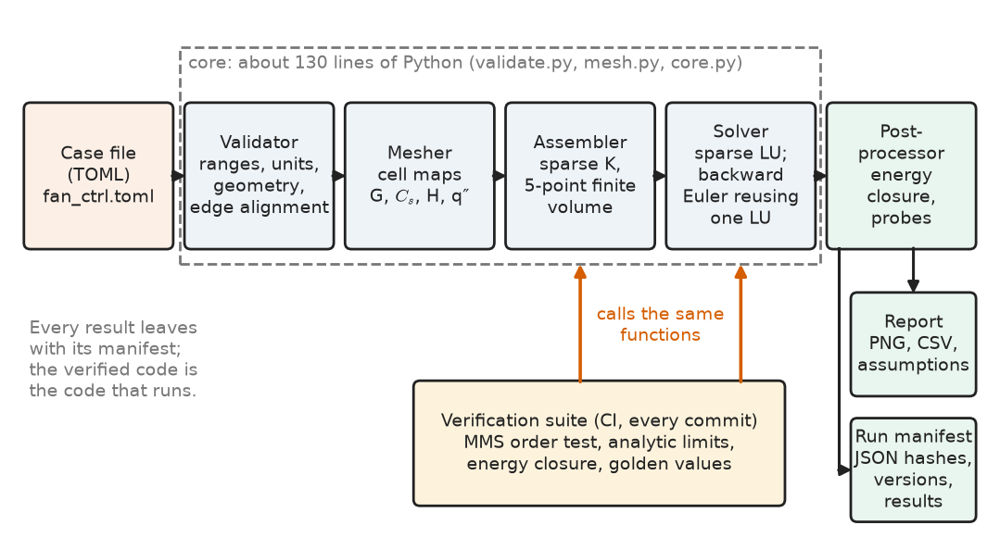
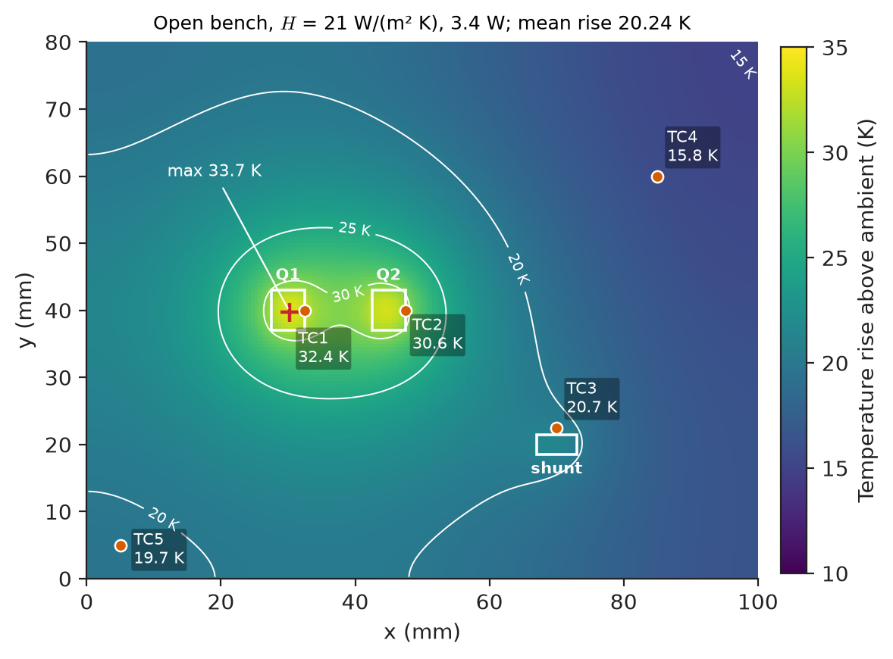
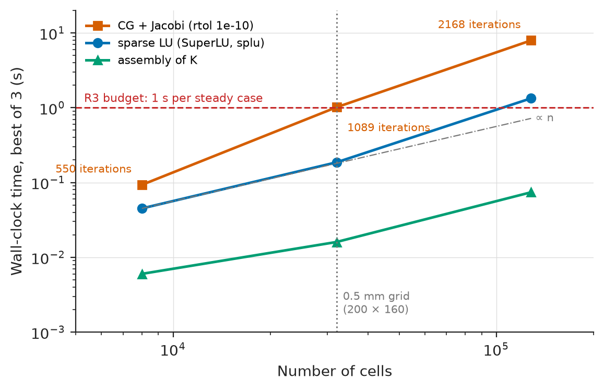
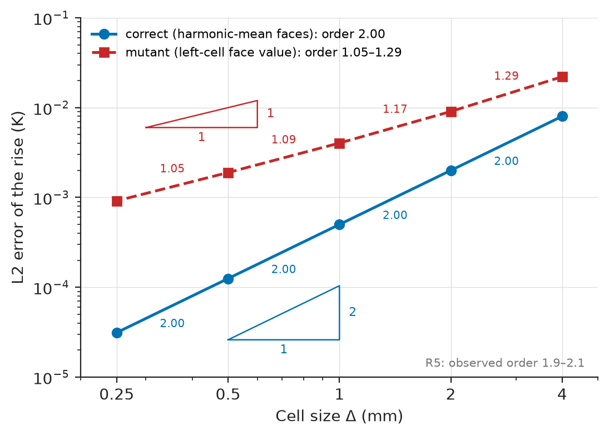
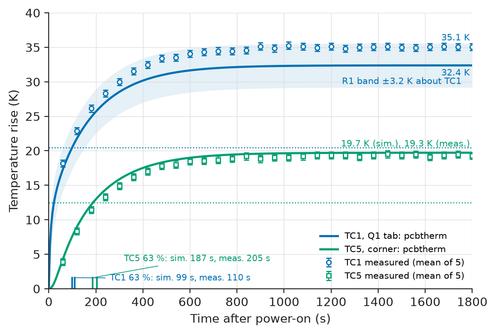

# Chapter 39 — Project: Engineering Simulation Tool

*Part IX · Interdisciplinary Engineering Projects*

A 12 V automotive cooling-fan controller switches up to 25 A through two DFN5×6 MOSFETs in parallel on a 100 × 80 mm two-layer board. The first thermal estimate used the datasheet junction-to-ambient resistance, about 50 K/W "on a 1 in² pad of 2 oz copper", and predicted a 75 K rise for each 1.5 W device. The team responded by adding a \$3.80 clip-on heat sink and a third MOSFET. On the bench the bare board rose only 35 K. Inside the sealed fan housing at 85 °C, though, the thermocouple on Q1's drain tab read 141 °C. That left 9 K to the 150 °C derated limit before the junction-to-tab drop was even added. Each layout variant took a week to evaluate: order boards, assemble, bond thermocouples, soak, repeat. The datasheet $R_{\theta JA}$ describes a JEDEC test board, not this one, so it could not rank variants. A commercial 3-D thermal package could, but it cost about \$25,000 a year and a day of set-up per layout. The team chose a third option. They wrote a small, verified, purpose-built tool, *pcbtherm*. It solves the in-plane heat spreading of a populated board in under a second, sweeps 200 layout variants in under a minute, and carries written evidence of how far its answers can be trusted.

The running reference system is pcbtherm Rev A applied to that board. The physics, numerics and software practice are owned elsewhere; this chapter integrates them into a tool others can rely on.

> **How does an engineer turn a physical question into a simulation tool whose equations, solver, input checks and outputs all serve one design decision?**
> **What evidence — verification, benchmarking, validation, documentation and reproducibility — makes a home-grown tool trustworthy enough to drop a heat sink from a production board?**

| Concept | Engineering destination |
|---|---|
| Problem definition for a tool | Scope tied to one design question; requirements with numbers and verification methods |
| Governing equations with stated assumptions | A model whose validity domain is checked on every run |
| Finite-volume discretisation, sparse direct solve | Sub-second steady solutions; transients that reuse one factorisation |
| Input validation | Unit and geometry errors rejected before any matrix is built |
| Visualization | Maps and probe curves a layout reviewer can act on |
| Benchmarking | Runtime and memory budgets with measured margins; code-to-code comparison |
| Verification and validation | Manufactured solutions, grid convergence, energy closure, comparison with a measured board |
| Documentation | Theory manual, user guide and V&V report shipped with the code |
| Reproducible results | Run manifest and golden-value regression gate |

**Roadmap.** Question and requirements (39.1) → equations and validity checks (39.2) → discretisation and solver (39.3) → input validation (39.4) → visualization (39.5) → benchmarking (39.6) → verification and validation (39.7) → documentation (39.8) → reproducibility (39.9) → cost, test results, FMEA and Revision B (39.10).

---

## 39.1 Problem definition

> **Boundary.** Turning a need into requirements is Chapter 1. The modelling workflow (assumptions, sensitivity, validation) is Chapter 3. The software workflow (version control, reproducible builds, automated tests) is Chapter 29. Solvers, sweeps and numerical verification are Chapter 30. Tool architecture is Chapter 31. Calibration and uncertainty quantification are Chapter 33. This chapter applies all six to one tool.

### The decision the tool must support

Tools fail most often because nobody asked which decision they serve. Here it was concrete. *For a given copper layout, component placement and cooling condition, does any power device exceed its temperature limit, and how much does a proposed layout change move it?* The layout engineer wants to rank ten variants before lunch; the reviewer wants to know whether a 4 K margin is real. The tool must give:

- The steady board-temperature rise at each power component, for two cooling cases: the open bench (for correlation with tests) and the sealed housing (for qualification).
- The warm-up transient, which sets the soak time of the qualification test.
- A ranking of layout variants by copper weight, device spacing and shunt position.

Out of scope: junction temperatures from first principles (the datasheet junction-to-board resistance is added), airflow (convection coefficients are inputs), and forced-air or liquid cooling. Writing the exclusions down stops later users from leaving the validity domain.

### Requirements

**Table 39.1 — Requirements for pcbtherm Rev A.**

| ID | Requirement | Target | Verification method |
|---|---|---|---|
| R1 | Steady rise at power-device pads vs measured reference board | Within ±3 K or ±10 % of the rise, whichever is larger | Validation, five thermocouples (39.7) |
| R2 | Warm-up time to 63 % of final rise | Within ±15 % of measured | Validation (39.7) |
| R3 | Steady solve, 100 × 80 mm board at 0.5 mm cells | ≤ 1 s on the reference workstation | Benchmark (39.6) |
| R4 | Sweep of 200 layout variants | ≤ 5 min | Benchmark (39.6) |
| R5 | Spatial discretisation order | Observed 1.9–2.1 on a manufactured solution | Code verification (39.7) |
| R6 | Energy balance of every steady solution | Relative closure ≤ 1×10⁻⁶ | Automatic check on every run |
| R7 | Invalid input rejected with key, value, unit and range | 24 of 24 seeded bad cases caught | Unit tests (39.4) |
| R8 | Any reported result re-creatable from its manifest | Equal to 4 decimals on a clean environment | Reproduction test (39.9) |
| R9 | Review outputs | Map, probe CSV, run report listing assumptions | Inspection (39.5) |
| R10 | Documentation | Theory manual, user guide, V&V report | Design review (39.8) |

R1 is the requirement the decision rests on. R3 and R4 make the tool usable, and R5–R8 make R1 believable. The ±3 K tolerance comes from the 9 K housing margin: a tool that is right to ±3 K can separate "heat sink needed" from "not needed".

### Architecture of the tool

Figure 39.1 shows the pipeline. Every result leaves with a run manifest, and the verification suite calls the same core functions as the user, so the code that was verified is the code that runs.

<!-- FIGURE 39.1 | figures/ch39/fig-39-1-pcbtherm-architecture.png | block-diagram | Architecture of pcbtherm Rev A, from case file to verified result. | Content: left-to-right boxes: Case file (TOML) then Validator (ranges, units, geometry, edge alignment) then Mesher (cell maps G, Cs, H, q) then Assembler (sparse K, 5-point finite volume) then Solver (sparse LU; backward Euler reusing one factorisation) then Post-processor (energy closure, probes). Outputs: Report (PNG, CSV, assumptions) and Run manifest (JSON hashes, versions, results). Lower row Verification suite (MMS order test, analytic limits, golden values) with arrows to Assembler and Solver labelled same functions. Dashed box around the four core stages labelled about 130 lines of Python. -->



*Figure 39.1 — Architecture of pcbtherm Rev A, from case file to verified result.*

The core is four short files (`validate.py`, `mesh.py`, `core.py`, `manifest.py`) plus a command-line driver; Chapter 31 argues for this modular, file-based form. The deciding argument was review: a 130-line core can be read line by line, and each listing below is one of those files, complete.

---

## 39.2 Governing equations

### The thin-plate energy balance

The board has two 2 oz copper pours (69.6 µm each) on 1.6 mm FR-4. It is thin compared with its width, and copper conducts about 480 times better than FR-4. Heat from a component therefore spreads mainly *in the plane* and leaves through both faces by convection and radiation. Lumping temperature through the thickness, the field-to-lumped step of *Engineering Physics*, [Ch. 17 §17.1](https://github.com/The-Studio-of-Sadiq/Engineering-Physics/blob/main/CHAPTERS/CHAPTER%2017.md), reduces the 3-D heat equation to a 2-D diffusion–reaction equation. Its unknown is the temperature rise $\theta=T-T_\infty$:

$$
C_s\,\frac{\partial \theta}{\partial t}=\nabla\cdot\left(G_s\nabla\theta\right)-H\,\theta+q''(x,y,t)
$$

The symbols are:

- $G_s=\sum_i k_i t_i$, the sheet conductance in W/K.
- $C_s=\sum_i\rho_i c_i t_i$, the heat capacity per unit area in J/(m² K).
- $H=h_{top}+h_{bot}$, the combined film coefficient of the two faces (convection plus linearised radiation).
- $q''$, the dissipated power per unit area under each component.

The edges are treated as adiabatic, since their area is under 4 % of the faces. The result is the two-dimensional fin equation. Its classification, boundary conditions and Biot-number scaling are in *The Mathematics Universe*, [Ch. 13 §13.4 and §13.8](https://github.com/The-Studio-of-Sadiq/engineering-mathematics/blob/main/part-4-differential-equations/13-partial-differential-equations.md). Two scales predict most of its behaviour before any solve:

$$
\ell=\sqrt{G_s/H},\qquad \tau=C_s/H
$$

$\ell$ is how far a hot spot spreads before the faces shed its heat, and $\tau$ is the board time constant. Under uniform heating the rise is simply $P/(HA)$.

> **Status of the principle: Thin-plate (fin) model of a populated PCB**
> *Approximate.* The model holds under four conditions:
> - The through-thickness Biot number is small: $h\,t/k_z\ll1$.
> - The copper layers are well coupled by vias under every heat source.
> - The film coefficient $h$ is constant, which holds within about ±30 K of the design point.
> - Component heat capacity and conduction are negligible beside the board's.

**Table 39.2 — Inputs for the fan-controller board.**

| Quantity | Value | Basis |
|---|---|---|
| Copper conductivity | 385 W/(m K) | Electrodeposited foil, typical |
| FR-4 conductivity, in-plane / through-plane | 0.8 / 0.3 W/(m K) | Laminate datasheet range 0.6–1.0 / 0.25–0.35 |
| Copper thickness per layer | 69.6 µm (2 oz/ft²) | IPC-4562 nominal, plating about ±10 % |
| Sheet conductance $G_s$ | 0.0549 W/K | $2\times385\times69.6\ \mathrm{\mu m}+0.8\times1.6\ \mathrm{mm}$ |
| Heat capacity per area $C_s$ | 3,736 J/(m² K) | Copper 3.45, FR-4 2.04 MJ/(m³ K) |
| $h_{top}$, $h_{bot}$, open bench, horizontal | 12, 9 W/(m² K) | Natural convection 5–7 plus radiation about 5 (ε ≈ 0.9) |
| $h_{top}$, $h_{bot}$, sealed housing | 6, 4 W/(m² K) | Enclosed air, warm housing wall |
| Sources | Q1, Q2: 1.5 W each on 5 × 6 mm; shunt and driver: 0.4 W on 6 × 3.2 mm | Loss calculation at 25 A, 20 kHz |

**Worked example — Is the thin-plate model valid for this board?**

*Through-thickness.* Heat leaving the bottom face must cross the FR-4. The drop across it, relative to the rise, is $h_{bot}t/k_z=9\times1.6\times10^{-3}/0.3=0.048$. That is under 5 %.

*Lateral.* Copper carries $2\times385\times69.6\times10^{-6}/0.0549=97.7\ \%$ of $G_s$, so the FR-4 in-plane value barely matters. The spreading length is $\ell=\sqrt{0.0549/21}=51$ mm, comparable with the board. Edges and device spacing therefore matter, and a 2-D model is needed rather than a single lumped node.

*Time.* $\tau=3736/21=178$ s, so a one-hour soak covers about 20τ.

*Vias, the weak point.* Without vias, the FR-4 under a 30 mm² pad has a through-plane resistance of $1.6\times10^{-3}/(0.3\times30\times10^{-6})=178$ K/W. One plated via (0.3 mm hole, 25 µm wall, 2.55×10⁻⁸ m² of copper) has $1.6\times10^{-3}/(385\times2.55\times10^{-8})=163$ K/W. The 15-via array under each MOSFET therefore gives about 10.9 K/W: good coupling, but not the isothermal stack the model assumes. A few hundred milliwatts crossing near the pad leaves the top copper roughly 2 K hotter than the merged-layer prediction. Section 39.7 measures this bias, and Revision B removes it.

> **Boundary.** Thermal-resistance networks, spreading resistance and convection and radiation coefficients come from *Engineering Physics*, [Ch. 14 §14.7](https://github.com/The-Studio-of-Sadiq/Engineering-Physics/blob/main/CHAPTERS/CHAPTER%2014.md). MOSFET thermal resistances and the switching-loss calculation that sets $q''$ belong to *Electronics and Computing*, [Ch. 29](https://github.com/The-Studio-of-Sadiq/Electronics-and-Computing/blob/main/part-7-power-electronics/29-power-electronic-fundamentals.md), and are applied to a full drive in Chapter 37.

---

## 39.3 Numerical solver

### Discretisation and time integration

The board is cut into square cells of side $\Delta$, each carrying its own $G_s$, $C_s$, $H$ and $q''$. Copper keep-outs, different pours and heat sources are all just maps. Integrating over a cell gives one energy balance per cell, the finite-volume form:

$$
C_s\Delta^2\,\dot\theta_P=\sum_{F\in\{E,W,N,S\}}g_{PF}\,(\theta_F-\theta_P)-H\Delta^2\theta_P+q''_P\Delta^2
$$

The face conductance $g_{PF}$ is the *harmonic* mean of the two cells' $G_s$, which is what two thermal resistances in series give. It stays correct where a pour meets bare laminate. Stacking the cells gives

$$
\mathbf C\dot{\boldsymbol\theta}=-\mathbf K\boldsymbol\theta+\mathbf q,
$$

where $\mathbf K$ is a symmetric positive-definite M-matrix with five non-zeros per row. The scheme conserves energy exactly, which makes requirement R6 a test of the *code*. The consistency, stability and method-of-lines view of such schemes are in *The Mathematics Universe*, [Ch. 22 §22.10–§22.11](https://github.com/The-Studio-of-Sadiq/engineering-mathematics/blob/main/part-7-numerical-computational/22-numerical-methods.md).

> **Status of the principle: Discrete energy conservation of the finite-volume scheme**
> *Derived.* Each face flux leaves one cell and enters its neighbour with the same conductance, so internal fluxes cancel. The total face loss therefore equals the injected power to round-off ($\approx10^{-13}$ relative here). A closure worse than about $10^{-9}$ signals a bug, not a discretisation error.

The transient system is stiff. Its grid-scale modes decay at about $4G_s/(C_s\Delta^2)$, while the board mode decays at $1/\tau$. Backward Euler was chosen:

$$
\left(\tfrac{1}{\Delta t}\mathbf C+\mathbf K\right)\boldsymbol\theta^{n+1}=\tfrac{1}{\Delta t}\mathbf C\,\boldsymbol\theta^{n}+\mathbf q^{n+1}
$$

It is L-stable. Crank–Nicolson rings cell by cell after a step change in power, because its amplification factor tends to −1 for grid-scale modes. With a constant $\Delta t$ the left-hand matrix never changes. It is factorised once, and each step costs only one forward–back substitution.

> **Status of the principle: Implicit stepping for diffusion on fine grids**
> *Derived.* An explicit step must satisfy $\Delta t\le C_s/(4G_s/\Delta^2+H)$, a limit that shrinks with $\Delta^2$. An L-stable implicit step is limited only by the accuracy wanted on the slow modes.

**Worked example — Explicit or implicit for a one-hour warm-up?**

*Explicit.* At $\Delta=0.5$ mm the stability limit is $\Delta t\le3736/(4\times0.0549/(0.5\times10^{-3})^2+21)=4.26$ ms. One hour takes 845,972 steps. Each step is one sparse matrix–vector product, measured at 0.49 ms on 32,000 cells, so the run takes about 410 s.

*Implicit.* Backward Euler with $\Delta t=5$ s takes 720 steps. One factorisation plus 720 solves measured 17.8 s, 23 times faster.

*Accuracy check.* For the board mode at $t=600$ s, the backward-Euler response is $1-(1+5/178)^{-120}=0.9640$ against the exact $1-e^{-600/178}=0.9656$. On a 32.6 K rise that is a 0.05 K error. A 20 s step would give 0.22 K.

### Platform and linear solver

**Table 39.3 — Component selection: implementation platform.**

| Option | Time per case | Validity for this board | Cost (2026) | Verdict |
|---|---|---|---|---|
| Datasheet $R_{\theta JA}$ hand calculation | Seconds | JEDEC board, one device, no layout effect | \$0 | Rejected: cannot rank variants |
| Commercial 3-D thermal FEM/CFD | 1 day setup, 10–30 min solve | Best: layers, vias, airflow | About \$25,000/yr | Kept as code-to-code reference only |
| Python + NumPy/SciPy, finite volume | 0.2 s | Thin-plate domain, checked each run | \$0 (BSD licences) | **Chosen**: fast enough, reviewable |

**Table 39.4 — Component selection: linear solver (32,000 / 128,000 cells, measured in 39.6).**

| Solver | Behaviour on $\mathbf K$ | Time | Verdict |
|---|---|---|---|
| Dense LAPACK | 8.2 GB just to store the 32k matrix | — | Rejected |
| CG, Jacobi preconditioner | Iterations grow as $1/\Delta$ (1,089 → 2,168) | 1.0 s / 7.9 s | Fallback only |
| CG + algebraic multigrid (`pyamg`, optional) | Nearly grid-independent iterations | — | Revision B |
| Sparse LU (SuperLU, `scipy.sparse.linalg.splu`) | Direct; factor reused every time step | 0.19 s / 1.34 s | **Chosen** |

The direct solver also has no convergence tolerance to differ silently between runs, and its factorisation serves the whole transient. Why CG iterations grow with the condition number is in *The Mathematics Universe*, [Ch. 24 §24.4–§24.5](https://github.com/The-Studio-of-Sadiq/engineering-mathematics/blob/main/part-7-numerical-computational/24-computational-mathematics.md).

### The core

`core.py` is the whole numerical core. `assemble` builds $\mathbf K$ face by face in COO form, where duplicate entries are summed on conversion. `steady` solves for the rise. `transient` is a generator, so the caller decides what to keep, and a one-hour run never holds 720 maps in memory.

```python
"""pcbtherm.core -- finite-volume thin-plate thermal solver (Rev A)."""
import numpy as np
import scipy.sparse as sp
import scipy.sparse.linalg as spla

def assemble(G, H, dx, dy):
    """Conductance matrix K in W/K for an (ny, nx) grid of cells.
    G: sheet conductance sum(k*t) per cell, W/K; H: h_top + h_bot, W/(m2 K)."""
    ny, nx = G.shape
    idx = np.arange(nx * ny).reshape(ny, nx)
    hm = lambda a, b: 2.0 * a * b / (a + b)          # harmonic mean at faces
    pairs = [(idx[:, :-1], idx[:, 1:], hm(G[:, :-1], G[:, 1:]) * dy / dx),
             (idx[:-1, :], idx[1:, :], hm(G[:-1, :], G[1:, :]) * dx / dy)]
    r, c, v = [], [], []
    for a, b, g in pairs:                            # each face couples a and b
        a, b, g = a.ravel(), b.ravel(), g.ravel()
        r += [a, b, a, b]; c += [a, b, b, a]; v += [g, g, -g, -g]
    n = nx * ny
    K = sp.coo_matrix((np.concatenate(v), (np.concatenate(r), np.concatenate(c))),
                      shape=(n, n)).tocsc()
    return (K + sp.diags(H.ravel() * dx * dy)).tocsc()

def steady(K, q, dx, dy):
    """Temperature rise (K) for a heat-flux map q in W/m2."""
    return spla.spsolve(K, q.ravel() * dx * dy).reshape(q.shape)

def transient(K, Cs, q_of_t, dx, dy, dt, n_steps, theta0=None):
    """Backward Euler; K factored once. Cs: heat capacity per area, J/(m2 K).
    q_of_t(t) returns the flux map at time t. Yields (t, theta map)."""
    shape = Cs.shape
    M = sp.diags(Cs.ravel() * dx * dy / dt)
    lu = spla.splu((M + K).tocsc())                  # one factorisation
    th = np.zeros(Cs.size) if theta0 is None else theta0.ravel().copy()
    for k in range(1, n_steps + 1):
        t = k * dt
        th = lu.solve(M @ th + q_of_t(t).ravel() * dx * dy)
        yield t, th.reshape(shape)
```

`mesh.py` turns a validated case into the maps. Its one subtle job is rasterising footprints so that **power is conserved exactly** even when the footprint's area is not.

```python
"""pcbtherm.mesh -- turn a validated case into cell maps (SI units)."""
import numpy as np

K_CU, K_FR4 = 385.0, 0.8                 # W/(m K); FR-4 in-plane value
RC_CU, RC_FR4 = 8960 * 385, 1850 * 1100  # volumetric heat capacity, J/(m3 K)
OZ = 34.8e-6                             # m of copper per oz/ft2

def build(cfg):
    b = cfg["board"]
    c = b["cell_mm"] * 1e-3
    nx, ny = round(b["width_mm"] * 1e-3 / c), round(b["height_mm"] * 1e-3 / c)
    t_cu, t_fr = b["copper_oz"] * OZ, b["fr4_mm"] * 1e-3
    G = np.full((ny, nx), 2 * K_CU * t_cu + K_FR4 * t_fr)   # two full pours
    Cs = np.full((ny, nx), 2 * RC_CU * t_cu + RC_FR4 * t_fr)
    H = np.full((ny, nx), float(b["h_top"] + b["h_bot"]))
    X, Y = np.meshgrid((np.arange(nx) + 0.5) * c, (np.arange(ny) + 0.5) * c)
    q = np.zeros((ny, nx))
    for s in cfg.get("source", []):
        m = ((np.abs(X - s["x_mm"] * 1e-3) < s["w_mm"] * 5e-4 + 1e-9) &
             (np.abs(Y - s["y_mm"] * 1e-3) < s["h_mm"] * 5e-4 + 1e-9))
        q += m * s["power_W"] / (m.sum() * c * c)          # power is conserved
    return dict(G=G, Cs=Cs, H=H, q=q, dx=c, dy=c, X=X, Y=Y)
```

Rev A applies the pours uniformly. A per-cell coverage map from the Gerber copper layers changes only the mesher, since the solver already accepts any $G_s$ map. Run on the case file of Section 39.4, the pipeline reports:

- $G_s=0.0549$ W/K and $C_s=3736$ J/(m² K);
- a maximum rise of 33.72 K at Q1;
- a mean rise of 20.24 K, which equals $P/(HA)=3.4/(21\times0.008)$ as it must;
- an energy closure of $6.4\times10^{-13}$.

---

## 39.4 Input validation

The first prototype had no validator. In its second week a user typed a width of `0.1`, meaning metres, into a millimetre field and got a rise of thousands of kelvin. Worse, a footprint dragged half off the board was silently clipped: it lost a third of its area but none of its power, and Q1's prediction rose 6 K. No solver verification catches such slips.

The validator checks **type and range**, **geometry** (on the board, at least two cells, edges on cell faces) and **plausibility** (the lumped mean rise $P/(HA)$). Its ranges are the validated domain, so leaving a range means leaving the model. Two examples: beyond 500 mm the mesh exceeds the memory budget, and $h\le200$ W/(m² K) keeps the through-thickness Biot number below 0.1. Units live in the key names (`width_mm`). Errors stop the run; warnings go into the report.

```python
"""pcbtherm.validate -- reject bad input before any matrix is built."""
RANGES = {  # key: (min, max, unit) -- the validity domain of the Rev A model
    "width_mm": (5, 500, "mm"), "height_mm": (5, 500, "mm"),
    "cell_mm": (0.1, 5, "mm"), "copper_oz": (0.5, 4, "oz"),
    "fr4_mm": (0.4, 3.2, "mm"), "h_top": (2, 200, "W/(m2 K)"),
    "h_bot": (2, 200, "W/(m2 K)"), "ambient_C": (-40, 125, "degC"),
}

def validate(cfg):
    errs, warns = [], []
    b = cfg.get("board", {})
    for key, (lo, hi, unit) in RANGES.items():
        v = b.get(key)
        if not isinstance(v, (int, float)):
            errs.append(f"board.{key}: missing or not a number"); continue
        if not lo <= v <= hi:
            errs.append(f"board.{key} = {v} {unit} outside [{lo}, {hi}]")
    if errs:
        return errs, warns
    W, Hh, c = b["width_mm"], b["height_mm"], b["cell_mm"]
    for i, s in enumerate(cfg.get("source", [])):
        x, y, w, h, p = (s[k] for k in ("x_mm", "y_mm", "w_mm", "h_mm", "power_W"))
        if not (0 <= x - w/2 and x + w/2 <= W and 0 <= y - h/2 and y + h/2 <= Hh):
            errs.append(f"source[{i}] footprint leaves the board")
        if not 0 <= p <= 100:
            errs.append(f"source[{i}].power_W = {p} outside [0, 100]")
        if min(w, h) < 2 * c:
            warns.append(f"source[{i}] spans < 2 cells; refine cell_mm")
        edges = (x - w/2, x + w/2, y - h/2, y + h/2)
        if any(abs(e / c - round(e / c)) > 1e-6 for e in edges):
            warns.append(f"source[{i}] edges off the cell faces; area will change")
    P = sum(s["power_W"] for s in cfg.get("source", []))
    rise = P / ((b["h_top"] + b["h_bot"]) * W * Hh * 1e-6)
    if rise > 100:
        warns.append(f"mean rise {rise:.0f} K: constant-h model not valid")
    return errs, warns
```

Every later result in this chapter comes from the reference case file `fan_ctrl.toml`. Its board section is:

```toml
# fan_ctrl.toml -- 12 V fan-controller board, Rev 2 layout
[board]
width_mm = 100
height_mm = 80
cell_mm = 0.5
copper_oz = 2          # top and bottom pours
fr4_mm = 1.6
h_top = 12             # W/(m2 K), open bench, board horizontal
h_bot = 9
ambient_C = 40
```

Three `[[source]]` tables follow, from Table 39.2: Q1 at (30, 40) mm, Q2 at (45, 40) mm, the shunt group at (70, 20) mm. Validating the clean case, then the width as `0.1`, then Q1 at `x_mm = 98` returns:

```text
([], ['source[2] edges off the cell faces; area will change'])
(['board.width_mm = 0.1 mm outside [5, 500]'], [])
(['source[0] footprint leaves the board'], ['source[2] edges off the cell faces; area will change'])
```

The clean-case warning is real: the 3.2 mm shunt group becomes 3.0 mm on the grid, raising its local flux 7 % with power conserved. The edge check itself came from a failed grid study (Section 39.7). R7 is closed by 24 seeded bad cases (missing keys, strings, negative powers, metres in each length field, sources off each edge, sub-cell footprints); all 24 are caught.

> **Status of the principle: Validity domain enforced at the input**
> *Empirical.* In use, unit and geometry slips outnumber solver bugs among the faults users actually hit. Range checks tied to the validated domain catch them at no run-time cost, but only the faults someone anticipated. Each new fault seen in use becomes a new seeded test.

---

## 39.5 Visualization

Each plot exists to support the decision, so each has one job:

- **The steady map** (Figure 39.2): perceptually uniform colours, 5 K contours, footprints and thermocouples drawn, and a scale fixed per study, since auto-scaling hides a 10 K improvement.
- **Probe curves** (Figure 39.5) overlay simulation lines and measured markers with error bars.
- **The variant table**: one row per layout, each device's margin, sorted by the worst. For ranking, a table beats any picture.

Each PNG is written beside the CSV of its data. The plotting practice is *Electronics and Computing*, [Ch. 22 §22.4](https://github.com/The-Studio-of-Sadiq/Electronics-and-Computing/blob/main/part-5-programming-and-computational-systems/22-python-for-engineering.md). The run report adds the validator warnings, the computed validity checks (Biot number, $\ell$, $\tau$) and the manifest hash, so a figure separated from its report can still be traced to its run.

<!-- FIGURE 39.2 | figures/ch39/fig-39-2-steady-map-bench.png | plot | Steady temperature-rise map of the fan-controller board on the open bench (pcbtherm Rev A, 0.5 mm cells). | Content: colour map, x 0 to 100 mm, y 0 to 80 mm, equal aspect, viridis fixed 10 to 35 K, contours every 5 K. Outlines of Q1 (27.5 to 32.5, 37 to 43 mm), Q2 (42.5 to 47.5, 37 to 43 mm), shunt (67 to 73, 18.5 to 21.5 mm). Maximum 33.7 K marked at Q1. Markers TC1 (32.5, 40), TC2 (47.5, 40), TC3 (70, 22.5), TC4 (85, 60), TC5 (5, 5) labelled 32.4, 30.6, 20.7, 15.8, 19.7 K. Colour bar: rise in K. -->



*Figure 39.2 — Steady temperature-rise map of the fan-controller board on the open bench (pcbtherm Rev A, 0.5 mm cells).*

Several things can be read from the map. TC1 reads hotter than TC2 (32.4 K against 30.6 K) although both MOSFETs dissipate 1.5 W. TC1 sits in the 10 mm gap between the devices and is heated from both sides, while TC2 faces open copper.

The lower-left corner (TC5, 19.7 K) is warmer than the upper-right region (TC4, 15.8 K). It lies 43 mm from Q1, inside one spreading length, and the two adiabatic edges that meet there turn back heat that would otherwise spread outward.

The actionable fact is that the MOSFETs heat each other. Moving Q2 out to 30 mm centre spacing lowers TC1 from 32.4 K to 29.0 K on the bench. 10 % thicker copper is worth only 1.0 K.

**Worked example — Reading a variant sweep.** A cost-reduction proposal swaps 2 oz copper for 1 oz. The tool predicts that TC1 rises from 32.4 K to 42.7 K on the bench, because the spreading length shrinks from 51 mm to $\sqrt{0.0281/21}=37$ mm. To transfer this to the housing, scale by the ratio of housing to bench rise at TC1, 55.1/32.4 = 1.70. The 10.3 K bench increase becomes about 17.5 K in the housing, which consumes the 9 K margin twice over. The variant row is flagged red, and the proposal is closed without building a board.

---

## 39.6 Benchmarking

Benchmarking has two meanings here. **Performance benchmarking** measures time and memory against R3 and R4. **Code-to-code benchmarking** compares results with an independent, more complete model.

### Performance

The steady solve was timed on three grids, best of three warm runs, following the benchmarking hygiene of *Electronics and Computing*, [Ch. 24 §24.6](https://github.com/The-Studio-of-Sadiq/Electronics-and-Computing/blob/main/part-5-programming-and-computational-systems/24-scientific-computing.md). The script times `assemble`, `splu(K).solve(b)` and `scipy.sparse.linalg.cg` with a Jacobi preconditioner (`rtol=1e-10`):

```text
 cells   assemble   splu      CG+Jacobi  iters
   8000    0.006    0.045      0.093    550
  32000    0.016    0.186      1.014   1089
 128000    0.074    1.336      7.946   2168
```

On an 8-core desktop (Python 3.14, NumPy 2.5, SciPy 1.18) sparse LU grows about linearly on the first refinement (4.1×) but 7.2× on the second, roughly $n^{1.4}$, while CG doubles its iterations at each halving of the cell size and grows 8–11× per refinement. Absolute times differ between machines; the ratios carry over. Figure 39.3 plots both against the R3 budget.

<!-- FIGURE 39.3 | figures/ch39/fig-39-3-runtime-scaling.png | plot | Measured steady-solve time against number of cells for sparse LU and Jacobi-preconditioned CG, with the R3 budget. | Content: log-log, x cells 5e3 to 2e5, y time 1e-3 to 20 s. Assembly 0.006, 0.016, 0.074 s; sparse LU 0.045, 0.186, 1.336 s; CG 0.093, 1.014, 7.946 s (iterations 550, 1089, 2168 annotated), all at 8,000, 32,000, 128,000 cells. Dashed line at 1 s labelled R3; dotted vertical at 32,000 cells labelled 0.5 mm grid. -->



*Figure 39.3 — Measured steady-solve time against number of cells for sparse LU and Jacobi-preconditioned CG, with the R3 budget.*

**Table 39.5 — Runtime and memory budget (reference grid 200 × 160 = 32,000 cells).**

| Item | Budget | Measured or computed | Margin |
|---|---|---|---|
| Steady case: validate, mesh, assemble, LU (R3) | 1.0 s | 0.22 s | 78 % |
| 200-variant sweep, serial (R4) | 300 s | 200 × 0.22 s = 44 s | 85 % |
| One-hour transient, $\Delta t=5$ s | 60 s (usability) | 17.8 s | 70 % |
| LU factor memory, 0.5 mm grid | 500 MB | 31 MB | 94 % |
| LU factor memory, 0.25 mm grid | 500 MB | 161 MB | 68 % |

**Worked example — Memory budget of the direct solver.** At 0.5 mm, $\mathbf K$ has 159,280 non-zeros. SuperLU's factors have 2,603,166, a fill ratio of 16.3. At 12 bytes per entry (an 8-byte value and a 4-byte index) that is 31 MB. At 0.25 mm the fill ratio rises to 21.0 and the factors take 161 MB. Fill grows roughly as $n\log n$, so 0.125 mm (512,000 cells) needs an estimated 0.8 GB and a measured 16 s solve. That breaks R3, which is why the validator's limits cap the cell count. Above that size, CG with algebraic multigrid is the right solver.

### Code-to-code comparison

The independent reference was a 3-D finite-element model with both copper layers, the FR-4 and the 15 vias under each MOSFET, run once by a consultant with the same convection coefficients. Air was not modelled, so the comparison isolates *model form* from convection uncertainty.

**Table 39.6 — Code-to-code benchmark, open bench, rise above ambient (K).**

| Location | pcbtherm Rev A (2-D) | 3-D FEM | Difference |
|---|---|---|---|
| TC1, Q1 tab | 32.4 | 34.5 | −2.1 |
| TC2, Q2 tab | 30.6 | 32.7 | −2.1 |
| TC3, shunt | 20.7 | 21.0 | −0.3 |
| TC4, upper right | 15.8 | 15.7 | +0.1 |
| TC5, corner | 19.7 | 19.5 | +0.2 |
| Board mean | 20.24 | 20.24 | 0.0 |

Away from the sources the two models agree to ±0.2 K, and the means agree exactly because both conserve energy with the same $H$. Spreading and convection are therefore right. The −2.1 K at the MOSFET tabs is the merged-layer bias predicted in Section 39.2: near a source, the top copper runs hotter than the layer average. This *model-form* error is systematic and its sign is known.

---

## 39.7 Verification

> **Boundary.** The theory of consistency, stability and convergence, and the method of manufactured solutions, are in *The Mathematics Universe*, [Ch. 22 §22.11](https://github.com/The-Studio-of-Sadiq/engineering-mathematics/blob/main/part-7-numerical-computational/22-numerical-methods.md) and [Ch. 24 §24.9](https://github.com/The-Studio-of-Sadiq/engineering-mathematics/blob/main/part-7-numerical-computational/24-computational-mathematics.md). Linearised (GUM) uncertainty propagation is in [Ch. 24 §24.8](https://github.com/The-Studio-of-Sadiq/engineering-mathematics/blob/main/part-7-numerical-computational/24-computational-mathematics.md) of the same book. The general verification workflow is Chapter 30.

The evidence has three layers, and each answers a different question:

- **Code verification:** does the program solve its equations at the designed order?
- **Solution verification:** how large is the discretisation error for this case?
- **Validation:** do the equations describe this board well enough for R1?

A good validation match can hide two cancelling bugs; a verified code can still solve the wrong equations.

### Code verification: the manufactured solution

The manufactured solution is $\theta_m=10\cos(\pi x/L_x)\cos(\pi y/L_y)$. Its normal derivative is zero on every edge, so it satisfies the adiabatic boundary conditions. The conductance is graded, $G(x)=G_0(1+0.5x/L_x)$, so that the harmonic-mean face code is exercised. The source that makes $\theta_m$ exact is computed analytically, and the error is measured as the grid is refined.

```python
"""Code verification by the method of manufactured solutions (MMS)."""
import numpy as np
from core import assemble, steady

Lx, Ly, G0, beta, Hc = 0.100, 0.080, 0.055, 0.5, 21.0
a, b = np.pi / Lx, np.pi / Ly
T_m = lambda x, y: 10.0 * np.cos(a * x) * np.cos(b * y)   # dT/dn = 0 on edges
G_f = lambda x: G0 * (1.0 + beta * x / Lx)                # graded copper

def source(x, y):        # q = -div(G grad T) + H T for the manufactured T
    Tx = -10.0 * a * np.sin(a * x) * np.cos(b * y)
    return -(G0 * beta / Lx) * Tx + G_f(x) * (a**2 + b**2) * T_m(x, y) + Hc * T_m(x, y)

prev = None
for n in (25, 50, 100, 200, 400):
    nx, ny = n, int(0.8 * n)
    dx, dy = Lx / nx, Ly / ny
    X, Y = np.meshgrid((np.arange(nx) + 0.5) * dx, (np.arange(ny) + 0.5) * dy)
    K = assemble(G_f(X), np.full(X.shape, Hc), dx, dy)
    err = steady(K, source(X, Y), dx, dy) - T_m(X, Y)
    e2 = np.sqrt(np.mean(err**2))
    p = "" if prev is None else f"  order {np.log2(prev / e2):.2f}"
    print(f"nx={nx:4d}  dx={dx*1e3:5.2f} mm  L2 error={e2:.3e} K{p}")
    prev = e2
```

```text
nx=  25  dx= 4.00 mm  L2 error=8.010e-03 K
nx=  50  dx= 2.00 mm  L2 error=2.001e-03 K  order 2.00
nx= 100  dx= 1.00 mm  L2 error=5.002e-04 K  order 2.00
nx= 200  dx= 0.50 mm  L2 error=1.250e-04 K  order 2.00
nx= 400  dx= 0.25 mm  L2 error=3.126e-05 K  order 2.00
```

The observed order is 2.00 on every refinement, which closes R5. A test is only as good as its power to fail, so the test was itself tested by *mutation*. The harmonic mean was replaced with the left cell's value (`hm = lambda a, b: a`). The script then printed orders of 1.29, 1.17, 1.09 and 1.05, with errors 3 to 29 times larger. A test on uniform copper would have missed this bug entirely, because both versions agree when $G$ is constant. Figure 39.4 shows both slopes.

<!-- FIGURE 39.4 | figures/ch39/fig-39-4-mms-convergence.png | plot | Manufactured-solution convergence of pcbtherm: correct code against a mutated face average. | Content: log-log, x cell size 0.25 to 4 mm, y L2 error 1e-5 to 1e-1 K. Correct: 8.010e-3, 2.001e-3, 5.002e-4, 1.250e-4, 3.126e-5 K at 4, 2, 1, 0.5, 0.25 mm, solid, labelled order 2.00. Mutated (left-cell face value): 2.210e-2, 9.060e-3, 4.034e-3, 1.894e-3, 9.159e-4 K, dashed, labelled order 1.05 to 1.29. Slope triangles 1 and 2. -->



*Figure 39.4 — Manufactured-solution convergence of pcbtherm: correct code against a mutated face average.*

> **Status of the principle: Observed order of accuracy as a code test**
> *Derived.* For a consistent, stable scheme of order $p$, the error on a smooth solution falls as $\Delta^p$ in the asymptotic range. If the observed order matches the design order to ±0.1 over three or more refinements, every term of the discrete operator, including boundaries and variable coefficients, is implemented as derived.

Every commit also checks energy closure (R6, $6.4\times10^{-13}$), the lumped limit (uniform heating gives $\theta=q''/H$ to $10^{-12}$ and follows $1-e^{-t/\tau}$), symmetry and linearity.

### Solution verification: grid convergence

**Worked example — Grid convergence index for the Q1 pad rise.** The pad-mean rises on the 0.5, 0.25 and 0.125 mm grids are $f_3=32.5949$, $f_2=32.5698$ and $f_1=32.5635$ K.

- The observed order is $p=\ln[(f_3-f_2)/(f_2-f_1)]/\ln2=\ln(0.0251/0.0063)/\ln2=1.99$.
- The Richardson-extrapolated value is $f_{ext}=f_1+(f_1-f_2)/(2^p-1)=32.561$ K.
- The production grid (0.5 mm) is the coarse member of the first pair. Its coarse-grid index is $1.25\,\lvert f_3-f_2\rvert\,2^p/(2^p-1)=1.25\times0.0251\times3.97/2.97=0.042$ K, or 0.13 %.
- The direct estimate $f_3-f_{ext}=0.034$ K lies inside that band.

Discretisation error is therefore negligible against ±3 K. The 0.5 mm grid stands, and the error budget carries 0.04 K for it.

The first attempt failed. Grids of 1.0, 0.5 and 0.25 mm gave 32.316, 32.595 and 32.570 K, non-monotonic. On the 1 mm grid the pad edges at 27.5 and 32.5 mm fall on cell *centres*, so the footprint became 6 mm wide: each grid solved a different source. The validator's edge-alignment warning dates from this failure.

> **Status of the principle: Grid convergence index with safety factor 1.25**
> *Empirical.* Roache set the factor 1.25 for three-grid studies from a large body of CFD cases. It covers roughly 95 % of observed discretisation errors when the observed order is near the formal order. It is not a bound, and it applies only in the asymptotic range, which the observed order of 1.99 confirms here.

### Validation against the reference board

Five Rev 2 boards carried 36 AWG type T thermocouples, epoxy-bonded at the five positions of Figure 39.2, and lay horizontal in a draught-shielded box at 23.4 °C. Power was measured electrically to ±2 % (standard uncertainty) and temperatures logged at 1 s.

Before any comparison, $H$ was *calibrated once* on a heater-only coupon of the same size, which carries a distributed 3.4 W resistive film. Its mean rise gives $H=P/(A\bar\theta)=21.0$ W/(m² K) ±5 %. That value was frozen for every prediction, so the validation below is not a fit. Keeping calibration data separate from validation data is Chapter 33's subject.

**Table 39.7 — Error budget for the predicted TC1 rise (32.4 K), standard uncertainties.**

| Source | Input uncertainty | Normalised sensitivity | Contribution (K) |
|---|---|---|---|
| Film coefficient $H$ (calibrated) | 5 % | −0.544 | 0.88 |
| Copper thickness (±10 %, rectangular) | 5.8 % | −0.314 | 0.59 |
| Dissipated power | 2 % | +1.000 | 0.65 |
| FR-4 in-plane conductivity (±50 %, rectangular) | 29 % | −0.008 | 0.08 |
| Discretisation (GCI, 0.5 mm) | — | — | 0.04 |
| Thermocouple and logger (±0.5 K limit) | — | — | 0.29 |
| Thermocouple position (±1 mm on the tab gradient) | — | — | 0.40 |
| **Combined, $u_{val}$** | | | **1.34** |

Sensitivities come from re-running the tool with one input perturbed at a time. Calibration is what makes R1 testable: a handbook $H$ known to ±20 % would contribute 3.5 K alone.

**Table 39.8 — Validation results, open bench, steady state at 60 min (mean of five boards; ± is board-to-board standard deviation).**

| Location | Predicted | Measured | $E$ = measured − predicted | Limit | Result |
|---|---|---|---|---|---|
| TC1, Q1 tab | 32.4 K | 35.1 ± 0.5 K | +2.7 K | ±3.2 K (10 %) | Pass, margin 0.5 K |
| TC2, Q2 tab | 30.6 K | 33.2 ± 0.5 K | +2.6 K | ±3.1 K (10 %) | Pass, margin 0.5 K |
| TC3, shunt | 20.7 K | 21.4 ± 0.4 K | +0.7 K | ±3.0 K | Pass |
| TC4, upper right | 15.8 K | 15.6 ± 0.4 K | −0.2 K | ±3.0 K | Pass |
| TC5, corner | 19.7 K | 19.3 ± 0.4 K | −0.4 K | ±3.0 K | Pass |
| Time to 63 %, TC1 | 99 s | 110 ± 5 s | −10 % | ±15 % | Pass |
| Time to 63 %, TC5 | 187 s | 205 ± 5 s | −9 % | ±15 % | Pass |

**Worked example — Is the remaining difference a model error?** Following ASME V&V 20, the comparison error $E$ is set against $u_{val}=1.34$ K.

- At TC1, $\lvert E\rvert=2.7$ K is just above $2u_{val}=2.68$ K. At the 95 % level, input, numerical and measurement uncertainty cannot explain it, so a model-form error is indicated.
- Its sign and size match the −2.1 K difference between pcbtherm and the 3-D model in Table 39.6, which is the merged-layer bias.
- Away from the sources, $\lvert E\rvert\le0.7$ K, well inside $2u_{val}$. No model error is detectable there.

The report records that Rev A meets R1 everywhere, with a declared 2–3 K under-prediction at source pads that the margin must absorb until Revision B.

The housing case was checked with the calibrated housing value $H=10$ W/(m² K). TC1 was predicted at 55.1 K and measured at 57.6 K, with the same sign of bias. The decision was then taken on the tool:

1. Q2 was moved out to 30 mm centre spacing. The tool predicts this lowers the housing TC1 rise to 51.4 K.
2. At 85 °C ambient, with the declared bias added, the tab reaches 85 + 51.4 + 2.6 = 139.0 °C.
3. The junction-to-tab drop adds 1.2 K/W × 1.5 W = 1.8 K, giving a junction of about 140.8 °C. That is 9.2 K below the 150 °C derated limit.
4. The heat sink and the third MOSFET were both dropped.

One confirmation board measured 53.8 K at TC1 in the housing. That is +2.4 K, inside the declared bias.

<!-- FIGURE 39.5 | figures/ch39/fig-39-5-transient-validation.png | plot | Warm-up transient at the Q1 tab (TC1) and the board corner (TC5): pcbtherm Rev A against the mean of five measured boards. | Content: x 0 to 1800 s, y rise 0 to 40 K. Simulated lines: TC1 17.3, 21.8, 28.5, 31.7, 32.2, 32.4 K and TC5 4.3, 9.0, 15.9, 19.0, 19.6, 19.7 K at 60, 120, 300, 600, 900, 1200 s. Measured markers every 60 s with ±0.5 K bars, settling at 35.1 K and 19.3 K. Dotted 63 % lines; ticks at simulated 99 s and 187 s, measured 110 s and 205 s. Shaded ±3.2 K band about TC1 labelled R1. -->



*Figure 39.5 — Warm-up transient at the Q1 tab (TC1) and the board corner (TC5): pcbtherm Rev A against the mean of five measured boards.*

**Table 39.9 — Verification of pcbtherm Rev A against its requirements.**

| ID | Test | Limit | Result | Pass/fail |
|---|---|---|---|---|
| R1 | Five-thermocouple validation | ±3 K or ±10 % | Worst +2.7 K (limit 3.2 K) | Pass, bias declared |
| R2 | Time to 63 % | ±15 % | −10 %, −9 % | Pass |
| R3 | Steady benchmark, 0.5 mm | ≤ 1 s | 0.22 s | Pass |
| R4 | 200-variant sweep | ≤ 300 s | 44 s | Pass |
| R5 | MMS order, graded copper | 1.9–2.1 | 2.00; mutant 1.05–1.29 detected | Pass |
| R6 | Energy closure | ≤ 1 × 10⁻⁶ | 6.4 × 10⁻¹³ | Pass |
| R7 | Seeded invalid inputs | 24/24 | 24/24 | Pass |
| R8 | Clean-environment reproduction | Equal to 4 decimals | Equal (39.9) | Pass |
| R9 | Report inspection | Map, CSV, assumptions | Present | Pass |
| R10 | Documentation review | Three documents approved | Approved, two actions | Pass |

---

## 39.8 Documentation

A tool without documentation is trusted only by its author. pcbtherm ships three Markdown documents in its repository, versioned and released with the code (Chapter 5 for revision control, Chapter 29 for docs-as-code).

**Table 39.10 — Documentation set of pcbtherm Rev A.**

| Document | Reader | Contents | How it stays correct |
|---|---|---|---|
| Theory manual (9 pp.) | Reviewer, maintainer | Equation and assumptions of 39.2; validity checks with formulas; solver choice; known biases with measured size | Each formula has a matching test; bias values are copied in from the V&V report by the build |
| User guide (6 pp.) | Layout engineer | Case-file reference; fan-board example; meaning of each warning; what not to use the tool for | Key table generated from `RANGES`; examples run as doctests in CI |
| V&V report (14 pp.) | Design review, quality | MMS and mutation results; grid study; benchmarks; error budget; validation tables and set-up photos | Regenerated from test outputs at each release; signed by the reviewer |

Two habits keep them honest. **Limits have one source**: the user guide's range table is generated from `validate.py`. **Assumptions carry numbers**: "valid for thin boards" becomes "valid when $h_{bot}t/k_z<0.1$; this board: 0.048", and the merged-layer assumption is listed with its measured 2–3 K bias. A reviewer can sign off a tool whose documents state its known errors.

---

## 39.9 Reproducible results

A prediction that dropped a heat sink may be questioned years later; reproducing it needs the exact input, code, library versions and result. The practice is set out in *Electronics and Computing*, [Ch. 22 §22.10](https://github.com/The-Studio-of-Sadiq/Electronics-and-Computing/blob/main/part-5-programming-and-computational-systems/22-python-for-engineering.md) and [Ch. 24 §24.8](https://github.com/The-Studio-of-Sadiq/Electronics-and-Computing/blob/main/part-5-programming-and-computational-systems/24-scientific-computing.md). pcbtherm automates it by writing a manifest beside every result.

```python
"""pcbtherm.manifest -- write what is needed to reproduce a result."""
import hashlib, json, platform
import numpy as np, scipy

def sha256(path):
    with open(path, "rb") as f:
        return hashlib.sha256(f.read()).hexdigest()[:16]

def write_manifest(case, code_files, results, out="run_manifest.json"):
    m = {
        "case": {"file": case, "sha256": sha256(case)},
        "code": {f: sha256(f) for f in code_files},
        "env": {"python": platform.python_version(), "numpy": np.__version__,
                "scipy": scipy.__version__, "os": platform.system()},
        "results": {k: round(float(v), 4) for k, v in results.items()},
    }
    with open(out, "w") as f:
        json.dump(m, f, indent=1, sort_keys=True)
    return m

def check_golden(results, golden, rtol=1e-6):
    """Regression gate: compare against stored golden values."""
    return {k: (results[k], g) for k, g in golden.items()
            if abs(results[k] - g) > rtol * max(1.0, abs(g))}

if __name__ == "__main__":
    res = {"pad_Q1_rise_K": 32.5949, "max_rise_K": 33.7183, "mean_rise_K": 20.2381}
    m = write_manifest("fan_ctrl.toml", ["core.py", "mesh.py", "validate.py"], res)
    print(m["env"]["scipy"], "regressions:", check_golden(res, {"pad_Q1_rise_K": 32.5949}))
    print("regressions:", check_golden(res, {"pad_Q1_rise_K": 32.3162}))
```

```text
1.18.1 regressions: {}
regressions: {'pad_Q1_rise_K': (32.5949, 32.3162)}
```

The second call shows the gate firing. 32.3162 K is the pad value from the misaligned 1 mm grid of Section 39.7. If a mesher change ever brought it back, CI would fail and print both numbers. The hash covers the file's bytes, so `.gitattributes` forces LF line endings on `*.toml` files.

Golden values are stored for six reference cases. The relative tolerance is $10^{-6}$. That is far above the $10^{-12}$-scale scatter between BLAS builds and CPUs on this well-conditioned problem, and far below the 0.01 K that matters in engineering. Bit-for-bit equality was rejected: a gate that fails on harmless platform changes teaches people to ignore it.

> **Status of the principle: Tolerance-based regression on golden values**
> *Empirical.* A tolerance set orders of magnitude above the observed platform scatter, and orders below any engineering-significant change, separates refactoring noise from changes in behaviour. The window has to be measured again for an ill-conditioned problem.

R8 was verified the way a sceptical reviewer would do it. On a second machine running another operating system, the team built a fresh environment from the lock file (exact versions with hashes), checked out tag `v1.0.0` and re-ran the archived case. The case and code hashes matched, all results agreed to the four stored decimals, and the full-precision values differed by at most $3\times10^{-13}$ K. Chapter 29 shows how to turn this into one CI command.

---

## 39.10 Project close-out: cost, test results, failure analysis and Revision B

### Bill of materials and indicative cost

**Table 39.11 — Bill of materials, pcbtherm Rev A development and validation (2026 indicative prices).**

| Item | Qty | Unit | Cost |
|---|---|---|---|
| Python, NumPy, SciPy, Matplotlib (BSD licences) | — | \$0 | \$0 |
| Hosted CI minutes | 12 months | \$8 | \$96 |
| Validation boards, Rev 2, assembled | 5 | \$36 | \$180 |
| Heater-only calibration coupons | 2 | \$45 | \$90 |
| Type T thermocouples 36 AWG, epoxy, tape | 30 | \$4.53 | \$136 |
| Thermocouple logger (lab stock, cross-charged) and draught box | 1 | \$210 | \$210 |
| 3-D FEM reference run (consultant, 1 day) | 1 | \$1,200 | \$1,200 |
| Engineering time: tool, tests, documents | 120 h | \$85 | \$10,200 |
| Validation testing and report | 40 h | \$85 | \$3,400 |
| **Total** | | | **\$15,512** |

Engineering time is 88 % of the cost, which is why in-house tools must stay narrow. Against it:

- One avoided layout iteration is worth about \$3,000.
- The dropped heat sink saves \$3.80 × 40,000 units a year, or \$152,000 a year.
- The commercial licence the tool replaces for everyday use costs \$25,000 a year.

### Test results

The test results are Tables 39.8 and 39.9. In its first three months the tool ran 1,420 cases; the validator rejected 37 (31 unit slips, 6 geometry) and warned on 112. No prediction has since been found wrong beyond its declared bias.

### Failure analysis

**Table 39.12 — FMEA of pcbtherm Rev A as a design tool.**

| Failure mode | Effect | Cause | Detection | Mitigation |
|---|---|---|---|---|
| Pad rise under-predicted by 2–3 K | Margin over-stated | Copper layers merged; via resistance (about 11 K/W per array) neglected | Code-to-code (−2.1 K); validation ($E$ = +2.7 K) | Bias stated in every report; Revision B two-layer model |
| Units slip, e.g. metres in a mm field | Absurd or plausible-but-wrong result | Free-form numeric input | Range check (R7) | Units in key names; validity ranges; seeded tests |
| Footprint partly off the board | Hot spot over-predicted by up to 6 K | Placement exported from layout | Geometry check | Error stops the run |
| Footprint edges off cell faces | Source area changes with grid; grid study non-monotonic | Rasterisation by cell centre | Failed grid study | Edge-alignment warning; aligned grids for studies |
| $h$ applied outside its case | Error grows silently | Bench $h$ used for housing | Range and mean-rise checks | Calibrated $H$ stored as named presets |
| Face-average coding error | Wrong spreading at copper boundaries | Refactoring | MMS with graded $G$ (order 2.00 → 1.05) | MMS in CI; mutation test kept |
| Silent library change | Results drift between releases | Unpinned SciPy update | Golden values at $10^{-6}$ | Lock file; versions in manifest |

The first row is the only failure verification did not prevent. The code was verified and converged; the error lay in the *equations*, in an assumption that was stated, estimated (10.9 K/W of vias), judged acceptable and then measured rather than hidden. Exposing model-form error is what V&V is for.

### Revision B

| Change | Why | Expected effect |
|---|---|---|
| Two-layer model: top and bottom sheets coupled by $k_z/t$ per area plus a via-conductance map from the drill file | Removes the merged-layer bias | Pad error about ±0.5 K against 3-D; twice the unknowns, about 2.5× solve time, R3 still met |
| Copper-coverage map from Gerber layers | Real pours have keep-outs, traces and thermal reliefs | Correct spreading near connectors and isolated pads |
| Temperature-dependent $h$ (natural-convection correlation plus exact radiation), Picard iteration | Constant $h$ is valid only within about ±30 K of calibration | Domain extended to 100 K rises at 3–5 extra solves |
| CG + algebraic multigrid above 200,000 cells; junction output from a parts library of $R_{\theta JB}$ | Direct-solver memory grows as $n\log n$; manual junction step can be skipped | Fine-pitch boards at 0.1 mm cells within 2 GB; junction margin reported directly |

---

## What remains open

| Open question | Where it is answered |
|---|---|
| How is a tool structured so that new physics (two layers, non-linear $h$) is added without rewriting the core? | Chapter 31 |
| How are sweeps, layout optimisation and parallel runs of 10,000 variants organised? | Chapter 30 |
| How is $H$ re-calibrated from end-of-line or field data, with its uncertainty carried into predictions? | Chapter 33 |
| How are the CI pipeline, lock file and release tagging set up so that R8 holds for every release? | Chapter 29 |
| How are MOSFET and shunt losses computed from the drive's operating point? | Chapter 37; *Electronics and Computing*, [Ch. 29](https://github.com/The-Studio-of-Sadiq/Electronics-and-Computing/blob/main/part-7-power-electronics/29-power-electronic-fundamentals.md) |
| What is the mathematics of discretisation convergence and iterative-solver rates? | *The Mathematics Universe*, [Ch. 22](https://github.com/The-Studio-of-Sadiq/engineering-mathematics/blob/main/part-7-numerical-computational/22-numerical-methods.md) and [Ch. 24](https://github.com/The-Studio-of-Sadiq/engineering-mathematics/blob/main/part-7-numerical-computational/24-computational-mathematics.md) |
| How is a whole project like this planned, reviewed and written up as a capstone? | Chapter 40 |

**Next:** Chapter 40 steps back from single projects to the capstone method: selecting, planning, designing, verifying, costing, risk-assessing and reporting a complete engineering project, worked through on one capstone from problem selection to final report.
