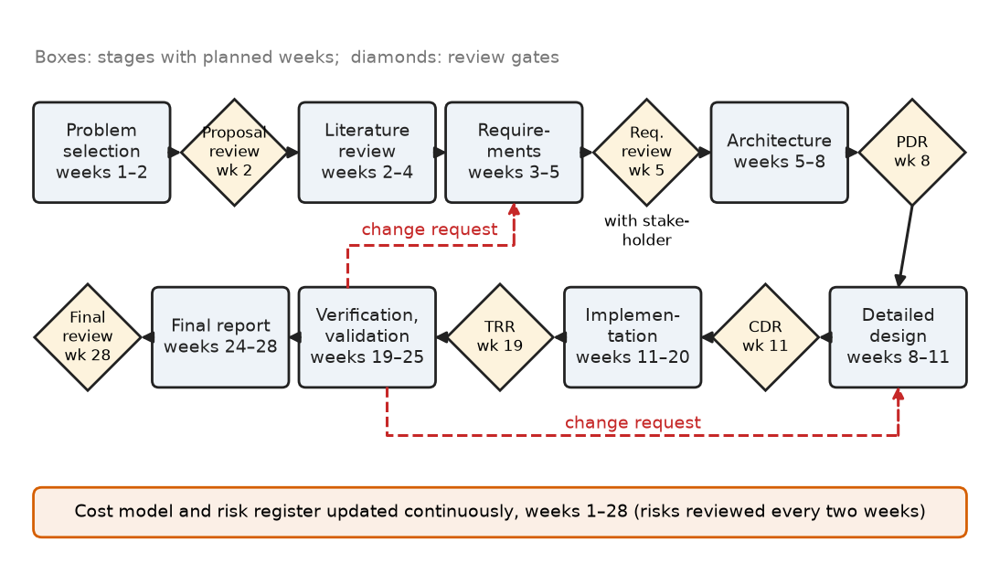
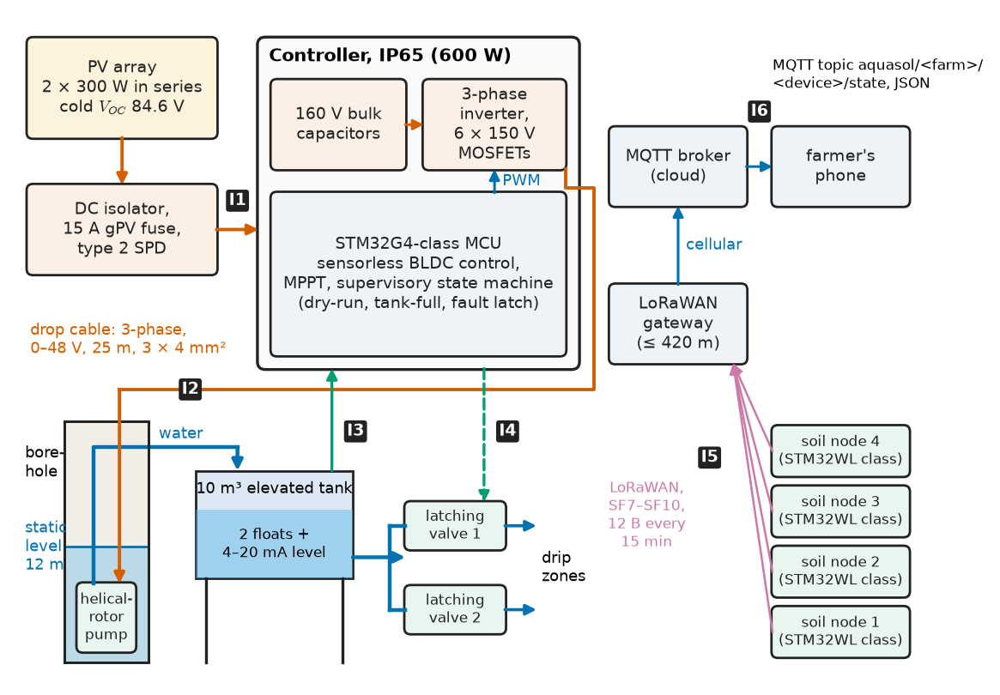
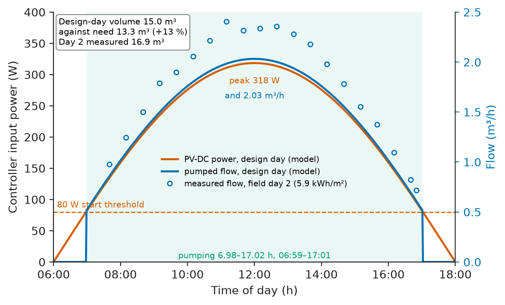
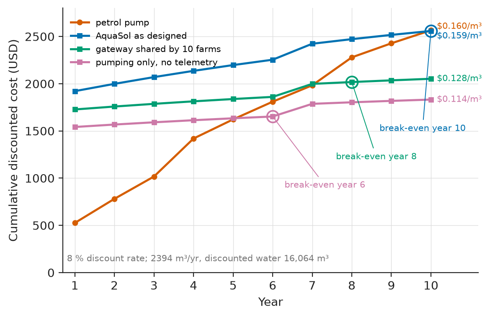
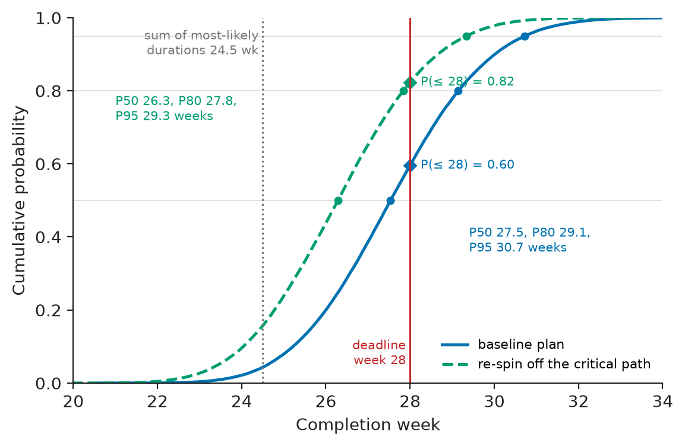

# Chapter 40 — Capstone Engineering Project

*Part IX · Interdisciplinary Engineering Projects*

A student team once won its department's capstone prize with a solar-powered irrigation pump controller. On the bench it was impressive: clean code, a tidy PCB, a live dashboard. It was installed on a smallholding at the end of the dry season and failed on its third day. The borehole's water level fell below the pump intake in the early afternoon. The controller had no idea this could happen, so it drove the dry pump at full speed for forty minutes until the rotor's elastomer stator scorched. Nothing in the electronics was wrong. The failure was made in week two, when the team wrote requirements from a vendor brochure instead of from an afternoon with the farmer and the borehole log. No requirement meant no design, no test and no protection.

This chapter is the capstone *method*. It ties Part I's methodology to a complete project and a complete report. It is worked end to end on the following year's capstone, which tackled the same problem: *AquaSol*, a PV-direct irrigation pump controller with tank and soil-moisture telemetry for a 0.2 ha vegetable plot, built by four students in 28 weeks on a budget of about \$2,000. Each section is one stage of the method, applied to AquaSol.

> **How does a team choose a problem, learn what is already known, and turn a need into requirements, an architecture and a design that can be built and verified in one academic year?**
> **How are cost, risk and schedule handled with numbers rather than hope, and how is all of it reported so that someone else could build, test and improve the result?**

| Concept | Engineering destination |
|---|---|
| Problem selection with weighted criteria | A project that is real, feasible and verifiable before any design starts |
| Structured literature review | Requirements and design values traced to standards, datasheets and field evidence |
| Requirements with verification methods | Acceptance tests agreed with the stakeholder in week 5, not week 26 |
| Architecture trade study and interface control | Parallel work by four people without integration surprises |
| Detailed design calculations | Sizing, voltage margins and energy budgets that are checked, not assumed |
| Implementation with design reviews | PDR, CDR and TRR gates that catch errors while they are cheap |
| Verification and validation | Bench tests against limits, then a field trial with the user |
| Cost analysis | BOM, production cost and life-cycle cost per cubic metre of water |
| Risk assessment | Risk register, FMEA and Monte Carlo schedule risk |
| Final technical report | A document that lets someone else rebuild, retest and improve the design |

**Roadmap.** Choosing the problem (40.1) → what is already known (40.2) → requirements (40.3) → architecture (40.4) → detailed design (40.5) → implementation (40.6) → verification and validation (40.7) → cost (40.8) → risk (40.9) → the final report and Revision B (40.10).

<!-- FIGURE 40.1 | figures/ch40/fig-40-1-capstone-lifecycle.png | flowchart | The capstone lifecycle used in this chapter, with review gates and planned weeks. | Content: left-to-right flow of boxes: Problem selection (weeks 1 to 2), Literature review (2 to 4), Requirements (3 to 5), Architecture (5 to 8), Detailed design (8 to 11), Implementation (11 to 20), Verification and validation (19 to 25), Final report (24 to 28). Diamond gates: Proposal review (week 2), Requirements review with stakeholder (5), PDR (8), CDR (11), TRR (19), Final review (28). Feedback arrows from V and V back to Requirements and Detailed design labelled change request. Bar beneath labelled cost model and risk register updated continuously. -->



*Figure 40.1 — The capstone lifecycle used in this chapter, with review gates and planned weeks.*

---

## 40.1 Problem selection

> **Boundary.** Requirements and traceability are Chapter 1's method, architecture and trade-offs Chapter 2's, test planning and V&V Chapter 4's, documentation and revision control Chapter 5's. This chapter applies them to one project and adds selection, review, cost, risk and the report.

### What makes a good capstone problem

A good capstone problem is **real** (someone outside the team has the need and can be asked), **crosses disciplines**, is **feasible** (about 1,344 person-hours, four students × 28 weeks × 12 h, must reach a verified prototype), is **verifiable** (success is a measurable number) and is **safe enough** to build under supervision.

The team considered three candidates. (A) A PV-direct irrigation pump controller with telemetry, for a farmers' cooperative the department already works with. (B) A temperature logger and alarm for vaccine cold boxes, for a district health office. (C) A battery-management board for a local e-bike conversion workshop.

**Worked example — A weighted decision matrix and its sensitivity.** Each candidate is scored from 1 to 5 against five weighted criteria. For the safety criterion, a higher score means lower risk.

**Table 40.1 — Problem-selection matrix.**

| Criterion | Weight | A: irrigation controller | B: cold-box monitor | C: e-bike BMS |
|---|---|---|---|---|
| Real need, stakeholder access | 0.25 | 5 | 4 | 3 |
| Disciplinary breadth | 0.20 | 5 | 3 | 4 |
| Feasibility in 1,344 h and \$2,000 | 0.25 | 3 | 5 | 4 |
| Verifiability of success | 0.15 | 4 | 4 | 5 |
| Safety and regulatory risk (5 = low) | 0.15 | 4 | 3 | 2 |
| **Weighted score** | 1.00 | **4.20** | **3.90** | **3.60** |

A wins: $0.25\times5+0.20\times5+0.25\times3+0.15\times4+0.15\times4=4.20$. The ranking is not robust, though. Moving 0.10 of weight from breadth to feasibility (0.10 and 0.35) gives A 4.00 and B 4.10, and B wins. A decision that flips under a plausible change of weights is telling the team where its real risk lies, here in feasibility. The team kept A and **bought down the feasibility risk by descoping**. The pump and PV modules are purchased parts. The team designs and builds the controller, the sensing and the telemetry, and the hydraulics come from the cooperative's existing borehole and 10 m³ tank.

> **Status of the principle: Weighted-sum selection with a sensitivity check**
> *Empirical.* The weights encode judgement, so the scores alone carry no authority. The method is useful because it makes the judgement explicit and shows which weight changes would reverse the choice. A choice that survives ±0.1 on every weight is robust; one that does not names the risk to manage first.

### The problem statement

The statement agreed with the cooperative at the proposal review (week 2) has four parts:

- **Need:** irrigate 0.2 ha of vegetables in the dry season without a petrol pump, whose fuel costs about \$300 a year and which requires someone to start and stop it every day.
- **User:** one farmer with a smartphone and no electrical training. Maintenance is done by the cooperative's technician.
- **Constraints:** an existing 12 m-static-head borehole and a 10 m³ elevated tank. No grid connection. A production cost under \$1,900 per farm.
- **Success:** enough water on the worst month's clear day; no damage from a dry well or a full tank; the farmer sees tank level and pump state on a phone; cost per cubic metre no worse than petrol.

---

## 40.2 Literature review

### What a design-oriented review is for

An engineering literature review exists to *change the design*. Each source should yield a requirement, a design value, a test method or a known failure; the team's review matrix had exactly those four columns, and a source that filled none was dropped.

**Table 40.2 — Source classes and what each contributes.**

| Source class | Examples for AquaSol | Typically yields |
|---|---|---|
| Standards | IEC 62253 (PV pumping systems, design qualification and performance); IEC 61702 (rating of direct-coupled PV pumping systems); IEC 62109-1 (safety of PV power converters); IEC 60364-7-712 (PV installations); IEC 60529 (IP codes); ETSI EN 300 220 (868 MHz short-range devices) | Test methods, limits, safety requirements |
| Agronomy references | FAO Irrigation and Drainage Paper 56 (crop evapotranspiration) | Water demand per day and per month |
| Datasheets and application notes | PV module, helical-rotor pump curves, MOSFETs, sensorless BLDC control notes, LoRa transceiver | Ratings, efficiencies, reference circuits |
| Field reports and prior projects | Cooperative's borehole log; the previous team's failure report; published surveys of PV-pump installations | Failure modes: dry running, lightning, theft, cable faults |
| Stakeholder interviews | Two site visits, farmer and technician | Usage, maintenance skills, what "works" means |
| Existing products | Commercial PV-pump kits with integrated controllers | Benchmark cost and features; what not to reinvent |

**Table 40.3 — Extract of the AquaSol review matrix.**

| Source | Requirement | Design value | Test method | Known failure |
|---|---|---|---|---|
| Borehole log (cooperative) | Must survive drawdown below intake (R3) | Static level 12 m, drawdown 3 m at 2 m³/h, recovery about 30 min | — | Dry running in late afternoon |
| FAO-56 | Daily water demand (R1) | Peak crop ET 6 mm/day for tomato, mid-season | — | — |
| IEC 62253 | Daily-volume performance test (R1) | — | Volume vs in-plane irradiation over full days | — |
| PV module datasheet and *Electrical Energy and Machines* Ch. 15 §15.1 | Cold-morning open-circuit voltage (R5) | $V_{OC}$ 40.0 V, −0.29 %/K | Measure $V_{OC}$ at dawn | Inverter over-voltage on cold mornings |
| Pump datasheet | Flow and power vs head (R1) | Wire-to-water 0.40 at 20–25 m, 600 W max input | — | Stator burn when run dry |
| Previous team's report | Dry-run and tank-full protection (R3, R4) | — | Bench dry-run test | Day-3 field failure |
| IEC 60364-7-712 | DC isolator, surge protection, fusing (R11) | — | Insulation test at 500 V | — |

The review changed the design in three places. The borehole log produced R3: the pump must stop within 10 s of running dry and wait 30 min. The module datasheet, combined with the site's record low of 5 °C, produced the 150 V device rating (Section 40.5). And the commercial kits showed that a PV-direct pump controller with MPPT is a solved product. The team's contribution therefore had to be the integration — protection logic, telemetry, soil-moisture-driven valves and the cost case — not a better motor drive.

> **Status of the principle: A review earns its place by changing the design**
> *Empirical.* In capstone and industrial projects alike, the expensive late failures trace back to evidence that existed and was not read: a field log, a standard's test method, a previous team's report. Tracking each source against the requirement, value, test or failure it produced makes the review auditable and keeps it short.

---

## 40.3 Requirements

The requirements were written in week 3, reviewed with the farmer and technician in week 5, and frozen at that review. Each one has a number, a verification method and a source. R3 traces to the borehole log, R5 to the module datasheet and site temperature record, R10 to the cooperative's budget.

**Table 40.4 — AquaSol requirements.**

| ID | Requirement | Target | Verification | Source |
|---|---|---|---|---|
| R1 | Daily water on a design day (≥ 5.0 kWh/m² in-plane) at 23 m total head | ≥ 13.3 m³ | IEC 62253-style full-day test, normalised to 5.0 kWh/m² | FAO-56 demand |
| R2 | Pumping hours on a design day | ≥ 8 h | Field log | Farmer: tank refilled by evening |
| R3 | Dry-run protection | Stop within 10 s; retry after 30 min | Bench test with throttled intake | Borehole log, previous failure |
| R4 | Tank-full stop | Stop within 2 s of upper float; no overflow | Bench and 14-day field log | Technician |
| R5 | Device voltage at cold-morning $V_{OC}$ | ≤ 80 % of MOSFET and capacitor ratings | Analysis plus dawn measurement | Datasheet, site minimum 5 °C |
| R6 | Controller environment | IP65; −5 to 55 °C ambient | Inspection; thermal soak at 55 °C, full load, 4 h | Site |
| R7 | Soil-node battery life at 15 min reporting | ≥ 3 years | Energy budget plus measured average current | Technician visit interval |
| R8 | Telemetry packet delivery at up to 420 m | ≥ 95 % over 14 days | Gateway log | Plot geometry |
| R9 | Status on farmer's phone | Tank level and pump state within 5 min of a change | Field demonstration | Farmer |
| R10 | Cost | Production capex ≤ \$1,900; 10-year cost per m³ ≤ petrol pump | Cost model (40.8) | Cooperative |
| R11 | Electrical safety | DC isolator, SPD, string fuses per IEC 60364-7-712; insulation ≥ 1 MΩ at 500 V | Inspection and insulation test | Standard |
| R12 | Delivery | Verified prototype and final report by week 28 | Schedule | Department |

Two things matter more than the contents. Every row has a verification method the stakeholder accepted in week 5, so the final validation was a test already agreed, not a demonstration designed afterwards. And the table is short: twelve requirements can be traced through design, test and report, whereas a capstone with 80 usually verifies none properly.

---

## 40.4 Architecture

### Trade study

Three architectures could meet R1. Each was scored on capex, ten-year maintenance, efficiency and learning value. For a capstone, learning value is a legitimate criterion.

**Table 40.5 — Architecture trade study.**

| Architecture | Energy storage | Capex estimate | Maintenance over 10 years | Assessment |
|---|---|---|---|---|
| (a) PV-direct DC pump, controller with MPPT, water stored in the existing tank | 10 m³ tank (about 0.75 day of demand) | Lowest: no battery, no inverter | Pump overhaul about year 7 | **Chosen**: the energy store already exists and is paid for |
| (b) PV, LFP battery, inverter, AC pump | 2.6 kWh LFP for one day of autonomy | Higher by about \$900 (battery and inverter) | Battery replacement around year 8–10 | Rejected: cost, and pumping does not need night operation |
| (c) Commercial PV-pump kit plus add-on telemetry | Tank | Similar to (a) | Vendor-dependent | Rejected for the capstone: leaves only the telemetry to design |

The water-tank argument settles the choice. The tank's 10 m³ at 23 m head stores $1000\times9.81\times23\times10/3.6\times10^6=0.63$ kWh of hydraulic energy. That is equivalent to about 1.6 kWh of PV-DC energy at 0.40 efficiency, and it is already paid for. Storing it as charge needs about 2 kWh of LFP at 80 % depth of discharge, plus an inverter.

### Blocks and interfaces

Figure 40.2 shows the architecture. Four people work on it in parallel, so the interfaces were frozen in an interface control document at the PDR (week 8). Table 40.6 is its summary.

<!-- FIGURE 40.2 | figures/ch40/fig-40-2-aquasol-architecture.png | block-diagram | AquaSol system architecture: PV-direct pump controller, tank sensing, soil-moisture nodes and telemetry. | Content: PV array 2 x 300 W in series (cold Voc 84.6 V) through DC isolator, fuse and SPD into IP65 Controller (160 V bulk capacitors, three-phase inverter with six 150 V MOSFETs, STM32G4-class MCU with sensorless BLDC control, MPPT and supervisory state machine). Three-phase 48 V drop cable 25 m to helical-rotor pump in borehole (static level 12 m), discharging to 10 m3 elevated tank with two floats and a 4 to 20 mA level transducer wired back. Tank feeds two latching valves. Four soil nodes (STM32WL-class) link by LoRaWAN to a gateway up to 420 m away, cellular backhaul to MQTT broker and phone. Interfaces labelled I1 to I6 as in Table 40.6. -->



*Figure 40.2 — AquaSol system architecture: PV-direct pump controller, tank sensing, soil-moisture nodes and telemetry.*

**Table 40.6 — Interface control summary.**

| ID | Interface | Signal and range | Owner |
|---|---|---|---|
| I1 | PV array → controller | DC 0–85 V, ≤ 10 A; isolator, 15 A gPV fuse, type 2 SPD | Power |
| I2 | Controller → pump | 3-phase, 0–48 V line, ≤ 12 A, 25 m drop cable 3 × 4 mm² | Power |
| I3 | Tank → controller | Two float contacts (wetting current 10 mA); 4–20 mA level, 0–2.5 m | Sensing |
| I4 | Controller → valves | Latching solenoid, 9 V, 50 ms pulse, polarity sets open or close | Firmware |
| I5 | Nodes → gateway | LoRaWAN EU868-class, SF7–SF10, 12-byte payload every 15 min | Telemetry |
| I6 | Gateway → cloud → phone | MQTT over cellular; topic `aquasol/<farm>/<device>/state`, JSON | Telemetry |

> **Status of the principle: Freeze interfaces before splitting the work**
> *Empirical.* Integration failures in multi-person projects concentrate at boundaries no one owns. A one-page interface table with ranges, units and an owner per row, frozen at the preliminary design review, is the cheapest known mitigation. It does not remove design errors inside blocks.

---

## 40.5 Detailed design

### Water, head and PV sizing

The design-day calculation turns the requirement into an array size. Its inputs are the plot area, the peak crop evapotranspiration from FAO-56, a drip efficiency of 0.90, the total dynamic head, the wire-to-water efficiency from the pump curve, and the design month's peak sun hours with a PV derate. The derate covers temperature (0.88), soiling (0.95) and wiring and mismatch (0.97). The PV energy-yield relations and temperature coefficients are those of *Electrical Energy and Machines*, [Ch. 15 §15.1](https://github.com/The-Studio-of-Sadiq/Electrical-Energy-and-Machines/blob/main/part-4-power-generation/15-renewable-energy-systems.md), and the PV design method is Chapter 22's. The listing then simulates the design day with a half-sine irradiance profile and an 80 W pump start threshold, to check the volume that is actually delivered.

```python
"""Capstone design calculation: PV-direct irrigation pump, design day."""
import numpy as np

area_m2, etc_mm, eta_drip = 2000.0, 6.0, 0.90      # plot, peak crop ET, drip eff.
head_m = 12 + 3 + 4 + 2 + 2                         # static, drawdown, stand, tank, friction
eta_w2w = 0.40                                      # PV-DC to water, pump+motor+controller
psh, derate = 5.0, 0.88 * 0.95 * 0.97               # design-month sun hours, PV derate
p_array, p_start = 600.0, 80.0                      # Wp installed, pump start threshold W

v_need = area_m2 * etc_mm / 1000 / eta_drip         # m3/day
e_hyd = 1000 * 9.81 * head_m * v_need / 3.6e6       # kWh/day
e_dc = e_hyd / eta_w2w
p_min_array = e_dc / (psh * derate)                  # kWp
print(f"water {v_need:.1f} m3/d  head {head_m} m  hydraulic {e_hyd:.3f} kWh/d")
print(f"DC energy {e_dc:.2f} kWh/d  minimum array {p_min_array*1000:.0f} Wp")

# Clear design day: half-sine irradiance scaled so that the day gives `psh`
t = np.linspace(6, 18, 721)                          # h, 1-min steps
g = np.sin(np.pi * (t - 6) / 12); g *= psh / np.trapezoid(g, t)   # kW/m2
p_dc = p_array * derate * g                          # W at the controller input
p_pump = np.where(p_dc >= p_start, p_dc, 0.0)
q = eta_w2w * p_pump / (1000 * 9.81 * head_m)        # m3/s
v_day = np.trapezoid(q, t * 3600)
on = t[p_pump > 0]
print(f"peak DC {p_dc.max():.0f} W  pumping {on[0]:.2f}-{on[-1]:.2f} h")
print(f"design-day volume {v_day:.1f} m3  margin {100*(v_day/v_need-1):.0f} %")
print(f"peak flow {q.max()*3.6e6/1000:.2f} m3/h")
```

```text
water 13.3 m3/d  head 23 m  hydraulic 0.836 kWh/d
DC energy 2.09 kWh/d  minimum array 515 Wp
peak DC 318 W  pumping 6.98-17.02 h
design-day volume 15.0 m3  margin 13 %
peak flow 2.03 m3/h
```

**Worked example — From crop to array.** The plot needs $2000\times6/1000/0.90=13.3\ \mathrm{m^3/day}$. Lifting it 23 m takes $1000\times9.81\times23\times13.3/3.6\times10^6=0.836$ kWh of hydraulic energy. At 0.40 wire-to-water efficiency that is 2.09 kWh of PV-DC energy. With 5.0 peak sun hours and a 0.811 derate the minimum array is $2.09/(5.0\times0.811)=0.515$ kWp. Two 300 W modules (600 Wp) give a 13 % volume margin on the design day once the morning and evening hours below the 80 W start threshold are lost.

The half-sine profile peaks at only 318 W because it spreads 5 kWh/m² over 12 h. On a clear day with 1 kW/m² at noon, the array would deliver up to about $600\times0.811=487$ W. The controller and pump are therefore rated for 600 W input. Sizing the volume on the design day and the power rating on the clear-sky peak is the standard split. Figure 40.3 shows the design day.

<!-- FIGURE 40.3 | figures/ch40/fig-40-3-design-day.png | plot | AquaSol design day: controller input power and pumped flow from the sizing model, with one measured field day. | Content: x time 6 to 18 h. Left y power 0 to 400 W: model PV-DC power half-sine peaking at 318 W at 12:00; dashed line at 80 W labelled start threshold; pumping shaded from 06:59 to 17:01. Right y flow 0 to 2.5 m3/h: model flow peaking at 2.03 m3/h. Measured flow markers for field day 2 (5.9 kWh/m2) every 30 min from 07:40 to 16:50. Text box: design-day volume 15.0 m3 vs need 13.3 m3; day 2 measured 16.9 m3. -->



*Figure 40.3 — AquaSol design day: controller input power and pumped flow from the sizing model, with one measured field day.*

### Voltage margins on a cold morning

**Worked example — Choosing the MOSFET voltage class.** The module's open-circuit voltage is 40.0 V at 25 °C with a coefficient of −0.29 %/K. At dawn on the coldest recorded morning the cells sit at the 5 °C ambient with enough light to reach open circuit. So $V_{OC}=40.0\times[1-0.0029\times(5-25)]=42.32$ V per module, and 84.6 V for the series pair. Ratings are derated to 80 % (R5):

- A 100 V MOSFET allows 80 V. That is below 84.6 V, so it is rejected.
- A 150 V MOSFET allows 120 V, a 42 % margin above the cold $V_{OC}$, with room for switching overshoot. It is chosen.
- The bulk capacitors follow the same rule. 100 V parts would run at 85 % of rating, so 160 V electrolytics are used.

The string-sizing rule is that of *Electrical Energy and Machines*, [Ch. 15 §15.1](https://github.com/The-Studio-of-Sadiq/Electrical-Energy-and-Machines/blob/main/part-4-power-generation/15-renewable-energy-systems.md), applied to a 2-module string rather than a 1,500 V one. At 66 V maximum-power voltage, the conduction loss of a 150 V, 10 mΩ-class device at 10 A is about 1–2 W per conducting device, allowing for $R_{DS(on)}$ rising when hot. That is acceptable without a heat sink in the 55 °C soak test (R6).

### Component selection

**Table 40.7 — Component selection for the main parts.**

| Function | Candidates | Deciding numbers | Choice |
|---|---|---|---|
| Pump | DC centrifugal; diaphragm; helical rotor (progressive cavity) | Centrifugal efficiency collapses at 23 m and low flow; diaphragm limited to about 1 m³/h; helical rotor 0.40 wire-to-water at 2 m³/h | Helical-rotor 48 V BLDC submersible, 600 W |
| Controller MCU | 8-bit AVR; STM32G431-class Cortex-M4F; ESP32-class | Sensorless BLDC needs fast ADC triggered from PWM; Wi-Fi not needed on site | STM32G431-class, about \$4.50 |
| Inverter switches | 100 V, 60 V, 150 V MOSFETs | Cold $V_{OC}$ 84.6 V with 80 % derating | 150 V, about 10 mΩ, TOLL or TO-220 |
| Soil-node radio | Cellular per node; IEEE 802.15.4 mesh; LoRa (SX1262-class or STM32WL SoC) | 420 m with foliage; 3-year battery; per-node cost | STM32WL-class LoRa SoC |
| Soil sensor | Resistive probe; capacitive probe; tensiometer | Resistive corrodes within a season; tensiometer needs maintenance | Capacitive, calibrated per soil |

The motor-drive power stage and its sensorless control are not re-derived here. BLDC operation is in *Electrical Energy and Machines*, [Ch. 8 §8.2](https://github.com/The-Studio-of-Sadiq/Electrical-Energy-and-Machines/blob/main/part-2-transformers-and-electrical-machines/08-special-electrical-machines.md). Renewable-fed converters and MPPT are in *Electronics and Computing*, [Ch. 32 §32.8](https://github.com/The-Studio-of-Sadiq/Electronics-and-Computing/blob/main/part-7-power-electronics/32-motor-drives-and-power-conversion.md). The closed-loop drive project that builds such a stage is Chapter 37.

### Energy budget of a soil node

**Worked example — Will a soil node last three years?** Each 15-min cycle has four parts:

- The capacitive probe draws 8 mA for 0.3 s (2.4 mC).
- The MCU is active at 3 mA for 0.2 s (0.6 mC).
- The radio transmits a 25-byte LoRaWAN frame at +14 dBm, drawing 45 mA. At SF9 and 125 kHz the frame lasts 206 ms (9.26 mC).
- The two receive windows draw 6 mA for 0.1 s (0.6 mC).

That totals 12.9 mC per 900 s, or 14.3 µA. Adding 2 µA of sleep current gives 16.3 µA average. An ER14505 lithium–thionyl-chloride cell (2.4 Ah, 85 % usable) then lasts $2.04/16.3\times10^{-6}=125{,}000$ h, or 14.3 years. In practice the cell's shelf life caps this at about 10. At SF12 the airtime grows to 1.48 s and the average current to 80 µA, giving 2.9 years. That fails R7. The design therefore requires the gateway to be placed so that every node closes its link at SF10 or below. Link-budget method is in *Circuits, Signals and Communications*, [Ch. 30 §30.10](https://github.com/The-Studio-of-Sadiq/Circuits-Signals-and-Communications/blob/main/part-6-communication-theory/30-wireless-and-mobile-communications.md) and Chapter 26; node power design is Chapter 38's.

**Table 40.8 — Design budgets and margins.**

| Budget | Requirement | Design value | Margin |
|---|---|---|---|
| Water volume, design day | ≥ 13.3 m³ | 15.0 m³ (model) | 13 % |
| Array size | ≥ 515 Wp | 600 Wp | 17 % |
| Device voltage at cold $V_{OC}$ | ≤ 80 % of rating | 84.6 V on 150 V (56 %) | 42 % above cold $V_{OC}$ |
| Controller input power | Clear-sky peak 487 W | 600 W rating | 23 % |
| Soil-node life at SF9 | ≥ 3 years | 14.3 years (10-year shelf life) | > 3× |
| Soil-node life at SF12 | ≥ 3 years | 2.9 years | −3 %: fails, hence SF ≤ 10 rule |

---

## 40.6 Implementation

### Plan, roles and reviews

The work split along the interfaces of Table 40.6: power (I1, I2), firmware (motor control, supervisory logic, I4), sensing and telemetry (I3, I5, I6), and a systems lead for requirements, integration, test plan, cost, risk and report. Each student had a named backup. Three review gates were held with the supervisor and the technician:

- **PDR (week 8):** architecture, interface control document and budgets frozen.
- **CDR (week 11):** schematics, layout, firmware design and the test plan with limits. The CDR found the 100 V MOSFETs on the first schematic, and they were changed to 150 V for \$4 per board.
- **TRR (week 19):** every test procedure written, instruments calibrated, safety plan signed. No field test started before it.

Configuration management followed Chapter 5. Everything lived in one repository: KiCad project, firmware, test scripts, cost and risk models and the report source. Releases were tagged at each gate, and every test record names the tag of the hardware and firmware it tested.

### Firmware: the protection logic the previous team lacked

Motor commutation and MPPT run in the PWM interrupt. The supervisory state machine runs every 100 ms from the main loop. It owns the decisions that protect the hardware: when to start, when to stop for a full tank, when the pump is running dry, and when to latch a fault. The dry-run signature is high rotor speed at low input power, which is what an unloaded helical rotor does. The state-machine design practice (explicit states, guarded transitions, timeouts) is *Electronics and Computing*, [Ch. 28 §28.4](https://github.com/The-Studio-of-Sadiq/Electronics-and-Computing/blob/main/part-6-embedded-and-real-time-systems/28-embedded-system-design.md). The listing is C11, and its thresholds are AquaSol's tuned values.

```c
/* pump_sup.c -- AquaSol supervisory state machine, called every 100 ms (C11).
   Illustrative: input scaling and the motor-control layer live elsewhere. */
#include <stdbool.h>
#include <stdint.h>

typedef enum { ST_IDLE, ST_RUN, ST_DRY_WAIT, ST_TANK_FULL, ST_FAULT } pump_state_t;

typedef struct {
    float v_pv;       /* array voltage, V */
    float p_in;       /* controller input power, W */
    float rpm;        /* sensorless speed estimate, r/min */
    bool  tank_high;  /* upper float closed: tank full */
    bool  tank_low;   /* lower float open: level below restart mark */
    bool  hw_trip;    /* latched overcurrent, overtemperature or driver fault */
} pump_in_t;

#define V_START   60.0f    /* V: array can carry the start-up load */
#define V_STOP    45.0f    /* V: below this the pump stalls */
#define DRY_RPM   2600.0f  /* high speed ...                          */
#define DRY_PMAX  60.0f    /* ... at low power: rotor running dry     */
#define DRY_TICKS 50u      /* 5 s of dry signature (R3: stop < 10 s)  */
#define DRY_WAIT  18000u   /* 30 min for the borehole to recover      */

static pump_state_t st = ST_IDLE;
static uint32_t n;         /* ticks spent in the current condition */

pump_state_t pump_step(const pump_in_t *in, bool *run)
{
    if (in->hw_trip) st = ST_FAULT;          /* cleared only by service reset */
    switch (st) {
    case ST_IDLE:
        if (in->tank_high)              st = ST_TANK_FULL;
        else if (in->v_pv > V_START)  { st = ST_RUN; n = 0u; }
        break;
    case ST_RUN:
        if (in->tank_high)            { st = ST_TANK_FULL; break; }
        if (in->v_pv < V_STOP)        { st = ST_IDLE; break; }
        n = (in->rpm > DRY_RPM && in->p_in < DRY_PMAX) ? n + 1u : 0u;
        if (n >= DRY_TICKS)           { st = ST_DRY_WAIT; n = 0u; }
        break;
    case ST_DRY_WAIT:
        if (++n >= DRY_WAIT)            st = ST_IDLE;
        break;
    case ST_TANK_FULL:
        if (in->tank_low)               st = ST_IDLE;
        break;
    case ST_FAULT:
        break;
    }
    *run = (st == ST_RUN);
    return st;
}
```

The dry-run detector needs 5 s of a *continuous* signature (the counter resets on any normal sample), so a gulp of air does not stop the pump. Tank-full uses two floats with hysteresis. A hardware fault latches until a technician resets it, because an overcurrent in a submersible pump usually means a damaged cable. The listing also contains a flaw that only the field found: there is no minimum off-time after a low-voltage stop. Section 40.9 shows what that did at dawn.

---

## 40.7 Verification and validation

Verification asks whether AquaSol was built right: does it meet R1–R12 with their limits? Validation asks whether the right thing was built: does the farmer get water without supervision, at an acceptable cost? Chapter 4 draws the distinction and sets out test planning. Here both were run. Verification came first, on the bench and on site. Validation followed as a 14-day trial operated by the farmer. Every instrument used for a pass/fail decision was calibrated or checked against a reference before the TRR. The flow meter, for example, was checked against timed fills of a 200 L drum to ±2 %.

**Table 40.9 — Verification results.**

| ID | Test | Limit | Result | Pass/fail |
|---|---|---|---|---|
| R1 | Full-day volume, 3 clear days, normalised to 5.0 kWh/m² | ≥ 13.3 m³ | 14.3 m³ (mean of 3 days) | Pass, 7 % margin |
| R2 | Pumping hours, day 2 | ≥ 8 h | 9.2 h (07:40–16:50) | Pass |
| R3 | Intake throttled to dry-run, 10 trials | Stop ≤ 10 s; retry at 30 min | 5.2–5.6 s; retry at 30:00 min | Pass |
| R4 | Upper float forced, 10 trials; 14-day log | Stop ≤ 2 s; no overflow | 0.3 s; 0 overflows | Pass |
| R5 | Dawn $V_{OC}$ at 7 °C module temperature | ≤ 120 V (80 % of 150 V) | 83.9 V measured (84.2 V predicted) | Pass |
| R6 | Thermal soak 55 °C, 600 W, 4 h; IP65 inspection | Hottest MOSFET case ≤ 110 °C | 96 °C | Pass |
| R7 | Node average current, 24 h, SF9 | ≤ 77 µA (3-year life) | 17.4 µA, 13.4-year estimate | Pass |
| R8 | Packet delivery, 4 nodes, 14 days | ≥ 95 % | 98.7 % (worst node 97.1 % at 420 m, SF10) | Pass |
| R9 | Status on phone after tank change | ≤ 5 min | 15–55 s | Pass |
| R10 | Cost model (40.8) | ≤ \$1,900; LCOW ≤ petrol | \$1,838; \$0.159 vs \$0.160 per m³ | Pass, marginal |
| R11 | Inspection; insulation at 500 V DC | ≥ 1 MΩ | > 200 MΩ | Pass |
| R12 | Final report submitted | Week 28 | Week 28 | Pass |

**Table 40.10 — Field test results, full-day volume tests (IEC 62253-style, 23 m head).**

| Day | In-plane irradiation (kWh/m²) | Predicted (model, η = 0.40) | Measured | Difference |
|---|---|---|---|---|
| 1 | 5.6 | 16.95 m³ | 16.0 m³ | −5.6 % |
| 2 | 5.9 | 17.90 m³ | 16.9 m³ | −5.6 % |
| 3 | 5.3 | 15.99 m³ | 15.1 m³ | −5.6 % |
| 4 (overcast) | 3.1 | 8.80 m³ | 8.2 m³ | −6.8 % |

The model over-predicted by a consistent 5.6 % on clear days. A consistent error is a parameter error, not a model-form error. Back-calculating gives a wire-to-water efficiency of 0.38 against the datasheet's 0.40. With 0.38 the model predicts 16.1, 17.0 and 15.2 m³, within 0.1 m³ of the measurements, and 14.3 m³ for the 5.0 kWh/m² design day. That is the R1 figure. The overcast day falls about 2 % below even the corrected model, as expected from more time below the start threshold. Recording the corrected efficiency in the design file closes the loop between design and test. Chapter 33 calls this a calibrated model.

**Validation.** In the 14-day farmer-operated trial, daily water use averaged 12.1 m³. That is below the 13.3 m³ design need, because the soil-moisture logic skipped irrigation on a zone that was still wet. The farmer's daily irrigation work fell from about 2.5 h to about 0.3 h. The tank never overflowed, and the dry-run protection operated twice, on the two hottest afternoons, exactly as the borehole log predicted. The farmer's acceptance was written against R1–R4 and R9, the requirements agreed in week 5.

---

## 40.8 Cost analysis

### Bill of materials

**Table 40.11 — Prototype bill of materials (2026 indicative prices, single quantities).**

| Item | Cost | Share |
|---|---|---|
| PV modules, 2 × 300 W | \$150 | 7.7 % |
| Mounting frame, galvanised, local fabrication | \$120 | 6.2 % |
| 48 V helical-rotor BLDC pump, 600 W | \$520 | 26.8 % |
| Controller boards × 3 (two spins and a spare), parts and PCB | \$285 | 14.7 % |
| Enclosure IP65, DC isolator, SPD, fuses, glands | \$110 | 5.7 % |
| Tank level: two floats and 4–20 mA transducer | \$83 | 4.3 % |
| Pulse flow meter, 25 mm | \$45 | 2.3 % |
| Soil-moisture nodes × 4 | \$164 | 8.5 % |
| LoRaWAN gateway, indoor 8-channel | \$160 | 8.3 % |
| Latching solenoid valves × 2 | \$56 | 2.9 % |
| Cables, pipe and fittings | \$185 | 9.5 % |
| Consumables | \$60 | 3.1 % |
| **Total** | **\$1,938** | 100 % |

The prototype cost \$1,938. Student time, about 1,350 h, is not charged, but the report states it. A production unit for one farm needs one controller board (\$95) rather than three, and no consumables. That brings the hardware to \$1,688, and installation adds about \$150, for a capex of \$1,838 against the \$1,900 target of R10. The pump is the largest single item (27 %), followed by the controller boards. The telemetry chain (gateway and nodes) is 17 %, and that matters below.

### Life-cycle cost and cost per cubic metre

**Worked example — Is solar cheaper than petrol?** Both options are compared over 10 years at an 8 % discount rate, delivering 13.3 m³ a day on 180 irrigation days a year, or 2,394 m³ a year.

*Petrol pump.* \$250 to buy and replaced in years 4 and 8. Fuel is 1.1 L a day × 180 days × \$1.20 = \$238 a year, plus \$60 maintenance, for \$297.60 a year.

*AquaSol.* \$1,838 capex. Running costs are \$30 a year of maintenance, \$60 a year of cellular backhaul for the gateway, and a \$200 pump overhaul in year 7.

The levelised cost of water is the discounted cost divided by the discounted water, 16,064 m³:

- Petrol: \$2,566, or \$0.160 per m³.
- AquaSol as designed: \$2,559, or \$0.159 per m³.

R10 passes, but only just. The discounted break-even comes in year 10.

The cost model then answered a question nobody had asked. Removing the gateway and backhaul from the per-farm cost lowers the levelised cost by a fifth:

| Variant | Capex | Discounted 10-year cost | Cost per m³ | Discounted break-even |
|---|---|---|---|---|
| Petrol pump | \$250 | \$2,566 | \$0.160 | — |
| AquaSol as designed | \$1,838 | \$2,559 | \$0.159 | Year 10 |
| Gateway shared by 10 farms | \$1,694 | \$2,052 | \$0.128 | Year 8 |
| Pumping only, no telemetry | \$1,514 | \$1,832 | \$0.114 | Year 6 |

The variant with no telemetry is the cheapest, but it loses R3's remote alarm and R9. The cooperative chose the shared gateway: one gateway on the cooperative's office roof covers ten farms within about 2 km. That became the main change in Revision B. Figure 40.4 shows the cumulative discounted costs. The economic-evaluation method follows Chapter 25 and the solar-battery project's assessment in Chapter 36.

> **Status of the principle: Levelised cost as the comparison basis**
> *Derived.* Dividing discounted life-cycle cost by discounted delivered quantity compares options with different capex and running costs on one number. The result depends directly on the discount rate, the lifetime and fuel-price assumptions, so the report states them and shows the break-even year as well as the ratio.

<!-- FIGURE 40.4 | figures/ch40/fig-40-4-cumulative-cost.png | plot | Cumulative discounted cost over 10 years: petrol pump against three AquaSol variants (8 % discount rate). | Content: x year 1 to 10, y 0 to 2,800 USD. Petrol: 526, 781, 1017, 1419, 1622, 1810, 1983, 2279, 2428, 2566. As designed: 1921, 1998, 2070, 2136, 2197, 2254, 2423, 2472, 2517, 2559. Shared gateway: 1727, 1758, 1787, 1813, 1838, 1860, 1998, 2018, 2036, 2052. Pumping only: 1542, 1567, 1591, 1613, 1634, 1653, 1787, 1803, 1818, 1832. Crossings marked at years 10, 8 and 6. End labels: 0.160, 0.159, 0.128, 0.114 USD per m3. -->



*Figure 40.4 — Cumulative discounted cost over 10 years: petrol pump against three AquaSol variants (8 % discount rate).*

---

## 40.9 Risk assessment

### Risk register

Risks were scored for likelihood and impact on a 1–5 scale each, at week 2, and reviewed every two weeks. A score of 12 or more needs a named mitigation and an owner.

**Table 40.12 — Extract of the risk register (scores at week 2 → after mitigation).**

| Risk | L × I | Mitigation | Owner | After |
|---|---|---|---|---|
| Controller PCB needs a second spin, delaying integration | 4 × 4 = 16 | Integrate firmware on a commercial BLDC evaluation board while the PCB is built | Power, firmware | 3 × 2 = 6 |
| Pump damaged during tests (dry running, wiring error) | 3 × 5 = 15 | Dry-run logic tested on a bench rig with a cheap spare pump first; current-limited supply | Firmware | 2 × 3 = 6 |
| Cold-morning over-voltage destroys inverter | 2 × 5 = 10 | 150 V devices (40.5); dawn $V_{OC}$ measured before connecting | Power | 1 × 5 = 5 |
| Gateway placement leaves a node at SF12 (fails R7) | 3 × 3 = 9 | Site survey with a test node before installing | Telemetry | 2 × 2 = 4 |
| Electric shock or arc during PV work | 2 × 5 = 10 | DC isolator, lock-out procedure, supervised PV wiring, insulation test before energising | Systems lead | 1 × 5 = 5 |

Electrical safety on site follows *Electrical Energy and Machines*, [Ch. 29 §29.6](https://github.com/The-Studio-of-Sadiq/Electrical-Energy-and-Machines/blob/main/part-8-electrical-safety-and-engineering-practice/29-electrical-safety.md) (isolation and lock-out) and §29.7 (safe testing). A PV string cannot be switched off by the sun, so the DC isolator and the lock-out procedure are what make "de-energised" true.

### Schedule risk

A plan built from most-likely durations is almost always late, because the duration distributions are skewed. The team estimated each task as a triangular distribution (optimistic, most likely, pessimistic) and simulated the plan. Monte Carlo propagation is covered in *The Mathematics Universe*, [Ch. 24 §24.6](https://github.com/The-Studio-of-Sadiq/engineering-mathematics/blob/main/part-7-numerical-computational/24-computational-mathematics.md).

```python
"""Schedule risk of the capstone plan: Monte Carlo over triangular estimates."""
import numpy as np

rng = np.random.default_rng(2026)
N = 100_000
tri = lambda lo, mode, hi: rng.triangular(lo, mode, hi, N)   # weeks

# Serial front end, then three parallel build tracks, then integration and test
front = tri(2, 3, 4) + tri(2, 2.5, 4) + tri(2, 3, 5)      # select+review, reqs, arch.
hw    = tri(4, 6, 10) + tri(1, 2, 4)                       # controller PCB, re-spin
fw    = tri(5, 7, 11)                                      # firmware
node  = tri(3, 4, 7)                                       # sensor nodes + gateway
build = np.maximum.reduce([hw, fw, node])                  # longest track governs
back  = tri(2, 3, 6) + tri(2, 3, 5) + tri(1.5, 2, 3)       # integrate, V&V, report
total = front + build + back

deadline = 28.0
mode_sum = 3 + 2.5 + 3 + max(6 + 2, 7, 4) + 3 + 3 + 2
print(f"sum of most-likely durations: {mode_sum:.1f} weeks")
print(f"mean {total.mean():.1f}  P50 {np.percentile(total, 50):.1f}  "
      f"P80 {np.percentile(total, 80):.1f}  P95 {np.percentile(total, 95):.1f} weeks")
print(f"P(finish by week {deadline:.0f}) = {np.mean(total <= deadline):.2f}")
print(f"hardware track critical in {np.mean(build == hw):.0%} of runs")
```

```text
sum of most-likely durations: 24.5 weeks
mean 27.6  P50 27.5  P80 29.1  P95 30.7 weeks
P(finish by week 28) = 0.60
hardware track critical in 76% of runs
```

**Worked example — Why 3.5 weeks of slack is not enough.** Adding up the most-likely durations gives 24.5 weeks, which seems to leave 3.5 weeks of slack. The simulation says otherwise. The mean is 27.6 weeks, and the chance of finishing by week 28 is only 0.60. Two effects consume the slack. Every triangular estimate is skewed to the right: tri(4, 6, 10) has mean 6.67 against its mode of 6. And the build ends when the *longest* of three parallel tracks ends, so the expected maximum exceeds the maximum of the modes. The hardware track, with its possible re-spin, is critical in 76 % of runs. The register's top mitigation is to integrate on an evaluation board, which takes the re-spin off the critical path. Removing the tri(1, 2, 4) term from the hardware track and re-running gives P50 26.3, P80 27.8 and $P(\le28)=0.82$. Firmware then becomes the critical track in 71 % of runs. The project finished in week 28 with the second PCB spin running in parallel with integration, as planned.

<!-- FIGURE 40.5 | figures/ch40/fig-40-5-schedule-risk.png | plot | Monte Carlo schedule risk of the AquaSol plan before and after taking the PCB re-spin off the critical path (100,000 runs each). | Content: x completion week 20 to 34, y cumulative probability 0 to 1. Baseline CDF (solid): P50 27.5, P80 29.1, P95 30.7, 0.60 at week 28. Mitigated CDF (dashed): P50 26.3, P80 27.8, P95 29.3, 0.82 at week 28. Vertical line at week 28 labelled deadline; dotted vertical at 24.5 labelled sum of most-likely durations. -->



*Figure 40.5 — Monte Carlo schedule risk of the AquaSol plan before and after taking the PCB re-spin off the critical path (100,000 runs each).*

> **Status of the principle: Schedule risk from skewed task estimates**
> *Empirical.* Task durations are right-skewed, and merging parallel paths adds further delay. A plan's sum of most-likely durations is therefore an optimistic bound, typically beaten in fewer than half of real projects. Triangular three-point estimates with Monte Carlo give a usable completion distribution, but only as honest as the pessimistic estimates fed into it.

### Failure modes and effects

The system FMEA was started at the CDR and updated after the field trial. Its last row was added by the field.

**Table 40.13 — FMEA of AquaSol (extract).**

| Failure mode | Effect | Cause | Detection | Mitigation |
|---|---|---|---|---|
| Pump runs dry | Stator scorched within minutes | Borehole drawdown below intake in hot afternoons | Speed-high, power-low signature for 5 s | Stop, 30 min wait (R3); alarm to phone |
| Tank overflows | Water and energy wasted, erosion at the tank base | Float stuck or cable cut | Upper float; level transducer disagrees with float | Stop on either; disagreement raises a maintenance alarm |
| Inverter over-voltage | MOSFET avalanche, controller destroyed | Cold-morning $V_{OC}$ 84.6 V on 100 V parts (first schematic) | Caught at CDR | 150 V MOSFETs, 160 V capacitors (R5) |
| Lightning surge on the 25 m drop cable or PV leads | Gate-driver or MCU damage | Induced surge on long cables | Post-storm self-test; fault latch | Type 2 SPD at the array; MOV on the pump leads; enclosure bonding |
| Soil node silent | Zone not irrigated or over-irrigated | Battery, antenna damage, SF creep | Gateway missing-packet alarm after 1 h | Zone falls back to a timed schedule |
| Pump hunts start–stop at dawn (every 20 s for about 15 min) | Inrush stress; 40 starts a morning | No minimum off-time: $V_{OC}$ recovers above `V_START` as soon as the pump stops | Field log, day 1 | Firmware 1.1: 120 s minimum off-time and start on estimated available power |

The last row is the instructive one. The bench PV simulator never recovered its voltage fast enough to reveal it; only a real array at dawn, with light enough for $V_{OC}$ but not for pumping, did. It was fixed within a day, and it is the report's strongest argument for field testing.

---

## 40.10 Final technical report

### What the report is for

The final report is the project's deliverable to people who were not in the room. It must let a reader answer four questions without asking the team: what was needed, what was built, what was shown, and what should be done next. Every numerical claim must point to its evidence: a calculation, a test record or a datasheet. Everything needed to rebuild and retest must be in the archive that accompanies the report. Chapter 5 covers the documentation set and revision control.

### Template

The AquaSol report followed this outline, with page budgets set at the start so that the analysis did not crowd out the verification.

```text
AquaSol: PV-Direct Irrigation Pump Controller -- Final Technical Report (rev C, tag v1.1)
 0  Abstract (200 words, with the four key numbers: m3/day, cost/m3, margin, life)
 1  Introduction: need, stakeholder, problem statement, success measures   (2 pp)
 2  Literature review: review matrix, standards, prior art, gaps           (3 pp)
 3  Requirements: table R1-R12 with source and verification method         (2 pp)
 4  Architecture: trade study, block diagram, interface control table      (3 pp)
 5  Detailed design: sizing, voltage margins, component selection,
    energy budget, budgets-and-margins table                               (6 pp)
 6  Implementation: schematics summary, PCB, firmware structure,
    state machine, build and configuration management                      (4 pp)
 7  Verification and validation: test plan, verification table,
    field results with uncertainty, model correction, validation trial     (6 pp)
 8  Cost analysis: BOM, production cost, life-cycle cost, sensitivity      (2 pp)
 9  Risk: register history, FMEA, schedule risk and outcome                (2 pp)
10  Conclusions and Revision B                                             (1 p)
 A  Appendices: full schematics, BOM with part numbers, test procedures
    and raw records, calculation scripts, ICD, safety plan, meeting log
 Archive: repository tag v1.1 -- hardware, firmware, scripts, data, report source
```

Five rules made the report reviewable:

1. **The abstract carries numbers**: "14.3 m³ on a 5.0 kWh/m² day at 23 m head, a 7 % margin", not "the system performs well".
2. **Every requirement appears three times:** in the requirements table, in the section that designs for it, and in the verification table. A reviewer can follow any row from need to result.
3. **Measured and simulated values are labelled as such**, with uncertainty and conditions. The 5.6 % model error and its correction are reported, not smoothed away.
4. **Failures are reported with mechanism and consequence.** The CDR MOSFET catch and the dawn hunting are the most useful pages for the next team.
5. **The archive reproduces the numbers.** Each figure and table in sections 5, 7, 8 and 9 is generated by a script in the repository from recorded data. The sizing, schedule and cost listings in this chapter are three of them.

> **Status of the principle: A report is verified like a design**
> *Empirical.* Reviewers and successor teams use a report through its traceability: requirement to design to evidence. Reports that state numbers with their sources and conditions, and failures with their mechanisms, get reused. Reports that state conclusions without evidence do not, however well they are written.

### Revision B

| Change | Why | Expected effect |
|---|---|---|
| One gateway shared by ten farms on the cooperative office; per-farm units send through it | Telemetry was 17 % of capex and made the cost case marginal | Cost per m³ from \$0.159 to \$0.128; break-even from year 10 to year 8 |
| Firmware 1.1 made standard: 120 s minimum off-time, start on estimated available power | Dawn start–stop hunting found in the field | Starts per morning from about 40 to 1–2; less inrush stress on pump and cable |
| Wire-to-water efficiency 0.38 in the design model; array sizing rule updated | Field calibration showed a consistent −5.6 % | Design margin stated against measured, not datasheet, efficiency |
| Level-transducer and float cross-check promoted from alarm to interlock | A stuck float was the one overflow path left in the FMEA | Overflow requires two independent failures |
| Borehole level sensor (pressure transducer at the intake) | Dry-run detection is reactive; a level reading lets the pump slow down before it runs dry | Fewer dry-run stops; more water on hot afternoons |
| Calibrated model and field data packaged as a simple digital twin of the site | Lets the cooperative size the next ten farms from data, not from the brochure | Sizing from measured efficiency and drawdown (Chapter 33) |

---

## What remains open

| Open question | Where it is answered |
|---|---|
| How are stakeholder needs turned into requirements with acceptance criteria and traced through a design? | Chapter 1 |
| How are architecture trades, interfaces and test plans organised? | Chapters 2 and 4 |
| How are schematics, BOMs, test reports and revisions managed so a report can be reproduced? | Chapter 5; Chapter 29 |
| How is a PV array designed in full, from resource assessment to protection and cable sizing? | Chapter 22; *Electrical Energy and Machines*, [Ch. 15](https://github.com/The-Studio-of-Sadiq/Electrical-Energy-and-Machines/blob/main/part-4-power-generation/15-renewable-energy-systems.md) |
| How is a closed-loop motor drive with its power stage, sensing and protection built and tested? | Chapter 37 |
| How is a wireless sensor network with link budgets, power budgets and security designed and deployed? | Chapter 38; Chapter 26 |
| How is a calibrated model turned into a digital twin that is updated from field data? | Chapter 33 |
| How is a complete project of a different kind (robot, energy monitor, solar battery system, simulation tool) carried from requirements to Revision B? | Chapters 34–39 |

This book began with a requirement written down before the build and ends with a farmer's water tank filling on a cold dry-season morning. Between them lies the whole of the work: every link in the chain chosen, budgeted, built, measured and allowed to fail where it was safe to learn. That chain, verified against numbers written down in advance, is what turns the theory of the other books into systems that work for the people who use them.
